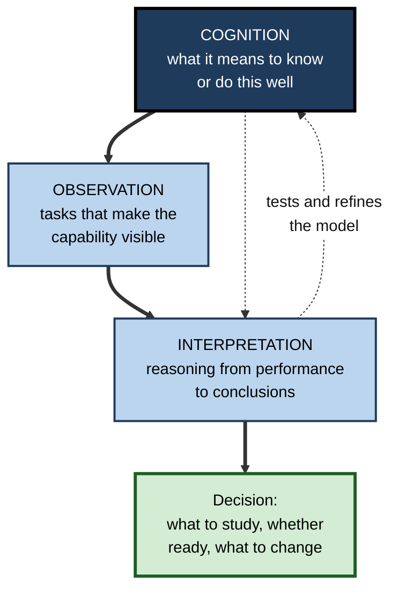
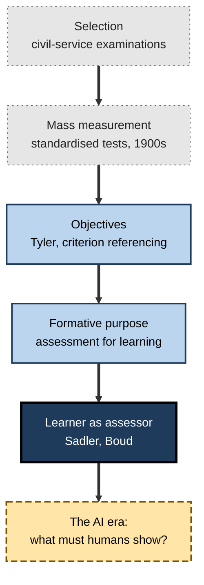
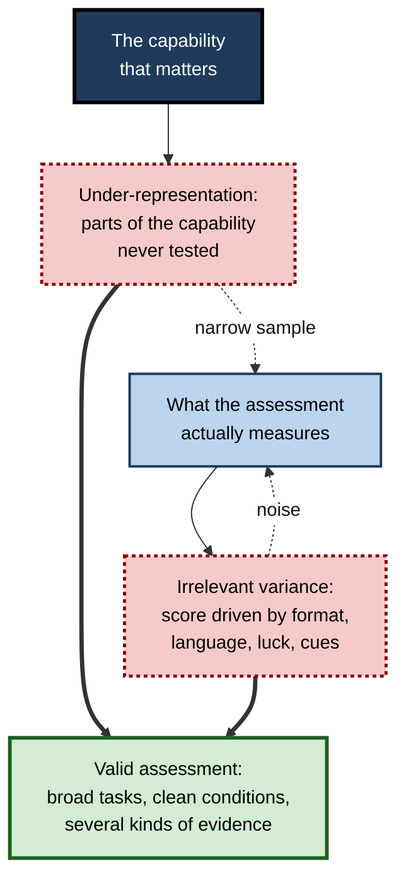
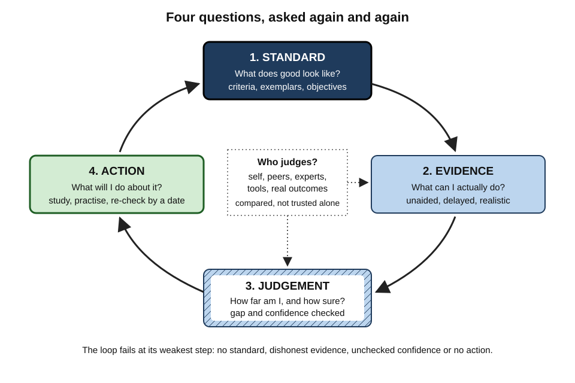
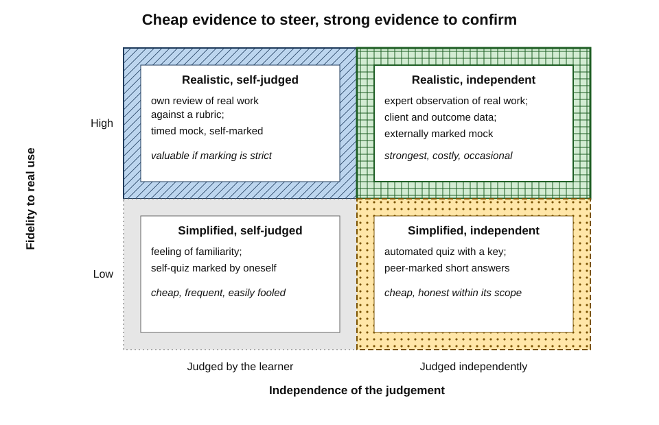
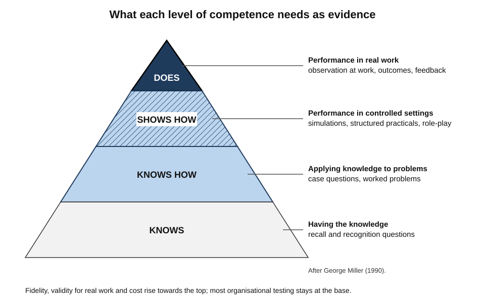
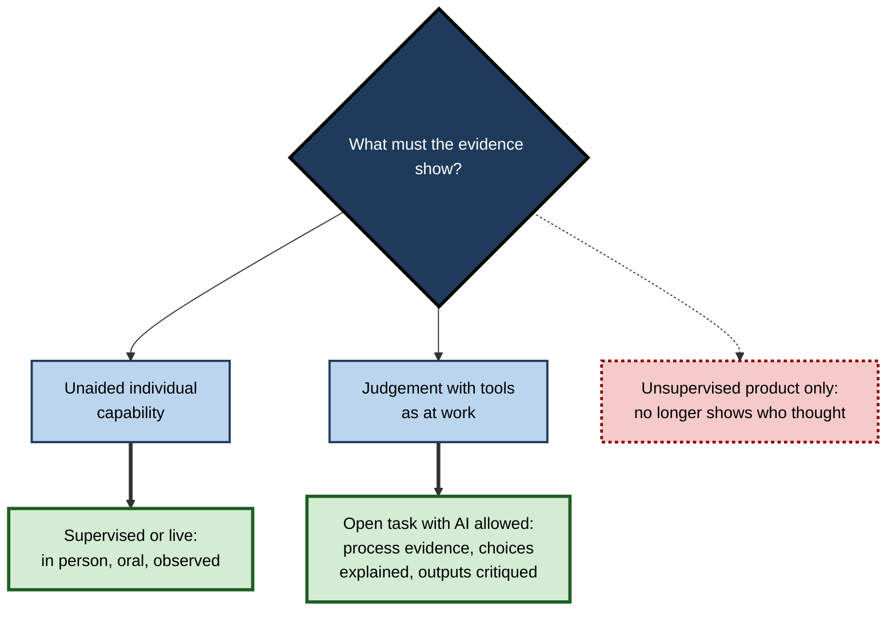

# L. Learning Assessment & Self-Testing

Every learner is constantly measuring — deciding, usually without noticing, that a topic is "done", that a skill is "good enough", that they are "ready". Most of these judgements are made on feelings of familiarity and effort, and many are wrong. The professionals who keep improving for decades are distinguished less by how much they study than by how well they **find out what they can actually do** — and by what they do with the answer.

> **Definition — Learning assessment:** the gathering and interpretation of evidence about what a person has learned, in order to judge progress against a standard and decide what to do next.

> **Definition — Self-testing:** attempting questions or tasks without help, in order to generate evidence of what one can and cannot yet do.

**Why it matters**

- **Study time follows judgement.** A learner who misjudges what they know studies the wrong things.
- **External assessment is scarce and late.** Teachers, examiners and managers see a small sample of a person's work, usually after it is finished.
- **High-stakes moments punish surprises.** Examinations, client meetings, clinical emergencies and production incidents reveal gaps at the worst possible time.
- **Assessment shapes learning.** What is measured is what gets practised — for individuals and for organisations.
- **The capability to judge one's own work** is itself one of the most valuable professional skills, and it grows more valuable as machines take over routine production.

---

## What Assessment Is

### Assessment as inference

- Learning cannot be observed directly. Assessment **infers** it from performance on a sample of tasks.
- The **National Research Council** report *Knowing What Students Know* (2001) described every assessment as a triangle of three linked elements:
  - **Cognition** — a model of what it means to know or be able to do something in the domain, and how that develops.
  - **Observation** — tasks designed to elicit evidence of that knowledge or skill.
  - **Interpretation** — a method for reasoning from the observations to conclusions about the learner.
- An assessment is only as good as the weakest corner: excellent tasks interpreted carelessly, or careful statistics applied to tasks that miss the point, both mislead.

**Figure 1.** The assessment triangle: every assessment links a model of competence, tasks and interpretation.

### Four words that are often confused

**Table 1.** Testing, measurement, assessment and evaluation compared.

| | Testing | Measurement | Assessment | Evaluation |
|---|---|---|---|---|
| What it is | A set of tasks under defined conditions | Assigning numbers to performance by rules | Gathering and interpreting evidence about learning | Judging the worth of a programme, policy or person's achievement |
| Typical output | Responses | A score | A judgement and next steps | A verdict about value |
| Example | A 40-item quiz | 31 of 40 correct | "Secure on recall, weak on application; practise cases" | "The onboarding programme reduced first-month errors; continue funding it" |

> **Key point:** a score is not an assessment. Assessment begins when the evidence is **interpreted against a standard** and **used** to decide something.

---

## Where Assessment Came From

### From selection to learning

- **Imperial China** ran written civil-service examinations for more than a thousand years, from around the early seventh century until 1905 — the longest-lived large-scale assessment system on record, designed for **selection**.
- **Victorian Britain:** the **Northcote–Trevelyan Report (1854)** recommended competitive examinations for entry to the civil service, replacing patronage with tested merit.
- **Early twentieth century:** **Alfred Binet** (1905) built tests to identify children needing extra help; during the First World War the United States Army tested well over a million recruits with the **Army Alpha** and **Beta** tests, launching mass standardised testing.
- **Ralph Tyler (1930s–1940s):** in the **Eight-Year Study**, argued that assessment should check whether stated **objectives** had been achieved — the root of objectives-based evaluation.
- **Robert Glaser (1963):** distinguished **criterion-referenced** measurement (against a standard) from **norm-referenced** measurement (against other people).
- **Michael Scriven (1967)** and **Benjamin Bloom** separated **formative** from **summative** purposes.
- **1989–2000:** **D. Royce Sadler** argued that learners must hold the standard themselves; **Paul Black and Dylan Wiliam (1998)** showed the power of formative assessment; **David Boud (2000)** called for **sustainable assessment** that prepares learners to judge their own work for life.
- **2000s onward:** item response theory and computerised adaptive testing spread; medical education developed **workplace-based** and **programmatic** assessment.
- **2020s:** generative AI can complete many unsupervised assessment tasks, forcing a rethink of what assessment should require.

**Figure 2.** Major shifts in the purpose of assessment.

> **Key point:** the history runs from assessment **of** people, for selection, towards assessment **by** people, for learning. Self-assessment is the end point of that shift, not a soft alternative to "real" assessment.

---

## The Qualities of Good Assessment

### Five qualities

- **Validity** — the evidence supports the interpretations and decisions made from it.
  - Modern theory treats validity as an **argument**: from the performance, to the score, to a generalisation across similar tasks, to an extrapolation to real-world capability, to a decision.
- **Reliability** — the result would be similar on another occasion, with other items or another marker.
- **Fairness** — the assessment does not disadvantage people for reasons unrelated to the capability: language, disability, culture, access to technology.
- **Practicality** — it can be done with the time, people and money available.
- **Impact** — its effects on learning and behaviour, intended or not, are acceptable.

> **Mnemonic — "Very Reliable Firms Prefer Impact":** Validity, Reliability, Fairness, Practicality, Impact.

### Two ways an assessment goes wrong

**Samuel Messick (1989)** identified two fundamental threats to validity:

- **Construct under-representation** — the assessment leaves out important parts of the capability.
  - *e.g.* a "communication" assessment that tests only written grammar.
- **Construct-irrelevant variance** — scores are affected by things that are not part of the capability.
  - *e.g.* a statistics test whose long, complex wording penalises non-native speakers more than poor statisticians.

**Figure 3.** Messick's two threats to the validity of an assessment.

- Both threats apply to self-assessment:
  - **under-representation** when self-tests cover only favourite topics or only recall;
  - **irrelevant variance** when results depend on recognising familiar items, on hints, or on generous self-marking.

### Goodhart's law

- The economist **Charles Goodhart** observed that statistical regularities tend to break down once they are used for control; the anthropologist **Marilyn Strathern (1997)** gave the popular form: "When a measure becomes a target, it ceases to be a good measure."
- **In learning:** a learner who targets a quiz score — by memorising the bank, choosing easy items or marking leniently — raises the score while the learning it was meant to indicate stays still.

> **Watch out:** any number a learner can raise **without** learning more is a dangerous number to steer by. Prefer measures that can only be improved by becoming more capable: unseen items, delayed checks, real tasks, independent judges.

---

## The Self-Assessment Loop

### Four questions

An assessing learner repeatedly asks four questions:

1. **What does good look like?** — the **standard**: an objective, a mark scheme, a rubric, exemplars, the expectations of a client or regulator.
2. **What can I actually do?** — the **evidence**: an unaided attempt, gathered after a delay, under realistic conditions.
3. **How far am I from the standard, and how sure am I?** — the **judgement**, including how well confidence matches accuracy.
4. **What will I do about it?** — the **action**: what to study, practise, change or ask for, and when to check again.

**Figure 4.** The self-assessment loop and its sources of evidence.

- Each step of the loop has its own tools.
  - Explicit criteria and exemplars make the **standard** usable by the learner, rather than locked in an examiner's head.
  - Well-designed self-tests and full-length practice under real conditions make the **evidence** honest.
  - Attaching confidence to answers, and checking it against results, makes the **judgement** trustworthy.
  - Classifying errors and recording gaps over time turn judgement into **targeted action**, and a plan with built-in checks makes the loop turn on schedule rather than by chance.

> **Key point:** the loop fails at its weakest step. Excellent evidence is wasted without a clear standard; a precise judgement is wasted without action.

### Who judges: self, peers, experts, tools, outcomes

- **Self** — always available, cheap, frequent; biased, especially for novices.
- **Peers** — plentiful, close in level; and reviewing others' work sharpens the reviewer's own judgement.
- **Experts** — most accurate on subtle quality; scarce and expensive.
- **Tools** — instant, consistent on what they can score; blind to what they cannot, and sometimes confidently wrong.
- **Outcomes** — what happened in real work: defects, client decisions, patient outcomes, audit findings; the most valid evidence, but slow, noisy and often too late.

> **In practice:** strong self-assessors **triangulate** — they make their own judgement first, then compare it with at least one independent source, and treat disagreements as the most informative data they have.

### Two dimensions of evidence

- Evidence varies on two dimensions that matter most:
  - **fidelity** — how closely the task resembles the real use of the capability;
  - **independence** — how far the judgement comes from someone or something other than the learner.
- High-fidelity, independent evidence is the strongest — and the most expensive. A sound assessment practice uses cheap, frequent evidence for steering and occasional strong evidence for checking.

**Figure 5.** Kinds of evidence arranged by fidelity to real use and independence of judgement.

---

## What the Evidence Says

### Assessment that teaches

- **Retrieval during testing strengthens memory** — the testing effect, one of the most robust findings in learning research. Self-testing is therefore never merely measurement; it changes what it measures.
- **Formative assessment** — using evidence during learning to adjust — produced substantial gains in the classroom studies reviewed by **Black and Wiliam (1998)**; later quantitative syntheses, such as **Kingston and Nash (2011)**, estimated smaller and highly variable effects.
- **Feedback** has large effects on average but wide variation:
  - **Avraham Kluger and Angelo DeNisi (1996)** found that in about a third of comparisons feedback **reduced** performance, especially when it focused attention on the self rather than the task;
  - **Benedikt Wisniewski, Klaus Zierer and John Hattie (2020)** estimated a medium average effect of feedback on learning, larger for feedback containing rich task and process information.
- **Self- and peer assessment interventions** improved academic performance with moderate effects in a large 2022 meta-analysis by **Zi Yan, Ernesto Panadero and colleagues**.

### Boundary conditions

- Benefits depend on:
  - **clear standards** — criteria and exemplars;
  - **low stakes** for formative activities — learners hide errors from assessments that count;
  - **action** — evidence that is not used changes nothing;
  - **training** — self- and peer judgement improve with practice and feedback on accuracy;
  - **delay** — immediate checks overstate retention.

> **Watch out:** headline effect sizes for "assessment for learning", "feedback" or "self-assessment" average across very different practices. The practices that work share specific features; labels alone guarantee nothing.

**Table 2.** Weak and strong assessment practice for a self-directed learner.

| | Weak practice | Strong practice |
|---|---|---|
| Standard | Vague sense of the syllabus | Explicit objectives, criteria and exemplars |
| Evidence | Feeling of familiarity; re-reading | Unaided attempts on unseen items after a delay |
| Coverage | Favourite topics; recall only | Whole domain, weighted; several levels of demand |
| Marking | Generous ("basically right") | Strict, against a key or rubric |
| Judgement | Confidence never checked | Confidence recorded and compared with results |
| Independence | Self only | Self compared with peers, experts or outcomes |
| Action | Score noted, nothing changes | Specific actions and a date for the next check |

### Assessment literacy

- **Richard Stiggins (1991)** used the term **assessment literacy** for the understanding needed to create, choose and interpret assessments soundly. For a self-directed professional it includes being able to:
  - say what a given test or review can and cannot show;
  - recognise when a score is inflated by familiarity, hints or lenient marking;
  - read results as **ranges**, not exact points, especially from short tests;
  - distinguish evidence of **exposure**, **performance** and **durable capability**;
  - choose evidence that fits the decision at hand — cheap for steering, strong for confirming.
- The same literacy protects against bad assessment imposed by others: a certification that tests trivia, a dashboard that rewards clicking, a performance rating that measures visibility rather than contribution.

> **Key point:** an assessment-literate learner treats every result as a **claim with evidence behind it** — and asks how good the evidence is before acting on the claim.

### The ethics of assessing oneself and others

- **Honesty** — the value of self-assessment depends on reporting real results to oneself; inflating them only moves the discovery of gaps to a worse moment.
- **Fairness to others** — peer and workplace assessment must not penalise people for language, disability, background or popularity.
- **Proportionate surveillance** — collecting detailed data about how people learn carries obligations of consent, security and limited use.
- **Consequences** — high-stakes decisions should rest on more than one piece of evidence and allow for challenge.

---

## Assessment in Workplace Learning

### Miller's pyramid

- **George Miller (1990)** proposed four levels at which clinical competence can be assessed:
  - **Knows** — has the knowledge (tested by knowledge questions).
  - **Knows how** — can apply it to problems (case-based questions).
  - **Shows how** — can perform it in a controlled setting (simulations, structured practical examinations).
  - **Does** — performs it in real practice (observation at work, outcomes).
- The pyramid applies well beyond medicine: most organisational assessment stops at "knows"; most of what matters happens at "does".

**Figure 6.** Miller's pyramid of competence and the evidence each level needs.

### Workplace-based assessment

- **Medical education** has developed structured ways to assess the top of the pyramid:
  - the **mini-clinical evaluation exercise (mini-CEX)**, developed by **John Norcini** and colleagues in the 1990s: brief, repeated observations of real patient encounters, rated on a structured form with immediate feedback;
  - **direct observation of procedural skills**;
  - **multi-source feedback** from colleagues and patients;
  - **entrustable professional activities**, proposed by **Olle ten Cate (2005)**: units of real work (such as "manage a patient admission") that a trainee is trusted to perform with decreasing supervision as evidence accumulates.
- **Other fields** use equivalents: code review and incident reviews in software, review notes in audit, supervised matters in law, observed calls in sales.

> **Definition — Entrustable professional activity:** a unit of professional work that a supervisor can entrust a learner to carry out unsupervised once sufficient competence has been demonstrated.

> **In practice:** the question "**What would I trust this person to do unsupervised, and what evidence supports that?**" is a powerful assessment question in any profession.

### Development and evaluation

- Workplace assessment serves two masters: **development** (formative) and **evaluation** for pay, promotion or continued employment (summative).
- When the two are combined, evaluation dominates: people present strengths and conceal weaknesses.
- Many organisations therefore separate frequent **development conversations** from periodic **performance evaluation** — and the best professionals run their own formative assessment regardless of what the organisation provides.

### Worked example: assessing one capability at every level

A firm wants new consultants to "build financial models that support client decisions".

**Table 3.** Evidence for one capability at each level of Miller's pyramid.

| Level | Question | Evidence | Who judges | When |
|---|---|---|---|---|
| Knows | Does the consultant know the principles? | Short quiz on discounting, scenario logic and model structure | Automated, with explanations | Week 1 and week 3 |
| Knows how | Can they apply them to a case? | Written case: design the model structure for a given client question | Peer review against a rubric | Week 2 |
| Shows how | Can they build one in controlled conditions? | Timed build of a small model from a data pack, unaided | Senior consultant with a single-point rubric | Week 4 |
| Does | Do they build sound models on live work? | Review notes on the first two client models; client's use of the model in a decision | Engagement manager; outcome | Months 2–4 |

- **Steps in reading it:**
  1. Lower levels are cheap and frequent — they **steer** learning.
  2. Higher levels are expensive and occasional — they **confirm** capability.
  3. Each level uses evidence of **increasing fidelity and independence**.
  4. The consultant runs her own self-tests and rubric checks **before** each external check, so external judgements serve as calibration rather than surprise.
- **Conclusion:** no single test establishes the capability; a **chain of evidence** up the pyramid does.

---

## Assessment When Machines Can Answer

### The challenge

- Generative AI can now produce competent answers to many questions, essays, code exercises and case analyses.
- **Consequences:**
  - unsupervised written tasks no longer show reliably **who** did the thinking;
  - fluent AI feedback can replace the learner's own judgement rather than develop it;
  - assessment that only checks products is increasingly easy to pass without capability.

### Responses

- **Assess process, not only product** — drafts, decisions, version histories, explanations of choices.
- **Use conversation** — oral follow-up, vivas, live problem-solving, "explain why".
- **Secure where it matters** — supervised assessment for certifying unaided capability; open, AI-permitted assessment elsewhere, with tasks redesigned for judgement.
- **Develop evaluative judgement** — the ability to recognise quality, including in AI output — as an explicit goal. Australian guidance on *Assessment reform for the age of artificial intelligence* (2023), prepared by a group of assessment researchers for the national higher-education regulator, emphasised assessing **process** and **trustworthy judgements of individual capability** through multiple, inclusive forms of evidence.

**Figure 7.** Designing assessment when AI can produce the answer.

> **Key point:** for a self-directed learner, the rule is simple — **judge first, then consult the tool**. A learner who lets the machine judge every answer will become skilled at prompting and unskilled at knowing.

---

## Case Study: Rebuilding Graduate Assessment in a Professional-Services Firm

- **Situation:** a firm recruited 200 graduates a year into audit and advisory. Its assessment consisted of end-of-course multiple-choice tests, professional examination results and an annual appraisal.
- **Problem:**
  - course test pass rates were above 95%, yet managers reported that first-year staff needed heavy review on basic tasks;
  - professional examination first-attempt pass rates were below the national average;
  - appraisals were dominated by ratings and pay, with little developmental content.
- **Diagnosis:**
  1. **Under-representation:** course tests measured recall; the job required application and judgement.
  2. **Irrelevant variance:** tests were open-book and repeatable; scores reflected persistence.
  3. **No loop:** graduates received scores but no standard to hold themselves, no analysis of errors and no planned re-checks.
  4. **Purposes mixed:** developmental feedback was buried in a pay-linked appraisal.
- **Actions:**
  1. Defined the first-year capabilities at each level of Miller's pyramid, with **exemplars** of good working papers and client notes.
  2. Replaced repeatable course tests with **unseen, delayed** scenario checks, low-stakes and reported only to the graduate and a coach.
  3. Introduced **two full mock examinations** before each professional sitting, with item-level reports and a planned response for weak areas.
  4. Trained graduates to **self-review** working papers against criteria before submitting them, and to **review one another's** papers in pairs.
  5. Asked graduates to record **confidence** on technical questions and to keep a log of **review comments by category**.
  6. Separated quarterly **development conversations** from the annual pay review.
- **Result (two years):**
  - first-attempt professional examination pass rates rose above the national average;
  - review comments per working paper fell markedly in the second half of the first year;
  - graduates' self-review scores converged with managers' scores over the year, a sign of developing judgement.
- **Side effects:** coaching and mock marking required significant senior time; the firm offset it partly through peer review and partly by accepting a higher cost per graduate.
- **Lesson:** the firm did not need **more** assessment but **better-designed** assessment — valid tasks, honest conditions, a standard held by the learner, and a loop from evidence to action.

---

## Open Questions

- **Can people become accurate judges of their own learning, or only less inaccurate?**
  - Training, feedback and criteria improve self-assessment, but the limits of improvement — and how far it transfers across fields — are not well established.
- **How should assessment change when AI can do much of the work?**
  - Redesign towards process, conversation and evaluative judgement is under way; which forms preserve validity at scale is still unknown.
- **How can high-fidelity evidence be made affordable?**
  - Workplace observation, simulations and expert review are valid but costly; organisations default to cheaper, weaker measures.
- **Can one assessment system serve both learning and certification?**
  - Programmatic approaches argue yes, through many low-stakes data points aggregated for high-stakes decisions; strong comparative evidence remains limited.
- **What is the right balance between measuring and learning?**
  - Testing improves memory, but too much measurement can crowd out other study and encourage gaming; optimal proportions are unknown.
- **How should assessment data about individuals be governed?**
  - Analytics, AI scoring and proctoring create detailed records of learners; questions of privacy, consent and fair use are unresolved.

---

## Summary

- **Learning assessment** gathers and interprets evidence about learning to judge progress and decide what to do next; **self-testing** generates that evidence through unaided attempts.
- Every assessment links **cognition, observation and interpretation** (the **assessment triangle**); a score becomes an assessment only when interpreted against a standard and used.
- Assessment moved historically from **selection** to **learning** and finally to the **learner as assessor** (Sadler, Boud).
- Good assessment is **valid, reliable, fair, practical** and has acceptable **impact**; validity is threatened by **construct under-representation** and **construct-irrelevant variance**; **Goodhart's law** warns against steering by numbers that can be raised without learning.
- The **self-assessment loop** asks: what does good look like; what can I actually do; how far am I and how sure; what will I do about it. Judges include **self, peers, experts, tools and outcomes**; evidence varies in **fidelity** and **independence**.
- Research supports testing, formative assessment, feedback and self- and peer assessment — with large variation and clear **boundary conditions**: clear standards, low stakes, action, training and delay.
- At work, **Miller's pyramid** (knows → knows how → shows how → does) shows that most important capability must be assessed at the top, through workplace-based methods and **entrustable professional activities**; separate development from evaluation.
- With AI, assess **process and judgement**, secure what must be unaided, and **judge first, then consult the tool**.

---

## Self-Check

1. Define learning assessment and self-testing, and explain why a score is not yet an assessment.
2. Describe the three corners of the assessment triangle, with an example of a weakness at each.
3. Distinguish testing, measurement, assessment and evaluation.
4. Outline the historical shift in the purpose of assessment from selection to self-assessment.
5. Name the five qualities of good assessment.
6. Explain construct under-representation and construct-irrelevant variance, with a self-assessment example of each.
7. State Goodhart's law and show how it applies to a learner using a question bank.
8. What four questions make up the self-assessment loop?
9. Compare self, peers, experts, tools and outcomes as judges of learning.
10. What are fidelity and independence of evidence, and how should a learner balance cheap and strong evidence?
11. Summarise what research shows about feedback, including the Kluger and DeNisi finding.
12. Describe Miller's pyramid and explain why most organisational assessment stops too low.
13. What is an entrustable professional activity? Give an example from a field other than medicine.
14. A company wants to certify that its project managers can "manage stakeholder conflict". Design a chain of evidence up Miller's pyramid.
15. How should assessment change when generative AI can produce competent answers?

### Answer Key

1. Learning assessment: gathering and interpreting evidence about learning to judge progress against a standard and decide next steps. Self-testing: unaided attempts that generate such evidence. A score becomes an assessment only when interpreted against a standard and used to decide something.
2. Cognition — a model of competence (weakness: an outdated or vague idea of what good performance is). Observation — tasks eliciting evidence (weakness: recall items for an application goal). Interpretation — reasoning from evidence (weakness: treating a single small quiz score as proof of mastery).
3. Testing: tasks under set conditions. Measurement: assigning numbers by rules. Assessment: interpreting evidence about learning to inform next steps. Evaluation: judging the worth of a programme, policy or achievement.
4. From imperial and civil-service examinations for selection, through mass standardised measurement, to Tyler's objectives and criterion referencing, to formative assessment for learning, and finally to learners holding the standard and judging their own work (Sadler, Boud) — now challenged by AI.
5. Validity, reliability, fairness, practicality, impact.
6. Under-representation: parts of the capability untested — a self-quiz covering only favourite topics or only recall. Irrelevant variance: scores driven by non-target factors — recognising familiar bank items, hints, or lenient self-marking.
7. "When a measure becomes a target, it ceases to be a good measure." A learner targeting a bank score memorises items, so the score rises while capability on unseen problems does not.
8. What does good look like (standard)? What can I actually do (evidence)? How far am I and how sure (judgement)? What will I do about it (action)?
9. Self: available, cheap, biased. Peers: plentiful, close in level, and reviewing improves their own judgement. Experts: most accurate on subtle quality, scarce. Tools: instant and consistent within their scope, blind outside it, sometimes wrong. Outcomes: most valid, but slow, noisy and often late.
10. Fidelity: closeness of the task to real use. Independence: how far the judge is someone other than the learner. Use cheap, frequent, lower-fidelity evidence to steer and occasional high-fidelity, independent evidence to confirm.
11. Feedback has a medium average effect, larger when it carries rich task and process information (Wisniewski, Zierer and Hattie, 2020), but varies widely; Kluger and DeNisi found about a third of feedback interventions reduced performance, especially when feedback drew attention to the self.
12. Knows, knows how, shows how, does. Organisations mostly test knowledge because it is cheap and easy to score, whereas what matters is performance in real work, which requires observation and outcome evidence.
13. A unit of work a learner can be trusted to perform unsupervised once competence is shown. E.g. in software, "deploy a change to production and handle a rollback"; in audit, "plan and execute the cash audit for a small client".
14. Knows: scenario quiz on conflict sources and approaches. Knows how: written case analysis reviewed against a rubric. Shows how: recorded role-play with trained actors scored by an assessor. Does: stakeholder feedback after real project disputes, sponsor's observation, escalation and resolution records over several months.
15. Assess process as well as product; use oral and live formats; secure assessments where unaided capability must be certified; allow AI in open tasks redesigned for judgement and critique; make evaluative judgement an explicit goal; learners should judge first and consult tools second.

---

## Glossary

| Term | Meaning |
|---|---|
| Assessment triangle | Model linking cognition, observation and interpretation in any assessment. |
| Assessment literacy | The understanding needed to create, choose and interpret assessments soundly. |
| Construct-irrelevant variance | Score differences caused by factors other than the target capability. |
| Construct under-representation | Failure of an assessment to cover important parts of the capability. |
| Criterion-referenced | Interpreted against a fixed standard rather than against other people. |
| Entrustable professional activity | A unit of work a learner can be trusted to perform unsupervised once competence is shown. |
| Evaluation | Judging the worth of a programme, policy or achievement. |
| Evaluative judgement | The capability to recognise the quality of one's own and others' work. |
| Fidelity | How closely an assessment task resembles the real use of a capability. |
| Formative assessment | Assessment whose results inform next steps during learning. |
| Goodhart's law | When a measure becomes a target, it ceases to be a good measure. |
| Independence (of evidence) | The extent to which a judgement comes from someone or something other than the learner. |
| Learning assessment | Gathering and interpreting evidence about learning to judge progress and decide next steps. |
| Measurement | Assigning numbers to performance according to rules. |
| Miller's pyramid | Levels of competence assessment: knows, knows how, shows how, does. |
| Mini-CEX | Brief, repeated, structured observation of real clinical encounters with feedback. |
| Reliability | Consistency of results across occasions, items and markers. |
| Self-testing | Unaided attempts at questions or tasks that generate evidence of capability. |
| Summative assessment | Assessment whose results judge or certify achievement. |
| Sustainable assessment | Assessment that builds learners' capacity to judge their own work in future. |
| Triangulation | Comparing one's own judgement with independent evidence. |
| Validity | The degree to which evidence supports the interpretations and uses of results. |
| Workplace-based assessment | Assessment of performance in real work settings. |
