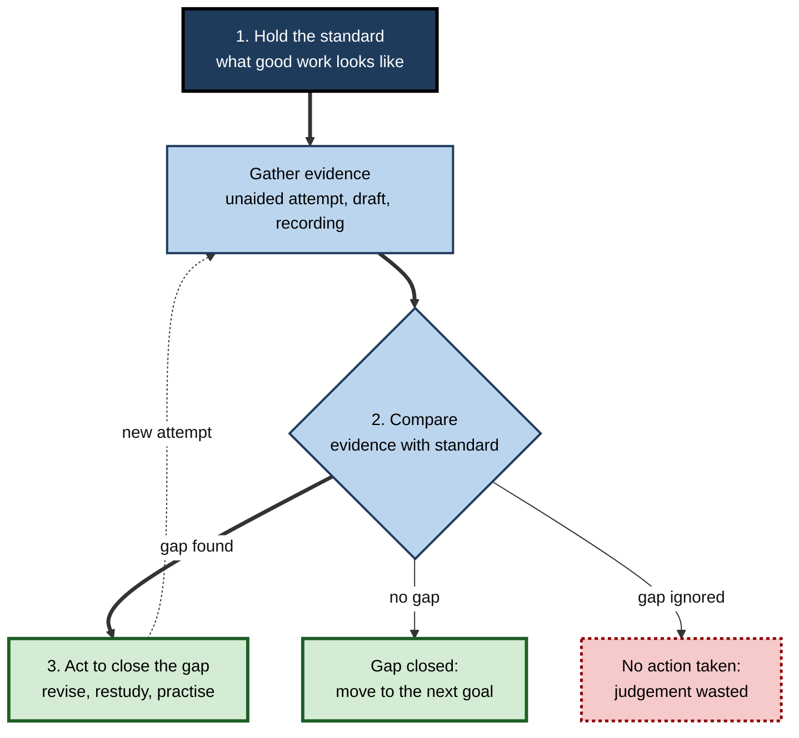
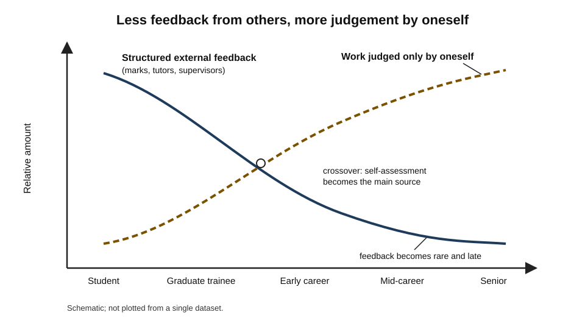
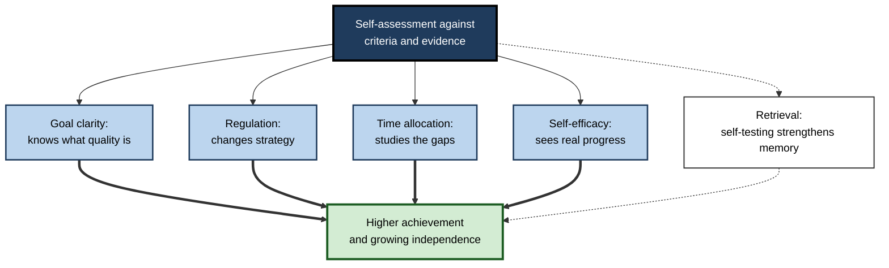
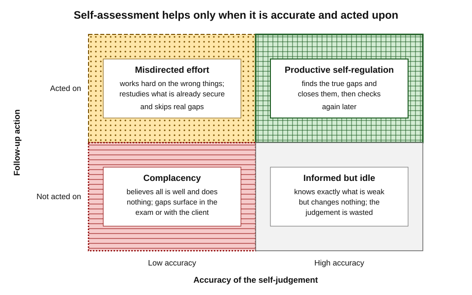
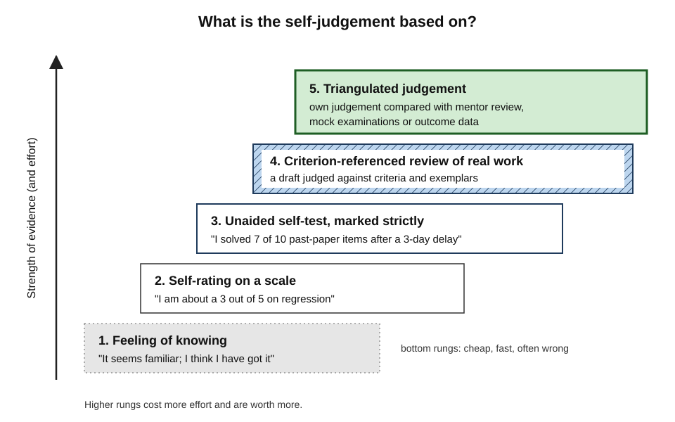
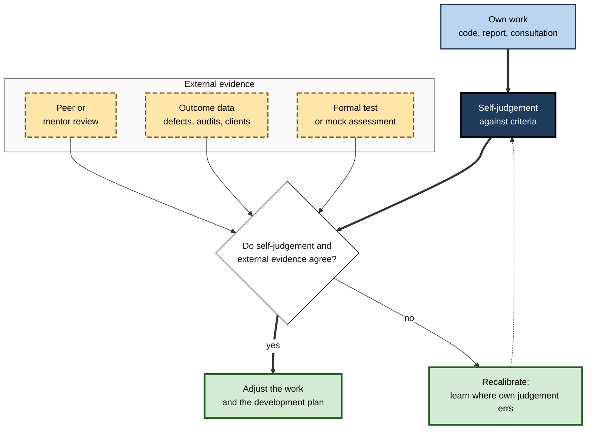

# L.1. Why Self-Assessment Matters

A trainee accountant sits a mock paper three weeks before a professional examination and discovers that the topic she felt safest about is the one she cannot do. A surgeon reviews the video of an operation and notices a hesitation nobody else in the theatre saw. A developer re-reads her own pull request before asking for review and finds two bugs that would have embarrassed her.

In each case the most useful judgement of the work came from the person who did it — but only because she had a standard, looked for evidence and was willing to act on what she found.

> **Definition — Self-assessment:** the process by which a learner judges the quality of their own work, or the state of their own knowledge and skill, against explicit or implicit standards, in order to decide what to do next.

**Why it matters**

- External judges are **scarce**: teachers, examiners, managers and clients see only a small fraction of what a person does.
- External feedback is **late**: by the time a grade or appraisal arrives, the chance to change course has often passed.
- Working life has **no syllabus and no examiner** for most of what must be learned; the professional must decide alone whether they are ready.
- Learners who can judge their own work **learn faster and more independently** — and the evidence that self-assessment improves achievement is now substantial.
- Poor self-assessment is costly: wasted study on what is already known, neglect of what is not, and confident errors in front of clients and patients.

---

## What Self-Assessment Is and Is Not

The phrase covers several activities that are easily confused. They differ in what is judged, what evidence is used and what happens next.

### Five neighbouring activities

- **Self-rating** — a global judgement of ability on a scale.
  - *e.g.* "On a scale of 1 to 5, how good is my Excel?"
  - Quick, but only weakly related to measured skill.
- **Self-testing** — answering questions or attempting tasks without help to see what can actually be done.
  - *e.g.* attempting ten past-paper questions under time limits.
  - Produces evidence, and is itself a powerful learning event.
- **Self-marking** — scoring one's own answers against a key or mark scheme.
  - *e.g.* comparing a worked solution with the official answer.
- **Self-grading** — awarding oneself a grade that counts towards an official result.
  - *e.g.* a module where student self-marks contribute to the final mark.
  - Creates an incentive to be lenient.
- **Self-assessment for improvement** — judging work against criteria in order to revise it or to redirect study.
  - *e.g.* checking a draft report against the criteria for a strong recommendation, then rewriting the weak sections.

> **Key point:** self-assessment is not a feeling about oneself. Its value comes from **evidence compared with a standard and followed by action**.

### Two components

- **David Boud (1995)** described self-assessment as two linked acts:
  1. **identifying the standards and criteria** that apply to a piece of work;
  2. **making judgements** about how far the work meets them.
- Most weak self-assessment fails at the first step: the learner does not know what good looks like.
- **Heidi Andrade and Ying Du (2007)** added the purpose: self-assessment is *formative* — it exists to improve the work, not to award a grade.

> **Definition — Evaluative judgement (Joanna Tai and colleagues, 2018):** the capability to make decisions about the quality of one's own work and that of others — knowing what quality is and recognising it in a specific case.

**Table 1.** Self-assessment activities compared.

| | Self-rating | Self-testing | Self-marking | Self-grading | Self-assessment for improvement |
|---|---|---|---|---|---|
| What is judged | General ability | Current capability on a task | Correctness of answers | Overall achievement | Quality of specific work |
| Evidence used | Impression | Unaided performance | A key or scheme | Work plus scheme | Work, criteria, exemplars |
| Main purpose | Description | Diagnosis | Checking | Certification | Revision and planning |
| Main risk | Bias, flattery | Easy questions chosen | Generous reading of own answers | Leniency for marks | Vague criteria |

> **Watch out:** "self-assessment" in appraisal forms usually means **self-rating** — the weakest form. Asking employees to rate their own competence on a five-point scale yields data that mainly reflects confidence and modesty, not capability.

---

## The Logic of Closing a Gap

### Sadler's three conditions

**D. Royce Sadler (1989)** argued that improvement requires the learner to:

1. **possess a concept of the standard** being aimed for — know what good work looks like;
2. **compare** the actual level of their performance with that standard;
3. **take action** that closes the gap.

- If the teacher holds the standard and does the comparing, the learner can improve only when the teacher is present.
- Sadler's conclusion: the long-term aim of assessment is to transfer the standard and the comparison **to the learner**.

> **Definition — Feedback (Arkalgush Ramaprasad, 1983):** information about the gap between the actual and the reference level of a system parameter, which is **used** to alter the gap. Information that is not used to change anything is not, by this definition, feedback.

**Figure 1.** The gap-closing loop at the heart of self-assessment.

### Three questions

- **John Hattie and Helen Timperley (2007)** framed useful feedback as answering three questions:
  - **Where am I going?** — the goal (*feed up*);
  - **How am I going?** — progress against the goal (*feed back*);
  - **Where to next?** — the action that follows (*feed forward*).
- Self-assessment is the learner asking those questions of themselves, without waiting for someone else.

> **Mnemonic — "Standard, Compare, Act" (SCA — "Self-Checks Always"):** know the standard, compare the evidence, act on the gap.

### Self-assessment and self-regulation

- Models of **self-regulated learning** place self-assessment in the middle of a cycle of planning, performing and reflecting.
- Without it the cycle cannot turn: a learner who does not judge outcomes cannot choose better strategies.
- The judgement may be small and frequent — "Can I state the rule without looking?" — or large and occasional — "Am I ready to sit the examination?"

> **Key point:** self-assessment is the **steering mechanism** of independent learning. Effort without steering produces motion, not progress.

---

## Why External Assessment Is Not Enough

### The scarcity problem

- A university student may receive detailed feedback on a few assignments a term, yet produce hundreds of pieces of thinking.
- A professional may receive a formal appraisal once a year and almost no structured feedback in between.
- Feedback from others is valuable precisely because it is **rare**; the space between feedback events must be filled by the learner's own judgement.

### The timing problem

- External verdicts arrive **after** the work is finished: the examination result, the client complaint, the failed audit.
- Self-assessment can occur **during** the work, when change is still cheap.
- **Donald Schön (1983)** distinguished:
  - **reflection-in-action** — thinking about what one is doing while doing it;
  - **reflection-on-action** — reviewing it afterwards.
- Expert practitioners do much of their self-assessment in action, adjusting as they go.

### The dependence problem

- Learners who are always told how well they have done may never develop the ability to tell for themselves.
- **David Boud (2000)** proposed **sustainable assessment**: assessment that meets immediate needs while also preparing learners to meet their own future learning needs.
  - Its test is not "Was the grade accurate?" but "Will this person be able to judge their own work after they leave?"

> **Definition — Sustainable assessment:** assessment practice that builds the learner's capacity to judge their own work in situations where no teacher or examiner is present.

**Figure 2.** As a career progresses, external feedback becomes rarer while the need for self-judgement grows.

### The professional obligation

- Most professions require members to keep their competence current through **continuing professional development (CPD)**.
- CPD schemes in medicine, nursing, law, accountancy and engineering typically ask the professional to:
  - identify their own development needs;
  - plan activities to meet them;
  - reflect on what changed in their practice.
- Each step assumes accurate self-assessment.
- **Kevin Eva and Glenn Regehr (2005)** argued that because unaided self-assessment is unreliable, professionals should practise **self-directed assessment seeking** — actively looking for external data on their performance rather than relying on introspection.

**Table 2.** External assessment and self-assessment compared.

| | External assessment | Self-assessment |
|---|---|---|
| Who holds the standard | Teacher, examiner, manager | The learner (ideally, the same standard) |
| Frequency | Occasional | Potentially continuous |
| Timing | Usually after the work | Before, during and after |
| Cost | Expensive in expert time | Cheap |
| Accuracy | Generally higher, if well designed | Variable; improves with criteria, evidence and training |
| What it builds | A verdict | A verdict **and** the learner's evaluative judgement |

> **Key point:** self-assessment does not replace external assessment; it **fills the gaps between** external judgements and learns from them.

---

## The Evidence That Self-Assessment Improves Learning

### Achievement gains

**Study card — Zi Yan, Huan Lao, Ernesto Panadero and colleagues (2022)**

- **Design:** meta-analysis of experimental, quasi-experimental and repeated-measures studies of self-assessment and peer-assessment interventions.
  - 175 independent studies; over 19,000 participants.
- **Results:**
  - self-assessment interventions improved academic performance with a **moderate-to-large** average effect (*g* ≈ 0.59);
  - combining self- and peer assessment did not add to the effect of either alone;
  - repeated-measures designs produced larger effects than controlled experiments.
- **Conclusion:** structured self-assessment reliably helps achievement, though the size of the benefit depends on study design.

> **Watch out:** repeated-measures studies (before and after, no control group) inflate effects because learners improve over time anyway. The **controlled** estimates are smaller — still positive, but more modest than headline figures suggest.

**Study card — Paul Black and Dylan Wiliam (1998)**

- **Design:** narrative review of about 250 studies of classroom **formative assessment** — assessment used during learning to adjust teaching and study.
- **Results:** formative practices produced substantial achievement gains; low attainers often benefited most.
- **Conclusion relevant here:** Black and Wiliam judged self-assessment by pupils to be **essential**, not optional, because pupils can act on a gap only if they can see it.

### Why it works: five mechanisms

- **Goal clarity.**
  - Using criteria forces the learner to learn what quality is.
  - *e.g.* a junior analyst who self-assesses against "clear question, defensible method, decision-relevant answer" begins to plan analyses around those features.
- **Regulation.**
  - A detected gap triggers a change of strategy: more practice, a different method, a request for help.
- **Allocation of study time.**
  - Accurate judgements direct effort to what is not yet known instead of what is already comfortable.
- **Self-efficacy.**
  - Seeing evidence of progress strengthens belief in one's ability to succeed — the strongest source of self-efficacy, in Albert Bandura's account, is **mastery experience**.
- **Retrieval.**
  - When self-assessment takes the form of self-testing, the act of recalling also strengthens memory; that benefit is real but separate from the diagnostic value considered here.

**Figure 3.** How self-assessment produces learning gains.

### What the reviews agree on

**Gavin Brown and Lois Harris (2013)** reviewed self-assessment research in schools and universities and concluded:

- Self-assessment improves learning mainly when it is **about learning**, not about awarding marks.
- Accuracy **improves with training**, practice and feedback on one's judgements.
- Accuracy is generally **higher** for concrete tasks and **lower** for broad abilities.
- **Social pressures** distort it: learners may underrate to appear modest or overrate to protect their standing.
- The **act** of self-assessing seems to matter more than the precision of each judgement — a rough but honest comparison followed by revision helps more than a precise score that changes nothing.

> **Remember:** self-assessment pays off when it is **specific, criterion-based, low-stakes and acted upon**.

---

## Why Self-Assessment Goes Wrong

### Inaccuracy

- Self-judgements are systematically biased — typically optimistic, and most optimistic among those who know least, because the knowledge needed to perform a task is also the knowledge needed to judge it.
- **Paul Mabe and Stephen West (1982)**, in a meta-analysis of self-evaluations of ability, found only a **modest** average correlation between self-ratings and measured performance — around 0.3.
- **David Davis and colleagues (2006)** reviewed studies comparing physicians' self-assessments with external measures:
  - in most comparisons the relationship was weak or absent;
  - the **least skilled** and the **most confident** tended to be the least accurate.

**Study card — David Boud and Nancy Falchikov (1989)**

- **Design:** review of studies in higher education that compared students' self-marks with teachers' marks.
- **Results:**
  - agreement varied widely between studies;
  - **weaker** students tended to **overrate** their work; **stronger** students tended to **underrate** it;
  - agreement tended to be higher in **advanced** courses than in introductory ones.
- **Conclusion:** self-assessment accuracy is a learnable skill that develops with expertise in a field — not a fixed trait.

### Five common failure modes

- **The wrong standard.**
  - Judging against what classmates or colleagues do rather than against the required level.
  - *e.g.* a new associate whose memos are better than her peers' but still not client-ready.
- **The wrong evidence.**
  - Using feelings of familiarity, effort spent or hours logged instead of an unaided attempt.
  - *e.g.* "I spent all weekend on it, so I know it."
- **The wrong grain size.**
  - Global judgements ("I'm good at statistics") are far less accurate than specific ones ("I can choose the correct test for two independent samples").
- **The wrong timing.**
  - Judging immediately after studying, when information is still fresh, overstates what will be available later.
- **No action.**
  - Self-assessment that ends in a score or a reflection paragraph, with no change in study or practice.

> **Watch out:** the popular claim that "the incompetent are always the most confident" overstates a real but contested pattern. Part of the classic effect is a statistical artefact; what survives is that low performers' self-estimates are **less accurate**, not that they believe themselves to be the best.

**Figure 4.** Accuracy and action combine to determine whether self-assessment helps.

### Conditions that help and hinder

**Table 3.** When self-assessment tends to be accurate and when it does not.

| Condition | Tends to make it accurate | Tends to make it inaccurate |
|---|---|---|
| Criteria | Explicit, with exemplars | Absent or vague |
| Evidence | An unaided attempt at a realistic task | A feeling or a memory of effort |
| Grain size | Specific skill or item | Broad ability |
| Timing | After a delay | Immediately after study |
| Stakes | Low; judgement used for learning | High; judgement counts towards a grade or bonus |
| Experience | Several rounds with feedback on accuracy | First attempt, no comparison with others' judgements |
| Domain knowledge | Advanced | Novice |

---

## Designing Self-Assessment That Works

### Seven principles

1. **Start from the standard.** Collect criteria, mark schemes, competency descriptors or exemplars before judging anything.
2. **Generate evidence.** Attempt the task unaided — a question set, a draft, a recorded role-play, a working program.
3. **Judge specific things.** Break the subject or the work into concrete elements; judge each separately.
4. **Delay the judgement.** Test after hours or days, not minutes, so that the result reflects what will last.
5. **Keep it low-stakes.** Separate self-assessment from rewards so that honesty costs nothing.
6. **Triangulate.** Periodically compare self-judgements with an external benchmark — a mock examination, a mentor's review, a client's response.
7. **Act and record.** End every self-assessment with a decision: what to restudy, practise or change, and when to check again.

> **Mnemonic — "Some Good Students Don't Let Tests Assess":** Standard, Generate, Specific, Delay, Low-stakes, Triangulate, Act.

### A ladder of evidence

- Self-assessment can rest on evidence of very different strength.
- The higher on the ladder, the more the judgement is worth — and the more effort it costs.

**Figure 5.** The strength of evidence behind different kinds of self-assessment.

### Worked example (illustrative): a data analyst decides whether she is ready

A data analyst plans to sit a cloud data-engineering certification in six weeks.

**Table 4.** The same readiness question answered two ways.

| | Feeling-based self-assessment | Evidence-based self-assessment |
|---|---|---|
| Question asked | "Do I feel ready?" | "Which exam objectives can I meet unaided today?" |
| Standard | Vague sense of the syllabus | The published objective list, broken into 24 specific skills |
| Evidence | Recollection of course videos watched | Two timed, unaided questions per objective, attempted three days after the last video |
| Judgement | "Mostly fine; storage is a bit weak" | 15 objectives secure, 5 shaky, 4 failed — including two in security she felt confident about |
| Action | General revision of storage | Targeted practice on the 9 weak objectives; re-test in one week |
| Check | None until the exam | Full mock exam in week four, compared with her predicted score |

*Illustrative figures.*

- **Step 1:** she lists the 24 objectives and rates her confidence in each *before* testing.
- **Step 2:** she attempts the questions unaided and marks them strictly against the official answers.
- **Step 3:** she compares the two: her confidence was **wrong on 6 objectives**, including two over-confident security items.
- **Step 4:** she plans practice for the weak items and books a re-test.
- **Conclusion:** the evidence-based version took about three hours but redirected roughly a third of her remaining study time.

> **Watch out:** marking one's own answers generously ("that's basically what I meant") turns evidence back into feeling. Mark strictly, as an examiner would.

---

## Self-Assessment in Professional Life

### Where professionals judge their own work

- **Software engineering** — reviewing one's own code diff before requesting review; running tests and static analysis; checking the change against the ticket's acceptance criteria.
- **Medicine and nursing** — reviewing case outcomes, audit data and recorded consultations; reflective entries for revalidation.
- **Law** — re-reading a draft contract against the client's instructions and a precedent; post-matter reviews.
- **Consulting** — testing a slide deck against "Does each page answer one question? Is the so-what clear?"
- **Sales** — listening back to recorded calls and scoring them against a discovery framework.
- **Aviation** — individual and crew debriefs after simulator sessions and flights.

> **In practice:** the strongest professionals do not trust their impression of their own work. They build **instruments** — test suites, call-scoring guides, audit reports, peer review — that give them evidence before others do.

### Self-assessment in organisations

- **Competency self-ratings** in appraisal systems are common but weak; they mostly measure confidence and culture.
- **Skills inventories** built from self-report overstate capability in fashionable areas and understate it in unfashionable ones.
- **Better organisational practice:**
  - pair self-ratings with work samples or short practical tests;
  - ask employees to cite **evidence** for each self-judgement;
  - treat large gaps between self- and manager ratings as a coaching topic, not a disciplinary one.
- **Psychological safety** matters: in teams where admitting weakness is punished, self-assessment becomes self-promotion.

**Figure 6.** Self-assessment in professional practice, checked against external evidence.

### Self-assessment when AI can judge

- Generative AI tools can now produce practice questions, mark answers and comment on drafts in seconds.
- **Benefits:** cheap, frequent, immediate external-style feedback; useful as one more source for triangulation.
- **Risks:**
  - **outsourced judgement** — the learner accepts the tool's verdict without developing their own sense of quality;
  - **confident errors** — tools may mark wrong answers as right or invent criteria;
  - **flattery** — conversational tools tend to praise.
- **Margaret Bearman and Rosemary Luckin (2020)** argued that as machines take on more routine tasks, **evaluative judgement** — knowing what good looks like and recognising it — becomes one of the most important capabilities for people to develop.

> **In practice:** make one's own judgement **first**, then compare it with the tool's. Disagreements are the most informative moments — they show either a gap in one's standard or an error in the tool.

### Case study (illustrative): the junior engineer whose pull requests kept coming back

- **Situation:** a graduate software engineer in a payments team had most of her pull requests returned by reviewers with many comments.
- **Problem:** each review cycle took two to three days; her lead considered her capable but "careless".
- **Diagnosis:**
  1. She judged a change ready when it **worked on her machine** — the wrong standard.
  2. She never looked at her own diff as a reviewer would — no comparison step.
  3. Review comments were fixed one at a time and never collected — no learning across reviews.
- **Actions:**
  1. She collected all review comments from the previous two months and grouped them into seven recurring categories (missing tests, unclear names, unhandled errors, and so on).
  2. She turned the categories into a short self-review guide and applied it to every diff **before** requesting review.
  3. Before each review she wrote a one-line prediction: "Expect comments on X."
  4. After each review she compared the comments with her prediction and updated the guide.
- **Result (three months):**
  - comments per pull request fell by more than half;
  - most review cycles closed within a day;
  - her predictions became steadily more accurate — she could see her own weak points before others did.
- **Caveats:** some improvement would have come with experience anyway; the guide needed pruning when it grew too long to use.
- **Lesson:** the reviewer's standard became **her** standard. Self-assessment turned scarce external feedback into a continuous internal one.

---

## Open Questions

- **Can self-assessment accuracy be trained to expert level, or only improved modestly?**
  - Training helps, but most studies are short; the long-term ceiling is unknown.
- **What is the active ingredient?**
  - Interventions usually bundle criteria, exemplars, self-testing and feedback; which component produces the gain is rarely isolated.
- **How should self-assessment be used in high-stakes settings?**
  - Professions rely on it for CPD and revalidation, yet the evidence on unaided accuracy is discouraging; how much weight it should carry is debated.
- **Does AI feedback strengthen or weaken evaluative judgement?**
  - Early studies show convenience and engagement; whether learners' own judgement improves or atrophies is not yet known.
- **How do culture and status shape honest self-judgement?**
  - Modesty norms, fear of blame and organisational incentives all distort self-reports, and they vary across cultures and workplaces.

---

## Summary

- **Self-assessment** = judging one's own work or knowledge against a standard **in order to act**. It differs from self-rating, self-marking and self-grading.
- Boud: **identify the standard**, then **judge** against it. Sadler: **hold the standard, compare, act** — the long-term aim is to transfer this capability to the learner.
- **Feedback** is information used to close a gap; unused information is not feedback.
- External assessment is **scarce, late and can create dependence**; **sustainable assessment** builds the learner's own judgement.
- Meta-analysis shows structured self-assessment improves achievement (moderate effects; smaller in controlled designs). It works through **goal clarity, regulation, study-time allocation, self-efficacy** and, when it involves self-testing, **retrieval**.
- Unaided self-judgements are often **inaccurate** — modestly correlated with performance, most optimistic among novices — but accuracy improves with **criteria, specific judgements, delay, low stakes, practice and feedback**.
- Use the **ladder of evidence**: feelings < self-ratings < self-tests < criterion-referenced review of real work < judgement triangulated with external evidence.
- Professionals build **instruments** and seek external data (**self-directed assessment seeking**); with AI, judge first, then compare.

---

## Self-Check

1. Define self-assessment and distinguish it from self-rating and self-grading.
2. State Sadler's three conditions for improvement and explain why he concluded the learner must hold them.
3. What is Ramaprasad's definition of feedback, and what does it imply about comments that are never acted on?
4. Give three reasons why external assessment alone is insufficient for a working professional.
5. What is sustainable assessment?
6. Summarise the 2022 meta-analysis of self-assessment interventions, including one caveat about its estimates.
7. Name four mechanisms by which self-assessment improves learning.
8. What did Boud and Falchikov find about weaker and stronger students' self-marks, and what does it suggest about accuracy?
9. Why is "I'm good at statistics" a poor self-assessment, and how could it be improved?
10. Explain the five failure modes of self-assessment with an example of one.
11. Why should self-assessment usually be kept separate from rewards?
12. A firm wants to build a skills inventory by asking 3,000 staff to rate themselves on 40 skills. Identify the weaknesses and propose a better design.
13. How should a learner use an AI tool that marks practice answers without weakening their own judgement?
14. In the pull-request case study, which of Sadler's conditions was missing at the start, and how was each supplied?

### Answer Key

1. Self-assessment is judging one's own work or knowledge against a standard in order to decide what to do next. Self-rating is a global impression of ability, usually on a scale, without evidence or action. Self-grading awards an official mark, which creates an incentive for leniency; self-assessment for improvement is formative.
2. The learner must (1) possess a concept of the standard, (2) compare their actual performance with it and (3) act to close the gap. If only the teacher holds the standard and compares, the learner can improve only when the teacher is present; independence requires transferring both to the learner.
3. Feedback is information about the gap between actual and reference levels that is used to alter the gap. Comments that are never acted on are, by this definition, not feedback — they change nothing.
4. External assessment is scarce (few judgements relative to the volume of work), late (after the work is done) and can create dependence (the learner never develops their own judgement). In working life much learning also has no examiner at all.
5. Assessment that meets immediate needs while building the learner's capacity to judge their own work in future, when no teacher or examiner is present (Boud, 2000).
6. Yan, Lao, Panadero and colleagues pooled 175 studies; self-assessment interventions improved performance with a moderate-to-large average effect (g ≈ 0.59), and combining with peer assessment added nothing. Caveat: repeated-measures designs without control groups gave larger effects, so the controlled estimate is more modest.
7. Goal clarity, regulation of strategy, better allocation of study time, increased self-efficacy through mastery experience — plus retrieval benefits when self-testing is used.
8. Weaker students tended to overrate their work and stronger students to underrate it; agreement with teachers was higher in advanced courses. Accuracy develops with knowledge of the field — it is learnable, not fixed.
9. It is global, vague and based on impression. Improve it by breaking statistics into specific skills (choosing a test, interpreting a confidence interval, checking assumptions), attempting an unaided task for each after a delay and judging each against a worked solution.
10. Wrong standard, wrong evidence, wrong grain size, wrong timing, no action. Example of wrong evidence: judging a topic known because many hours were spent on it, rather than because a problem was solved unaided.
11. When self-judgements affect grades, bonuses or promotion, there is an incentive to inflate them (or, in some cultures, to deflate them for modesty). Low stakes make honesty costless, which is what makes the judgement useful for learning.
12. Self-ratings on broad skills mostly reflect confidence, modesty norms and fashion; they will be poorly related to capability, and staff who fear consequences will inflate them. Better: define each skill with behavioural descriptors and levels; ask for cited evidence (projects, outputs); sample key skills with short work-sample tasks; compare self- and manager ratings; and make clear the data is for development, not appraisal.
13. Make an independent judgement first — mark one's own answer against the criteria — then compare with the tool's marking. Investigate disagreements: either one's standard has a gap or the tool is wrong. Verify the tool's criteria against an authoritative mark scheme and do not accept praise as evidence.
14. At first she lacked the standard (she judged "works on my machine", not the reviewers' standard) and did not compare (she never reviewed her own diff); action was piecemeal. The categorised guide supplied the standard, self-review before submission supplied the comparison, and predictions checked against actual comments improved the accuracy of her comparisons over time.

---

## Glossary

| Term | Meaning |
|---|---|
| Continuing professional development (CPD) | Structured activity by which professionals maintain and extend their competence. |
| Evaluative judgement | The capability to recognise the quality of one's own and others' work. |
| Feed forward | Information about what to do next to improve. |
| Feedback | Information about a performance gap that is used to alter the gap. |
| Formative assessment | Assessment used during learning to adjust teaching or study. |
| Mastery experience | Direct experience of succeeding at a task; the strongest source of self-efficacy. |
| Reflection-in-action | Thinking about and adjusting one's work while doing it. |
| Reflection-on-action | Reviewing one's work after it is done. |
| Self-assessment | Judging one's own work or knowledge against a standard in order to act. |
| Self-directed assessment seeking | Actively seeking external data on one's own performance rather than relying on introspection. |
| Self-efficacy | Belief in one's capability to succeed at a particular task. |
| Self-grading | Awarding oneself a mark that counts towards an official result. |
| Self-marking | Scoring one's own answers against a key or mark scheme. |
| Self-rating | A global judgement of one's own ability, usually on a scale. |
| Self-regulated learning | Learning in which the learner plans, monitors and adjusts their own study. |
| Self-testing | Attempting questions or tasks unaided to find out what one can actually do. |
| Standard | The level or quality of performance that counts as good enough. |
| Sustainable assessment | Assessment that builds learners' capacity to judge their own work in future. |
| Triangulation | Checking a self-judgement against independent external evidence. |
