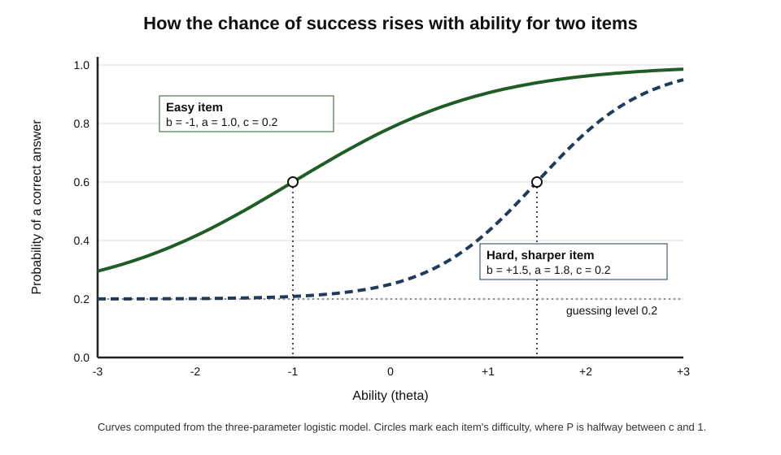
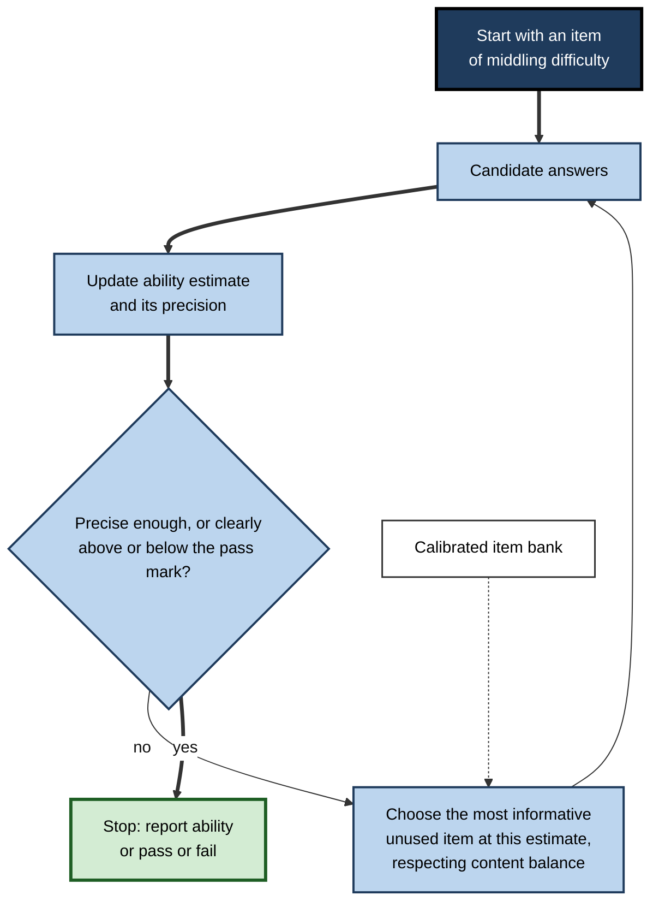
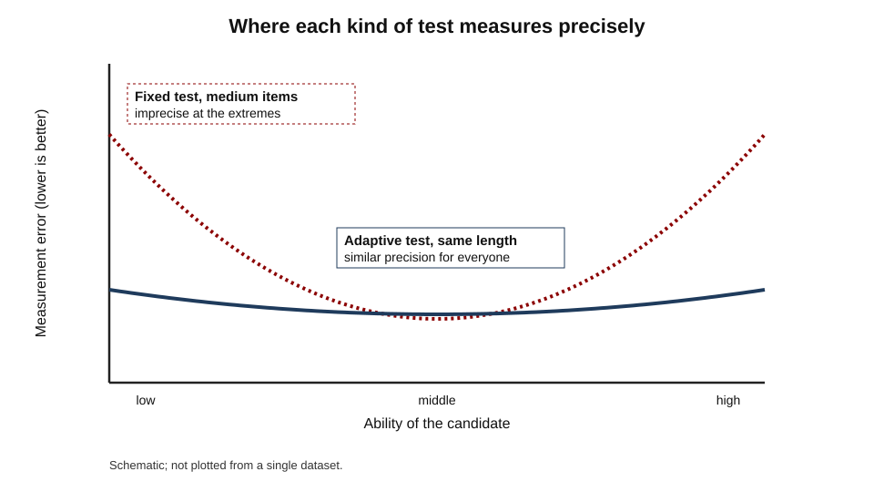
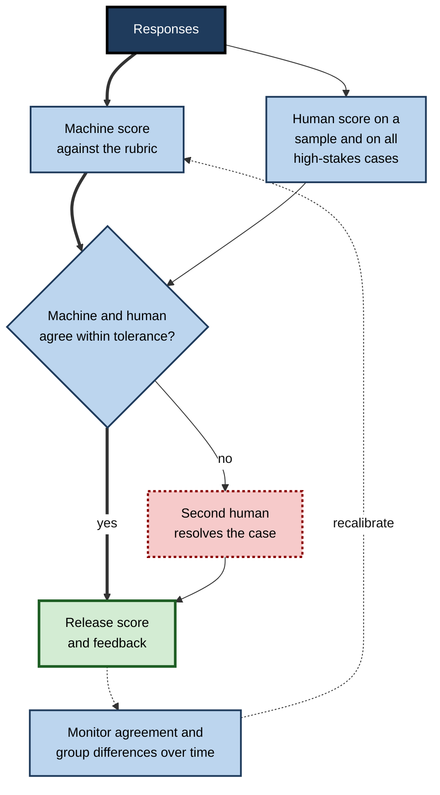
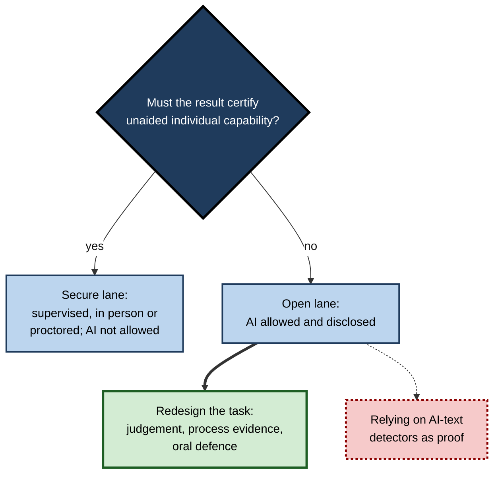
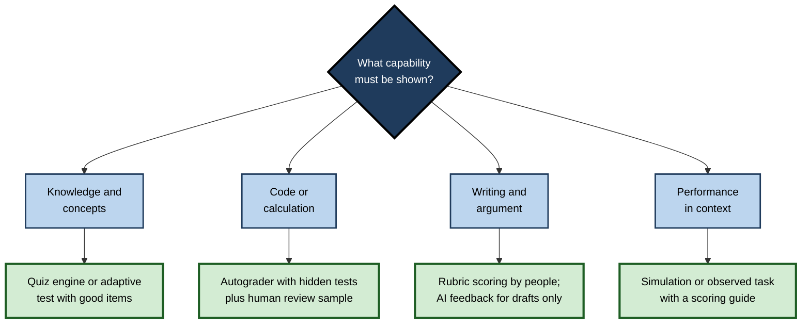

# L.10. Digital Assessment Tools

A nursing graduate sits her licensing examination at a computer: each time she answers correctly the next question is harder, each time she errs it is easier, and the test may stop well before the maximum number of items because the software is already confident she has passed. A programming student submits code and sees, within seconds, which of forty automated tests it fails. A sales team's learning platform shows each representative which product modules they have mastered — and which they have merely clicked through.

Digital tools now deliver, score and analyse much of the assessment that learners and professionals meet.

> **Definition — Digital assessment tool:** software that delivers assessment tasks, scores responses, analyses results or records evidence of learning.

**Why it matters**

- Digital tools make assessment **faster, cheaper and more frequent** — and so more useful for self-assessment.
- Some tools measure **more precisely** than paper tests; others measure the wrong things very efficiently.
- Their **scores and dashboards** shape what learners study and what organisations believe about capability.
- They raise new issues of **integrity, fairness, accessibility and privacy** that every user should understand.

---

## The Landscape of Tools

### Main categories

- **Quiz engines in learning platforms** — deliver multiple-choice, short-answer and numerical items; score automatically; give feedback.
- **Item banks and authoring tools** — store large sets of tagged items; assemble tests to a blueprint.
- **Computer-based testing systems** — deliver high-stakes examinations in test centres or online, under controlled conditions.
- **Computerised adaptive tests** — choose each item based on previous answers.
- **Automated scoring systems** — score essays, short answers, code or spoken responses.
- **Simulations and virtual labs** — assess performance in realistic environments: clinical scenarios, network configuration, financial trading, flight.
- **E-portfolio systems** — collect and organise evidence of competence over time.
- **Learning analytics dashboards** — summarise learners' activity and results.
- **Integrity and proctoring tools** — lockdown browsers, identity checks, remote invigilation.
- **AI feedback tools** — generative models that comment on, score or generate assessment items.

**Table 1.** Digital assessment tools compared.

| Category | Typical use | Main strength | Main risk |
|---|---|---|---|
| Quiz engine | Frequent formative checks | Instant scoring and feedback | Recognition-heavy items |
| Adaptive test | Certification, placement | Precise with fewer items | Needs a large, calibrated item bank |
| Automated essay or answer scoring | Large-scale writing assessment | Speed, consistency | Rewards surface features; can be gamed |
| Code autograder | Programming courses, technical hiring | Immediate, objective on functionality | Ignores design and readability; tests can be gamed |
| Simulation | Clinical, technical, operational skills | Assesses performance, not description | Expensive to build and validate |
| Analytics dashboard | Monitoring progress | Visibility across many learners | Activity mistaken for learning |
| Remote proctoring | Unsupervised high-stakes tests | Allows remote sitting | Privacy, false flags, anxiety |
| Generative AI feedback | Comments on drafts and answers | Cheap, immediate, detailed | Inaccurate, lenient or biased judgements |

> **Key point:** a digital tool inherits the **validity** of the tasks it delivers. Delivering a weak test electronically makes it faster, not better.

---

## Measuring with Item Response Theory

### From total scores to abilities

- **Classical test theory** treats a score as the number correct; item difficulty is the percentage of people who get it right — which depends on who sat the test.
- **Item response theory (IRT)** models the **probability** that a person of a given ability answers a given item correctly. Ability and item difficulty are placed on the **same scale**.
- **Georg Rasch (1960)**, a Danish mathematician, proposed the simplest such model; later models added parameters for how sharply an item distinguishes between abilities and for guessing.

> **Definition — Item response theory:** a family of statistical models linking a person's latent ability and an item's properties to the probability of a correct response, allowing ability to be estimated from any calibrated set of items.

> **Formula — Three-parameter logistic model:** P(correct) = c + (1 − c) ÷ (1 + e^(−a(θ − b))), where θ is ability, *b* the item's difficulty, *a* its discrimination and *c* the chance of guessing. For θ = 0.5, b = 0, a = 1.2, c = 0.2: e^(−0.6) ≈ 0.549, so 1 ÷ 1.549 ≈ 0.646, and P = 0.2 + 0.8 × 0.646 ≈ **0.72**.

**Figure 1.** Item characteristic curves for an easy and a hard item.

**Table 2.** Classical test theory and item response theory compared.

| | Classical test theory | Item response theory |
|---|---|---|
| Unit of analysis | Whole test | Each item |
| Item difficulty | Percentage correct in a particular group | A parameter on the ability scale, stable across groups if the model fits |
| Precision | One reliability figure for everyone | Precision varies by ability; can be calculated for each person |
| Comparing different test forms | Requires equating studies | Natural, if items are calibrated on one scale |
| Data needed | Modest | Large samples to calibrate items |
| Typical use | Classroom and course tests | Large-scale and adaptive testing |

### Computerised adaptive testing

- An adaptive test begins with an item of middling difficulty, then:
  1. estimates the candidate's ability from the answers so far;
  2. chooses the next item that gives the **most information** at that estimate — usually one the candidate has about an even chance of answering correctly;
  3. repeats until the estimate is precise enough, a maximum length is reached, or — in pass/fail tests — the candidate is confidently above or below the pass standard.
- **Examples:** the US nursing licensure examination (NCLEX) uses adaptive testing with variable length; graduate admissions tests such as the GMAT have long used adaptive formats, and the GRE uses a section-level (multistage) adaptive design.

**Figure 2.** How a computerised adaptive test chooses each item.

### What adaptivity gives and costs

- **Gains:**
  - comparable precision with **substantially fewer items** than a fixed test;
  - **even precision** across the ability range — a fixed test measures well near its average difficulty and poorly at the extremes;
  - less time wasted on items far too easy or far too hard.
- **Costs and constraints:**
  - a **large, calibrated item bank** — expensive to build;
  - **item exposure** — popular items are seen by many candidates and may leak;
  - **content balancing** — the algorithm must still cover the blueprint;
  - many adaptive tests do **not allow returning** to earlier items, which changes test-taking strategy.

**Figure 3.** Measurement precision across the ability range: fixed test compared with adaptive test.

> **Watch out:** in an adaptive test, finding the questions hard is **expected** — the algorithm aims for items the candidate has roughly an even chance of answering. Candidates who conclude "I must be failing" from difficulty alone are misreading the design.

> **In practice:** a learner preparing for an adaptive examination should practise under its rules — no going back, steady pacing — and should not try to infer their score from how hard the items feel.

---

## Automated Scoring

### Essays and short answers

- **Ellis Page (1966)** built **Project Essay Grade**, an early program that predicted human essay scores from measurable features such as length and vocabulary.
- Modern systems — such as **e-rater**, developed by Educational Testing Service — score features of grammar, organisation, vocabulary and development; in several large examinations they are used **alongside** a human rater, with disagreements resolved by a second human.
- **Agreement:** on many prompts, machine–human agreement approaches human–human agreement.
- **Criticism:** **Les Perelman** and colleagues demonstrated that essay-scoring engines could award high scores to fluent but meaningless essays generated by software, because the engines assessed form rather than truth or argument.

> **Watch out:** agreement with human scores shows **consistency**, not **validity**. A system can match human scores on ordinary essays while being fooled by text designed to exploit it.

### Code autograders

- Run submitted code against **automated tests**; report which pass and fail.
- **Strengths:** immediate, objective about **functionality**; allow many attempts — excellent for formative use.
- **Weaknesses:**
  - do not assess design, readability, efficiency or security unless specifically tested;
  - encourage **test-driven guessing** — changing code until tests pass without understanding;
  - visible tests can be **special-cased** ("if input is X, return Y").
- **Good practice:** hidden test cases; limits on submission frequency; human review of a sample for design and style; tests that probe edge cases rather than examples.

### Generative AI as a scorer

- Large language models can score answers against a rubric and write feedback.
- **Promise:** detailed, immediate feedback at very low cost; can handle open-ended responses.
- **Concerns:**
  - **accuracy** varies by task and prompt; errors are fluent and plausible;
  - **leniency** and sensitivity to length and style;
  - **bias** — possible differences by dialect, writing style or demographic markers;
  - **instability** — the same answer may receive different scores on different runs or model versions.

**Figure 4.** Using automated scoring with human moderation.

> **Key point:** automated scoring is safest in **formative** use, where errors cost little and speed matters most. For high-stakes decisions it needs human moderation and continuing checks for bias.

---

## Simulations and Performance Assessment

### Assessing doing, not describing

- **Simulations** place the learner in a realistic environment and record what they do:
  - **virtual patients** — taking a history, ordering tests, choosing treatment;
  - **network and cloud labs** — configuring real or emulated systems against a specification;
  - **flight and driving simulators** — handling normal and abnormal situations;
  - **business simulations** — making pricing, staffing or investment decisions over simulated quarters.
- **What they can capture:** the sequence of actions, decisions and their timing, errors and recoveries — far richer evidence than a final answer.

### Stealth assessment

- **Valerie Shute (2011)** described **stealth assessment**: assessment woven invisibly into a game or simulation, inferring competence continuously from the learner's actions rather than from separate test items.
- **Advantages:** less test anxiety; evidence gathered during authentic activity; continuous rather than one-off.
- **Challenges:** building a valid model linking actions to competences is difficult and expensive; learners may not know they are being assessed, which raises transparency questions.

> **Watch out:** realism is not validity. A simulation can look convincing yet reward behaviours that would not succeed in real work — for example, a trading game that rewards risk-taking because it never simulates a crash. Validity needs evidence that simulation performance predicts real performance.

---

## Digital Tools for Self-Assessment

### Getting the most from them as a learner

- **Prefer tools that report item- and topic-level results**, not just totals.
- **Use adaptive practice for diagnosis**: tools that estimate mastery per topic quickly locate weak areas — but confirm with delayed, unaided checks.
- **Turn on feedback that explains**, and read it before moving on.
- **Export the data.** Results kept only inside a platform are lost when the subscription or course ends; copy key results into one's own tracker.
- **Practise under the real conditions** where the tool allows: time limits, no going back, no notes.
- **Ignore the gamification** — points, streaks and leaderboards — when judging progress; look at performance on new items after a delay.

### A personal item bank

- The principles of professional item banks scale down to an individual learner:
  - **tag** each item with topic, level (recall, application, transfer) and source;
  - **record** each attempt — date, correct or not, confidence;
  - **estimate difficulty** roughly from one's own history and, where available, from others' results;
  - **assemble** each self-test to a blueprint — the right mix of topics and levels — rather than drawing items at random;
  - **retire and refresh** items as they become familiar.
- A spreadsheet or a flashcard application with tags is enough. What matters is that items carry **metadata**, so that results can be analysed by topic and level and tests can be built to represent the domain.

> **Example:** a pharmacist preparing for a clinical examination keeps 300 tagged items. Each Sunday a short script draws 25 items weighted towards topics below threshold and towards application-level items, excluding any answered correctly three times in a row.

### Using generative AI as a personal assessor

- **Useful for:**
  - generating practice items mapped to stated objectives;
  - marking short answers against a supplied model answer;
  - giving feedback on a draft against a supplied rubric;
  - acting as a questioner in a mock oral examination.
- **Safeguards:**
  - supply the **standard** — the objectives, mark scheme or rubric — rather than asking the tool to invent one;
  - make one's **own judgement first**, then compare;
  - **verify** facts and marking against authoritative sources;
  - never upload confidential client, patient or employer material to tools that store it.

> **Key point:** for self-assessment, a digital tool is valuable to the extent that it produces **honest evidence of unaided performance** and **specific information about what to study next**.

---

## Learning Analytics and Dashboards

> **Definition — Learning analytics (Society for Learning Analytics Research, 2011):** the measurement, collection, analysis and reporting of data about learners and their contexts, for purposes of understanding and optimising learning and the environments in which it occurs.

### What dashboards show

- **Activity** — logins, time on platform, videos watched, pages viewed.
- **Completion** — modules finished, assignments submitted.
- **Performance** — quiz scores, mastery estimates, item-level results.
- **Comparison** — position relative to peers or targets.

**Table 3.** Dashboard measures that indicate learning and those that mostly do not.

| Measure | What it indicates | Use for self-assessment |
|---|---|---|
| Delayed quiz scores by topic | Retained knowledge | High |
| Mastery estimates from adaptive practice | Probable mastery of components | High, if items are good |
| Error patterns by item | Specific misconceptions | High |
| Modules completed | Exposure | Low |
| Time on platform | Effort, or distraction | Low |
| Streaks and badges | Regularity of use | Low to moderate |
| Rank among peers | Relative standing | Low for learning; may harm motivation |

> **Watch out:** **vanity metrics** — streaks, hours, completion percentages — feel like progress and are easy to improve without learning anything. Self-assessment should rest on **performance** data.

### Early-warning systems

- **Course Signals** at Purdue University combined grades, effort and background data to flag students at risk, with traffic-light signals and messages.
- Early reports claimed that students in courses using Signals were more likely to stay at the university.
- Critics, including **Michael Caulfield** and **Alfred Essa**, argued that the analysis was confounded: students who took more courses using Signals were simply students who stayed longer, so the retention effect may have been an artefact.

> **Watch out:** analytics claims often confuse **correlation** with **effect**. A dashboard that predicts who will struggle has not thereby been shown to **help** them.

---

## Integrity, Fairness and Privacy

### Online proctoring

- **Remote proctoring** uses webcams, screen recording, identity checks and automated flagging of "suspicious" behaviour.
- **Concerns:**
  - **privacy** — recording candidates' homes and faces;
  - **false flags** — looking away, family noise or unstable connections flagged as misconduct;
  - **bias** — face-detection systems have been reported to work less well for some skin tones;
  - **anxiety** — surveillance itself may depress performance.
- **Alternatives:** design assessments that are hard to cheat on — open-book questions requiring application, individual data sets, oral follow-up, project work with process evidence.

### Generative AI and unsupervised assessment

- Generative AI can complete many unsupervised written tasks — essays, short answers, code exercises — to a passing standard.
- **Responses in education and professional training:**
  - **secure assessments** — supervised, in person or carefully proctored — for certifying individual capability;
  - **open assessments** — where AI use is allowed and expected, with the task redesigned to require judgement, process evidence or oral defence;
  - some universities describe this as a **"two-lane"** approach.
- **Detection tools** that claim to identify AI-written text have produced false accusations; most institutions treat their outputs as weak evidence at best.

**Figure 5.** Designing for integrity when AI is widely available.

### Accessibility

- Digital assessment must work for candidates who use **screen readers**, keyboard navigation, magnification or captions, and must support **reasonable adjustments** such as extra time.
- The **Web Content Accessibility Guidelines (WCAG)** set widely adopted standards for digital content.
- **Common failures:** drag-and-drop items unusable without a mouse; images without text descriptions; timed items that cannot be extended.

### Data protection

- Assessment data are **personal data**; under laws such as the EU and UK **General Data Protection Regulation (GDPR)**, organisations need a lawful basis, must limit data to what is necessary and must explain how it is used.
- Individuals have rights in relation to **solely automated decisions** with significant effects — relevant where automated scoring decides certification or employment.

> **In practice:** before using a tool for others' assessment, ask what data it collects, where it is stored, who can see it, how long it is kept and whether any decision is made without human involvement.

---

## Choosing and Using Tools

### Questions to ask of any tool

1. **Validity:** do its tasks require the capability that matters, or a proxy?
2. **Item quality:** who wrote and checked the items? Are they calibrated?
3. **Feedback:** does it explain errors, or only score them?
4. **Data:** does it give item- and topic-level results, or only totals?
5. **Integrity:** are its conditions appropriate to the stakes?
6. **Accessibility:** can every intended user take it fairly?
7. **Privacy:** what happens to the data?
8. **Portability:** can results and evidence be exported if the learner or organisation moves?

**Figure 6.** Choosing a digital tool for a given assessment purpose.

### Worked example: choosing a tool for annual anti-money-laundering certification

A bank must certify 4,000 staff each year on anti-money-laundering procedures.

**Current practice:** a 20-question multiple-choice quiz in the learning platform; unlimited attempts; pass mark 80%. Completion is 99%; audit findings on suspicious-activity reporting are unchanged.

**Options considered:**

**Table 4.** Three options for the certification compared.

| | A: Keep current quiz | B: Adaptive scenario test | C: Branching simulation |
|---|---|---|---|
| Tasks | Recall of rules | Realistic customer scenarios at varied difficulty | Interactive cases: interviewing a customer, deciding whether to escalate |
| Attempts | Unlimited, same items | Limited; items drawn from a calibrated bank | Two attempts, different cases |
| Data produced | Pass/fail | Ability estimate and topic profile | Decisions made and their timing |
| Cost to build | Already exists | Moderate (item writing and calibration) | High |
| Validity for the real task | Low | Moderate to high | High |

**Decision steps:**

1. **Purpose:** the regulator expects evidence that staff can **recognise and escalate** suspicious activity — an application skill.
2. **Option A** fails on validity: unlimited attempts on the same items measure persistence and recognition.
3. **Option C** is most valid but expensive; reserved for high-risk roles (relationship managers, cash handlers).
4. **Option B** chosen for all other staff: scenario items, calibrated in a pilot with 300 staff, drawn adaptively, with a topic profile for each person.
5. **Monitoring:** compare suspicious-activity report quality before and after, by business unit.

> **Watch out:** the most expensive part of good digital assessment is not software but **items** — writing, reviewing, piloting and calibrating realistic tasks.

### Case study: the autograder that taught students to pass tests

- **Situation:** an introductory programming course for 600 students used an autograder with visible tests and unlimited submissions.
- **Problem:** pass rates on assignments were above 90%, but in the supervised final examination many students could not write simple functions unaided.
- **Diagnosis:**
  1. Logs showed many students submitting dozens of times in quick succession, changing code until tests passed.
  2. Some submissions special-cased the visible test inputs.
  3. The autograder checked output only; design and reasoning were never assessed.
- **Actions:**
  1. Half the tests were **hidden**; feedback named the failing category ("empty input", "large values") rather than the exact case.
  2. Submissions were limited to a small number per hour.
  3. Each assignment added a short **explanation question** — "why does your loop terminate?" — marked by teaching assistants on a sample.
  4. Weekly **unaided** five-minute coding checks were introduced in labs.
- **Result:** assignment pass rates fell at first, then recovered; the gap between assignment scores and examination performance narrowed considerably.
- **Lesson:** a fast, automated scorer is a powerful formative tool only if it rewards **understanding** rather than **search**.

---

## Open Questions

- **How reliable and fair are AI scorers for open-ended work?**
  - Agreement with humans varies widely by task and model; bias audits and long-term stability studies are still limited.
- **Can unsupervised assessment survive generative AI?**
  - Redesign, secure lanes and oral defence are being tried; which combinations preserve validity at scale is unresolved.
- **Do analytics dashboards improve learning?**
  - Prediction is easier than improvement; rigorous evidence that dashboards cause better outcomes is limited.
- **How should adaptive testing be used for formative purposes?**
  - Adaptive practice can target weaknesses efficiently, but its effects compared with simpler spaced practice are not fully established.
- **What are acceptable limits on assessment surveillance?**
  - Integrity, privacy and wellbeing pull in different directions; norms and regulations are still developing.

---

## Summary

- **Digital assessment tools** deliver, score, analyse and record assessment; they inherit the **validity** of their tasks.
- Categories include **quiz engines, item banks, computer-based testing, adaptive tests, automated scoring, simulations, e-portfolios, dashboards, proctoring and AI feedback**.
- **Item response theory** places ability and item difficulty on one scale; the **three-parameter logistic model** links them to the probability of success.
- **Adaptive tests** choose the most informative next item, giving **comparable precision with fewer items** and **even precision** across abilities, at the cost of large calibrated banks, exposure control and no going back.
- **Automated scoring** is consistent and fast but can reward surface features; code autograders test function, not design; **AI scorers** need human moderation and bias monitoring.
- **Learning analytics** dashboards are useful when they show **performance**; **vanity metrics** mislead; prediction is not effect.
- **Integrity** — proctoring raises privacy, bias and anxiety concerns; with generative AI, separate **secure** and **open** assessment and redesign tasks. Ensure **accessibility** and **data protection**.
- Choose tools by **validity, item quality, feedback, data, integrity, accessibility, privacy and portability**.

---

## Self-Check

1. Define a digital assessment tool and name six categories.
2. Distinguish classical test theory from item response theory.
3. Using the three-parameter model with θ = 1, b = 1, a = 1.5, c = 0.25, calculate the probability of a correct answer.
4. Describe the steps of a computerised adaptive test.
5. Why does an adaptive test feel hard to most candidates, and why should they not infer their score from this?
6. What are the main costs and constraints of adaptive testing?
7. What did Les Perelman's demonstrations show about automated essay scoring?
8. List three weaknesses of code autograders and a remedy for each.
9. Why should AI scoring be used mainly formatively, and what safeguards are needed for high-stakes use?
10. Distinguish meaningful dashboard measures from vanity metrics, with examples.
11. What was the criticism of the Course Signals retention claim?
12. Outline the main concerns about remote proctoring and one alternative approach.
13. Explain the "two-lane" approach to assessment in the era of generative AI.
14. In the anti-money-laundering example, why was the existing quiz rejected, and why was the simulation not used for everyone?

### Answer Key

1. Software that delivers, scores, analyses or records assessment. Categories: quiz engines, item banks, computer-based testing, adaptive tests, automated scoring, simulations, e-portfolios, analytics dashboards, proctoring tools, AI feedback tools.
2. Classical: the score is the number correct; item difficulty is the percentage correct in a group; one reliability for the whole test. IRT: models the probability of success from person ability and item parameters on one scale; precision varies with ability; items can be combined into different forms on a common scale.
3. θ − b = 0, so e^0 = 1 and 1 ÷ 2 = 0.5; P = 0.25 + 0.75 × 0.5 = 0.625.
4. Start with a middling item; after each answer, update the ability estimate; choose the most informative unused item at that estimate (respecting content balance); stop when precision is sufficient or the pass/fail decision is clear.
5. Because the algorithm picks items the candidate has roughly an even chance of answering, so most items feel difficult whatever the candidate's ability. Difficulty is a feature of the design, not a sign of failing.
6. A large calibrated item bank; controlling item exposure; maintaining content balance; usually no returning to earlier items.
7. Engines could give high scores to fluent but meaningless generated essays — they assessed surface features of form rather than meaning or argument, so agreement with humans on ordinary essays did not guarantee validity.
8. Ignore design → human review of a sample; encourage trial-and-error → limit submissions and add explanation questions; visible tests can be special-cased → hidden tests and category-level feedback.
9. Its accuracy, leniency, bias and stability are uncertain; errors cost little in formative use. High-stakes use needs human moderation, second-marking of disagreements, monitoring of agreement and group differences, and recalibration.
10. Meaningful: delayed topic scores, mastery estimates, item-level errors. Vanity: time on platform, streaks, modules completed — easy to raise without learning.
11. Students who took more Signals courses were those who stayed longer at university, so the apparent retention benefit may have reflected that confound rather than an effect of Signals.
12. Privacy intrusion, false flags, possible bias in face detection, and anxiety. Alternative: design assessments that are hard to cheat on — application-based open-book tasks, individual data, oral follow-up, process evidence.
13. Separate secure assessments (supervised, AI not allowed) for certifying unaided capability from open assessments where AI use is allowed and tasks are redesigned to require judgement, process evidence or oral defence.
14. The quiz measured recall with unlimited attempts on the same items, not the ability to recognise and escalate suspicious activity. The simulation was the most valid but too expensive for 4,000 staff, so it was reserved for high-risk roles and an adaptive scenario test used for others.

---

## Glossary

| Term | Meaning |
|---|---|
| Automated scoring | Software scoring of essays, short answers, code or speech. |
| Autograder | A tool that runs submitted code against automated tests. |
| Classical test theory | Measurement framework based on total scores and group-dependent item statistics. |
| Computerised adaptive test | A test that chooses each item according to the candidate's previous answers. |
| Content balancing | Constraints ensuring an adaptive test still covers the blueprint. |
| Discrimination (item) | How sharply an item distinguishes between abilities around its difficulty. |
| Item bank | A stored, tagged collection of items from which tests are assembled. |
| Item characteristic curve | The curve linking ability to the probability of answering an item correctly. |
| Item exposure | The frequency with which an item is seen, risking leakage. |
| Item response theory | Models linking ability and item properties to the probability of a correct response. |
| Learning analytics | Measurement and analysis of data about learners to understand and improve learning. |
| Multistage adaptive test | A test that adapts between sections rather than item by item. |
| Rasch model | The simplest item response model, with item difficulty as its only item parameter. |
| Remote proctoring | Online invigilation using cameras, screen capture and automated flags. |
| Simulation | A realistic environment in which performance is recorded and assessed. |
| Stealth assessment | Assessment embedded invisibly in a game or simulation, inferring competence from actions. |
| Two-lane approach | Separating secure, AI-free assessment from open assessment where AI use is allowed. |
| Vanity metric | A measure that looks like progress but does not indicate learning. |
| WCAG | Web Content Accessibility Guidelines, standards for accessible digital content. |
