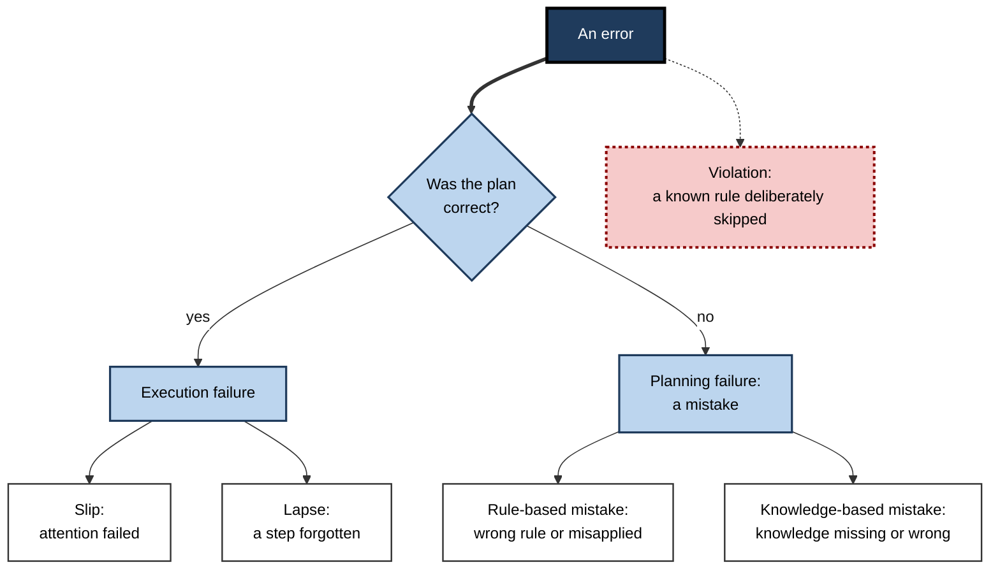
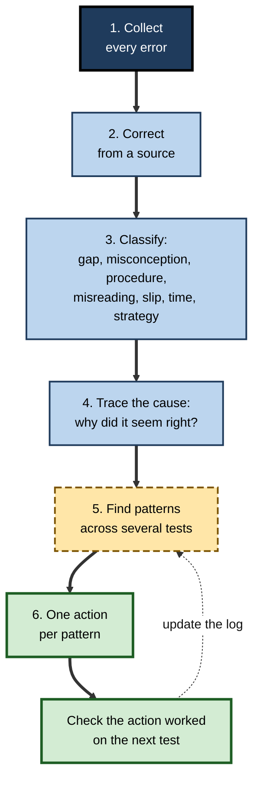
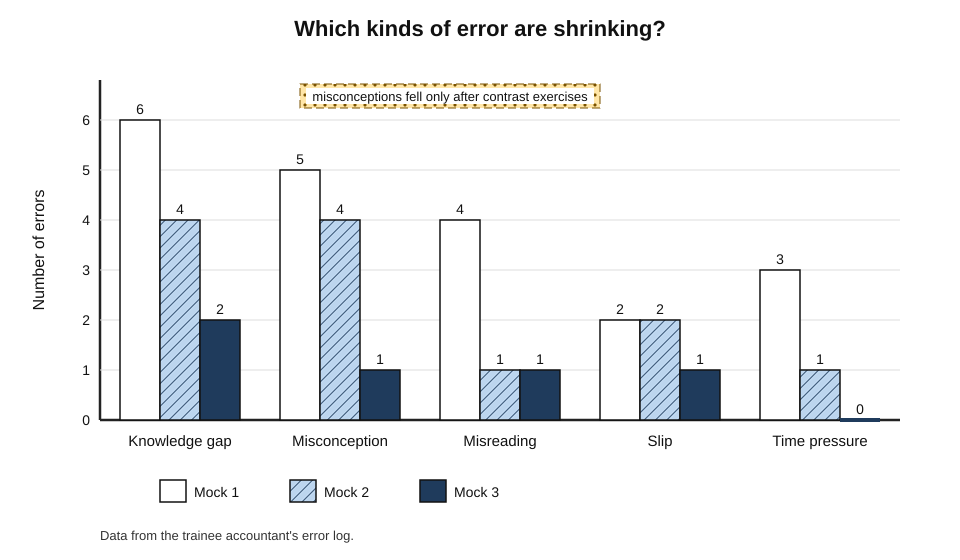
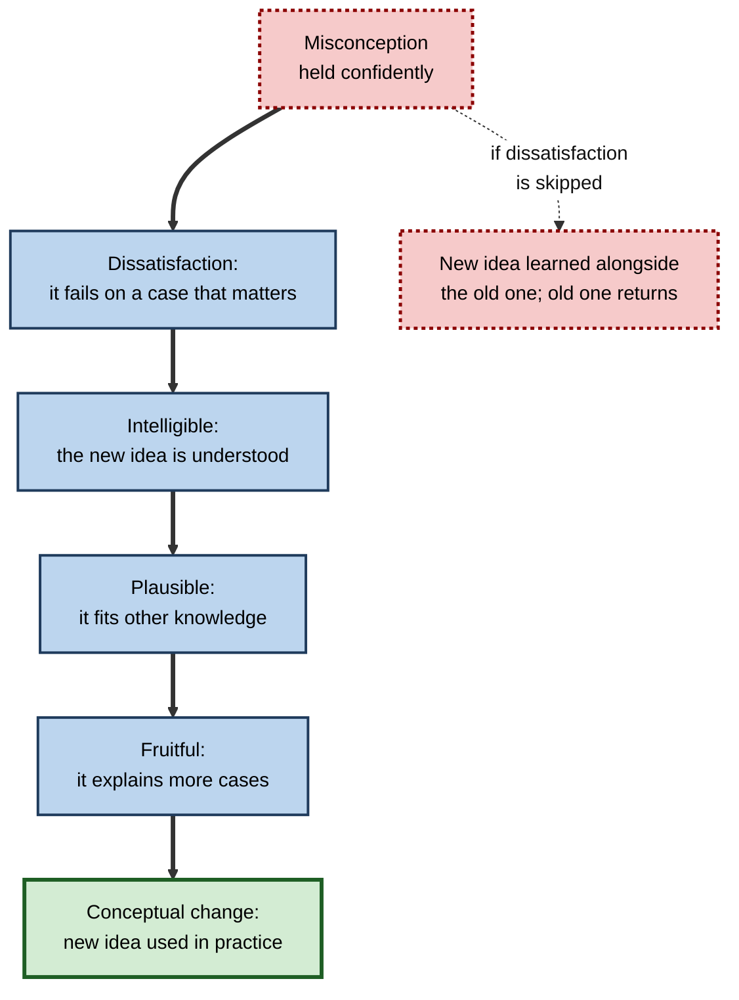
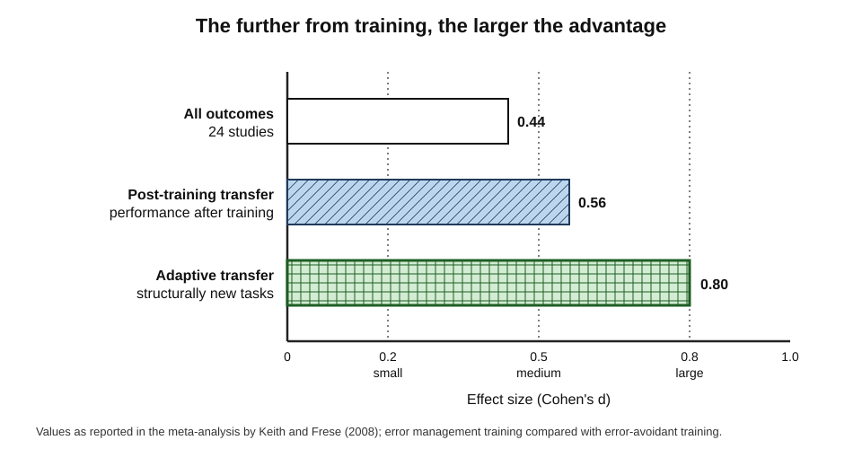
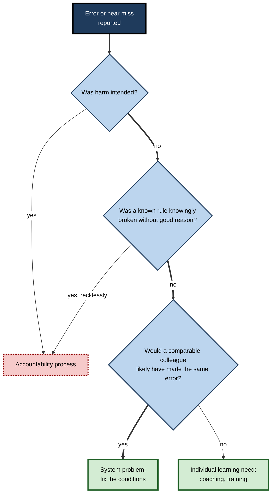

# L.11. Using Errors to Guide Study

A trainee accountant loses marks on a mock paper and writes "careless" beside every wrong answer. When a tutor looks more closely, the eleven errors fall into three groups: four misread questions, five instances of the same misunderstanding about deferred tax, and two arithmetic slips. "Careless" described none of them well, and it pointed to no remedy. Errors are the richest assessment data a learner ever receives — but only if they are **classified, traced to causes and turned into specific study actions**.

> **Definition — Error analysis:** the systematic examination of one's mistakes to classify them, identify their causes and decide what to change in study or practice.

**Why it matters**

- A score says **how much** was wrong; errors say **what** and **why**.
- Different kinds of error need **different remedies** — more study cures a knowledge gap but does nothing for a misread question or a lapse of attention.
- Errors made in practice are **cheap**; the same errors made in an examination, with a client or with a patient are expensive.
- Organisations that learn systematically from errors — in aviation, healthcare and software operations — become safer and more capable; the same logic works for an individual.

---

## Kinds of Error

### Reason's taxonomy

- **James Reason (1990)**, studying human error in industrial and medical settings, distinguished errors by where in the process they arise:
  - **Slips** — the right plan, carried out wrongly; an attention failure.
    - *e.g.* typing 1,250 instead of 12,500 when the correct figure was in mind.
  - **Lapses** — the right plan, but a step forgotten; a memory failure.
    - *e.g.* forgetting to state units in a final answer.
  - **Mistakes** — the plan itself is wrong.
    - **Rule-based mistakes** — a good rule misapplied, or a bad rule applied.
      - *e.g.* using the straight-line depreciation formula where the question specifies reducing balance.
    - **Knowledge-based mistakes** — reasoning from incomplete or incorrect knowledge in an unfamiliar situation.
      - *e.g.* inventing an approach to a tax problem because the relevant rule was never learned.
- **Violations** — deliberate departures from a known rule; in study, shortcuts such as skipping checking steps "to save time".

> **Definition — Slip:** an error in which the intended action was correct but was executed wrongly, usually through a lapse of attention.

> **Definition — Mistake (Reason):** an error in which the plan itself was inappropriate for the goal, through misapplied rules or inadequate knowledge.

**Figure 1.** A taxonomy of errors, after James Reason.

### A practical classification for study

- For self-assessment, a simpler set of categories is usually enough:
  - **Knowledge gap** — did not know it.
  - **Misconception** — "knew" something wrong.
  - **Procedural error** — knew the idea but made an error in method.
  - **Misreading** — answered a different question from the one asked.
  - **Slip** — arithmetic, transcription or attention error.
  - **Time pressure** — would have been right with more time.
  - **Strategy** — chose a poor approach (for example, spending too long on one question).

**Table 1.** Error categories, their signs and their remedies.

| Category | Typical sign | Remedy |
|---|---|---|
| Knowledge gap | Could not start; blank or guess | Study the topic from a good source; re-test after a delay |
| Misconception | Confident wrong answer, consistent across items | Confront the wrong idea; contrast with the right one; explain why it fails |
| Procedural error | Right approach, wrong step, often at the same point | Practise the procedure on varied cases; write out each step |
| Misreading | Right answer to a different question | Underline task words and qualifiers; restate the question before answering |
| Slip | Wrong figure copied; arithmetic error | Estimate before calculating; build in a checking step |
| Time pressure | Correct when re-done untimed | Timed practice; pacing plan |
| Strategy | Over-long on low-value items | Triage; time per mark; two-pass approach |

> **Key point:** "careless" is not a category. It hides at least three different problems — slips, misreading and procedural errors — each with a different cure.

### Errors change as expertise grows

- The **kind** of error a learner makes is itself evidence of their stage of learning.
- Reason observed that knowledge-based mistakes dominate in **unfamiliar** situations, rule-based mistakes when people have learned rules but not their limits, and slips and lapses in **highly practised** activity, where attention is no longer fully on the task.

**Table 2.** Typical errors at three stages of learning.

| | Novice | Developing practitioner | Expert |
|---|---|---|---|
| Dominant error | Knowledge-based mistakes | Rule-based mistakes | Slips and lapses |
| Example (spreadsheet modelling) | Does not know how to discount cash flows | Applies an annual rate to monthly periods | Drags a formula one row too far |
| Typical cause | Missing knowledge | Rules learned without their boundaries | Automatic action with attention elsewhere |
| Best remedy | Study and worked examples | Contrast cases; varied practice at rule boundaries | Checks, templates, automation |
| What to watch for | Guessing presented as knowledge | Over-confidence in familiar rules | Complacency about routine tasks |

- **Implication for self-assessment:** a falling share of knowledge-based mistakes and a rising share of slips is a **sign of progress**, even if the total number of errors is unchanged — and it calls for a different response.

---

## The Error Analysis Procedure

### Six steps

1. **Collect.** Gather every error from a test, assignment, review or piece of work.
2. **Correct.** Find the right answer or approach, from a source — not from memory.
3. **Classify.** Assign each error a category.
4. **Trace the cause.** For mistakes and misconceptions, ask *why* the wrong idea seemed right; for slips and misreadings, ask what in the process allowed them.
5. **Look for patterns.** Count errors by category and by topic across several tests; patterns matter more than single errors.
6. **Act.** Choose one change per significant pattern, and decide how its effect will be checked.

**Figure 2.** From an error to a study action.

### Tracing causes

- **The five whys** — a root-cause technique from manufacturing — asks "why?" repeatedly until a changeable cause appears.
  - *Error:* wrong deferred-tax figure.
  - *Why?* Used the accounting profit instead of the temporary difference.
  - *Why?* Thought deferred tax is calculated on profit.
  - *Why?* Learned it from a summary sheet that skipped the definition of temporary differences.
  - *Action:* study temporary differences from the standard; contrast three cases where accounting and tax bases differ.
- **Ask what made the wrong answer attractive.** Misconceptions usually persist because they work in some cases; finding where they work explains why they feel right.

> **Watch out:** the most comfortable diagnosis is usually the least useful. "I ran out of time" and "I was careless" protect self-esteem but rarely survive careful analysis.

### The error log

- A running record of errors across tests and real work, with columns for **date, source, topic, category, cause, action and re-check result**.
- **Uses:**
  - reveals **recurrent** errors that single tests hide;
  - shows whether actions **worked** — does the category shrink?
  - becomes a personal **revision list** before examinations: the items one has actually got wrong, not the whole syllabus.

### Worked example: an error log across three mocks

A trainee accountant logs every error across three mock papers.

**Table 3.** Errors by category across three mocks.

| Category | Mock 1 | Mock 2 | Mock 3 | Action taken after Mock 1 |
|---|---|---|---|---|
| Knowledge gap | 6 | 4 | 2 | Studied group accounts and leases from the standard |
| Misconception | 5 | 4 | 1 | Contrast exercises on deferred tax (after Mock 2) |
| Misreading | 4 | 1 | 1 | Underlined task words; restated each requirement |
| Slip | 2 | 2 | 1 | Estimated answers before calculating |
| Time pressure | 3 | 1 | 0 | Pacing plan with checkpoints |
| **Total errors** | **20** | **12** | **5** | |

**Reading it:**

1. **Misreading** fell sharply after one simple change — the cheapest gain available.
2. **Misconceptions** barely moved between Mocks 1 and 2 despite extra study; only targeted contrast exercises, begun after Mock 2, fixed them — more reading of the same material had not helped.
3. **Knowledge gaps** fell steadily with study.
4. **Slips** are now the residual category; a final checking routine is the next step.

**Figure 3.** Error categories across three mock papers.

> **In practice:** an exam wrapper — a short questionnaire after a test about how one prepared and what went wrong — is a light form of the same analysis. The full error log adds **patterns over time** and **evidence of whether actions worked**.

---

## Repairing Misconceptions

### Why misconceptions resist

- A misconception is not a blank to be filled; it is an **existing idea** that competes with the correct one.
- It often survives teaching because:
  - it **works** in everyday cases;
  - the learner does not notice the conflict between old and new ideas;
  - the correct idea is learned **alongside** the misconception, not instead of it.

### Conditions for conceptual change

- **George Posner, Kenneth Strike, Peter Hewson and William Gertzog (1982)** proposed that a learner replaces a conception when:
  1. they are **dissatisfied** with the existing conception — it fails in a case that matters;
  2. the new conception is **intelligible** — they understand it;
  3. it is **plausible** — it seems capable of being true and fits other knowledge;
  4. it is **fruitful** — it explains more, or opens new possibilities.

> **Mnemonic — "DIPF" ("Doubt It, Picture it, Prove it, Find more"):** Dissatisfaction, Intelligibility, Plausibility, Fruitfulness.

**Figure 4.** Conditions under which a misconception gives way.

### Techniques for the self-directed learner

- **Name the wrong idea explicitly.** Write it down: "I believed deferred tax is a percentage of profit."
- **Find a case where it fails.** Construct or find an example that the wrong idea gets wrong.
- **Study a refutation.** A **refutation text** states the misconception, says it is wrong and explains why the correct idea is better. Reviews of research in science education, such as **Douglas Tippett (2010)**, have found refutation texts more effective than standard explanations for changing misconceptions.
- **Contrast cases.** Work several examples side by side where the wrong and right ideas give different answers.
- **Re-test with discriminating items** — items designed so that the misconception produces a specific wrong answer.
- **Re-test after a delay.** Misconceptions often return after initial correction; a single correct answer the next day is not proof.

> **Watch out:** feedback that simply gives the right answer often fixes the item without fixing the idea. When the same error appears on a new item, the misconception is still there.

---

## Errors as a Way to Learn

### Studying others' errors

**Study card — Cornelia Große and Alexander Renkl (2007)**

- **Design:** university students studied worked examples in probability; some sets included **incorrect** worked examples that learners had to identify and explain.
- **Results:** incorrect examples helped learners with **higher prior knowledge** improve transfer; learners with **low prior knowledge** did not benefit, and could be confused.
- **Conclusion:** analysing errors — one's own or others' — is powerful once there is enough knowledge to recognise why they are wrong.

> **In practice:** "find the error" exercises — in code, accounts, contracts, clinical notes — are excellent once the basics are secure, and a poor starting point for complete novices.

### Making errors on purpose: error management training

**Study card — Nina Keith and Michael Frese (2008)**

- **Design:** meta-analysis of 24 studies comparing **error management training** — in which trainees explore actively, are encouraged to make errors and are told errors are useful for learning — with **error-avoidant** training that guides them step by step.
- **Results:**
  - overall, error management training produced better outcomes (*d* ≈ 0.44);
  - the advantage was larger on **post-training transfer** (*d* ≈ 0.56) than within training;
  - and largest on **adaptive transfer** — tasks structurally different from those trained (*d* ≈ 0.80).
- **Conclusion:** treating errors as information during training improves people's ability to handle new and different problems, partly by building emotional control and metacognitive activity.

**Figure 5.** Reported advantages of error management training over error-avoidant training.

> **Watch out:** the advantage appears mainly for **transfer**. Within training, error-avoidant methods often look as good or better — another case where short-term performance and long-term learning diverge.

- Related work on **productive failure** — attempting problems before instruction — has found benefits for conceptual understanding and transfer in many studies, with the strongest effects when the problem-solving is followed by well-designed instruction that builds on learners' attempts.

### Hunting for errors before they count

- Errors found in practice are cheap; the same errors found in an examination or in live work are not. Skilled learners therefore **look for** errors deliberately:
  - **Test at the edges** — attempt the unusual cases: zero values, boundary dates, exceptions to rules, the question type that appears once a year.
  - **Vary the conditions** — work under time pressure, without notes, in a different format.
  - **Invite challenge** — ask a colleague to find the flaw in an answer or a plan.
  - **Run a pre-mortem** — **Gary Klein (2007)** proposed imagining that a project has already failed and asking why; the same move works for an examination or a presentation: "It is the day after — I failed. What went wrong?"

> **Example:** a tax trainee, before her examination, imagines she has failed and lists likely causes: "ran out of time on the long question", "confused residence rules for part-year residents", "lost marks on presentation". Each becomes a targeted practice task for the final fortnight.

### The emotional side of error

- Errors produce **shame, anxiety and avoidance** as well as information. Learners who experience errors mainly as verdicts on their worth tend to:
  - avoid difficult practice where errors are likely;
  - glance at the right answer and move on without analysis;
  - attribute errors to fixed causes ("I'm just bad at this").
- Research on **error orientation** in the workplace — for example the questionnaire developed by **Janina Rybowiak, Harry Garst, Michael Frese and Bernhard Batinic (1999)** — distinguishes tendencies such as learning from errors, thinking about them, and feeling strain or covering them up; these tendencies differ between people and organisations.

**Table 4.** Errors treated as verdicts and as information.

| | Error as verdict | Error as information |
|---|---|---|
| Immediate reaction | "I failed" | "What does this tell me?" |
| What is recorded | The score | The error, its category and cause |
| Behaviour afterwards | Avoids similar tasks | Seeks similar tasks to practise |
| Attribution | Fixed ability | Specific, changeable cause |
| Long-term effect | Gaps persist and are hidden | Gaps shrink and are tracked |

> **In practice:** a short ritual helps — after any test, **record the errors before looking at the score**. Starting with the information rather than the verdict changes the conversation the learner has with themselves.

---

## Errors in Professional Practice

### Organisations that learn from errors

**Study card — Amy Edmondson (1996)**

- **Design:** studied medication errors in eight hospital nursing units, expecting better-led, better-functioning teams to make **fewer** errors.
- **Results:** better-functioning units **reported more** errors.
- **Explanation:** in those units, staff felt safe to report errors; in others, errors were hidden.
- **Conclusion:** the **detected** error rate depends on willingness to report; psychological safety shapes how much an organisation can learn from its mistakes.

### Just culture and blameless review

- **James Reason (1997)** described a **just culture**: one that distinguishes **honest error** from **reckless behaviour**, so that people report errors without fear while accountability for recklessness remains.
- **Blameless post-incident reviews**, widespread in software operations, ask what conditions allowed an error rather than who is to blame.
- **Aviation** has long run confidential incident-reporting systems, such as the United States Aviation Safety Reporting System, which collect reports of errors and near misses to find systemic causes.

**Figure 6.** Separating honest error from reckless behaviour in a just culture.

### The individual professional's error practice

- **Keep a personal error and near-miss log** for work: what happened, the category, the cause, the change made.
- **Review it before similar work.** An auditor reviews her own past review notes before starting a similar client; a developer reviews past production incidents before changing the same system.
- **Share selectively.** A team that pools individual logs finds systemic causes no single person sees.
- **Treat repeated errors as a design problem.** If the same slip happens repeatedly, add a check, a template or an automated test — do not rely on trying harder.

### Learning from errors in a study group or team

- Groups see more errors than individuals, and patterns that one person's log would never show.
- **A short group error review** — after a shared mock, a sprint or a project milestone:
  1. Each member brings two or three errors they made, already classified.
  2. The group looks for **shared** categories and topics.
  3. For each shared pattern, the group asks what condition made the error likely — a misleading resource, an ambiguous instruction, a missing check.
  4. The group agrees one change to shared practice and one individual action per member.
- **Ground rules:** errors are discussed as information, not confessions; no one is required to share anything they consider too sensitive; the focus is on conditions and remedies.

> **Example:** five trainee actuaries compare errors after a mock and find that four of them mishandled the same kind of annuity question. The cause turns out to be a widely used revision note with an incorrect worked example. One corrected note fixes four people's errors.

### Errors when working with AI tools

- AI assistants change the pattern of errors in two ways:
  - **they hide the learner's own errors** — when a tool produces the answer, the learner never makes, sees or analyses the mistakes that would have revealed gaps;
  - **they introduce new errors** — fluent but wrong output that the learner may accept.
- **Practices for learning from errors in AI-assisted work:**
  - **attempt first** on material being learned, then compare with the tool; the differences are the learner's error data;
  - **log the tool's errors** that one caught — and, more importantly, those one **missed** and found later; missed errors show where one's own knowledge is too thin to check the tool;
  - **classify AI-related errors** like any others: was it a knowledge gap (could not tell the output was wrong), a misreading (did not check what was asked), or a violation (skipped verification under time pressure)?

> **Key point:** the ability to spot an error in someone else's — or something else's — work depends on knowing the subject. Errors one fails to catch in AI output are among the most important gaps to study.

### Case study: the analyst who kept making the same mistake

- **Situation:** a pricing analyst in an insurance firm had three of her models returned by reviewers in six months for the same kind of problem — inconsistent treatment of inflation.
- **Problem:** each time she fixed the specific model; each time she resolved to "be more careful".
- **Diagnosis using error analysis:**
  1. **Classification:** not a slip but a **rule-based mistake** — she applied nominal rates in some places and real rates in others.
  2. **Cause (five whys):** her template mixed nominal and real inputs without labels; she had learned the distinction informally and never tested herself on it.
  3. **Pattern:** a review of her error log showed two earlier near misses of the same type caught by her own checks.
- **Actions:**
  1. Studied the nominal–real distinction from a textbook and worked ten contrasting cases.
  2. Redesigned the template: every rate labelled "nominal" or "real", with a consistency check that flagged mixtures.
  3. Added the issue to a short pre-review checklist she applied to every model.
  4. Shared the template fix with the team; two colleagues found the same latent problem in their own models.
- **Result:** no further inflation errors in the following year; the team adopted the labelled template as standard.
- **Lesson:** "be more careful" fails because it targets effort, not cause. **Classifying** the error and **redesigning** the conditions fixed it — for her and for others.

---

## Open Questions

- **When do errors help learning and when do they entrench mistakes?**
  - Errorful practice and productive failure help in many studies, but effects depend on prior knowledge, feedback and follow-up instruction.
- **How should misconceptions be detected cheaply?**
  - Diagnostic items and confidence tagging help; reliable, low-cost detection across professional domains is still limited.
- **How much error analysis is worth the time?**
  - Deep analysis of every error is costly; the best balance between breadth and depth is unstudied for most learners.
- **Can AI classify learners' errors accurately?**
  - Tools can label error types and suggest causes, but their accuracy and the risk of misleading diagnoses are not established.
- **How can psychological safety be built where errors carry real consequences?**
  - Just culture balances learning and accountability, but implementing it consistently remains hard in high-stakes professions.

---

## Summary

- **Error analysis** turns mistakes into diagnosis: classify, trace causes, find patterns, act, re-check.
- **Reason's taxonomy:** **slips** (attention), **lapses** (memory), **mistakes** (rule-based or knowledge-based) and **violations**. For study: knowledge gap, misconception, procedural error, misreading, slip, time pressure, strategy — each with its own remedy; "careless" is not a category.
- Trace causes with the **five whys** and by asking why the wrong answer seemed right; keep an **error log** to reveal recurrent patterns and test whether actions work.
- **Misconceptions** compete with correct ideas; change needs **dissatisfaction, intelligibility, plausibility and fruitfulness** (**Posner and colleagues, 1982**). Use **refutation**, **contrast cases** and **delayed re-tests**.
- Studying **incorrect examples** helps those with enough prior knowledge (**Große and Renkl, 2007**); **error management training** improves transfer, especially adaptive transfer (**Keith and Frese, 2008**).
- Organisations learn from errors when it is **safe to report** (**Edmondson, 1996**); a **just culture** separates honest error from recklessness; blameless reviews look for conditions, not culprits.
- Treat repeated errors as **design problems** — templates, checks and tests — rather than calls for more care.

---

## Self-Check

1. Define error analysis and explain why "careless" is not a useful category.
2. Distinguish slips, lapses, rule-based mistakes and knowledge-based mistakes, with an example of each.
3. List the seven practical error categories and the remedy for misreading.
4. State the six steps of the error analysis procedure.
5. Apply the five whys to this error: "Chose the wrong statistical test for paired data."
6. What should an error log contain, and what does it reveal that single tests do not?
7. In the three-mock worked example, why did misconceptions not fall after Mock 1, and what finally fixed them?
8. Why do misconceptions resist correction?
9. State Posner and colleagues' four conditions for conceptual change.
10. What is a refutation text, and why is it effective?
11. Summarise Große and Renkl (2007) and its implication for "find the error" exercises.
12. What did Keith and Frese (2008) find, and why is the transfer result important?
13. What did Edmondson (1996) find about reported errors, and why?
14. A developer repeatedly forgets to update configuration files when adding a feature. Using the ideas here, design a fix.

### Answer Key

1. The systematic classification of mistakes, tracing of their causes and choice of changes in study or practice. "Careless" lumps together slips, misreadings and procedural errors, which need different remedies, and suggests no specific action.
2. Slip: correct intention executed wrongly (typing a wrong digit). Lapse: a step forgotten (omitting units). Rule-based mistake: right rule misapplied or wrong rule applied (using straight-line depreciation where reducing balance is required). Knowledge-based mistake: reasoning without the needed knowledge (inventing an approach to an unfamiliar tax problem).
3. Knowledge gap, misconception, procedural error, misreading, slip, time pressure, strategy. Misreading: underline task words and qualifiers and restate the question before answering.
4. Collect; correct from a source; classify; trace the cause; look for patterns across tests; act, and check the action worked.
5. E.g. Why? Used an independent-samples test. Why? Did not recognise the data as paired. Why? Thought "paired" meant two equal-sized groups. Why? Never learned the definition of paired observations. Action: study pairing from a source; practise classifying ten data sets as paired or independent; re-test after a delay.
6. Date, source, topic, category, cause, action and re-check result. It reveals recurring errors and whether actions reduce them over time.
7. Extra reading of the same material does not confront the wrong idea; the misconception survived alongside new knowledge. Targeted contrast exercises, begun after Mock 2, created dissatisfaction with the old idea and fixed it.
8. They are existing ideas that work in some cases, the learner may not notice the conflict with the correct idea, and the correct idea is often learned alongside rather than instead of the misconception.
9. Dissatisfaction with the existing conception; intelligibility, plausibility and fruitfulness of the new one.
10. A text that states a misconception, says it is wrong and explains why the correct idea is better. It forces the conflict between ideas into awareness, creating dissatisfaction with the old conception.
11. Incorrect worked examples improved transfer for learners with higher prior knowledge but not for those with low prior knowledge. "Find the error" exercises suit learners whose basics are secure.
12. Error management training outperformed error-avoidant training (d ≈ 0.44), with larger advantages on post-training transfer (≈ 0.56) and adaptive transfer (≈ 0.80). It matters because real work presents new problems; within-training performance would have hidden the benefit.
13. Better-functioning nursing units reported more medication errors, because staff felt safe to report; detected error rates reflect willingness to report as well as actual errors.
14. Classify: a lapse (a step forgotten), recurring. Cause: the step is not prompted anywhere in the workflow. Fix by design: a pull-request template listing configuration updates, an automated test that fails if a new feature lacks configuration, or a code generator that creates both together — plus an entry in the error log to check the fix works.

---

## Glossary

| Term | Meaning |
|---|---|
| Blameless review | A post-incident review focused on conditions and systems rather than individual blame. |
| Conceptual change | Replacement of a misconception by a more adequate conception. |
| Error analysis | Systematic classification of errors, tracing of causes and choice of remedies. |
| Error log | A running record of errors with their categories, causes, actions and re-check results. |
| Error management training | Training that encourages exploration and errors and treats them as information. |
| Exam wrapper | A short post-test questionnaire about preparation and errors. |
| Five whys | A root-cause technique of asking "why?" repeatedly until a changeable cause appears. |
| Just culture | A culture that distinguishes honest error from reckless behaviour. |
| Knowledge-based mistake | An error from reasoning with missing or wrong knowledge. |
| Lapse | An error in which a step is forgotten. |
| Misconception | A confidently held incorrect idea. |
| Productive failure | Attempting problems before instruction, followed by instruction that builds on the attempts. |
| Psychological safety | A shared belief that it is safe to take interpersonal risks, such as admitting errors. |
| Refutation text | A text that states a misconception, refutes it and explains the correct idea. |
| Rule-based mistake | An error from misapplying a good rule or applying a bad one. |
| Slip | An error in executing a correct intention, through lapse of attention. |
| Violation | A deliberate departure from a known rule. |
