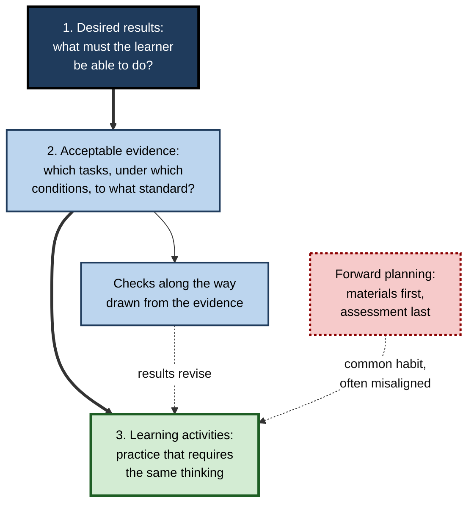
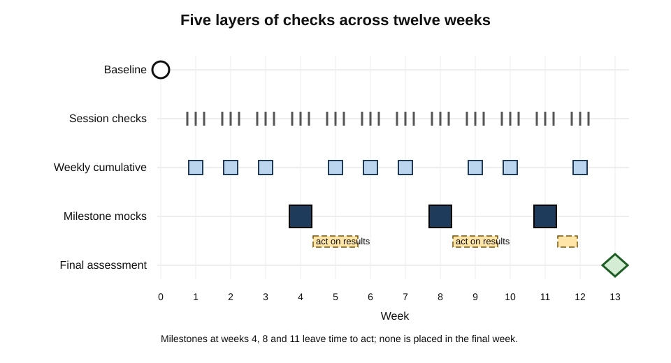
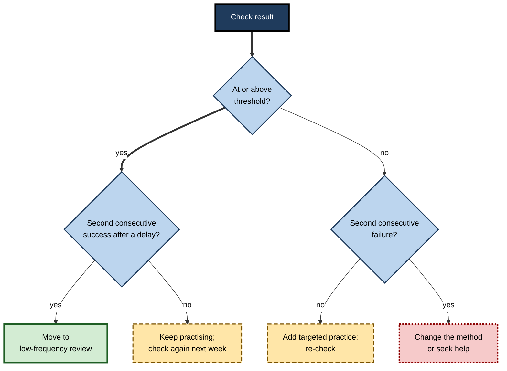
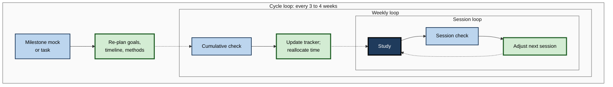
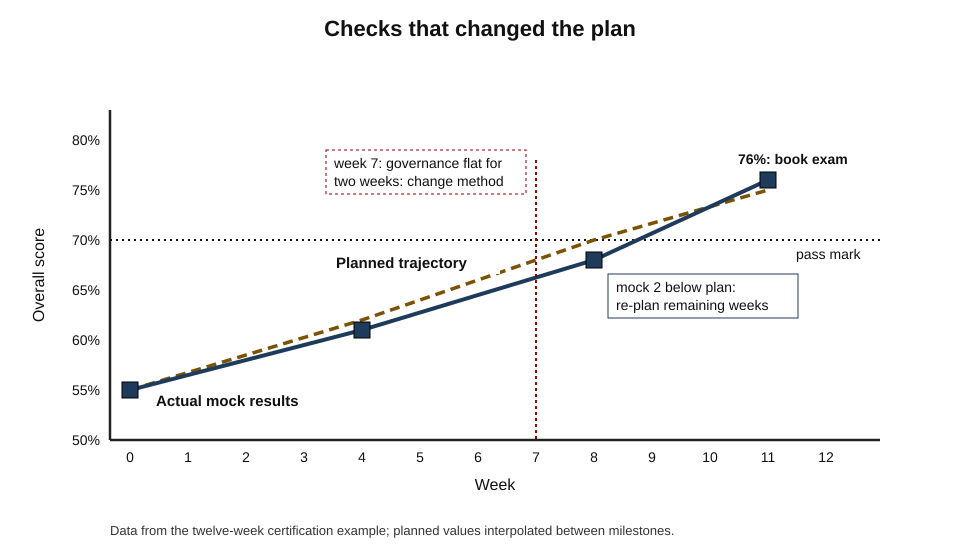
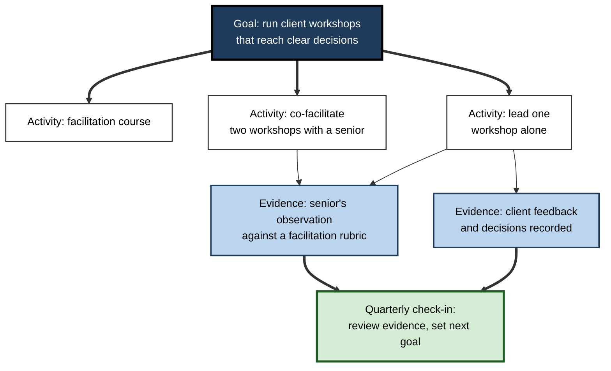

# L.12. Integrating Assessment Into Learning Plans

Two analysts start the same twelve-week preparation for a data-analytics certification. The first plans topics week by week and books the examination for week thirteen.

The second plans the same topics, but also decides in advance what evidence will show each topic is secure, schedules a short check every week and a full mock every four weeks, and writes down what she will do if a check fails. By week five the first analyst feels on track; the second **knows** she is two topics behind and has already changed her plan.

> **Definition — Assessment-integrated learning plan:** a learning plan in which the evidence that will show each goal has been achieved, the checks along the way and the decisions those checks will trigger are specified before study begins.

**Why it matters**

- A plan without checks is a **hope**: it says what will be studied, not whether it will be learned.
- Checks without **decision rules** produce data that nobody acts on.
- Building assessment in from the start makes progress **visible early**, while there is still time to change course.
- The same design applies to an individual's study, a team's onboarding programme and an organisation's capability-building.

---

## Start from the Evidence

### Backward design

- **Grant Wiggins and Jay McTighe (1998)** proposed planning instruction **backwards**:
  1. **Identify the desired results** — what should the learner understand and be able to do?
  2. **Determine acceptable evidence** — how will it be known that they can?
  3. **Plan learning experiences** — only then, decide what to study and practise.
- The usual habit runs the other way: choose materials, then think about assessment at the end.

> **Definition — Backward design:** planning that starts from the intended results and the evidence that will demonstrate them, and only then selects learning activities.

### Constructive alignment

- **John Biggs (1996)** described **constructive alignment**: intended outcomes, learning activities and assessment tasks should all require the **same kind of thinking**.
  - If the outcome is "evaluate investment options", the activities must involve evaluating options, and the assessment must require evaluation — not recall of definitions.
- Misalignment is common: a goal of application, practice of reading and an assessment of recall.

**Figure 1.** Backward design: from results to evidence to activities.

**Table 1.** Forward and backward planning compared.

| | Forward planning | Backward design |
|---|---|---|
| Starting point | Materials and topics | Intended capabilities and their evidence |
| When assessment is decided | At the end | Before study begins |
| Typical checks | One final test | Baseline, frequent checks, milestones, final |
| Alignment of practice and assessment | Often weak | Built in |
| How progress is judged | Topics covered | Evidence produced |

---

## From Goals to Evidence

### The evidence chain

- Each goal in a plan should carry five elements:
  1. **Goal** — the capability, stated as something the learner will be able to do.
  2. **Evidence** — what will show it (a task, a product, a performance).
  3. **Check method** — how and when the evidence will be gathered (quiz, mock, observed task, review).
  4. **Threshold** — the standard that counts as achieved.
  5. **Date** — when the check will happen.

**Table 2.** Evidence chains for three goals in a data-analytics plan.

| Goal | Evidence | Check method | Threshold | Date |
|---|---|---|---|---|
| Write SQL joining three or more tables to answer business questions | Correct answers to unseen questions on a practice schema | Timed set of 8 questions, no notes | 7 of 8 correct, under 40 minutes | Weeks 3 and 6 |
| Choose and interpret appropriate statistical tests | Written analyses of four short cases | Self-marked against model answers, one checked by a mentor | 3 of 4 fully correct | Weeks 5 and 9 |
| Build a dashboard that answers a stakeholder's question | A working dashboard and a two-minute explanation | Mentor review against a single-point rubric | All criteria at proficient | Week 10 |

> **Mnemonic — "Good Evidence Comes Through Dates":** Goal, Evidence, Check, Threshold, Date.

> **Watch out:** "finish module 4" is an **activity**, not a goal. Plans built from activities record effort; plans built from evidence record learning.

### Matching the check to the goal

- The check must demand the same kind of performance as the goal — the alignment principle applied to each line of the plan.

**Table 3.** Check formats suited to different kinds of goal.

| Kind of goal | Example goal | Suitable check | Unsuitable check |
|---|---|---|---|
| Knowledge | Explain the main provisions of a new regulation | Delayed short-answer quiz; explain aloud without notes | Ticking "read the summary" |
| Procedure | Reconcile a bank account | Timed reconciliation of an unseen case | Describing the steps |
| Judgement | Decide whether to escalate a customer complaint | Scenario cases compared with an expert's reasoning | Recall of the escalation policy |
| Communication | Present a recommendation to senior stakeholders | Recorded rehearsal scored against a rubric; stakeholder feedback | Slide count or attendance at a course |
| Professional behaviour | Give regular, useful feedback to reports | Reports' ratings; observation by a manager | Self-rating alone |
| Technical build | Deploy a service with monitoring | Working deployment reviewed by a peer | Course certificate |

> **Key point:** for every goal, ask, "**If I could do this, what would I be able to show?**" — then make showing it the check.

---

## The Assessment Architecture of a Plan

### Five layers of checks

- **Baseline (diagnostic)** — before study: what is already known? Prevents wasted time and sets the starting point.
- **Session checks** — a few questions at the end of each study session: did anything stick?
- **Weekly cumulative checks** — sampled across everything studied so far: is it lasting?
- **Milestone checks** — every three to four weeks, a larger task or mock under realistic conditions: is the plan on track?
- **Final or external assessment** — the examination, certification, project delivery or real work the plan is aimed at.

**Figure 2.** An assessment calendar for a twelve-week plan.

### How much time should checks take?

- Checks are not overhead: retrieval during checks is itself learning, and the information they provide steers the remaining effort.
- A common rule of thumb in self-directed preparation is that roughly **a fifth to a quarter** of study time goes on some form of testing — more as the final assessment approaches.

> **Watch out:** this proportion is practitioners' guidance, not an experimentally established optimum. The right amount depends on the material, the learner and how much each check changes decisions.

### Setting thresholds and dates

- **Thresholds** should come from the **use** of the capability:
  - for an examination, the pass mark plus a **safety margin** that reflects how much scores vary between practice tests;
  - for work, the standard a competent colleague meets — "reconciles a month's accounts without review comments";
  - for safety-critical tasks, near-perfect accuracy **and** fluency.
- **Dates** should come from **dependencies and decay**:
  - check prerequisites before the material that builds on them;
  - check again after a delay — a success the day after study says little about the day of the examination;
  - place the final milestone early enough to act on it, typically one to three weeks before the target.
- **Write thresholds down before the first check.** Thresholds chosen after seeing results tend to drift towards whatever was achieved.

> **Watch out:** a threshold set too low makes every check a pass and the plan uninformative; one set too high makes every check a failure and the plan demoralising. If a threshold is never or always met across several checks, revisit it — openly, with a reason.

### Spacing the checks

- Checks spread over time do double duty: they **measure retention** and, through repeated retrieval, **improve** it.
- **Milestones** should leave time to act: a milestone in the final week can only report, not redirect.

---

## Decision Rules

### Decide in advance what each result will mean

- A check is useful only if its result **changes what happens next**.
- **Pre-committed decision rules** avoid two common failures:
  - **ignoring bad results** ("that was an off day");
  - **over-reacting** to one result ("I'm hopeless at this; I'll drop it").

**Table 4.** Example decision rules for a study plan.

| Result | Decision |
|---|---|
| Session check below 60% | Restudy the material from the source next session |
| Weekly check below threshold on a topic | Add two practice sessions on that topic; re-check next week |
| Same topic below threshold on two consecutive weekly checks | Change the method: different source, worked examples, ask a mentor |
| Topic above threshold on two delayed checks | Move to low-frequency review |
| Milestone mock more than 10 points below target | Re-plan: drop low-weight topics, extend the timeline or seek tuition |
| Milestone mock above target on fresh items | Continue; consider booking the examination |

### If–then planning

- **Peter Gollwitzer (1999)** described **implementation intentions** — plans of the form "**if** situation X arises, **then** I will do Y".
- **Gollwitzer and Paschal Sheeran (2006)**, in a meta-analysis of 94 independent tests, found implementation intentions had a medium-to-large positive effect on goal attainment compared with goal intentions alone.
- Decision rules for assessment results are implementation intentions applied to learning: "**If** my weekly score on statistics is below 70%, **then** I will book a session with my mentor."

> **Definition — Implementation intention:** an if–then plan that links a specific situation to a specific response, making the response more likely when the situation occurs.

**Figure 3.** A decision gate after each check.

### Options when the plan is behind

- When checks show the plan is failing, there are five levers. Evidence should decide which to pull:
  1. **Change the method** — when effort is adequate but results are flat (a different source, more worked examples, practice with feedback, a tutor).
  2. **Add time** — when results are rising but too slowly to reach the threshold by the date.
  3. **Narrow the scope** — drop or postpone low-weight or low-priority goals so that high-weight ones are secured.
  4. **Add support** — a mentor, study partner or course where the learner cannot diagnose the problem alone.
  5. **Move the date** — postpone the final assessment when the gap is too large for the time remaining.
- **What not to do:** lower the threshold quietly, stop checking, or keep the same method and hope.

> **Example (illustrative):** after Mock 2 in the twelve-week example, results were rising (so the method was working) but slightly behind. The analyst narrowed scope — dropping a low-weight optional topic — and added two sessions to the weakest domain, rather than postponing.

### A week with assessment built in

- The architecture becomes concrete in an ordinary study week. A working professional with about six hours a week might plan:
  1. **Monday (60 minutes):** new material on the first topic; three-question session check at the end.
  2. **Tuesday (45 minutes):** practice problems on that topic; brief check on last week's topic.
  3. **Wednesday (60 minutes):** new material on the second topic; session check.
  4. **Thursday (45 minutes):** mixed practice on both topics and older ones.
  5. **Friday (30 minutes):** **weekly cumulative check** — 15–20 items sampled across all topics, answered unaided with confidence tags.
  6. **Saturday (60 minutes):** targeted work on whatever Friday's check showed was weakest.
  7. **Sunday (15 minutes):** update the tracker, apply decision rules, set next week's priorities.
- **Proportions:** in this example roughly a fifth of the time is explicit checking, and much of the practice is itself retrieval.
- **Flexibility:** if a week is lost to work pressure, keep the Friday check and the Sunday review — they show how much ground was lost and keep the loop turning.

> **Remember:** the **check** and the **review** are the last parts of the week to drop, not the first.

---

## Loops at Three Timescales

### Session, week, cycle

- **Session loop (minutes):** study → session check → adjust the next session.
- **Weekly loop (days):** weekly cumulative check → update tracker → reallocate next week's time.
- **Cycle loop (weeks):** milestone → compare with plan → re-plan goals, timeline or methods.
- The structure echoes the **plan–do–check–act** cycle associated with **Walter Shewhart** and **W. Edwards Deming** in quality management: improvement comes from repeated cycles in which checking drives action.

**Figure 4.** Three nested feedback loops in a learning plan.

---

## Worked Example (illustrative): A Twelve-Week Certification Plan

A data analyst plans for a certification with four domains: data preparation (30%), analysis (30%), visualisation (20%), governance (20%). Pass mark 70%.

**Steps:**

1. **Baseline (week 0):** 40-question diagnostic → preparation 65%, analysis 45%, visualisation 75%, governance 40%.
2. **Allocate time by gap and weight:** analysis and governance get most time; visualisation least.
3. **Write evidence chains** for each domain (as in Table 2).
4. **Schedule checks:** session checks throughout; weekly 20-item cumulative quiz every Friday; full mocks in weeks 4, 8 and 11.
5. **Write decision rules** (as in Table 4) and keep them beside the plan.

**Table 5.** Planned checks and what happened.

| Week | Planned focus | Check | Result | Decision |
|---|---|---|---|---|
| 0 | — | Diagnostic | 55% overall | Allocate time to analysis and governance |
| 1–3 | Analysis, preparation | Weekly quizzes | Analysis 50%, 55%, 62% | Rising; continue |
| 4 | — | Mock 1 | 61% (governance 42%) | Governance not yet studied; on plan |
| 5–7 | Governance, analysis | Weekly quizzes | Governance 48%, 50%, 51% | Two weeks flat: **change method** — switch from reading to case questions with a colleague |
| 8 | — | Mock 2 | 68% (governance 63%) | Below target; drop a low-weight optional topic; add two governance sessions |
| 9–10 | Mixed review | Weekly quizzes | All domains above 70% | Continue |
| 11 | — | Mock 3 (fresh items) | 76% | Book the examination for week 13 |
| 12 | Light review | Session checks | — | Rest before the examination |

*Illustrative figures.*

- **What the architecture achieved:**
  - the **flat governance results** in weeks 5–7 triggered a method change three weeks before it could have been noticed at a mock;
  - Mock 2 triggered a **re-plan**, not panic;
  - the booking decision rested on a **fresh-item mock**, not a feeling.

**Figure 5.** Planned trajectory, actual results and the points where checks changed the plan. (illustrative)

---

## Plans Over Long Horizons

### Multi-year qualifications and careers

- Professional qualifications often run over two to four years and many papers; careers run over decades. Assessment must be integrated at longer timescales too.
- **Practices that help:**
  - **Quarterly reviews** — a short re-baseline across all goals: what has moved, what has stalled, what has decayed.
  - **Retention checks of earlier material** — knowledge from a paper passed a year ago is often needed for later papers and for work; a few delayed items on old material keep it alive and reveal decay.
  - **Annual re-planning** — revisit goals themselves: are they still the right ones, given changes in role, field and ambition?
  - **Linking to a portfolio** — evidence from milestone checks and real work feeds the record used for appraisal, registration or promotion.

> **In practice:** treat the end of each paper or project as a **milestone, not a finish line**: record what was learned, what was weak and what will be needed again, and schedule a light check on it in three to six months.

### Programme-level plans

- Organisations designing development programmes apply the same architecture at scale:
  - an **assessment map** showing which outcome is checked where, in what format and to what standard — a direct application of constructive alignment;
  - **frequent formative checks** inside the programme, with data reviewed by facilitators to adjust delivery;
  - **evidence beyond the classroom** — observed changes in work, collected weeks after the programme;
  - a **review cadence** — what will be looked at, by whom, and what will change as a result.
- **The common gap:** programmes measure reactions and end-of-course scores but rarely gather evidence of changed practice, so they cannot learn whether they work.

---

## Assessment in Workplace Learning Plans

### Individual development plans

- An **individual development plan (IDP)** sets development goals for an employee, usually agreed with a manager.
- Most IDPs list **activities** — courses, conferences, stretch assignments. An assessment-integrated IDP adds, for each goal:
  - the **evidence** that will show progress (a delivered project, observed behaviour, feedback, a certification);
  - **check-ins** at which evidence is reviewed;
  - **who** provides independent evidence (manager, client, peer).
- **The common split:** most workplace learning happens through experience and relationships rather than courses; evidence should therefore come mainly from **work outputs and observed performance**, not course completions.

**Figure 6.** From a development goal to evidence in an individual development plan.

### Team learning plans

- Teams adopting a new technology, process or regulation need a shared plan with shared checks:
  - **team-level goals** with evidence — "every engineer can deploy to the new platform unaided by the end of the quarter";
  - **individual baselines**, so that experienced members are not forced through material they already know;
  - **shared milestones** — a team game day, a joint review of the first real deliveries;
  - **a skills view** showing who has reached which level, used to pair people and spread knowledge.
- **The trap:** reporting team progress as course completions. A team plan should report **evidence of capability** — tasks performed unaided, reviews passed, incidents handled.

### Onboarding plans

- **30-60-90-day plans** for new joiners work best when each phase ends with **evidence** rather than a feeling:
  - *30 days* — can explain the team's systems and clients; has completed a supervised piece of work;
  - *60 days* — has completed a standard task unaided, reviewed by a colleague;
  - *90 days* — owns a piece of work end to end; manager and peer feedback collected.

### Keeping development checks formative

- Development check-ins work best when they are **separate** from performance ratings and pay decisions; otherwise employees present only good evidence, and the plan loses its diagnostic value.

> **In practice:** many managers find a simple question transforms development conversations: "**What evidence would show us, in three months, that this goal has been met?**"

### Case study (illustrative): a new team lead's ninety days

- **Situation:** an experienced engineer was promoted to lead a team of seven.
- **Initial plan:** attend a management course, read two books, "have one-to-ones".
- **Problem:** after six weeks she felt busy but could not say whether she was improving; her manager's feedback was vague.
- **Redesign using an assessment-integrated plan:**
  1. **Goals** — run effective one-to-ones; delegate work so that she wrote less code herself; handle one performance conversation well.
  2. **Evidence** — team members' anonymous ratings of one-to-one usefulness (monthly, three questions); share of team tickets she personally closed; her manager's observation of a recorded role-play of a performance conversation, scored against a rubric.
  3. **Thresholds** — average usefulness rating at least 4 of 5; personal share of tickets below 15%; role-play at proficient on all rubric criteria.
  4. **Decision rules** — if one-to-one ratings fell, ask the team what to change; if her ticket share rose above 20%, review delegation with her manager.
- **Result (ninety days):**
  - one-to-one ratings rose from 3.1 to 4.2 after she started agreeing actions at the end of each meeting;
  - her ticket share fell from about 40% to 12%;
  - the first role-play scored "developing" on two criteria; after practice, the second reached proficient, and a real performance conversation the following month went well.
- **Lesson:** the course and the books were useful **activities**; the **evidence** — ratings, ticket share, observed role-play — showed what was working and when to change course.

---

## Why Integrated Plans Fail

- **Assessment only at the end** — no chance to redirect.
- **Checks without decisions** — scores logged, nothing changes.
- **Over-assessment** — so many checks that study time collapses; checks should be short and purposeful.
- **Moving the goalposts** — lowering thresholds after a bad result.
- **Measuring activity** — hours, modules, books read.
- **Rigid plans** — refusing to re-plan when evidence says the plan is failing.

> **Remember:** a good plan **expects to be wrong** and builds in the checks that will show where.

---

## Open Questions

- **What proportion of study time should go on assessment?**
  - Testing is both measurement and learning, so the optimum is hard to define; practical guidance outruns the evidence.
- **How should plans balance flexibility and commitment?**
  - Pre-committed rules prevent rationalisation but can be too rigid; when to override them is a matter of judgement.
- **How can workplace learning goals be assessed affordably?**
  - Observed performance and feedback are valid but costly; organisations default to completion data.
- **Can AI maintain and adapt learning plans?**
  - Tools can schedule checks and suggest re-plans from results; whether learners keep ownership — and judgement — is an open concern.
- **Does backward design improve outcomes for self-directed learners?**
  - It is widely recommended for course design; direct evidence for individuals planning their own study is limited.

---

## Summary

- An **assessment-integrated plan** specifies, before study begins, the **evidence** for each goal, the **checks** along the way and the **decisions** they trigger.
- **Backward design** (**Wiggins and McTighe, 1998**): results → evidence → activities. **Constructive alignment** (**Biggs, 1996**): outcomes, activities and assessment require the same thinking.
- Each goal carries an **evidence chain**: goal, evidence, check method, threshold, date — activities are not goals.
- Five layers of checks: **baseline, session, weekly cumulative, milestone, final**; milestones must leave time to act.
- **Decision rules** — **if–then** plans (**implementation intentions**, Gollwitzer) — prevent both ignoring and over-reacting to results.
- Loops run at three timescales — **session, week, cycle** — in the spirit of **plan–do–check–act**.
- At work, **IDPs** and **onboarding plans** need evidence from **work outputs and observed performance**, kept separate from pay decisions.
- Plans fail through end-only assessment, checks without decisions, over-assessment, moving goalposts, measuring activity and rigidity.

---

## Self-Check

1. Define an assessment-integrated learning plan.
2. State the three stages of backward design and contrast it with forward planning.
3. What is constructive alignment? Give an example of misalignment.
4. Name the five elements of an evidence chain and write one for a goal of your own.
5. Why is "complete module 4" not a goal?
6. List the five layers of checks and the purpose of each.
7. Why should milestone checks not be placed in the final week?
8. Write three decision rules for a language learner preparing for a speaking examination.
9. What are implementation intentions, and what did Gollwitzer and Sheeran's meta-analysis find?
10. Describe the three nested feedback loops and their timescales.
11. In the twelve-week example, what triggered the change of method for governance, and why was that earlier than a mock would have shown?
12. How should an IDP goal be made assessable? Give an example.
13. Why should development check-ins be separate from performance ratings?
14. In the team-lead case study, identify the evidence used for each goal and explain why it was better than the original plan.

### Answer Key

1. A plan specifying, before study begins, the evidence that will show each goal is achieved, the checks along the way and the decisions those checks will trigger.
2. Identify desired results; determine acceptable evidence; plan learning experiences. Forward planning chooses materials first and decides assessment at the end, which often misaligns practice with the real goal.
3. Outcomes, activities and assessment all require the same kind of thinking (Biggs). Misalignment: a goal of evaluating investment options, practice by reading summaries, and an assessment of definitions.
4. Goal, evidence, check method, threshold, date. E.g. goal: present quarterly results to the board clearly; evidence: a recorded rehearsal; check: mentor scores it against a rubric; threshold: proficient on all criteria; date: two weeks before the board meeting.
5. It describes an activity — exposure — not a capability, and its completion says nothing about whether anything was learned.
6. Baseline — find the starting point; session checks — did anything stick; weekly cumulative — is it lasting; milestone — is the plan on track under realistic conditions; final — the target assessment or real performance.
7. Because a milestone's purpose is to redirect the plan; in the final week there is no time to act on what it shows.
8. E.g. "If my recorded two-minute answer has more than three long pauses, then I will practise that topic aloud twice more this week." "If I score below 3 of 5 on fluency in two consecutive weekly recordings, then I will book a session with a tutor." "If I meet the target on two recordings a week apart, then I will move that topic to monthly review."
9. If–then plans linking a situation to a response. Across 94 independent tests they had a medium-to-large positive effect on goal attainment compared with goal intentions alone.
10. Session loop (minutes): study, check, adjust the next session. Weekly loop (days): cumulative check, update tracker, reallocate time. Cycle loop (weeks): milestone, compare with plan, re-plan.
11. Two consecutive weeks of flat governance scores (48%, 50%, 51%) triggered the "two consecutive failures → change method" rule in week 7; the next mock was not until week 8, and without weekly checks the problem would only have shown there.
12. Add evidence, check-ins and independent sources. E.g. goal "improve stakeholder communication": evidence — stakeholder feedback after three project updates and a manager's observation of one meeting against a rubric; check-in quarterly; threshold — average feedback 4 of 5 and proficient on the rubric.
13. Because when pay or ratings depend on them, employees present only favourable evidence and hide weaknesses, destroying the diagnostic value of the plan.
14. One-to-ones — anonymous monthly usefulness ratings; delegation — personal share of tickets closed; performance conversations — rubric-scored role-play observed by her manager. Unlike courses and books, these measured her actual behaviour and its effects, showed what was working and triggered specific changes.

---

## Glossary

| Term | Meaning |
|---|---|
| Assessment calendar | A schedule of the checks planned across a learning period. |
| Assessment-integrated learning plan | A plan specifying evidence, checks and decision rules before study begins. |
| Backward design | Planning from desired results to evidence to activities. |
| Baseline | A diagnostic check before study that establishes the starting point. |
| Constructive alignment | Alignment of outcomes, activities and assessment so that all require the same thinking. |
| Decision rule | A pre-committed statement of what a given check result will trigger. |
| Evidence chain | Goal, evidence, check method, threshold and date for a learning goal. |
| Implementation intention | An if–then plan linking a situation to a response. |
| Individual development plan (IDP) | An agreed plan of an employee's development goals and activities. |
| Milestone check | A larger, realistic check every few weeks to test whether a plan is on track. |
| Plan–do–check–act | A repeated improvement cycle in which checking drives action. |
| Session check | A short check at the end of a study session. |
| Threshold | The standard that counts as achieving a goal. |
| Weekly cumulative check | A regular check sampled across everything studied so far. |
