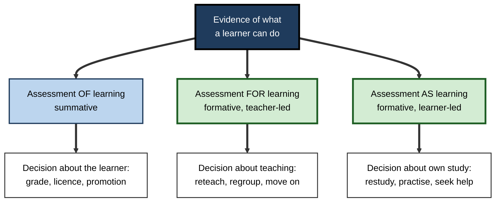
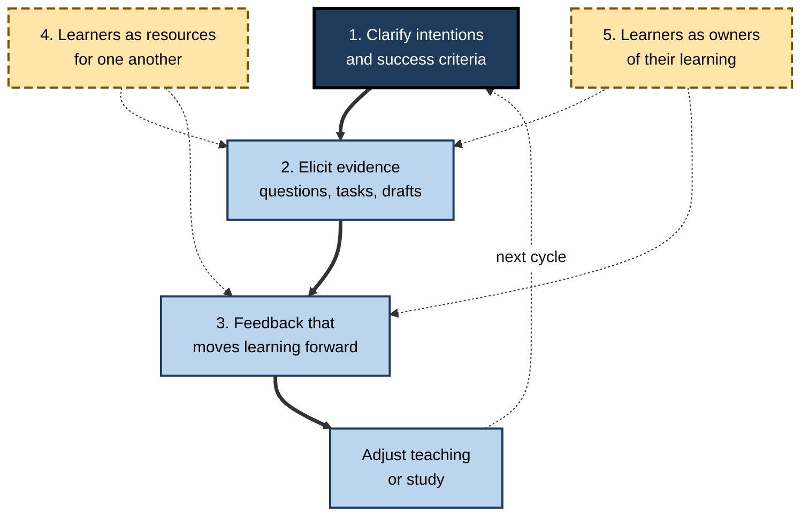
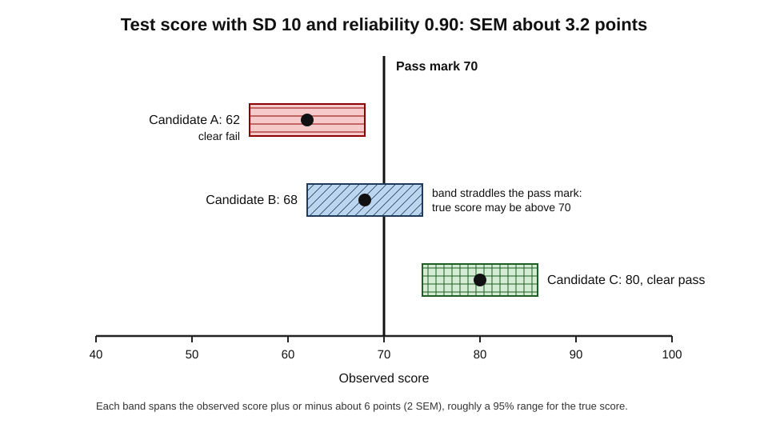
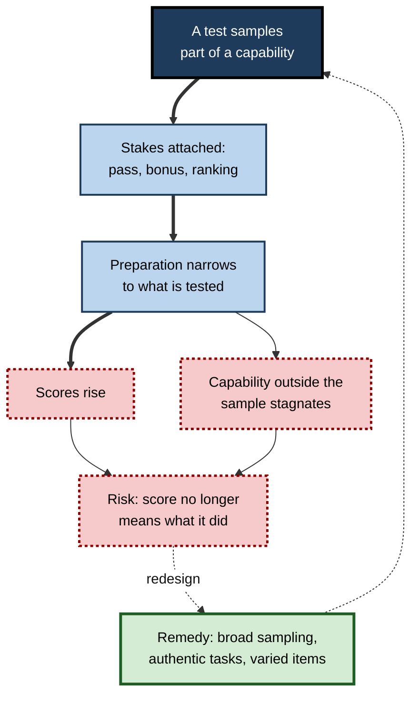
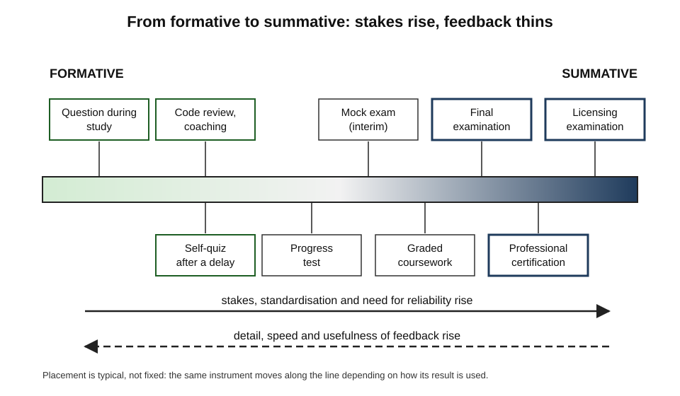
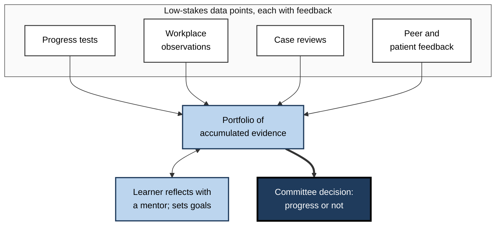

# L.2. Formative vs. Summative Assessment

When a cook tastes the soup, the tasting changes the soup — a pinch more salt, five more minutes on the heat. When the guests taste it, the verdict is final. The same spoon and the same soup serve two entirely different purposes. Assessment works the same way: a practice question answered on Monday can redirect a week of study, while the identical question in a licensing examination decides a career.

> **Definition — Formative assessment:** assessment whose results are used, while learning is still under way, to decide what the learner or teacher should do next.

> **Definition — Summative assessment:** assessment whose results are used to make a judgement or decision about what has been achieved — a grade, a certificate, a pass, a promotion.

**Why the distinction matters**

- It decides **how a result should be used**: to adjust learning, or to certify it.
- It decides **what quality the assessment needs**: summative decisions demand high reliability; formative checks demand speed and usefulness.
- Mixing the purposes carelessly **damages learning** — learners hide errors from assessments that count.
- A self-directed learner must run their own formative assessment and prepare for other people's summative assessment; confusing the two leads to both poor study and poor results.

---

## Where the Distinction Came From

### From curriculum evaluation to classrooms

- **Michael Scriven (1967)** introduced the terms in **programme evaluation**:
  - **formative evaluation** — used to improve a curriculum while it is being developed;
  - **summative evaluation** — used to judge its overall worth once finished.
- **Benjamin Bloom, Thomas Hastings and George Madaus (1971)** carried the distinction to the assessment of **individual students**.
- **Bloom's mastery learning (1968):**
  1. teach a unit;
  2. give a short, ungraded **formative test**;
  3. provide **correctives** to those who have not reached mastery and enrichment to those who have;
  4. re-test before moving on.
  - Bloom's insight: most differences in final achievement reflect differences in the **time and help** learners received, not fixed ability.

> **Definition — Mastery learning:** an approach in which learners move on only after demonstrating a set level of mastery, with formative tests and corrective instruction used to get them there.

### The modern revival

- **Paul Black and Dylan Wiliam (1998)** reviewed about 250 studies and concluded that strengthening formative assessment produced **substantial** gains in achievement — among the largest of any classroom intervention.
- Their pamphlet *Inside the Black Box* (1998) made the case to teachers and policymakers.
- The **Assessment Reform Group** in the United Kingdom popularised the phrase **assessment for learning**, contrasting it with **assessment of learning**.
- **Lorna Earl (2003)** added **assessment as learning** — the learner monitoring and adjusting their own learning.

> **Watch out:** the large effect sizes once quoted for formative assessment came from a broad narrative review, not a single meta-analysis. Later analyses, such as **Neal Kingston and Brooke Nash (2011)**, estimated much **smaller** average effects and wide variation by implementation. Formative assessment helps; its benefit depends heavily on how well it is done.

**Figure 1.** Three purposes of assessment.

---

## Function, Not Format

### The same test, two uses

- Neither term describes a **type of test**; both describe a **use of results**.
- A multiple-choice quiz is formative if the results change what happens next, and summative if they are recorded as a verdict.
- **Dylan Wiliam** has argued that it is clearer to speak of formative and summative **uses** or **inferences** than of formative and summative assessments.
- A test can serve both purposes, but rarely serves both **well**: what makes it good for one often weakens it for the other.

**Table 1.** Formative and summative assessment compared.

| | Formative | Summative |
|---|---|---|
| Central question | What should happen next? | What has been achieved? |
| Timing | During learning | At the end of a unit, course or period |
| Stakes | Low or none | Moderate to high |
| Main user of results | Learner and teacher | Institution, employer, regulator, learner |
| Quality most needed | Speed, detail, usefulness for action | Reliability, comparability, defensibility |
| Typical result | Specific diagnosis and next steps | A score, grade or pass/fail |
| Effect on learner behaviour | Encourages exposing errors | Encourages hiding errors |
| Workplace examples | Code review, coaching, simulation debrief | Certification, licensing, probation sign-off |

### Criterion and norm referencing

- A result needs a frame of reference.
  - **Criterion-referenced** — compared with a fixed standard: "can calculate dosage correctly in 9 of 10 cases".
  - **Norm-referenced** — compared with other people: "scored in the top 20% of the cohort".
  - **Ipsative** — compared with the learner's own previous performance: "better than last month".
- Formative self-assessment benefits most from **criterion** and **ipsative** frames: they show the gap to the standard and the progress made.
- Norm-referencing is useful for selection but tells the learner little about what to do.

> **Definition — Ipsative assessment:** assessment that compares a learner's present performance with their own past performance.

**Table 2.** Three frames of reference for an assessment result.

| | Criterion-referenced | Norm-referenced | Ipsative |
|---|---|---|---|
| Compared with | A defined standard | Other people | One's own earlier results |
| Answers | "Am I good enough?" | "How do I rank?" | "Am I improving?" |
| Best for | Licensing, mastery decisions, self-diagnosis | Selection when places are limited | Motivation, tracking progress |
| Weakness | Standards are hard to define precisely | Says little about actual capability | Can hide that the standard is still far off |

---

## The Formative Cycle

### Five key strategies

**Dylan Wiliam and Marnie Thompson (2007)** organised formative assessment as five strategies, built around three questions — where the learner is going, where they are now, and how to get there:

1. **Clarify** learning intentions and criteria for success.
2. **Elicit** evidence of learning through well-designed questions, tasks and discussions.
3. **Provide feedback** that moves learners forward.
4. **Activate learners as resources** for one another (peer assessment).
5. **Activate learners as owners** of their own learning (self-assessment).

**Figure 2.** The formative cycle and its five strategies.

### The independent learner's version

- Each strategy has a form a learner can run alone:
  - **Clarify** — collect the syllabus, competency framework or mark scheme; translate it into specific "I can…" statements.
  - **Elicit** — attempt unaided questions, explain a concept aloud, produce a draft.
  - **Feedback** — mark against a key or exemplar; compare with a model answer.
  - **Peers** — swap work with a colleague or study partner.
  - **Ownership** — decide what to do with the result and when to check again.

> **Mnemonic — "Clever Elephants Find Peanuts Swiftly":** Clarify, Elicit, Feedback, Peers, Self.

### Designing questions that elicit evidence

- A formative question is good if its answer **tells the asker what to do next**.
- **Hinge questions** — a single question, usually multiple-choice, at a pivotal point of a lesson.
  - Each wrong option corresponds to a specific, common misconception.
  - The pattern of answers decides whether to move on or reteach.
  - *e.g.* for a finance trainee: "A company's revenue rises and its cash falls. Which is the most likely explanation?" — with distractors reflecting the confusion of profit with cash, timing with volume, and so on.
- **Exit tickets** — two or three questions at the end of a session to check what stuck.
- **Delayed checks** — the same ideas re-tested days later, which show durable learning rather than momentary performance.

> **Key point:** a formative check that cannot change a decision is a waste of time. Before setting one, decide what will be done with each possible result.

---

## Diagnostic Assessment: Before Learning Begins

### A third purpose

- Some writers add a third category to the pair: **diagnostic** (or **placement**) assessment, given **before** instruction.
- It answers two questions:
  - **What does the learner already know?** — so that time is not spent on it.
  - **What misconceptions do they bring?** — so that teaching can confront them directly.
- Strictly it is a special case of formative use: its result changes what happens next.

> **Definition — Diagnostic assessment:** assessment before or at the start of learning that identifies existing knowledge, skills and misconceptions in order to plan what to teach or study.

### Why prior knowledge deserves its own check

- **David Ausubel (1968)** wrote that the single most important factor influencing learning is **what the learner already knows**: "Ascertain this and teach him accordingly."
- Prior knowledge decides how fast new material is learned, which explanations make sense and which errors are likely.
- **Concept inventories** — such as the **Force Concept Inventory** developed by **David Hestenes and colleagues (1992)** for introductory physics — are diagnostic tests built from common misconceptions; each wrong option corresponds to a known faulty idea.

### Diagnostic assessment for the self-directed learner

- **Start with a pre-test** on the syllabus or competency list before studying anything.
- **Sort topics** into three groups: secure (skip or review lightly), partial (study), absent (study from the beginning).
- **Record wrong answers given with confidence** — they signal misconceptions, which need more than new information to fix.
- **Re-use the pre-test later** — the difference between the pre-test and a delayed re-test is the clearest evidence of what the study achieved.

> **Example (illustrative):** an experienced project manager starting a formal risk-management qualification sits a 40-question diagnostic. She finds that most of the qualitative risk material is secure, but she confuses **risk appetite** with **risk tolerance** and cannot compute an expected monetary value. She skips two weeks of familiar content and spends that time on the quantitative units.

> **Watch out:** a pre-test is itself a learning event — attempting questions before study can improve later learning of that material. That is helpful for the learner, but it means a pre-test/post-test gain is not a pure measure of the teaching alone.

### Common confusions about the two purposes

- **"Formative means informal."**
  - Formative assessment can be highly structured — hinge questions, diagnostic inventories, progress tests. What makes it formative is the use of the result, not its looseness.
- **"Summative means a final examination."**
  - Any assessment whose result is recorded as a verdict — a probation sign-off, a quarterly review rating — is summative, whatever its form.
- **"More frequent testing is more formative."**
  - Frequent tests that are graded and reported become many small summative events; they can increase anxiety and concealment without improving learning.
- **"Feedback makes it formative."**
  - Feedback that is not used changes nothing. The test is whether the learner or teacher **did something different** because of the result.
- **"Self-tests are automatically formative."**
  - A learner who treats each self-quiz as a verdict on their worth — chasing scores, avoiding hard items, abandoning a topic after a bad result — has turned formative practice into summative judgement.

> **Remember:** ask of any assessment, "**What will be done differently because of this result?**" If the answer is "nothing except record it", it is functioning summatively.

---

## What Summative Assessment Demands

### Reliability

> **Definition — Reliability:** the consistency of an assessment's results — the extent to which the same person would receive a similar score on another occasion, another form of the test or from another marker.

- Summative decisions are consequential, so the score must not depend on luck: which questions appeared, which marker marked, which day it was.
- Reliability is raised by **more items**, **clear marking schemes**, **trained markers**, **second marking** and **standardised conditions**.

> **Formula — Standard error of measurement (SEM):** SEM = SD × √(1 − reliability). For a test with a standard deviation of 10 points and a reliability of 0.90, SEM = 10 × √0.10 ≈ **3.2 points**. A candidate scoring 68 has a true score that probably (about 95% of the time) lies between roughly 62 and 74.

**Figure 3.** A measured score is a band, not a point: what the standard error of measurement means near a pass mark. (illustrative)

### Validity

> **Definition — Validity:** the degree to which evidence and reasoning support the interpretations and uses made of assessment results.

- **Samuel Messick (1989)** treated validity as a single concept about the **meaning and consequences** of scores, not a property of the test alone.
- **Michael Kane** developed the **argument-based** approach: state the chain of inferences from performance to decision, then check each link.
  - *Scoring* — was the performance scored correctly?
  - *Generalisation* — would similar tasks give similar results?
  - *Extrapolation* — does the result reflect performance in the real domain?
  - *Decision* — is the pass mark set sensibly, and are the consequences acceptable?
- A test can be reliable but invalid: a highly consistent typing-speed test is not a valid measure of writing quality.

### Standard setting

- A pass mark must be set by a defensible method, not by habit ("60% has always been the pass mark").
- **Angoff method:** expert judges estimate, for each item, the probability that a **borderline** candidate would answer correctly; the sum of these estimates becomes the cut score.
- **Borderline-group methods** (common in clinical skills examinations): examiners mark candidates and also give a global judgement; the cut score is set from the scores of those judged borderline.

> **Watch out:** formative self-tests need **none** of this machinery. Holding home-made practice quizzes to summative standards of reliability wastes time; their job is to show what to do next.

---

## How the Two Purposes Interfere

### Grades crowd out comments

**Study card — Ruth Butler (1988)**

- **Design:** Israeli school pupils completed creative and convergent-thinking tasks and then received one of three kinds of feedback:
  - comments only;
  - grades only;
  - grades plus comments.
- **Results:**
  - **comments only** → higher performance on later tasks and greater interest;
  - **grades only** and **grades plus comments** → no such gains; when a grade was present, comments seemed to be ignored.
- **Conclusion:** once work is graded, learners attend to the grade — the summative signal swamps the formative one.

> **Watch out:** later studies and syntheses broadly support the advantage of comments for motivation, but the pattern is not uniform across ages and settings. The robust lesson is narrower: **a mark attached to feedback reduces attention to the feedback.**

### Washback

> **Definition — Washback (or backwash):** the effect of an assessment on the teaching and learning that precede it.

- **Positive washback** — the test rewards the right capabilities, so preparing for it builds them.
  - *e.g.* a clinical examination with live patients pushes trainees to practise examination skills on the wards.
- **Negative washback** — the test rewards a narrow proxy, so preparation narrows to the proxy.
  - *e.g.* a certification that tests only recall of command syntax leads candidates to memorise syntax rather than solve problems.
- **Donald Campbell (1976):** the more a quantitative indicator is used for social decision-making, the more it is subject to corruption pressures and the more it distorts the processes it was meant to monitor.

**Figure 4.** How high stakes turn a measure into a target.

### Why learners hide errors from summative assessment

- When results count, rational learners:
  - avoid difficult questions they might get wrong;
  - conceal confusion from teachers and managers;
  - choose safe, familiar tasks over stretching ones.
- These behaviours are exactly the **opposite** of what learning needs.
- **The design response:** keep formative activities free of consequences, and make the separation explicit — "this does not count; its only purpose is to find what to work on".

> **Key point:** the more an assessment counts, the less honestly learners engage with it. Learning needs a protected space where being wrong costs nothing.

---

## A Continuum, Not a Switch

### The middle ground

- Between a quick self-quiz and a licensing examination lie many assessments of intermediate stakes.
- **Interim (benchmark) assessments** — periodic tests given across a course or organisation, often to predict summative results.
  - **Marianne Perie, Scott Marion and Brian Gong (2009)** classified assessments as **formative**, **interim** and **summative** by scale and frequency, and warned that interim tests are often sold as formative while rarely changing instruction.
- **Coursework that counts** — useful formatively only if feedback arrives before the next piece is due.

**Figure 5.** Common assessments arranged from formative to summative.

### Formative use of summative tests

- A summative result can be **read formatively** after the event:
  - analyse item-level results to find topics consistently missed;
  - compare predicted and actual scores;
  - plan the next cycle around the weaknesses found.
- **Black, Harrison, Lee, Marshall and Wiliam (2003)** described teachers in the King's–Medway–Oxfordshire project using past examination papers formatively — pupils marked each other's answers and generated their own questions — while still preparing for the summative examination.

> **In practice:** treat every external result — an examination transcript, an audit finding, a client evaluation — as data for the next formative cycle, not only as a verdict.

### Programmatic assessment

- **Cees van der Vleuten and Lambert Schuwirth (2005)** argued that no single assessment can be both reliable and valid enough for high-stakes decisions about complex competence.
- Their alternative, **programmatic assessment**:
  - many **low-stakes** assessments across a programme, each giving feedback;
  - **no single data point** decides progression;
  - a committee makes **high-stakes** decisions from the **aggregated** evidence;
  - learners are coached to reflect on the accumulating data.
- Widely adopted in medical education in the Netherlands, Australia and elsewhere; it blurs the formative–summative boundary by design.

**Figure 6.** Programmatic assessment: many low-stakes points feeding one well-informed decision.

> **Watch out:** programmatic assessment is resource-intensive and relies on committees judging qualitative data well. Its advantages are argued strongly, but rigorous comparisons with traditional systems are still limited.

---

## Assessment in Workplace Learning

### Formative and summative at work

**Table 3.** Formative and summative assessment in four professional settings.

| Setting | Formative examples | Summative examples |
|---|---|---|
| Software engineering | Code review, pairing, test failures, design critiques | Promotion panels, security certification, probation review |
| Medicine | Supervised case discussions, simulation debriefs, workplace-based observations | Licensing examinations, specialty exit examinations, revalidation |
| Accountancy | Progress tests, review notes on working papers | Professional examinations, partner sign-off |
| Sales | Call coaching, role-play feedback, deal reviews | Quarterly quota attainment, product certification |

- **The common failure:** organisations invest in summative events (certification, annual review) and neglect formative ones, which do most of the developmental work.
- **The common confusion:** annual appraisals that try to give developmental feedback *and* decide pay at once; the pay decision dominates, much as Butler's grades did.

> **In practice:** many organisations now separate **development conversations** (frequent, formative, no pay consequence) from **performance evaluation** (periodic, summative), for exactly this reason.

### Worked example (illustrative): redesigning assessment in a support-centre onboarding programme

A customer-support centre certifies new agents after a four-week onboarding programme.

**Before:**

- Weekly graded quizzes, all counting towards certification.
- Final certification: a 50-question multiple-choice test.
- Agents copied answers from the knowledge base; few admitted confusion; first-month escalation rates were high.

**Redesign, step by step:**

1. **Separate the purposes.** Weekly quizzes become ungraded practice; scores are seen only by the agent and their coach.
2. **Make formative checks diagnostic.** Each weekly check uses five realistic tickets; coaches review the reasoning, not just the outcome.
3. **Make the summative assessment valid.** Certification becomes a live simulation: ten unseen tickets of varied difficulty, handled with the real tools, marked against a scoring guide by two trained assessors.
4. **Raise reliability.** Assessors calibrate on recorded examples before marking; disagreements of more than one band are resolved by a third assessor.
5. **Use the summative result formatively.** Each agent receives an item-level breakdown that sets their first-month coaching goals.

**Table 4.** Onboarding assessment before and after redesign.

| | Before | After |
|---|---|---|
| Weekly assessment | Graded quiz, counts | Ungraded ticket practice with coaching |
| What learners did with errors | Concealed them | Brought them to coaching |
| Final assessment | Recognition test | Simulation of real work, double-marked |
| What the pass meant | Could recognise facts | Could resolve typical tickets unaided |
| Use of final result | Pass/fail only | Pass/fail plus a development plan |

- **Conclusion:** the programme did not need more assessment, but **clearer purposes** — formative checks that were safe to fail and a summative check that resembled the job.

> **Watch out:** the redesign costs more assessor time. The case for it rests on downstream measures — escalations, rework, customer satisfaction — which must be tracked to justify the cost.

### Case study (illustrative): a professional-examination programme that stopped grading practice

- **Situation:** an accountancy firm sponsored graduates through professional examinations; first-attempt pass rates were below the national average.
- **Problem:** monthly progress tests were graded and reported to managers; poor scores triggered warnings.
- **Diagnosis:**
  1. Trainees treated progress tests as threats: they crammed the night before, avoided weak topics and sometimes sought leaked questions.
  2. Results reflected cramming, so they predicted the real examination poorly.
  3. Feedback was a single percentage; nobody looked at which topics were failing.
- **Actions:**
  1. Progress tests were made **formative**: results went only to the trainee and a tutor, never to managers.
  2. Each test returned an item-level report mapped to syllabus areas.
  3. Trainees wrote a short plan after each test naming three areas to work on.
  4. One **full mock examination** under real conditions, six weeks before the sitting, remained reported — as the single interim summative check.
- **Result:** over the next two sittings, first-attempt pass rates rose, and the mock examination became a better predictor of the real result.
- **Side effects:** some managers complained of losing visibility; the firm reported aggregate, anonymised progress instead.
- **Lesson:** removing stakes from practice made it honest; honest practice made it useful.

---

## Open Questions

- **How large is the real effect of formative assessment?**
  - Estimates range from small to large depending on definition, setting and study quality; isolating what makes formative practice work remains difficult.
- **Can one assessment serve both purposes well?**
  - Programmatic assessment claims to reconcile them through aggregation, but strong comparative evidence is limited.
- **How should AI-marked assessments be used?**
  - Automated feedback makes formative assessment cheap and frequent; whether such marking is accurate and fair enough for summative decisions is debated.
- **How much should grades be removed from learning?**
  - "Ungrading" movements argue for minimal grading; critics worry about motivation, comparability and selection.
- **What is a valid summative assessment of complex workplace competence?**
  - Simulations and observations are more authentic but costly and harder to make reliable.

---

## Summary

- **Formative** assessment informs what happens next; **summative** assessment certifies what has been achieved. The difference lies in the **use** of results, not the format.
- The terms came from **Scriven (1967)** in programme evaluation; **Bloom** applied them to learners through **mastery learning**; **Black and Wiliam (1998)** revived formative assessment as **assessment for learning**; **assessment as learning** places the learner in charge.
- Results need a frame: **criterion**, **norm** or **ipsative** referencing.
- **Wiliam and Thompson's five strategies:** clarify criteria, elicit evidence, give feedback, use peers, build ownership — each with a self-directed version.
- Summative assessment needs **reliability** (quantified by the **standard error of measurement**), **validity** (an argument from scores to decisions) and defensible **standard setting**.
- The purposes interfere: **grades crowd out comments** (Butler, 1988); high stakes produce **washback** and **Campbell's law**; learners hide errors from what counts.
- Assessment is a **continuum**; summative results can be **used formatively**; **programmatic assessment** aggregates many low-stakes points into high-stakes decisions.
- At work, separate **development** from **evaluation**, keep practice safe to fail, and make summative checks resemble the job.

---

## Self-Check

1. Define formative and summative assessment and explain why the distinction is about use, not format.
2. Who introduced the terms, and in what context?
3. Describe the steps of Bloom's mastery learning.
4. Distinguish assessment of, for and as learning.
5. Compare criterion-referenced, norm-referenced and ipsative assessment, with a use for each.
6. List Wiliam and Thompson's five key strategies and give a self-directed version of two.
7. What makes a good hinge question?
8. A test has a standard deviation of 12 and reliability of 0.84. Calculate the SEM and interpret a score two points below the pass mark.
9. What did Ruth Butler (1988) find, and what does it imply for feedback on graded work?
10. Explain washback and give one positive and one negative example from professional certification.
11. Why do learners hide errors from summative assessment, and how should formative activities be designed in response?
12. What is programmatic assessment, and what are its main weaknesses?
13. A manager wants the annual appraisal to give developmental feedback and decide bonuses at once. Advise them.
14. In the support-centre example, which change improved validity and which improved reliability?

### Answer Key

1. Formative: results used during learning to decide next steps. Summative: results used to judge or certify achievement. The same quiz can be either, depending on whether its result changes what happens next or is recorded as a verdict.
2. Michael Scriven (1967), in programme (curriculum) evaluation: formative evaluation improves a programme under development; summative evaluation judges a finished one.
3. Teach a unit; give an ungraded formative test; give correctives to those below mastery and enrichment to others; re-test; move on only after mastery.
4. Of: summative judgement of achievement. For: formative use of evidence, usually by the teacher, to adapt teaching. As: the learner using evidence to monitor and regulate their own learning.
5. Criterion: against a standard — licensing, mastery decisions, self-diagnosis. Norm: against others — selection for limited places. Ipsative: against one's past — tracking progress and motivation.
6. Clarify criteria; elicit evidence; feedback that moves forward; peers as resources; learners as owners. Self-directed: clarify by turning a syllabus into "I can…" statements; elicit by attempting unaided past-paper questions after a delay.
7. A single, quick question at a pivotal point whose wrong options each correspond to a known misconception, so the pattern of answers tells the teacher (or learner) exactly what to do next.
8. SEM = 12 × √0.16 = 12 × 0.4 = 4.8 points. A score two points below the pass mark is well within one SEM; the candidate's true score could easily be above the pass mark — the result is uncertain, which is why borderline cases deserve extra evidence.
9. Comments alone led to better later performance and interest; grades, with or without comments, did not. When a grade is present, learners attend to it and largely ignore the comments — so feedback intended to improve work should be given without (or before) a grade.
10. Washback is the effect of an assessment on the preceding learning. Positive: a practical certification requiring candidates to configure a live system pushes them to practise hands-on. Negative: a recall-based certification leads candidates to memorise question banks.
11. Because errors cost marks, status or rewards; rational learners avoid difficulty and conceal confusion. Formative activities should carry no consequences, be explicitly separated from evaluation and reward the exposure of errors.
12. Many low-stakes assessments with feedback, aggregated in a portfolio; a committee makes high-stakes decisions from the whole picture. Weaknesses: costly, dependent on committee judgement of qualitative data, and with limited comparative evidence.
13. Separate them. Hold frequent, formative development conversations with no pay consequence, and a periodic summative evaluation for bonuses. Combining them makes the bonus dominate and suppresses honest discussion of weaknesses, as Butler's grades suppressed attention to comments.
14. Validity: replacing the recognition test with a simulation of real tickets handled with real tools. Reliability: double marking against a scoring guide, assessor calibration and third-assessor resolution of disagreements.

---

## Glossary

| Term | Meaning |
|---|---|
| Angoff method | Standard-setting method in which judges estimate how a borderline candidate would perform on each item. |
| Assessment as learning | Learners using assessment evidence to regulate their own learning. |
| Assessment for learning | Assessment used to adapt teaching and learning while under way. |
| Assessment of learning | Assessment used to certify or judge achievement. |
| Concept inventory | Diagnostic test whose wrong options correspond to known misconceptions. |
| Criterion-referenced | Interpreted against a fixed standard. |
| Diagnostic assessment | Assessment before learning that identifies prior knowledge and misconceptions. |
| Exit ticket | Short check at the end of a session to see what was learned. |
| Formative assessment | Assessment whose results inform next steps during learning. |
| Hinge question | Diagnostic question at a pivotal point, with distractors mapping to misconceptions. |
| Interim assessment | Periodic assessment between formative checks and final examinations. |
| Ipsative assessment | Comparison with the learner's own earlier performance. |
| Mastery learning | Progression only after demonstrating mastery, supported by formative tests and correctives. |
| Norm-referenced | Interpreted relative to other people's performance. |
| Programmatic assessment | Many low-stakes assessments aggregated to inform high-stakes decisions. |
| Reliability | Consistency of assessment results across occasions, forms and markers. |
| Standard error of measurement | Typical spread of observed scores around a true score: SD × √(1 − reliability). |
| Standard setting | Defensible method of fixing a pass mark. |
| Summative assessment | Assessment whose results judge or certify achievement. |
| Validity | The degree to which evidence supports the interpretations and uses of results. |
| Washback | The effect of an assessment on the learning and teaching that precede it. |
