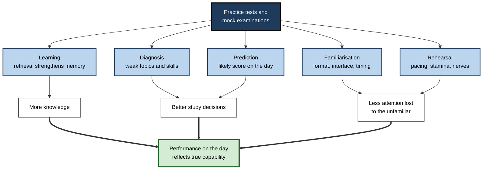
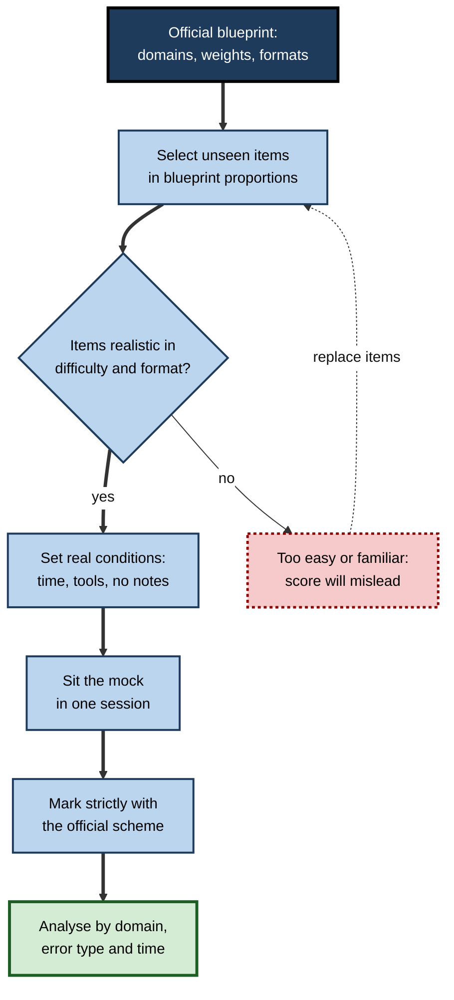
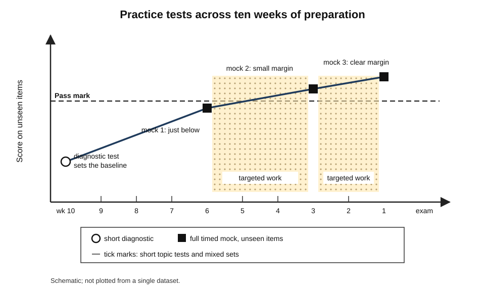
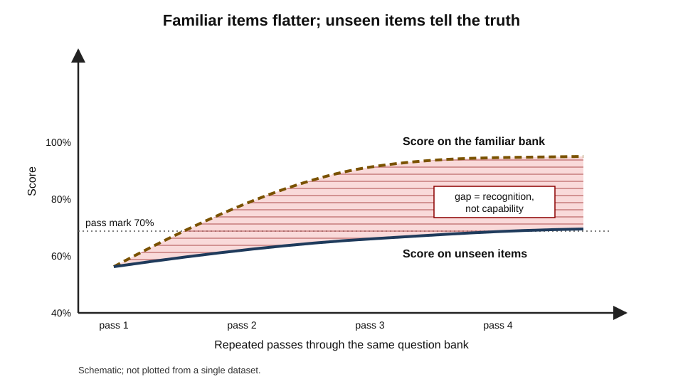
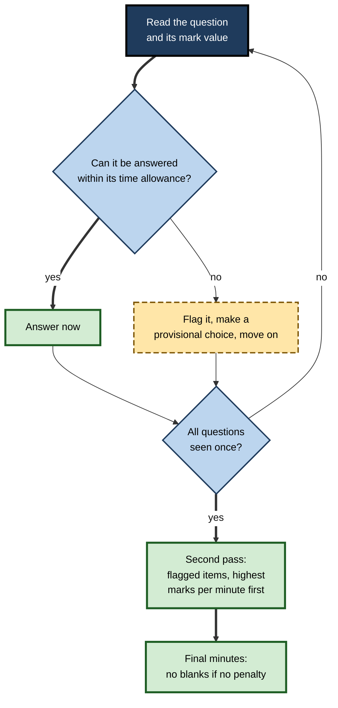
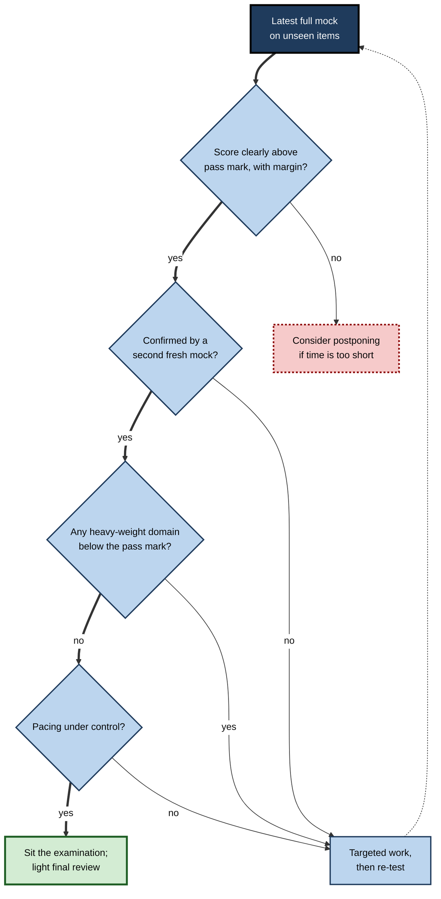

# H.3. Practice Tests and Mock Exams

Airline pilots do not meet an engine failure for the first time in the sky; they meet it, repeatedly, in a simulator that looks, sounds and moves like the real aircraft. Barristers argue moots before they argue cases. Candidates for professional examinations who sit full, timed mock papers under realistic conditions discover — weeks in advance — whether they can finish in time, which topics collapse under pressure and how their score compares with the pass mark.

> **Definition — Practice test:** any attempt at assessment-style questions, made in order to learn or to find out what one can do, before the assessment that counts.

> **Definition — Mock examination:** a full-length practice test built to resemble a specific real assessment in content, format, timing and conditions, taken in order to predict performance and expose weaknesses.

**Why it matters**

- A mock is the closest a learner can come to **seeing the result before it happens** — and there is still time to change it.
- Many failures in high-stakes assessments are not failures of knowledge but of **time management, format, stamina or nerves**; mocks expose them.
- Badly designed practice tests mislead: repeated question banks and generous marking create **false confidence**.
- In working life the same logic underlies simulator checks, rehearsals, incident drills and bid reviews — rehearsing the consequential event under realistic conditions.

---

## What Practice Tests Do

### Five functions

- **Learning.** Attempting to retrieve answers strengthens memory more than restudying — the well-established testing effect. That benefit is real, but the functions below are the specific reasons for full mock examinations.
- **Diagnosis.** Showing which topics, question types and skills are weak, with enough detail to direct study.
- **Prediction.** Estimating the score likely on the day, and so whether the learner is ready.
- **Familiarisation.** Making the format, instructions, interface and timing routine, so that none of them consumes attention on the day.
- **Rehearsal under pressure.** Practising performance — pacing, stamina, recovery from a bad question — in conditions that feel like the real thing.

**Figure 1.** What practice tests contribute to performance on the day.

### Removing noise from the score

> **Definition — Construct-irrelevant variance (Samuel Messick):** differences in scores caused by something other than the capability the assessment is meant to measure — unfamiliar format, poor pacing, anxiety, confusing instructions.

- A good mock programme reduces construct-irrelevant variance: on the day, the score reflects what the candidate knows and can do, not whether they were surprised by the format.
- **Test-wiseness** — the ability to use features of the test and the situation to score higher — was described by **Jason Millman, Carol Bishop and Robert Ebel (1965)**. Some of it is legitimate (pacing, reading instructions); some exploits poorly written items (choosing the longest option).

> **Key point:** familiarity with the format is not cheating; it removes an obstacle between the candidate's capability and the score. Exploiting badly written items is a different matter — and well-built professional examinations are designed to defeat it.

### Practice under stress

**Study card — Amy Smith, Valerie Floerke and Ayanna Thomas (2016)**

- **Design:** participants learned word and picture lists either by restudying or by retrieval practice; half then underwent a laboratory stress procedure before a final test.
- **Results:**
  - restudy learners recalled **less** under stress;
  - retrieval-practice learners showed **no** stress-related decline.
- **Conclusion:** practising retrieval appears to make memories more robust to acute stress — one reason to prepare by testing rather than rereading.

> **Watch out:** this is a laboratory finding with simple materials. Its size for complex professional examinations is not established, though it is consistent with wider evidence that well-practised retrieval holds up better under pressure.

---

## Building a Practice Test That Represents the Real One

### The blueprint

> **Definition — Test blueprint (test specification):** a plan showing what an assessment covers — its content areas and their weights, the cognitive demands, item formats, number of items and time allowed.

- Most professional examinations publish an outline: domains, percentage weights, objectives.
- A mock should **sample the domain in the same proportions** — otherwise its score predicts nothing.
- **The common error:** building practice around favourite or recently studied topics, so the mock over-represents strengths.

**Table 1.** A simplified blueprint for a 60-question cloud-architecture certification, with a mock built to match it.

| Domain | Exam weight | Questions in a 60-item mock | Typical cognitive demand |
|---|---|---|---|
| Secure architectures | 30% | 18 | Analyse scenarios, choose controls |
| Resilient architectures | 26% | 16 | Apply design patterns to failures |
| High-performing architectures | 24% | 14 | Compare options against requirements |
| Cost-optimised architectures | 20% | 12 | Evaluate trade-offs |
| **Total** | **100%** | **60** | |

### Where practice items come from

- **Official past papers and sample questions** — best for format and difficulty; limited in number.
- **Commercial question banks** — plentiful; quality varies; some items far easier or far harder than the real examination.
- **Self-written questions** — useful for learning, but tend to test what the writer already knows.
- **Study partners' questions** — better coverage of one's blind spots.
- **AI-generated questions** — cheap and plentiful; must be checked for accuracy, ambiguity and fidelity to the real format.

### Fresh items, not familiar ones

- Repeating the same items inflates scores through **item memorisation**: the candidate recognises the question rather than solving the problem.
- A mock is only predictive if its items are **new to the candidate**.
- **Rule of thumb:** keep at least one full set of unseen items in reserve for each planned full mock.

**Figure 2.** Building a mock examination that predicts the real one.

---

## Fidelity: Matching the Conditions

### What to match

- **Time** — the full allowance, in one sitting, with the real breaks.
- **Tools** — only what is allowed: calculator model, open or closed book, permitted references.
- **Interface** — computer-based examinations have their own navigation, flagging and review screens; practise with the same or a close imitation.
- **Environment** — a quiet room, no phone, no interruptions; ideally at the same time of day as the real sitting.
- **Marking** — the official scheme, applied strictly; for essays and practicals, ideally by someone else.

**Table 2.** Low-fidelity and high-fidelity practice compared.

| | Low-fidelity practice | High-fidelity mock |
|---|---|---|
| Length | A few questions | Full paper |
| Timing | Untimed or loosely timed | Exact time limit, one sitting |
| Help available | Notes, search, pausing to check | Only what the real examination allows |
| Items | Often seen before | Unseen, in blueprint proportions |
| Marking | Generous, by the candidate | Strict, by scheme or by another person |
| Best use | Learning a topic; frequent diagnosis | Prediction, pacing, stamina, readiness decisions |

### How much fidelity matters

- **Transfer-appropriate processing (Morris, Bransford and Franks, 1977):** memory performance is best when the processing at test matches the processing during learning. Practising the **kind of thinking** the examination requires matters more than matching the room.
- **Context-dependent memory:** **Godden and Baddeley (1975)** found divers recalled words better when tested in the same environment — underwater or on land — in which they had learned them.
  - **Steven Smith and Edward Vela (2001)**, in a meta-analysis, found environmental context effects are real but modest, and shrink when people mentally reinstate the learning context or when the material is well learned.

> **Watch out:** studying in the examination hall is not the point. Physical context effects are small for well-learned material; **cognitive fidelity** — the same question types, time pressure and absence of help — is what makes a mock realistic.

> **Key point:** low-fidelity practice is for **learning**; high-fidelity mocks are for **knowing**. A preparation plan needs both, in that order.

### Mocking assessments that are not multiple choice

- **Essays and long-form answers**
  - Write complete answers under the real time limit, by hand if the examination is handwritten.
  - Have them marked against the official criteria by someone else — a tutor, a colleague who has passed, a study partner briefed with the mark scheme.
  - Compare with **annotated exemplar answers** at different grades; the comparison teaches the standard faster than reading model answers alone.
- **Case-based and scenario papers**
  - Use unseen case material of the real length; practise reading and planning within the time allowance.
  - Check whether answers address the **question asked** rather than everything known about the topic — the most common failure in case examinations.
- **Oral examinations, vivas and interviews**
  - Rehearse with a questioner who does not share the candidate's notes and who asks follow-up questions.
  - Record the session; review for vague answers, filler and missed opportunities to give evidence.
- **Practical and clinical examinations**
  - Rehearse each station or task against its scoring sheet, with an observer timing and scoring.
  - Practise **recovery**: deliberately introduce an error or interruption and continue.
- **Coding and technical assessments**
  - Solve unseen problems in the same environment — the same editor restrictions, no autocomplete or AI if those are not allowed, the real time limit.
  - Explain reasoning aloud if the real assessment involves an interviewer.

> **Watch out:** self-marking an essay is far less reliable than self-marking a multiple-choice paper. Writers read their own text with the intended meaning already in mind, and fill gaps that an examiner would see. For extended work, an **external marker** is worth seeking for at least one mock.

---

## Scheduling Practice Tests

### A typical sequence

1. **Diagnostic test (start of preparation)** — a short, broad test to find the baseline and allocate study time.
2. **Topic tests (throughout)** — short, untimed or lightly timed sets after each area, then mixed sets across areas.
3. **First full mock (about six weeks out)** — the first realistic reading of readiness; leaves time for substantial change.
4. **Second full mock (about three weeks out)** — checks whether the weaknesses found have closed.
5. **Final full mock (about one week out)** — confirms readiness and rehearses the day; late enough to be predictive, early enough to fix small gaps.

- Leave **at least several days** after each full mock to act on what it shows.
- Avoid a full mock the day before the examination: fatigue and a bad score can do more harm than good.

**Figure 3.** A preparation timeline with practice tests and the score trajectory they reveal.

> **In practice:** the most common scheduling error is leaving the first full mock until the last week — when it can only report bad news, not prevent it.

---

## Interpreting Mock Results

### The score is an estimate

- A mock score is a noisy estimate of the score on the day:
  - different items sample the domain differently;
  - mocks from commercial banks may be easier or harder than the real examination;
  - repeated items inflate scores.
- Treat a single mock as a **range**, not a point. A candidate scoring exactly at the pass mark is roughly as likely to fail as to pass.

> **Formula — Readiness margin:** margin = mock score − pass mark. With a pass mark of 70% and mocks of 74% and 77% on fresh items, the margins are +4 and +7 points. If repeated mocks typically vary by about ±5 points, a margin of +4 is not yet safe; +7 on a second fresh mock is more reassuring.

### Reading beyond the total

- **By domain** — which areas fall below the pass mark even when the total does not?
- **By question type** — calculations, scenarios, definitions, essays.
- **By error type** — knowledge gap, misread question, careless slip, time pressure.
- **By time** — were the last questions rushed or left blank? Did one question consume ten minutes?
- **By confidence** — were wrong answers given confidently (a misconception) or tentatively (a gap)?

### Worked example (illustrative): deciding whether to sit or postpone

A candidate for a financial-planning qualification has a pass mark of 65%. She has sat three full mocks on unseen items.

**Table 3.** Three mock results by domain.

| Domain (weight) | Mock 1 (week −6) | Mock 2 (week −3) | Mock 3 (week −1) |
|---|---|---|---|
| Taxation (30%) | 48% | 61% | 70% |
| Investments (30%) | 72% | 74% | 76% |
| Retirement planning (25%) | 66% | 70% | 69% |
| Ethics and regulation (15%) | 80% | 82% | 85% |
| **Weighted total** | **64%** | **70%** | **74%** |
| Unanswered at time limit | 6 questions | 2 questions | 0 questions |

*Illustrative figures.*

**Steps:**

1. **Trend:** the total rose from 64% to 74% on fresh items — evidence of real improvement, not item memorisation.
2. **Margin:** +9 points on the latest mock; +5 on the one before. Both above the pass mark.
3. **Weak domain:** taxation, the heaviest-weighted area, rose from 48% to 70% — now above the pass mark but the least secure.
4. **Pacing:** blanks fell from six to none — a timing problem that has been solved.
5. **Decision:** sit the examination; spend the final week on mixed taxation questions and rest, not on new material.

> **Watch out:** had the three mocks reused the same items, the rising trend would mean nothing. The decision rests on the items being **unseen**.

### The overfitting trap

- Learners who practise on a single question bank see their bank scores rise steadily — partly from learning, partly from **recognising items**.
- Scores on **fresh** items rise more slowly and plateau lower.
- The gap between the two is the size of the illusion.

**Figure 4.** Scores on a familiar question bank compared with scores on unseen items.

---

## Test-Taking Strategy

### Pacing

- **Time per mark:** divide the time available by the marks available, after reserving time for review.
  - *e.g.* 180 minutes, 150 marks, 15 minutes reserved → (180 − 15) ÷ 150 = **1.1 minutes per mark**.
- Set **checkpoints**: by the halfway time, roughly half the marks should be attempted.
- Never let one question consume more than about **twice** its time allowance on the first pass.

### Triage: the two-pass method

1. **First pass:** answer every question that can be done confidently and quickly; mark the rest.
2. **Second pass:** return to marked questions in order of likely marks per minute.
3. **Final minutes:** ensure every question has an answer, where there is no penalty for guessing.

**Figure 5.** A two-pass approach to a timed examination.

### Should answers be changed?

**Study card — Justin Kruger, Derrick Wirtz and Dale Miller (2005)**

- **Design:** analysed the eraser marks on psychology students' multiple-choice examinations, and surveyed students' beliefs about answer changing.
- **Results:**
  - of 3,291 changed answers, about **51%** went from wrong to right, **25%** from right to wrong and **23%** from wrong to wrong;
  - yet about three-quarters of students believed changing answers usually **lowers** scores.
- **Explanation:** changing a right answer to a wrong one produces vivid regret ("I knew it!"), so those cases are remembered; wrong-to-right changes are forgotten.
- **Conclusion:** the belief in "trust your first instinct" is a **fallacy**; reconsidering answers for a reason usually helps.

> **Watch out:** this does not mean every hunch to change should be followed. Changes made because of a **specific reason** — a misread word, a recalled fact — are the ones that help.

### Guessing and negative marking

> **Formula — Expected value of a guess:** EV = p × (mark for correct) − (1 − p) × (penalty for wrong). With four options, +1 for correct and −⅓ for wrong, a blind guess (p = 0.25) gives 0.25 − 0.75 × ⅓ = **0** — neutral. Eliminating one option (p = ⅓) gives ⅓ − ⅔ × ⅓ ≈ **+0.11** — worth guessing.

- **No penalty:** never leave a blank.
- **Penalty:** guess when at least one option can be eliminated with confidence.

### Strategy by question format

**Table 4.** Test-taking strategy by format.

| Format | Main risks | Strategy |
|---|---|---|
| Multiple choice | Misreading negatives ("NOT", "EXCEPT"); attractive distractors | Predict the answer before reading options; eliminate; underline qualifiers |
| Short answer | Writing too much or too little | Match length and detail to marks; use the question's terms |
| Long essay | Running out of time; answering a different question | Spend 5–10% of the time planning; answer the question asked in the first paragraph |
| Calculation | Arithmetic slips; no method marks | Show working; estimate the size of the answer first; check units |
| Practical or clinical station | Freezing; missing a required step | Rehearse a standard sequence; narrate actions; recover quickly after an error |

> **Mnemonic — "PTCGF" ("Pace The Clock, Guess Fairly"):** Pace, Triage, Change for a reason, Guess by expected value, Format-specific tactics.

---

## Managing Pressure

### Test anxiety

> **Definition — Test anxiety:** apprehension about evaluation that interferes with performance; it has a **worry** (cognitive) component and an **emotionality** (physical arousal) component, a distinction drawn by **Robert Liebert and Larry Morris (1967)**.

- The **worry** component — intrusive thoughts about failure — is the more damaging: it consumes working memory needed for the task.
- **Mocks help** by making the format familiar, providing evidence of capability and rehearsing recovery from difficult questions.

### Techniques with evidence

- **Expressive writing.** **Gerardo Ramirez and Sian Beilock (2011)** found that students who wrote about their worries for ten minutes before a high-stakes test performed better than those who did not, especially if they were habitually anxious.
- **Reappraising arousal.** **Jeremy Jamieson and colleagues (2010)** found that telling students that physiological arousal can **improve** performance raised scores on practice mathematics questions for a graduate-admissions test.
- **Retrieval-based preparation.** As above, well-practised retrieval appears more resistant to stress.

> **Watch out:** these are promising but **not settled** findings. Some later attempts to reproduce the benefit of expressive writing found smaller or no effects. They are cheap to try, but no substitute for preparation.

> **Remember:** the most reliable anxiety reducer is **evidence of readiness** — fresh mock scores comfortably above the pass mark.

---

## Mock Examinations in Professional Life

### After the real examination

- The real result is also evidence — especially after a failure, but also after a narrow pass that will be built on.
- **Use the score report.** Many professional examinations report performance by domain; compare it with the mock profile. Domains that were weak in both are confirmed gaps; domains weak only on the day may point to nerves, pacing or unfamiliar question styles.
- **Write a post-examination note within a day**, before memory fades: which questions felt hardest, where time went, what was unexpected.
- **For a resit:** rebuild the plan from the blueprint and the score report, not from the old plan; reserve fresh items for new mocks, because the previous ones are now familiar.

> **Watch out:** after a failure, the instinct is to repeat the same preparation more intensely. The score report and the mocks usually show that something **different** is needed.

### The same principle, different names

- **Aviation** — recurrent simulator checks with engine failures, weather and system faults; pilots are assessed against set standards.
- **Medicine** — mock objective structured clinical examinations (OSCEs); simulated emergencies with mannequins and actors.
- **Law** — moots and mock trials; rehearsing witness examination.
- **Software and operations** — "game days" and incident drills, in which teams deliberately trigger failures to practise response.
- **Consulting and sales** — bid rehearsals and **red-team reviews**, in which colleagues play a hostile evaluation panel before submission.
- **Leadership** — rehearsing difficult conversations or board presentations with a colleague playing the other side.

> **In practice:** the professional version of the mock asks the same questions — *Does it resemble the real event? Are the conditions realistic? Is it marked honestly? Is there time to act on what it shows?*

**Figure 6.** Deciding whether a candidate is ready, using mock evidence.

### Case study (illustrative): ninety per cent on the bank, fail on the day

- **Situation:** an infrastructure engineer prepared for a cloud-security certification using one commercial question bank of about 400 items.
- **Problem:** after five weeks his bank scores were above 90%; he sat the examination and failed narrowly.
- **Diagnosis:**
  1. He had cycled through the same bank four times; most items were **recognised**, not solved.
  2. The bank over-represented identity management, his strongest area, and under-represented logging and incident response.
  3. He had never sat a full-length paper in one sitting; in the real examination he ran short of time on long scenario items.
  4. His marking was generous: "nearly right" counted as right.
- **Actions for the resit:**
  1. Built a blueprint from the official domain weights.
  2. Reserved two unseen full-length sets from a different source, used only as mocks.
  3. Did daily mixed practice on new scenario questions, especially in under-weighted domains.
  4. Sat both mocks under exact time limits with no notes, marking strictly.
  5. Analysed each by domain, error type and time per question.
- **Result:** first fresh mock 68% (pass mark 72%) — a sobering but useful number; second, two weeks later, 79%. He passed the resit comfortably.
- **Lesson:** a practice score is only as honest as its items, its conditions and its marking. **Familiar items measure memory for the items.**

---

## Open Questions

- **How well do mock scores predict real results?**
  - Predictive accuracy depends on item source and similarity; for many commercial banks it has never been published.
- **What is the optimal number and spacing of full mocks?**
  - Practice guidance is widely shared, but controlled comparisons of mock schedules are scarce.
- **Do anxiety interventions work reliably?**
  - Expressive writing and arousal reappraisal show promise, but replication results are mixed.
- **How will AI change mock examinations?**
  - Generated questions make unlimited fresh items possible, but their fidelity to real examinations — difficulty, ambiguity, distractor quality — is unproven.
- **What is a valid "mock" for complex professional performance?**
  - Simulations are expensive and their transfer to real incidents, trials and negotiations is hard to measure.

---

## Summary

- A **mock examination** is a full-length, realistic practice test used to **learn, diagnose, predict, familiarise and rehearse**.
- Mocks reduce **construct-irrelevant variance** so the real score reflects capability; retrieval-based preparation appears more robust to stress.
- Build mocks from the **blueprint**, with **unseen** items in the right proportions; familiar items measure memory for items.
- **Fidelity** matters most at the cognitive level — question types, time limits, no help — rather than the physical room.
- Schedule a **diagnostic** early, **topic tests** throughout and **full mocks** at roughly six, three and one week out, leaving time to act.
- Interpret mocks as **ranges**: use the **readiness margin**, trends on fresh items, and analysis by domain, error type, time and confidence.
- **Strategy:** pace by time per mark, use **two passes**, change answers for a reason (the **first-instinct fallacy**), guess by **expected value**, and adapt to format.
- Manage **test anxiety** — mainly its **worry** component — with familiarity, evidence of readiness and, possibly, expressive writing or reappraisal.
- Professions use the same logic in **simulator checks, OSCEs, moots, game days and red-team reviews**.

---

## Self-Check

1. Name the five functions of practice tests and say which matter most for a full mock.
2. What is construct-irrelevant variance, and how do mocks reduce it?
3. Describe the study by Smith, Floerke and Thomas (2016) and its limits.
4. What is a test blueprint, and why must a mock follow it?
5. Why do repeated question-bank items inflate scores?
6. Which kind of fidelity matters most, and what did Smith and Vela's meta-analysis find about physical context?
7. Outline a schedule of practice tests for a ten-week preparation period.
8. A candidate scores 71% on a mock with a pass mark of 70%. What should they conclude?
9. Calculate the time per mark for a 150-minute paper worth 100 marks with 10 minutes reserved for review.
10. Summarise the Kruger, Wirtz and Miller (2005) findings and explain why the first-instinct belief persists.
11. With five options, +1 for correct and −¼ for wrong, what is the expected value of a blind guess, and of a guess after eliminating two options?
12. Distinguish the worry and emotionality components of test anxiety; which is more harmful and why?
13. A team lead wants to prepare her team for a major client pitch. Design a "mock" using the principles of fidelity and honest marking.
14. In the cloud-security case study, list four reasons the bank score misled and the fix for each.

### Answer Key

1. Learning, diagnosis, prediction, familiarisation, rehearsal under pressure. For a full mock the most distinctive are prediction, familiarisation and rehearsal; diagnosis is valuable for both short and full tests.
2. Score differences caused by things other than the target capability — unfamiliar format, poor pacing, anxiety. Mocks make format and timing routine, reveal pacing problems and build evidence of readiness, so less attention is lost to them on the day.
3. Learners who studied by retrieval practice showed no decline in recall after a stress procedure, while restudy learners recalled less. Limits: laboratory setting, simple materials, acute stress; generalisation to complex professional examinations is not established.
4. A plan of content areas, weights, cognitive demands, formats and timing. A mock that does not match it samples the domain differently, so its score cannot predict the real one — it usually over-represents the candidate's strengths.
5. The candidate recognises the question and recalls its answer rather than solving it, so scores reflect memory for specific items rather than capability on new ones.
6. Cognitive fidelity — the same question types, time pressure and absence of help. Smith and Vela found environmental context effects are real but modest and shrink when the context is mentally reinstated or material is well learned.
7. E.g. week 1 diagnostic; weekly topic and then mixed tests; full mocks in weeks 4, 7 and 9 on unseen items, each followed by several days of targeted work; light review in the final days; no full mock on the eve of the examination.
8. That they are at the borderline: a single mock varies by several points, so their chance of passing is not much better than even. They should do targeted work on weak domains and confirm with another fresh mock before relying on the result.
9. (150 − 10) ÷ 100 = 1.4 minutes per mark.
10. About 51% of changes were wrong-to-right, 25% right-to-wrong; yet three-quarters of students believed changing usually hurts. Right-to-wrong changes cause vivid regret and are remembered; wrong-to-right changes are not.
11. Blind guess: 0.2 × 1 − 0.8 × 0.25 = 0 (neutral). After eliminating two (p = ⅓): ⅓ − ⅔ × ¼ ≈ 0.33 − 0.17 = +0.17 — worth guessing.
12. Worry: cognitive concern about failure; emotionality: physical arousal. Worry is more harmful because it occupies working memory needed for the task; arousal alone can be neutral or even helpful if appraised positively.
13. E.g. a full rehearsal with the real time limit, slides and demo; colleagues briefed as the client panel with their likely objections; unscripted questions; scoring against the client's stated evaluation criteria; recording for review; held a week before the pitch so that findings can be acted on.
14. Item memorisation → unseen items reserved for mocks. Unrepresentative coverage → blueprint-weighted sampling. No full-length timed practice → full mocks under exact conditions. Generous marking → strict marking against the key, with analysis by domain and error type.

---

## Glossary

| Term | Meaning |
|---|---|
| Blueprint (test specification) | Plan of an assessment's content areas, weights, demands, formats and timing. |
| Cognitive fidelity | Similarity between the thinking demanded in practice and in the real assessment. |
| Construct-irrelevant variance | Score differences caused by factors other than the capability being measured. |
| Context-dependent memory | Better recall when the testing environment matches the learning environment. |
| Diagnostic test | An early test used to find a baseline and direct study. |
| Expected value of a guess | Average marks gained from guessing, given the chance of being right and any penalty. |
| First-instinct fallacy | The mistaken belief that changing answers usually lowers scores. |
| Item memorisation | Recognising and recalling answers to specific seen items rather than solving them. |
| Mock examination | Full-length practice test resembling a real assessment in content, format and conditions. |
| Negative marking | Deducting marks for wrong answers to discourage blind guessing. |
| Objective structured clinical examination (OSCE) | Clinical skills examination using timed stations with standardised tasks. |
| Practice test | Any assessment-style attempt made before the assessment that counts. |
| Readiness margin | Mock score minus pass mark. |
| Red-team review | Rehearsal in which colleagues act as a critical evaluation panel. |
| Test anxiety | Apprehension about evaluation that interferes with performance. |
| Test-wiseness | Ability to use features of a test and situation to score higher. |
| Transfer-appropriate processing | Principle that memory is best when test processing matches learning processing. |
| Two-pass method | Answering quick items first, then returning to flagged ones. |
