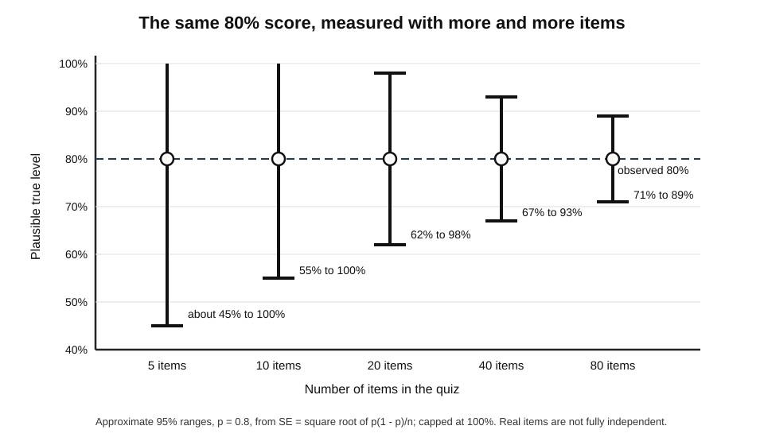
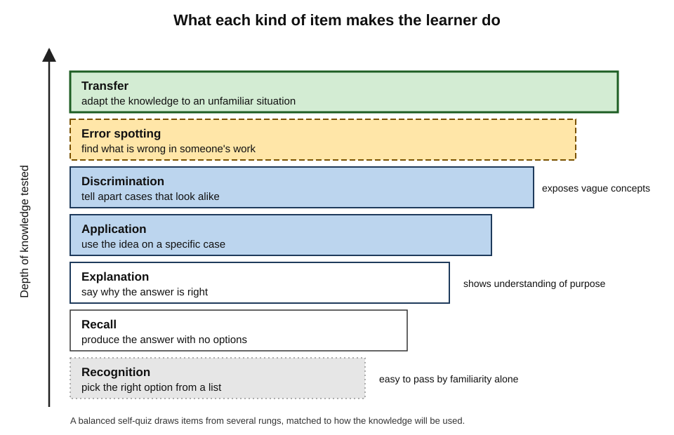
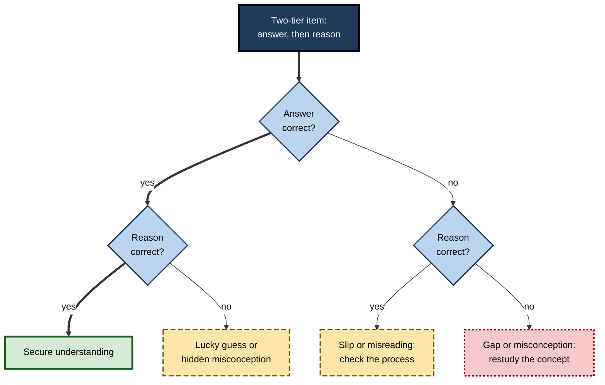
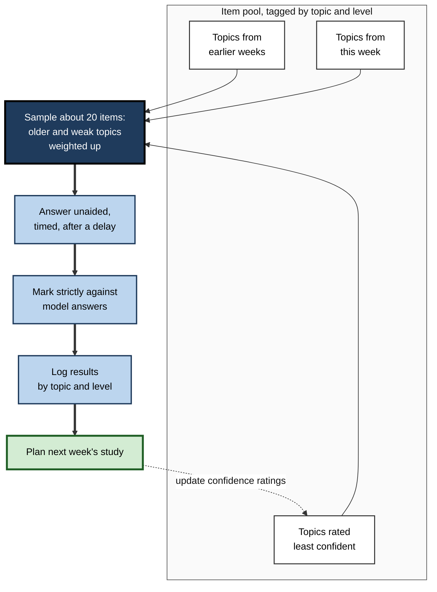
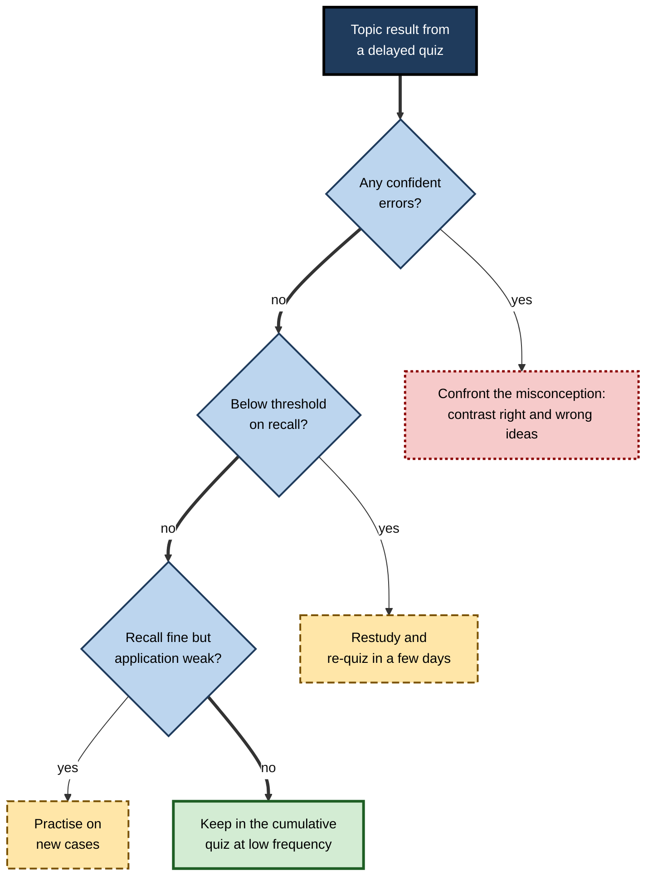

# L.4. Self-Quizzing Techniques

A new compliance analyst writes ten questions on the data-protection module she has just finished, answers all ten correctly and concludes she is ready. A week later a colleague asks her one question she had never thought to ask herself — whether a supplier's analytics cookie needs consent — and she has no idea. Her quiz was not wrong; it simply measured only what she already knew she knew. A self-quiz is a measuring instrument, and like any instrument it can be well or badly designed.

> **Definition — Self-quiz:** a short set of questions or tasks, chosen and marked by the learner, answered without help in order to find out what can and cannot yet be done.

**Why it matters**

- Self-quizzing is the cheapest, most frequent form of self-assessment; most learners do some version of it.
- The **design** of the quiz decides what its result means: a quiz built from favourite topics, easy formats and seen questions reports success that is not there.
- A well-designed self-quiz tells the learner **what to study next**, not just a score.
- The same techniques underlie professional self-checks: a pilot's recurrent knowledge review, a clinician's case quiz, an engineer's design-review questions.

> **Key point:** answering questions from memory also strengthens memory — a well-established benefit. The focus here is the quiz as an **assessment**: how to design, mark and interpret it so that it measures accurately.

---

## A Self-Quiz Is a Sample

### What a score can and cannot say

- No quiz can ask everything. It **samples** a domain — a module, a syllabus, a competency — and the score is used to infer mastery of the whole.
- The inference is only as good as the sample:
  - **Coverage** — does the quiz draw from every part of the domain, or only some?
  - **Representativeness** — are topics weighted as they matter?
  - **Difficulty** — are items as demanding as the real use of the knowledge?
  - **Novelty** — are items new, or recognised from earlier practice?
  - **Size** — are there enough items for the score to be stable?

> **Definition — Domain sampling:** the principle that a test's items are a sample from all the possible items in a domain, and that the score supports inferences about the domain only to the extent that the sample represents it.

### How many items are enough?

- Small quizzes give **unstable** scores: one lucky or unlucky item moves the percentage a long way.

> **Formula — Uncertainty of a quiz score:** the standard error of a proportion is SE = √(p × (1 − p) ÷ n), where *p* is the proportion correct and *n* the number of items. For 8 correct out of 10 (p = 0.8), SE = √(0.8 × 0.2 ÷ 10) ≈ **0.13**, so a rough 95% range is 80% ± 25 points — roughly 55% to 100%. With 40 items at the same rate, SE ≈ 0.063 and the range narrows to about ±12 points.

- **Practical consequence:** a five- or ten-item quiz can show whether a topic is **clearly secure or clearly weak**, but cannot distinguish 70% from 85%. For readiness decisions, combine several quizzes or use a longer one.

**Figure 1.** How the uncertainty of a self-quiz score shrinks as the number of items grows.

> **Watch out:** the formula treats items as interchangeable and independent, which real items are not. Treat it as a rough guide to how much a small quiz can be trusted, not as a precise interval.

### The blind-spot problem

- Learners who write their own questions tend to ask about **what they noticed** — which is largely what they understood.
- Topics they skimmed, never met or misunderstood are **under-sampled** precisely because they are weak.
- **Arthur Graesser and Natalie Person (1994)**, studying tutoring sessions, found students asked relatively few questions, and most were shallow — about facts and definitions rather than causes, consequences and comparisons.
- **Remedies:**
  - build quizzes from an **external list** — the syllabus, objectives, competency framework, table of contents — not from memory of what was studied;
  - include **questions written by others**: past papers, a colleague's questions, a question bank, an AI tool working from the official objectives;
  - deliberately add items on topics **rated least confident**.

> **Remember:** a self-quiz built from one's own notes measures one's notes. Build it from the **domain**.

---

## Item Types and What They Reveal

### A ladder of diagnostic depth

- Different item types demand different kinds of knowing, and so reveal different things when answered wrongly.

**Figure 2.** Item types ordered by the depth of knowledge they test.

**Table 1.** Self-quiz item types compared.

| Item type | Example (software engineering) | What a correct answer shows | What a wrong answer suggests |
|---|---|---|---|
| Recognition (multiple choice) | Which HTTP status code means "not found"? | Can recognise the fact | Fact absent or confused with a neighbour |
| Recall (short answer) | Write the status code for "not found" | Can retrieve without cues | Fact not yet retrievable |
| Explanation | Why should an API return 404 rather than 200 with an error message? | Understands purpose | Knows the rule, not the reason |
| Application | Given this request log, which responses are wrong? | Can use the knowledge on a case | Cannot yet map rule to situation |
| Discrimination | When is 410 more appropriate than 404? | Can tell close cases apart | Over-general concept |
| Error spotting | Find the two mistakes in this handler | Can evaluate work | May produce work but not check it |
| Transfer | Design status handling for a new kind of service | Can adapt to a new context | Knowledge tied to familiar examples |

- **A good self-quiz mixes levels.** A quiz made only of recognition items will overstate readiness for any assessment — or job — that requires explanation or application.

> **Mnemonic — "Really Reliable Engineers Always Debug Every Task":** Recognition, Recall, Explanation, Application, Discrimination, Error spotting, Transfer.

### Two-tier items: answer plus reason

> **Definition — Two-tier item:** a question in which the learner first chooses or states an answer and then chooses or states the **reason** for it; developed for diagnosing misconceptions by **David Treagust (1988)** in science education.

- A correct answer with a wrong reason reveals a **lucky guess or a misconception** that a single-tier item would miss.
- A wrong answer with a reasonable reason may show a **slip** rather than a gap.

**Figure 3.** The four outcomes of a two-tier item.

### Writing items that measure

- **Ask one thing per item.** A wrong answer to a compound question cannot be diagnosed.
- **Write wrong options from real errors.** Distractors that reflect known confusions turn a multiple-choice item into a diagnostic instrument.
- **Avoid giveaway wording.** Grammatical clues, the longest option, or the answer's key words in the stem let recognition stand in for knowledge.
- **Vary surface features.** If every practice problem about depreciation involves a delivery van, the learner may be learning "van problems".
- **Write the answer when writing the question.** A model answer written at the same time fixes the standard before marking begins.
- **Tag each item** with its topic, level and source, so results can be analysed later.

> **Watch out:** questions written straight after studying a passage tend to copy its wording. Answering them then tests memory for the passage's sentences, not understanding. Rephrase, or write questions a day later.

---

## Seven Self-Quizzing Techniques

Each technique answers a different assessment question. A study routine typically combines several.

### 1. The diagnostic pre-quiz

- **Question answered:** what do I already know, before I start?
- **Method:** before studying a module, attempt 10–20 items drawn across its objectives.
- **Use:** skip or skim what is secure; plan time for what is not.
- **Bonus:** attempting questions before study tends to improve later learning of that material, even when the answers are wrong.

### 2. The end-of-session check

- **Question answered:** did today's study produce anything I can retrieve?
- **Method:** three to five questions at the end of a session, answered without notes.
- **Use:** an early warning; failures mean the session produced familiarity rather than learning.
- **Limitation:** immediate quizzes overstate later retention; never treat them as proof of mastery.

### 3. The delayed cumulative quiz

- **Question answered:** what is still there after days or weeks?
- **Method:** once a week, a quiz sampled across **everything studied so far**, weighted towards older and weaker topics.
- **Use:** the main progress measure; it tests retention and resists the illusion created by recency.

**Figure 4.** Building a weekly cumulative self-quiz.

### 4. The blind-spot quiz

- **Question answered:** what have I failed to notice?
- **Method:** a quiz written by someone else — a colleague, a past paper, a question bank, an AI tool given the official objectives.
- **Use:** exposes topics the learner's own questions never touch.

### 5. The application quiz

- **Question answered:** can I use it on something new?
- **Method:** unseen cases, scenarios or problems in contexts different from those studied.
  - *e.g.* a nurse quizzes herself on fluid-balance calculations using patient scenarios she has not seen, not the textbook examples.
- **Use:** tests transfer, the strongest evidence of learning.

### 6. The fluency quiz

- **Question answered:** can I do it fast enough?
- **Method:** the same kind of item under a time limit; track both accuracy and time.
- **Use:** essential where speed matters — mental arithmetic for traders, drug-dose calculations, keyboard operations, live interpreting.

### 7. The examiner's quiz

- **Question answered:** can I explain and defend it?
- **Method:** answer aloud, as if to an examiner or client who asks "why?" after each answer; record and review.
- **Use:** reveals the gap between knowing an answer and being able to justify it — the gap that vivas, interviews and client meetings expose.

**Table 2.** Seven self-quizzing techniques compared.

| Technique | When | Size | Measures | Main risk |
|---|---|---|---|---|
| Diagnostic pre-quiz | Before study | 10–20 items | Prior knowledge | Discouragement if framed as a verdict |
| End-of-session check | After each session | 3–5 items | Immediate retrieval | Overstates retention |
| Delayed cumulative quiz | Weekly | 15–30 items | Retention across topics | Sampling only recent work |
| Blind-spot quiz | Every few weeks | 10–30 items | Unnoticed gaps | Poor-quality external items |
| Application quiz | After a topic is secure | 3–10 cases | Transfer | Cases too similar to examples |
| Fluency quiz | When speed matters | 10–20 items | Speed and accuracy | Speed at the expense of care |
| Examiner's quiz | Before oral or client-facing use | 5–10 questions | Justification | Rambling answers judged generously |

---

## Matching the Quiz to the Kind of Knowledge

A quiz must ask the learner to do what the knowledge is for. The right form of item differs by kind of knowledge.

- **Facts and terminology**
  - Short recall items, ideally in both directions (term → meaning, meaning → term).
  - *e.g.* a trainee radiographer recalls the standard projections for a wrist, then names the projection from a description.
- **Concepts and principles**
  - Explanation, prediction and discrimination items: "What will happen if…?", "Why does…?", "Which of these is an example?"
  - *e.g.* an economics graduate predicts the effect of an interest-rate rise on a fixed-rate borrower and on a saver.
- **Procedures and calculations**
  - Perform the procedure on a new case; never just describe its steps.
  - Check both the answer and the method — a right answer from a wrong method is a hidden error.
  - *e.g.* a payroll officer calculates net pay for an unusual case (part-month, salary sacrifice) from scratch.
- **Physical and technical skills**
  - Do the task, timed, and compare with a standard: a recording, a scoring sheet, an observer.
  - *e.g.* a phlebotomist runs through the full sequence on a practice arm while a colleague scores it.
- **Judgement**
  - Scenario items with no single correct answer; compare the learner's reasoning with an expert's, or with a set of considerations an expert would weigh.
  - *e.g.* a new manager writes how she would handle a team member's repeated lateness, then compares with an HR adviser's account of the factors that matter.
- **Language and communication**
  - Produce, do not recognise: write or speak the sentence, the explanation, the email.
  - *e.g.* a lawyer learning German drafts a short client letter, then has it checked.

> **Key point:** a quiz on **describing** a skill does not measure the **skill**. If the knowledge will be used to do something, the quiz must ask the learner to do it.

### Common design errors

- **All one level** — usually recall, because it is easiest to write.
- **All one source** — usually the learner's own notes.
- **Too soon** — quizzing minutes after study, which flatters retention.
- **Too familiar** — re-using the same items until the answers are recognised.
- **Too small for the decision** — judging readiness from five items.
- **No record** — scores not logged, so progress and recurring weaknesses are invisible.
- **No consequence** — results that never change what is studied next.

> **Mnemonic — "All Students Too Often Skip Recording Consequences":** All one level, Source, Too soon, Over-familiar, Size, Record, Consequence.

---

## Marking a Self-Quiz Honestly

### Decide the standard first

- Write or obtain the **model answer** before attempting the quiz, or at least before marking.
- Decide **in advance** what counts as correct:
  - *exact* — a formula, a code, a value;
  - *essential elements* — "a correct answer must mention lawful basis **and** purpose limitation";
  - *partial credit* — how many marks for which elements.

### Five rules for strict marking

1. **No "basically right".** If an examiner would not give the mark, neither does the learner.
2. **Mark from the answer written, not the answer intended.**
3. **Count hesitations.** An answer reached only after a long struggle, or after glancing at notes, is marked as not secure.
4. **Mark against the source**, not memory of the source.
5. **Record the error type** for every miss: knowledge gap, misconception, misread question, slip, or too slow.

> **Watch out:** self-marking of short factual answers is usually accurate; self-marking of explanations and essays is not. Learners read their own words with the intended meaning in mind. For extended answers, compare with an exemplar point by point, or have someone else mark a sample.

### Scoring for confidence

- Adding a quick **confidence tag** (sure / unsure) to each answer turns a quiz into two measurements: what is known, and how well the learner knows what they know.
- The most important result is a **confident error** — it signals a misconception that will not be fixed by more of the same study.

---

## Interpreting the Results

### From score to decision

- A total score is the least useful result. The useful results are:
  - **by topic** — which areas are below the learner's threshold;
  - **by level** — recall secure but application weak?
  - **by error type** — knowledge gaps call for study; slips call for process changes; slow answers call for fluency practice;
  - **by confidence** — confident errors first.

**Figure 5.** Turning a topic's self-quiz result into a study decision.

### Keeping the item pool healthy

- A pool of self-quiz items ages:
  - items answered correctly many times stop measuring anything except memory for the item;
  - items written early in study often reflect early misunderstandings;
  - the domain itself changes — new regulations, versions, guidelines.
- **Maintenance habits:**
  - **retire** items answered correctly on three or more delayed occasions, keeping a few for occasional spot checks;
  - **rewrite** items whose wording gives the answer away or whose model answer proved wrong;
  - **refresh** with new items at higher levels — application, discrimination, transfer — as recall becomes secure;
  - **date** items tied to changeable facts and review them when the source changes.
- A healthy pool **grows harder over time**, tracking the learner's progress rather than flattering it.

### Thresholds

- A **threshold** turns a score into a decision. Typical self-set thresholds:
  - **Below 60%** on a delayed quiz — study again from the source.
  - **60–85%** — targeted practice on the items missed.
  - **Above 85% on two delayed quizzes, a week or more apart** — treat as secure for now; keep a few items in the cumulative pool.
- Thresholds should reflect the **stakes**: a pharmacist's dose calculations need a far higher bar than a manager's recall of a framework's history.

> **In practice:** set the threshold by asking what an error would **cost** in real use. Where errors are dangerous — doses, safety-critical procedures, legal deadlines — the target is near 100% with fluency, not 85%.

---

## Self-Quizzing at Work

### Professional forms

- **Clinicians** quiz themselves on guidelines before on-call shifts; some departments circulate weekly case questions.
- **Pilots** review memory items and limitations — actions that must be performed without a checklist — on a regular cycle.
- **Engineers** quiz themselves on a system's architecture before an on-call rotation: "What happens if this queue fills? Where are the logs?"
- **Lawyers** test themselves on new legislation with scenario questions before advising clients.
- **Consultants** run an "examiner's quiz" on a client's numbers before a steering meeting: "What was revenue growth? Why did margin fall?"

### AI as an item writer

- Generative AI tools can produce many questions quickly, at different levels, with model answers and diagnostic distractors.
- **Use them well:**
  - supply the **official objectives or source text** and ask for items mapped to each objective;
  - ask for **application and discrimination** items, not only recall;
  - **check every answer** against the source — tools produce plausible errors;
  - keep the learner's own judgement in the loop: decide what counts as correct before reading the tool's verdict.

> **Watch out:** AI-written items often share the wording of the source they were generated from, which encourages recognition rather than understanding. Ask for rephrased, scenario-based items.

### Worked example (illustrative): a cumulative self-quiz for a data-protection module

A compliance analyst has four weeks to master an internal data-protection module with eight objectives.

**Steps:**

1. **List the domain.** Eight objectives from the module outline: lawful bases, consent, data-subject rights, retention, international transfers, breaches, processors, cookies.
2. **Build the pool.** For each objective she writes four items (one recall, one explanation, two application) and adds two items from a colleague and two from the module's practice set — 64 items in all, each tagged.
3. **Sample weekly.** Each Friday she draws 16 items: two per objective, weighted towards objectives below threshold the week before.
4. **Answer unaided**, with a sure/unsure tag on each.
5. **Mark strictly** against model answers; record error type.
6. **Decide** by objective using thresholds.

**Table 3.** Her week-two results by objective.

| Objective | Correct (of 2) | Confident errors | Error type | Decision |
|---|---|---|---|---|
| Lawful bases | 2 | 0 | — | Keep at low frequency |
| Consent | 1 | 1 | Misconception: thought consent always required | Contrast consent with legitimate interests; re-quiz |
| Data-subject rights | 2 | 0 | — | Keep |
| Retention | 1 | 0 | Gap: did not know the retention schedule | Study the schedule |
| International transfers | 0 | 0 | Gap | Study from the source |
| Breaches | 2 | 0 | — | Keep |
| Processors | 1 | 0 | Slip: misread "processor" as "controller" | Slow down on reading |
| Cookies | 0 | 1 | Misconception: thought analytics cookies exempt | Contrast exempt and non-exempt cases |

*Illustrative figures.*

- **Conclusion:** the total (9 of 16, 56%) says little. The breakdown shows **two misconceptions**, **two gaps** and **one slip** — five different actions.

> **Watch out:** two items per objective is a very small sample. One week's result is a signal to investigate, not a verdict; decisions rest on the pattern over several weeks.

### Case study (illustrative): the sales engineer who scored 95% and froze in the demo

- **Situation:** a sales engineer joining a database company studied the product's architecture for a month before taking customer calls.
- **Self-assessment:** she quizzed herself daily from flashcards she had written and reached 95% recall.
- **Problem:** in her first technical demonstration a customer asked how the database handled a network partition in their multi-region set-up. She knew every definition but could not reason through the case.
- **Diagnosis:**
  1. Her items were **almost all recall** — definitions and feature names.
  2. All items were **self-written**, from her own notes.
  3. She never answered **aloud** or under follow-up questioning.
- **Actions:**
  1. Rebuilt her pool: one third recall, one third application scenarios, one third discrimination ("when would a customer choose X over Y?").
  2. Asked two senior colleagues for the ten hardest questions customers had asked them — the blind-spot quiz.
  3. Ran a weekly examiner's quiz with a colleague playing a sceptical architect.
- **Result:** her recall score fell at first to about 70% on the harder pool; within five weeks she was handling technical calls without escalation.
- **Lesson:** the original quiz was accurate about the wrong thing. **The level of the items must match the level of the use.**

---

## Open Questions

- **How should learners balance self-written and external items?**
  - Writing questions aids learning; external items assess more fairly. The best mix has not been established.
- **Can learners be trained to write diagnostic questions?**
  - Training in question generation improves question quality in studies, but whether it improves self-assessment accuracy is less clear.
- **How reliable are AI-generated quiz items?**
  - Early evaluations show many usable items alongside a significant share with errors or ambiguity; quality varies by domain and tool.
- **What is the right threshold for "secure"?**
  - Practice relies on rules of thumb; how thresholds should vary with stakes, delay and knowledge type is under-researched.
- **How much does self-marking bias distort self-quiz results?**
  - Bias is clearly larger for open answers, but how much it misleads study decisions is not well measured.

---

## Summary

- A **self-quiz** is a measuring instrument; its score is only as meaningful as its **coverage, representativeness, difficulty, novelty and size**.
- Small quizzes are **noisy**: SE = √(p(1 − p) ÷ n); ten items can separate secure from weak, not 70% from 85%.
- Self-written quizzes suffer from **blind spots**; build from the **domain**, add **external** items and target low-confidence topics.
- **Item types** reveal different depths: recognition, recall, explanation, application, discrimination, error spotting, transfer. **Two-tier items** expose lucky guesses and misconceptions.
- Seven techniques: **diagnostic pre-quiz, end-of-session check, delayed cumulative quiz, blind-spot quiz, application quiz, fluency quiz, examiner's quiz**.
- Mark **strictly** against a pre-set standard; record **error type** and **confidence**; confident errors matter most.
- Interpret **by topic, level, error type and confidence**; use **thresholds** set by the cost of errors.
- At work, self-quizzing appears as pre-shift reviews, memory-item checks, architecture quizzes and pre-meeting rehearsals; AI can write items but must be checked.

---

## Self-Check

1. Define a self-quiz and explain why it should be treated as a sample of a domain.
2. Name the five properties that decide what a self-quiz score means.
3. Calculate the standard error for 15 correct out of 20, and interpret it.
4. What is the blind-spot problem, and what three remedies address it?
5. Give an example of each of: a recall item, an application item and a discrimination item in a field of your choice.
6. What is a two-tier item, and what does "correct answer, wrong reason" indicate?
7. Why do items written immediately after reading a passage often mislead?
8. Compare the end-of-session check and the delayed cumulative quiz.
9. State the five rules for strict marking.
10. Why is a confident error the most important result of a self-quiz?
11. How should thresholds for "secure" differ between a pharmacist and a marketing manager?
12. Design a weekly self-quiz routine for someone learning a new programming language for work.
13. In the data-protection example, why does the total score say little, and what five actions follow from the breakdown?
14. In the sales-engineer case, what three design faults made the 95% score misleading?

### Answer Key

1. A short set of questions answered unaided and marked by the learner to find out what can be done. It can only ask a fraction of possible questions, so its score supports conclusions about the whole domain only if the items represent it.
2. Coverage, representativeness (weighting), difficulty, novelty and size.
3. p = 0.75; SE = √(0.75 × 0.25 ÷ 20) ≈ 0.097, so roughly 75% ± 19 points (about 56%–94%). The quiz shows the topic is probably not weak, but cannot pin the level down precisely.
4. Learners' own questions over-sample what they noticed and understood and under-sample what they skimmed or misunderstood. Remedies: build from an external list of the domain; include items written by others; deliberately target low-confidence topics.
5. E.g. accounting — recall: "State the accounting equation"; application: "Record this transaction's effect on assets and liabilities"; discrimination: "Is this payment an expense or a prepayment, and why?"
6. An item asking for an answer and then the reason for it. A correct answer with a wrong reason indicates a lucky guess or a misconception that a single-tier item would have scored as knowledge.
7. They copy the passage's wording, so answering them tests memory for the sentences rather than understanding — and the material is fresh, so retention is overstated.
8. End-of-session: 3–5 items immediately after study, an early warning of whether anything was retrievable but an overestimate of retention. Delayed cumulative: a weekly sample across all topics, weighted to older and weaker ones — the main measure of retained learning.
9. No "basically right"; mark the answer written, not intended; count hesitations and peeks as not secure; mark against the source; record the error type.
10. It reveals a misconception — a wrong idea held firmly — which further study of the same kind will not fix and which is likely to be acted on in real work. It needs direct confrontation with the correct idea.
11. Thresholds should reflect the cost of errors. Dose calculations demand near-perfect accuracy with fluency; a manager's recall of a framework's origins can tolerate a much lower threshold.
12. E.g. a tagged pool of items per language feature (recall, predict-the-output, find-the-bug, write-a-function), plus items from documentation exercises; each week a 20-item delayed quiz weighted to weak features, answered without an editor's autocomplete, marked by running the code; results logged by feature and error type; thresholds decide next week's practice.
13. 9 of 16 averages over very different problems. The breakdown shows two misconceptions (consent; cookies), two gaps (retention; transfers) and one slip (processors) — needing contrast with correct ideas, study of two topics from the source, and slower reading.
14. Items were mostly recall, all self-written from her own notes, and never answered aloud under questioning — so the quiz measured definitions, not the reasoning customers demanded.

---

## Glossary

| Term | Meaning |
|---|---|
| Application item | A question requiring knowledge to be used on a specific case. |
| Blind-spot problem | Under-sampling of weak topics in self-written questions. |
| Confident error | A wrong answer given with high confidence, signalling a misconception. |
| Cumulative quiz | A quiz sampling all topics studied so far. |
| Diagnostic distractor | A wrong option written to match a specific known error. |
| Discrimination item | A question requiring close cases to be told apart. |
| Domain sampling | Treating test items as a sample from all possible items in a domain. |
| Examiner's quiz | Answering aloud under follow-up questioning. |
| Fluency quiz | A timed quiz measuring speed as well as accuracy. |
| Model answer | A pre-written answer that fixes the standard for marking. |
| Pre-quiz | A diagnostic quiz taken before studying a topic. |
| Self-quiz | A learner-chosen, learner-marked set of questions answered unaided. |
| Standard error of a proportion | √(p(1 − p) ÷ n); the uncertainty of a percentage score. |
| Threshold | A score that triggers a study decision. |
| Transfer item | A question requiring knowledge to be adapted to a new context. |
| Two-tier item | A question asking for an answer and then the reason for it. |
