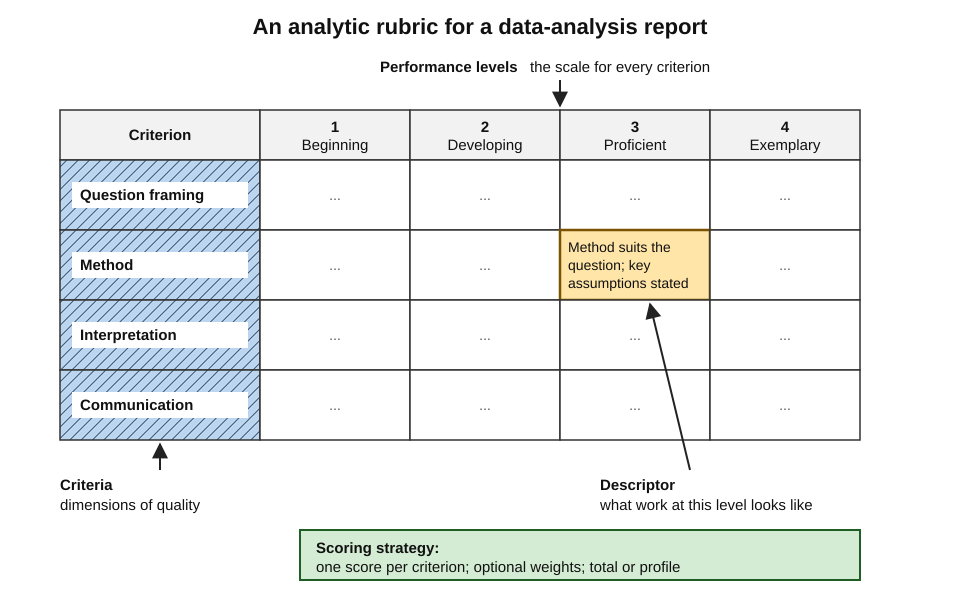
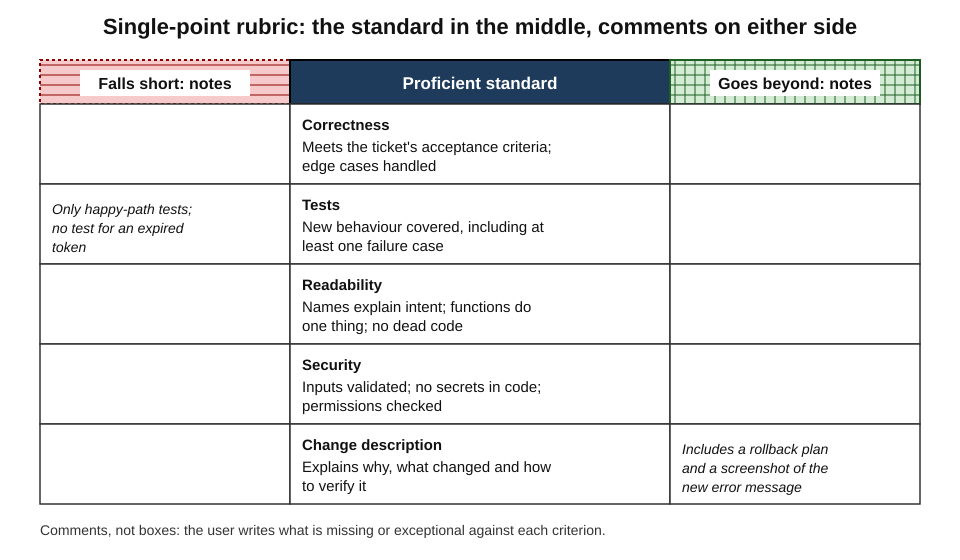
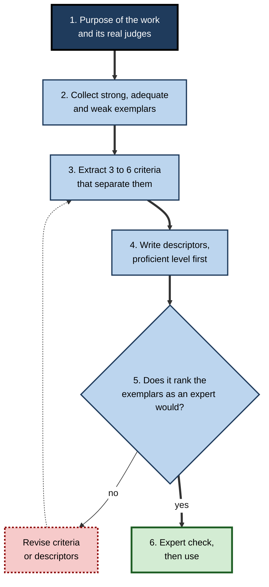
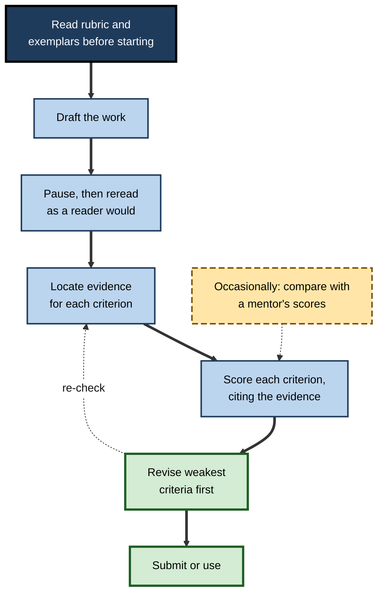
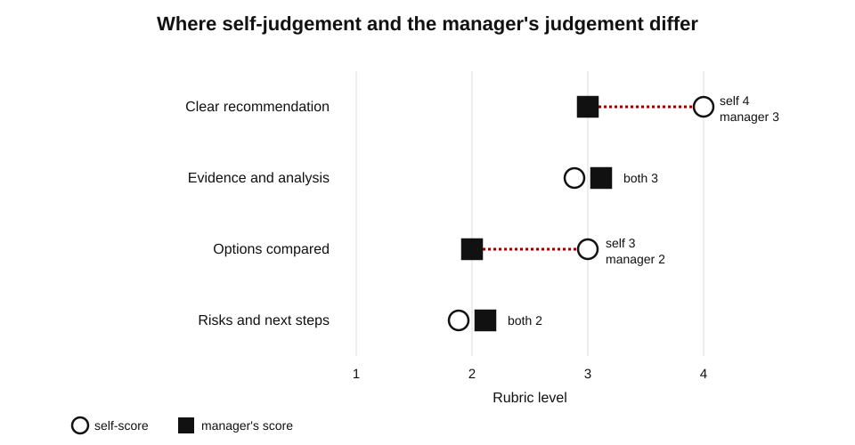

# H.5. Rubrics for Self-Evaluation

A junior consultant finishes a client memo and asks herself whether it is good. Without a standard, the honest answer is "it feels fine". With a rubric — clear recommendation in the first paragraph; every claim backed by evidence; options compared on stated criteria; risks and next steps explicit — she can check each feature, find that her risks section is a single vague sentence and fix it before her manager sees it.

Questions and answer keys work for knowledge with right answers. A rubric is how quality is judged in work that has no single correct answer: reports, designs, code, presentations, consultations.

> **Definition — Rubric:** a coherent set of criteria for a piece of work, with descriptions of levels of performance quality on each criterion (after **Susan Brookhart, 2013**).

**Why it matters**

- Most professional output — analysis, writing, design, advice, care — is judged by **quality**, not correctness; rubrics make quality visible.
- A rubric lets a learner hold the **standard** themselves, which is the precondition for judging their own work.
- Used well, rubrics improve both **performance** and **self-regulation**; used badly, they turn work into box-ticking.
- In organisations, rubrics underlie interview scorecards, competency frameworks, design reviews, clinical skills assessments and code-review guides.

---

## The Anatomy of a Rubric

### Four parts

- **Criteria** — the dimensions on which the work is judged.
  - *e.g.* for a data-analysis report: question framing, method, interpretation, communication.
- **Performance levels** — the scale along each criterion.
  - *e.g.* beginning, developing, proficient, exemplary — or 1 to 4.
- **Descriptors** — what the work looks like at each level of each criterion.
  - *e.g.* "Proficient: states the business question precisely and explains why it matters to the decision-maker."
- **Scoring strategy** — how levels combine: separate scores per criterion, weights, a total, or an overall judgement.

> **Definition — Descriptor:** the description of what work at a particular level of a particular criterion looks like.

**Figure 1.** The parts of an analytic rubric.

### Criteria versus indicators

- A **criterion** names a quality: *clarity of argument*.
- An **indicator** is observable evidence of it: *the main recommendation appears in the first paragraph*.
- Good rubrics describe quality at each level; indicators help the user find evidence for it.

> **Watch out:** a rubric whose descriptors only count things — "uses three sources", "has five slides" — measures quantity, not quality. Counting is easy to self-score and easy to game.

---

## Kinds of Rubric

### Analytic, holistic, single-point

- **Analytic rubric** — each criterion is scored separately on its own scale.
  - **Strength:** detailed diagnosis; shows exactly which aspect is weak.
  - **Weakness:** slower; the sum of parts can miss the quality of the whole.
- **Holistic rubric** — one overall judgement, guided by descriptions of whole pieces of work at each level.
  - **Strength:** fast; captures overall quality.
  - **Weakness:** little diagnostic information.
- **Single-point rubric** — lists only the criteria at the **proficient** level, with space on either side to note where the work falls short or goes beyond.
  - Described by **Jarene Fluckiger (2010)** as a simpler alternative that invites comment rather than box-selection.
  - **Strength:** short; focuses on the standard; encourages written feedback.
  - **Weakness:** less guidance on what the levels below and above look like.

**Figure 2.** A single-point rubric for a pull request.

### Checklists and rating scales

- **Checklist** — features present or absent, with no quality levels.
  - Useful for **procedures** where each step must be done: a surgical safety checklist, a release procedure.
- **Rating scale** — criteria rated on a numeric or frequency scale ("rarely … always") without descriptors.
  - Quick, but each rater interprets the numbers differently.

### General and task-specific

- **General rubrics** apply across many tasks of a kind — any persuasive essay, any client presentation.
  - Teach the **transferable** standard; ideal for self-evaluation over time.
- **Task-specific rubrics** describe the expected content of one task — "identifies that the lease is an operating lease".
  - More reliable for marking, but they give away the answer and do not transfer.

**Table 1.** Rubric types compared.

| | Analytic | Holistic | Single-point | Checklist | Rating scale |
|---|---|---|---|---|---|
| Unit of judgement | Each criterion | The whole work | Each criterion, at the standard | Each feature | Each criterion |
| Quality levels described | Yes, every level | Yes, overall | Proficient only | No | No |
| Diagnostic detail | High | Low | Medium–high, via comments | Low | Low–medium |
| Speed of use | Slow | Fast | Fast | Fast | Fast |
| Best for self-evaluation of | Complex work during learning | Final judgement of finished work | Drafts, with comments | Procedures | Quick, rough checks |

> **Key point:** for **self-evaluation during learning**, analytic and single-point rubrics are usually best: they tell the learner what to fix. Holistic judgements are better for the final question, "is it good enough overall?"

---

## What the Evidence Shows

### Rubrics and achievement

**Study card — Heidi Andrade, Ying Du and Xiaolei Wang (2008)**

- **Design:** pupils in the United States wrote essays.
  - **Treatment group:** read a model essay, generated a list of the qualities of good writing, received a rubric and used it to self-assess their first drafts before revising.
  - **Comparison group:** generated a list of qualities but did not use the rubric for self-assessment.
- **Results:** the treatment group's final essays were scored higher, across most criteria.
- **Conclusion:** rubric-referenced self-assessment, combined with a model, improved the quality of the work — not just the learners' awareness of criteria.

**Study card — Ernesto Panadero, Anders Jonsson, Leire Pinedo and Belén Fernández-Castilla (2023)**

- **Design:** meta-analysis of studies comparing the use of rubrics with no rubric.
- **Results:**
  - a **moderate** positive effect on academic performance (around *g* = 0.45);
  - smaller positive effects on **self-regulated learning** and **self-efficacy**;
  - effects depended on how rubrics were used — for example, whether learners engaged actively with them.
- **Conclusion:** rubrics help, especially when learners **use** them to plan, monitor and revise, rather than merely receiving them.

### Rubrics and reliability

- **Anders Jonsson and Gunilla Svingby (2007)** reviewed rubric research and concluded:
  - rubrics improve the **consistency** of scoring, especially when combined with **exemplars** and **rater training**;
  - rubrics may promote learning by making expectations **explicit**;
  - rubrics alone do not guarantee valid assessment — the criteria must reflect what matters.

### How rubrics help

- **Transparency** — the learner knows what quality looks like before starting.
- **Planning** — criteria become a design brief.
- **Monitoring** — drafts can be checked against the standard while there is still time.
- **Feedback language** — rubric terms give learners and reviewers a shared vocabulary.
- **Lower anxiety** — clearer expectations make evaluation less mysterious; several studies report reduced anxiety, though the effect is modest.

> **Watch out:** handing out a rubric is not the same as using one. In many studies the benefit appears only when learners **apply** it to their own or others' work, often with exemplars and guidance.

---

## The Limits of Criteria

### Sadler's critique

- **D. Royce Sadler (2009)** argued that quality in complex work is **not fully reducible** to preset criteria:
  - experts often judge **holistically**, noticing qualities no rubric names;
  - a work can satisfy every criterion and still be mediocre, or break one and be brilliant;
  - criteria are interpreted differently by different readers.
- His proposed emphasis: develop learners' **evaluative judgement** through **exemplars** and **discussion** of real work, using criteria as aids rather than definitions of quality.

### Criteria compliance

- **Harry Torrance (2007)** warned that making criteria fully transparent can produce **criteria compliance**: learners and teachers optimise work for the rubric, and learning becomes instrumental.
- **Alfie Kohn (2006)** criticised rubrics for standardising work and shifting attention from ideas to scores.
- **W. James Popham (1997)** identified a design failure: descriptors either **too task-specific** (giving the answer away) or **too general** (meaningless — "excellent organisation").

### Weak and strong descriptors

**Table 2.** Weak descriptors and stronger alternatives for "use of evidence" in an analytical report.

| Level | Weak descriptor | Stronger descriptor |
|---|---|---|
| 4 | Excellent use of evidence | Every major claim is supported by relevant, credible evidence; limitations of the evidence are acknowledged and their effect on the conclusion explained |
| 3 | Good use of evidence | Major claims are supported by relevant evidence; some limitations noted |
| 2 | Some use of evidence | Evidence is present for some claims; some is irrelevant or uncritically accepted |
| 1 | Poor use of evidence | Claims are mostly asserted; evidence absent, irrelevant or misrepresented |

- The weak version is just a ranking with adjectives; the strong one describes what a reader would **see**.

> **Remember:** a good descriptor is **observable**, **qualitative** (not a count), **parallel** across levels and **distinct** from its neighbours.

> **Key point:** rubrics and exemplars work together. The rubric names the qualities; the exemplars show what they look like. Neither is enough alone.

---

## Building a Rubric for One's Own Work

### When to build one

- When no rubric exists — common in workplaces, where standards are often implicit.
- When an existing rubric is too vague or too task-specific.
- When the learner wants to understand an implicit professional standard — building the rubric is itself a way of learning what quality is.

### Six steps

1. **Define the work and its purpose.** What is it for, and who judges it in the real world? (*A board paper is judged by busy directors deciding under time pressure.*)
2. **Collect exemplars** of varied quality — strong, adequate and weak — from colleagues, archives or published examples.
3. **Extract criteria.** Ask: what distinguishes the strong examples from the weak? Keep three to six criteria that matter most.
4. **Write descriptors**, starting with the **proficient** level, then above and below.
5. **Test on exemplars.** Score the collected examples. Does the rubric rank them as an expert would? Are any levels impossible to tell apart?
6. **Revise and check with an expert.** Ask a senior practitioner whether it captures what they actually look for.

**Figure 3.** Building a rubric from exemplars.

### Co-constructed rubrics

- Rubrics developed **with** learners — by analysing exemplars together — tend to be understood and used better than those simply handed out.
- In a team, co-constructing a rubric for a recurring output (incident reports, proposals, design documents) surfaces **disagreements** about quality that would otherwise appear only in review comments.

---

## Using a Rubric to Self-Evaluate

### The procedure

1. **Read the rubric before starting** — use the criteria to plan the work.
2. **Produce a draft.**
3. **Wait** — even a few hours helps the writer see the work as a reader would.
4. **Find evidence first.** For each criterion, locate the passage, slide or code that provides the evidence. Highlighting or annotating the draft criterion by criterion forces this step.
5. **Score each criterion** against the descriptors, citing the evidence.
6. **Compare with an exemplar** at the target level.
7. **Revise** the weakest criteria first.
8. **Calibrate** occasionally: ask a mentor or peer to score the same draft, and compare.

**Figure 4.** Self-evaluation with a rubric.

### Agreement with others

- Self-scores are most useful when they **agree** with an expert's scores often enough to be trusted.

> **Formula — Exact and adjacent agreement:** exact agreement = criteria scored identically ÷ total criteria; adjacent agreement = criteria scored within one level ÷ total criteria. If a learner and a mentor score six criteria and match on three, differ by one level on two and by two levels on one: exact = 3 ÷ 6 = **50%**; adjacent = 5 ÷ 6 ≈ **83%**.

- **Patterns to look for:**
  - **systematic leniency** — the learner scores every criterion higher;
  - **criterion-specific blind spots** — agreement everywhere except one criterion, which usually means the learner has not understood that criterion's standard;
  - **improving agreement over time** — a sign that the learner's evaluative judgement is developing.

### Worked example (illustrative): self-evaluating a recommendation memo

A junior consultant drafts a two-page memo recommending whether a retail client should close a regional warehouse. She uses a four-criterion analytic rubric (levels 1–4) and then asks her manager to score it independently.

**Table 3.** Self-scores and manager's scores on the first draft.

| Criterion | Self-score | Evidence she cited | Manager | Manager's reason |
|---|---|---|---|---|
| Clear recommendation | 4 | "Recommendation in first paragraph" | 3 | Recommendation present but hedged with "may wish to consider" |
| Evidence and analysis | 3 | Cost model in appendix | 3 | Agreed |
| Options compared | 3 | Two options described | 2 | Options described but not compared on the same criteria |
| Risks and next steps | 2 | One paragraph of risks | 2 | Agreed: risks generic, no owners or dates |

*Illustrative figures.*

**Steps:**

1. **Agreement:** exact 2 of 4 (50%); adjacent 4 of 4 (100%) — broadly calibrated, slightly lenient.
2. **Pattern:** she over-scored the **two criteria about decisiveness and comparison** — a sign she has not yet absorbed how directly the firm expects recommendations to be stated.
3. **Revision:** she rewrote the opening as a single unhedged sentence, added a comparison table scoring both options on cost, service level and risk, and gave each risk an owner and a date.
4. **Second draft:** both scorers gave 4, 3, 4, 3.

> **Watch out:** the most valuable result was not the score but the **mismatch** on "clear recommendation". It revealed an unstated professional norm — directness — that no amount of self-scoring alone would have taught her.

**Figure 5.** Self-scores compared with a manager's scores on the first draft. (illustrative)

---

## Combining Scores and Tracking Growth

### Compensatory and non-compensatory scoring

- **Compensatory scoring** adds criterion scores, so strength on one criterion offsets weakness on another.
- **Non-compensatory (conjunctive) scoring** requires a minimum on certain criteria regardless of the total.
- Professional work often needs **both**: some criteria are critical, and no amount of polish elsewhere makes up for failing them.
  - *e.g.* a financial model with a broken formula is not rescued by elegant formatting; a clinical handover that omits allergies is not rescued by clarity.

> **Formula — Weighted rubric score:** total = Σ (weight × level) ÷ Σ weights. With criteria weighted 3 (accuracy), 2 (analysis), 1 (presentation) and levels 2, 4, 4: total = (3×2 + 2×4 + 1×4) ÷ 6 = 18 ÷ 6 = **3.0** — "proficient" overall. If accuracy must be at least 3 (a conjunctive rule), the work **fails** despite the total.

**Table 4.** Compensatory and non-compensatory scoring compared.

| | Compensatory | Non-compensatory |
|---|---|---|
| Rule | Scores combine; strengths offset weaknesses | Minimum required on specified criteria |
| Suits | Work where qualities trade off | Work with safety-critical or non-negotiable elements |
| Risk | Hides a fatal weakness behind a good total | Can fail strong work on one narrow point |
| Self-evaluation use | Overall sense of quality | Identifying what must be fixed before anything else |

> **In practice:** when self-evaluating, mark the **critical criteria** first. If any is below the minimum, fix it before polishing anything else.

### Rubrics as maps of development

- A general rubric used repeatedly becomes a **record of growth**: the same criteria, scored on successive pieces of work, show which qualities are developing and which have stalled.
- **Developmental rubrics** describe levels as stages of growing expertise rather than grades — for example, from "follows a template" to "adapts the approach to the client's situation" to "sets the standard others follow".
- **Uses for the self-directed learner:**
  - score each significant piece of work on the same rubric and keep the scores together;
  - look for criteria stuck at the same level for months — they need deliberate practice, not more of the same work;
  - revisit the descriptors as expertise grows; criteria that once seemed clear often reveal new depth.

> **Example (illustrative):** a data scientist scores every analysis she presents on a five-criterion rubric. After six months, "question framing" and "method" have risen from 2 to 4, but "communicating uncertainty" has stayed at 2. She asks a senior colleague to review her next three presentations on that criterion alone.

> **Watch out:** scores on a rubric are not interval measurements. A move from 2 to 3 on one criterion is not necessarily the same size as a move from 3 to 4 on another; treat rubric scores as ordered categories, and avoid over-precise averages.

---

## Rubrics in Professional Practice

### Checklists and global ratings in clinical assessment

**Study card — Glenn Regehr, Helen MacRae, Richard Reznick and David Szalay (1998)**

- **Design:** surgical residents were assessed in an OSCE-format examination of technical skills; examiners used both **task-specific checklists** and **global rating scales** (overall judgements of qualities such as respect for tissue, flow and knowledge of instruments).
- **Results:** the **global rating scales** showed reliability at least as high as the checklists and better evidence of validity — they distinguished more clearly between residents of different experience.
- **Conclusion:** for experienced examiners judging complex skills, well-described global judgements can outperform detailed checklists — consistent with Sadler's view that expert judgement is partly holistic.

> **In practice:** many clinical skills examinations now combine checklists (for essential steps that must not be missed) with global ratings (for overall quality).

### Behaviourally anchored rating scales

- **Patricia Smith and Lorne Kendall (1963)** developed **behaviourally anchored rating scales (BARS)** for job performance: each level of a scale is anchored by a concrete example of behaviour.
  - *e.g.* for "handling customer complaints", level 5: "acknowledges the customer's frustration, resolves the issue in the call and confirms the resolution in writing".
- BARS reduce the ambiguity of rating scales and are widely used in structured interviews and competency frameworks.

### Other professional rubrics

- **Structured interview scorecards** — each question scored against anchored levels; structured interviews predict job performance better than unstructured ones.
- **Code-review guides** — correctness, readability, tests, security, performance; often single-point.
- **Design critiques** — criteria such as user need, clarity, accessibility, consistency.
- **Sales call scorecards** — discovery questions, listening, next steps agreed.
- **Writing standards** — plain-language criteria for public-sector and legal documents.

### Rubrics for live performance

- Presentations, negotiations, consultations and interviews happen in real time; they cannot be revised like a draft.
- **Self-evaluation needs a record:** a recording, a transcript, or an observer's notes. Judging a live performance from memory is unreliable — people remember intentions and highlights, not filler words, interruptions or missed questions.
- **Practical approach:**
  1. Choose three or four criteria at most — more cannot be attended to while watching.
  2. Watch or listen once for an overall impression, then once per criterion, noting time-stamped evidence.
  3. Score each criterion, then compare with one observer's scores.
  4. Pick **one** criterion to improve in the next performance.

> **Example (illustrative):** a sales engineer records a discovery call and scores it on "open questions", "summarising the customer's need", "linking features to that need" and "agreeing a next step". The recording shows she asked only two open questions in thirty minutes — invisible to her during the call.

### Rubrics and AI

- Generative AI tools can apply a rubric to a draft and comment on each criterion.
- **Uses:** a fast **second rater** for self-evaluation; a way to see how a reader might interpret descriptors.
- **Risks:** tools tend to be **lenient**; they may claim evidence exists that does not; they can make the learner rely on the tool's judgement instead of developing their own.
- **Good practice:** score first, then ask the tool; treat disagreements as prompts to re-examine the evidence; never accept a score without the cited evidence.

### Case study (illustrative): a design-review rubric in a product team

- **Situation:** a product-design team of twelve held weekly critiques; junior designers found feedback inconsistent and personal.
- **Problem:** each senior designer emphasised different things; juniors could not predict what would be criticised and so could not self-review.
- **Actions:**
  1. The team collected twenty past designs, sorted them into strong and weak and discussed what separated them.
  2. They agreed five criteria — user problem, task flow, visual hierarchy, accessibility, edge cases — with single-point descriptors.
  3. Designers self-scored against the rubric before each critique, noting concerns and strengths.
  4. Critique began with the designer's self-assessment; reviewers responded to it.
  5. Every quarter the team re-scored a few designs together to keep interpretations aligned.
- **Result (two quarters):**
  - critiques became shorter and more focused;
  - juniors' self-assessments increasingly matched seniors' views;
  - accessibility issues found in testing fell markedly, because accessibility was now checked by every designer before review.
- **Side effects:** some seniors felt the rubric constrained discussion of bold ideas; the team added an open "what is distinctive here?" prompt.
- **Lesson:** a co-constructed rubric made a tacit standard **shared**, so juniors could apply it to their own work — and the open prompt kept it from becoming a cage.

---

## Open Questions

- **How much of quality can criteria capture?**
  - Sadler's critique suggests holistic judgement is irreducible; how best to combine rubrics with exemplar-based judgement is debated.
- **Do rubrics narrow learning?**
  - Concerns about criteria compliance are widely voiced; strong evidence on long-term effects on creativity and depth is limited.
- **What makes rubric use effective?**
  - Effects vary widely; the roles of exemplars, training, co-construction and feedback are not fully disentangled.
- **Can AI apply rubrics reliably?**
  - Agreement with expert raters varies by task and model; leniency and fabricated evidence are recurrent concerns.
- **How transferable is rubric-based self-evaluation?**
  - Whether learners who use rubrics in one field judge quality better in another is largely unstudied.

---

## Summary

- A **rubric** = criteria + performance levels + descriptors + scoring strategy; it makes quality visible in work without single right answers.
- Types: **analytic** (diagnostic), **holistic** (overall), **single-point** (the standard with comments), **checklists** (procedures), **rating scales** (quick but ambiguous); **general** rubrics transfer, **task-specific** ones do not.
- Evidence: rubric-referenced **self-assessment with a model** improved writing (**Andrade, Du and Wang, 2008**); meta-analysis shows **moderate** gains in performance and smaller gains in self-regulation and self-efficacy (**Panadero and colleagues, 2023**); rubrics raise scoring consistency, especially with exemplars and training.
- Limits: quality is partly **holistic** (**Sadler**); transparency can produce **criteria compliance** (**Torrance**); descriptors can be too general or too specific (**Popham**).
- Good descriptors are **observable, qualitative, parallel and distinct**; pair rubrics with **exemplars**.
- Build rubrics from **exemplars** and test them on real work; co-construct where possible.
- Self-evaluate by **finding evidence first**, scoring each criterion, comparing with an exemplar, revising the weakest criteria and **calibrating** with others using exact and adjacent agreement.
- Professional forms: clinical **checklists and global ratings**, **BARS**, interview scorecards, code-review and design-critique rubrics; AI can be a second rater, not the judge.

---

## Self-Check

1. Define a rubric and name its four parts.
2. Distinguish a criterion from an indicator, with an example.
3. Compare analytic, holistic and single-point rubrics for self-evaluating a draft.
4. Why are task-specific rubrics poor tools for long-term self-evaluation?
5. Describe the Andrade, Du and Wang (2008) study and its conclusion.
6. What did the 2023 meta-analysis find, and what condition seemed to matter?
7. Summarise Sadler's critique of preset criteria and his proposed emphasis.
8. What is criteria compliance, and how might a team guard against it?
9. Rewrite "good structure" as a strong level-3 descriptor for a technical report.
10. List the six steps for building a rubric from exemplars.
11. Why should evidence be located before a criterion is scored?
12. A learner and mentor score five criteria: identical on two, one level apart on two, two levels apart on one. Calculate exact and adjacent agreement and interpret.
13. What did Regehr and colleagues (1998) find about checklists and global ratings, and why might it be so?
14. How should a learner use an AI tool to apply a rubric to their work?

### Answer Key

1. A coherent set of criteria with descriptions of quality levels on each. Parts: criteria, performance levels, descriptors, scoring strategy.
2. A criterion names a quality (clarity of argument); an indicator is observable evidence of it (the recommendation appears in the first paragraph).
3. Analytic: separate scores per criterion — most diagnostic, slowest. Holistic: one overall judgement — fast, little diagnosis. Single-point: the proficient standard per criterion with space for comments — short, focused, good for drafts.
4. They describe the expected content of one task, so they give away answers and do not teach the transferable standard that applies to the next piece of work.
5. Pupils read a model essay, listed qualities of good writing, and used a rubric to self-assess drafts before revising; they wrote better final essays than pupils who listed qualities without rubric-based self-assessment. Rubric-referenced self-assessment with a model improves the work itself.
6. A moderate positive effect on performance (about g = 0.45) and smaller effects on self-regulation and self-efficacy; benefits depended on active use of the rubric rather than mere receipt.
7. Quality in complex work is not fully reducible to preset criteria; experts judge partly holistically, and criteria are interpreted variously. He emphasised developing evaluative judgement through exemplars and discussion, with criteria as aids.
8. Optimising work to satisfy rubric criteria rather than to achieve real quality. Guards: pair rubrics with exemplars, include an open criterion or prompt for distinctiveness, revise rubrics periodically and discuss real work, not just scores.
9. E.g. "Sections follow a logical order from problem to recommendation; each section opens with its main point; headings let a reader find any key result within a minute; minor digressions remain."
10. Define the work and its real judges; collect exemplars of varied quality; extract the criteria that separate them; write descriptors from proficient outwards; test the rubric on the exemplars; revise and check with an expert.
11. Because otherwise the score reflects the writer's impression and intention; locating the passage that meets each criterion forces a judgement based on what a reader will actually see.
12. Exact = 2 ÷ 5 = 40%; adjacent = 4 ÷ 5 = 80%. Broadly aligned but imprecise; the criterion two levels apart is likely a blind spot whose standard the learner has not grasped.
13. Global rating scales were at least as reliable as checklists and better at distinguishing experience levels. Checklists capture whether steps were done, not how well; expert examiners' holistic judgements capture fluency and quality that steps miss.
14. Score the work first, with evidence; then ask the tool to score it, citing evidence; examine disagreements against the actual text; treat the tool's leniency and possible fabricated evidence with caution; keep one's own judgement as the decision.

---

## Glossary

| Term | Meaning |
|---|---|
| Adjacent agreement | Share of criteria on which two raters' scores are within one level. |
| Analytic rubric | A rubric scoring each criterion separately. |
| Behaviourally anchored rating scale (BARS) | A rating scale whose levels are anchored by concrete behavioural examples. |
| Checklist | A list of features or steps marked present or absent. |
| Co-constructed rubric | A rubric developed together with those who will use it. |
| Compensatory scoring | Combining criterion scores so that strengths offset weaknesses. |
| Criteria compliance | Optimising work to satisfy listed criteria rather than achieve real quality. |
| Criterion | A dimension on which work is judged. |
| Descriptor | A description of what work at a given level of a criterion looks like. |
| Developmental rubric | A rubric whose levels describe stages of growing expertise. |
| Exact agreement | Share of criteria on which two raters give identical scores. |
| Exemplar | An example of real work used to illustrate a level of quality. |
| Global rating scale | An overall judgement of quality on defined dimensions. |
| Holistic rubric | A rubric giving one overall judgement of the work. |
| Indicator | Observable evidence that a criterion is met. |
| Non-compensatory scoring | Requiring a minimum on specified criteria regardless of the total. |
| Performance level | A point on the quality scale of a criterion. |
| Rating scale | Criteria rated numerically or by frequency without full descriptors. |
| Rubric | Criteria for a piece of work with descriptions of quality levels on each. |
| Single-point rubric | A rubric describing only the proficient level, with space for comments on either side. |
| Task-specific rubric | A rubric describing the expected content of one particular task. |
