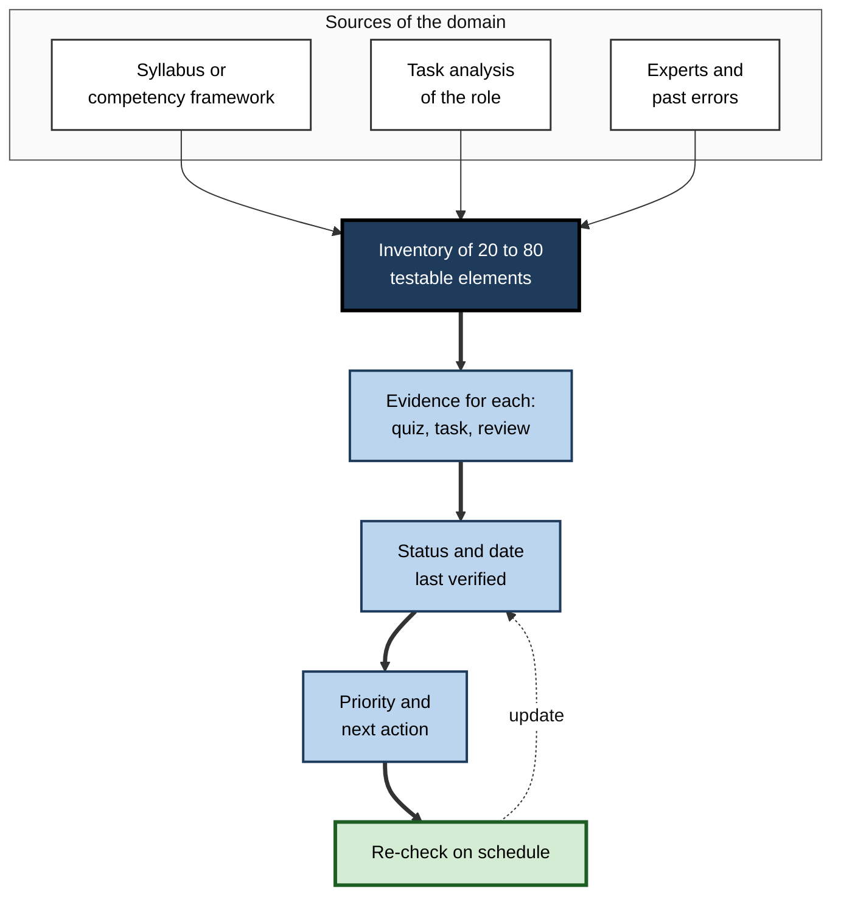
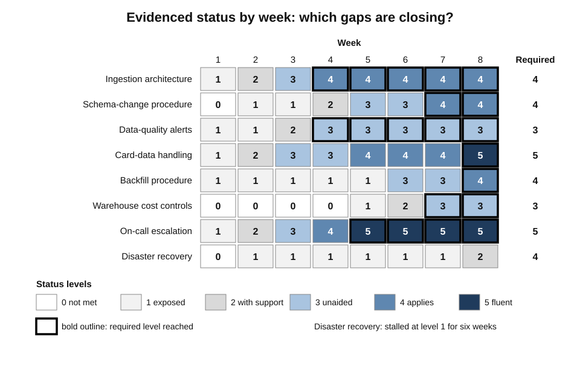
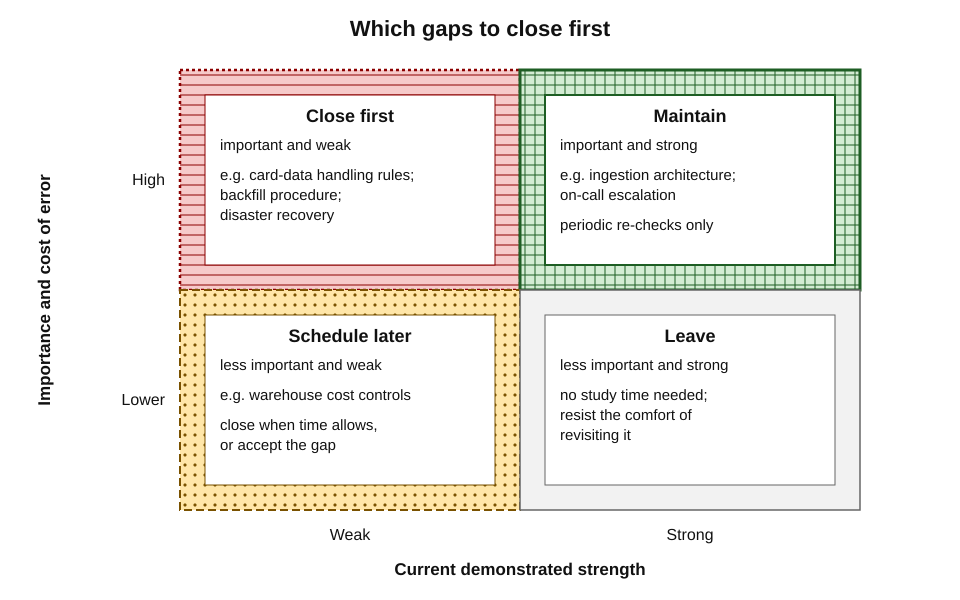
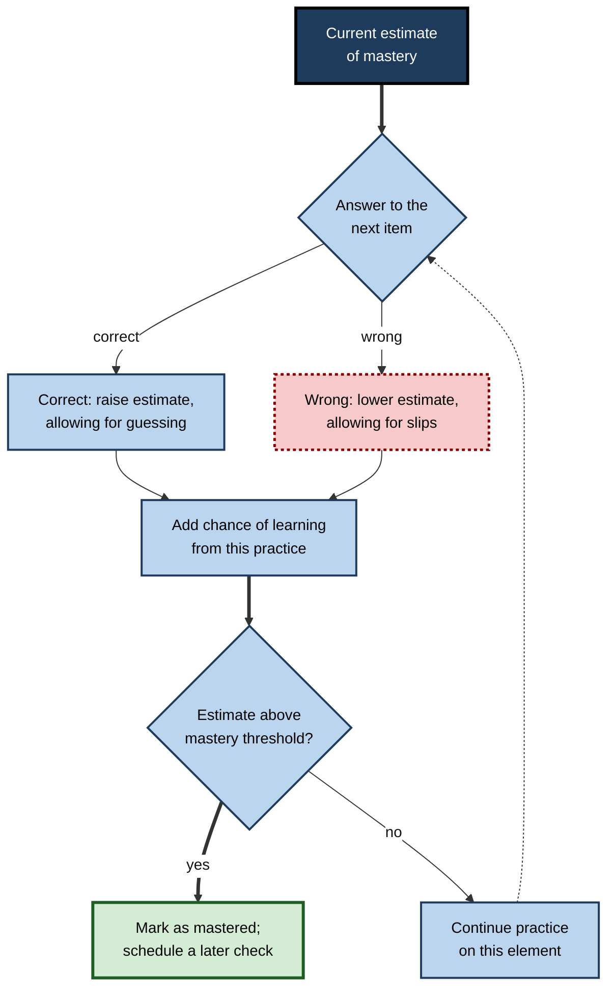
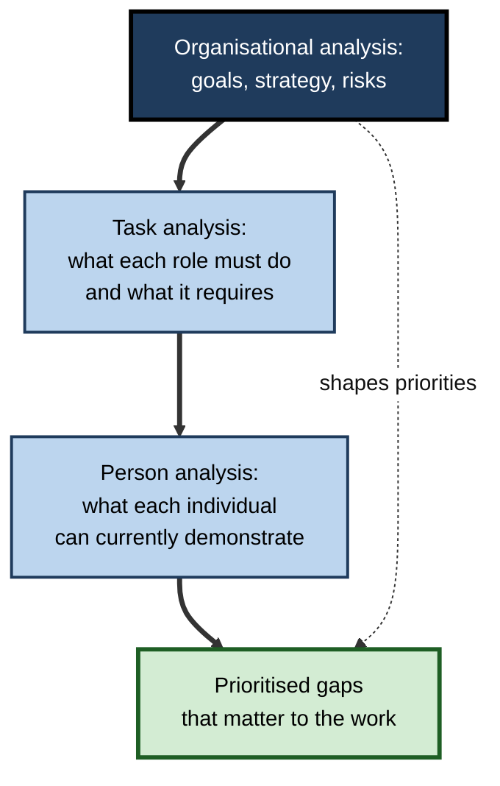
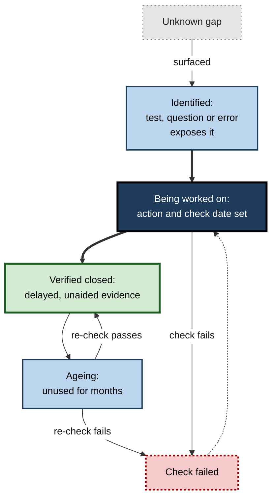

# L.6. Tracking Knowledge Gaps

A new site-reliability engineer keeps a simple spreadsheet: every service she is expected to support, every runbook procedure, and for each one a status, the date she last proved she could do it and what she will do next. During her first serious incident she is not guessing where her weaknesses lie — she already knows that database failover is "practised once, two months ago" and asks a colleague to pair with her.

Most learners know vaguely that they have gaps. Few know **which** gaps, **how large**, **how important** and **whether they are closing**.

> **Definition — Knowledge gap:** the difference, on a specific element of knowledge or skill, between the level a task or role requires and the level a person can currently demonstrate.

> **Definition — Gap tracking:** the systematic recording of a domain's elements, the evidence of current capability on each, and the actions and re-checks planned to close the gaps.

**Why it matters**

- Memory for one's own weaknesses is poor: a gap noticed on Monday is forgotten by Friday unless it is written down.
- Without a record, study drifts towards **comfortable** topics and away from weak ones.
- A tracker turns scattered evidence — quiz results, mock scores, review comments, questions that could not be answered — into **one picture**.
- In organisations, gap tracking underlies **training needs analysis**, team skills matrices, onboarding and succession planning.

---

## What a Gap Is

### Six kinds of gap

- **Absent** — the knowledge has never been acquired.
  - *e.g.* a new analyst has never met survival analysis.
- **Fragile** — retrievable only with cues, or only soon after study.
  - *e.g.* can follow a worked example of a discounted-cash-flow calculation but cannot set one up from scratch.
- **Misconceived** — held confidently but wrong.
  - *e.g.* believes that correlation coefficients measure the size of an effect.
- **Inert** — known when asked directly, but not used when relevant.
  - *e.g.* can define "selection bias" but does not notice it in a client's survey.
- **Slow** — correct, but too slow for real use.
  - *e.g.* a trainee interpreter who renders every sentence accurately but lags far behind the speaker.
- **Judgement** — rules known, but cases not yet weighed well.
  - *e.g.* a new manager knows the disciplinary policy but misjudges when to use it.

> **Definition — Inert knowledge (Alfred North Whitehead, 1929):** knowledge that can be recalled when prompted but is not used spontaneously in situations where it applies.

**Table 1.** Six kinds of knowledge gap, how they show and what closes them.

| Gap | Typical evidence | Main remedy |
|---|---|---|
| Absent | Cannot attempt the question at all | Study from a good source |
| Fragile | Succeeds with hints or right after study; fails after a delay | Spaced, unaided practice |
| Misconceived | Wrong answers given with confidence | Confront the wrong idea with the right one; contrast cases |
| Inert | Correct on direct questions; misses it in realistic cases | Practice on varied, realistic cases without labels |
| Slow | Correct but over time | Timed practice for fluency |
| Judgement | Inconsistent decisions on similar cases | Worked cases with expert reasoning; feedback on decisions |

> **Key point:** "I have a gap in statistics" is not trackable. "I cannot choose between a t-test and a Mann–Whitney test without notes" is. A gap is useful only when it is **specific enough to act on and to re-test**.

### Known and unknown gaps

- Gaps that the learner is aware of can be tracked directly.
- Gaps the learner is **unaware** of must first be surfaced — through tests built from an external list of the domain, through others' questions and through real work that exposes them.
- A tracker helps with both: because it lists the **whole domain**, untested elements stand out as blanks.

---

## Mapping the Domain First

### Build the inventory

- Gaps can only be tracked against a list of what should be known. Sources:
  - **syllabi and examination outlines** — objectives, weights;
  - **competency frameworks** — professional bodies' standards; the **Skills Framework for the Information Age (SFIA)** for digital skills; clinical curricula;
  - **job and task analysis** — the tasks the role actually involves, and the knowledge each requires;
  - **expert interviews** — "what do new people most often not know?";
  - **incident and error records** — what has gone wrong before.

### Choose the grain size

- **Too coarse** — "cloud networking" — hides which parts are weak; cannot be re-tested.
- **Too fine** — 400 rows of individual facts — the tracker is abandoned within a fortnight.
- **About right** — elements that can each be checked with a few items or one task in a few minutes; typically **20–80 elements** for a qualification or a new role.

> **Definition — Knowledge component (Kenneth Koedinger, Albert Corbett and Charles Perfetti, 2012):** an acquired unit of cognitive function or structure that can be inferred from performance on a set of related tasks — the unit at which learning is tracked in intelligent tutoring systems.

> **Remember:** a good tracker element is **specific**, **testable** and **meaningful** to the work.

**Figure 1.** From a domain to a gap tracker.

---

## Recording Status on Evidence

### A status scale

- A useful scale describes **what the learner can demonstrate**, not how they feel:
  0. **Not yet met** — no exposure.
  1. **Exposed** — has read or watched it; no evidence of retention.
  2. **Recalls with support** — can answer with hints, notes or a worked example open.
  3. **Recalls unaided** — can answer or perform after a delay without help.
  4. **Applies** — can use it on new, realistic cases.
  5. **Fluent** — applies quickly and reliably; could teach it.
- Status moves **up only on evidence** — a delayed, unaided check — and **down** when a check fails.

> **Watch out:** the most common tracker failure is recording **effort** as status: "watched the course module" becomes "done". Exposure is level 1, however many hours it took.

### Evidence and dates

- Each status entry should carry:
  - **the evidence** — "3 of 3 correct on delayed quiz", "configured failover in sandbox unaided";
  - **the date** it was verified;
  - **the next check date**.
- **Status ages.** A skill verified six months ago and unused since is less certain than one verified last week. Many professionals treat any status older than a set period — say, three months for rarely used procedures — as **due for re-verification**.

### Worked example: a gap tracker for a new role

A data engineer starting in a payments company tracks eight elements of the platform she must support.

**Table 2.** Extract from her tracker in week four.

| Element | Required level | Current level | Evidence | Verified | Next action | Next check |
|---|---|---|---|---|---|---|
| Ingestion pipeline architecture | 4 | 4 | Explained it to a new joiner; answered 5 scenario questions | Wk 3 | None | Wk 8 |
| Schema-change procedure | 4 | 2 | Completed only with the runbook open | Wk 4 | Practise in sandbox twice, unaided | Wk 5 |
| Data-quality alerts | 3 | 3 | Diagnosed two live alerts correctly | Wk 4 | None | Wk 8 |
| Card-data handling rules | 5 | 3 | 8/10 on compliance quiz; missed tokenisation rules | Wk 2 | Study tokenisation; re-quiz | Wk 5 |
| Backfill procedure | 4 | 1 | Read the runbook only | Wk 1 | Shadow next backfill | Wk 6 |
| Warehouse cost controls | 3 | 0 | — | — | Diagnostic quiz | Wk 5 |
| On-call escalation paths | 5 | 4 | Walk-through with lead | Wk 3 | Timed drill | Wk 5 |
| Disaster recovery | 4 | 1 | Attended briefing | Wk 2 | Join quarterly test | Wk 10 |

**Steps in reading it:**

1. **Largest gaps:** backfill (gap 3), warehouse cost controls (gap 3), disaster recovery (gap 3).
2. **Most critical:** card-data handling — required at 5 because errors have regulatory consequences.
3. **Untested:** warehouse cost controls has no evidence at all — a blank, not a strength.
4. **Plan for week five:** card-data re-quiz, schema-change sandbox practice, escalation drill, cost-controls diagnostic.

> **Key point:** the tracker's value lies in the **evidence, dates and next actions**, not the status numbers alone. A status without evidence is an opinion.

**Figure 2.** A gap tracker over eight weeks: status by element.

---

## Prioritising Gaps

### Four factors

- **Importance** — how much the element matters to the role or assessment (weight in the examination, frequency in the job).
- **Size** — how far current capability is from the required level.
- **Cost of error** — what happens if the gap shows at the wrong moment: a lost mark, a lost client, a patient harmed.
- **Dependency** — whether other elements build on it. Foundational gaps come first because they slow everything that depends on them.

> **Formula — A simple priority score:** priority = importance (1–3) × gap size (required − current) × cost of error (1–3). For card-data handling: 3 × (5 − 3) × 3 = **18**. For warehouse cost controls: 2 × (3 − 0) × 1 = **6**. Despite the smaller gap, card-data handling comes first.

**Worked example — ranking four gaps from the tracker**

**Table 4.** Priority scores for four elements in week four.

| Element | Importance (1–3) | Gap (required − current) | Cost of error (1–3) | Priority |
|---|---|---|---|---|
| Card-data handling | 3 | 5 − 3 = 2 | 3 | **18** |
| Backfill procedure | 2 | 4 − 1 = 3 | 2 | **12** |
| Disaster recovery | 3 | 4 − 1 = 3 | 3 | **27** |
| Warehouse cost controls | 2 | 3 − 0 = 3 | 1 | **6** |

- **Ranking:** disaster recovery (27), card-data handling (18), backfill (12), cost controls (6).
- **Adjustment for timing:** the next disaster-recovery test is in week ten, and the procedure cannot be practised alone in production; she therefore studies the plan now and books a sandbox walk-through, while card-data handling — which she meets daily — gets the bulk of week five.
- **Conclusion:** the score orders the list; practical constraints — when practice is possible, what depends on what — decide the schedule.

> **Watch out:** a priority formula is a thinking aid, not an algorithm. Its numbers are judgements; disagreeing with the output is often a sign that a factor, such as an upcoming deadline, has been left out.

**Figure 3.** Prioritising gaps by importance and current strength.

### Prerequisite structure

- Some elements are **prerequisites** for others: matrix algebra before linear regression; accounting principles before group consolidation.
- A gap in a prerequisite produces apparent gaps **downstream** — the learner seems weak at regression when the real weakness is algebra.
- **Diagnosis rule:** when several related elements are weak, test their shared prerequisite first.

> **Watch out:** prioritising by importance alone can leave foundations weak; prioritising by gap size alone can waste time on large gaps in rarely used knowledge. Combine the factors.

---

## Keeping the Tracker Alive

### A weekly review

1. **Update from evidence.** Enter the week's quiz results, task outcomes, review comments and unanswered questions; change statuses only where evidence justifies it.
2. **Age the old entries.** Flag any element whose last verification is older than its re-check interval.
3. **Recompute priorities.** Elements whose status fell, or whose importance rose because of new work, move up.
4. **Choose three actions.** More than three rarely get done; fewer leaves time unused.
5. **Book the checks.** Each action gets a date on which unaided evidence will be collected.

- **Monthly:** revise the inventory itself — add elements that real work exposed, merge rows that are always identical, split rows that keep hiding mixed results.
- **Quarterly:** compare the tracker with an external view — a mentor, a manager, an assessment — to check that it is not drifting into self-flattery.

### Reading the trend

- **Steady rise** — the study plan is working.
- **Plateau below the required level** — the current method has stopped working; change it (a different source, a different kind of practice, a coach).
- **Saw-tooth** — status rises after study and falls at the next delayed check; the learning is fragile and needs spacing and unaided practice.
- **Never tested** — blank rows are a risk in themselves; schedule a diagnostic.

> **Example:** in the data engineer's tracker, the disaster-recovery row stays at level 1 for six weeks. The engineer had planned to "read the DR plan", which kept her at exposure. Only a sandbox walk-through in week eight — doing the work rather than reading about it — began to move it.

### Reviewing the tracker with a mentor

- A tracker kept alone shares the blind spots of its author. A periodic review with a mentor or manager adds three things:
  - **inventory gaps** — elements the learner did not know to include ("you've no row for vendor management, and you'll need it next quarter");
  - **standard checks** — whether "level 4" means what an experienced practitioner would mean by it;
  - **priority corrections** — what actually matters most in the role this year.
- **Making the review efficient:**
  - send the tracker in advance, sorted by priority;
  - bring evidence for the three statuses one is least sure of;
  - leave with agreed actions and dates for the top gaps.

> **In practice:** a thirty-minute quarterly tracker review often does more for development than a day-long course, because it aims every subsequent hour of learning at the right target.

### Tools

**Table 3.** Ways of keeping a gap tracker compared.

| Tool | Strengths | Weaknesses | Suits |
|---|---|---|---|
| Spreadsheet | Flexible; sortable; easy to add evidence and dates | Manual updating; easy to let lapse | Most self-directed learners |
| Paper or notebook log | Quick; no distraction | Hard to sort, filter or age | Short courses; reflective learners |
| Flashcard or quiz app statistics | Automatic; item-level data | Tracks items, not elements; blind to skills and judgement | Factual and terminological domains |
| Learning platform dashboard | Linked to official objectives | Shows only what the platform tests | Formal courses and certifications |
| Team skills matrix | Shared view; reveals single points of failure | Often self-rated without evidence | Teams and departments |
| AI assistant | Can summarise evidence and suggest priorities | May invent or misjudge; privacy concerns | Supplement, not the record itself |

> **In practice:** whatever the tool, the three columns that matter most are **evidence**, **date verified** and **next action**. A tracker without them is a list of topics.

### Gaps for the experienced professional

- For experts, gaps open less from ignorance than from **change** and **disuse**:
  - **change in the field** — new regulations, standards, tools, guidelines;
  - **disuse** — procedures rarely performed, such as disaster recovery or rare clinical emergencies;
  - **role change** — a promotion that adds budgeting, hiring or client leadership.
- **Practical habits:**
  - keep a short **"what changed" list** for the field each quarter and check one's practice against it;
  - list **rarely used, high-consequence procedures** and re-verify them on a schedule, much as pilots revisit emergency procedures;
  - on any change of role, build a fresh inventory for the new responsibilities instead of assuming the old tracker still applies.

---

## How Machines Track Knowledge

### Bayesian knowledge tracing

**Study card — Albert Corbett and John Anderson (1994)**

- **Setting:** computer tutors for programming, later for school mathematics.
- **Model:** for each knowledge component, the tutor maintains the probability that the learner has **mastered** it, updated after every answer using four parameters:
  - **prior** — the initial probability of mastery;
  - **learn** — the probability of moving from unmastered to mastered at each practice opportunity;
  - **guess** — the probability of answering correctly without mastery;
  - **slip** — the probability of answering wrongly despite mastery.
- **Use:** practice continues on a component until estimated mastery reaches a threshold (commonly 0.95), then moves on.
- **Conclusion:** individualised practice driven by knowledge tracing led learners to reach mastery more efficiently than fixed practice sequences in the tutors studied.

> **Formula — One Bayesian update:** with prior mastery 0.30, guess 0.20 and slip 0.10, a **correct** answer gives P(mastered | correct) = (0.30 × 0.90) ÷ (0.30 × 0.90 + 0.70 × 0.20) = 0.27 ÷ 0.41 ≈ **0.66**. Applying a learning probability of 0.10 for the practice just done: 0.66 + (1 − 0.66) × 0.10 ≈ **0.69**. One correct answer raises the estimate a lot — but not to certainty.

**Figure 4.** How knowledge tracing updates the estimate of mastery after each answer.

### Lessons for the individual learner

- **One correct answer is weak evidence.** Guessing and recognition can produce it; tutors require several.
- **One wrong answer is not proof of a gap.** Slips happen; patterns matter.
- **Mastery is a probability, not a state.** It rises with evidence and should be checked again later.
- **Track at the component level.** Tutors track dozens of specific components, not "algebra".

> **Watch out:** knowledge-tracing models assume that each item measures one component cleanly and that learners do not forget — both simplifications. Later models, including neural approaches such as **deep knowledge tracing (Chris Piech and colleagues, 2015)**, predict answers better in some datasets but are harder to interpret; their advantage over well-tuned simpler models is debated.

---

## Gap Tracking at Work

### Where gap evidence comes from at work

- **Questions that could not be answered** — by a client, a manager, a colleague. Writing them down the same day is one of the richest sources of gap evidence.
- **Review comments** — code reviews, editorial reviews, audit findings; recurring categories reveal gaps.
- **Escalations and handovers** — every time work had to be passed to someone more experienced.
- **Near misses** — errors caught before they mattered.
- **Time overruns** — tasks that took far longer than a competent colleague would need.

> **In practice:** many experienced professionals keep a running **"questions I couldn't answer" list**. Reviewing it weekly turns embarrassing moments into a study plan.

### Training needs analysis

- **William McGehee and Paul Thayer (1961)** proposed analysing training needs at three levels:
  - **organisational analysis** — where in the organisation is training needed, given its goals?
  - **task (operational) analysis** — what must be done in each job, and what knowledge and skill does it need?
  - **person analysis** — who needs training, and in what?
- Individual gap tracking is the **person analysis** carried out by the learner — ideally aligned with the other two levels so that the gaps closed are the ones the organisation needs.

**Figure 5.** Three levels of training needs analysis.

### Team skills matrices

- A **skills matrix** lists team members against the skills the team needs, with each person's level.
- It reveals:
  - **single points of failure** — skills held by only one person;
  - **coverage gaps** — skills nobody holds at the required level;
  - **development opportunities** — who could learn from whom.
- **Weakness:** if levels are self-rated without evidence, the matrix reflects confidence, not capability.

### Case study: the skills matrix that found the outage before it happened

- **Situation:** a twelve-person platform team supported thirty services; most knowledge was held informally.
- **Problem:** two serious incidents in a quarter were prolonged because the only person who understood the affected service was on leave.
- **Actions:**
  1. The team listed 45 operational tasks across the services, at the grain of "fail over the primary database", "rotate the payment-gateway certificate".
  2. Each engineer rated themselves on a four-level scale — but a rating of 3 or 4 required **evidence**: having performed the task unaided in production or in a recorded drill.
  3. The matrix showed nine tasks with only one engineer at level 3 or above and four with none.
  4. The team scheduled monthly **game days**: one engineer performs a scarce task in a sandbox while its expert observes and coaches.
  5. Status and dates were updated after each game day; any level older than six months without use was marked for re-verification.
- **Result (two quarters):** every task had at least two engineers at level 3; mean time to resolve incidents on previously single-expert services fell noticeably; on-call stress reported in team surveys decreased.
- **Side effects:** game days took about half a day per engineer per month — a cost management questioned until the next incident was resolved in minutes.
- **Lesson:** a gap tracker at team level, based on **evidence rather than self-rating**, made invisible risk visible and gave a concrete plan to reduce it.

---

## Why Gap Tracking Fails

- **Too granular** — hundreds of rows, abandoned within weeks.
  - *Remedy:* 20–80 elements; split only those that keep causing trouble.
- **Feelings instead of evidence** — status reflects confidence or hours spent.
  - *Remedy:* status rises only on delayed, unaided checks.
- **No dates** — old successes treated as permanent.
  - *Remedy:* record the verification date; re-check on a schedule.
- **No actions** — gaps listed but never assigned a next step.
  - *Remedy:* every gap row has an action and a check date.
- **Tracking only the measurable** — facts are easy to track, judgement is not, so judgement gaps go unrecorded.
  - *Remedy:* include judgement elements with scenario-based checks and expert comparison.
- **Illusion of completeness** — a full tracker feels like a map of everything, but it is only as complete as its inventory.
  - *Remedy:* revise the inventory when real work exposes an element it lacked.

> **Mnemonic — "Grain, Evidence, Dates, Actions, Judgement, Inventory" ("Good Engineers Document Actions, Judging Inventories"):** the six things that keep a tracker honest.

**Figure 6.** The life cycle of a tracked gap.

---

## Open Questions

- **What grain size is best for self-tracking?**
  - Tutoring systems track fine-grained components; humans abandon fine-grained trackers. The trade-off has been little studied for self-directed learners.
- **How quickly should verified status be assumed to decay?**
  - Forgetting rates differ by person, material and use; practical re-verification intervals are rules of thumb.
- **Can AI maintain a learner's gap model?**
  - Tools can infer gaps from questions and work products, but accuracy, privacy and the risk of over-reliance are unresolved.
- **How should judgement gaps be measured?**
  - Scenario tests and expert comparison help, but reliable, cheap measures of judgement remain elusive.
- **Do organisational skills matrices improve capability or only describe it?**
  - Case reports are positive; controlled evidence is scarce, and self-rated matrices are of doubtful accuracy.

---

## Summary

- A **knowledge gap** is a specific difference between required and demonstrated capability; **gap tracking** records elements, evidence, status, dates and actions.
- Six kinds of gap: **absent, fragile, misconceived, inert, slow, judgement** — each with its own remedy.
- Track against an **inventory** built from syllabi, competency frameworks, task analysis, experts and past errors, at a grain of roughly **20–80 testable elements**.
- Use an **evidence-based status scale** (exposed → recalls with support → recalls unaided → applies → fluent); status rises only on delayed, unaided checks and **ages** without use.
- Prioritise by **importance × gap size × cost of error**, fixing **prerequisites** first.
- **Bayesian knowledge tracing** treats mastery as a probability updated after each answer, allowing for guesses and slips — one answer is weak evidence.
- At work, gap evidence comes from unanswered questions, review comments, escalations, near misses and overruns; **training needs analysis** links person, task and organisation; **skills matrices** reveal single points of failure.
- Trackers fail when too granular, feeling-based, undated, action-free, blind to judgement or mistaken for complete.

---

## Self-Check

1. Define a knowledge gap and explain why "a gap in statistics" is not trackable.
2. Name the six kinds of gap and give the main remedy for each.
3. What is inert knowledge? Give a professional example.
4. List four sources for building a domain inventory.
5. What problems arise when tracker elements are too coarse or too fine?
6. Describe an evidence-based status scale and the rule for moving up it.
7. Why should each status entry carry a verification date?
8. Calculate the priority score for an element with importance 2, required level 4, current level 1 and cost of error 3.
9. Why should prerequisites be tested first when several related elements are weak?
10. Explain the four parameters of Bayesian knowledge tracing.
11. With prior 0.5, guess 0.25 and slip 0.1, what is the probability of mastery after one wrong answer (before adding learning)?
12. Name McGehee and Thayer's three levels of training needs analysis.
13. A team's self-rated skills matrix shows everyone at level 3 or above on most skills. Why might it be misleading, and how should it be fixed?
14. In the platform-team case study, what made the matrix trustworthy and how was it kept current?

### Answer Key

1. The difference, on a specific element, between required and demonstrated capability. "A gap in statistics" is too broad to test, act on or re-check; a specific element ("choose between a t-test and a Mann–Whitney test unaided") can be.
2. Absent — study from a source; fragile — spaced unaided practice; misconceived — confront the wrong idea with contrasting cases; inert — practice on varied realistic cases; slow — timed fluency practice; judgement — worked cases with expert reasoning and feedback.
3. Knowledge recalled when prompted but not used where it applies (Whitehead). E.g. an auditor who can define "related-party transaction" but fails to notice one in a client's ledger.
4. Syllabi or examination outlines; competency frameworks; job and task analysis; expert interviews; incident and error records.
5. Too coarse hides which parts are weak and cannot be re-tested; too fine creates an unmanageable list that is abandoned.
6. E.g. 0 not met, 1 exposed, 2 recalls with support, 3 recalls unaided, 4 applies, 5 fluent. Status rises only on evidence from a delayed, unaided check, and falls when a check fails.
7. Because capability decays without use; a date shows how current the evidence is and when re-verification is due.
8. 2 × (4 − 1) × 3 = 18.
9. A weak prerequisite produces apparent weakness in everything built on it; fixing it may close several downstream gaps at once, whereas working on the downstream elements alone wastes effort.
10. Prior — initial probability of mastery; learn — probability of becoming mastered at each practice opportunity; guess — probability of a correct answer without mastery; slip — probability of a wrong answer despite mastery.
11. P(mastered | wrong) = (0.5 × 0.1) ÷ (0.5 × 0.1 + 0.5 × 0.75) = 0.05 ÷ 0.425 ≈ 0.12.
12. Organisational analysis, task (operational) analysis and person analysis.
13. Self-ratings reflect confidence, modesty and social pressure rather than capability, and may be inflated. Fix it by requiring evidence (unaided performance in production or a drill) for higher levels, dating each rating and re-verifying periodically.
14. Levels of 3 or 4 required evidence of unaided performance in production or a recorded drill; the matrix was updated after each monthly game day, and any level unused for six months was marked for re-verification.

---

## Glossary

| Term | Meaning |
|---|---|
| Bayesian knowledge tracing | Model estimating the probability of mastery of each component, updated after every answer. |
| Fragile knowledge | Knowledge retrievable only with cues or shortly after study. |
| Game day | A planned exercise in which a team practises operational tasks or failures in a safe setting. |
| Gap tracking | Systematic recording of elements, evidence, status, dates and actions to close gaps. |
| Guess parameter | Probability of a correct answer without mastery. |
| Inert knowledge | Knowledge recalled when prompted but not used where it applies. |
| Inventory | The list of elements that make up a domain to be learned. |
| Knowledge component | A unit of knowledge inferred from performance on related tasks. |
| Knowledge gap | The difference between required and demonstrated capability on a specific element. |
| Mastery threshold | Estimated probability of mastery at which practice on a component stops. |
| Prerequisite | Knowledge on which other knowledge depends. |
| Priority score | Importance × gap size × cost of error. |
| Single point of failure | A skill or task only one person can perform. |
| Skills matrix | A grid of team members against required skills and their levels. |
| Slip parameter | Probability of a wrong answer despite mastery. |
| Status ageing | Declining confidence in a verified level as time passes without use. |
| Training needs analysis | Analysis of training needs at organisational, task and person levels. |
