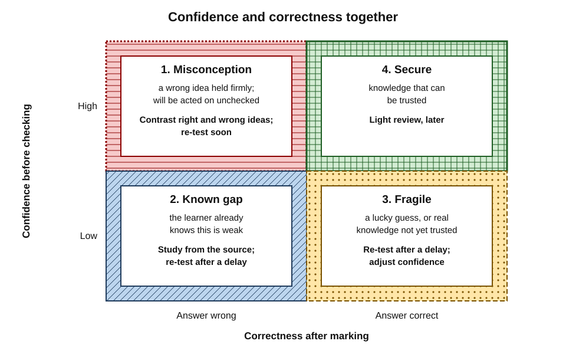
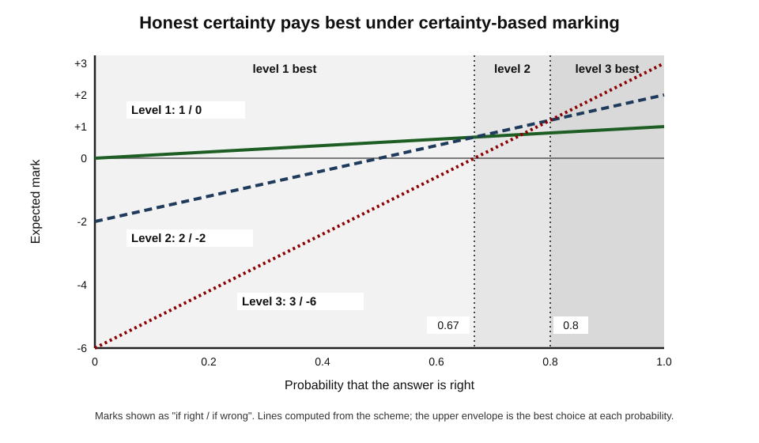
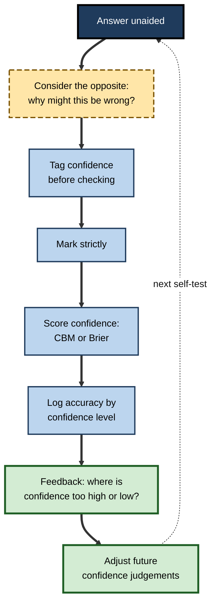
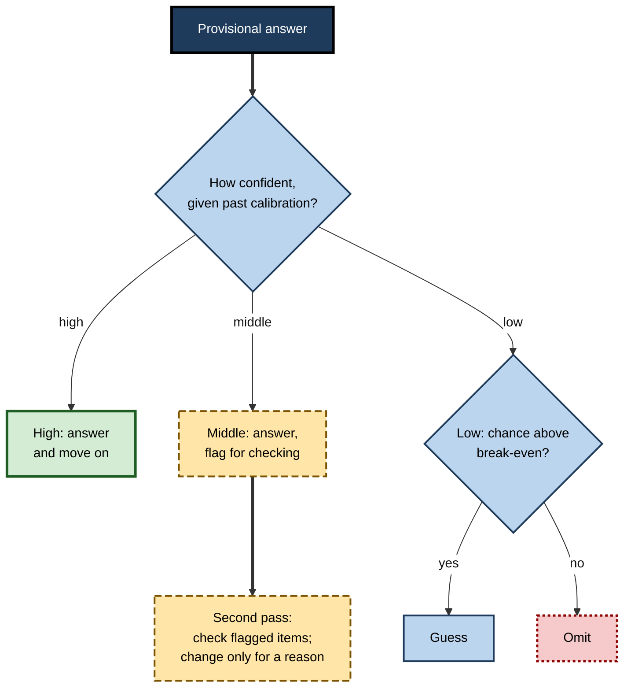
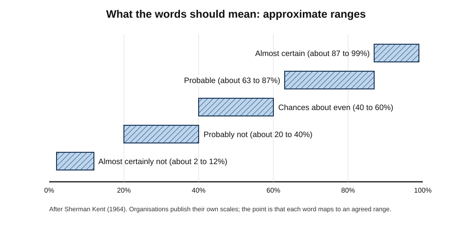
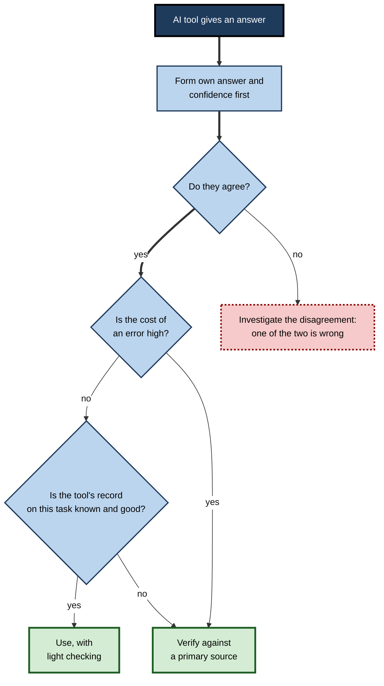

# L.7. Calibrating Confidence with Performance

Two actuarial students each score 70% on a practice paper. The first marked every answer "sure" before checking; the second marked her answers "sure", "unsure" or "guess" — and discovered that almost all her errors were among the "unsure" ones, while three "sure" answers were wrong. The second student now knows far more than her score: which knowledge she can trust, which she cannot, and where a confidently held wrong idea is waiting to cost her marks in the real examination.

> **Definition — Confidence calibration:** the correspondence between how confident a person is in their answers or judgements and how often those answers or judgements are actually correct. A well-calibrated person is right about 80% of the time when 80% sure.

**Why it matters**

- Confidence, not knowledge, decides **when a learner stops studying**, whether they answer or abstain, whether they double-check, and whether they ask for help.
- In professional work, confidence decides whether a diagnosis is reconsidered, a contract clause queried, a deployment paused.
- Confidence and accuracy are **often poorly matched**, especially on hard material — but calibration can be **measured** and **improved** with the right practice.
- Recording confidence turns every self-test into **two measurements**: what is known, and how well the learner knows what they know.

> **Key point:** the aim is not to feel more or less confident but to make confidence **informative** — high when right, low when wrong.

---

## Why Confidence Needs Checking

### Confidence drives decisions

- **During study:** "I know this" → stop practising it. If the judgement is wrong, a gap is left open.
- **During examinations:** confidence decides whether to change an answer, flag it, guess or skip.
- **At work:** a confident wrong belief is acted on without verification; an unconfident right belief may be abandoned under challenge.

### Two kinds of mismatch

- **Overconfidence** — confidence exceeds accuracy; the usual pattern on difficult material.
- **Underconfidence** — accuracy exceeds confidence; more common on easy material and among some highly competent learners.
- A related but distinct quality is **discrimination** (often called resolution): being more confident in right answers than in wrong ones, whatever the overall level.

> **Definition — Discrimination (resolution):** the degree to which a person's confidence distinguishes their correct answers from their incorrect ones.

> **Watch out:** a learner can be well calibrated on average yet poorly discriminating — 75% sure of everything and right 75% of the time. Such confidence is accurate in aggregate but useless for deciding **which** answers to trust. For study decisions, discrimination matters most.

---

## Confidence-Tagged Self-Testing

### The method

1. Answer each item **unaided**.
2. **Before checking**, tag each answer with a confidence level — either three categories (**sure / unsure / guess**) or a percentage (50%, 70%, 90%, 100%).
3. Mark strictly.
4. Sort every item into one of **four outcomes**.

### Four outcomes

- **Confident and correct — secure.**
  - Knowledge that can be trusted; review lightly and later.
- **Unconfident and correct — fragile.**
  - Either a lucky guess or real knowledge the learner does not trust. Re-test after a delay; if correct again, raise confidence.
- **Confident and wrong — misconception.**
  - The most dangerous category: a wrong idea held firmly. It will be acted on without checking.
  - The good news: when feedback is given, confidently wrong answers are corrected unusually well — the **hypercorrection effect** — provided the learner attends to the correction.
- **Unconfident and wrong — known gap.**
  - The learner already knows this is weak. Study it, but it holds no hidden danger.

**Figure 1.** The four outcomes of confidence-tagged self-testing.

**Table 1.** What to do with each outcome.

| Outcome | What it means | Priority | Action |
|---|---|---|---|
| Confident, correct | Secure knowledge | Low | Keep in a delayed review at low frequency |
| Unconfident, correct | Fragile or underconfident | Medium | Re-test after a delay; note whether confidence was justified |
| Confident, wrong | Misconception | **Highest** | Study the correct idea **against** the wrong one; explain why the wrong one fails; re-test soon |
| Unconfident, wrong | Known gap | High | Study from the source; re-test after a delay |

> **Remember:** **confident errors first**, then known gaps, then fragile knowledge.

### Worked example: tagging a practice paper

An actuarial student answers 40 questions on probability and tags each.

**Table 2.** Her results by confidence category.

| Tag | Items | Correct | Accuracy | Interpretation |
|---|---|---|---|---|
| Sure | 22 | 19 | 86% | Mostly justified; 3 confident errors |
| Unsure | 12 | 7 | 58% | Genuinely uncertain — appropriate |
| Guess | 6 | 2 | 33% | Close to chance on four-option items, as expected |
| **Total** | **40** | **28** | **70%** | |

**Steps:**

1. **Overall:** 70% — the only number she would have had without tags.
2. **Discrimination:** accuracy falls clearly from "sure" (86%) to "unsure" (58%) to "guess" (33%) — her confidence is **informative**.
3. **Calibration of "sure":** if "sure" means about 95%, then 86% shows mild overconfidence.
4. **Confident errors:** three — all on conditional probability with dependent events. A single misconception, not three separate gaps.
5. **Plan:** one focused session contrasting dependent and independent cases; re-test conditional probability in three days; general review of the twelve "unsure" items.

> **Watch out:** with only 22 "sure" items, 86% is an imprecise estimate. Calibration judgements need **many** tagged answers, accumulated over several sessions.

---

## Certainty-Based Marking

### The idea

- In ordinary marking, a confident right answer and a lucky guess score the same.
- **Certainty-based marking (CBM)** rewards learners for **knowing how reliable their answers are**: they state a certainty level with each answer, and the mark depends on both correctness and certainty.

**Study card — Tony Gardner-Medwin and colleagues (University College London, from the 1990s)**

- **Setting:** medical and biomedical students' self-assessment exercises, later formative and summative examinations.
- **Scheme:** each answer is given a certainty level of 1, 2 or 3.
  - **Correct:** +1, +2 or +3 marks.
  - **Wrong:** 0, −2 or −6 marks.
- **Rationale:** the scheme is designed so that the best strategy is to report honestly:
  - certainty 1 pays best when the chance of being right is below about **67%**;
  - certainty 2 between about **67% and 80%**;
  - certainty 3 above about **80%**.
- **Reported findings:** students learned to use the scale sensibly with practice; Gardner-Medwin reported that CBM scores were more reliable than conventional number-right scores, and that students described thinking more carefully about the basis of their answers.
- **Conclusion:** CBM makes confidence a scored part of the answer, training calibration and discouraging both bluffing and excessive caution.

**Table 3.** The certainty-based marking scheme.

| Certainty level | Mark if correct | Mark if wrong | Best when chance of being right is |
|---|---|---|---|
| 1 (low) | +1 | 0 | Below about 67% |
| 2 (mid) | +2 | −2 | About 67% to 80% |
| 3 (high) | +3 | −6 | Above about 80% |

> **Formula — Expected mark under CBM:** for a probability *p* of being right, level 1 gives p; level 2 gives 2p − 2(1 − p) = 4p − 2; level 3 gives 3p − 6(1 − p) = 9p − 6. Level 2 beats level 1 when 4p − 2 > p, i.e. p > ⅔; level 3 beats level 2 when 9p − 6 > 4p − 2, i.e. p > 0.8. At p = 0.9: level 1 = 0.9, level 2 = 1.6, level 3 = **2.1**.

**Figure 2.** Expected mark at each certainty level as the chance of being right rises.

> **Watch out:** critics have asked whether CBM disadvantages risk-averse learners, or those socialised to understate confidence. Gardner-Medwin argued that such differences shrink with practice and clear explanation; the question is still raised, so CBM is safest in **formative** use before it counts.

> **In practice:** a learner can apply CBM to their own self-tests without any software — tag each answer 1, 2 or 3 and score it with the table. Some learning platforms build CBM into their quiz engines.

---

## Predicting Scores

### Prediction and postdiction

- **Prediction** — estimating one's score before a test.
- **Postdiction** — estimating it after finishing, before seeing results.
- Both are usually overconfident among weaker performers and somewhat more accurate after the test, when the learner has seen the questions.

### The calibration log

- Before each mock or practice paper, **write down the predicted score**; afterwards, the postdicted score; then the actual score.
- Over several tests, compute the learner's **bias**.

> **Formula — Prediction bias:** bias = mean predicted score − mean actual score. If predictions over five mocks were 72, 75, 70, 78, 74 (mean 73.8) and actual scores were 64, 68, 66, 70, 69 (mean 67.4), bias = 73.8 − 67.4 = **+6.4 points** — consistent overconfidence.

**Table 4.** A calibration log over five mock examinations.

| Mock | Predicted | Postdicted | Actual | Prediction error | Postdiction error |
|---|---|---|---|---|---|
| 1 | 72 | 68 | 64 | +8 | +4 |
| 2 | 75 | 71 | 68 | +7 | +3 |
| 3 | 70 | 68 | 66 | +4 | +2 |
| 4 | 78 | 72 | 70 | +8 | +2 |
| 5 | 74 | 70 | 69 | +5 | +1 |
| **Mean** | **73.8** | **69.8** | **67.4** | **+6.4** | **+2.4** |

**Using the log:**

1. **Correct for bias.** Before the real examination, subtract about 6 points from the gut prediction — a far better estimate of readiness.
2. **Notice postdiction accuracy.** After a paper, this learner's sense of how it went is much closer to reality (+2.4); her pre-test optimism is the problem.
3. **Look at the trend.** Errors shrink slightly — her calibration is improving with feedback.

> **Key point:** a learner who knows their own bias can **correct for it**. "I always feel about six points better prepared than I am" is one of the most useful facts a candidate can possess.

### Topic-level calibration

- Confidence can also be checked at the level of **topics** rather than items.
- **Method:**
  1. Before a mock, rate readiness on each syllabus topic (for example, 1–5).
  2. After marking, compute the score on each topic.
  3. Compare: where are the largest gaps between rated readiness and actual score?
- **Typical findings:**
  - topics met often at work or studied recently are **over-rated** — familiarity inflates readiness;
  - topics that felt hard during study but were practised hard are sometimes **under-rated**;
  - topics never tested are rated on impression alone and deserve suspicion.

**Table 5.** Topic readiness ratings compared with mock scores for a project-management candidate.

| Topic | Readiness rating (1–5) | Mock score | Mismatch |
|---|---|---|---|
| Scheduling and critical path | 5 | 58% | Over-rated: familiar from work, but calculation errors |
| Risk management | 3 | 74% | Slightly under-rated |
| Stakeholder management | 4 | 76% | Matched |
| Earned value | 2 | 45% | Matched: a known gap |
| Procurement and contracts | 4 | 52% | Over-rated: read once, never practised |

- **Action:** the two over-rated topics are the hidden risks; the known gap (earned value) was already planned for.

> **Key point:** the topics a learner feels best about deserve a check **because** they feel safe; nothing else will prompt one.

---

## Misreadings of Calibration

- **"Calibration means being less confident."**
  - It means confidence that **matches** accuracy. For an underconfident learner it means becoming more confident.
- **"Confidence is a personality trait."**
  - General self-assurance and item-level confidence are different things. Item-level confidence responds to evidence and practice; it can be changed by tagging, feedback and scoring.
- **"Underconfidence is harmless."**
  - Underconfidence wastes study time on secure material, leads learners to abandon correct answers under challenge and discourages people from speaking up in meetings when they are right.
- **"If I am well calibrated, I must be competent."**
  - A weak learner who knows they are weak can be well calibrated. Calibration is about **knowing the state of one's knowledge**, not about the state itself — though good calibration helps close gaps faster.
- **"One test is enough to judge calibration."**
  - Calibration estimates need many judgements; dozens of tagged items at least, accumulated across sessions.

> **Watch out:** the popular claim that the least competent are always the most confident has been heavily debated; part of the classic pattern is a statistical artefact of how scores and estimates are compared. What is well supported is that weaker performers' self-estimates tend to be **less accurate**, which makes measuring calibration more valuable for them, not less.

---

## Training Calibration

### What the evidence shows

- **Sarah Lichtenstein and Baruch Fischhoff (1980)** gave participants extensive practice at answering questions with confidence ratings, followed by **feedback on their calibration**. Most improvement came early, and calibration improved noticeably — though gains were stronger for the tasks practised than for new kinds of question.
- **Weather forecasters** are a classic example of good calibration: **Allan Murphy and Robert Winkler (1977)** found that United States forecasters' precipitation probabilities closely matched observed frequencies. Forecasters make many judgements, receive **fast, unambiguous feedback** and are scored on their probabilities.
- **Philip Tetlock, Barbara Mellers and colleagues**, in a large geopolitical forecasting tournament from 2011, found that a short training module in probabilistic reasoning improved forecasting accuracy modestly but reliably; regular forecasters who received feedback improved further.

> **Key point:** calibration improves under the conditions forecasters enjoy: **many judgements, explicit probabilities, quick and clear feedback, and scoring that rewards accuracy**. Self-testing with confidence tags recreates those conditions for a learner.

### Techniques

- **Tag and score every self-test** — accumulate data so calibration can be seen.
- **Consider the opposite.** **Asher Koriat, Sarah Lichtenstein and Baruch Fischhoff (1980)** found that asking people to list reasons their answer might be **wrong** reduced overconfidence.
- **Delay the judgement.** Rate confidence after a gap, not straight after studying, when fluency inflates it.
- **Use a reference class.** "On questions like this, how often have I been right before?" — the calibration log supplies the answer.
- **Use interval estimates for numbers.** Give a range one is 90% sure contains the answer; check how often ranges actually contain it. Most people's 90% ranges contain the truth far less often — and widen with practice.
- **Score with a proper rule.** CBM, or a squared-error score of probabilities such as the **Brier score**, rewards honest confidence and penalises both bluffing and false modesty.

**Figure 3.** A calibration-training loop for self-testing.

### How much can calibration transfer?

- Calibration trained in one domain transfers only partly to others.
- A learner well calibrated in contract law may be poorly calibrated in tax: calibration depends on **knowing the domain** well enough to sense where one's knowledge is thin.
- **Practical consequence:** keep calibration data **per subject** and re-establish it in each new field.

---

## Confidence in the Examination Room

### Using confidence to decide

- **Changing answers** — reconsider answers tagged "unsure"; change them when there is a specific reason. Research on answer changing finds that changes are more often from wrong to right than the reverse.
- **Flagging** — flag low-confidence items for the second pass.
- **Guessing under negative marking** — guess when the estimated chance of being right exceeds the break-even point; omit when it does not.
- **Allocating checking time** — spend review time on mid-confidence answers, where checking is most likely to change the outcome.

**Figure 4.** Using confidence to decide what to do with an answer in a negatively marked examination.

> **In practice:** the break-even probability depends on the penalty. With four options and a penalty of a quarter of a mark, a blind guess is slightly positive in expectation; with a penalty of one third, it is neutral. Eliminating even one option usually tips the balance towards guessing.

---

## Calibration in Professional Work

### Confidence that does not track difficulty

**Study card — Ashley Meyer, Velma Payne, Derek Meeks, Radha Rao and Hardeep Singh (2013)**

- **Design:** over a hundred physicians, internists and residents, diagnosed clinical vignettes — two relatively easy, two difficult — and rated their confidence after each.
- **Results:**
  - diagnostic accuracy was about **55%** on easier cases and about **6%** on difficult ones;
  - mean confidence was **7.2 out of 10** on easier cases and **6.4** on difficult ones — barely different;
  - higher confidence was associated with **fewer requests** for additional tests and second opinions.
- **Conclusion:** physicians' confidence hardly responded to difficulty, and high confidence suppressed the very actions — further testing, consultation — that could have caught errors.

> **Watch out:** these were written vignettes, not real patients with the full clinical picture, and the difficult cases were deliberately hard. The finding is about **confidence failing to track difficulty**, not about typical accuracy in practice.

### Communicating uncertainty

- Professionals often express confidence in **words** — "likely", "probable", "almost certain" — which listeners interpret very differently.
- **Sherman Kent (1964)**, at the United States Central Intelligence Agency, proposed mapping such **words of estimative probability** to numerical ranges so that analysts and readers meant the same thing.
- Many intelligence, risk and forecasting organisations now publish such scales.

**Figure 5.** Words of estimative probability mapped to approximate ranges.

> **In practice:** when reporting a judgement to a client or manager, give a **number or range** alongside the word: "likely (around 70–80%)". It makes one's confidence checkable — and so, over time, calibratable.

### Calibrating readiness for new responsibilities

- Professionals constantly judge readiness: "Can I lead this workshop?", "Am I ready to sign off this audit area?", "Should I take the on-call rotation?"
- These judgements are calibration problems too, and the same habits apply:
  - **state the judgement as a probability** — "about 70% confident I can run this workshop without help";
  - **name the evidence** behind it — similar tasks done, feedback received, checks passed;
  - **record the outcome** — how it actually went, judged against criteria agreed beforehand;
  - **compare over time** — are readiness judgements typically too high, too low, or about right?
- **Two characteristic errors:**
  - **overconfident readiness** — taking on work without the evidence, often because a similar-sounding task went well;
  - **underconfident readiness** — declining stretch work despite good evidence, a pattern that can quietly slow a career.

> **In practice:** asking a manager "On a scale of 1 to 10, how ready do you think I am for this, and what evidence would move it up?" turns a vague conversation about confidence into a calibration exercise with an external reference.

### Calibrating trust in AI outputs

- AI tools produce fluent answers whose apparent confidence does not reliably indicate correctness.
- **Automation bias** — the tendency to over-rely on automated advice — leads users to accept errors they would have caught unaided.
- **The calibration question becomes:** "How often is this tool right on **this kind** of question — and how often am I right when I disagree with it?"

**Figure 6.** Deciding how far to rely on an AI tool's answer.

### Case study: a trainee auditor learns where her confidence lies

- **Situation:** a first-year audit trainee was preparing for professional examinations while working on client audits.
- **Problem:** her mock scores were steady at around 60% (pass mark 50%), but her manager noted that she often stated incorrect technical positions to clients with complete assurance.
- **Diagnosis:**
  1. She tagged two practice papers with sure / unsure / guess.
  2. Her "sure" answers were right only about 70% of the time; nearly all the confident errors were on **revenue recognition** and **lease accounting** — the two areas she met most often at work.
  3. Familiarity from client work had produced **fluency without precision**: she recognised the topics, so felt sure.
- **Actions:**
  1. Built a 60-item pool on the two areas, answered with CBM scoring each week.
  2. For each confident error, wrote a short note contrasting her belief with the standard's actual requirement.
  3. Adopted a work rule: on revenue and lease questions from clients, say "I'll confirm that" and check the standard before answering.
  4. Kept a calibration log across mocks.
- **Result (three months):** accuracy on "sure" answers rose above 90%; CBM scores rose faster than raw scores; her manager reported fewer corrections needed after client meetings; she passed the financial reporting paper at the first attempt.
- **Lesson:** the danger was not ignorance but **misplaced confidence** in familiar areas. Tagging confidence located it; scoring confidence fixed it.

---

## Open Questions

- **How far does calibration training transfer?**
  - Gains are clear on practised tasks; transfer to new domains and to real-world professional judgement is weaker and less studied.
- **Is certainty-based marking fair in high-stakes use?**
  - Its advocates report better reliability; concerns about risk aversion and confidence norms persist.
- **Why does confidence fail to track difficulty?**
  - Explanations include reliance on fluency and familiarity cues, and lack of feedback; how to build difficulty-sensitivity reliably is unresolved.
- **How should humans calibrate trust in AI tools?**
  - Tools change quickly, their accuracy varies by task, and their expressed confidence is unreliable; practical methods are still emerging.
- **Should learners aim for calibration or for a slight bias?**
  - Some argue mild underconfidence prompts useful checking, while others see any bias as wasteful; evidence on which serves learning best is limited.

---

## Summary

- **Calibration** is the match between confidence and accuracy; **discrimination** is the ability of confidence to separate right from wrong answers — the more useful property for study decisions.
- **Confidence-tagged self-testing** sorts answers into **secure, fragile, misconception and known gap**; treat **confident errors first**.
- **Certainty-based marking** (+1/+2/+3 if right, 0/−2/−6 if wrong) makes honest confidence the best strategy, with break-even points near **67%** and **80%**.
- A **calibration log** of predicted, postdicted and actual scores reveals a personal **bias** that can be corrected.
- Calibration improves with **many judgements, explicit probabilities, fast feedback and proper scoring**; techniques include **considering the opposite**, delayed judgements, reference classes and interval estimates. Transfer across domains is partial.
- In examinations, confidence guides **flagging, checking, changing answers and guessing**.
- At work, confidence can fail to track difficulty (physicians' vignette study); give **numbers with words**; calibrate **trust in AI** by forming one's own answer first and knowing the tool's record.

---

## Self-Check

1. Define calibration and discrimination, and explain why discrimination matters more for study decisions.
2. Describe the four outcomes of confidence-tagged self-testing and the action for each.
3. Why are confident errors the highest priority, and what effect makes their correction efficient?
4. State the certainty-based marking scheme and the probability ranges in which each level is optimal.
5. Using the CBM formulas, compute the expected mark at each level for p = 0.7, and say which is best.
6. A learner's predictions over four mocks were 80, 78, 82, 79 and actual scores 70, 71, 75, 72. Compute the bias and explain how to use it.
7. Why are postdictions usually more accurate than predictions?
8. What conditions explain weather forecasters' good calibration, and how can a learner recreate them?
9. Describe the "consider the opposite" technique and its evidence.
10. Why should calibration data be kept separately for each subject?
11. Summarise the Meyer and colleagues (2013) study and one limitation.
12. What are words of estimative probability, and how should professionals use them?
13. Outline a procedure for deciding how far to rely on an AI tool's answer.
14. In the trainee-auditor case, why were her confident errors concentrated in familiar areas?

### Answer Key

1. Calibration: confidence matches accuracy on average (80% sure → right 80% of the time). Discrimination: confidence is higher for right answers than wrong ones. Study decisions concern *which* items to trust, which requires discrimination; good average calibration with no discrimination cannot tell the learner where to focus.
2. Confident-correct: secure — light, delayed review. Unconfident-correct: fragile — re-test after a delay. Confident-wrong: misconception — study the right idea against the wrong one; re-test soon. Unconfident-wrong: known gap — study from the source.
3. They are wrong ideas that will be acted on without checking. The hypercorrection effect: high-confidence errors are corrected unusually well when feedback is given and attended to.
4. Correct: +1/+2/+3; wrong: 0/−2/−6. Level 1 best below about 67% chance, level 2 between about 67% and 80%, level 3 above about 80%.
5. Level 1: 0.7. Level 2: 4(0.7) − 2 = 0.8. Level 3: 9(0.7) − 6 = 0.3. Level 2 is best.
6. Mean predicted 79.75, mean actual 72.0; bias = +7.75. Subtract roughly eight points from gut predictions when judging readiness, and keep logging to see whether the bias shrinks.
7. After the test the learner has seen the actual questions and experienced their difficulty, so the judgement rests on direct evidence rather than on general feelings of familiarity.
8. Many judgements, explicit probabilities, fast and unambiguous feedback, and scoring of the probabilities. A learner recreates them by tagging confidence on many self-test items, checking promptly, and scoring with CBM or a Brier-type rule.
9. Before settling confidence, list reasons the answer might be wrong. Koriat, Lichtenstein and Fischhoff (1980) found it reduced overconfidence, because it brings contrary evidence to mind.
10. Calibration depends on domain knowledge and transfers only partly; a learner can be well calibrated in one field and poorly in another.
11. Over a hundred physicians diagnosed easy and hard vignettes; accuracy was about 55% vs 6%, yet confidence was 7.2 vs 6.4 out of 10, and higher confidence went with fewer requests for tests. Limitation: written vignettes, deliberately hard cases — not representative of everyday practice.
12. Verbal probability terms ("likely", "almost certain") mapped to numerical ranges (Sherman Kent, 1964). Professionals should state a number or range alongside the word, so their judgement can be understood consistently and checked.
13. Form one's own answer and confidence first; compare; if they disagree, investigate; if they agree, consider the cost of error and the tool's track record on that kind of task — verify against a primary source when the cost is high or the record unknown.
14. Frequent exposure at work made the topics feel familiar and fluent, which she mistook for precise knowledge; familiarity raised confidence without raising accuracy.

---

## Glossary

| Term | Meaning |
|---|---|
| Automation bias | Over-reliance on automated advice, leading to accepted errors. |
| Bias (prediction) | Mean predicted score minus mean actual score. |
| Brier score | Mean squared difference between stated probabilities and outcomes; lower is better. |
| Calibration | Correspondence between confidence and actual accuracy. |
| Calibration log | Record of predicted, postdicted and actual scores over tests. |
| Certainty-based marking (CBM) | Scoring in which marks depend on both correctness and stated certainty. |
| Confidence tag | A rating of certainty attached to an answer before checking it. |
| Consider the opposite | Listing reasons one's answer might be wrong before settling confidence. |
| Discrimination (resolution) | The extent to which confidence separates correct from incorrect answers. |
| Hypercorrection effect | The finding that high-confidence errors are corrected especially well after feedback. |
| Interval estimate | A range one is a stated percentage sure contains the true value. |
| Overconfidence | Confidence higher than accuracy. |
| Postdiction | Estimating one's score after a test, before seeing results. |
| Prediction | Estimating one's score before a test. |
| Proper scoring rule | A scoring method under which reporting one's true confidence maximises expected score. |
| Underconfidence | Confidence lower than accuracy. |
| Words of estimative probability | Verbal probability terms mapped to numerical ranges. |
