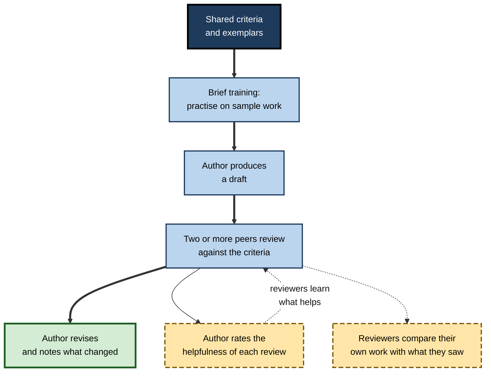
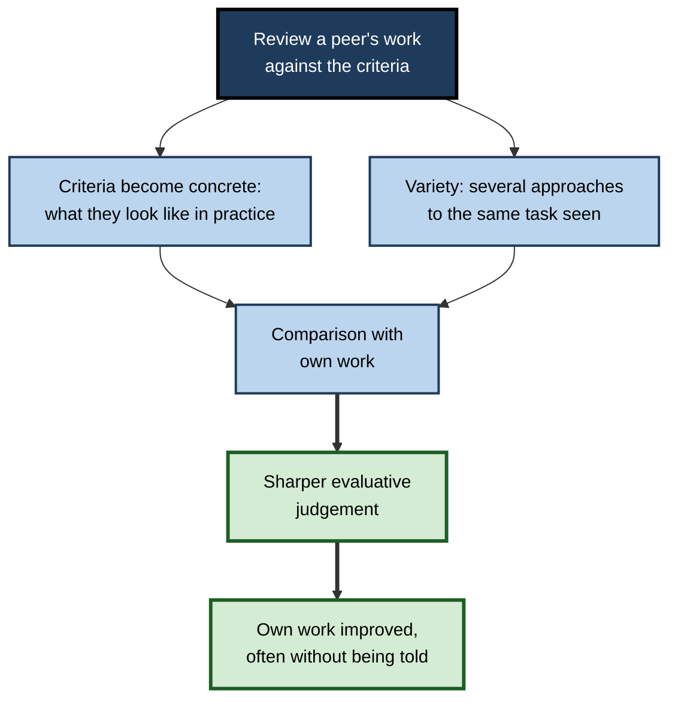
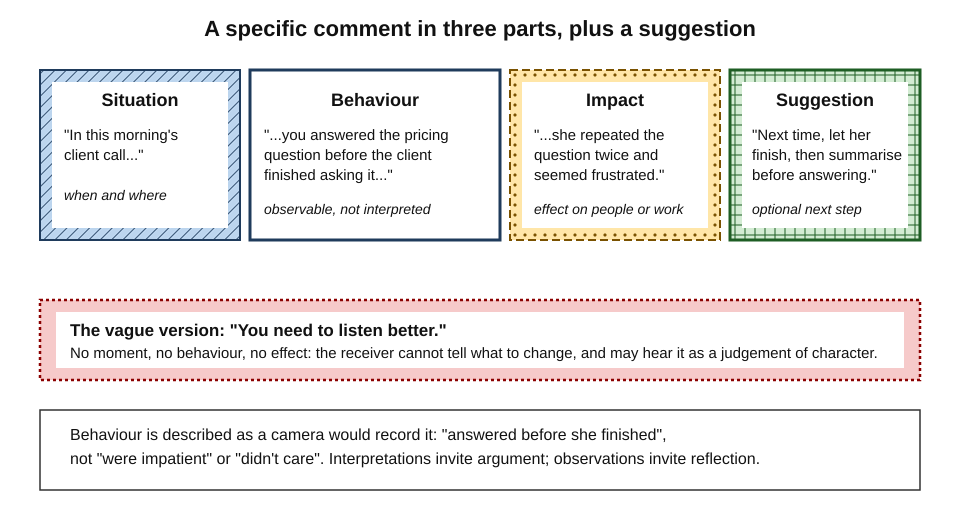
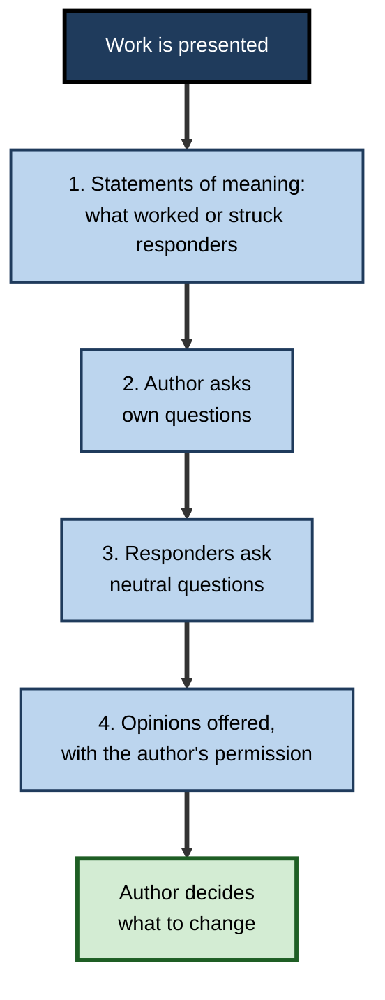
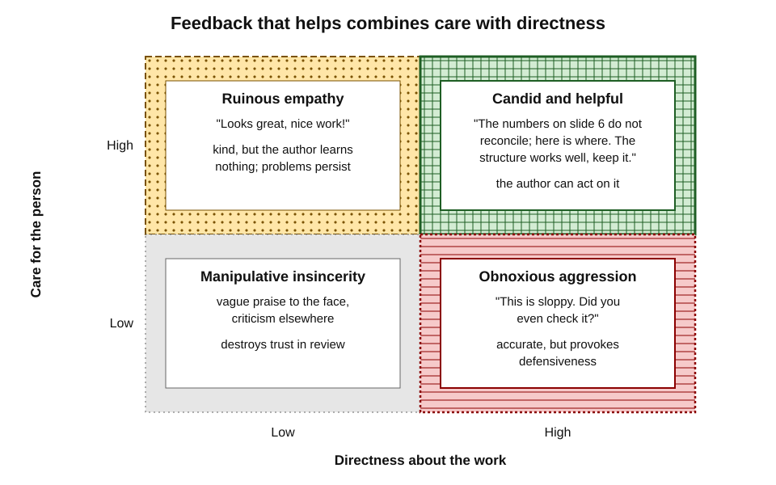
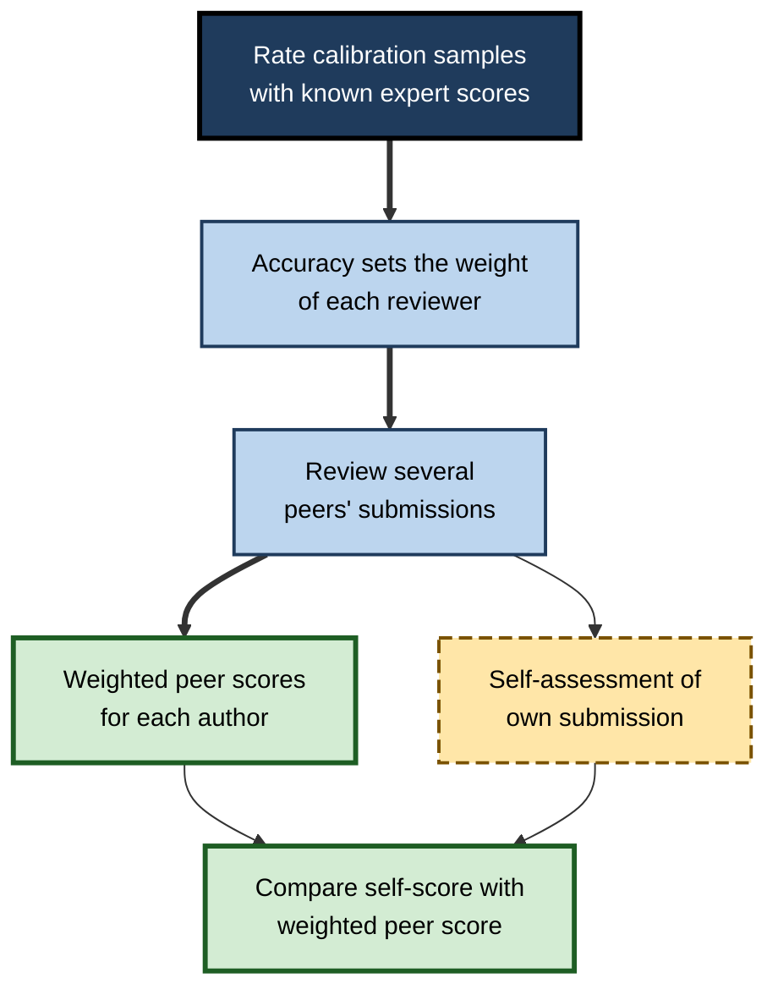

# H.8. Peer Assessment and Feedback

At most software companies no change reaches production until a colleague has read it. In many hospitals, junior doctors present their cases to one another before the consultant arrives. Writing groups, design critiques and bid reviews all rest on the same idea: people at a similar level, judging each other's work against a shared standard, can find what the author missed — and in doing so sharpen their own sense of quality.

> **Definition — Peer assessment (after Keith Topping, 1998):** an arrangement in which people of similar status consider the amount, level, value, quality or success of the products or outcomes of one another's learning.

> **Definition — Peer feedback:** comments from a peer on a piece of work or performance, intended to help the author improve it.

**Why it matters**

- Experts' time is scarce; peers are plentiful. Peer assessment multiplies the feedback available.
- Peers are **closer** to the learner's level, so their comments are often easier to understand and act on.
- **Reviewing** others' work is one of the most effective ways to develop one's own judgement of quality — often more effective than receiving feedback.
- Peer assessment is the **normal form** of quality control in professional life: code review, peer review of research, clinical audit, design critique.

---

## Forms of Peer Assessment

### The design choices

**Keith Topping (1998)** identified many dimensions on which peer assessment schemes vary. The most consequential are:

- **Purpose** — formative (feedback to improve) or summative (marks that count).
- **Output** — qualitative (comments) or quantitative (scores), or both.
- **Product** — written work, presentations, code, designs, clinical performance, teamwork.
- **Anonymity** — authors and reviewers known to each other, or not.
- **Direction** — one-way, reciprocal (each reviews the other) or many-to-many.
- **Number of reviewers** — one peer or several.
- **Relationship to expert assessment** — supplement, partial replacement or full replacement.

**Table 1.** Common forms of peer assessment compared.

| Form | Purpose | Output | Typical setting | Main strength | Main risk |
|---|---|---|---|---|---|
| Peer grading | Summative | Scores | Large courses, team projects | Scale | Leniency, bias, resentment |
| Peer feedback on drafts | Formative | Comments | Writing, design, analysis | Improves the next draft | Vague or overly kind comments |
| Peer review of code | Formative and gatekeeping | Comments, approval | Software teams | Catches defects; spreads knowledge | Superficial review of large changes |
| Peer observation | Formative | Notes, discussion | Teaching, clinical practice | Sees performance, not only products | Discomfort; politeness |
| Team-member evaluation | Summative or formative | Ratings of contribution | Group projects | Identifies free-riding | Friendship and retaliation effects |

> **Key point:** most of the learning benefit comes from **formative, comment-based** peer assessment. Peer **grading** adds scale but brings bias and social strain.

**Figure 1.** A well-structured peer-assessment cycle.

---

## The Evidence

### Effects on achievement

**Study card — Kit Double, Joshua McGrane and Therese Hopfenbeck (2020)**

- **Design:** meta-analysis of 54 controlled studies of peer assessment in primary, secondary and tertiary education.
- **Results:**
  - peer assessment improved academic performance compared with **no assessment** (*g* ≈ 0.31);
  - it also slightly outperformed **teacher assessment** (*g* ≈ 0.28) in the studies that compared them;
  - **peer grading** appeared beneficial for university students but not for school pupils.
- **Conclusion:** peer assessment produces small-to-moderate learning gains and is at least as useful as teacher assessment in the conditions studied.

- A broader meta-analysis by **Zi Yan and colleagues (2022)** of self- and peer-assessment interventions found a larger average effect for peer assessment (around *g* = 0.6), though that pool included many uncontrolled before-and-after studies, which inflate effects.

> **Watch out:** "peer assessment" covers very different practices. Average effects hide wide variation; schemes with training, clear criteria and comment-based feedback do much better than unsupported peer marking.

### Agreement with experts

**Study card — Nancy Falchikov and Judy Goldfinch (2000)**

- **Design:** meta-analysis of studies comparing peer marks with teacher marks in higher education.
- **Results:**
  - average agreement was fairly high — a mean correlation of about **0.69**;
  - agreement was better for **academic products** (essays, reports) than for professional practice;
  - better when peers made **global judgements** against well-understood criteria than when they scored many separate dimensions;
  - better when students had been **involved in developing the criteria**.
- **Conclusion:** peers can mark reasonably consistently with experts, under the right conditions.

- A later meta-analysis by **Hongli Li and colleagues (2016)** found a similar average peer–teacher correlation (around 0.63), higher when peer marking was **anonymous**, involved **training** and used **multiple raters**.

---

## Why Reviewing Teaches the Reviewer

### Learning by reviewing

**Study card — Kwangsu Cho and Charles MacArthur (2011)**

- **Design:** university students were assigned to one of three conditions before writing their own reports:
  - **reviewing** peers' drafts and giving feedback;
  - **reading** the same drafts without reviewing;
  - reading unrelated material.
- **Results:** students who **reviewed** wrote better reports than those who only read the drafts or read unrelated material.
- **Conclusion:** the act of evaluating others' work — not just exposure to it — improved the reviewers' own writing.

**David Nicol, Avril Thomson and Caroline Breslin (2014)**

- Interviewed and surveyed engineering students after a peer-review exercise.
- Students reported that **producing reviews** helped them more than **receiving** them:
  - reviewing triggered comparison of the peers' work with their own;
  - it made the criteria concrete;
  - it prompted them to revise their own work spontaneously.
- Nicol argued that the core of feedback is **comparison** — the internal feedback a learner generates by comparing their work with others'.

**Figure 2.** How reviewing others' work develops the reviewer's own judgement.

> **Key point:** in a peer-assessment scheme, the **reviewer** often gains as much as the **author**. Schemes that ask each person to review several pieces of work exploit this.

### Several peers or one expert?

- **Kwangsu Cho and Christian Schunn (2007)**, using an online peer-review system in university writing courses, found that students who received feedback from **several peers** improved their drafts more than students who received feedback from a **single expert**.
- **Possible reasons:**
  - several reviewers point out different problems;
  - a problem mentioned by several peers is hard to dismiss;
  - peers' comments may be easier to understand than an expert's.

> **Watch out:** this does not mean peers can replace experts. Experts see problems peers cannot, especially in subtle reasoning or advanced technique. The useful lesson is that **several peers plus occasional expert input** is a strong combination.

---

## What Good Peer Feedback Looks Like

### Five qualities

- **Specific** — points to a particular passage, line or moment.
- **Criterion-referenced** — linked to the agreed standard, not personal taste.
- **Actionable** — suggests or implies what to do.
- **Balanced** — identifies strengths to keep as well as weaknesses to fix.
- **About the work** — not about the person's ability or character.

**Table 2.** Weak and strong peer comments on a market-sizing analysis.

| Weak comment | Why it is weak | Stronger comment |
|---|---|---|
| "Great work!" | No information | "The bottom-up estimate on slide 4 is persuasive because each assumption is sourced — keep that." |
| "The numbers seem off." | Vague; no location | "The 40% adoption rate on slide 6 is higher than the comparable markets on slide 3; either justify it or test a lower case." |
| "I'd have done it differently." | Personal preference | "The criteria ask for two independent methods; only the bottom-up method is shown." |
| "This is confusing." | No diagnosis | "I could not tell whether the totals are annual or cumulative; a label on the chart axis would fix it." |
| "You obviously rushed this." | About the person | "Three totals in the summary do not match the detailed tables." |

### Structures for comments

- **Situation–Behaviour–Impact (SBI)**, developed at the Center for Creative Leadership: describe the **situation**, the specific **behaviour** observed, and its **impact**.
  - *e.g.* "In this morning's client call (situation), you answered the pricing question before the client finished asking it (behaviour); she repeated the question twice, and seemed frustrated (impact)."
- **Praise–question–suggest** — something that works; a question about something unclear; one suggestion.
- **"I noticed… I wondered… What if…"** — a softer version suited to creative work.

**Figure 3.** The anatomy of an SBI comment.

### Structured critique protocols

- **Liz Lerman's Critical Response Process**, developed for the arts, gives the author control of the conversation in four steps:
  1. **Statements of meaning** — responders say what was meaningful, striking or working.
  2. **Artist as questioner** — the author asks the questions they want answered.
  3. **Neutral questions** — responders ask questions without embedded opinions.
  4. **Opinion time** — responders offer opinions, but only with the author's permission.
- Similar protocols in teaching ("tuning protocols", "critical friends") and design critiques keep feedback focused and safe.

**Figure 4.** The four steps of the Critical Response Process.

### Candour and care

- Peer feedback fails in two opposite ways:
  - **too harsh** — accurate but delivered without regard for the person, provoking defensiveness;
  - **too kind** — protecting the relationship at the expense of the truth.
- **Kim Scott (2017)** framed effective feedback as combining **caring personally** with **challenging directly** — and argued that the commonest failure in workplaces is not harshness but **"ruinous empathy"**: withholding criticism to avoid discomfort.

**Figure 5.** Two dimensions of feedback: care for the person and directness about the work.

> **Remember:** a peer review that only praises is a **missed opportunity**, not a kindness.

---

## Making Peer Assessment Work

### Problems and remedies

**Table 3.** Common problems in peer assessment and how to address them.

| Problem | Example | Remedies |
|---|---|---|
| Leniency and friendship bias | Friends give each other high marks | Anonymity; formative use; multiple reviewers |
| Reciprocity | "I'll be kind if you are" | Non-reciprocal assignment; reviewers rated on helpfulness |
| Lack of expertise | Peers miss subtle errors | Training on exemplars; clear criteria; expert spot-checks |
| Vague comments | "Looks good" | Required structure (SBI, praise–question–suggest); minimum specific points |
| Social discomfort | Reluctance to criticise colleagues | Protocols; framing as help to the work; psychological safety |
| Mistrust of peers' judgement | Authors dismiss comments | Several reviewers; show agreement with expert ratings |
| Retaliation in team ratings | Low ratings returned in kind | Confidential ratings; aggregate across raters |

### Calibrated peer review

- **Calibrated Peer Review**, developed by **Orville Chapman** and colleagues at the University of California, Los Angeles, from the 1990s, adds a calibration step:
  1. Students first assess several **calibration samples** whose expert ratings are known.
  2. Their accuracy on those samples determines how much **weight** their later ratings of peers carry.
  3. They then review peers' work, and finally their own.
- The design rewards careful reviewing and trains judgement before it is used on real work.

**Figure 6.** Calibrated peer review: weighting reviewers by demonstrated accuracy.

### Peer assessment at scale

- In very large online courses, peer assessment is often the only way to give feedback on open-ended work.
- **Chris Piech and colleagues (2013)**, analysing peer grading in large online courses, showed that statistical models which estimate each grader's **bias** (generous or harsh) and **reliability** produced grades closer to staff grades than simple averages of peer scores.
- **Lessons for any scheme:**
  - use **several** raters per piece of work;
  - include a few pieces with **known** staff grades to estimate each rater's bias;
  - weight or correct ratings accordingly;
  - give raters feedback on their own accuracy.

### Rating contributions to teamwork

- In group projects, peers are often the only people who know who did what.
- **Team-member evaluation** asks each member to rate the others' contributions, ideally on **behaviourally anchored** scales rather than a single "contribution" score.
  - *e.g.* the **CATME** system, developed by **Matthew Ohland, Misty Loughry and colleagues**, rates dimensions such as contributing to the team's work, interacting with teammates, keeping the team on track, expecting quality and having relevant knowledge, each with behavioural descriptions.
- **Uses:** adjusting individual marks for free-riding; giving each member developmental feedback on teamwork.
- **Risks:** retaliation, collusion ("we all give each other top marks"), and penalising members whose contributions were real but less visible.
- **Remedies:** confidential ratings; comments required alongside scores; patterns across several raters, not single ratings, used for decisions.

### Peer and self-assessment together

- Peer ratings are a valuable **calibration source** for self-assessment: they show the learner how their work looks to others who share the standard.
- **A simple routine:**
  1. Self-assess the work against the criteria **before** reading peer feedback.
  2. Read peer comments and scores.
  3. Note where peers and self **agree** (probably accurate), where peers rate **higher** (possible underconfidence) and where they rate **lower** (possible blind spot).
  4. Treat a criterion on which several peers disagree with the self-assessment as a priority for discussion with an expert.
- Over time, the gap between self- and peer ratings typically narrows as the learner's evaluative judgement develops.

> **Key point:** peers do two jobs at once — they improve the **work** and they calibrate the author's **judgement of the work**.

### Training reviewers

- **Short training helps.** Practising on two or three sample pieces, then comparing one's comments with an expert's, improves the specificity and accuracy of peer feedback.
- **Model good comments.** Show examples of weak and strong comments on the same piece of work.
- **Rate the reviews.** Asking authors to rate how helpful each review was ("back-evaluation") gives reviewers feedback on their feedback.

---

## Receiving Peer Feedback

- **Listen first; defend later — or not at all.** The first reaction to criticism is often defensive; separating hearing from deciding helps.
- **Clarify.** Ask for the specific passage or moment; ask what the reviewer expected instead.
- **Look for convergence.** A point raised by several reviewers deserves more weight than one raised once.
- **Judge the feedback.** Peers can be wrong; check comments against the criteria and, where needed, an expert.
- **Close the loop.** Record what was changed and why; tell reviewers which comments were most useful.

### Written and remote peer feedback

- Much peer feedback is now **written and asynchronous** — comments on documents, pull requests and design files — and lacks the tone of voice and facial expression that soften spoken criticism.
- **Practices that help:**
  - **label the weight** of each comment — "blocking", "suggestion", "minor" or "question" — so the author knows what must change;
  - **ask before asserting** where intent is unclear: "Is this meant to handle refunds too?" rather than "This ignores refunds";
  - **explain the why** — a comment that gives the reason teaches; one that only gives the instruction corrects one instance;
  - **move to a conversation** when a thread passes two or three rounds of disagreement;
  - **acknowledge what works**, briefly and specifically, so authors know what to keep.
- **For the author:** read all comments before replying to any; reply to the strongest point first; assume good intent unless there is clear evidence otherwise.

> **Example (illustrative):** a reviewer writes on a pull request: "Blocking: the retry loop has no upper limit, so a failing payment provider could cause unbounded retries. Could we cap it at three with backoff? Minor: nice clear naming throughout." The author knows exactly what must change, why, and what to keep.

### Feedback across levels

- Peer feedback is easiest between equals. Across levels it needs more care:
  - **juniors to seniors** — invite it explicitly ("What is one thing I could do to make my reviews more useful to you?"), because juniors rarely volunteer criticism;
  - **seniors to juniors** — be specific and concise; a long list of minor points can bury the one that matters;
  - **across functions** — agree criteria first; an engineer and a designer reviewing each other's work may use different standards of quality.

> **In practice:** many teams adopt a simple rule — the author **responds to every comment**, even if only to say "considered; not changing because…". It forces engagement and shows reviewers their effort mattered.

---

## Peer Assessment at Work

### Professional forms

- **Code review.** **Caitlin Sadowski and colleagues (2018)**, studying code review at Google, found that beyond finding defects, review served **education** — spreading knowledge of the codebase and of good practice — and maintaining norms of readability and consistency.
- **Pair programming** — continuous, real-time peer review.
- **Clinical peer review** — morbidity and mortality conferences, case reviews, peer observation of procedures.
- **Academic peer review** — the gatekeeping system for research publication; valuable but known to vary in reliability between reviewers.
- **Design critiques** — structured reviews of designs against user needs and principles.
- **Peer observation of teaching** — colleagues observe a class and discuss it against agreed criteria.
- **360-degree feedback** — ratings from peers, reports and managers; useful for development when followed by coaching, less so when used mainly for pay decisions.

### Peer review of whole practices

- Some professions use peer assessment at the level of **firms and practices**, not only individuals:
  - **audit quality reviews**, in which reviewers from other firms or from a professional body examine a sample of completed audit files against standards;
  - **clinical audit and peer review** of a department's cases against agreed guidelines;
  - **external examining** in universities, in which academics from other institutions review assessment standards and samples of marked work.
- These schemes share the design features that make individual peer assessment work: **explicit standards**, **independent reviewers**, **samples of real work** and a requirement to **respond** to findings.
- For an individual, the lesson is that being reviewed by peers is a normal part of professional life, and learning to give and receive such review well is a career-long skill rather than a classroom exercise.

> **Watch out:** feedback does not automatically improve performance. A well-known review of feedback interventions by **Avraham Kluger and Angelo DeNisi (1996)** found that in about a third of cases feedback **reduced** performance — especially when it directed attention to the self rather than to the task.

### Worked example (illustrative): introducing peer review for analysis reports

A ten-person analytics team produces weekly reports for business units; quality varies and the manager reviews everything herself.

**Steps:**

1. **Agree criteria.** The team analyses six past reports — three praised, three criticised — and agrees four criteria: right question, sound method, honest uncertainty, clear recommendation.
2. **Train.** Each analyst reviews the same sample report; the team compares comments and discusses differences.
3. **Assign reviewers.** Each report gets **two** peer reviewers, rotated so that pairs do not always review each other.
4. **Structure comments.** Each reviewer gives at least one strength and two specific improvements per criterion, in praise–question–suggest form.
5. **Respond.** The author responds to every comment and revises.
6. **Back-evaluate.** Authors rate each review's helpfulness (1–3); ratings are shared monthly with reviewers.
7. **Spot-check.** The manager reviews one report in four, comparing her view with the peers'.

**Table 4.** The team's reviewing before and after the change.

| | Before | After (three months) |
|---|---|---|
| Who reviewed | Manager only | Two peers, manager spot-checks |
| Time to feedback | Two to four days | Usually within one day |
| Typical comment | "Tighten this up" | "The confidence interval on chart 2 is missing; add it or explain why" |
| Manager's review time | About a day a week | About two hours a week |
| Analysts' own reports | Variable | Fewer issues found at spot-check |

*Illustrative figures.*

- **Conclusion:** the manager's time fell, feedback became faster and more specific, and — as the research predicts — the analysts' own reports improved through the habit of reviewing others'.

### Case study (illustrative): peer review that became a rubber stamp

- **Situation:** a consultancy required every client deliverable to be reviewed by a peer before submission.
- **Problem:** two deliverables with significant calculation errors reached clients within a quarter, despite both being "peer reviewed".
- **Diagnosis:**
  1. Reviewers were usually close colleagues on the same project, reviewing at the last minute.
  2. Reviews took about fifteen minutes for documents of fifty pages; most comments concerned formatting.
  3. There were no criteria; reviewers did not know what they were responsible for checking.
  4. Reviewers' sign-off carried no visible accountability.
- **Actions:**
  1. Reviewers were drawn from **outside** the project team.
  2. Review was scheduled **two working days** before submission, not on the day.
  3. A single-point review guide named five checks: the client's question answered, numbers reconciled, sources cited, risks stated, recommendation clear.
  4. Reviewers recorded which checks they had performed and signed their name to the review.
  5. Quarterly, a sample of reviews was audited by a partner and discussed anonymously at a practice meeting.
- **Result:** in the following year no deliverable reached a client with a material calculation error; reviewers reported that the guide made it easier to raise uncomfortable points.
- **Lesson:** peer review works only when it has **independence, time, criteria and accountability**. Without them, it produces the appearance of assessment without the substance.

---

## Open Questions

- **Should peer grades count?**
  - Peer grading offers scale and engages learners, but fairness, bias and acceptance remain contested, especially in schools.
- **What exactly makes reviewing so beneficial?**
  - Comparison, exposure to variety and active use of criteria are proposed; their relative contributions are unclear.
- **How should AI fit into peer review?**
  - AI tools can pre-screen work or draft comments; whether this enriches peer judgement or crowds it out is unknown.
- **How much training is enough?**
  - Short training improves comment quality, but the optimal amount and form for different fields are not established.
- **Can peer assessment work in low-trust cultures?**
  - Its success depends on psychological safety and norms of candour that vary widely between organisations and countries.

---

## Summary

- **Peer assessment**: people of similar status judging each other's work; most learning value comes from **formative, comment-based** forms.
- Schemes differ in **purpose, output, anonymity, direction, number of reviewers** and relation to expert assessment (**Topping, 1998**).
- Evidence: small-to-moderate achievement gains (**Double, McGrane and Hopfenbeck, 2020**); peer marks agree fairly well with experts (mean correlation about 0.6–0.7), especially with global judgements, involvement in criteria, anonymity, training and multiple raters.
- **Reviewing teaches the reviewer** (**Cho and MacArthur, 2011**; **Nicol and colleagues, 2014**); **several peers** can prompt more revision than one expert (**Cho and Schunn, 2007**).
- Good feedback is **specific, criterion-referenced, actionable, balanced and about the work**; structures include **SBI**, praise–question–suggest and the **Critical Response Process**; combine **care with candour**.
- Address **bias, reciprocity, inexpertise, vagueness and discomfort** with anonymity, rotation, training, structure, back-evaluation and **calibrated peer review**.
- Receive feedback by listening, clarifying, weighing convergence, judging and closing the loop.
- At work, peer review takes the form of **code review, clinical review, design critique, peer observation and 360-degree feedback**; it needs **independence, time, criteria and accountability**.

---

## Self-Check

1. Define peer assessment and distinguish it from peer feedback.
2. Name five of Topping's design dimensions.
3. Summarise the findings of Double, McGrane and Hopfenbeck (2020).
4. Under what conditions do peer marks agree best with expert marks?
5. Describe the Cho and MacArthur (2011) study and what it shows about reviewing.
6. Why might feedback from several peers lead to more revision than feedback from one expert?
7. List the five qualities of good peer feedback.
8. Rewrite "Your presentation was a bit messy" as an SBI comment.
9. Describe the four steps of the Critical Response Process.
10. What is "ruinous empathy", and why is it a common failure in peer feedback?
11. How does calibrated peer review work, and what does it reward?
12. What did Kluger and DeNisi (1996) find about feedback interventions, and what does it imply for peer feedback?
13. Design a peer-review scheme for a team of six junior lawyers drafting client letters.
14. In the consultancy case study, name the four missing conditions and how each was supplied.

### Answer Key

1. Peer assessment: people of similar status judging the level, quality or success of each other's work, possibly with scores. Peer feedback: the comments given to help the author improve; it is the formative core of most peer assessment.
2. Purpose (formative or summative), output (comments or scores), product, anonymity, direction (one-way or reciprocal), number of reviewers, relation to expert assessment.
3. A meta-analysis of 54 controlled studies found peer assessment improved performance compared with no assessment (g ≈ 0.31) and slightly compared with teacher assessment (g ≈ 0.28); peer grading helped university students but not school pupils.
4. For academic products rather than professional practice; with global judgements against well-understood criteria; when peers helped develop criteria; and with anonymity, training and multiple raters.
5. Students who reviewed peers' drafts before writing produced better reports than those who only read the drafts or read unrelated material — evaluating others' work improves one's own.
6. Several peers raise different issues, a point raised repeatedly is hard to dismiss, and peers' comments may be easier to understand and act on.
7. Specific, criterion-referenced, actionable, balanced, about the work.
8. E.g. "In the budget section of today's presentation (situation), the slides jumped from the summary to the detailed costs and back twice (behaviour); several of us lost track of which total you were discussing (impact)."
9. Statements of meaning; the author asks their own questions; responders ask neutral questions; opinions offered with the author's permission.
10. Withholding honest criticism to avoid discomfort or protect a relationship (Kim Scott). It is common among colleagues who must keep working together, and it deprives the author of information needed to improve.
11. Reviewers first rate calibration samples with known expert scores; their accuracy determines the weight of their ratings of peers; they then review peers and themselves. It rewards careful, accurate reviewing.
12. In about a third of cases feedback reduced performance, especially when it drew attention to the self rather than the task. Peer feedback should focus on the work and on specific, actionable improvements.
13. E.g. agree criteria from exemplar letters (accuracy, client's question answered, plain language, risks flagged); train on two sample letters; assign two reviewers per letter, rotated; require SBI or praise–question–suggest comments per criterion; author responds to each comment; back-evaluate helpfulness; a partner spot-checks a sample monthly.
14. Independence — reviewers from outside the project; time — review two days before submission; criteria — a five-check single-point guide; accountability — named sign-off recording the checks, with quarterly audits.

---

## Glossary

| Term | Meaning |
|---|---|
| 360-degree feedback | Ratings of a person from peers, reports, managers and sometimes clients. |
| Back-evaluation | Authors rating the helpfulness of the reviews they received. |
| Calibrated peer review | Peer review in which reviewers' ratings are weighted by their accuracy on samples with known scores. |
| Code review | Inspection of a colleague's code changes before they are merged. |
| Critical Response Process | Liz Lerman's four-step protocol for structured feedback on work. |
| Feedback literacy | The capacity to understand, judge and act on feedback. |
| Peer assessment | People of similar status judging the quality or success of each other's work. |
| Peer feedback | Comments from a peer intended to help improve work. |
| Peer grading | Peers awarding marks that count towards a result. |
| Peer observation | A colleague observing a performance, such as teaching or a procedure, and discussing it. |
| Praise–question–suggest | A comment structure: a strength, a question, a suggestion. |
| Reciprocity bias | Lenient reviewing in expectation of lenient treatment in return. |
| Ruinous empathy | Withholding honest criticism to avoid discomfort. |
| Situation–Behaviour–Impact (SBI) | A comment structure describing the situation, the behaviour and its impact. |
