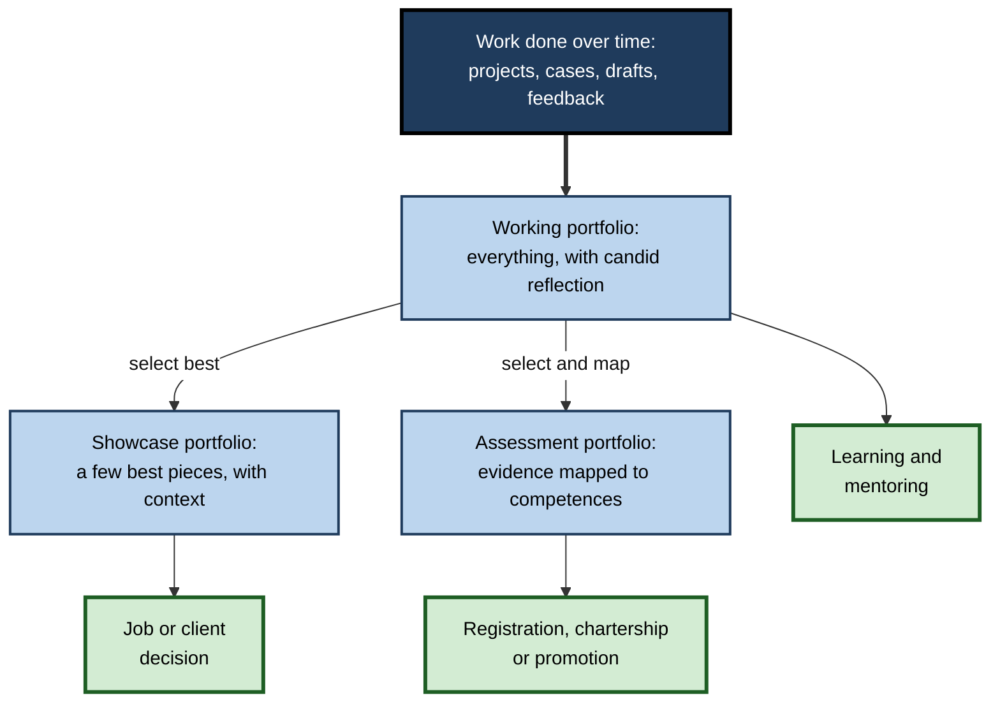
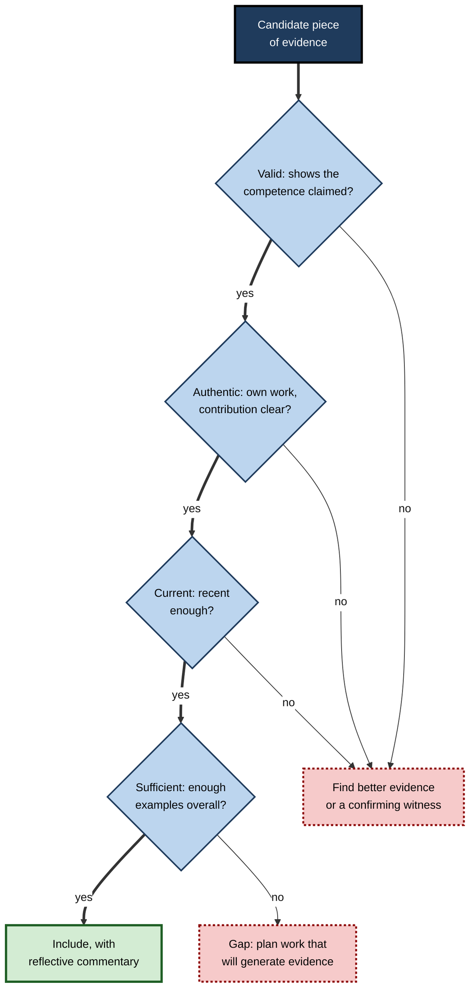
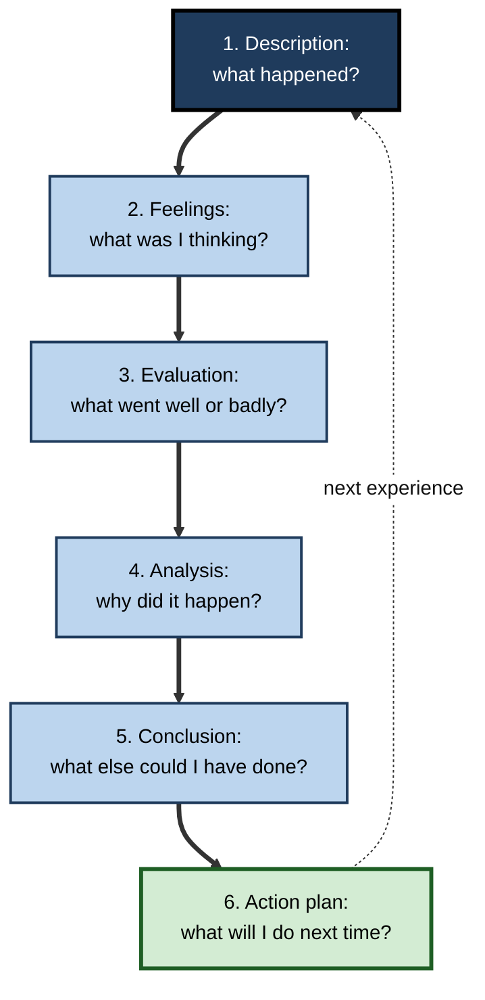
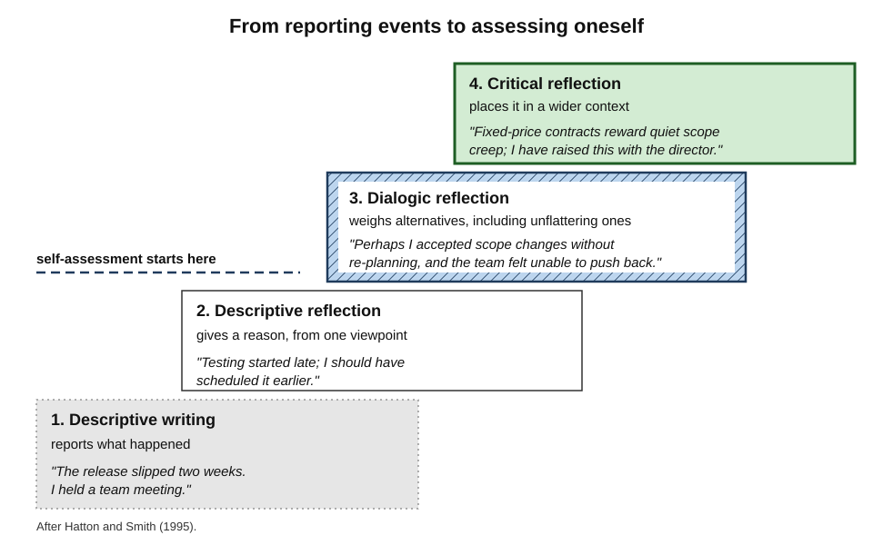
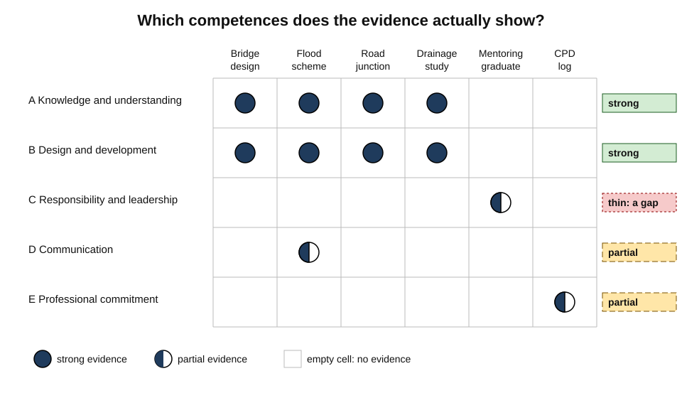
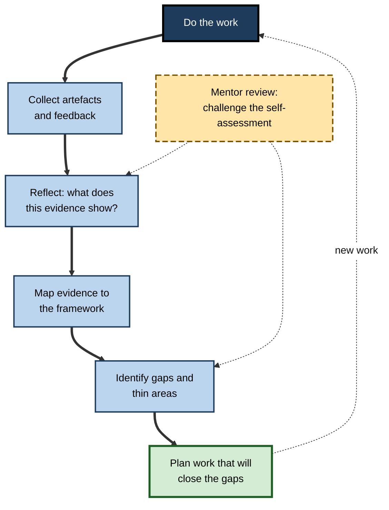

# H.9. Portfolio-Based Self-Assessment

Every three years, each nurse and midwife registered in the United Kingdom must show their regulator evidence of practice hours, continuing development, feedback received and written reflections on what they learned. An engineer applying for chartered status submits a report mapping their projects to a framework of competences. A designer seeking a new role sends not a certificate but a selection of work, each piece annotated with the problem, the process and the result.

In each case the person assesses themselves by **choosing, arranging and explaining evidence** of what they can do.

> **Definition — Portfolio (after F. Leon Paulson, Pearl Paulson and Carol Meyer, 1991):** a purposeful collection of a learner's work that shows effort, progress and achievement in one or more areas, and that includes the learner's participation in selecting its contents, the criteria for selection and judgement, and evidence of self-reflection.

**Why it matters**

- Many capabilities — design, leadership, clinical judgement, engineering practice — cannot be shown in a single test; they show in **bodies of work over time**.
- Building a portfolio forces repeated self-assessment: **what is my best evidence? What does it show? What is still missing?**
- Portfolios are required for professional registration, revalidation, chartership, academic promotion and many job applications.
- Poorly designed portfolios become bureaucratic chores or performances of "reflection" for an audience; well-designed ones become a career-long record of learning.

---

## Kinds of Portfolio

### Three purposes

- **Working (development) portfolio** — a running collection of drafts, attempts, feedback and reflections, used to learn.
  - Audience: the learner and a mentor.
  - Contains failures and unfinished work.
- **Showcase portfolio** — a selection of the best work, used to demonstrate capability.
  - Audience: employers, clients, selection panels.
  - Curated, polished, short.
- **Assessment (credentialing) portfolio** — evidence assembled against a framework for a formal decision.
  - Audience: assessors, regulators, promotion committees.
  - Structured by required competences; evidence must meet stated standards.

> **Key point:** the three purposes pull in different directions. A working portfolio is honest about weakness; a showcase portfolio hides it; an assessment portfolio must prove competence. Confusing them produces portfolios that are neither honest nor convincing.

**Table 1.** Three kinds of portfolio compared.

| | Working | Showcase | Assessment |
|---|---|---|---|
| Purpose | Learn and develop | Demonstrate best capability | Prove competence for a decision |
| Audience | Self, mentor | Employers, clients | Assessors, regulators |
| Contents | Drafts, failures, feedback, reflections | Best finished work with context | Evidence mapped to a framework |
| Reflection | Frequent, candid | Brief, framed for the reader | Structured, against criteria |
| Main risk | Neglect | Gloss without substance | Box-ticking and performative reflection |

**Figure 1.** How one body of evidence serves three portfolio purposes.

### Electronic portfolios

- **E-portfolios** hold documents, code, images, recordings and links in one place, often with templates mapped to competency frameworks.
- **Advantages:** easy to update; multimedia; shareable with mentors; searchable over years.
- **Risks:** platform lock-in when changing employer or institution; privacy of sensitive material (patient cases, client data); temptation to collect everything and select nothing.

---

## What Goes into a Portfolio

### Five components

- **Artefacts** — the work itself: reports, code, designs, lesson plans, case notes (suitably anonymised).
- **Evidence of process** — drafts, versions, design decisions, test results, showing how the work developed.
- **Feedback** — comments from clients, colleagues, supervisors, patients; review results.
- **Reflection** — the learner's account of what the evidence shows, what was learned and what will change.
- **Self-assessment and plans** — a judgement of current level against criteria, and the next development goals.

### Judging evidence: VACS

- Vocational assessment in the United Kingdom has long judged portfolio evidence with four tests, often remembered as **VACS**:
  - **Valid** — it shows the competence claimed, not something else.
  - **Authentic** — it is the person's own work.
  - **Current** — it reflects present capability, not skills from years ago.
  - **Sufficient** — there is enough of it to show the competence reliably.

> **Mnemonic — "VACS — Very Able Candidates Show":** Valid, Authentic, Current, Sufficient.

**Table 2.** Applying the four evidence tests to an engineer's portfolio.

| Test | Weak evidence | Strong evidence |
|---|---|---|
| Valid | Certificate of attendance at a leadership course, offered as evidence of leading a team | Project record showing the engineer planned work, allocated tasks and resolved a conflict, with the manager's confirmation |
| Authentic | A team design report with no indication of personal contribution | The same report with a statement of what the engineer personally did, countersigned by the project lead |
| Current | Calculations from a graduate project seven years ago | Calculations from the last twelve months |
| Sufficient | One example of a risk assessment | Three risk assessments on different kinds of project, one revised after review |

**Figure 2.** Testing a piece of evidence before including it.

> **Watch out:** the commonest invalid evidence is **evidence of attendance** — certificates, course lists, hours logged. They show exposure, not capability. Assessors increasingly ask what changed in practice as a result.

---

## Reflection: Turning Evidence into Self-Assessment

### Why reflection is the core

- A collection of work is an archive; a portfolio becomes self-assessment only when the learner says **what the evidence shows** and **what it means for next steps**.
- Reflection links artefacts to criteria, explains decisions and identifies development needs.

### Models of reflection

- **David Kolb (1984) — experiential learning cycle:** concrete experience → reflective observation → abstract conceptualisation → active experimentation.
- **Graham Gibbs (1988) — reflective cycle**, widely used in nursing and teaching:
  1. **Description** — what happened?
  2. **Feelings** — what was I thinking and feeling?
  3. **Evaluation** — what was good and bad about the experience?
  4. **Analysis** — what sense can I make of it? What explains it?
  5. **Conclusion** — what else could I have done?
  6. **Action plan** — what will I do if it arises again?
- **Gary Rolfe and colleagues (2001):** three questions — **What?** **So what?** **Now what?**

> **Mnemonic — "Don't Forget Every Analysis Concludes in Action":** Description, Feelings, Evaluation, Analysis, Conclusion, Action plan.

**Figure 3.** Gibbs's reflective cycle.

### Levels of reflective writing

- **Neville Hatton and David Smith (1995)**, studying student teachers, distinguished four kinds of writing:
  - **Descriptive writing** — reports events; no reflection.
  - **Descriptive reflection** — gives reasons, but from a single perspective.
  - **Dialogic reflection** — steps back; weighs alternative explanations and perspectives.
  - **Critical reflection** — places the event in its wider context: ethical, social, organisational.
- Most portfolio entries stay at the first two levels. Self-assessment improves when entries reach the third.

**Figure 4.** Four levels of reflective writing, with examples from a project manager's portfolio.

**Table 3.** The same event described at increasing depth.

| Level | Example entry |
|---|---|
| Descriptive writing | "The release slipped by two weeks. I held a meeting with the team." |
| Descriptive reflection | "The release slipped because testing started late. I should have scheduled it earlier." |
| Dialogic reflection | "Testing started late, but the deeper cause may be that I accepted the client's scope changes without re-planning. My team said they felt unable to push back; I may have signalled that schedule mattered more than quality." |
| Critical reflection | "Our fixed-price contracts reward accepting scope changes quietly. Unless the commercial model changes, other managers will face the same pressure; I have raised this with the delivery director." |

> **Key point:** the step from descriptive to dialogic reflection is the step from **reporting** to **self-assessment** — considering alternative explanations, including unflattering ones.

### Worked example (illustrative): writing a reflective entry

A junior software engineer wants a portfolio entry about an incident she handled.

**Draft 1 (descriptive):** "On 12 March the payments service failed. I was on call. I restarted the service and wrote the incident report."

**Steps to improve it:**

1. **What? — select and describe briefly.** Keep only the facts needed: the failure, her role, the outcome. "The payments service failed during peak hours; as on-call engineer I led the response; service was restored in 48 minutes."
2. **So what? — evaluate and analyse.** What went well, what did not, and why? "I found the failing dependency quickly from the dashboards, but I spent twenty minutes trying fixes alone before escalating. I think I hesitated because I did not want to wake the senior engineer — the cost of that was twenty minutes of failed payments."
3. **Consider alternatives.** "A different reading: the escalation policy was unclear about when to call for help, so my hesitation may be a common pattern, not just mine."
4. **Link to the framework.** "This shows competence in incident diagnosis (strong) and a development need in escalation judgement."
5. **Now what? — act.** "I agreed with my lead a rule: escalate after ten minutes without progress. I proposed adding it to the on-call runbook; it was accepted."
6. **Attach evidence.** The incident report, the runbook change and the lead's comment.

- **Result:** the final entry is about 150 words — shorter than many descriptive entries — but it records a **self-assessment**, a **change in practice** and **evidence** of both.

> **Watch out:** reflection is not confession. The aim is not to list failings but to show **what was learned and what changed**; an entry that ends without an action is incomplete.

---

## What the Evidence Shows

### Portfolios in professional education

- **Erik Driessen and colleagues (2007)** systematically reviewed portfolios in medical education and asked why they met with mixed success. Portfolios worked better when:
  - their **goals were clear** and integrated into the curriculum and assessment;
  - learners had **mentors** who discussed the portfolio with them regularly;
  - the format was **not overly bureaucratic**;
  - they were introduced with explanation of their purpose.
- **Sharon Buckley and colleagues (2009)**, reviewing portfolios in undergraduate health-professions education, found reported benefits for **self-awareness, reflection and engagement**, but noted heavy **time demands** and generally **weak study designs**.

> **Watch out:** much portfolio research relies on participants' perceptions rather than measured outcomes. Portfolios are widely mandated; strong evidence that they improve **practice** is thinner than their prevalence suggests.

### Can portfolios be assessed reliably?

- Portfolio contents differ from person to person, so standardised scoring is hard.
- Approaches that improve the trustworthiness of judgements:
  - **multiple assessors**, discussing disagreements;
  - **clear criteria** linked to a framework;
  - **mentor input**, combined with independent assessors;
  - **holistic judgements** built from many pieces of evidence rather than item-by-item marks.

### The reflection problem

- Critics warn that compulsory written reflection can become **performative**: learners write what assessors want to read.
- **Anne de la Croix and Mario Veen (2018)** described the "**reflective zombie**" — a learner who produces reflection on demand, following formulae, without genuine thought.
- In the United Kingdom, a high-profile **2018** case involving a trainee paediatrician raised fears that doctors' written reflections could be used against them. Regulators and professional bodies subsequently issued guidance that reflections should focus on **learning**, avoid identifiable patient details and would not be demanded as evidence in fitness-to-practise proceedings.

> **In practice:** write reflections **for learning first**. Keep candid working reflections private or shared only with a mentor; prepare structured, appropriately anonymised entries for formal portfolios.

---

## Using a Portfolio to Assess Oneself

### Mapping evidence to a framework

- Lay out the competency framework as rows and the pieces of evidence as columns.
- Mark which evidence demonstrates which competence, and how strongly.
- **Empty rows** are gaps: competences with no evidence.
- **Thin rows** — one weak piece — are risks.

**Figure 5.** Mapping portfolio evidence against a competence framework reveals gaps. (illustrative)

### Worked example (illustrative): an engineer preparing for chartership

A civil engineer, five years after graduating, plans to apply for chartered status. Her professional body's framework (based on the UK Standard for Professional Engineering Competence) groups competences under five headings: **A** knowledge and understanding, **B** design and development, **C** responsibility, management and leadership, **D** communication and interpersonal skills, **E** professional commitment.

**Steps:**

1. **List evidence.** She lists eight projects and activities, with artefacts for each.
2. **Map.** For each competence area she records which projects demonstrate it, and rates the strength of evidence (strong, partial, none).
3. **Read the map.**
   - A and B: strong evidence from four projects each.
   - D: partial — internal presentations only; no evidence of communicating with the public or non-specialists.
   - C: thin — she has supervised a graduate but never managed a budget or a work package.
   - E: partial — CPD records, but no evidence of ethical or sustainability judgement.
4. **Plan.** She asks to lead a small work package with its own budget (C); volunteers to present a scheme at a public consultation (D); writes up a sustainability trade-off she made on a drainage design (E).
5. **Reflect.** For each new piece she writes a short dialogic reflection: what she did, alternatives she considered, what she would do differently.
6. **Review with a mentor** every quarter; apply when every area has strong evidence.

**Table 4.** Her evidence map before and after a year of planned development.

| Competence area | Evidence before | Strength before | Evidence after | Strength after |
|---|---|---|---|---|
| A Knowledge and understanding | Four design projects | Strong | Unchanged | Strong |
| B Design and development | Four design projects | Strong | Plus drainage redesign | Strong |
| C Responsibility and leadership | Supervising a graduate | Thin | Led a work package; managed its budget and risks | Strong |
| D Communication | Internal presentations | Partial | Public consultation presentation; written briefing for councillors | Strong |
| E Professional commitment | CPD log | Partial | Written analysis of a sustainability trade-off; ethics course applied to a live dilemma | Strong |

- **Conclusion:** the portfolio did more than document competence — it **revealed** the gaps and turned them into a development plan a year before the formal assessment.

> **Watch out:** a common error is to describe team achievements as personal ones. Assessors look for "**I**" statements backed by evidence of the individual's own contribution.

**Figure 6.** A portfolio-based self-assessment cycle with a mentor.

---

## Building and Curating a Portfolio

### Setting one up

1. **Decide the purpose and the framework.** Which competences, standards or job requirements must the portfolio speak to? Without a framework, evidence piles up without telling a story.
2. **Create a simple structure.** One folder or section per competence area, plus a dated log of entries.
3. **Capture as work happens.** Save the artefact, the feedback and a two- or three-line note on the day; reconstructing later loses detail and honesty.
4. **Tag each entry** with the competences it may demonstrate.
5. **Reflect periodically** — monthly or quarterly — on a few entries in depth rather than on every entry superficially.
6. **Review the map** of evidence against the framework every six months.
7. **Curate** when a purpose arises: select from the working collection for an appraisal, application or showcase.

> **Remember:** **collect continuously, reflect periodically, curate occasionally.**

### Showcase portfolios that persuade

- **Fewer, stronger pieces.** Three to seven well-explained pieces usually persuade more than twenty unexplained ones; reviewers skim.
- **Context, problem, process, result.** For each piece: who it was for, what problem it addressed, how the work was done and what happened as a result.
- **Make the personal role explicit.** "I designed the data model and led the migration; two colleagues built the reports."
- **Show judgement.** Include a decision and its rationale — an option rejected, a trade-off made.
- **Evidence of outcome.** A metric, a client's comment, a test result.
- **Consider one honest difficulty.** A short account of something that went wrong and what changed afterwards often impresses experienced reviewers more than unbroken success.

### Portfolios across a career

- **Early career** — breadth: evidence of core competences across several kinds of work; many small pieces.
- **Mid-career** — depth and responsibility: leading work, mentoring, managing risk, owning outcomes.
- **Senior roles** — impact and influence: shaping strategy, developing others, changing how an organisation works.
- **Career changes** — **translation**: mapping existing evidence onto the new field's framework. A teacher moving into instructional design, for example, maps lesson design, assessment and evaluation evidence onto the new role's competences.
- **Interviews** — portfolio entries become **structured stories** (situation, task, action, result) that answer competency-based questions with real, specific evidence.

### Common portfolio errors

- **Hoarding** — everything kept, nothing selected or explained.
- **Attendance as evidence** — certificates and hours instead of what changed in practice.
- **"We" instead of "I"** — team achievements without a personal role.
- **Description without reflection** — what happened, but not what it shows or what will change.
- **Reflection without evidence** — claims of learning not backed by artefacts or feedback.
- **Last-minute assembly** — reconstructed from memory under deadline.
- **Stale evidence** — strong pieces from years ago standing in for current capability.

### Organising the evidence

- Two common structures, each with strengths:
  - **By competence** — sections for each area of the framework, evidence filed under the competences it shows.
    - Makes gaps obvious and suits formal assessment.
    - Can fragment a single rich project across many sections.
  - **By chronology or project** — entries in date order, each tagged with competences.
    - Preserves the story of development and is easy to keep up.
    - Gaps are visible only through the tags or a separate map.
- **A practical combination:** keep the working portfolio **chronological** (quick to add to) with **tags**, and generate a **competence view** — a map or index — when self-assessing or preparing a submission.

### Others' eyes on the portfolio

- A portfolio assessed only by its author risks the same biases as any self-assessment.
- **Useful external checks:**
  - a **mentor** who challenges claims — "what evidence shows that?";
  - a **peer** at the same stage who swaps portfolios and applies the framework to the other's evidence;
  - a **recent successful candidate** who can say what assessors actually looked for;
  - the **witnesses** named in evidence, who can confirm the learner's role.
- Disagreement between the self-assessment and these readers is the most useful output: it shows where the learner's evidence is weaker — or stronger — than they believe.

> **Mnemonic — "Happy Authors Write Down Real Life Stories":** Hoarding, Attendance, We, Description only, Reflection only, Last-minute, Stale.

---

## Portfolios in Professional Life

### Regulated professions

- **Nursing and midwifery (United Kingdom):** revalidation every three years requires, among other things, 450 practice hours, 35 hours of continuing professional development (20 of them participatory), five pieces of practice-related feedback, five written reflective accounts and a reflective discussion with another registrant.
- **Medicine (United Kingdom):** annual appraisal with a portfolio of supporting information — CPD, quality improvement activity, significant events, feedback from colleagues and patients — leading to revalidation every five years.
- **Engineering, accountancy, surveying, teaching:** professional bodies require mapped evidence for chartership or registration and CPD records to maintain it.

### Unregulated work

- **Design and creative work** — showcase portfolios are the main hiring evidence.
- **Software** — public code, design documents, technical writing and talks.
- **Consulting and management** — case summaries of engagements (anonymised), outcomes achieved, feedback received.
- **"Brag documents"** — a running private record of accomplishments, feedback and learning, kept to prepare for performance reviews and promotion cases; in effect a working portfolio.

> **In practice:** the cheapest portfolio habit is a **monthly entry**: one piece of work, what it shows, feedback received, one thing learned. Over a year this produces twelve dated, specific pieces of evidence — far better than reconstructing a year from memory the week before an appraisal.

### Portfolios and AI

- **Risks:**
  - AI-written reflections that sound fluent but contain no genuine self-assessment;
  - fabricated or inflated evidence that is hard for assessors to detect;
  - uploading confidential work to tools that store it.
- **Responses:**
  - assessors place more weight on **verifiable artefacts**, witness testimony and **professional discussions** (oral examination of the portfolio);
  - learners use AI, if at all, to **organise** evidence or check coverage against a framework — not to write the reflection.

> **Key point:** a reflection's value lies in the thinking it records. Outsourcing the writing outsources the self-assessment.

### Case study (illustrative): from last-minute revalidation to a living portfolio

- **Situation:** a community nurse had compiled her first revalidation portfolio in the final month before the deadline.
- **Problem:** she struggled to recall feedback, wrote five reflections from memory in one weekend and felt the exercise had taught her nothing.
- **Diagnosis:**
  1. The portfolio was treated as an **assessment portfolio only**, assembled once for the regulator.
  2. Evidence was reconstructed, not collected as it occurred.
  3. Reflections were descriptive — accounts of events, not of learning.
- **Actions for the next cycle:**
  1. A **monthly fifteen-minute entry**: one case or event, feedback received, a short What? / So what? / Now what? reflection.
  2. A simple map of entries against her service's competency framework, reviewed every six months.
  3. Discussion of two entries each quarter with a colleague acting as reflective partner.
  4. Formal revalidation entries **selected** from the working portfolio rather than written afresh.
- **Result:** at the next revalidation the formal portfolio took two evenings; the six-monthly map had shown a gap in wound-care updates, which she closed by arranging training a year in advance.
- **Lesson:** the same requirement became useful once the **working portfolio** came first and the **assessment portfolio** was drawn from it.

---

## Open Questions

- **Do portfolios improve practice, or mainly documentation?**
  - Perceived benefits are widely reported; rigorous evidence of improved professional performance is limited.
- **How can reflection be assessed without making it performative?**
  - Grading reflection invites writing for the assessor; not assessing it risks neglect. The balance is debated.
- **How reliable are portfolio judgements?**
  - Multiple assessors and holistic judgement help, but standardisation across diverse portfolios remains difficult.
- **What is the right balance of privacy and accountability?**
  - Candid reflection needs protection; regulators need evidence. Legal and professional positions continue to evolve.
- **How will AI change portfolio assessment?**
  - Generated reflections and evidence push assessment towards verification and conversation; the long-term shape is unclear.

---

## Summary

- A **portfolio** is a purposeful, learner-selected collection of work with reflection, showing progress and achievement (**Paulson, Paulson and Meyer, 1991**).
- **Working**, **showcase** and **assessment** portfolios serve different purposes; the working portfolio should come first and feed the others.
- Components: **artefacts, process evidence, feedback, reflection, self-assessment and plans**. Judge evidence as **Valid, Authentic, Current and Sufficient**; attendance is not capability.
- Reflection turns evidence into self-assessment: **Kolb's cycle**, **Gibbs's six stages**, **What? So what? Now what?**; aim for **dialogic** rather than merely descriptive reflection (**Hatton and Smith, 1995**).
- Evidence: portfolios work better with **clear goals, mentoring, integration and light bureaucracy** (**Driessen and colleagues, 2007**); benefits are mostly self-reported; reflection can become **performative**.
- **Map evidence to a framework** to find gaps and thin areas, then plan work that will generate evidence; review with a mentor.
- Professions use portfolios for **revalidation, appraisal and chartership**; elsewhere showcase portfolios and **brag documents** serve the same function. With AI, value shifts to **verifiable artefacts** and **professional discussion**.

---

## Self-Check

1. Give Paulson, Paulson and Meyer's definition of a portfolio and identify its self-assessment elements.
2. Distinguish working, showcase and assessment portfolios.
3. What are the five components of a portfolio?
4. Explain the VACS tests and give an example of evidence that fails the validity test.
5. List the six stages of Gibbs's reflective cycle.
6. What are Hatton and Smith's four levels of reflective writing?
7. Rewrite "The workshop went badly; I'll prepare more next time" as a dialogic reflection.
8. What conditions did Driessen and colleagues associate with successful portfolios?
9. What is the "reflective zombie" problem, and how might it be reduced?
10. How does mapping evidence to a framework support self-assessment?
11. In the chartership example, which competence areas were weak, and what actions addressed them?
12. Why should the working portfolio come before the assessment portfolio?
13. How should a learner use AI tools in building a portfolio, and what should they avoid?
14. Design a minimal monthly portfolio habit for a junior data analyst.

### Answer Key

1. A purposeful collection of work showing effort, progress and achievement, including the learner's participation in selecting contents, the criteria for selection and judgement, and evidence of self-reflection. Selection, criteria and reflection are all acts of self-assessment.
2. Working: everything, including failures, with candid reflection, for learning. Showcase: a few best pieces with context, for employers or clients. Assessment: evidence mapped to a framework for a formal decision.
3. Artefacts; evidence of process; feedback; reflection; self-assessment and plans.
4. Valid (shows the competence claimed), Authentic (own work), Current (recent), Sufficient (enough). Failing validity: a leadership-course certificate offered as evidence of leading a team.
5. Description, feelings, evaluation, analysis, conclusion, action plan.
6. Descriptive writing, descriptive reflection, dialogic reflection, critical reflection.
7. E.g. "Participants disengaged after the first hour. I had assumed lack of preparation was the cause, but their questions suggest the material was pitched at the wrong level — I designed it from my own expertise rather than asking what they knew. Next time I will survey participants beforehand and include an early check of understanding."
8. Clear goals integrated into curriculum and assessment; regular mentoring; a format that is not overly bureaucratic; a clear introduction to the purpose.
9. Learners producing formulaic reflection on demand without genuine thought (de la Croix and Veen). It may be reduced by separating private learning reflections from assessed entries, valuing candour, using conversation with mentors and avoiding grading reflective style.
10. It shows which competences have strong evidence, which have thin evidence and which have none, turning a vague sense of readiness into specific gaps that can be planned for.
11. C (leadership) — led a work package with its own budget; D (communication) — public consultation and councillor briefing; E (professional commitment) — written sustainability trade-off and applied ethics.
12. Evidence collected as work happens is more accurate and complete; the working portfolio supports learning throughout, and the assessment portfolio can then be selected from it rather than reconstructed under deadline.
13. Use AI to organise evidence or check coverage against a framework; avoid having it write reflections, invent or inflate evidence, or process confidential material in tools that store it.
14. E.g. at the end of each month: one analysis produced (link or anonymised summary), what it shows about skills, feedback received from stakeholders, one thing learned and one thing to try next; every six months, map entries against the team's competency framework and discuss gaps with a manager.

---

## Glossary

| Term | Meaning |
|---|---|
| Artefact | A piece of work included in a portfolio as evidence. |
| Assessment portfolio | Evidence mapped to a framework for a formal decision. |
| Brag document | A private running record of accomplishments, feedback and learning. |
| Critical reflection | Reflection placing events in their wider ethical, social or organisational context. |
| Descriptive reflection | Reflection giving reasons from a single perspective. |
| Dialogic reflection | Reflection weighing alternative explanations and perspectives. |
| E-portfolio | A digital portfolio holding documents, media and links. |
| Evidence map | A grid matching evidence to competences, showing strength and gaps. |
| Gibbs's reflective cycle | Six-stage model: description, feelings, evaluation, analysis, conclusion, action plan. |
| Portfolio | A purposeful, learner-selected collection of work with reflection, showing progress and achievement. |
| Professional discussion | An oral examination of a portfolio by an assessor. |
| Reflective zombie | A learner producing formulaic reflection without genuine thought. |
| Revalidation | Periodic renewal of professional registration based on evidence of continuing fitness to practise. |
| Showcase portfolio | A curated selection of best work for an external audience. |
| VACS | Evidence tests: valid, authentic, current, sufficient. |
| Working portfolio | A running collection of work, feedback and reflection used for learning. |
