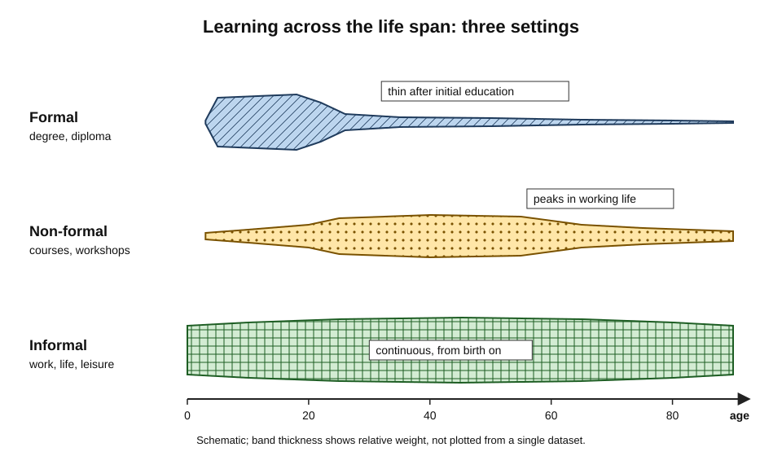
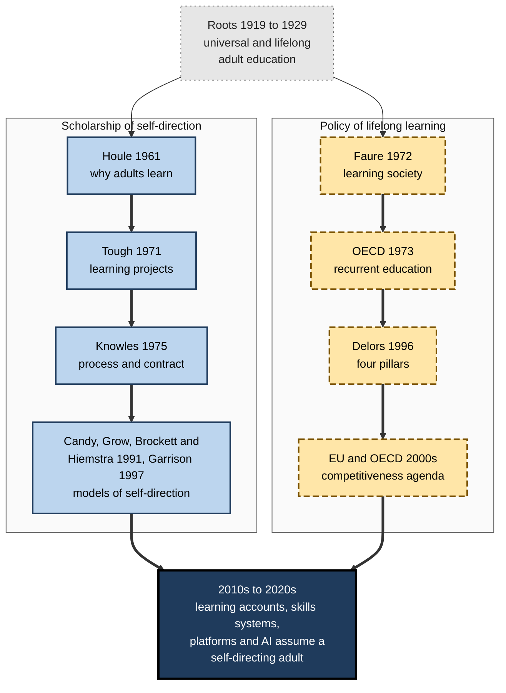
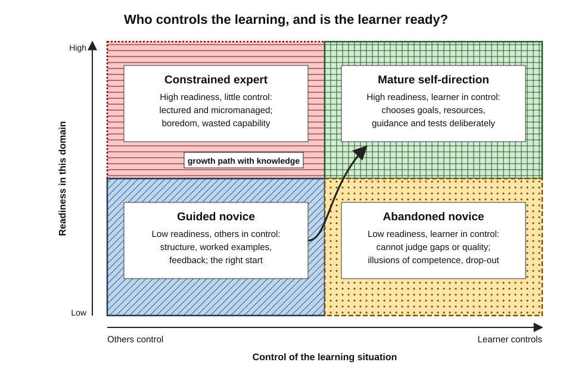
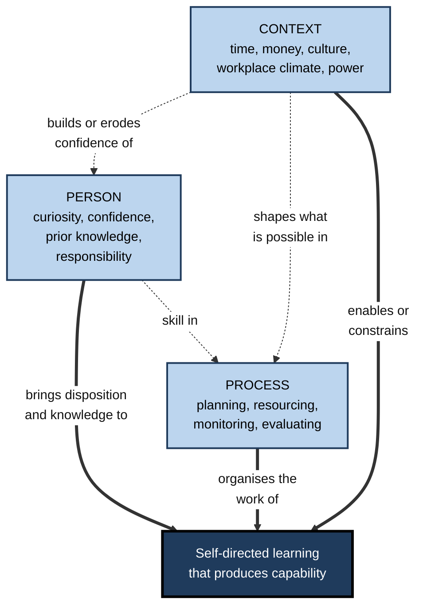
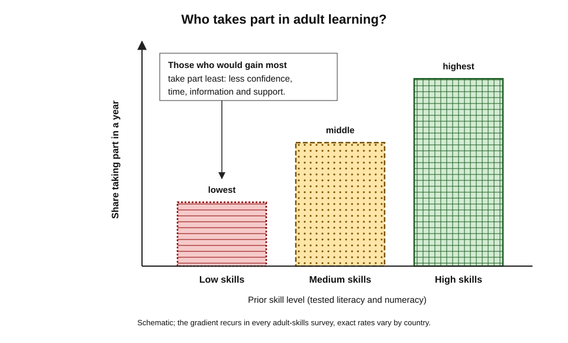
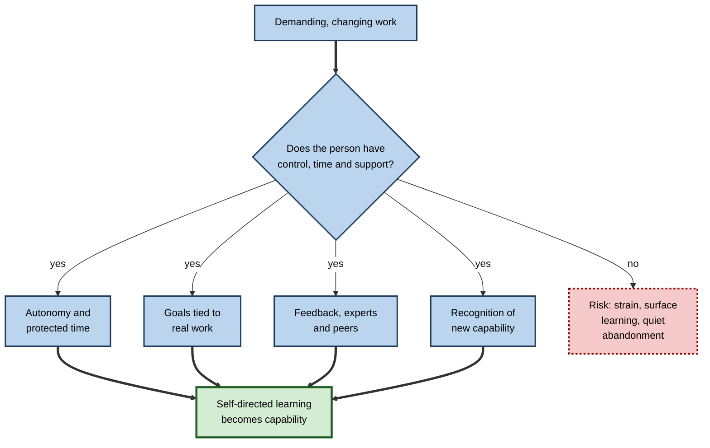

# 1.3. Self-Directed & Lifelong Learning

A radiographer teaches herself a new imaging protocol from manuals and colleagues in the month before it goes live. A retired engineer learns Mandarin for the pleasure of it. A government gives every adult citizen a training account and wonders why the people who most need it rarely use it. All three are instances of the same two ideas: that adults can and must **direct their own learning**, and that learning must **continue across the whole of life**.

> **Definition — Self-directed learning:** "a process in which individuals take the initiative, with or without the help of others, in diagnosing their learning needs, formulating learning goals, identifying human and material resources for learning, choosing and implementing appropriate learning strategies, and evaluating learning outcomes" (Malcolm Knowles, 1975).

> **Definition — Lifelong learning:** all learning activity undertaken throughout life, with the aim of improving knowledge, skills and competences within a personal, civic, social or employment-related perspective (European Commission, 2001).

**Why it matters**

- **Initial education cannot last a career** — a working life of forty to fifty years outlasts most of what is learned before twenty-five.
- **Most adult learning is already self-directed** — planned by learners themselves, outside courses.
- **Opportunity is unequal** — adults with the most education learn the most afterwards, a gap that compounds over a lifetime.
- **Policy assumes it** — training accounts, skills credits, continuing-competence rules and learning platforms all presume a capable self-directed learner.
- **AI changes the economics of self-teaching** — explanations and practice are nearly free; judging what to learn and whether it has been learned is not.

---

## Two Ideas, One Disposition

Self-directed learning concerns **who controls** learning; lifelong learning concerns **when and where** it happens. They meet in the professional who keeps learning, mostly on her own initiative, for decades.

### Self-directed learning: a process and an attribute

- **As a process** — a way of organising a learning episode in which the learner makes the main decisions.
  - *e.g.* a product manager decides she needs pricing analytics, picks two textbooks and a mentor, and judges her progress by redoing a past analysis.
- **As a personal attribute** — a disposition and capability to take charge of one's learning.
  - *e.g.* the colleague who, faced with any unfamiliar system, quietly works out what she does not know and fixes it.
- **Philip Candy (1991)** drew the distinction sharply, warning that confusing the two had muddled decades of research.

> **Watch out:** self-directed is not the same as **alone**. Allen Tough's interviews found that self-planners routinely recruited helpers — friends, experts, librarians, colleagues. Self-direction concerns who makes the decisions, not who is in the room.

### Lifelong and life-wide

- **Lifelong** — learning across the life span, from early childhood to old age.
- **Life-wide** — learning across all settings at any one time: classroom, workplace, home, community, online.
- Three settings are distinguished in international statistics:
  - **Formal learning** — structured and leading to a recognised qualification (*e.g.* a degree).
  - **Non-formal learning** — organised and intentional but uncertified (*e.g.* a workshop, an employer course).
  - **Informal learning** — from daily work, family and leisure, often unplanned and unrecognised.

> **Definition — Recurrent education:** a strategy of spreading formal education across life in alternation with work and other activities, rather than concentrating it in youth (OECD, 1973).

**Figure 1.** Formal, non-formal and informal learning across the life span.

> **Key point:** formal education dominates only the first quarter of life; afterwards non-formal and especially **informal** learning carry almost all growth.

### Neighbouring ideas

- **Self-regulated learning** — the psychologists' cycle of forethought, performance and self-reflection within a task; it supplies the moment-to-moment mechanics inside a self-directed project, while the decision to undertake the project belongs to self-direction.
- **Continuing professional development** — the professions' term for lifelong learning that keeps a practitioner competent and current.

---

## How the Ideas Developed

### Early roots

- **Nineteenth-century institutions for adults** — Mechanics' Institutes (from the 1820s), public libraries and the Workers' Educational Association (England, 1903) served self-educating workers.
- **1919 — the United Kingdom's Ministry of Reconstruction** called adult education "a permanent national necessity" that should be "both universal and lifelong".
- **Eduard Lindeman (1926)** and **Basil Yeaxlee, *Lifelong Education* (1929)** — adult learning should start from adults' situations, and education should span the whole of life.

### The scholarship of self-direction

**Study card — Cyril Houle, *The Inquiring Mind* (1961)**

- **Design:** in-depth interviews with 22 adults known as unusually active continuing learners.
- **Results:** three orientations to learning:
  - **goal-oriented** — learning to achieve a definite objective;
  - **activity-oriented** — learning for the social contact and activity it brings;
  - **learning-oriented** — learning for its own sake, out of curiosity.
- **Conclusion:** adults learn for different reasons, and the most persistent learners often combine all three; "why" shapes "how".

**Study card — Allen Tough, *The Adult's Learning Projects* (1971)**

- **Design:** structured interviews with adults in Canada about every deliberate attempt in the past year to gain knowledge or skill (a "learning project" — at least seven hours of effort with a clear intention to learn).
- **Results:**
  - the typical adult conducted about **eight projects a year**, averaging roughly **90 hours each** — some **700 hours a year**;
  - around **two-thirds or more** were planned by the learner rather than by a teacher or institution.
- **Conclusion:** institutional adult education is the tip of an **iceberg**; most adult learning lies hidden below it, self-planned and unrecorded.

> **Watch out:** Tough's samples were small and largely educated. Later replications confirmed that most adults conduct learning projects, but the numbers of projects and hours vary widely with sample and interview method.

- **Malcolm Knowles, *Self-Directed Learning* (1975)** — the classic process definition and the **learning contract**, a written agreement of objectives, resources, evidence and criteria. His andragogy treated self-direction as a defining adult trait; critics see it as situational rather than a feature of age.
- **Lucy Guglielmino (1977)** — the **Self-Directed Learning Readiness Scale (SDLRS)**, a self-report questionnaire that became the field's most-used measure.
- **From counting to explaining (1984–2012)** — Gary Spear and Donald Mocker, Ralph Brockett and Roger Hiemstra, Philip Candy, Gerald Grow and D. Randy Garrison turned the field from documenting self-planned learning to modelling what self-direction is and when it works.

### The policy of lifelong learning

- **Paul Lengrand (UNESCO, 1965; *An Introduction to Lifelong Education*, 1970)** — proposed *éducation permanente*: education as a continuous process rather than a stage of youth.
- **The Faure Report, *Learning to Be* (UNESCO, 1972)** — chaired by Edgar Faure, former French prime minister: everyone must be able to keep learning throughout life, in a **learning society** where all institutions educate; its tone was **humanistic** — the full development of the person and citizen.
- **OECD, *Recurrent Education: A Strategy for Lifelong Learning* (1973)** — alternate education with work across life; a more economic framing.
- **The Delors Report, *Learning: The Treasure Within* (UNESCO, 1996)** — chaired by Jacques Delors, former President of the European Commission; "learning throughout life" as the key to the twenty-first century, built on **four pillars**:
  - **learning to know** and **learning to do** — knowledge, the tools of learning, and competence to act;
  - **learning to live together** and **learning to be** — cooperation, personal development and responsibility.
- **1996–2006 — the economic turn** — OECD ministers adopt "Lifelong Learning for All" (1996); the EU's Lisbon strategy and *Memorandum on Lifelong Learning* (2000) make it the engine of a competitive knowledge economy; the EU's key competences (2006) include **learning to learn**.
- **2015 — UN Sustainable Development Goal 4**: "ensure inclusive and equitable quality education and promote lifelong learning opportunities for all".
- **2021–2022 — EU targets and instruments**: at least **60% of adults** in training every year by 2030; Council recommendations on **individual learning accounts** and **micro-credentials** (2022).

> **Mnemonic — "Know, Do, Together, Be":** the four Delors pillars, in order — knowing, doing, living together, being.

**Figure 2.** The two lines of development — the scholarship of self-direction and the policy of lifelong learning — and where they converged.

> **Key point:** the policy story moved from **humanistic** (Faure) to **economic** (OECD and EU: employability and competitiveness). Critics such as John Field and Gert Biesta argue that this turned learning from a public good into an individual duty.

---

## Models of Self-Direction

The models answer different questions: how a self-directed project unfolds, what a self-directed person is like, and what surrounds both. Sharan Merriam and Rosemary Caffarella grouped them as **linear**, **interactive** and **instructional**.

### Linear models

- **Tough and Knowles** — the learner moves through ordered steps: diagnose needs → set goals → find resources → choose strategies → carry them out → evaluate.
- **Strength:** a teachable procedure; each step is a craft that rewards deliberate skill.
- **Limit:** real adults seldom work this tidily; the steps overlap, loop and are often skipped.

### Interactive models

- **Spear and Mocker's organising circumstance (1984)** — interviews with adults of limited formal education showed that self-directed learners rarely plan in advance; opportunities and constraints in the environment determine what happens next.
  - *e.g.* a nurse's study of wound care follows whichever patients, colleagues and journals happen to be available on the ward.
- **Brockett and Hiemstra's PRO model (1991)** — the Personal Responsibility Orientation separates the *process* (the learner controls planning, doing and evaluating) from the *person* (an orientation towards taking responsibility); their **Person-Process-Context (PPC) model (2012)** gave context — culture, organisation, resources, power — equal weight.
- **Garrison (1997)** — three dimensions in balance: **self-management** (control of goals, resources and support), **self-monitoring** (checking one's own understanding) and **motivation** (to *enter* a task and to *persist* in it).

### Candy's four dimensions

- **Personal autonomy** — a person's general disposition to think and act independently.
- **Self-management** — the willingness and capacity to conduct one's own education.
- **Learner-control** — the degree of control a learner is given *within* formal instruction.
- **Autodidaxy** — independent pursuit of learning *outside* formal institutions.
- **Candy's central claim:** self-direction is **situational and domain-specific**. A person autonomous in her own profession may be dependent as a novice in a new one, because judging what to learn and whether one has learned it requires knowledge of the field.

> **Mnemonic — "PALS" for Candy:** Personal autonomy, Autodidaxy, Learner-control, Self-management.

### Instructional models

- **Grow's staged model (1991)** — teachers move from authority to coach to facilitator to delegator as learners move from dependent to self-directed.
- **Knowles's learning contract** — a structure in which a teacher or employer grants control in exchange for explicit objectives and evidence.

**Figure 3.** Matching control of learning to a learner's readiness in a particular domain.

| Model | What it explains | Unit of analysis | Main strength | Main limit |
|---|---|---|---|---|
| **Tough / Knowles (linear)** | The steps of a self-planned project | One project | Teachable procedure | Real learning is less orderly |
| **Spear and Mocker (interactive)** | How circumstance shapes each step | One project in its setting | Realistic for low-resource learners | Little guidance on improving practice |
| **Brockett and Hiemstra (PRO, PPC)** | Person, process and context together | Learner in context | Integrates disposition and situation | Broad; hard to test as a whole |
| **Candy (four dimensions)** | What "self-direction" can mean | Concept | Conceptual clarity; domain-specificity | Not a procedure |
| **Grow (staged)** | How teaching should adapt to readiness | Teacher–learner pair | Practical matching rule | Stages are coarse; little experimental test |
| **Garrison (three dimensions)** | Control, monitoring and motivation | Learner during a task | Links to cognition and metacognition | Mostly applied in formal education |

**Figure 4.** The Person-Process-Context view of self-directed learning.

### Why self-direction works — and why it fails

- **Why it works**
  - **Autonomy and motivation** — self-determination theory (Edward Deci and Richard Ryan) links perceived autonomy to deeper, more persistent motivation.
  - **Relevance** — learners choose problems they actually face, so the distance to practice is short.
- **Why it fails**
  - **Poor self-assessment** — a review by David Dunning, Chip Heath and Jerry Suls (2004) found self-assessments correlate only modestly with measured performance; novices are least accurate.
  - **Illusions of competence** — fluent re-reading feels like learning; effortful retrieval and spacing feel worse but work better.
  - **Unguided discovery** — novices learn less from minimal guidance than from explicit instruction.
  - **Motivational decay and no feedback** — self-set goals lack deadlines, and without an expert or a test errors persist unnoticed.

> **Key point:** self-direction is not the absence of structure but the **choice** of structure. Expert self-directed learners buy courses, recruit mentors and submit to tests — they simply decide when and why.

> **Watch out:** "adults are naturally self-directed" is a myth that wastes money. Most adults are self-directed in *familiar* domains and dependent in *new* ones, which is exactly where reskilling happens.

---

## The Evidence on Self-Directed Learners

### Measuring self-direction

- **SDLRS (Guglielmino, 1977)** — a self-report scale of readiness; widely used in nursing, medicine and business education.
- **Later scales** — Lorraine Oddi's Continuing Learning Inventory (1986) targets the personality of the lifelong learner; a nursing scale by Murray Fisher and colleagues (2001) measures self-management, desire for learning and self-control.
- **Critiques**
  - All are **self-report** — how people see themselves, not what they do; Lewis Field (1989) challenged the SDLRS's construct validity.
  - Readiness is treated as a general trait, although Candy's analysis implies it is **domain-specific**.

> **Watch out:** a high readiness score predicts how a learner *describes* herself. It does not certify that she can diagnose her gaps in a new field or judge her own work accurately.

### Does self-directed learning work?

**Study card — Murad and colleagues (2010), health professions**

- **Design:** systematic review and meta-analysis of 59 studies (8,011 learners) comparing self-directed learning with traditional teaching in health professions education.
- **Results:**
  - a **moderate gain in knowledge** (standardised mean difference about 0.45);
  - **no clear difference** in skills or attitudes;
  - gains were larger when learners were involved in choosing their own resources, and for more advanced learners.
- **Conclusion:** self-direction can match or beat teaching for knowledge — especially for learners who already know enough to direct themselves.

**Study card — Wilkes and colleagues (2026), health professions**

- **Design:** systematic review of 125 comparative studies published 2009–2023; 48 entered a meta-analysis.
- **Results:**
  - a **small-to-moderate** overall effect (Cohen's d about 0.34), with **very high heterogeneity** between studies;
  - effects were larger where self-directed learning was the designed intervention itself.
- **Conclusion:** structured self-directed learning helps on average, but results vary so much that **design matters more than the label**.

### Limits of the evidence

- **Selection and definitions** — those choosing self-directed routes are often already motivated; "self-directed" covers anything from assigned private study to a learner-designed project.
- **Short horizons and narrow settings** — few studies track retention or transfer; most rigorous ones come from health-professions education.
- **Culture** — critics such as Stephen Brookfield and Michael Collins argued that the concept reflects Western, middle-class individualism and can ignore collective learning and unequal power.

| Claim | State of the evidence |
|---|---|
| Most adults undertake deliberate self-planned learning | Strong; consistent across surveys since the 1970s |
| Structured self-directed learning improves knowledge relative to teaching | Moderate; large variation by design |
| Self-directed learning improves practical skills as much as teaching | Weak or mixed |
| Readiness scales measure actual self-directed capability | Weak; self-report and general rather than domain-specific |
| Novices learn best by directing themselves without guidance | Not supported; guidance helps novices most |

---

## The Economics and Policy of Lifelong Learning

### Why markets under-supply adult learning

- **Poaching externality** — an employer that trains a worker in transferable skills may lose her to a rival. Gary Becker predicted firms would avoid paying for general training; Daron Acemoglu and Jörn-Steffen Pischke later showed that in imperfect labour markets firms pay for some — but less than is socially optimal.
- **Credit constraints** — individuals cannot borrow against future earnings to fund training.
- **Information failures** — learners cannot easily judge which courses raise earnings or capability.
- **Time poverty** — work and caring leave little time; time, not fees, is the commonest barrier adults report.
- **Present bias** — costs come now, benefits years later.

> **Definition — Barriers to participation (K. Patricia Cross, 1981):** **situational** (time, cost, caring), **institutional** (timetables, entry rules, poor information) and **dispositional** (attitudes, confidence, past experience of school).

### The participation gap

- **The OECD Survey of Adult Skills (PIAAC)** directly tests adults' literacy, numeracy and problem solving; its second cycle was published in December 2024.
- **Key findings of the 2023 survey**
  - nearly **one adult in three** across participating OECD economies has low literacy or numeracy;
  - adult literacy **stagnated or declined** in most participating countries over the decade; Finland and Denmark were the only countries with significant improvements;
  - literacy fell most among adults with **less than upper-secondary education**;
  - on average about **8%** of adults were in formal learning and about **37%** in non-formal learning over the reference year.
- **The European Union** — in the 2022 Adult Education Survey, **46.6%** of adults aged 25–64 had taken part in education or training in the previous twelve months; on the narrower indicator used for the 2030 target, which excludes guided on-the-job training, the figure was about **39.5%** — far below the **60%** goal.
- **The gradient** — in every survey, participation rises steeply with prior education, skill level and job status, and falls with age.

> **Definition — Matthew effect in adult learning:** the tendency for adults who already have the most education and skill to receive the most further learning, widening gaps over the life course.

**Figure 5.** Participation in adult learning falls steeply as prior skill falls — the pattern behind the Matthew effect.

> **Key point:** voluntary, self-directed systems reproduce this gradient by default, because confidence, information, time and employer support all cluster with existing advantage.

### Policy instruments

| Instrument | Who decides what is learned | Strengths | Typical failure |
|---|---|---|---|
| **Training levies and employer subsidies** | Employer | Training linked to real jobs | Favours already-skilled staff; firm-specific skills |
| **Paid training leave** | Individual with employer | Solves time poverty | Low take-up where workload is high |
| **Vouchers and skills credits** | Individual | Simple; universal | Small sums; used for low-value courses |
| **Individual learning accounts** | Individual | Portable rights that accumulate | Fraud, poor quality, advantaged users dominate |
| **Recognition of prior learning** | Assessor | Credits informal and self-directed learning | Costly assessment; low awareness |
| **Micro-credentials and skills taxonomies** | Market and individual | Fine-grained, stackable signals | Unclear value to employers; proliferation |

> **Definition — Individual learning account (ILA):** a personal, publicly backed account of training rights or money that an individual can spend on approved learning of their own choice, often portable between jobs.

### Case study: individual learning accounts in three countries

- **Situation:** governments wanted adults, not institutions, to choose their training.
- **England (2000–2001):** small public contributions towards learner-chosen courses; rapid take-up, but weak control of providers allowed widespread fraud, and the scheme closed in late 2001.
- **France — the *compte personnel de formation* (CPF, from 2015):**
  - rights accumulate yearly; from 2019 they were held in euros (typically €500 a year up to €5,000, more for the low-qualified) and booked directly through a smartphone application;
  - use rose sharply, but so did spending on courses of doubtful value and fraudulent offers;
  - from 2024 users pay a flat co-payment of about €100, indexed annually, with exemptions such as jobseekers.
- **Singapore — SkillsFuture Credit (from 2016):** S$500 for every citizen aged 25 and over; in 2024 a **S$4,000 mid-career top-up** for those aged 40 and over, restricted to selected programmes with better employment outcomes.
- **Result:** unrestricted choice raised participation but not always capability, and better-educated adults tended to make more use of the accounts.
- **Lesson:**
  1. choice needs **quality assurance** of providers;
  2. choice needs **guidance** — advice on which learning pays;
  3. universal sums need **targeting** towards low-skilled adults;
  4. small co-payments and tighter catalogues trade some participation for value.

> **Watch out:** "give people money and let them choose" assumes the very self-directed capability that low-skilled adults are least likely to have had the chance to develop. The schemes that lasted added guidance, quality controls or targeting.

### Skills-based systems

- **Skills taxonomies and micro-credentials** — inventories such as the EU's ESCO and the United States' O\*NET describe jobs and learning in a common language; micro-credentials certify short units of learning.
- **Validation of non-formal and informal learning** — the EU's 2012 recommendation asked member states to let adults have self-directed and workplace learning assessed and recognised.
- **Skills-based hiring** — selecting on demonstrated skills rather than degrees. A 2024 analysis by Harvard Business School and the Burning Glass Institute found that, although many large employers removed degree requirements between 2014 and 2023, **fewer than one hire in 700** was affected in practice.

> **Key point:** a skills-based system rewards self-directed learning only if the learning can be **evidenced** — through assessment, portfolios, recognised micro-credentials or performance in work. Invisible learning earns no market return.

### Worked example (illustrative): spending a learning account

- **Situation:** a 44-year-old warehouse operations supervisor has €3,000 in a learning account and about 150 hours of study time a year. Options:
  - **A** — a recognised certificate in supply-chain analytics, €2,400, 120 hours, valued in job advertisements in her region;
  - **B** — three short unaccredited online courses in leadership, €900, 40 hours, enjoyable but not recognised.

| | Option A | Option B |
|---|---|---|
| Cost from the account | €2,400 | €900 |
| Time | 120 hours | 40 hours |
| Evidence produced | Assessed certificate plus a project | Completion badges |
| Signal to employers | Strong in her region | Weak |

> **Formula:** expected yearly gain ≈ probability of using the skill for higher-paid work × annual pay difference. Illustrative figures: if Option A gives a 40% chance of a role paying €4,000 more a year, the expected gain is 0.4 × €4,000 = **€1,600 a year**, recovering the account cost in about 1.5 years. If Option B gives a 10% chance of €2,000 more, the expected gain is **€200 a year**.

1. **Classify** each option by the evidence it produces, not by its title.
2. **Check demand** in job advertisements and the employer's plans.
3. **Estimate** the gain with honest probabilities, then add non-financial value.
- **Conclusion:** Option A, with a mentor at work to apply the analytics to real data; Option B later, from personal time.

> **Watch out:** the figures are illustrative. The common error is to choose by price or enjoyment and ignore whether the learning will be **evidenced** and **used**.

---

## Self-Direction at Work

### What employers now expect

- **Learning in the flow of work** — a phrase popularised by the industry analyst Josh Bersin (2018): short learning at the moment of need, inside everyday tools.
- **Platforms and talent marketplaces** — employers buy content libraries and match people to projects by skill, leaving employees to choose and to build what roles need.
- **The result** — responsibility for development has moved towards the individual, while the organisation still sets goals, controls time and decides promotions; individuals, employers and the state each fund and steer part of the whole.

> **Watch out:** a content library is not a learning strategy. Organisations that provide platforms without time, goals, feedback and recognition typically see low use concentrated among already-motivated staff.

### Conditions that make workplace self-direction work

- **Job autonomy with demand** — Robert Karasek's demand–control model (1979) predicted that **active jobs**, combining high demands with high control, promote learning and motivation, whereas high demand with low control produces strain.
- **Protected time and clear goals** — learning hours that do not compete with delivery targets, tied to a real problem, project or next role.
- **Feedback and recognition** — access to people who can judge quality; new capability counts in staffing and promotion.
- **Psychological safety** — permission to be visibly bad at something new.
- **Social learning** — most workplace self-direction runs through others; communities, networks and teaching what one has learned are among its strongest engines.

**Figure 6.** Workplace conditions that turn self-direction into capability, and those that turn it into strain.

### Continuing professional development

- **Input-based CPD** — required hours or points a year; easy to audit, weakly related to competence.
- **Output-based CPD** — the professional reflects on practice, identifies needs, plans, acts and records the effect.
  - *e.g.* in 2016 the Solicitors Regulation Authority in England and Wales replaced its 16-hour annual requirement with a reflective continuing-competence approach.
  - *e.g.* since 2012 doctors licensed in the United Kingdom have undergone periodic **revalidation**, drawing on appraisal, feedback and reflection.

> **In practice:** the strongest professional development records read like a learning contract — a need diagnosed from evidence, an objective, the activity chosen, and proof of changed practice.

### Case study (illustrative): a learning platform nobody used

- **Situation:** a 6,000-person engineering consultancy bought an online learning library and announced that "every employee owns their development".
- **Problem:** a year later a small fraction of staff accounted for most activity; billable-hours targets left no time.
- **Diagnosis:** responsibility had been transferred without **time**, **goals** or **recognition**, and juniors — with most to learn — felt least able to choose.
- **Actions:**
  1. one learning objective a half-year, agreed with a manager and tied to a project;
  2. two hours a week recorded against a learning code, not against utilisation;
  3. monthly sessions where staff showed senior engineers what they could now do;
  4. new capability entered on skills profiles used for staffing.
- **Result:** use spread far more evenly across grades; project leads began requesting staff with newly evidenced skills.
- **Side effects:** some managers resented the time code; review sessions exposed hours logged without visible change.
- **Lesson:** self-direction at work is an **organisational design problem**. Autonomy without time, goals, feedback and recognition is abandonment.

---

## Self-Directed Learning With AI

Generative AI has removed many costs of self-direction — explanations, practice, feedback, plans — but not the decisions that make it *self-directed*.

### Where AI helps and where the learner must lead

| Self-directed learning step | What AI can now do well | What remains the learner's work |
|---|---|---|
| **Diagnosing needs** | Suggest the components of a field; quiz to expose gaps | Decide which gaps matter for her goals and work |
| **Setting goals** | Draft objectives and milestones | Choose goals that reflect values and real demand |
| **Finding resources** | Explain, summarise, recommend | Judge accuracy and quality; choose authoritative sources |
| **Learning strategies** | Generate questions, cases, simulations, spaced review | Do the retrieval, practice and explanation herself |
| **Evaluating outcomes** | Mark answers, critique drafts | Test unaided performance; seek expert and real-world judgement |

- **The central risk is substitution** — when the tool does the thinking the learner meant to do, practice performance rises and unaided capability falls, as a large field experiment in school mathematics by Hamsa Bastani and colleagues showed.
- **Planning is now cheap; validation is not** — an AI drafts a plausible route through a field in seconds; whether it is sound still needs expert judgement.
- **Equity cuts both ways**
  - AI tutors are cheap and always available, which may narrow gaps for learners without access to teachers;
  - but people with strong self-directed skills are likely to use AI to learn more effectively, which may widen gaps — the Matthew effect in a new form; the balance is not yet known.

> **Key point:** AI makes **self-direction more important, not less**. When information and practice are abundant, the scarce capabilities are knowing what to learn, keeping the thinking for oneself, and judging honestly whether learning has happened.

> **In practice:** the disciplined learner with AI tests herself without the tool at intervals, builds her capture, review and reflection routines into a system she can sustain, and treats fluent AI explanations as a starting point to be checked.

---

## Open Questions

- **How can self-directed capability be taught to adults who never developed it?**
  - Most evidence comes from educated or professional learners; little is known about building self-direction among low-skilled adults at scale.
- **Can lifelong-learning systems close gaps rather than widen them?**
  - Voluntary schemes have generally been used most by the already advantaged; targeted designs help, but no country has clearly reversed the gradient.
- **How should self-directed and informal learning be recognised?**
  - Validation is costly, micro-credentials proliferate, and skills-based hiring has changed practice far less than announced.
- **Will AI strengthen or erode self-direction?**
  - Early evidence shows both effects depending on design; long-term effects on adults' independent learning are unknown.
- **Is self-direction a general trait or many domain-specific capabilities?**
  - Readiness scales assume the first; conceptual analysis and expertise research suggest the second.

---

## Summary

- **Self-directed learning** is learning in which the person takes the initiative in diagnosing needs, setting goals, finding resources, choosing strategies and evaluating outcomes — with or without help; it is both a **process** and a personal **attribute** (Candy).
- **Lifelong learning** spans the whole life and all settings — **formal, non-formal and informal**; after early adulthood informal learning dominates.
- **Scholarship:** Houle (orientations), Tough (the learning-projects **iceberg**), Knowles (process, learning contract), Spear and Mocker (organising circumstance), Brockett and Hiemstra (PRO, PPC), Candy (four dimensions), Grow (stages), Garrison (three dimensions).
- **Policy:** Faure (1972, **learning society**), OECD **recurrent education** (1973), Delors (1996, **four pillars**), then EU and OECD competitiveness agendas and the EU 60% target — a humanistic-to-economic shift.
- **Self-direction is situational:** strong in familiar domains, weak in new ones; mature learners choose structure deliberately.
- **Evidence:** **small-to-moderate**, highly variable knowledge gains; readiness scales are self-report; selection and culture limit generalisation.
- **Economics:** externalities, credit limits, information failures and time poverty cause under-investment; participation shows a strong **Matthew effect**.
- **Instruments:** levies, leave, credits, **individual learning accounts** and skills-based systems — choice works only with quality assurance, guidance and targeting.
- **At work:** active jobs, protected time, goals, feedback and recognition turn self-direction into capability; CPD has moved from hours to **evidenced reflection**.
- **AI** makes resources cheap but leaves diagnosis, thinking and honest evaluation to the learner — self-direction matters more.

---

## Self-Check

1. Distinguish self-directed learning as a process from self-directed learning as an attribute, with an example of each.
2. Define formal, non-formal and informal learning, and explain why informal learning dominates adult life.
3. What did Allen Tough find, and what did he mean by the "iceberg"?
4. Name Houle's three orientations to learning and explain why they matter for designing adult learning.
5. State Candy's four dimensions of self-direction and his central claim about domain-specificity.
6. Compare the Faure and Delors reports with the OECD and EU agendas of the 1990s and 2000s. What changed in the framing of lifelong learning?
7. Summarise what the 2010 and 2026 meta-analyses of self-directed learning in health professions found, and state two limits of this evidence.
8. Explain three reasons markets under-invest in adult learning.
9. What is the Matthew effect in adult learning, and why do voluntary schemes tend to reproduce it?
10. Using the English, French and Singaporean experience, state three design lessons for individual learning accounts.
11. A firm gives all staff access to a learning library and declares that employees "own their development". Predict the result and propose four changes.
12. A mid-career accountant wants to use AI to teach herself data engineering. Which steps of self-directed learning can AI support, and which must she keep for herself?

### Answer Key

1. As a process, the learner makes the main decisions in a learning episode — *e.g.* a manager designing her own route into pricing analytics. As an attribute, it is a disposition to take charge of learning — *e.g.* a colleague who habitually diagnoses and closes her own gaps. Either can exist without the other.
2. Formal learning leads to recognised qualifications; non-formal is organised but uncertified; informal arises from work, family and leisure. After initial education adults spend little time in formal settings but learn continuously from work and life.
3. Most adults undertook about eight deliberate learning projects a year, around 700 hours in total, mostly self-planned. Institutional education is the visible tip; the far larger mass of self-planned learning lies unseen below.
4. Goal-oriented, activity-oriented and learning-oriented. Motives shape persistence and methods, so designs that ignore why adults learn lose them.
5. Personal autonomy, self-management, learner-control and autodidaxy. Judging what to learn and whether one has learned it requires domain knowledge, so one can be autonomous in one's own field and dependent in a new one.
6. Faure and Delors were humanistic — personal development, citizenship, a learning society. The OECD and EU agendas framed lifelong learning as employability and competitiveness, shifting responsibility to individuals; critics call this turning a public good into a private duty.
7. Murad and colleagues: a moderate knowledge gain, no clear difference in skills or attitudes, larger gains for advanced learners. Wilkes and colleagues: a small-to-moderate average effect with very high heterogeneity. Limits: varied definitions, self-selection, short horizons, concentration in health-professions settings.
8. Any three of: poaching externality; credit constraints; inability to judge course quality and returns; time poverty; present bias.
9. Adults with the most education receive the most further learning, widening gaps. Voluntary schemes rely on confidence, information, time and employer support, all of which cluster with existing advantage.
10. Assure provider quality (England's fraud); guide choice and restrict catalogues to valuable learning (France, Singapore's targeted top-up); target the low-skilled; consider small co-payments.
11. Low use concentrated among the already motivated, juniors least engaged. Changes: protected time recorded apart from utilisation; objectives agreed with managers and tied to projects; demonstration sessions with experts; recognition of evidenced capability in staffing and promotion.
12. AI can map the field, draft goals, explain, generate practice and critique work. She must decide which gaps matter, choose goals aligned with real demand, do the effortful thinking, verify sources, and test her unaided capability against expert standards.

---

## Glossary

| Term | Meaning |
|---|---|
| Barriers to participation | Situational, institutional and dispositional obstacles to adult learning (Cross). |
| Continuing professional development | The maintenance and development of a professional's competence across a career. |
| Delors pillars | Learning to know, to do, to live together and to be. |
| Formal learning | Structured learning leading to a recognised qualification. |
| Individual learning account | A personal, publicly backed account of training rights or money spent on chosen learning. |
| Informal learning | Learning from daily work, family and leisure, often unplanned and unrecognised. |
| Learning contract | A written agreement setting out learning objectives, resources, evidence and criteria. |
| Learning project | A deliberate effort of at least several hours intended to gain knowledge or skill (Tough). |
| Lifelong learning | All learning activity undertaken throughout life to improve knowledge, skills and competences. |
| Matthew effect (adult learning) | The tendency of those with most education to receive most further learning. |
| Micro-credential | A certified record of a short unit of learning. |
| Non-formal learning | Organised, intentional learning that does not lead to a formal qualification. |
| Organising circumstance | Environmental opportunities that shape the next step of self-directed learning (Spear and Mocker). |
| PRO model | Brockett and Hiemstra's Personal Responsibility Orientation model of self-direction. |
| Recognition of prior learning | Assessment and certification of learning gained outside formal education. |
| Recurrent education | Spreading formal education across life in alternation with work. |
| Self-directed learning | Learning in which the person takes the initiative in diagnosing needs, goals, resources, strategies and evaluation. |
| Self-regulated learning | Planning, monitoring and adapting one's learning during a task. |
