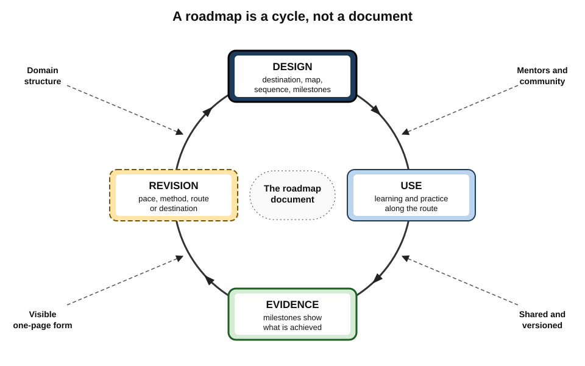
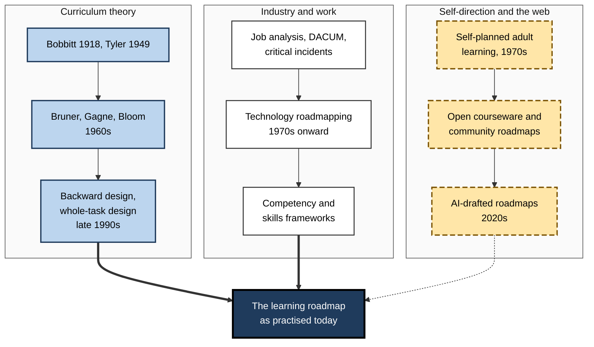
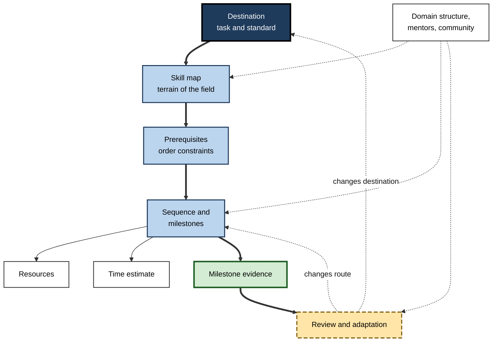
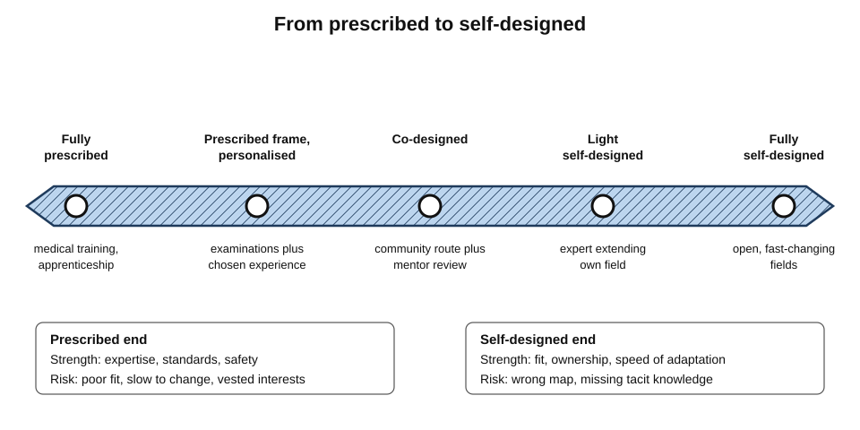
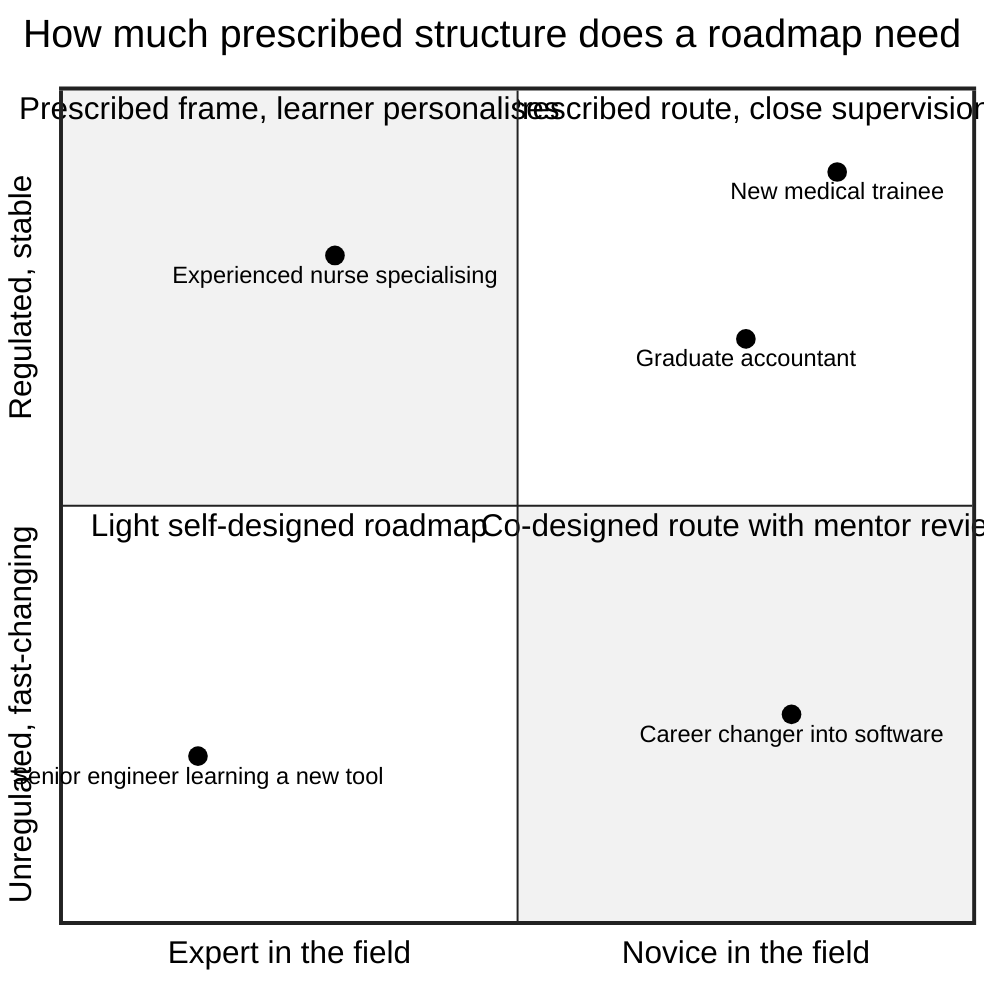
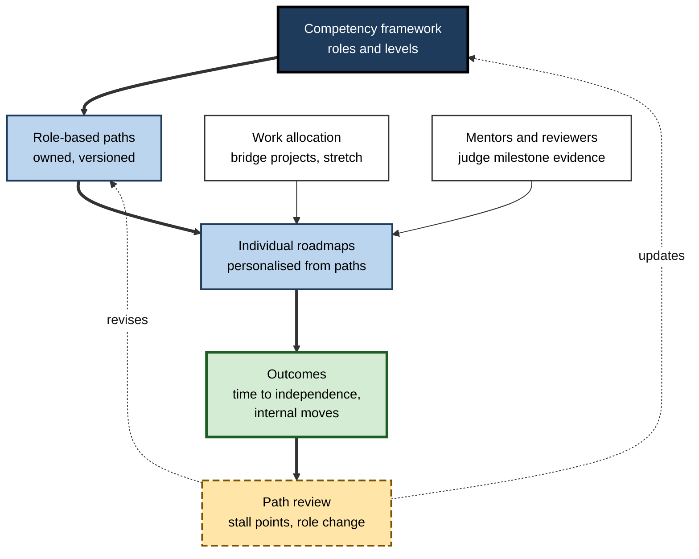

# C. Learning Roadmaps

A hospital trains a junior doctor through a decade of mandated rotations and sign-offs. A software company hands a new hire a ninety-day onboarding path. A mid-career accountant sketches, on one page, a route into data engineering and reviews it every six weeks with a mentor. All three are following **learning roadmaps** — designed routes from present capability to a target one. Whether the route is laid down by a regulator, an employer or the learner, its quality decides how much of the effort turns into capability.

> **Definition — Learning roadmap:** a structured, revisable representation of a route from a learner's current capability to a defined target capability, showing what must be learned, in what order, with which evidence-based milestones, and how the route will be reviewed.

**Why it matters**

- **Self-directed adult learning is the norm**, and its weakest point is usually the route, not the effort.
- **Content is abundant; good routes are scarce.** The bottleneck has moved from access to selection, sequence and verification.
- **Organisations run on roadmaps** — onboarding, reskilling, promotion readiness, licensing — whether or not they call them that.
- **Careers are longer and more varied**, so the ability to design, follow and revise roadmaps is used repeatedly over a working life.
- **Designing roadmaps for others** — teams, cohorts, professions — is a core professional capability for managers, educators and senior practitioners.

---

## The Subject and Its Scope

### What the field covers

- **Design** — framing a destination, mapping a domain, identifying prerequisites, sequencing, choosing milestones and resources, estimating time.
- **Use** — following a route, gathering evidence at milestones, keeping the route visible.
- **Revision** — adapting pace, method, resources, route or destination as evidence accumulates.
- **Social dimensions** — mentors, communities, teams and organisations who shape, review, share and maintain roadmaps.
- **Context** — how the structure of a field, its regulation and its rate of change shape the roadmap it needs.

> **Key point:** a roadmap is not a document but a **cycle** — design, use, evidence, revision — of which the document is only the visible part.

**Figure 1.** The learning roadmap as a cycle of design, use and revision.

### Neighbouring ideas

| Neighbour | Relation to roadmaps | Key difference |
|---|---|---|
| **Goal setting** | Supplies the destination | A goal says where; a roadmap says how, in what order and with what evidence |
| **Curriculum design** | The institutional form of the same problem | Built for cohorts, usually by educators rather than learners |
| **Project planning** | Supplies scheduling methods — critical paths, estimates, versioning | Projects produce outputs; roadmaps produce capability, which is harder to observe |
| **Meta-learning** | Supplies the habit of studying a field before learning it | Meta-learning concerns learning how to learn; roadmaps concern one route to one destination |
| **Self-regulated learning** | Supplies the moment-to-moment monitoring and control | Operates within sessions and tasks; roadmaps operate over months and years |
| **Career development** | Supplies destinations and transitions | Careers include choices that are not learning; roadmaps are the learning part |

> **Watch out:** a roadmap is often confused with a **list of resources**. A list says what exists; a roadmap selects, orders and tests. The confusion is responsible for much wasted learning effort.

---

## How the Idea Developed

### Curriculum theory

- **Franklin Bobbitt, *The Curriculum* (1918)** — derive learning from analysis of what competent adults actually do.
- **Ralph Tyler (1949)** — four questions: purposes, experiences, organisation, evaluation; still the skeleton of most curriculum and roadmap design.
- **Jerome Bruner, *The Process of Education* (1960)** — the **spiral curriculum**: return to core ideas at increasing depth.
- **Robert Gagné (1960s)** — **learning hierarchies**: identify prerequisites by asking what a learner must already be able to do.
- **Benjamin Bloom (1968)** and **Fred Keller (1968)** — **mastery learning**: hold the standard fixed and let time vary.
- **Grant Wiggins and Jay McTighe (1998)** — **backward design**: results, then evidence, then activities.
- **Jeroen van Merriënboer (1997)** — **whole-task sequencing** from simple to complex, with fading support.

### Industry and work

- **Job and task analysis** in the twentieth century, and methods such as **DACUM** (from the late 1960s) and the **critical incident technique** (John Flanagan, 1954), made the analysis of what a role requires systematic.
- **Technology roadmapping** at Motorola (1970s) and later in the semiconductor industry and Cambridge research linked purpose, capabilities and resources over time — and gave the field its name.
- **Competency frameworks** from the 1970s onward, and digital-skills frameworks such as SFIA, supplied organisations with shared maps of roles and levels.

### Self-direction and the open web

- **Allen Tough (1971)** documented how much adult learning is self-planned.
- **Open courseware (from 2002)** and **open licences** made high-quality curricula freely available as raw material for personal routes.
- **Community roadmaps (2010s)** — practitioners publishing routes for technologies and roles — turned roadmaps into public, shared artefacts.
- **Generative AI (2020s)** made it possible to draft a plausible roadmap in seconds, sharpening the question of how routes are validated.

**Figure 2.** The main lines of development that converged in the modern learning roadmap.

---

## The Architecture of a Roadmap

### Eight elements

- **Destination** — the target capability, stated as a task, conditions and a standard.
- **Starting point** — what the learner can already demonstrate, unaided.
- **Skill map** — the components of the destination and how they relate.
- **Sequence** — the order of components, respecting genuine dependencies.
- **Milestones** — checkpoints defined by evidence.
- **Resources** — sources, practice environments and people for each stage.
- **Time** — effort and calendar estimates, as ranges.
- **Review** — cadence, triggers and rules for change.

> **Mnemonic — "Do Smart Students Seek More Reliable Travel Routes?":** Destination, Starting point, Skill map, Sequence, Milestones, Resources, Time, Review.

### Map and route

- **The map** — a field's terrain, largely the same for everyone entering it.
- **The route** — one learner's path across it, from their start to their destination.
- **The core error** — confusing the two: following a field's full map as if it were a route, or designing a route without a map.

### Shapes

- **Linear, branching, networked, spiral, layered** — most real roadmaps are hybrids, typically a dependency network underneath, a largely linear route on top, spiralling back to core ideas, laid out on a timeline.

---

## How the Parts Interact

The elements of a roadmap are not independent steps; each constrains the others, and the strength of the whole depends on the weakest link.

- **The design chain.** A destination stated as a task gives the skill map its boundary; the map, built from real work, reveals which dependencies are genuine, and pruning false prerequisites matters as much as finding true ones. Only then can milestones be designed backwards from the evidence the destination demands, with resources chosen for practice and fit rather than popularity, and time estimated from people who made similar journeys.
- **The life of the route.** Milestones are tests of the plan as much as of the learner; when evidence diverges, the smallest effective change — pace, method, resource, route, destination — keeps the roadmap honest, and a visible one-page form keeps it in use.
- **The social layer.** Practitioners see what learners outside a field cannot, near-peers remember difficulties experts have forgotten, and roadmaps that are shared, versioned and maintained outlast their authors.
- **The context.** A field's regulation, structure and pace decide how much of the route is prescribed, and a move into a new role adds proof, relationships and identity to the skills a roadmap must build.

**Figure 3.** How design, use and revision decisions constrain one another.

> **Key point:** errors propagate downstream. A vague destination produces a map without boundaries, which produces a route with no clear order and milestones that test nothing in particular.

---

## Core Findings Behind Good Roadmaps

No experiment has randomised learners to a roadmap or none over a career. The practice rests instead on well-established findings about learning and planning, which a good roadmap combines.

### Seven principles

1. **Structure before detail helps.** Advance organisers (David Ausubel, 1960) and an early overview give new information somewhere to attach; the average benefit is positive but modest.
2. **Novices need guidance.** Research on learner control generally finds little benefit, and sometimes harm, when novices choose their own content and order without support.
3. **Prior knowledge sets the level of learning.** It strongly predicts later knowledge, though only weakly predicts gains; diagnosis matters, and so does correcting misconceptions.
4. **Whole tasks beat isolated parts** for interdependent skills; support should fade as competence grows.
5. **Mastery gating improves achievement.** Meta-analysis (Kulik, Kulik and Bangert-Drowns, 1990) found gains of about half a standard deviation; the size outside classrooms is debated.
6. **Estimates are too short.** The planning fallacy is robust; the outside view and unpacking improve forecasts.
7. **Plans must be revised.** Realised strategies combine deliberate and emergent elements (Henry Mintzberg and James Waters, 1985); sunk costs and escalation of commitment distort revision.

> **Remember — the seven principles:** structure first; guide novices; diagnose prior knowledge; practise whole tasks; gate on mastery; distrust first estimates; revise on evidence.

### Evidence quality

| Claim | Strength of evidence | Main caveat |
|---|---|---|
| Advance organisers help | Moderate — many studies, small average effect | Depends on genuine links to prior knowledge |
| Novices benefit from guided routes | Moderate to strong | Experts can self-direct with lighter structure |
| Mastery learning raises achievement | Moderate — meta-analytic | Smaller on standardised and long-term measures |
| Planning fallacy | Strong, repeatedly replicated | Size varies by task and person |
| Mentoring improves careers | Moderate, correlational | Selection effects likely |
| Choice overload paralyses learners | Weak — meta-analytic average near zero | Effects vary widely by setting |
| "10,000 hours" to mastery | Not supported as a rule | A misreading of research on elite violinists |

> **Watch out:** many popular roadmap claims — fixed hours to mastery, "learn in 30 days", "never tell anyone your goals" — are oversimplifications. Each has a kernel of research behind it and a much larger shell of exaggeration.

---

## Landmark Debates

### Prescribed or self-designed?

- **The case for prescription:** experts know the terrain; standards protect clients and patients; cohorts are efficient to teach and assess.
- **The case for self-design:** learners differ in starting point and destination; prescribed routes age and may serve the issuer's interests; ownership sustains motivation.
- **The emerging resolution:** **co-design** — a prescribed or community route as raw material, personalised by the learner and reviewed by an experienced practitioner.

**Figure 4.** The spectrum from prescribed to self-designed roadmaps.

### Plan or emerge?

- **Planners** argue that a clear destination and route prevent drift and wasted effort.
- **Emergentists** — drawing on research such as Herminia Ibarra's on career change — argue that clarity comes from action, and that tight plans miss opportunities.
- **The practical synthesis:** plan near-term work in detail, later work in outline (**rolling-wave planning**), with a sampling period early and review triggers throughout.

### Foundations first or just in time?

- **Just-in-case** foundations give coherence but risk dropout and inert knowledge.
- **Just-in-time** foundations motivate but risk fragmentation.
- **Evidence** such as the CUNY remediation trial suggests some traditional prerequisites act as gates; the synthesis is **minimum viable prerequisites** plus a consolidation pass.

### Credentials or capability?

- **Credential-led roadmaps** suit regulated fields and examination-gated careers.
- **Capability-led roadmaps** suit fields that hire on portfolios and track record.
- **The tension:** credentials measure what examinations test; employers increasingly claim to hire on skills, though evidence of changed hiring practice is limited.

**Figure 5.** Matching the amount of structure to the learner and the field.

---

## Roadmaps Designed for Others

### Designing for a cohort

- **Diagnose entry differences** — an entry assessment lets people test out of what they know.
- **Fix the standard, flex the pace** where possible — the mastery principle applied to cohorts.
- **Use whole tasks from the start** — simplified versions of the real work, with support fading.
- **Define milestones as evidence**, judged by qualified reviewers.
- **Provide catch-up and fast-track loops** so one sequence serves a range of learners.
- **Name an owner and a review date** — cohort routes age as fast as personal ones.

### Role-based learning paths and competency-based progressions

| | Role-based learning path | Competency-based progression |
|---|---|---|
| Organising unit | A role | A competency and its levels |
| Progression trigger | Completing the path's activities and assessments | Demonstrating each competency to a standard |
| Pace | Usually cohort-fixed | Individual |
| Typical setting | Onboarding, certification, reskilling | Professions, career ladders, entrustment |
| Common failure | Completion counted as capability | Frameworks too long or out of date to use |

- **Entrustment** — borrowed from medical education, where trainees are entrusted with professional activities at rising levels of independence — is spreading to other fields with high-stakes supervised work.
- **Skills-based organisations** describe work as skills rather than fixed jobs; their roadmaps depend on maintained skills libraries and proficiency scales.

**Figure 6.** An organisational roadmap system linking frameworks, paths and individual roadmaps.

> **In practice:** the most common organisational failure is a system that tracks **completion** at every level. Each layer should instead track **evidence** — milestone results, time to independent work, successful internal moves.

---

## Roadmaps in the Age of AI

- **Drafting** — AI tools can generate a plausible map and route for almost any field instantly. The map is often reasonable; the route rarely fits a particular learner's starting point, constraints and local market unless they are supplied.
- **Validation becomes the scarce skill** — checking a generated roadmap against role evidence, practitioners' judgement and the learner's own diagnostic results.
- **Shifting destinations** — where AI performs routine components of a role, entry tasks change, and roadmaps built on yesterday's junior work may train for tasks that are disappearing.
- **Milestones under pressure** — when tools can produce the artefacts, milestones must specify conditions and include explanation or defence of the work.
- **Maintained routes gain value** — a shared roadmap with a record of use, review and outcomes carries what a generated draft cannot.

> **Key point:** AI shortens the time to a first draft of a roadmap; it does not shorten the need for a **destination worth reaching** and **evidence that the route works**.

---

## Professional Mastery in Roadmap Design

### What expert roadmap designers do

- **Start from the destination's real tasks**, observed or elicited from practitioners, not from course catalogues.
- **Cut ruthlessly** — the core of most fields is a fraction of what can be listed.
- **Diagnose before prescribing** — test prerequisites and misconceptions rather than assuming them.
- **Put real practice early** and build milestones as demonstrations.
- **Estimate from the outside view** and state ranges.
- **Build review into the design** — cadence, tripwires, versioning.
- **Seek outside eyes** — an expert for the destination, a near-peer for the path.
- **Keep it visible** — one page, current, looked at.
- **Respect the field's structure** — navigate prescribed routes well; design open ones carefully.
- **Maintain shared routes** as assets with owners.

### Worked example (illustrative): auditing a roadmap in fifteen minutes

- **Situation:** a manager asks a senior colleague to review a junior analyst's development roadmap before their quarterly conversation.

1. **Destination** — is it a task with a standard? *"Become a better analyst"* fails; rewrite as *"Lead a pricing analysis from scoping to recommendation that the category director acts on."*
2. **Starting point** — is it evidenced? The analyst rates SQL "advanced"; no work sample supports it. Request one.
3. **Map and cut** — 34 topics listed; 12 serve the destination. Move the rest to "later".
4. **Prerequisites** — elasticity concepts appear after the pricing project; move them before.
5. **Milestones** — all are course completions. Replace with three output milestones: a reviewed data-cleaning notebook, an elasticity estimate checked by a senior, a recommendation memo.
6. **Resources** — three parallel courses. Choose one spine; add a practice source.
7. **Time** — "three months" for the whole route at four hours a week. Outside view and unpacking suggest seven to nine.
8. **Review** — none. Add a six-weekly review and a tripwire.

| Element | Before | After |
|---|---|---|
| Destination | "Become a better analyst" | Lead a pricing analysis the director acts on |
| Components | 34 topics | 12 core, rest deferred |
| Milestones | Course completions | Three reviewed outputs |
| Spine | Three parallel courses | One, plus practice source |
| Estimate | Three months | Seven to nine months |
| Review | None | Six-weekly, with a tripwire |

*Illustrative figures.*

- **Conclusion:** none of the changes required new information about the field — only the application of the roadmap's eight elements and the principles behind them.

### Case study (illustrative): a reskilling programme rebuilt around roadmaps

- **Situation:** a telecommunications company planned to move several hundred employees from declining network-operations roles into cloud and software roles over three years.
- **First attempt:** licences to a large content library and a target of forty course hours per person per year.
- **Problem after a year:** hours were logged, but few employees moved; receiving managers judged most applicants not ready; participants reported not knowing what to learn or where it led.
- **Diagnosis:** **content without routes** — no destinations, no sequence, no evidence-based milestones, no bridge into real work, and success measured by hours.
- **Actions:**
  1. Defined **four destination roles** with receiving managers, each stated as tasks and standards.
  2. Mapped each role's skills from current team work and recent hires' experience; identified **adjacent** starting roles whose skills overlapped most.
  3. Built **role roadmaps** with entry diagnostics, stages, output milestones and estimated ranges — typically twelve to eighteen months part-time.
  4. Attached **bridge assignments** in receiving teams from the midpoint, and a mentor from the receiving function to each participant.
  5. Replaced the hours target with **milestone evidence** and **placements**.
  6. Gave each roadmap an **owner**, a changelog and six-monthly reviews driven by where participants stalled.
- **Result:** placements into the destination roles rose substantially over the following two years, according to the company's own reporting; receiving managers reported better-prepared transfers; several roadmaps were revised after a common stall in networking-to-cloud security was traced to a missing identity-management stage.
- **Side effects:** mentors' time had to be funded; some participants found the honest time estimates discouraging; a few roadmaps were abandoned when the destination roles themselves changed.
- **Lesson:** reskilling succeeds when the organisation provides **routes, evidence and bridges** — not when it provides content and counts hours.

---

## Open Questions

- **Do roadmaps measurably improve long-term learning and career outcomes?**
  - The supporting principles are well evidenced; direct, long-term studies of roadmap use are rare.
- **How much structure suits whom, and when should it be withdrawn?**
  - Novices benefit from guidance; the right pace of handing control to the learner is unclear.
- **How can routes stay current in fast-changing fields?**
  - Maintained shared roadmaps help, but maintenance is chronically under-resourced.
- **How should AI-generated routes be validated at scale?**
  - Practitioner review does not scale easily; outcome data raise privacy questions.
- **What happens to entry-level routes as AI absorbs junior tasks?**
  - Fields may need deliberately designed practice environments to replace learning that used to happen through routine work.
- **Can roadmaps be made fair?**
  - Access to mentors, bridge assignments and sponsors is unevenly distributed; roadmap design alone cannot correct structural barriers.

---

## Summary

- A **learning roadmap** is a structured, revisable route from current to target capability, with evidence-based milestones and built-in review; it is a **cycle** of design, use, evidence and revision.
- It draws on **curriculum theory** (Bobbitt, Tyler, Bruner, Gagné, Bloom, backward design, whole-task design), **industry practice** (job analysis, technology roadmapping, competency frameworks) and **self-direction on the open web**.
- Eight elements: **Destination, Starting point, Skill map, Sequence, Milestones, Resources, Time, Review**; distinguish the **map** from the **route**.
- The elements constrain one another; **errors propagate downstream** from a vague destination.
- Seven principles: structure first; guide novices; diagnose prior knowledge; practise whole tasks; gate on mastery; distrust first estimates; revise on evidence. Several popular claims — fixed hours, choice paralysis — are **overstated**.
- Landmark debates — prescribed versus self-designed, plan versus emerge, foundations first versus just in time, credentials versus capability — tend to resolve in **co-design, rolling-wave planning, minimum viable prerequisites and evidence-led milestones**.
- In organisations, **role-based paths** and **competency-based progressions** work when they track **evidence**, not completion, and have owners and review cycles.
- **AI** shortens drafting but raises the value of **validation**, conditioned milestones and maintained routes.
- Expert designers start from real tasks, cut, diagnose, practise early, estimate from the outside view, review, seek outside eyes, keep routes visible and respect the field's structure.

---

## Self-Check

1. Define a learning roadmap and explain why it is better understood as a cycle than as a document.
2. Distinguish a roadmap from a goal, a curriculum and a resource list.
3. Name the eight elements of a roadmap and explain the difference between a map and a route.
4. Trace the contributions of Tyler, Gagné, Bloom and Wiggins and McTighe to roadmap design.
5. What did technology roadmapping contribute to the idea?
6. Explain how an error in the destination propagates through the rest of a roadmap.
7. State the seven principles behind good roadmaps and rate the strength of evidence for two of them.
8. Which popular roadmap claims are overstated, and why?
9. Summarise the prescribed-versus-self-designed debate and its resolution.
10. How does rolling-wave planning reconcile planning and emergence?
11. Compare role-based learning paths and competency-based progressions.
12. How does AI change what is scarce in roadmap design?
13. Audit this roadmap: destination "get good at cloud", 50 topics, milestones "finish course 1–5", no estimate, no review.
14. An organisation's reskilling programme logs many learning hours but few role moves. Diagnose and redesign.

### Answer Key

1. A structured, revisable route from current to target capability with evidence-based milestones and review. It is a cycle because the document is continually tested by milestone evidence and revised; a roadmap that is never revised soon stops guiding.
2. A goal states where to be; a roadmap adds how, in what order and with what evidence. A curriculum is an institution's programme for a cohort. A resource list says what exists without selection, order or tests.
3. Destination, Starting point, Skill map, Sequence, Milestones, Resources, Time, Review. The map is the field's terrain, common to all entrants; the route is one learner's path across it.
4. Tyler: purposes, experiences, organisation, evaluation as design questions. Gagné: learning hierarchies for prerequisites. Bloom: mastery learning — fixed standard, variable time. Wiggins and McTighe: backward design — results, evidence, then activities.
5. The name and the layered view linking purpose, capabilities and enabling resources over time.
6. A vague destination gives the skill map no boundary, so the map sprawls; prerequisites and order become arbitrary; milestones test nothing specific; estimates and reviews have no reference point.
7. Structure first; guide novices; diagnose prior knowledge; practise whole tasks; gate on mastery; distrust first estimates; revise on evidence. E.g. the planning fallacy is strongly and repeatedly replicated; mastery learning's benefit is moderate, meta-analytic and smaller on standardised measures.
8. Fixed hours to mastery (a misreading of Ericsson's research), "learn in 30 days" claims (ignore integration and standards), universal choice paralysis (meta-analytic average near zero), "never tell anyone your goals" (evidence is mixed and specific to identity intentions).
9. Prescription brings expertise and standards; self-design brings fit and ownership. The resolution is co-design: a prescribed or community route personalised by the learner and reviewed by a practitioner.
10. Near-term work is planned in detail and later work in outline, refined at each review, so there is direction without rigidity and room for emergent opportunities.
11. Role-based paths organise activities for a role, usually at cohort pace, and risk counting completion. Competency-based progressions advance people on demonstrated competencies at individual pace, and risk unwieldy or outdated frameworks.
12. Drafts become cheap; validation against role evidence, practitioners and diagnostics becomes scarce, along with conditioned milestones and maintained routes with outcome records.
13. Reframe the destination as a role or task with a standard; diagnose the start; cut the 50 topics to the core the destination needs; order by genuine prerequisites; replace course completions with output milestones reviewed by a practitioner; estimate a range from the outside view; add a review cadence and a tripwire; put it on one page.
14. Content without routes: no destinations, sequence, evidence-based milestones or bridges, and success measured by hours. Redesign: define destination roles with receiving managers; map skills; build role roadmaps with diagnostics and output milestones; attach bridge assignments and mentors; measure milestone evidence and placements; give each roadmap an owner and review cycle.

---

## Glossary

| Term | Meaning |
|---|---|
| Advance organiser | Introductory material linking new learning to existing knowledge. |
| Backward design | Designing learning from desired results and evidence before activities. |
| Bridge assignment | Real work in a target role or team used as a stage of a roadmap. |
| Co-designed roadmap | A roadmap built by the learner with an experienced adviser. |
| Competency-based progression | Advancement on demonstrated competencies rather than time or attendance. |
| Curriculum | An institution's designed programme of learning for a cohort. |
| Destination | The target capability of a roadmap, stated as a task and standard. |
| Entrustment | Granting increasing independence in professional activities as competence is shown. |
| Learning hierarchy | An arrangement of capabilities in which each depends on those beneath it. |
| Learning roadmap | A structured, revisable route from current to target capability with evidence-based milestones. |
| Map (of a field) | The components of a field and their relationships. |
| Mastery learning | Progression only after demonstrating mastery of each unit. |
| Milestone | A checkpoint defined by evidence of capability. |
| Outside view | Forecasting from outcomes of similar past cases. |
| Planning fallacy | The tendency to underestimate time and cost of future tasks. |
| Role-based learning path | An organisation's sequenced learning for a specific role. |
| Rolling-wave planning | Detailed near-term and outline long-term planning, refined over time. |
| Route | One learner's chosen path across a field's map. |
| Skills-based organisation | An organisation that describes work and careers mainly in terms of skills. |
| Spiral curriculum | A curriculum that revisits core ideas at increasing depth. |
| Technology roadmap | An industrial chart linking purpose, products and technologies over time. |
| Whole-task sequencing | Practising complete tasks from simple to complex with fading support. |
