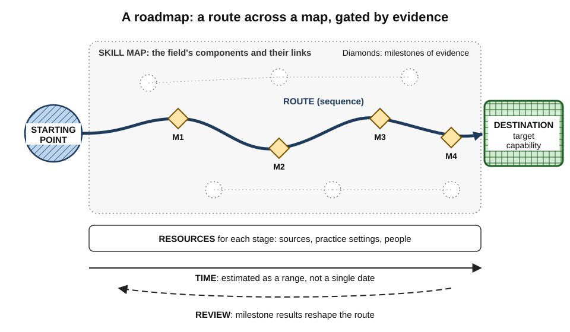
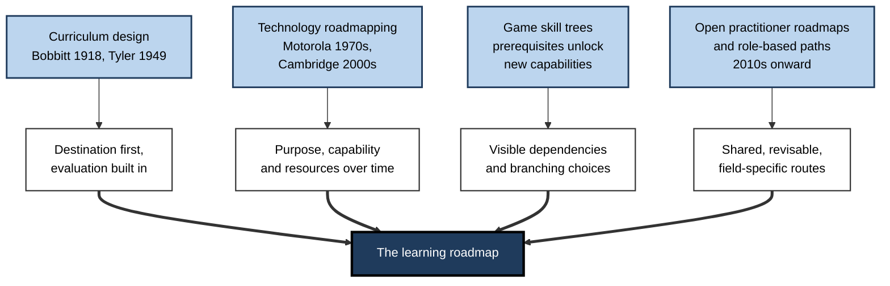
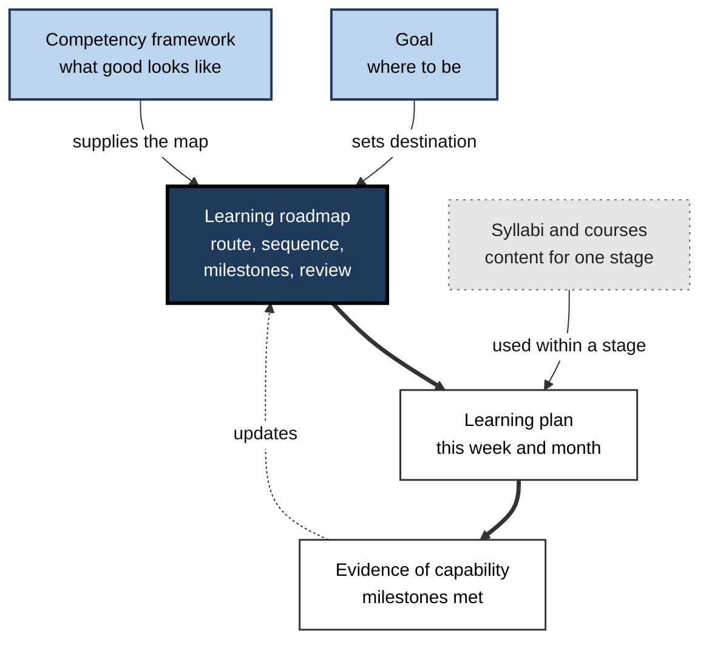
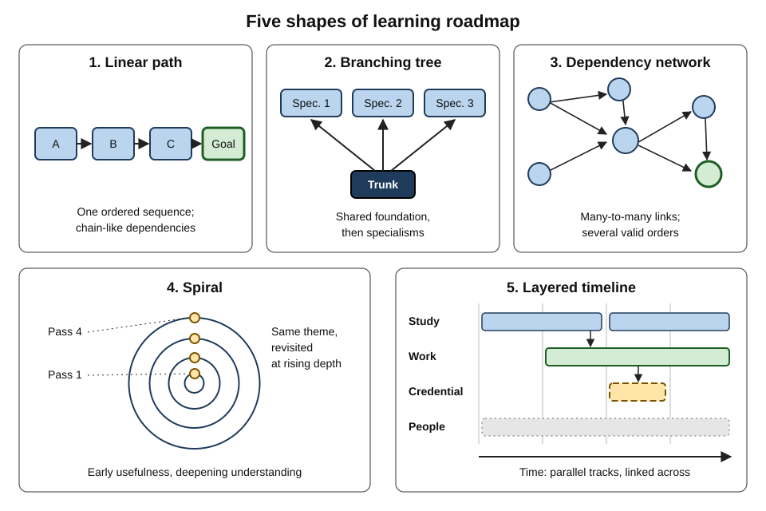
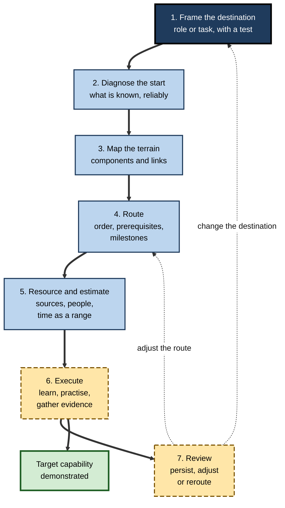

# A.1. What is a Learning Roadmap?

A graduate decides to "get into cybersecurity", opens a video platform and, six months later, has watched two hundred hours of tutorials without being able to investigate a single real alert.

A colleague with the same goal spends one evening sketching where she wants to be in a year, what that role actually does, which skills it rests on and in what order to build them — and checks herself every six weeks against a small, real task. Both learners worked hard. Only one had a **map of the territory and a route through it**.

> **Definition — Learning roadmap:** a structured representation of a route from a learner's current capability to a defined target capability, showing what must be learned, in what order, with which milestones of evidence along the way — treated as a working hypothesis to be revised as learning proceeds.

**Why the idea matters**

- **Most adult learning is self-planned.** Allen Tough's interviews with adults in the late 1960s found that the typical adult ran several deliberate learning projects a year, and that most were planned by the learners themselves rather than by a teacher.
- **Self-planning is hard.** Choosing what to learn, in what order and from which source is a skill in its own right — and novices are, by definition, poorly placed to judge an unfamiliar field.
- **Organisations depend on it.** Onboarding, reskilling, promotion readiness and professional licensing are all, at bottom, roadmaps that someone designed.
- **The modern problem is abundance, not scarcity.** When almost any subject has thousands of free courses, the bottleneck is no longer access to content but a sound **route** through it.

---

## The Core Idea

### A map and a route

A roadmap combines two things that are often confused.

- **The map** — a picture of the territory.
  - What the field contains: its skills, knowledge areas and tools.
  - How these relate: which depend on which, which cluster together.
  - It is largely the same for every learner entering that field.
- **The route** — one path across the map.
  - Chosen for **a particular learner**, starting from **their** current position and heading to **their** destination.
  - Two learners entering the same field may share the map but need different routes.

> **Key point:** a roadmap is not a list of everything in a field. It is a **selection and an ordering** made for a purpose.

### The eight elements of a roadmap

- **Destination** — the target capability, stated as what the learner will be able to *do*, under what conditions.
  - *e.g.* "Triage and document a phishing incident end to end in a security operations centre, without supervision."
- **Starting point** — an honest description of current capability.
  - *e.g.* "Comfortable with networking basics and Python; no security tooling."
- **Skill map** — the components of the destination and how they connect.
- **Sequence** — the order in which components will be built, respecting dependencies.
- **Milestones** — checkpoints defined by **evidence**, not by time spent or content consumed.
  - *e.g.* "Week 6: analyse three captured network traces and write up findings a reviewer accepts."
- **Resources** — the sources, practice environments and people for each stage.
- **Time** — an estimate of effort and calendar time, with a range rather than a single date.
- **Review rules** — when and how the roadmap will be checked and changed.

> **Mnemonic — "Do Smart Students Seek More Reliable Travel Routes?":** Destination, Starting point, Skill map, Sequence, Milestones, Resources, Time, Review.

**Figure 1.** The anatomy of a learning roadmap.

### What makes something a roadmap rather than a wish

- **A destination with a test.** "Get better at data" has no test; "build and explain a forecasting model a finance team adopts" does.
- **Dependencies, not just topics.** A topic list says *what*; a roadmap also says *what first, and why*.
- **Evidence-based milestones.** Each stage ends with something the learner can show or do.
- **A revision mechanism.** A roadmap with no review rule hardens into a schedule and is abandoned at the first surprise.

> **Watch out:** a long, colourful list of courses is not a roadmap. Without a destination, dependencies and evidence it is a **catalogue with ambitions** — and it tends to produce consumption rather than capability.

---

## Where the Idea Came From

The learning roadmap draws on four separate traditions, each of which contributed one part of the modern idea.

### Curriculum design

- **Franklin Bobbitt, *The Curriculum* (1918)**
  - Proposed **activity analysis**: study what competent adults actually do, then derive the learning needed to do it.
  - The first systematic attempt to work *backwards* from adult performance to a course of study.
- **Ralph Tyler, *Basic Principles of Curriculum and Instruction* (1949)** — four questions that still underpin curriculum design:
  1. What **purposes** should be attained?
  2. What **experiences** are likely to attain them?
  3. How should those experiences be **organised**?
  4. How can we **evaluate** whether the purposes are being attained?
- **Contribution to roadmaps:** destination first; content chosen to serve it; organisation and evaluation as explicit design decisions.

> **Key point:** Tyler's four questions map almost exactly onto a roadmap's destination, resources, sequence and milestones — a roadmap is, in effect, a **personal curriculum**.

### Technology roadmapping in industry

- **Motorola, 1970s:** under chief executive Robert Galvin, the company began drawing **technology roadmaps** — charts linking future products to the technologies they would need and the dates by which those technologies must be ready.
  - Described publicly by Charles Willyard and Cheryl McClees in 1987.
- **Industry-wide roadmaps:** the semiconductor industry coordinated research for decades through shared roadmaps setting out which capabilities were needed by which year.
- **Robert Phaal and colleagues at the University of Cambridge (early 2000s):** generalised the method into a layered chart.
  - Top layer — *why*: market and business purpose.
  - Middle layer — *what*: products and services.
  - Bottom layer — *how*: technologies and resources.
  - Time runs from left to right.
- **Contribution:** the word "roadmap" itself; the habit of linking **purpose → capability → enabling resources** over time.

### Games and skill trees

- **Strategy and role-playing games** popularised the **tech tree** and **skill tree** — a branching diagram in which a capability unlocks only once its prerequisites are acquired.
  - Sid Meier's *Civilization* (1991) made the technology tree familiar to millions of players.
- **Contribution:** an intuitive picture of **prerequisites and branching choices**, and the motivating sense of visible progress.

> **Watch out:** game skill trees are designed so that every node is equally achievable with enough play. Real fields are less tidy — some nodes are far harder than others, some prerequisites are soft, and the tree itself changes.

### Developer and practitioner roadmaps

- **From the 2010s:** practitioners began publishing **open roadmaps** for fields such as front-end development, data engineering and cloud architecture — large diagrams of what to learn and in what order.
  - Many are maintained by communities and revised as tools change.
- **Employers' role-based learning paths:** technology vendors and large employers publish sequenced collections of modules tied to a role or a certification.
- **Contribution:** roadmaps became **public, shared artefacts** — and with them came the risk of copying a route designed for someone else.

**Figure 2.** Four traditions that converged in the modern learning roadmap.

---

## A Roadmap Among Related Ideas

### Neighbouring artefacts

- **Goal** — a desired end state.
  - A roadmap *contains* a goal (its destination) but adds the route; how goals are chosen and framed is a separate question.
- **Curriculum** — the full designed programme of an institution or profession.
  - Usually built for a cohort, not an individual.
- **Syllabus** — the content and schedule of one course.
  - A single stage of a roadmap may *use* a syllabus.
- **Learning plan** — the near-term actions: this month's sessions, resources and deadlines.
  - A plan is a slice of a roadmap seen up close.
- **Individual development plan (IDP)** — a workplace document agreeing development goals and actions between an employee and a manager.
  - Often a roadmap in compressed form, with organisational commitments attached.
- **Competency framework** — an organisation's description of the capabilities required for roles at each level.
  - Supplies the *map*; a roadmap supplies the *route*.

| | Main question | Built for | Time span | Typical owner |
|---|---|---|---|---|
| **Goal** | Where do I want to be? | One person or team | Any | The learner |
| **Learning roadmap** | How do I get from here to there, in what order, and how will I know? | One learner or one role | Months to a few years | The learner, often with a mentor |
| **Curriculum** | What should everyone in this programme learn? | A cohort | A programme's length | An institution or profession |
| **Syllabus** | What does this course cover, when? | A class | One course | A teacher |
| **Learning plan** | What will I do this week and month? | One learner | Weeks | The learner |
| **Competency framework** | What does good look like in each role and level? | An organisation | Years | HR or a professional body |

**Figure 3.** How a roadmap relates to the artefacts around it.

### Roadmaps for oneself and for others

- **Personal roadmap** — designed by the learner for their own destination.
  - Strength: fits the learner's starting point, constraints and motives.
  - Weakness: the learner does not yet know the field, so the map may be wrong.
- **Prescribed roadmap** — designed by an expert, institution or employer for a role or cohort.
  - Strength: encodes experience of what actually works and what is required.
  - Weakness: ignores individual starting points; may serve the issuer's interests (a certification, a product).
- **Co-designed roadmap** — built by the learner with a mentor, manager or community.
  - Usually the strongest combination: expert knowledge of the terrain plus the learner's knowledge of themselves.

| | Personal | Prescribed | Co-designed |
|---|---|---|---|
| Knowledge of the field | Weak at first | Strong | Strong |
| Fit to the learner | Strong | Weak | Strong |
| Ownership and motivation | High | Variable | High |
| Risk | Wrong map, wasted effort | One-size-fits-none, vested interests | Depends on the adviser's quality |
| Best when | The field is familiar or small | Regulated roles, cohorts, onboarding | Unfamiliar fields, career moves |

> **In practice:** when entering an unfamiliar field, start from a reputable prescribed route, then **personalise** it: delete what is already known, add what the particular destination needs, and have an experienced practitioner review the result.

---

## Shapes of Roadmaps

Roadmaps differ in shape, and the shape should match the structure of the field.

- **Linear path** — a single ordered sequence of stages.
  - Suits fields with strong, chain-like dependencies.
  - *e.g.* learning to read music before sight-reading; double-entry book-keeping before financial statements.
- **Branching tree** — a common trunk, then specialisations.
  - Suits fields with shared foundations and divergent careers.
  - *e.g.* general software engineering fundamentals, then branches into front-end, back-end, data or security.
- **Dependency network** — many components with many-to-many dependencies, drawn as a graph.
  - Suits rich technical fields where several orders are valid.
  - *e.g.* machine learning, where probability, linear algebra, programming and data handling interlock.
- **Spiral** — the same core themes revisited at rising depth.
  - Suits fields where early simplified versions are useful and later refined.
  - *e.g.* a language learner meets the past tense first as a few phrases, later as a full system, later still in literary forms.
  - Rooted in Jerome Bruner's (1960) argument that any subject can be taught in an intellectually honest form at any stage, then revisited.
- **Layered timeline** — parallel tracks running across time, with links between them.
  - Suits roadmaps that combine knowledge, practice, credentials and relationships.
  - *e.g.* one track for study, one for on-the-job assignments, one for certification, one for networking.

**Figure 4.** Five common shapes of a learning roadmap.

| Shape | Field structure it fits | Main strength | Main risk |
|---|---|---|---|
| **Linear** | Chain-like dependencies | Simple, clear next step | False rigidity; boredom if early stages are known |
| **Branching tree** | Shared foundation, divergent specialisms | Defers specialisation sensibly | Branching too early or too late |
| **Network** | Many interlocking components | Honest about multiple valid orders | Overwhelming; hard to choose a next step |
| **Spiral** | Concepts deepen with revisiting | Early usefulness; durable understanding | Shallow loops if depth never increases |
| **Layered timeline** | Learning mixed with work, credentials and people | Integrates all routes to capability | Complexity; tracks drift apart |

> **Key point:** most mature roadmaps are **hybrids** — a network map underneath, a mostly linear route on top, spiralling back to core ideas, laid out on a timeline.

---

## Why Roadmaps Help — and What the Evidence Says

No experiment has randomised learners to "roadmap" versus "no roadmap" for a whole career. The case rests instead on several well-studied mechanisms that a good roadmap brings together.

### Mechanism 1 — Structure before detail

**Study card — David Ausubel (1960), advance organisers**

- **Design:** university students read a passage on the metallurgy of steel.
  - One group first read a short, abstract introduction showing how the new material related to ideas they already knew — an **advance organiser**.
  - A control group first read a historical passage of similar length.
- **Results:** the organiser group retained more of the passage on a later test.
- **Conclusion:** giving learners a framework *before* the detail helps them anchor new information.
- **Later evidence:** reviews of many subsequent studies found the average benefit to be **positive but small**, and larger when the organiser genuinely connects to prior knowledge.

> **Definition — Advance organiser:** introductory material, at a higher level of generality than the content that follows, that links new learning to what the learner already knows.

- **Link to roadmaps:** a roadmap is an advance organiser for an entire field — the learner always knows where the current lesson sits.

### Mechanism 2 — Clear targets direct effort

- **Goal-setting research** (Edwin Locke and Gary Latham, from the 1960s) consistently finds that specific, challenging goals improve performance more than vague "do your best" instructions — provided the person has the ability and commitment.
- A roadmap's destination and milestones turn one large, vague goal into a series of **specific, near-term targets**.
- **Proximal sub-goals** matter: in a classic study by Albert Bandura and Dale Schunk (1981), children working through a mathematics programme with near-term goals progressed faster and developed greater self-efficacy than those given only a distant goal.

### Mechanism 3 — Good sequencing reduces wasted load

- Material learned before its prerequisites is confusing and poorly retained.
- A roadmap that respects dependencies ensures each new idea has something to attach to — lowering the burden on **working memory**, the small, short-lived store in which new information is processed.

### Mechanism 4 — Novices choose poorly without structure

- **Learner-control research** — studies in which learners choose their own order, pace or content — has generally found **small or no average benefit**, and sometimes harm for low-prior-knowledge learners.
- **Why:** novices cannot yet judge what they need; they skip what feels hard and linger on what feels fluent.
- Kirschner, Sweller and Clark (2006) argued more broadly that minimally guided instruction is less effective for novices than guided instruction.

> **Key point:** the case for roadmaps is strongest for **novices in unfamiliar fields** — precisely the learners least able to build one alone. For experts extending their own field, a light roadmap is usually enough.

### Mechanism 5 — Visible progress sustains motivation

- **Teresa Amabile and Steven Kramer's** study of knowledge workers' daily diaries found that making progress in meaningful work was the event most strongly associated with positive inner work life.
- Milestones make progress **visible** over months in which day-to-day improvement is imperceptible.

> **Watch out:** the popular claim that "too many choices paralyse people" — often illustrated by a famous supermarket jam-tasting study (Iyengar and Lepper, 2000) — is weaker than usually stated. A later meta-analysis of choice-overload experiments found an average effect close to zero, with large variation between studies. Abundant learning resources may overwhelm some learners in some conditions; it is not a universal law.

### Where roadmaps can harm

- **Planning as procrastination** — elaborate roadmap-building feels productive but replaces learning.
- **False linearity** — a neat sequence hides the fact that real learning loops back.
- **Rigidity** — a learner sticks to an obsolete route because "it is in the plan".
- **Borrowed destinations** — following a popular roadmap for a role the learner does not actually want.
- **Content-counting** — milestones defined as "finished course X" reward attendance, not capability.

> **Remember:** a roadmap earns its keep only if it leads to **more and better practice**, sooner. If building it takes longer than a small fraction of the learning it organises, it has become the work rather than the guide.

---

## How a Roadmap Is Built and Used

### The roadmap life cycle

1. **Frame** the destination — a role, task or capability with a test of success.
2. **Diagnose** the starting point — what is already known, and how reliably.
3. **Map** the terrain — the components of the destination and their relationships.
4. **Route** — choose and order components; identify prerequisites; choose milestones.
5. **Resource and estimate** — select materials, practice settings and people; estimate time as a range.
6. **Execute** — learn, practise, and gather evidence at each milestone.
7. **Review** — at fixed intervals and at milestone results, decide to persist, adjust or reroute.

**Figure 5.** The life cycle of a learning roadmap.

### Properties of a good roadmap

- **Destination-led** — every element can be traced to the target capability.
- **Starting-point aware** — no time spent relearning what is already secure.
- **Dependency-respecting** — prerequisites before what depends on them, but no unnecessary gatekeeping.
- **Practice-heavy** — real tasks appear early and often, not only at the end.
- **Evidence-gated** — milestones are demonstrations, judged against a criterion.
- **Time-honest** — estimates as ranges, with slack for life.
- **Light enough to revise** — one page, or a small diagram, rather than a hundred-row spreadsheet.
- **Reviewed** — a fixed cadence and clear triggers for change.

> **Remember — the two-question test:** for every item on the roadmap, ask *"which part of the destination does this serve, and how will I know it worked?"* An item that fails both questions should be cut.

### Worked example (illustrative): from intention to roadmap skeleton

- **Situation:** Ravi, a network support engineer, says, "I want to get into cybersecurity."

1. **Frame the destination.**
   - Vague: "get into cybersecurity".
   - Framed: "Within 12–18 months, work as a junior security operations analyst: triage alerts, investigate phishing and malware incidents, and write incident reports a senior accepts."
2. **Diagnose the start.**
   - Secure: networking (routing, DNS, firewalls), Windows administration, basic scripting.
   - Missing: security monitoring tools, log analysis, attack techniques, incident handling procedures.
3. **Map the terrain** (from job advertisements, a role framework and two practising analysts):
   - security foundations; log and network-traffic analysis; endpoint investigation; common attack patterns; the incident-handling process; report writing.
4. **Route.**
   - Foundations and attack patterns first, because investigation makes no sense without knowing what is being looked for.
   - Log analysis and traffic analysis in parallel, since Ravi's networking background makes traffic analysis a quick win.
   - Incident handling and reporting last, combined in realistic simulated incidents.
5. **Milestones.**
   - Month 2: explain ten common attack techniques and the evidence each leaves, from memory.
   - Month 4: investigate three practice incidents in a lab environment; reports reviewed by a practising analyst.
   - Month 7: a recognised entry-level security certification, chosen because local job advertisements request it.
   - Month 9–12: shadow or join the employer's security team on real alerts.
6. **Resources and time.** One structured course as the spine, a hands-on lab platform for practice, a mentor for monthly report reviews; roughly 6–8 hours a week, giving a 12–18-month range.
7. **Review.** Every six weeks, and after every milestone.

| | Before | After |
|---|---|---|
| Destination | "Get into cybersecurity" | Junior SOC analyst, with stated tasks |
| Content | Whatever the platform recommends | Six components, chosen from role evidence |
| Order | Random | Dependencies first; strengths exploited early |
| Progress measure | Hours watched | Reviewed investigations, a credential, real alerts |
| Revision | None | Six-weekly and at each milestone |

> **Watch out:** the most common error is building step 3 from a single popular online roadmap. Such diagrams often list everything a field contains; the destination role may need a third of it.

---

## Roadmaps at Work

### Role-based learning paths

> **Definition — Role-based learning path:** a sequenced set of learning activities that an organisation designs to bring people to competence in a specific role.

- **Common forms:**
  - **onboarding paths** — the first 30, 60 and 90 days in a role;
  - **certification paths** — modules leading to a vendor or professional credential;
  - **promotion-readiness paths** — capabilities required before stepping up a level.
- **Typical contents:** formal modules, assigned practice tasks, shadowing, a mentor, assessment points and sign-off by a manager or assessor.

### Competency-based progressions

> **Definition — Competency-based progression:** advancement determined by demonstrated mastery of defined competencies rather than by time served or courses attended.

- **Examples:**
  - in many health professions, trainees are progressively entrusted with clinical activities as they demonstrate readiness;
  - digital-skills frameworks such as the **Skills Framework for the Information Age (SFIA)** describe around 150 professional skills across **seven levels of responsibility**, giving employers a shared language for progressions;
  - career ladders in engineering and consulting define what is expected at each grade.

| | Role-based learning path | Competency-based progression |
|---|---|---|
| Organising unit | A role or job family | A competency and its proficiency levels |
| Progression trigger | Completing the path's activities and assessments | Demonstrating each competency to a standard |
| Pace | Often fixed for a cohort | Individual — faster or slower as evidence allows |
| Strength | Simple to deliver at scale | Rewards capability, not attendance |
| Weakness | Can become box-ticking | Expensive to assess well; frameworks age |

### What organisations get wrong

- **Paths built from catalogues, not roles** — assembling every available module tagged with a role's name.
- **Completion as the metric** — dashboards show percentage completed, not capability gained.
- **No starting-point diagnosis** — experienced hires sit through the same path as graduates.
- **No link to real work** — the path ends, and the first real task arrives months later.

### Case study (illustrative): replacing a course catalogue with a roadmap

- **Situation:** a mid-sized consulting firm gave new data analysts access to a library of several hundred online courses and asked them to "build their skills" in the first three months.
- **Problem:**
  - analysts sampled widely and finished little;
  - project managers reported that new analysts could not yet clean a client data set or explain their own results;
  - the most confident analysts completed the most courses but were not the most capable.
- **Diagnosis:** abundant content, no destination, no sequence, no evidence-based milestones — and completion counts rewarded consumption.
- **Actions:**
  1. Defined the destination as three real tasks: clean and document a messy client data set; produce a reproducible analysis; present findings to a non-technical manager.
  2. Asked three senior analysts what a new analyst most often gets wrong; built the map from their answers and from actual project tasks.
  3. Cut the path to **eleven** modules in a fixed order, each followed by a practice task drawn from anonymised past projects.
  4. Added a short diagnostic at entry so that people could test out of modules they had already mastered.
  5. Replaced completion tracking with three milestone reviews by a senior analyst.
- **Result:** within two intakes, project managers reported that new analysts reached useful independence noticeably sooner; course completion fell, as intended, because people skipped what they already knew.
- **Side effects:** senior analysts' review time had to be protected in their objectives; the practice tasks needed refreshing each year.
- **Lesson:** a roadmap's value lies in **selection, order and evidence**, not in the volume of content behind it.

---

## Roadmaps in the Age of Abundant Content and AI

- **Abundance shifts the scarce resource** from content to **curation, sequencing and verification**.
- **Generated roadmaps** — AI assistants can now produce a plausible roadmap for almost any field in seconds.
  - Useful as a first draft of the **map**.
  - Weak on the **route**: they know little about the learner's starting point, local job market or constraints unless told, and may present outdated or invented resources.
- **Personalised platforms** sequence content adaptively, but optimise for what they can measure — usually quiz performance and engagement.
- **What remains human:** choosing a destination worth reaching, judging which evidence counts, and noticing when the destination itself should change.

> **In practice:** use generated or published roadmaps as **raw material**, then test them against three sources of reality: job or role evidence, practitioners' judgement, and the learner's own diagnostic results.

---

## Open Questions

- **Do roadmaps measurably improve self-directed learning outcomes?**
  - The supporting mechanisms are well studied, but there are few controlled studies of roadmap use itself over months or years.
- **How much structure is optimal, and for whom?**
  - Novices appear to need more guidance; how quickly structure should be withdrawn as expertise grows is unclear.
- **Can shared roadmaps keep pace with fast-changing fields?**
  - Community roadmaps are updated irregularly; their accuracy over time has not been systematically studied.
- **How should a roadmap balance a known destination with openness to discovery?**
  - Careers often change direction through unplanned opportunities; tight roadmaps may miss them, loose ones may drift.
- **What will AI-assisted personalisation do to roadmap quality?**
  - It may tailor routes well, or it may optimise for measurable but shallow targets; evidence is only emerging.

---

## Summary

- A **learning roadmap** is a structured, revisable route from current to target capability: what to learn, in what order, with which **evidence-based milestones**.
- It combines a **map** (the field's terrain, largely shared) with a **route** (one learner's path).
- Its eight elements: **Destination, Starting point, Skill map, Sequence, Milestones, Resources, Time, Review**.
- The idea draws on **curriculum design** (Bobbitt, Tyler), **technology roadmapping** (Motorola, Cambridge), **game skill trees** and **open practitioner roadmaps**.
- A roadmap differs from a goal, curriculum, syllabus, learning plan and competency framework; it can be **personal, prescribed or co-designed**.
- Common shapes: **linear, branching tree, network, spiral, layered timeline** — usually combined.
- Supporting mechanisms: **advance organisers**, specific and proximal goals, dependency-respecting sequencing, guidance for novices, visible progress. Choice-overload claims are **contested**.
- Risks: planning as procrastination, false linearity, rigidity, borrowed destinations, content-counting.
- At work, roadmaps appear as **role-based learning paths** and **competency-based progressions**; both fail when completion replaces capability.
- In an age of abundant content and AI, the scarce skills are **curation, sequencing and verification**.

---

## Self-Check

1. Define a learning roadmap and explain why "treated as a working hypothesis" belongs in the definition.
2. Distinguish the map from the route. Why can two learners share one but not the other?
3. List the eight elements of a roadmap.
4. What did Tyler's four questions contribute to the idea of a roadmap?
5. How does a roadmap differ from a learning plan and from a competency framework?
6. Name five shapes of roadmap and the field structure each suits.
7. Describe Ausubel's advance-organiser study and its relevance to roadmaps.
8. Why is the case for roadmaps strongest for novices?
9. What does the evidence say about choice overload, and why does it matter here?
10. Give four ways a roadmap can do harm.
11. Distinguish a role-based learning path from a competency-based progression.
12. A friend shows you a 120-item online roadmap for "becoming a data scientist" and plans to work through it in order. What would you advise?
13. An organisation reports that 94% of new hires completed their onboarding path. Why is this weak evidence, and what should be measured instead?
14. Design a roadmap skeleton (destination, three components, two milestones, review rule) for a teacher who wants to become an instructional designer.

### Answer Key

1. A structured representation of a route from current to target capability — what to learn, in what order, with evidence-based milestones. "Working hypothesis" matters because the learner's knowledge of the field, their circumstances and the field itself change; a roadmap that cannot be revised becomes obsolete or is abandoned.
2. The map is the field's terrain — its components and relationships — and is largely common to everyone entering the field. The route depends on each learner's starting point, destination and constraints, so it differs between learners.
3. Destination, Starting point, Skill map, Sequence, Milestones, Resources, Time, Review.
4. They established destination-first design (purposes), deliberate choice of experiences (resources and activities), explicit organisation (sequence) and built-in evaluation (milestones).
5. A learning plan is a near-term slice — this week's and month's actions. A competency framework describes what capability looks like for roles and levels (the map); the roadmap is a chosen route through it for a particular learner or role.
6. Linear — chain-like dependencies; branching tree — shared foundation then specialisms; network — interlocking components with several valid orders; spiral — concepts deepened by revisiting; layered timeline — learning combined with work, credentials and relationships.
7. Students given a short, abstract introduction linking new material on steel metallurgy to known ideas retained more than a control group. Later reviews found small average benefits. A roadmap acts as an organiser for a whole field, letting the learner place each new piece.
8. Novices cannot yet judge what they need or in what order; learner-control research shows little benefit from unguided choice, especially at low prior knowledge. Experts can self-direct with lighter structure.
9. A famous study suggested too many options reduce choice, but a meta-analysis found an average effect near zero with large variation. Abundance may overwhelm some learners sometimes, but "choice paralysis" should not be assumed as a law.
10. Any four of: planning replacing learning; false linearity; rigidity in the face of change; borrowed destinations; milestones defined by content completion.
11. A role-based path is a sequence of activities for a role, usually completed as a cohort; a competency-based progression advances people when they demonstrate defined competencies to a standard, at individual pace.
12. Frame a concrete destination first (which data role, which tasks); diagnose what is already known; cut the list to what that destination requires; reorder by dependencies; insert real projects early; define evidence-based milestones; have a practitioner review it; set a review cadence.
13. Completion measures attendance, not capability; it rewards consumption and may reflect pressure to click through. Measure instead delayed, unaided performance on real tasks, time to independent productivity, manager and reviewer judgements at milestones, and early-career quality indicators.
14. For example: destination — within a year, design and evaluate a short e-learning module that a corporate client adopts; components — learning-needs analysis, instructional design models and evidence-based practice, authoring tools and evaluation; milestones — month 3: a needs analysis and design document reviewed by a practising designer; month 8: a complete pilot module with learner feedback and a delayed knowledge check; review — every six weeks and after each milestone.

---

## Glossary

| Term | Meaning |
|---|---|
| Activity analysis | Bobbitt's method of deriving curriculum from what competent adults actually do. |
| Advance organiser | Introductory material that links new learning to existing knowledge before the detail. |
| Branching tree | A roadmap shape with a common trunk that divides into specialisms. |
| Co-designed roadmap | A roadmap built by the learner together with a mentor, manager or community. |
| Competency-based progression | Advancement based on demonstrated mastery rather than time or attendance. |
| Competency framework | An organisation's description of capabilities required for roles at each level. |
| Curriculum | The full designed programme of learning for a cohort. |
| Dependency network | A roadmap shape showing many-to-many prerequisite relationships as a graph. |
| Destination | The target capability of a roadmap, stated as what the learner will be able to do. |
| Individual development plan | A workplace document agreeing an employee's development goals and actions. |
| Layered timeline | A roadmap shape with parallel tracks over time, such as study, work and credentials. |
| Learner control | Allowing learners to choose their own content, order or pace. |
| Learning plan | The near-term actions within a roadmap. |
| Learning roadmap | A structured, revisable route from current to target capability with evidence-based milestones. |
| Map (of a field) | A representation of a field's components and their relationships. |
| Milestone | A checkpoint on a roadmap defined by evidence of capability. |
| Prescribed roadmap | A roadmap designed by an expert, institution or employer for a role or cohort. |
| Proximal sub-goal | A near-term goal on the way to a distant one. |
| Role-based learning path | An organisation's sequenced learning activities for a specific role. |
| Route | One chosen path across a field's map for a particular learner. |
| Skill tree | A branching diagram in which capabilities unlock once prerequisites are acquired. |
| Spiral roadmap | A roadmap that revisits core themes at increasing depth. |
| Syllabus | The content and schedule of a single course. |
| Technology roadmap | An industrial chart linking future products to required technologies over time. |
| Working memory | The limited, short-lived store in which new information is processed. |
