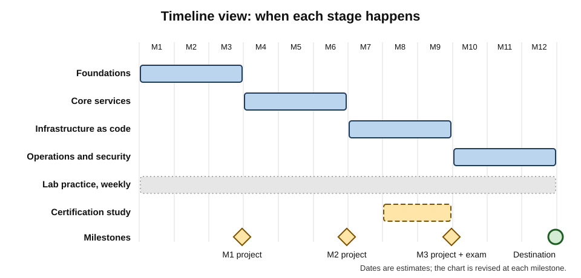
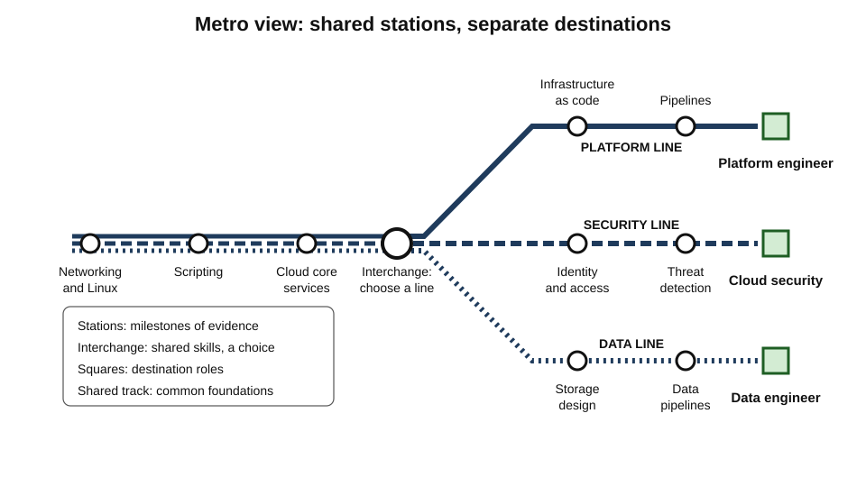
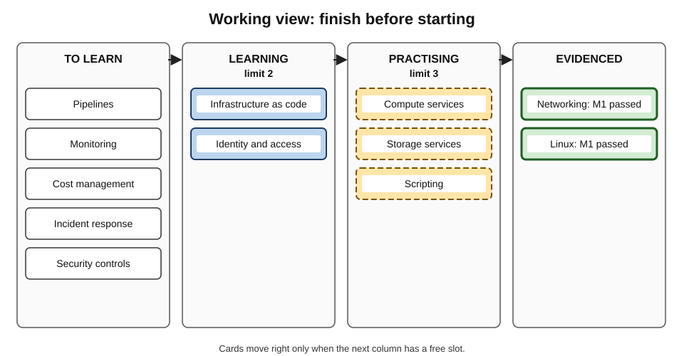
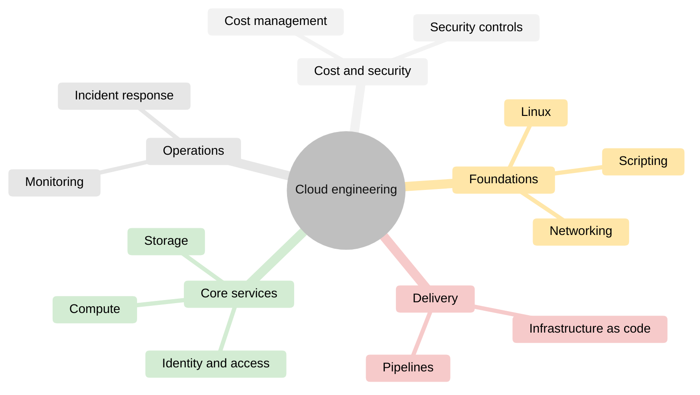
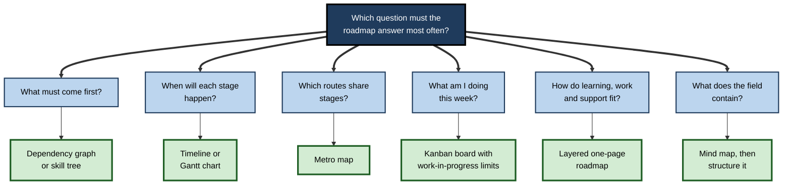
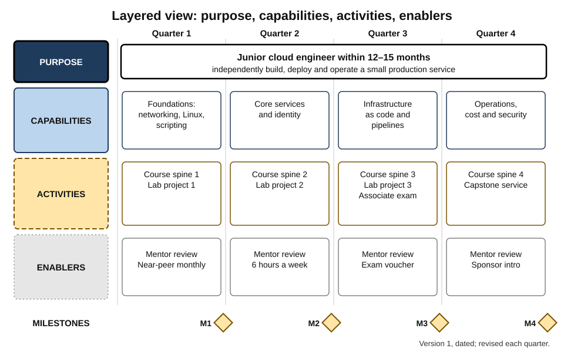

# C.10. Visual Roadmap Tools and Templates

The same learning roadmap can live in a sixty-row spreadsheet or on a single page. In the spreadsheet, the learner scrolls past dates, links and status columns and cannot say, at a glance, what comes next or what is blocking progress. On the single page — a few tracks, a handful of milestones, the destination at the right — a mentor can review it in two minutes and the learner can see where they are while making coffee. The content is identical; the **representation** decides whether the roadmap is used.

> **Definition — Visual roadmap:** a graphical representation of a learning roadmap that shows its destination, components, sequence, dependencies, timing and progress so that they can be grasped, discussed and revised at a glance.

> **Definition — Roadmap template:** a reusable, pre-structured format with defined sections or fields that guides the construction of a roadmap and makes roadmaps comparable.

**Why it matters**

- **A roadmap that is not looked at does not guide.** Visibility drives use; use drives revision.
- **Different formats answer different questions** — "what next?", "what depends on what?", "when?", "how far have I come?"
- **Visual roadmaps are communication tools** — for mentors, managers and teams as much as for the learner.
- **Templates spread good practice.** A template that requires a destination, evidence-based milestones and a review date makes those elements hard to forget.

---

## Why Diagrams Help — Sometimes

**Study card — Jill Larkin and Herbert Simon (1987), "Why a diagram is (sometimes) worth ten thousand words"**

- **Question:** when, and why, are diagrams more useful than text that contains the same information?
- **Analysis:** compared sentential (text) and diagrammatic representations of the same problems in physics and geometry.
- **Findings — diagrams help when they:**
  - **group information by location**, so that everything about one element is in one place;
  - **reduce search**, because related items are adjacent rather than scattered through text;
  - **support perceptual inference** — relationships can be *seen* (above, next to, connected) rather than worked out.
- **The qualification in the title:** a diagram helps only if it is designed so that the **information needed for the task** is grouped and visible.
- **Conclusion:** two representations can be informationally equivalent but **computationally** very different.

> **Key point:** choose a format by asking **which question the roadmap must answer most often** — and make the answer visible without search.

### Principles of visual grouping

- **Gestalt principles** — described by early twentieth-century German psychologists — explain how people group visual elements:
  - **proximity** — items near each other are seen as related;
  - **similarity** — items alike in shape or style are seen as a group;
  - **enclosure** — items inside a boundary are seen as belonging together;
  - **connection** — items joined by lines are seen as linked.
- **Use in roadmaps:** stages enclosed in boxes; milestones in one consistent shape; dependencies as connecting lines; tracks as horizontal bands.

---

## Formats for Visual Roadmaps

### Ordered list

- **What it shows:** sequence, simply.
- **Best for:** short, linear roadmaps; the near-term horizon.
- **Weakness:** hides dependencies, parallel work and time.

### Timeline and Gantt chart

- **What it shows:** when each stage happens, its duration, and which run in parallel.
- **Origins:** the bar chart of activities against time is named after **Henry Gantt**, who developed versions in the 1910s; the Polish engineer **Karol Adamiecki** had devised a similar chart, the harmonogram, in the 1890s.
- **Best for:** fixed-date commitments — examinations, start dates, cohort programmes.
- **Weakness:** implies false precision; discourages revision because moving bars feels like failure.

**Figure 1.** A timeline roadmap with parallel stages and milestones.

### Layered roadmap

- **What it shows:** several parallel tracks over time, with links between layers.
- **Origin:** industrial technology roadmapping, particularly the layered charts developed by Robert Phaal and colleagues at Cambridge — *why* at the top, *what* in the middle, *how* at the bottom.
- **Learning adaptation:**
  - **Purpose** — the destination and why it matters;
  - **Capabilities** — skills to be built, by stage;
  - **Activities** — study, practice, projects;
  - **Enablers** — resources, people, credentials, time.
- **Best for:** one-page summaries for mentors and managers; roadmaps that combine learning with work and relationships.

### Dependency graph

- **What it shows:** which components require which others, as nodes and arrows.
- **Best for:** technical fields with rich prerequisite structure; identifying the critical path.
- **Weakness:** becomes unreadable beyond a few dozen nodes; shows order constraints but not time.

### Skill tree

- **What it shows:** capabilities branching from a trunk, unlocked as prerequisites are met.
- **Best for:** fields with a shared foundation and many specialisms; motivating visible progress.
- **Weakness:** forces every skill into one place in a hierarchy.

### Metro map

- **What it shows:** routes as coloured or patterned lines, milestones as stations, shared skills as interchanges.
- **Origin of the idea:** **Harry Beck's** London Underground diagram (first published in 1933) abandoned geographical accuracy in favour of **topology** — what connects to what, in what order — with straight lines and regular spacing. It became the model for transit maps worldwide.
- **Best for:** showing several specialisms or routes that share early stations; career-path options within an organisation.

**Figure 2.** A metro-map roadmap: specialist lines sharing foundation stations.

### Kanban board

- **What it shows:** the current state of work items in columns — for learning, typically *to learn*, *learning*, *practising*, *evidenced*.
- **Origin:** the kanban (Japanese for "signboard" or "card") system of production control at Toyota, adapted for knowledge work by David Anderson and others in the 2000s.
- **Key idea — work-in-progress limits:** capping how many items may sit in a column at once, so that work is finished before more is started.
- **Best for:** the near-term horizon; preventing too many parallel resources and topics.

**Figure 3.** A kanban board for learning, with work-in-progress limits.

> **In practice:** a work-in-progress limit of **one or two** items in "learning" puts the rule "one spine at a time" into visual form.

### Now–next–later

- **What it shows:** three horizons without dates — what is being done now, what comes next, what is planned later.
- **Origin:** a format common in product management, used to avoid committing to dates that cannot be known.
- **Best for:** fast-changing fields and roadmaps under frequent revision.

### Mind map

- **What it shows:** a central topic with radiating branches of subtopics.
- **Popularised** by Tony Buzan from the 1970s.
- **Best for:** the **exploration** stage — brainstorming what a field might contain before structuring it.
- **Weakness:** shows no sequence, time, dependency or progress — it is a map, not a route.

**Figure 4.** A mind map used to explore a field before a route is chosen.

| Format | Shows sequence | Shows time | Shows dependencies | Shows progress | Best question answered |
|---|---|---|---|---|---|
| **Ordered list** | Yes | No | No | Partly | "What is the order?" |
| **Timeline / Gantt** | Yes | Yes | Partly | Partly | "When will each stage happen?" |
| **Layered roadmap** | Yes | Yes | Across layers | Partly | "How do learning, work and support fit together?" |
| **Dependency graph** | Implied | No | Yes | Partly | "What must come first?" |
| **Skill tree** | Implied | No | Yes | Yes | "What can I unlock next?" |
| **Metro map** | Yes | No | Shared stations | Yes | "Which routes share which stages?" |
| **Kanban board** | No | No | No | Yes | "What am I working on now?" |
| **Now–next–later** | Coarse | Coarse | No | Partly | "What is current, upcoming, later?" |
| **Mind map** | No | No | No | No | "What does the field contain?" |

> **Key point:** most good roadmaps use **two formats**: a one-page **overview** (layered, metro or timeline) for direction, and a **working view** (kanban or a short ordered list) for the coming weeks.

---

## Choosing a Format

**Figure 5.** Choosing a roadmap format from the question it must answer.

- **By audience:**
  - **the learner, daily** → kanban or short list;
  - **a mentor, monthly** → one-page layered or metro map, plus recent evidence;
  - **a manager or sponsor** → one-page layered roadmap with milestones and support needed;
  - **a team** → shared skills matrix plus individual one-page roadmaps.
- **By field:**
  - **highly cumulative technical fields** → dependency graph underneath, timeline on top;
  - **fast-changing fields** → now–next–later;
  - **fields with many specialisms** → skill tree or metro map.

---

## Designing a Roadmap Visual Well

### Principles

- **One page for the overview.** If it does not fit on one page, it has too much detail for an overview.
- **Destination always visible** — as the right-hand edge, the top of the tree or the terminus of every line.
- **Core distinct from optional** — through position, border or label, not only colour.
- **Milestones in a consistent, distinctive shape** — so that evidence points stand out from activities.
- **Progress shown** — completed, in progress, not started — using fill or marks.
- **Labels on the elements themselves** — no reliance on separate legends where direct labels are possible.
- **Version and date** — every roadmap visual carries the date it was last revised.

> **Watch out:** colour alone is a poor carrier of meaning. Red–green colour vision deficiency affects roughly **one man in twelve** of Northern European ancestry (fewer women), and colour disappears entirely on many printers and screens set to save ink or power. Use **shape, position, pattern and text**, with colour as reinforcement.

### Limiting what is shown

- **Working memory is small.** George Miller's (1956) famous "seven, plus or minus two" has since been revised downwards — Nelson Cowan (2001) argued that about **four** chunks is a more realistic capacity.
- **Practical rule:** group the roadmap into roughly **three to six** stages or tracks, each with a handful of items; push detail into a linked working view.
- **Edward Tufte**, in *The Visual Display of Quantitative Information* (1983), argued for maximising the **data-ink ratio** — the share of ink that conveys information — and against **chartjunk**, decoration that carries none.

> **Mnemonic — "ONE PAGE":** **O**verview on one page; **N**amed destination; **E**vidence milestones distinct; **P**rogress shown; **A**ccessible without colour; **G**rouped into few stages; **E**dition dated.

---

## Tools

| Tool type | Strengths | Weaknesses | Best for |
|---|---|---|---|
| **Paper, whiteboard, sticky notes** | Fast; flexible; highly visible if kept in sight | Hard to share and version | First drafts; workshops with a mentor |
| **Spreadsheets** | Universal; sortable; easy to add fields | Poor at showing structure; becomes a wall of rows | Detailed component lists, estimates |
| **Diagramming software** | Any format; good-looking overviews | Manual updating; diagrams drift from reality | One-page overviews, metro maps |
| **Task and project boards** | Natural kanban; progress tracking | Encourage task lists over capability | Working views for the near term |
| **Note and knowledge tools** | Link roadmap to notes and resources | Structure can sprawl | Roadmaps linked to study material |
| **Text-to-diagram languages** | Diagrams written as text; easy to version and share | Requires learning a syntax | Technical learners; shared roadmaps under version control |
| **Organisational learning platforms** | Assigned paths, tracking at scale | Completion-centred; limited personal control | Role-based paths in organisations |

> **Remember:** the best tool is the one that keeps the roadmap **visible and current with least effort**. Elaborate tools that are opened once a month are worse than a sheet of paper on the wall.

---

## Templates

### The one-page learning roadmap

A template whose sections force the essential elements:

- **Destination** — the target capability as a task and a standard; target date as a range.
- **Starting point** — three to five lines of what is already secure.
- **Stages** — three to six, each with:
  - its purpose;
  - its components;
  - its **milestone** (evidence, criterion, judge);
  - an estimated duration range.
- **Support** — named mentor, near-peer, reviewer; key resources.
- **Constraints and risks** — time available, known obstacles.
- **Review rules** — cadence, tripwires.
- **Version** — date and a one-line note of the last change.

### The milestone card

- **Milestone** — short name.
- **Evidence** — what will be produced or performed.
- **Criterion** — the standard that counts as success.
- **Conditions** — help allowed, time limits, setting.
- **Judge** — who or what decides.
- **Target date** — and actual date.
- **Result** — passed, partly, not yet.
- **Next decision** — what the result changes.

### The quarterly layered roadmap

- **Columns:** the next four quarters.
- **Rows:** purpose; capabilities; activities; enablers.
- **Links:** arrows from enablers to activities to capabilities to purpose.

### The weekly working board

- **Columns:** to learn → learning (limit 2) → practising (limit 3) → evidenced.
- **Cards:** one per component or practice item, linked to the stage it serves.

**Figure 6.** A one-page layered learning roadmap built from the quarterly template.

> **Watch out:** templates can become forms to fill rather than thinking tools. A template completed in ten minutes without a real destination or real milestones looks like a roadmap and functions as none.

---

## Worked Example: From Spreadsheet to Two Views

- **Situation:** Marco, a support engineer moving into cloud engineering, keeps his roadmap in a spreadsheet of 64 rows — every topic from a community roadmap, each with a status and a link. He rarely opens it and cannot say what he is working on.

1. **Diagnose:** the spreadsheet answers no question quickly; core and optional items look identical; there are no milestones, only topics.
2. **Explore first:** he redraws the field as a mind map (Figure 4) to see its main branches.
3. **Build the overview** as a one-page layered roadmap:
   - **Purpose:** junior cloud engineer within 12–15 months.
   - **Capabilities by quarter:** foundations (Q1); core services and identity (Q2); infrastructure as code and pipelines (Q3); operations, cost and security (Q4).
   - **Activities:** one course spine per quarter; a lab project per quarter; a vendor associate-level certification in Q3.
   - **Enablers:** a mentor reviewing each project; six hours a week; a near-peer monthly.
   - **Milestones:** one per quarter, each a reviewed project.
4. **Build the working view** as a kanban board with limits: two items in "learning", three in "practising".
5. **Prune:** 64 rows become **18 components** on the overview; the remaining 46 are moved to a "later, if needed" list.
6. **Version:** the overview carries "v1, 3 March"; each quarterly review produces a new version.

| | Spreadsheet | Two views |
|---|---|---|
| Items visible | 64, equal weight | 18 on the overview; 4–5 on the board |
| What next? | Unclear | Visible on the board |
| Milestones | None | One reviewed project per quarter |
| Mentor review time | Too long to attempt | Two minutes |
| Revision | Rare | Quarterly, versioned |

- **Conclusion:** no new information was added; the change was in **selection and representation**.

> **Watch out:** Marco was tempted to spend a weekend building an elaborate interactive dashboard. The roadmap needed **pruning**, not more tooling.

---

## Case Study: Replacing a Competency Document With Role Roadmaps

- **Situation:** a software company's engineering career framework was a 40-page document describing five levels across nine competencies.
- **Problem:**
  - engineers and managers rarely consulted it outside promotion season;
  - development conversations stayed vague ("work on your impact");
  - engineers could not see what to learn next or how roles connected.
- **Actions:**
  1. For each level transition, the framework team produced a **one-page layered roadmap**: purpose of the next level, three to five capabilities that most distinguish it, typical activities and assignments, and evidence examples.
  2. A **metro map** showed the routes from mid-level engineer to staff engineer, engineering manager and specialist architect, with shared stations.
  3. Each engineer kept a **personal one-page roadmap** using the same template, reviewed with their manager quarterly.
  4. The full document remained as reference.
- **Result:** managers reported more specific development conversations; engineers referred to the one-page roadmaps in one-to-ones; promotion cases cited evidence more consistently, by the framework team's review.
- **Side effects:** the one-pagers simplified some nuances of the full framework; disagreements arose over which capabilities were "most distinguishing".
- **Lesson:** a **representation** designed for the question people actually ask — "what should I work on next to grow?" — changed behaviour more than additional content.

---

## Visual Roadmaps for Teams and Organisations

### Team views

- **Shared skills matrix** — people as rows, critical skills as columns, proficiency in each cell; shows single points of failure and cross-training needs at a glance.
- **Team learning roadmap** — a layered roadmap for capabilities the **team** must build together, such as adopting a new platform, with individual roadmaps linked to it.
- **Guild or chapter roadmaps** — roadmaps maintained by a community of practice for a discipline across teams, revised by members.

### Organisational views

- **Role-family metro maps** — showing how roles connect and which capabilities form the shared stations between them; useful for internal mobility.
- **Programme timelines** — cohort-based paths with fixed dates for intakes, assessments and certifications.
- **Portfolio views for learning teams** — which roles have current, owned, recently reviewed roadmaps, and which are stale.

| | Personal roadmap view | Team or organisational view |
|---|---|---|
| Main question | "What should I learn next?" | "Where are our capability gaps and routes?" |
| Typical format | One-page layered roadmap plus kanban | Skills matrix, metro map, programme timeline |
| Owner | The learner | Team lead, guild or learning function |
| Main risk | Neglect | Surveillance; ratings used for unintended purposes |
| Update rhythm | Weekly working view, quarterly overview | Quarterly or with each role change |

> **Watch out:** a team skills matrix can feel like surveillance. Agree in advance what it is for (planning cover and development), who sees it, and that it will **not** be used directly in performance ratings — otherwise people inflate their entries and the matrix becomes useless.

### Text-based and versioned roadmaps

- **Roadmaps written as structured text** — for example in a diagram language or a simple outline — can be stored under **version control**, compared between versions and edited by several people.
- **Advantages:**
  - every change is recorded with a date and reason;
  - a team can propose and review changes;
  - the same source can generate several views.
- **Limit:** the learner must be comfortable with the syntax; for most people a one-page document with a dated version line achieves the same purpose.

> **In practice:** whatever the tool, keep **one source** for the roadmap and generate or update the views from it. Two independently edited copies drift apart within weeks.

---

## Pitfalls

- **Decoration over function** — attractive visuals that hide what matters.
- **Too many views** — five versions of the roadmap in five tools, none current.
- **False precision** — dates on a Gantt chart treated as commitments rather than estimates.
- **Tool tinkering** — redesigning the roadmap's format instead of learning.
- **Invisible location** — a roadmap stored where it is never seen.
- **Overview overload** — every topic on the one-page view.

> **Remember:** a roadmap visual is good when the learner can answer, within ten seconds, **where am I going, where am I now, and what is next?**

---

## Open Questions

- **Which formats improve learning outcomes, not only planning?**
  - Research on diagram comprehension is strong; studies of roadmap formats and actual learning progress are scarce.
- **Do visible progress representations motivate or distort?**
  - Progress visuals can sustain effort, but may reward easily countable items over capability.
- **How should AI-generated roadmap visuals be judged?**
  - Tools can generate polished diagrams instantly; polish may hide poor selection and sequencing.
- **Can shared templates make roadmaps comparable across organisations?**
  - Common templates could support mobility and recognition; few standards exist.
- **What is the right level of detail for different audiences?**
  - Practitioners use rules of thumb; there is little evidence on optimal granularity.

---

## Summary

- A **visual roadmap** shows destination, components, sequence, dependencies, timing and progress at a glance; a **template** structures roadmaps and makes them comparable.
- **Larkin and Simon:** diagrams help when they group information by location, reduce search and support perceptual inference — *sometimes*, if designed for the task.
- **Gestalt grouping** — proximity, similarity, enclosure, connection — underpins roadmap layout.
- Formats: **ordered list, timeline/Gantt, layered roadmap, dependency graph, skill tree, metro map, kanban, now–next–later, mind map** — each answers a different question.
- Use **two views**: a one-page overview for direction and a working view for the coming weeks; **work-in-progress limits** enforce "one spine at a time".
- Design for **ONE PAGE**: Overview, Named destination, Evidence milestones distinct, Progress shown, Accessible without colour, Grouped into few stages, Edition dated.
- Working memory holds about **four** chunks (Cowan); avoid **chartjunk** (Tufte).
- Tools range from paper to organisational platforms; the best keeps the roadmap **visible and current** with least effort.
- Key templates: **one-page roadmap, milestone card, quarterly layered roadmap, weekly board**.
- Pitfalls: decoration, multiple views, false precision, tool tinkering, invisibility, overload.

---

## Self-Check

1. Define a visual roadmap and a roadmap template.
2. Summarise Larkin and Simon's argument, including the meaning of "sometimes".
3. Name four Gestalt grouping principles and show how each applies to a roadmap.
4. What does a Gantt chart show well, and what is its main risk for learning roadmaps?
5. Explain the layered roadmap and its four learning layers.
6. What design idea did Harry Beck's Underground diagram introduce, and why does it suit roadmaps with several routes?
7. What is a work-in-progress limit, and what learning rule does it enforce?
8. When is a mind map useful, and why is it not a route?
9. Which format would you choose for each question: "what must come first?", "what am I doing this week?", "which careers share which skills?"
10. Why should roadmap visuals not rely on colour alone?
11. List the elements of ONE PAGE.
12. List the fields of a milestone card and explain why "next decision" is included.
13. A learner's roadmap is a 90-row spreadsheet. Describe how you would convert it into two useful views.
14. A company wants every employee to maintain a learning roadmap in its learning platform. What risks would you raise, and what design would you propose?

### Answer Key

1. A visual roadmap is a graphical representation of a roadmap's destination, components, sequence, dependencies, timing and progress. A template is a reusable structure with defined sections or fields for building roadmaps.
2. Diagrams can be informationally equivalent to text yet computationally easier, because they group information by location, reduce search and allow relationships to be seen. "Sometimes" means only when the diagram is designed so that the information needed for the task is grouped and visible.
3. Proximity (stage components placed together), similarity (all milestones in one shape), enclosure (stages in boxes), connection (dependencies as lines).
4. When stages happen, their duration and parallel work. Risk: false precision, and reluctance to revise because moved bars feel like failure.
5. Parallel tracks over time with links between them: purpose (destination and why), capabilities (skills by stage), activities (study, practice, projects), enablers (resources, people, credentials, time).
6. Topology over geography — showing connections and order rather than physical distance, with regular spacing. It suits roadmaps where several specialist routes share early stations.
7. A cap on how many items may be in a column at once. It enforces finishing before starting — "one spine at a time".
8. In the exploration stage, to brainstorm what a field contains. It shows no sequence, time, dependency or progress, so it does not tell the learner what to do next.
9. Dependency graph or skill tree; kanban board; metro map.
10. Colour vision deficiency is common, particularly among men, and colour is lost in many print and display settings; meaning should be carried by shape, position, pattern and text.
11. Overview on one page; Named destination; Evidence milestones distinct; Progress shown; Accessible without colour; Grouped into few stages; Edition dated.
12. Milestone, evidence, criterion, conditions, judge, target and actual date, result, next decision. "Next decision" links the result to action — a milestone exists to inform what happens next.
13. Explore the field's main branches; define the destination; group items into three to six stages with one milestone each; place 15–20 core components on a one-page overview (layered or metro); move the rest to a "later" list; create a kanban board with work-in-progress limits for the near term; date and version both.
14. Risks: completion-centred tracking, roadmaps filled in as forms, privacy and fear of exposing gaps, poor visibility outside the platform. Proposal: a short one-page template with destination, stages, evidence milestones and review dates; quarterly conversations with managers using it; employee ownership and control over sharing; measurement of milestone evidence rather than completions.

---

## Glossary

| Term | Meaning |
|---|---|
| Chartjunk | Decoration in a graphic that conveys no information. |
| Data-ink ratio | The share of a graphic's ink that conveys information. |
| Dependency graph | A diagram of components as nodes and prerequisite relations as arrows. |
| Gantt chart | A bar chart of activities against time. |
| Gestalt principles | Principles describing how people perceive visual elements as grouped. |
| Kanban board | A board showing work items in columns by state. |
| Layered roadmap | Parallel tracks — such as purpose, capabilities, activities, enablers — over time. |
| Metro map | A roadmap drawn like a transit diagram, with routes, stations and interchanges. |
| Milestone card | A template recording a milestone's evidence, criterion, conditions, judge, dates, result and next decision. |
| Mind map | A radial diagram of a central topic and its branches. |
| Now–next–later | A roadmap format with three horizons and no fixed dates. |
| Roadmap template | A reusable structure for building roadmaps. |
| Skill tree | A branching diagram of capabilities unlocked by prerequisites. |
| Topology | The arrangement of connections, independent of exact distances. |
| Visual roadmap | A graphical representation of a learning roadmap. |
| Work-in-progress limit | A cap on the number of items allowed in a stage at once. |
| Working view | A near-term view of a roadmap used for day-to-day action. |
