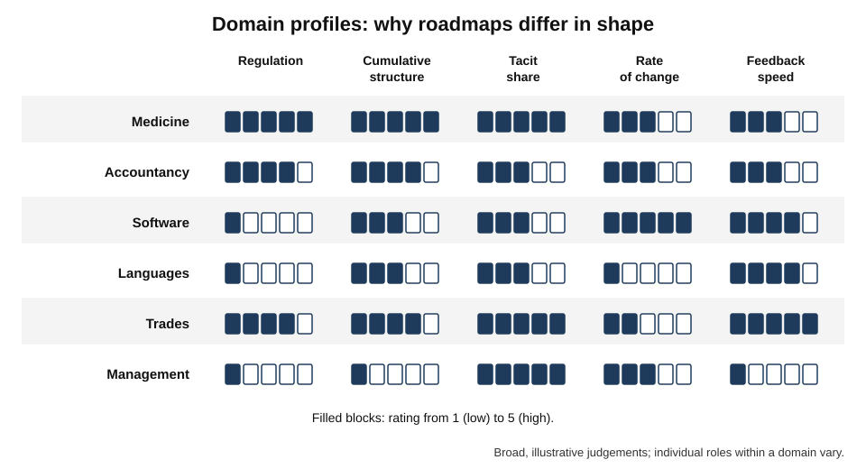
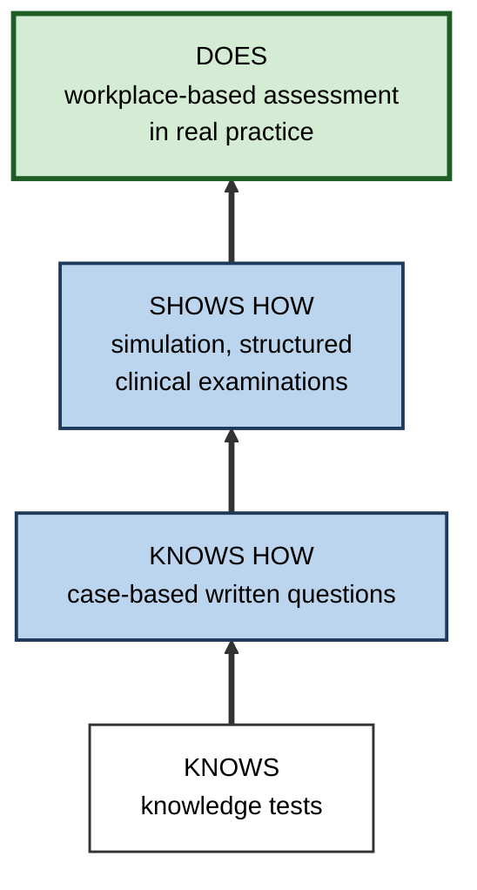
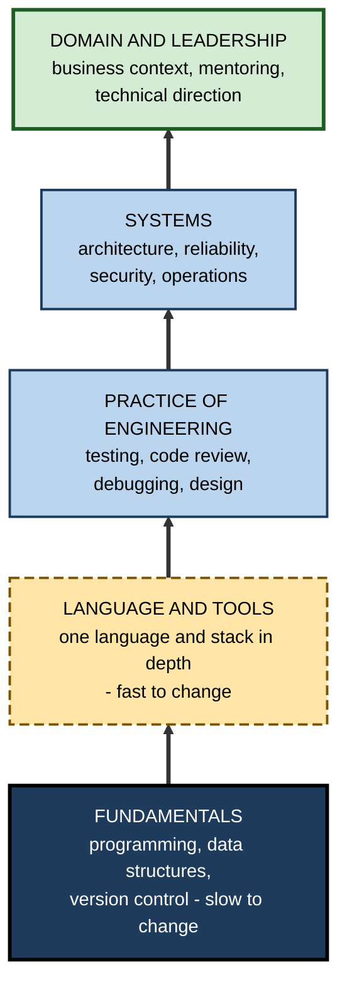
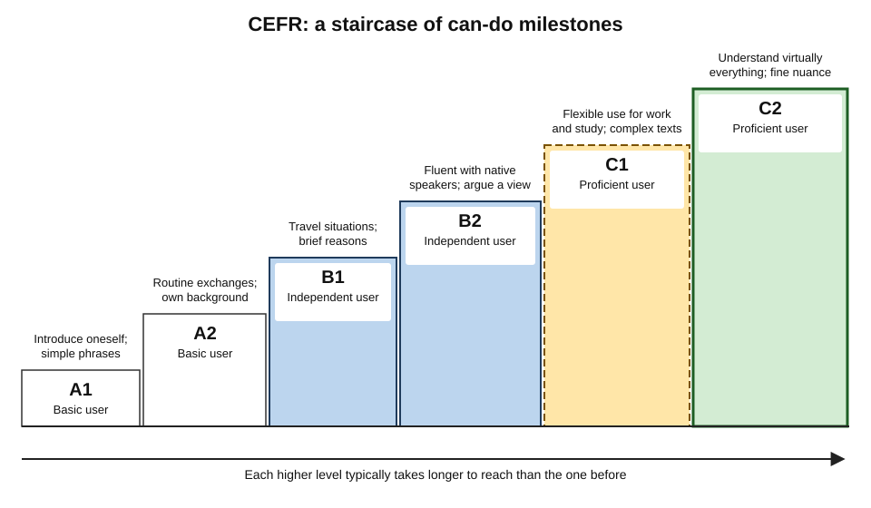

# C.11. Domain-Specific Learning Roadmaps

A future surgeon follows a route laid down in detail by regulators: degree, foundation years, specialty training, supervised operations, examinations, sign-offs — more than a decade in which almost no step is optional.

A future software developer may follow no prescribed route at all: self-teaching, a bootcamp or a degree, then a portfolio and a technical interview. A language learner climbs internationally recognised levels with published "can-do" descriptions. Each domain has its own **shape of roadmap** — and a learner entering any of them needs to recognise that shape before drawing a route.

> **Definition — Domain-specific roadmap:** a learning roadmap shaped by the particular features of a field — its structure of knowledge, its standards of competence, its regulation and credentials, its feedback environment, the share of tacit knowledge, and its rate of change.

**Why it matters**

- **The universal elements are the same everywhere** — destination, starting point, sequence, milestones, review. What changes is how each is filled.
- **Some domains prescribe the route.** In regulated professions, the main task is to navigate a mandated path well, not to design one.
- **Some domains prescribe nothing.** There, the learner must design the route and generate the signals employers trust.
- **Roadmaps transfer badly across domains** unless their differences are understood — a self-teaching approach that works in programming fails in surgery; an examination-heavy approach that works in accountancy wastes time in design.

---

## How Domains Differ

### Six dimensions

- **Regulation and licensing** — whether practice requires a licence, and who sets the standard.
  - *e.g.* medicine, law, accountancy, nursing, pharmacy and many engineering roles are regulated; software development generally is not.
- **Knowledge structure** — how cumulative the field is.
  - **Highly cumulative** — each stage depends heavily on earlier ones (mathematics, physics, medicine's basic sciences).
  - **Modular** — components can be learned in many orders (much of marketing, many software tools).
- **Feedback environment** — how quickly and accurately practice reveals errors.
  - Kind fields give fast, clear feedback; wicked fields give slow, noisy or misleading feedback.
- **Tacit share** — how much competence depends on knowledge that is hard to state and learned mainly alongside experts.
  - High in surgery, trades, leadership, negotiation; lower in well-documented technical procedures.
- **Rate of change** — how quickly the field's tools and knowledge turn over.
  - Fast in cloud computing and AI; slower in contract law principles or anatomy.
- **Signalling** — what employers and clients trust as proof.
  - **Credentials** (examinations, licences), **portfolios** (work samples), **experience records** (supervised hours, case logs), or **reputation**.

> **Mnemonic — "Real Knowledge Feeds Talent, Really Slowly":** Regulation, Knowledge structure, Feedback, Tacit share, Rate of change, Signalling.

**Figure 1.** Profiles of six domains on the dimensions that shape their roadmaps.

| Domain | Regulation | Structure | Feedback | Tacit share | Rate of change | Main signal |
|---|---|---|---|---|---|---|
| **Medicine** | Very high | Highly cumulative | Mixed — fast in procedures, slow in outcomes | Very high | Moderate | Licence, training sign-offs |
| **Law** | High | Moderately cumulative | Slow, often adversarial | High | Moderate | Qualification, supervised experience |
| **Accountancy** | High | Cumulative | Moderate | Moderate | Moderate | Professional examinations plus experience |
| **Software engineering** | Low | Mixed | Fast for code, slow for design | Moderate | Fast | Portfolio, interviews, track record |
| **Languages** | None | Cumulative at the core | Fast in conversation | Moderate | Slow | Proficiency level, demonstrated use |
| **Skilled trades** | Often high | Cumulative | Fast, physical | Very high | Slow to moderate | Apprenticeship qualification |
| **Design** | Low | Modular | Slow, subjective | High | Moderate | Portfolio, critique |
| **Management** | Low | Weakly cumulative | Slow, noisy | Very high | Moderate | Track record, reputation |

> **Key point:** the more **regulated, cumulative and tacit** a domain, the more its roadmap is prescribed and supervised; the more **unregulated, modular and fast-changing**, the more the learner must design the route and generate their own proof.

---

## Medicine: Competence by Entrustment

### Miller's pyramid

**George Miller (1990)** proposed four levels for assessing clinical competence:

1. **Knows** — factual knowledge.
2. **Knows how** — applying knowledge to problems (e.g. written case questions).
3. **Shows how** — performing in a simulated setting (e.g. structured clinical examinations with standardised patients).
4. **Does** — performing in real practice (e.g. workplace-based assessment).

**Figure 2.** Miller's pyramid of clinical competence.

- **Lesson beyond medicine:** a roadmap whose milestones stop at "knows how" has not tested competence. Every domain needs milestones at **shows how** and **does**.

### Entrustable professional activities

> **Definition — Entrustable professional activity (EPA) (Olle ten Cate, 2005):** a unit of professional work that can be entrusted to a trainee once they have demonstrated the competence to perform it unsupervised.

- **Examples:** taking a history and performing a physical examination; prescribing and monitoring medication; handing over a patient's care to another clinician.
- **Levels of entrustment** — commonly described as:
  1. **observe only**;
  2. **act under direct, proactive supervision**;
  3. **act under indirect, reactive supervision** (supervisor available on request);
  4. **act unsupervised**;
  5. **supervise others**.
- **Why it matters for roadmaps:** milestones are defined as **real work tasks** with explicit **trust levels**, rather than as abstract competencies.

**Figure 3.** Levels of entrustment for a professional activity.

```mermaid
%%{init: {'theme':'base','themeVariables':{'fontFamily':'Arial, Helvetica, sans-serif','fontSize':'15px','primaryColor':'#FFFFFF','primaryTextColor':'#111111','primaryBorderColor':'#222222','lineColor':'#333333','secondaryColor':'#F2F2F2','tertiaryColor':'#FFFFFF','clusterBkg':'#FAFAFA','clusterBorder':'#555555','edgeLabelBackground':'#FFFFFF','titleColor':'#111111'}}}%%
flowchart LR
    classDef muted   fill:#E6E6E6,stroke:#666666,stroke-width:1px,stroke-dasharray:2 4,color:#222222
    classDef key     fill:#BCD5EE,stroke:#1F3B5C,stroke-width:2px,color:#000000
    classDef accent  fill:#FFE6A8,stroke:#7A5200,stroke-width:2px,stroke-dasharray:8 4,color:#000000
    classDef good    fill:#D3ECD3,stroke:#1E5E24,stroke-width:3px,color:#000000
    classDef core    fill:#1F3B5C,stroke:#000000,stroke-width:3px,color:#FFFFFF

    L1["1. Observe<br/>only"]
    L2["2. Direct<br/>supervision"]
    L3["3. Indirect<br/>supervision"]
    L4["4. Unsupervised"]
    L5["5. Supervises<br/>others"]

    L1 ==> L2 ==> L3 ==> L4 ==> L5

    class L1 muted
    class L2 key
    class L3 accent
    class L4 good
    class L5 core
```

- **Developmental milestones:** in the United States, the Accreditation Council for Graduate Medical Education introduced specialty **Milestones** from 2013 — narrative descriptions of development across five levels for each sub-competency, used in regular reviews of each resident.

> **Watch out:** competency-based medical education has strong advocates but its effects on patient outcomes are hard to measure; evaluations so far mainly show changes in assessment practice and feedback, with outcome evidence still limited.

### Nursing and the allied health professions

- **Patricia Benner, *From Novice to Expert* (1984)**, applied the Dreyfus stages to clinical nursing through interviews and observation of nurses at different career points.
  - Novice nurses relied on rules and checklists; expert nurses recognised deteriorating patients from subtle patterns they often could not articulate.
  - Benner argued that this expertise grows from **experience of many cases**, reflected on — which formal education alone cannot supply.
- **Typical route:** a degree with substantial supervised clinical placements → registration with a regulator → a period of preceptorship or supported practice → specialisation through further study and experience.
- **Roadmap implications:**
  - the early route is prescribed; the later route — specialty, advanced practice, education, leadership or informatics — is increasingly self-designed;
  - case exposure, supervision and structured reflection are the core components at every stage.

---

## Law and Accountancy: Examinations Plus Supervised Experience

### Law

- **Typical structure:** academic legal knowledge → professional training → **supervised practice** → qualification.
- **Example — England and Wales:** since 2021, intending solicitors take the **Solicitors Qualifying Examination** in two stages — SQE1 on functioning legal knowledge and SQE2 on practical legal skills — and complete **two years of qualifying work experience**.
- **Roadmap implications:**
  - examinations dictate a large part of the knowledge route;
  - supervised work dictates the skills route — choosing where to gain experience shapes the eventual specialism;
  - tacit knowledge of drafting, advising and negotiating comes from supervision and feedback on real matters.

### Accountancy and finance

- **Typical structure:** a sequence of professional examinations alongside a **practical experience requirement** — commonly about three years of relevant work, recorded and signed off.
- **Investment profession:** the CFA programme has three examination levels, each commonly prepared for with around 300 hours of study.
- **Roadmap implications:**
  - examination schedules impose a calendar;
  - employers often structure graduate programmes around examination sittings;
  - the risk is a roadmap that is **only** examinations — technical knowledge without client, judgement and communication skill.

> **In practice:** in examination-heavy domains, build a **parallel track** for workplace capability — client communication, judgement on ambiguous cases — that examinations do not test.

---

## Software Engineering: Design Your Own Route

### Features

- **No licence** for most roles; many entry routes — degrees, bootcamps, self-teaching, apprenticeships.
- **Very fast change** in tools and frameworks; **slower change** in fundamentals (data structures, design principles, testing, systems thinking).
- **Fast feedback** for code (it runs or it fails; tests pass or fail); **slow feedback** for design decisions, whose costs appear months later.
- **Signals:** portfolios, open-source contributions, technical interviews, track record.

### A layered structure

**Figure 4.** A layered roadmap structure for software engineering.

- **Roadmap implications:**
  - invest in the **slow-changing** layers; treat specific frameworks as replaceable;
  - make **projects** the milestones — reviewed by experienced engineers;
  - practise **engineering**, not only programming — tests, reviews, reading others' code;
  - expect career ladders (junior → mid → senior → staff or manager) to define later destinations.

> **Watch out:** open community roadmaps for software often list every current tool. The durable core is much smaller, and employers' technical interviews test fundamentals and problem-solving far more than breadth of tools.

---

## Languages: Levels With Can-Do Descriptions

### The Common European Framework of Reference

- **Published by the Council of Europe in 2001**, with an expanded **Companion Volume** in 2018 and 2020.
- **Six levels** in three bands:
  - **A1, A2** — basic user;
  - **B1, B2** — independent user;
  - **C1, C2** — proficient user.
- **"Can-do" descriptors** — each level is described by what the learner can do.
  - *e.g.* B1: can deal with most situations likely to arise while travelling; can describe experiences and events and briefly give reasons for opinions.
- **Roadmap implications:**
  - the descriptors are ready-made **milestones**;
  - progress between levels slows as levels rise — B2 to C1 takes far longer than A1 to A2;
  - speaking, listening, reading and writing can be at different levels, so roadmaps can target skills separately.

**Figure 5.** The six CEFR levels as a roadmap with can-do milestones.

> **Example:** a professional moving to Madrid for work might target B2 in speaking and listening — enough to take part in meetings — and B1 in writing, using official proficiency examinations or tutor assessments against the descriptors as milestones.

---

## Skilled Trades, Creative Fields and Management

### Skilled trades: apprenticeship as roadmap

- **Apprenticeship** combines paid work under a qualified practitioner with structured off-the-job training and final assessment.
- **The German dual system** — vocational training typically lasting around three years, split between a company and a vocational school, with examinations set by chambers of industry and crafts — is widely studied as a model.
- **Roadmap implications:** the route is largely prescribed; the learner's choices are the employer, the specialism and how deliberately they use the supervised hours.

### Creative fields: portfolio and critique

- **Design, writing, architecture, music and visual arts** rely on **portfolios** and **critique** more than examinations.
- **Feedback is slow and subjective**, so structured critique from experienced practitioners is central.
- **Graded examinations** exist in some fields — for example, graded music examinations such as those of the Associated Board of the Royal Schools of Music (ABRSM), established in 1889 — providing ready-made milestones.
- **Roadmap implications:** milestones are **portfolio pieces** produced to briefs and judged by critics; the route alternates making, critique and revision.

### Management and leadership: roadmaps of experience

- **Morgan McCall, Michael Lombardo and Ann Morrison, *The Lessons of Experience* (1988)** — interviews with successful executives about the events that most developed them.
  - **Challenging assignments** — start-ups, turnarounds, big increases in scope.
  - **Other people** — especially good and bad bosses.
  - **Hardships** — mistakes, setbacks, career disappointments.
  - **Coursework** — mentioned, but less often.
- **Roadmap implications:** leadership roadmaps are sequences of **experiences and assignments**, with reflection and feedback around them, more than sequences of courses.

> **Watch out:** retrospective accounts by successful executives are subject to memory and survivorship bias. They indicate where development happens; they do not prove that the same assignments would develop anyone.

---

## Data, AI and Hybrid Domains

### Data and AI roles

- **A hybrid by nature** — data roles combine three bodies of knowledge:
  - **statistics and quantitative reasoning** — slow to change, highly cumulative;
  - **programming and data tools** — fast to change, modular;
  - **domain knowledge** — the business, scientific or clinical context in which data has meaning.
- **Little regulation, mixed signalling** — portfolios, technical interviews and, for some roles, degrees in quantitative subjects.
- **Wicked feedback at the top** — code runs or fails quickly, but whether an analysis led to a good decision may not be known for months.
- **Roadmap implications:**
  - build the statistical core deliberately; it is the layer most often skipped and most often exposed in interviews and real work;
  - treat tools as interchangeable modules learned through projects;
  - pair every technical milestone with a **domain question** — an analysis that someone used to decide something.

### Chartered engineering and other assessed-experience routes

- **Many engineering institutions** grant chartered or professional status on the basis of an accredited degree **plus** a period of documented professional development, assessed against competence standards and confirmed in a professional review interview.
- **Roadmap implications:** the route is partly prescribed (the standards), partly designed (the experiences chosen to evidence them); mentors and supervising engineers are central, and evidence must be collected continuously rather than reconstructed at the end.

### Hybrid domains without established routes

- **Examples:** clinical informatics, legal technology, climate finance, AI governance, bioinformatics.
- **Typical difficulties:**
  - no single standards body; two parent fields with different cultures;
  - employers unsure what to ask for;
  - learners entering from either side, with opposite gaps.
- **Roadmap approach:**
  - map **both** parent domains and identify the overlap the hybrid role actually uses;
  - treat the learner's **home** domain as the asset that earns entry, and the other as the gap;
  - seek mentors from **both** sides;
  - generate proof that speaks to both audiences — for example, a workflow improvement that clinicians endorse and technical staff can maintain.

| | Established domain | Hybrid domain |
|---|---|---|
| Standards | Clear, often codified | Emerging, contested |
| Canonical increments | Exist | Few or none |
| Typical entrant | From the domain's own pipeline | From either parent field |
| Main roadmap task | Navigate and personalise | Design, borrow structures, build proof for two audiences |
| Mentors | Within the domain | From both parent fields |

### How domains change their roadmaps

- **Technology reshapes entry tasks.** Where routine components of a domain are automated — drafting standard documents, writing boilerplate code, reconciling transactions — the early rungs of the traditional route weaken.
- **Professions respond slowly.** Regulators and professional bodies revise standards over years; learners may find official routes lagging behind practice.
- **Learners should therefore read two signals:** the **official** route, which governs entry, and **current practice**, which governs usefulness — and plan for both.

---

## Building a Roadmap in an Unfamiliar Domain

### The SIGNAL questions

> **Mnemonic — SIGNAL:**
> - **S**tandards — who defines competence here (regulator, professional body, employers, community)?
> - **I**ncrements — what canonical levels or stages already exist?
> - **G**atekeeping — which signals open doors: licence, examination, portfolio, referral?
> - **N**ovelty rate — how quickly does the field change, and which layers are stable?
> - **A**pprenticeship share — how much must be learned alongside experts?
> - **L**earning feedback — how quickly and accurately does practice reveal errors?

### Translating the answers into roadmap design

- **Strong standards and increments** → adopt the official structure; build personal milestones around it.
- **Credential gatekeeping** → schedule examinations early in planning; they set the calendar.
- **Portfolio gatekeeping** → make every milestone a portfolio piece.
- **High novelty** → separate stable foundations from replaceable tools; review the roadmap often.
- **High apprenticeship share** → secure supervised experience and mentors early; they are the bottleneck.
- **Wicked feedback** → add expert review, case discussions and calibration against outcomes.

| Answer | Roadmap consequence |
|---|---|
| Regulated with mandated stages | Navigate the official route; personalise within it |
| Unregulated, portfolio-based | Design the route; generate proof at every milestone |
| Fast-changing | Short planning horizons; frequent reviews |
| Tacit-heavy | Supervision and mentoring as core components |
| Slow, noisy feedback | Expert review and structured reflection at milestones |

---

## Worked Example: Two Domains, Two Roadmap Shapes

- **Situation:** two colleagues at an engineering firm each start a roadmap. Elena wants to become a **chartered project manager**; Sam wants to become a **data analyst** in the firm's new analytics team.

1. **Apply SIGNAL:**

| Question | Elena: project management | Sam: data analysis |
|---|---|---|
| Standards | Professional body's competence framework | Employer expectations; no single body |
| Increments | Defined qualification levels and chartership | Informal junior–senior ladder |
| Gatekeeping | Examinations plus assessed experience | Portfolio of analyses, internal interview |
| Novelty rate | Moderate | Fast for tools, slower for statistics |
| Apprenticeship share | High — judgement in real projects | Moderate — reviews of analyses |
| Learning feedback | Slow — project outcomes appear late | Fast for code, slower for business value |

2. **Resulting roadmap shapes:**
   - **Elena:** a **prescribed spine** of qualifications, with a parallel track of increasingly complex projects and a mentor's review of each project's lessons; milestones include examination passes and documented project outcomes.
   - **Sam:** a **self-designed route**: stable foundations (statistics, SQL) first, tools as replaceable modules; milestones are reviewed analyses that the team uses; quarterly reviews because tools change quickly.

- **Conclusion:** the universal elements are the same; the **shape** — prescribed or designed, credential-led or portfolio-led, slow or fast review — differs because the domains differ.

> **Watch out:** Sam initially copied Elena's approach — a certificate first, then projects. In a portfolio-led domain, the certificate opened few doors; the first reviewed analysis opened several.

---

## Case Study: Borrowing Entrustment for Software On-Call

- **Situation:** an online retailer's engineering teams struggled with **on-call** duties — responding to production incidents out of hours. New engineers were added to the rota after a short briefing.
- **Problem:** inexperienced engineers handled serious incidents poorly; some incidents lasted longer than necessary; new engineers reported high anxiety.
- **Diagnosis:** on-call capability was treated as a one-step jump from "not on rota" to "fully on rota" — no graduated route, no explicit trust levels.
- **Actions — borrowing from medical entrustment:**
  1. Defined on-call as a set of **entrustable activities**: triaging alerts, communicating during an incident, executing a rollback, leading an incident.
  2. Set **entrustment levels** for each: shadow (observe only); co-pilot (act with an experienced engineer alongside); primary with backup on call (indirect supervision); primary unsupported; incident lead (supervises others).
  3. Required **evidence** for each step: shadowed incidents, simulated incident drills ("game days"), reviewed real incidents.
  4. Recorded each engineer's level per activity in a simple matrix.
- **Result:** new engineers reached unsupported primary on-call over roughly two to three months, more consistently than before; incident reviews showed fewer escalations caused by inexperience; reported anxiety fell.
- **Side effects:** senior engineers spent more time in co-pilot roles; the matrix needed upkeep.
- **Lesson:** structures developed in one domain — here, **entrustment** from medicine — can transfer to another when the underlying problem (high-stakes work learned through supervised practice) is the same.

---

## Open Questions

- **Do competency-based routes improve outcomes in regulated professions?**
  - Assessment practice has changed; links to client and patient outcomes remain hard to establish.
- **How should unregulated domains signal competence?**
  - Portfolios and interviews are noisy; shared standards are emerging in some fields but are not widely adopted.
- **How will AI change domain structures?**
  - In fields where AI performs routine components, the knowledge layers learners must master may shift; how professions will redefine entry routes is unsettled.
- **Which structures transfer between domains?**
  - Entrustment, portfolios and apprenticeship models are being borrowed across fields; systematic evaluation of such transfers is rare.
- **How should roadmaps handle hybrid domains?**
  - Roles combining fields — clinical informatics, legal technology, climate finance — lack established routes.

---

## Summary

- A **domain-specific roadmap** is shaped by the field's **regulation, knowledge structure, feedback, tacit share, rate of change and signalling**.
- Regulated, cumulative, tacit-heavy domains have **prescribed, supervised** routes; unregulated, modular, fast-changing domains require **self-designed** routes and self-generated proof.
- **Medicine:** Miller's pyramid — knows, knows how, shows how, does; **entrustable professional activities** with graduated **entrustment levels**; developmental milestones.
- **Law and accountancy:** examinations plus **supervised experience**; add a workplace-capability track.
- **Software engineering:** invest in **slow-changing layers**; projects as milestones; tools as replaceable modules.
- **Languages:** **CEFR** levels A1–C2 with **can-do** descriptors as ready-made milestones.
- **Trades:** apprenticeship as roadmap; **creative fields:** portfolio and critique; **management:** sequences of **experiences**.
- Enter an unfamiliar domain with the **SIGNAL** questions: Standards, Increments, Gatekeeping, Novelty rate, Apprenticeship share, Learning feedback.
- **Hybrid domains** lack established routes: map both parent fields, use the home field as the asset, seek mentors and proof on both sides.
- Structures can transfer between domains — such as **entrustment** for software on-call — when the underlying learning problem is the same.

---

## Self-Check

1. Define a domain-specific roadmap and list the six dimensions on which domains differ.
2. Contrast the roadmap shape of a regulated, cumulative domain with that of an unregulated, modular one.
3. Describe Miller's pyramid. What does it imply for milestones in any domain?
4. What is an entrustable professional activity, and what are the five levels of entrustment?
5. How is solicitor qualification structured in England and Wales since 2021, and what does this imply for a roadmap?
6. What risk do examination-heavy domains carry, and how can a roadmap counter it?
7. Which layers of software engineering change slowly, and why should a roadmap invest in them?
8. Describe the CEFR and explain why its descriptors suit roadmaps.
9. What did McCall, Lombardo and Morrison find about executive development, and what caution applies?
10. Explain each letter of SIGNAL.
11. A friend wants to become a UX designer and plans to collect three certificates before building any work. Use SIGNAL to advise them.
12. How would a roadmap differ for a domain with slow, noisy feedback?
13. Explain how the on-call case borrowed from medicine, and why the borrowing worked.
14. Design the outline of a roadmap for someone entering a hybrid field, such as clinical informatics.

### Answer Key

1. A roadmap shaped by a field's particular features. Dimensions: regulation and licensing, knowledge structure, feedback environment, tacit share, rate of change, signalling.
2. Regulated, cumulative: a prescribed, supervised sequence with credentials and sign-offs; the learner navigates and personalises within it. Unregulated, modular: the learner designs the route, chooses order flexibly and must generate proof such as portfolios.
3. Knows, knows how, shows how, does. Milestones in any domain should reach performance in simulated and real settings, not stop at knowledge tests.
4. A unit of professional work entrusted to a trainee once they show they can perform it unsupervised. Levels: observe only; direct supervision; indirect supervision; unsupervised; supervise others.
5. Two examination stages — SQE1 (functioning legal knowledge) and SQE2 (practical legal skills) — plus two years' qualifying work experience. The roadmap combines an examination-driven knowledge route with a supervised-experience route whose choice shapes specialism.
6. A roadmap of examinations alone, producing technical knowledge without client, judgement and communication skills. Counter it with a parallel workplace-capability track.
7. Fundamentals (programming, data structures, version control), engineering practice (testing, review, design) and systems thinking change slowly; they retain value as tools change and are what interviews and senior work rely on.
8. Six levels (A1–C2) in three bands with can-do descriptors for each skill. The descriptors are observable, graded milestones that can be targeted skill by skill.
9. Executives were developed mostly by challenging assignments, other people (especially bosses) and hardships, with coursework less prominent. Caution: retrospective accounts by successful people are subject to memory and survivorship bias.
10. Standards (who defines competence), Increments (canonical levels), Gatekeeping (signals that open doors), Novelty rate (speed of change), Apprenticeship share (learning alongside experts), Learning feedback (how quickly practice reveals errors).
11. Standards are set by employers rather than a regulator; increments are informal; gatekeeping is mainly portfolio and critique; novelty is moderate; apprenticeship share is high; feedback is slow and subjective. Therefore build portfolio pieces from the start, seek critique from experienced designers, and treat certificates as optional supplements.
12. Add expert review of decisions, structured case discussion, simulations with known answers, and calibration against later outcomes; define milestones that include reasoning, not just results; review more deliberately because progress is hard to see.
13. It defined on-call work as entrustable activities with graduated supervision levels and required evidence for each step, as in medical training. It worked because both involve high-stakes work learned through supervised practice.
14. For example: SIGNAL analysis (mixed standards; gatekeeping by clinical credibility plus technical portfolio; moderate-to-fast change; high tacit share); a clinical-workflow track built on existing clinical expertise; a technical track (data, systems configuration, process mapping); a bridge role such as super-user; milestones as documented workflow improvements reviewed by both clinical and technical mentors; quarterly reviews.

---

## Glossary

| Term | Meaning |
|---|---|
| Apprenticeship | Paid work under a qualified practitioner combined with structured training and assessment. |
| Can-do descriptor | A description of a proficiency level in terms of what the learner can do. |
| CEFR | The Common European Framework of Reference for Languages, with six levels A1–C2. |
| Cumulative domain | A field in which later learning depends heavily on earlier learning. |
| Domain-specific roadmap | A roadmap shaped by a field's structure, standards, regulation, feedback, tacit share and rate of change. |
| Dual system | Vocational training split between a company and a vocational school, as in Germany. |
| Entrustable professional activity | A unit of professional work entrusted once competence to perform it unsupervised is shown. |
| Entrustment level | The degree of supervision under which a trainee may perform an activity. |
| Hybrid domain | A field combining two parent domains, often without established routes or standards. |
| Miller's pyramid | Four levels of clinical competence: knows, knows how, shows how, does. |
| Modular domain | A field whose components can be learned in many orders. |
| Portfolio | A curated collection of work samples used as evidence of capability. |
| Qualifying work experience | Supervised practical experience required for professional qualification. |
| SIGNAL | Standards, Increments, Gatekeeping, Novelty rate, Apprenticeship share, Learning feedback. |
| Signalling | The evidence a field's employers and clients trust as proof of competence. |
| Tacit share | The proportion of competence that depends on hard-to-state knowledge. |
