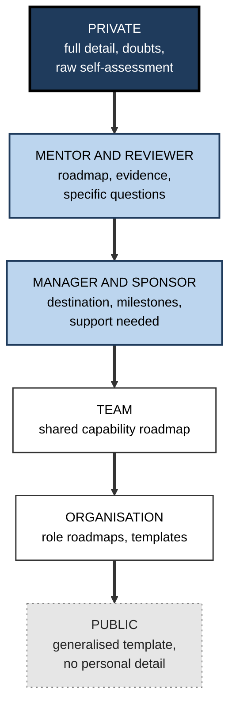
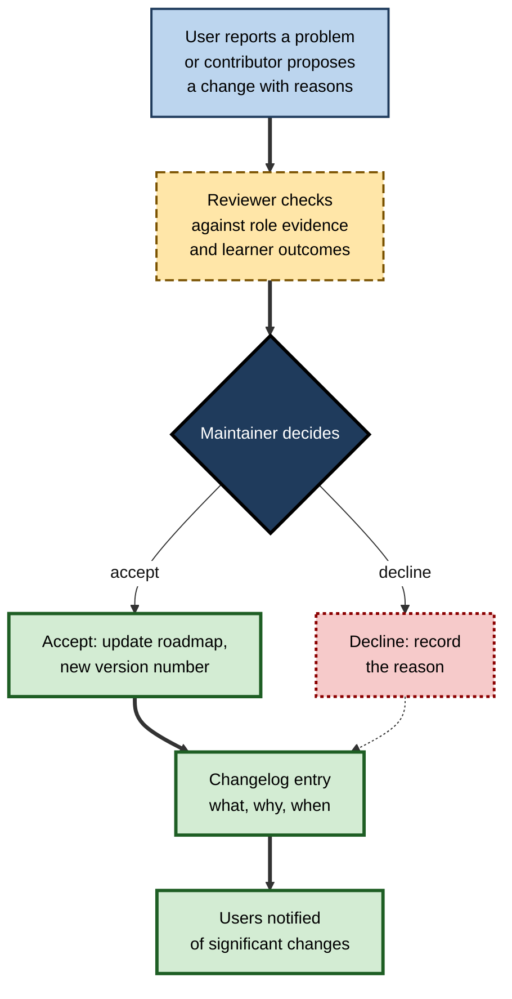
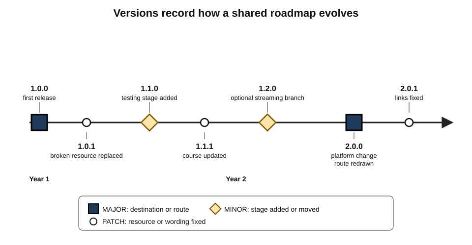
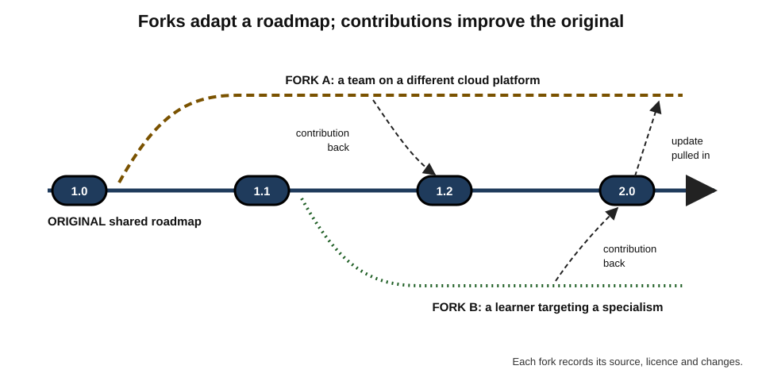
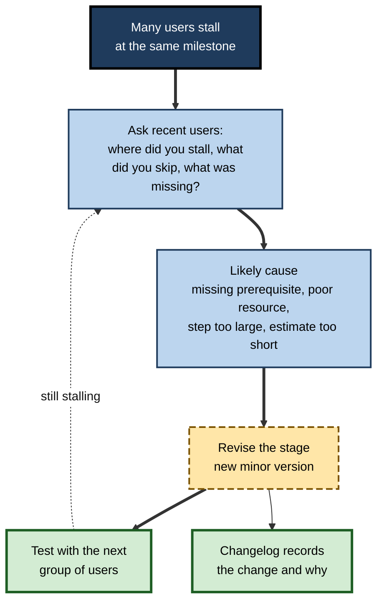

# A.12. Sharing and Collaborating on Roadmaps

An engineer writes a one-page roadmap for moving into site reliability work and posts it on her company's internal wiki. Within a month thirty colleagues have copied it. Within a year it is out of date — two tools have been replaced — but nobody owns it, and new joiners keep following it.

In another team, a similar roadmap is maintained by a small group, with a version number, a list of changes, a named owner and a review date; contributors propose improvements and the owner accepts or declines them. The second roadmap is still useful three years later. The difference lies not in the content but in **how the roadmap is shared and kept alive**.

> **Definition — Shared roadmap:** a learning roadmap made available to others — a mentor, a team, an organisation or the public — for review, reuse or coordination.

> **Definition — Collaborative roadmap:** a roadmap created or maintained by several contributors under agreed rules for proposing, reviewing and recording changes.

**Why it matters**

- **Roadmaps are expensive to build well** — mapping, sequencing and validating a route takes real expertise. Sharing spreads that investment.
- **Shared roadmaps coordinate people** — teams building a capability together need a common route.
- **Sharing invites correction** — more reviewers find more errors and gaps.
- **Shared roadmaps decay** unless someone maintains them; an outdated route followed by many does more harm than a personal one followed by one.

---

## Why Share a Roadmap

### Benefits

- **Feedback** — others spot missing components, poor sequencing and unrealistic estimates.
- **Reuse** — colleagues and newcomers start from a validated route rather than a blank page.
- **Alignment** — a team learning a new platform moves in step; managers can plan cover and assignments.
- **Visibility** — sponsors and managers can see what a learner is working towards and offer opportunities.
- **Accountability** — a named partner who sees the plan can ask how it is going.

### Does announcing a goal help or hurt?

**Study card — Gollwitzer, Sheeran, Michalski and Seifert (2009), "When intentions go public"**

- **Background:** Peter Gollwitzer's **symbolic self-completion theory** proposes that people pursue identity goals ("becoming a lawyer") by acquiring symbols of that identity; having others notice one's intention can itself feel like progress.
- **Design:** in four studies, students formed intentions related to an identity they valued — such as their future profession. For half, the intention was **noticed** by the experimenter; for the others, it remained private.
- **Results:** when identity-related intentions were noticed by others, students subsequently put **less** effort into actions serving them, in the tasks studied.
- **Conclusion:** publicly announcing an **identity** goal can create a premature sense of completion that reduces effort.

> **Watch out:** this finding is often overstated as "never tell anyone your goals". It concerned identity-related intentions in particular settings, and other research on goal setting suggests that **commitment to a specific person** who will follow up — a manager, mentor or partner — can strengthen persistence. The evidence is **mixed**; the safer practice is to share the **plan and the evidence** with people who will engage with it, rather than to broadcast an identity claim.

| | Broadcasting an intention | Sharing a plan with an engaged reviewer |
|---|---|---|
| What is shared | "I'm becoming a data scientist" | Destination, route, milestones, recent evidence |
| Likely effect | Possible premature sense of progress | Feedback, follow-up, accountability |
| Who responds | Many, briefly | One or a few, in depth |
| Risk | Effort falls; public pressure if plans change | Little, if trust exists |

---

## What to Share, With Whom

### Audiences and openness

- **Private** — the learner alone; full detail, including doubts.
- **Mentor and reviewer** — the roadmap plus evidence and specific questions.
- **Manager and sponsor** — destination, milestones and support needed; enough to plan opportunities.
- **Team** — shared capability roadmap; individual roadmaps only by choice.
- **Organisation** — role roadmaps and templates, not personal gaps.
- **Public** — generalised templates and routes, stripped of personal and confidential detail.

**Figure 1.** What to share with each audience.

> **Key point:** as the audience widens, share **less personal detail and more general structure**. The template travels; the self-assessment stays close.

### Privacy and psychological safety

- **A roadmap exposes gaps.** In some workplaces, admitting a gap feels risky — it may be read as weakness or used in performance judgements.
- **Safeguards:**
  - agree **purpose** before sharing — development, not evaluation;
  - control **who sees** individual roadmaps;
  - keep personal self-ratings separate from organisational skills records;
  - managers model sharing their **own** development roadmaps.
- **Amy Edmondson's** research on team psychological safety suggests that where people believe candour is safe, they report problems and seek help more readily — the same condition that makes sharing development gaps productive.

---

## Open Curricula and Licensing

### Openly shared learning routes

- **Open educational resources (OER)** — teaching and learning materials released under licences that allow free use, adaptation and redistribution.
  - The term was adopted at a UNESCO forum in **2002**; UNESCO adopted a formal Recommendation on OER in **2019**.
- **MIT OpenCourseWare** — announced in 2001 and launched in 2002, published course materials from a large share of the university's courses, including syllabi and problem sets that learners worldwide use as ready-made roadmaps.
- **Open community roadmaps** — practitioner-maintained routes for technologies and roles, often hosted on public code-collaboration platforms.

### Licences

- **Creative Commons** — founded in 2001, released its first licences in 2002; its licences let creators grant permissions in advance.
  - **BY** — reuse permitted with **attribution**.
  - **SA** (share-alike) — adaptations must carry the same licence.
  - **NC** (non-commercial) — no commercial reuse.
  - **ND** (no derivatives) — no adapted versions.
- **Why licensing matters for roadmaps:**
  - without a licence, others may be legally unable to adapt or republish the roadmap;
  - with an open licence, adaptations can be shared back, improving the original.

> **In practice:** when publishing a roadmap template for others, choose a licence that allows **adaptation with attribution** — the purpose of a template is to be modified.

> **Watch out:** a roadmap built from an employer's internal materials, client information or paid course content may not be the author's to share. Strip proprietary detail and check obligations before publishing.

---

## Collaborative Maintenance

### Lessons from open-source software

- **Eric Raymond, *The Cathedral and the Bazaar* (1999)** contrasted centrally planned development with open, many-contributor development, and popularised **Linus's law**: "given enough eyeballs, all bugs are shallow."
- **Applied to roadmaps:** many reviewers find errors and gaps faster than one author — **if** reviewers actually look, and **if** someone integrates their contributions.
- **Typical roles:**
  - **maintainer** — owns the roadmap; accepts or declines changes; keeps it coherent;
  - **contributor** — proposes changes, with reasons;
  - **reviewer** — checks proposed changes against evidence;
  - **user** — follows the roadmap and reports problems.

**Figure 2.** A workflow for proposing and accepting changes to a shared roadmap.

> **Watch out:** "many eyeballs" fail when everyone assumes someone else is reviewing. Shared roadmaps need a **named maintainer** and a **review date**; otherwise they suffer a tragedy of the commons — used by many, maintained by none.

### Versioning a roadmap

- **Borrowing semantic versioning** — a widely used software convention, written by Tom Preston-Werner around 2010, numbers releases **MAJOR.MINOR.PATCH**:
  - **MAJOR** — a change that breaks compatibility;
  - **MINOR** — added capability, compatible with before;
  - **PATCH** — a small correction.
- **For roadmaps:**
  - **MAJOR** — the **destination** or the overall route changes (users partway through must re-plan);
  - **MINOR** — a stage or milestone is added, removed or resequenced;
  - **PATCH** — a resource is replaced, a link fixed, a description clarified.

> **Formula — Version increments:** a roadmap at 2.3.1 that replaces a broken resource becomes **2.3.2**; adding a new testing stage makes it **2.4.0**; retargeting from "data analyst" to "analytics engineer" makes it **3.0.0**.

**Figure 3.** The version history of a shared role roadmap.

### The changelog

- **Each entry records:** version, date, what changed, why, and who proposed it.
- **Why it matters:** users partway through can see what changed since they started; reviewers can see the reasoning; the roadmap's evolution becomes evidence about the field.

---

## Forking and Adapting

> **Definition — Fork:** a copy of a shared roadmap taken in order to adapt it independently, while retaining a link to the original.

- **When to fork:**
  - the learner's destination differs from the original's;
  - a team's context (tools, regulations, clients) differs;
  - the original is not maintained.
- **Good forking practice:**
  - **attribute** the original and its licence;
  - **record** what was changed and why;
  - **contribute back** improvements that would help the original's users;
  - **track** the original for important updates.

**Figure 4.** An original roadmap, its forks and contributions flowing back.

| | Following the original | Forking |
|---|---|---|
| Effort | Low | Moderate |
| Fit to own context | Partial | High |
| Benefits from upstream updates | Automatically | Only if tracked |
| Risk | Irrelevant or outdated parts | Divergence; duplicated maintenance |
| Best when | The original is maintained and fits | Context differs; original stale |

---

## Collaborating on Roadmaps in Teams and Organisations

### Team capability roadmaps

- **A shared destination** — "the team can design, deploy and operate services on the new platform by the end of the year".
- **Distributed routes** — individuals take different components according to role and starting point, coordinated so that every critical skill is held by at least two people.
- **Joint milestones** — the team's first production service on the platform; the first incident handled without external help.

### Guild-maintained role roadmaps

- **Guilds, chapters or communities of practice** maintain roadmaps for a discipline across teams — for example, all data engineers in an organisation.
- **Practices that work:**
  - a small maintainer group with rotating membership;
  - quarterly review against current job descriptions and recent hires' experience;
  - contributions from anyone, reviewed openly;
  - a stable template so that roadmaps for different roles are comparable.

### Co-learning roadmaps

- **Study pacts and cohorts** — two to six people following the same route on the same schedule, meeting regularly to review milestones.
- **Benefits:** shared pacing, mutual explanation, accountability.
- **Risk:** the group's pace may suit no one exactly; agree rules for splitting when needs diverge.

### Collaborative curriculum design

- **Teacher design teams** — groups of teachers jointly designing curricula — have been studied in education research, which has generally found that collaborative design supports both the quality of materials and the professional development of the designers.
- **Implication:** building a roadmap together is itself a learning activity for the people who build it.

> **In practice:** when an organisation needs a new role roadmap, involve **recent learners** who made the journey, **experienced practitioners** who know the destination and **hiring managers** who set the standard — and publish the result with an owner and a review date.

---

## Sharing Progress: Learning in Public

- **"Learning in public"** — publishing notes, projects and reflections as one learns — has become common in software, design and data fields.
- **Benefits:**
  - feedback from strangers with relevant expertise;
  - visible proof for future employers;
  - connections with people on similar routes.
- **Risks:**
  - **performative learning** — producing posts rather than capability;
  - **social comparison** — Leon Festinger's (1954) theory proposed that people evaluate themselves by comparison with others; constant exposure to others' highlights can distort self-assessment and erode motivation;
  - **Goodhart's law** — visible metrics (streaks, posts, followers) become targets.

> **Remember:** share **evidence of capability** — a reviewed project, a solved problem, an explanation — rather than counts of effort. Evidence invites useful feedback; counts invite comparison.

---

## Worked Example (illustrative): Turning a Personal Roadmap Into a Shareable Template

- **Situation:** Leon, a security engineer, built a personal roadmap from network engineer to cloud security engineer. Colleagues keep asking for it.

1. **Separate the general from the personal:**
   - **Keep:** destination role, stages, milestone definitions, recommended resources, typical time ranges.
   - **Remove:** his self-ratings, his salary considerations, references to specific clients, his mentor's name.
2. **Generalise the starting point:** replace "my networking background" with a short **entry diagnostic** so that users with different starts can locate themselves.
3. **Add structure for reuse:**
   - a short introduction: who the roadmap is for, and who it is not for;
   - the one-page overview;
   - milestone cards;
   - a list of **optional branches** for different specialisms;
   - **known limitations** — "written for organisations on one particular cloud platform".
4. **Set governance:**
   - **owner:** Leon, with a co-maintainer from the security guild;
   - **review date:** every six months;
   - **contribution route:** proposals through the guild's channel, reviewed monthly.
5. **Version and licence:** publish as **1.0.0** with a changelog, under an internal licence allowing adaptation with attribution.
6. **Collect outcomes:** ask users to report when they reach milestones and what they changed.

| | Personal roadmap | Shareable template |
|---|---|---|
| Starting point | Leon's own | Entry diagnostic for any user |
| Personal detail | Self-ratings, mentor, constraints | Removed |
| Scope statement | Implicit | Who it is for and not for; limitations |
| Owner and review date | None | Named; six-monthly |
| Version | Unnumbered | 1.0.0 with changelog |
| Feedback loop | None | Contributions and outcome reports |

- **Conclusion:** the shareable version took a few hours to prepare; without governance, it would have become the same stale wiki page as in the opening example.

> **Watch out:** Leon's first instinct was to post his personal file unchanged. It contained his candid self-assessment — exactly the information that should **not** travel beyond a mentor.

---

## Case Study (illustrative): A Guild-Maintained Data Engineering Roadmap

- **Situation:** a bank employed about 150 data engineers across many teams. Each team had its own informal advice for newcomers; quality varied widely.
- **Problem:**
  - newcomers' time to independent work differed greatly by team;
  - internal moves into data engineering were rare because no route was visible;
  - several outdated personal roadmaps circulated, recommending tools the bank had retired.
- **Actions:**
  1. The data-engineering guild formed a **maintainer group** of four, rotating annually, including one recent joiner.
  2. They built a **shared role roadmap** from existing team advice, current job descriptions and interviews with ten engineers hired in the previous year.
  3. Published it internally as **version 1.0.0** with a changelog, a contribution process and a six-monthly review date; retired the outdated personal roadmaps with a pointer to the shared one.
  4. Encouraged teams to **fork** it for team-specific tools, contributing general improvements back.
  5. Added a short **entry diagnostic** so that internal movers from analysis and software roles could skip what they knew.
- **Result:** within two years the roadmap had passed through several minor versions and one major version (after a platform change); newcomers reported clearer expectations; several analysts used it to move into data engineering, by the guild's own count.
- **Side effects:** maintaining it took several hours a month from each maintainer, which had to be recognised in objectives; some teams kept unofficial forks without contributing back.
- **Lesson:** a shared roadmap becomes an organisational asset only with **ownership, versioning, a contribution route and recognition for maintainers**.

---

## Judging and Improving a Shared Roadmap

### Signals of a healthy shared roadmap

- **Ownership** — a named maintainer and a review date that has not passed.
- **Recent change** — a changelog showing revisions in step with the field.
- **Clear scope** — who it is for, what it assumes, what it omits.
- **Evidence of use** — people who followed it, and what happened.
- **Open contribution** — a visible route for proposing changes, and evidence that proposals are answered.

### Measuring its value

- **Use** — how many people start it, and at which stage they join.
- **Progress** — milestone pass rates, and where many users stall.
- **Outcomes** — time to independent work in the target role; successful internal moves; hiring managers' judgements of readiness.
- **Health** — contributions received and resolved; time since last review.

| Measure | What it reveals | How it can mislead |
|---|---|---|
| **Number of users** | Reach and demand | Popularity, not quality |
| **Milestone pass rates** | Where the route works or stalls | Easy milestones inflate rates |
| **Time to independence** | Real outcome for learners | Confounded by team, manager and starting point |
| **Contributions resolved** | Whether the community is engaged | Many trivial changes can look like vitality |
| **Time since review** | Risk of staleness | A recent date can hide a superficial review |

> **Watch out:** once a shared roadmap's usage or pass rate becomes a target for its maintainers, **Goodhart's law** applies — milestones may be softened and scope widened to attract users. Judge a roadmap mainly by **outcomes for the people who follow it**.

### Stall points as design information

- **When many users stall at the same milestone**, the cause is usually in the roadmap, not the learners:
  - a missing prerequisite before that stage;
  - a resource that no longer fits;
  - a milestone that is too large a step;
  - an estimate that is consistently too short.
- **Shared roadmaps make this visible** in a way personal roadmaps cannot — one of the strongest arguments for collaborating on them.

**Figure 5.** Turning a common stall point into a revision of the shared roadmap.

### Shared roadmaps as organisational memory

- **A maintained roadmap records what an organisation has learned** about how people become capable in a role — which resources worked, which stages were hard, which tools changed.
- **The changelog is a history of the field as experienced locally** — useful for workforce planning and for redesigning roles.
- **When maintainers leave**, a documented, versioned roadmap preserves this knowledge; an undocumented personal route leaves with its author.

> **In practice:** at each review, ask recent users three questions — *where did you stall, what did you skip, what was missing?* — and record the answers in the changelog's reasoning.

### Generated roadmaps and shared ones

- **AI tools can now generate a plausible roadmap in seconds.** Such drafts are useful starting points but carry no record of use, review or outcomes.
- **A maintained shared roadmap carries what a generated one cannot:** validation by practitioners, evidence from people who followed it, and a history of corrections.
- **A sensible combination:** use generated drafts to propose changes, and the shared process — review, decision, changelog — to decide which are adopted.

---

## Ethics of Sharing

- **Attribution** — credit original authors and contributors.
- **Licensing** — respect the terms under which materials were shared.
- **Privacy** — never share others' gaps, ratings or development discussions without consent.
- **Confidentiality** — strip client, employer and proprietary information.
- **Conflicts of interest** — disclose when a roadmap recommends one's own paid courses or products.
- **Honesty about evidence** — state whether a roadmap has been followed successfully by anyone, or is untested.

---

## Open Questions

- **Do shared roadmaps produce better outcomes than personal ones?**
  - Reuse saves effort; whether it improves learning outcomes has not been systematically studied.
- **How can maintenance be sustained?**
  - Open communities and organisations both struggle to keep shared resources current; incentive models are debated.
- **When does public sharing help or hurt?**
  - Evidence on announcing goals is mixed; effects probably depend on what is shared and with whom.
- **Can roadmap outcome data be collected ethically?**
  - Tracking who reaches which milestone could improve roadmaps, but raises privacy concerns.
- **Will AI-generated roadmaps reduce the value of shared, maintained ones?**
  - Generated routes are instant but unvalidated; maintained routes are slower but tested — the balance is not yet clear.

---

## Summary

- A **shared roadmap** is made available for review, reuse or coordination; a **collaborative roadmap** is maintained by several contributors under agreed rules.
- Sharing brings feedback, reuse, alignment, visibility and accountability — but **decays** without maintenance.
- Announcing identity goals can reduce effort (**Gollwitzer and colleagues, 2009**); evidence is mixed — share **plans and evidence** with engaged reviewers rather than broadcasting identity claims.
- Match **openness to audience**: personal detail stays close; general structure travels.
- **Open educational resources** (UNESCO, 2002), **MIT OpenCourseWare** and **Creative Commons** licences (BY, SA, NC, ND) enable reuse and adaptation.
- **Collaborative maintenance** borrows from open source: maintainers, contributors, reviewers, users; **Linus's law** works only with named owners.
- **Version** roadmaps — **MAJOR** (destination), **MINOR** (stages), **PATCH** (resources) — and keep a **changelog**.
- **Fork** to adapt, with attribution, recorded changes and contributions back.
- Teams use **capability roadmaps**, guilds maintain **role roadmaps**, peers form **co-learning** pacts; co-design is itself learning.
- Judge shared roadmaps by **ownership, recent change, scope, evidence of use and open contribution**; measure **outcomes**, treat common **stall points** as design information, and value the roadmap as **organisational memory**.
- **Learning in public** helps when it shares evidence, harms when it becomes performance or comparison.
- Ethics: attribution, licensing, privacy, confidentiality, conflicts of interest, honesty about evidence.

---

## Self-Check

1. Define a shared roadmap and a collaborative roadmap.
2. List five benefits of sharing a roadmap.
3. Describe the Gollwitzer and colleagues (2009) finding and explain why it should not be overstated.
4. How should what is shared change as the audience widens?
5. What safeguards make sharing development gaps safer in a workplace?
6. What are open educational resources, and what did MIT OpenCourseWare contribute?
7. Explain the Creative Commons BY, SA, NC and ND conditions.
8. What is Linus's law, and under what conditions does it apply to roadmaps?
9. Describe the four roles in collaborative maintenance.
10. Apply semantic versioning: a roadmap at 1.4.2 adds an accessibility stage, then later changes its destination. Give the versions.
11. When should a roadmap be forked, and what is good forking practice?
12. Compare broadcasting an intention with sharing a plan with an engaged reviewer.
13. A colleague wants to publish their personal roadmap online unchanged. What should they change first?
14. Design governance for a shared role roadmap in an organisation of 500 engineers.
15. Forty per cent of users of a shared roadmap stall at its fourth milestone. What might explain this, and how would you investigate?

### Answer Key

1. A shared roadmap is made available to others for review, reuse or coordination. A collaborative roadmap is created or maintained by several contributors under agreed rules for proposing, reviewing and recording changes.
2. Feedback, reuse, alignment, visibility to sponsors, accountability.
3. When students' identity-related intentions were noticed by others, they subsequently put less effort into related actions — a premature sense of completion. It concerned identity intentions in particular settings; commitment to a specific person who follows up may help, so the evidence is mixed.
4. Share less personal detail and more general structure as the audience widens — full detail privately, evidence and questions with a mentor, milestones with a manager, templates with the organisation and public.
5. Agree that sharing is for development, not evaluation; control access; separate self-ratings from organisational records; managers share their own roadmaps first.
6. Materials released under licences allowing free use, adaptation and redistribution. MIT OpenCourseWare published syllabi, notes and problem sets from many courses, which learners use as ready-made routes.
7. BY: attribution required. SA: adaptations carry the same licence. NC: no commercial reuse. ND: no adapted versions.
8. "Given enough eyeballs, all bugs are shallow." It applies only if reviewers actually examine the roadmap and a maintainer integrates their findings.
9. Maintainer (owns and decides), contributor (proposes changes with reasons), reviewer (checks changes against evidence), user (follows and reports problems).
10. Adding a stage is a minor change: 1.5.0. Changing the destination is a major change: 2.0.0.
11. When the destination or context differs or the original is unmaintained. Attribute the original and licence, record changes, contribute improvements back, track upstream updates.
12. Broadcasting shares an identity claim with many people briefly and may reduce effort; sharing a plan with an engaged reviewer shares destination, route, milestones and evidence with one or a few people, producing feedback and follow-up.
13. Remove personal self-ratings, confidential and employer information and others' names; replace the personal starting point with an entry diagnostic; add a scope statement and limitations; add a version, changelog, licence and contact or contribution route.
14. For example: a maintainer group of four to six from the relevant guild, rotating annually and including a recent joiner; a stable template; version numbers and a changelog; quarterly review against job descriptions and recent hires' experience; an open contribution process reviewed monthly; team forks encouraged with contributions back; maintainer time recognised in objectives; optional, anonymised outcome reporting.
15. A stall shared by many users points to the roadmap: a missing prerequisite before the stage, an unsuitable resource, a milestone that is too large a step, or an unrealistic time estimate. Investigate by interviewing recent users about where and why they stalled, examining the work they produced, comparing those who passed with those who did not, and testing a revised stage with the next group — recording the change and its reasoning in the changelog.

---

## Glossary

| Term | Meaning |
|---|---|
| Changelog | A record of each version's changes, reasons, date and proposer. |
| Co-learning pact | A small group following the same route on a shared schedule. |
| Collaborative roadmap | A roadmap maintained by several contributors under agreed rules. |
| Contributor | A person who proposes changes to a shared roadmap. |
| Creative Commons | An organisation and family of licences granting permissions in advance. |
| Fork | A copy of a shared roadmap adapted independently while linked to the original. |
| Learning in public | Publishing notes, projects and reflections while learning. |
| Linus's law | "Given enough eyeballs, all bugs are shallow." |
| Maintainer | The owner of a shared roadmap who accepts or declines changes. |
| Open educational resources | Learning materials licensed for free use, adaptation and redistribution. |
| Semantic versioning | Numbering versions MAJOR.MINOR.PATCH by the significance of changes. |
| Shared roadmap | A roadmap made available to others for review, reuse or coordination. |
| Social comparison | Evaluating oneself by comparison with others. |
| Symbolic self-completion | Pursuing an identity through symbols of it, which can substitute for action. |
| Tragedy of the commons | Overuse and neglect of a shared resource that no one owns. |
