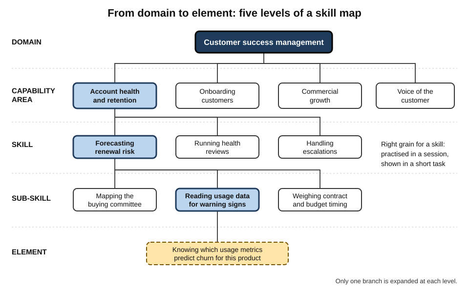
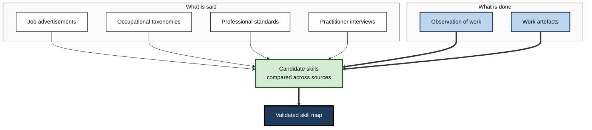
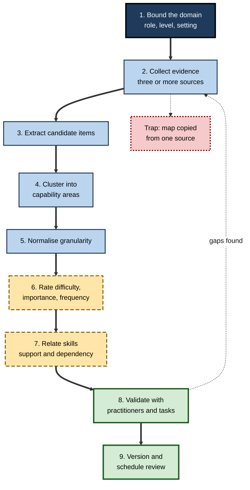
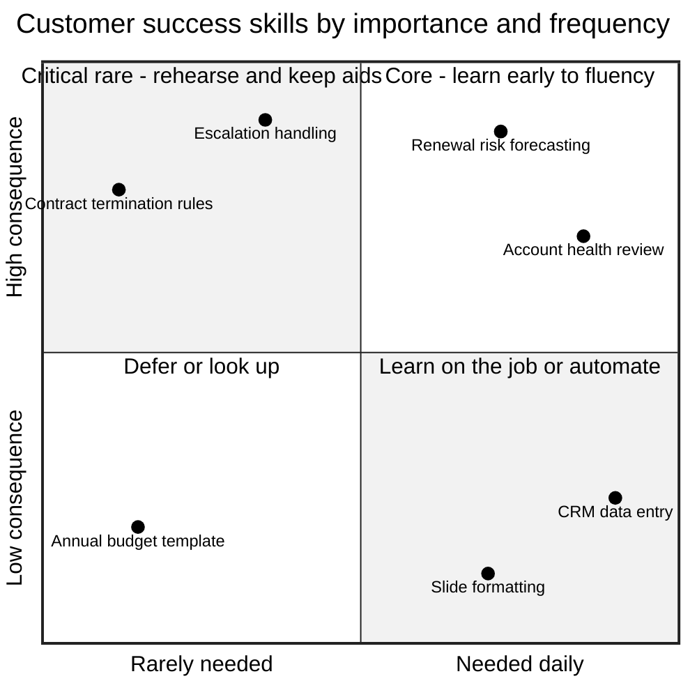
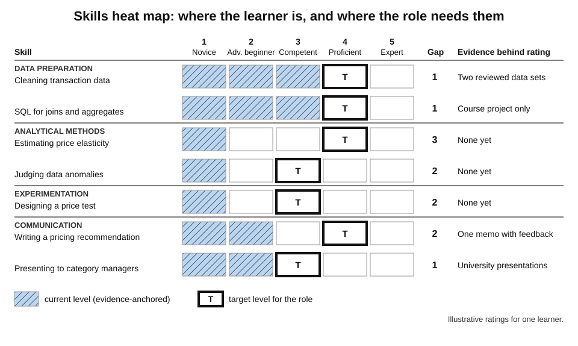

# C.2. Mapping Skills in a Domain

Ask ten customer-success managers what their job requires and the answers will overlap only partly: one stresses product knowledge, another negotiation, a third data dashboards. Watch them work for a week and a richer picture appears — renewal forecasting, handling escalations, translating customer complaints into product requests, judging when to involve sales. Turning that picture into an organised, checkable inventory of capabilities is the work of **skill mapping**, and every sound learning roadmap rests on it.

> **Definition — Skill map (domain skill map):** a structured inventory of the capabilities that competent performance in a domain requires, organised into a hierarchy or network, described at a consistent level of detail, and usually linked to levels of proficiency.

**Why it matters**

- **It defines the terrain.** A route can only be as good as the map beneath it; omitted skills are never learned, and imaginary ones waste time.
- **It makes the invisible visible.** Much professional capability — judgement, prioritising, handling people — is never written in job descriptions until someone maps it.
- **It enables measurement.** A learner, manager or assessor can only judge a gap against a defined list.
- **It is the backbone of organisational talent systems.** Hiring criteria, career ladders, training catalogues and workforce plans all depend on some skill map, explicit or not.

---

## The Building Blocks of a Skill Map

### Units of capability

- **Task** — a unit of work with a beginning, an end and an output.
  - *e.g.* "prepare a quarterly business review for a client".
- **Skill** — a learned capacity to perform tasks or parts of tasks well.
  - *e.g.* "synthesise account data into a narrative of value delivered".
- **Knowledge area** — a body of facts, concepts and principles the skills draw on.
  - *e.g.* "subscription revenue metrics: churn, expansion, net revenue retention".
- **Ability** — a relatively enduring capacity, partly innate, that supports many skills.
  - *e.g.* verbal reasoning; spatial ability.
- **Disposition** — a habitual tendency or attitude that shapes performance.
  - *e.g.* curiosity about the customer's business; conscientiousness in follow-up.

> **Definition — Task versus skill:** a task is **what is done**; a skill is **what enables it**. One task usually needs several skills, and one skill usually serves many tasks.

> **Key point:** most good skill maps start from **tasks** — because tasks are observable — and then derive the skills and knowledge they demand. Maps that start from abstract skill labels tend to drift away from real work.

### Levels of granularity

A skill map is a hierarchy of increasingly fine units.

1. **Domain** — the whole field or role. *e.g.* customer success management.
2. **Capability area** — a major cluster of related skills. *e.g.* account health and retention.
3. **Skill** — a distinct, learnable, assessable capacity. *e.g.* forecasting renewal risk.
4. **Sub-skill** — a component of a skill. *e.g.* reading product-usage data for early warning signs.
5. **Element** — the smallest unit worth naming: a single fact, step or criterion. *e.g.* knowing which usage metrics predict churn for this product.

**Figure 1.** A domain decomposed into capability areas, skills and sub-skills.

**Choosing the right grain**

- **Too coarse** — "communication" — cannot be taught, practised or assessed as a single unit.
- **Too fine** — three hundred elements — the map becomes a manual that nobody reads or maintains.
- **Rule of thumb:** a **skill** should be something that can be practised in a session and assessed by a short observable performance.
  - Capability areas typically number five to ten per role; skills, a few dozen.

> **Remember:** a skill is at the right grain when you can answer three questions about it — *how would I practise it, how would I show it, and who could judge it?*

### Proficiency levels

A skill map becomes a development tool once each skill has defined levels.

- **The Dreyfus model** — Stuart and Hubert Dreyfus (1980), developed from studies of pilots, chess players and drivers:
  1. **Novice** — follows context-free rules.
  2. **Advanced beginner** — begins to recognise situational aspects from experience.
  3. **Competent** — plans deliberately; chooses what to attend to; feels responsible for outcomes.
  4. **Proficient** — sees situations as wholes; recognises what is important intuitively.
  5. **Expert** — acts fluidly from deep tacit understanding; rules recede.
- **Patricia Benner (1984)** applied the model to nursing in *From Novice to Expert*, showing how clinical judgement develops through experience of cases.
- **Framework scales** — many organisational frameworks use their own scales.
  - *e.g.* SFIA uses **seven levels of responsibility**, from following instructions under close supervision to setting strategy for an organisation.

> **Watch out:** the Dreyfus stages are a **descriptive model**, built from observation and philosophical argument, not a measured scale. They are useful for writing level descriptors; they are not proof that every skill passes through exactly five stages.

| | Behavioural level descriptors | Task-based level descriptors |
|---|---|---|
| Form | "Communicates clearly with stakeholders" | "Runs a renewal negotiation for a mid-size account without support" |
| Ease of writing | Easy | Harder — needs real task knowledge |
| Ease of assessing | Hard — vague, rater-dependent | Easier — observable outcome |
| Typical failure | Everyone rates themselves highly | Becomes outdated as tasks change |
| Best use | Broad cultural expectations | Learning roadmaps and promotion evidence |

---

## Where Skill Evidence Comes From

### Six kinds of evidence

- **Job descriptions and advertisements** — what employers say they want.
  - Fast to collect in quantity; reveal tools and credentials in demand.
  - Often inflated wish-lists; silent about judgement and tacit skills.
- **Occupational taxonomies** — national and international classifications of occupations and skills.
  - **O\*NET**, the United States' occupational information network, launched in 1998 to replace the *Dictionary of Occupational Titles*; it describes roughly a thousand occupations by tasks, knowledge, skills, abilities and work context.
  - **ESCO**, the European multilingual classification, which in its 2024 version described about **3,000 occupations** and nearly **14,000 skills and knowledge concepts** in 28 languages.
  - **SFIA**, the Skills Framework for the Information Age, whose ninth version (2024) defines **147 professional skills** for digital work across seven levels of responsibility.
- **Professional standards** — competence standards set by professional bodies and regulators.
  - *e.g.* national occupational standards, licensing syllabi, accreditation criteria.
- **Practitioner interviews and panels** — what experienced workers say the job requires.
- **Observation of work** — what practitioners actually do, including what they would not think to mention.
- **Work artefacts** — reports, code, case files, tickets and logs that show the outputs of skill.

| Source | Strength | Weakness | Best for |
|---|---|---|---|
| Job advertisements | Volume, currency, tools in demand | Wish-lists; omit tacit skill | Spotting market trends and entry requirements |
| Occupational taxonomies | Comprehensive, standardised vocabulary | Generic; slow to update | A starting checklist and shared language |
| Professional standards | Authoritative; tied to licensing | Minimum standards, not excellence | Regulated roles |
| Practitioner interviews | Rich, contextual | Experts omit what has become automatic | Judgement and priorities |
| Observation | Captures what is really done | Time-consuming; observer effects | Tacit and routine skills |
| Work artefacts | Objective evidence of outputs | Show results, not reasoning | Quality standards and level descriptors |

> **Key point:** no single source is sufficient. **Triangulate** — a skill that appears in taxonomies, advertisements *and* observed work is almost certainly real; one that appears only in advertisements may be a passing fashion.

**Figure 2.** Triangulating evidence into a skill map.

---

## Methods for Mapping a Domain

Several established methods exist. They differ in who supplies the knowledge, how it is captured and what they are best at revealing.

### Job and task analysis

> **Definition — Job analysis:** the systematic study of a job to identify its tasks, the conditions under which they are performed, and the knowledge, skills and other characteristics they require.

- **Typical steps:**
  1. list tasks from documents, interviews and observation;
  2. survey job holders to rate each task's frequency and importance;
  3. derive the knowledge and skills each important task requires.
- **Strength:** grounded in real work; defensible for hiring and assessment.
- **Weakness:** describes the job as it is today.

### DACUM

> **Definition — DACUM ("Developing A Curriculum"):** a facilitated workshop method in which a panel of expert workers from an occupation jointly builds a chart of its duties and tasks, from which training is then designed.

- **Origins:** developed in Canada in the late 1960s and spread widely through vocational education, notably by Robert Norton at Ohio State University.
- **Format:** a small panel — typically around a dozen or fewer — of high-performing practitioners, a trained facilitator, about two days.
- **Output:** a single chart listing broad **duties** (rows) and the specific **tasks** within each, plus general knowledge, skills, tools and worker behaviours.
- **Key premise:** expert workers describe their own job better than anyone else, *if* skilfully facilitated.
- **Weakness:** relies on what experts can articulate; can miss tacit judgement and future change.

### Functional analysis

- **Developed in the United Kingdom** from the late 1980s to build national occupational standards.
- **Works top-down from purpose:**
  1. **key purpose** of the occupation;
  2. **key roles** that achieve it;
  3. **units** of competence within each role;
  4. **elements** with performance criteria.
- **Strength:** every unit traces to the occupation's purpose, so the map is coherent.
- **Weakness:** can become abstract and bureaucratic; standards may run to many pages.

### Critical incident technique

**Study card — John Flanagan (1954), the critical incident technique**

- **Context:** developed from work in the United States Army Air Forces' aviation psychology programme during the Second World War, studying why pilot trainees failed and what distinguished effective from ineffective performance.
- **Method:**
  - ask practitioners or observers to describe **specific incidents** of notably effective or ineffective behaviour;
  - record what led up to it, exactly what the person did, and the outcome;
  - classify hundreds of incidents into categories of critical behaviour.
- **Finding:** concrete incidents revealed requirements that general job descriptions missed.
- **Contribution:** a way to capture the behaviours that **make a difference** — not merely the routine ones.

> **In practice:** asking "tell me about the last time a renewal nearly failed — what did you do, step by step?" yields far better skill evidence than "what skills does this job need?"

### Competency modelling

- **Behavioural event interviews** — a structured form of incident interviewing — compare **outstanding** and **average** performers to identify the characteristics that distinguish them.
  - Popularised by David McClelland's work in the 1970s and by Lyle and Signe Spencer's *Competence at Work* (1993).
- **Strength:** focuses on what drives superior, not merely adequate, performance.
- **Weakness:** outputs are often broad behavioural labels ("results orientation") that are hard to teach.

### Expert knowledge elicitation

- **Cognitive task analysis** — a family of interview and observation techniques designed to surface the decisions and cues experts use but rarely state.
- Valuable where judgement dominates — diagnosis, incident response, trading, investigation.

| Method | Knowledge source | Reveals best | Effort | Main limitation |
|---|---|---|---|---|
| **Job and task analysis** | Documents, surveys, job holders | Task inventory with frequency and importance | Moderate to high | Snapshot of today's job |
| **DACUM** | Panel of expert workers | Duties and tasks, quickly | Low to moderate | Misses unarticulated judgement |
| **Functional analysis** | Occupational experts, top-down | Coherent standards linked to purpose | High | Abstract; bureaucratic |
| **Critical incidents** | Concrete stories of success and failure | What makes the difference | Moderate | Biased towards memorable events |
| **Competency modelling** | Outstanding versus average performers | Drivers of superior performance | High | Broad, hard-to-teach labels |
| **Cognitive task analysis** | Experts in action, probed | Hidden cues and decisions | High | Expensive; needs skilled analysts |

> **Key point:** for a **personal** roadmap, a light combination works well — a taxonomy as a checklist, a handful of job advertisements for currency, and two or three critical-incident conversations with practitioners.

---

## Building a Skill Map Step by Step

### The procedure

1. **Bound the domain** — which role or capability, at what level, in what setting.
   - "Data analysis" is unbounded; "analyst in a retail pricing team" is mappable.
2. **Collect evidence** from at least three different sources.
3. **Extract candidate items** — every task, skill, knowledge area and tool mentioned.
4. **Cluster** — group items into capability areas.
   - **Card sorting** — writing items on cards and grouping them, alone or with practitioners — quickly reveals natural clusters.
5. **Normalise granularity** — merge duplicates, split overloaded items, push tools down to sub-skill level.
6. **Rate** each skill for difficulty, importance and frequency.
7. **Relate** — mark which skills support or depend on others.
8. **Validate** — have practitioners review the draft; test it against a few real tasks.
9. **Version** — date it and plan when it will be reviewed.

**Figure 3.** The procedure for building a skill map.

### Rating skills: difficulty, importance and frequency

Training designers have long rated tasks on three dimensions — often called **DIF analysis** — to decide what deserves most attention.

- **Difficulty** — how hard the skill is to learn and perform well.
- **Importance** — the consequence of performing it badly.
- **Frequency** — how often it is needed.

| Pattern | Implication for learning |
|---|---|
| High importance, high frequency | Core: learn early, to fluency, with much practice |
| High importance, low frequency | Critical rare event: learn to a procedure, rehearse periodically, keep job aids |
| Low importance, high frequency | Learn quickly on the job; automate or use tools |
| Low importance, low frequency | Defer or skip; look up when needed |

> **Formula — Simple priority score:** priority = importance × frequency × difficulty, each rated 1–5. Example: renewal-risk forecasting rated importance 5, frequency 4, difficulty 4 → 5 × 4 × 4 = **80**; formatting slide templates rated 2, 4, 1 → **8**. The first deserves ten times the attention.

> **Watch out:** multiplying ratings rewards precision that the ratings do not have. Treat the score as a way to **sort into bands** — core, important, peripheral — not as an exact measure.

**Figure 4.** Placing skills by importance and frequency to decide how they should be learned.

### Relating skills

- **Supports** — skill A makes skill B easier but is not strictly required.
  - *e.g.* spreadsheet fluency supports financial analysis.
- **Requires** — B cannot be performed meaningfully without A.
  - *e.g.* interpreting a regression requires understanding variance.
- **Co-occurs** — A and B are typically used together in the same tasks.
  - *e.g.* stakeholder interviewing and requirements writing.
- **Substitutes** — A and B achieve similar outcomes by different means.
  - *e.g.* two different analytics tools.

> **Key point:** only the **requires** relationship constrains the *order* of learning; the others shape grouping and practice design. Over-marking "requires" produces a map with artificial bottlenecks.

---

## Skill Trees, Skill Graphs and Skills Taxonomies

### Trees and graphs

- **Skill tree** — each skill has one parent; the map branches downwards from the domain.
  - Easy to read and assess; forces each skill into one place.
- **Skill graph** — skills are nodes, relationships are links of several kinds; a skill can belong to several areas.
  - Truer to reality; harder to read without good visual design.
- **Practical compromise:** a tree for **navigation** (capability areas → skills), with cross-links marked only where they matter.

### Labour-market skills graphs

- **What they are:** very large databases built by parsing millions of job advertisements, CVs and course descriptions, linking skills that appear together.
- **Uses:**
  - showing which skills are rising or falling in demand;
  - measuring **skill adjacency** — how close one skill or role is to another, judged by shared skills;
  - suggesting next skills for a learner, or internal moves for an employee.
- **Limitations:**
  - advertisements record employers' **requests**, not the work actually done;
  - co-occurrence is not dependency — two skills listed together need not be learned together;
  - tools are over-represented, judgement under-represented.

> **Definition — Skill adjacency:** the degree of overlap between the skills required for two skills or roles; high adjacency suggests a shorter, cheaper transition.

> **Watch out:** skills extracted automatically from text inherit the text's biases. A graph built from advertisements for "data scientist" will show many tool names and few of the judgement skills practitioners say matter most.

### Skills taxonomies inside organisations

- **Skills-based organisations** attempt to describe work as skills rather than fixed jobs, so that people can be matched to projects and development by skill.
- **Common components:**
  - a **skills library** — a controlled list of skill names and definitions;
  - **proficiency scales** for each;
  - **skill profiles** for roles;
  - **employee skill records**, increasingly inferred automatically from work systems.
- **Governance problems:** duplicate and near-duplicate skills multiply; definitions drift; self-reported records inflate.

---

## Using the Map: Locating Oneself

### Self-assessment against a skill map

- **Rate each skill** on the chosen proficiency scale.
- **Attach evidence** to each rating — a task done, an artefact produced, feedback received.
- **Mark confidence** — how sure the rating is.
- **Produce a heat map** — capability areas as rows, skills as columns or cells, shaded by current level against target level.

**Figure 5.** A skills heat map comparing current and target proficiency.

> **Watch out:** people with the least skill in a domain often overestimate it most — the pattern reported by Justin Kruger and David Dunning (1999). Later analyses argue that part of the pattern is a statistical artefact of regression to the mean and the general tendency to rate oneself above average; the size of the effect is **debated**. The practical lesson is uncontroversial: **anchor self-ratings to evidence**, and ask someone more skilled to check them.

### Team skill matrices

- A **skills matrix** lists team members against skills, with proficiency levels in each cell.
- **Uses:** spotting single points of failure (one person knows a critical system), planning cross-training, staffing projects.
- **Rule used in many operational teams:** every critical skill should be held at working level by at least two or three people.

---

## Common Errors in Skill Mapping

- **Tool lists masquerading as skill maps** — "Python, SQL, Tableau" says nothing about what the analyst must *do* with them.
- **Missing glue skills** — framing problems, prioritising, explaining results, judging when to escalate.
- **Inconsistent grain** — "Excel" next to "strategic thinking".
- **Mapping only the visible** — tasks that leave artefacts get mapped; quiet judgement does not.
- **Mapping yesterday** — a map validated by people who learned the job ten years ago.
- **Maps too large to use** — hundreds of items with equal weight hide the core.
- **Confusing co-occurrence with dependency** — making learners study things in a fixed order that the field does not require.

> **Mnemonic — "TIGER Maps Mislead":** Tool lists, Inconsistent grain, Glue skills missing, Everything equal weight, Retro (yesterday's job), Mapping only the visible, Misread dependencies.

---

## Worked Example: Mapping a Pricing Analyst Role

- **Situation:** Leila, a finance graduate, wants to become a pricing analyst in a retail company.

1. **Bound the domain** — junior pricing analyst, retail, two years to independent competence.
2. **Collect evidence:**
   - twenty job advertisements from her region;
   - the relevant occupational profile in a national taxonomy;
   - interviews with two practising pricing analysts, using incident questions ("walk me through the last price change you recommended").
3. **Extract and cluster** — from about sixty raw items she forms five capability areas:
   - data preparation; commercial understanding; analytical methods; experimentation; communication and influence.
4. **Normalise** — "SQL", "Excel" and "Python" become sub-skills under *data preparation*; "communication" splits into *writing pricing recommendations* and *presenting to category managers*.
5. **Rate** (importance × frequency × difficulty, 1–5):

| Skill | I | F | D | Score | Band |
|---|---|---|---|---|---|
| Estimating price elasticity from sales data | 5 | 4 | 4 | 80 | Core |
| Preparing and cleaning transaction data | 4 | 5 | 3 | 60 | Core |
| Writing a pricing recommendation | 5 | 3 | 3 | 45 | Core |
| Designing a price test | 5 | 2 | 4 | 40 | Important |
| Competitor price monitoring | 3 | 4 | 2 | 24 | Important |
| Building dashboards | 2 | 3 | 2 | 12 | Peripheral |

6. **Relate** — elasticity estimation *requires* data preparation and basic regression; price-test design *requires* elasticity concepts; dashboards merely *co-occur*.
7. **Validate** — one practitioner points out a missing glue skill: **judging when a data anomaly is a real market signal** versus a data error. It is added under analytical methods.

- **Conclusion:** Leila's map has five areas and fifteen skills, three of them core; her roadmap will start with data preparation and elasticity, with recommendation writing practised from the first month.

> **Watch out:** Leila's original list from job advertisements gave dashboards the same prominence as elasticity — because advertisements mention tools more than judgement.

---

## Case Study: A DACUM Workshop for Customer Success Managers

- **Situation:** a software company had grown its customer-success team from five to sixty people in three years. New managers were trained on the product and the customer-relationship system, then left to learn the rest.
- **Problem:**
  - customer renewal rates varied widely between managers;
  - managers' own development requests were mostly for product training;
  - the company's competency framework described the role in six generic behaviours ("customer focus", "collaboration") that no one could use.
- **Actions:**
  1. Ran a two-day DACUM workshop with eight of the highest-performing managers and an external facilitator.
  2. Produced a chart of **eight duties** and **seventy-one tasks**, including several nobody had written down — such as *identifying the customer's internal champion and planning for their departure*.
  3. Ran critical-incident interviews on twenty renewals that were nearly lost, and added the behaviours that saved them.
  4. Rated each task by importance, frequency and difficulty with a survey of all managers.
  5. Defined **three proficiency levels** for the fifteen highest-priority skills, each with observable evidence.
- **Result:**
  - new managers' learning roadmaps were rebuilt around the fifteen skills, with real-account practice from the first month;
  - development requests shifted from product training towards renewal forecasting and executive conversations;
  - managers and their leaders reported more useful development conversations, because they now discussed specific skills with evidence.
- **Side effects:**
  - the chart needed updating within a year as the company introduced usage-based pricing;
  - some experienced managers resisted being rated on newly explicit skills.
- **Lesson:** the most valuable output of skill mapping is often the **tacit skills made explicit** — the ones that distinguished top performers but appeared in no document.

---

## Professional Mastery in Skill Mapping

- **Keep the map task-anchored.** Every skill should trace to tasks that matter.
- **Separate the stable from the volatile.** Underlying capabilities (estimating demand, diagnosing faults) change slowly; tools change fast. Map tools as replaceable sub-skills.
- **Map the frontier, not just the core.** Add a small "emerging" area for skills the field is moving towards, flagged as provisional.
- **Design for assessment.** A skill without a way to show it will be ignored in practice.
- **Mind the politics.** Skill maps affect pay, promotion and redundancy decisions; involving practitioners improves both accuracy and acceptance.
- **Mind privacy.** Automatically inferred skill records about employees raise questions of consent, accuracy and fair use.
- **AI as a mapping assistant.** Language models can draft skill inventories and cluster large sets of advertisements rapidly; the drafts still need practitioner validation, since they reproduce the bias of their sources towards visible tools and away from judgement.

---

## Open Questions

- **What is the right grain for a skill?**
  - Taxonomies disagree by orders of magnitude on how many skills exist; there is no agreed definition of a single "skill".
- **Can skills inferred from work data be trusted?**
  - Automated inference from documents, code and messages is spreading; its accuracy and fairness are largely unvalidated.
- **How quickly do skill maps decay?**
  - Fast-moving fields may need maps revised every year; there is little systematic evidence on how fast different domains change.
- **How can judgement be mapped without reducing it to checklists?**
  - The skills that matter most at expert level are the hardest to describe as discrete units.
- **Do skills-based organisations deliver what they promise?**
  - Claims of better mobility and hiring are widespread; rigorous evaluations are few.

---

## Summary

- A **skill map** is a structured inventory of the capabilities a domain requires, at a consistent grain, usually with **proficiency levels**.
- Distinguish **tasks** (what is done) from **skills, knowledge, abilities and dispositions** (what enables it); start from tasks.
- Map at levels: **domain → capability area → skill → sub-skill → element**; a skill is the right grain when it can be practised, shown and judged.
- Proficiency models include **Dreyfus** (novice to expert) and framework scales such as SFIA's seven levels; task-based level descriptors are easier to assess than behavioural ones.
- Evidence sources: **advertisements, taxonomies (O\*NET, ESCO, SFIA), professional standards, interviews, observation, artefacts** — triangulate.
- Methods: **job and task analysis, DACUM, functional analysis, critical incident technique, competency modelling, cognitive task analysis**.
- Build by bounding, collecting, extracting, clustering, normalising, **rating (difficulty, importance, frequency)**, relating, validating and versioning.
- Only **"requires"** links constrain order; co-occurrence is not dependency.
- Labour-market **skills graphs** measure adjacency and demand but over-represent tools.
- Self-assess with **evidence-anchored** ratings; the Dunning–Kruger pattern is real in direction but debated in size.
- Common errors: tool lists, missing glue skills, inconsistent grain, mapping only the visible or yesterday's job, maps too big to use.

---

## Self-Check

1. Define a skill map and distinguish a task from a skill.
2. Name the five levels of granularity and give an example of each for a role you know.
3. What three questions test whether a skill is at the right grain?
4. Describe the Dreyfus model's five stages. What is its evidential status?
5. Compare job advertisements and observation of work as sources of skill evidence.
6. What is DACUM, and what is its main weakness?
7. Describe Flanagan's critical incident technique and why it captures what general questions miss.
8. Explain DIF analysis and how a high-importance, low-frequency skill should be learned.
9. Calculate the priority score for a skill rated importance 4, frequency 2, difficulty 5. Why should the result be treated cautiously?
10. Why does only the "requires" relationship constrain learning order?
11. What is skill adjacency, and what are the limitations of skills graphs built from job advertisements?
12. A team lead proposes mapping a new data-engineering team's skills by copying the list of tools in their job advertisement. Identify three problems and propose a better approach.
13. An employee rates themselves "expert" in stakeholder management, but their manager disagrees. How should a skill map and its use be designed to resolve this?
14. Design the first three steps of mapping the skills of a hospital ward manager, naming the evidence sources and method you would use.

### Answer Key

1. A structured inventory of the capabilities competent performance in a domain requires, organised at a consistent grain and usually linked to proficiency levels. A task is a unit of work with an output (what is done); a skill is a learned capacity that enables tasks (what makes doing it possible).
2. Domain (customer success), capability area (retention), skill (forecasting renewal risk), sub-skill (reading usage data for warning signs), element (knowing which metrics predict churn for the product).
3. How would I practise it? How would I show it? Who could judge it?
4. Novice (context-free rules), advanced beginner (situational aspects), competent (deliberate planning and responsibility), proficient (seeing wholes intuitively), expert (fluid, tacit action). It is a descriptive model from observation and argument, not a measured scale.
5. Advertisements are numerous and current and reveal tools in demand, but are wish-lists and omit tacit skill. Observation captures what is really done, including unspoken skills, but is slow and may alter behaviour.
6. A facilitated workshop in which expert workers build a chart of an occupation's duties and tasks in about two days. Its weakness is reliance on what experts can articulate, so tacit judgement and future change may be missed.
7. Practitioners describe specific incidents of notably effective or ineffective behaviour — context, actions, outcome — which are classified into critical behaviours. Concrete cases surface decisive behaviours that people do not think of when asked in general terms.
8. Rating tasks by difficulty, importance and frequency to set learning priorities. A high-importance, low-frequency skill should be learned to a clear procedure, rehearsed periodically and supported by job aids, because it will not be practised naturally.
9. 4 × 2 × 5 = 40. The ratings are rough judgements, so the multiplication implies false precision; use it to sort skills into bands rather than as an exact measure.
10. Only a true dependency means one skill cannot be performed meaningfully without the other. "Supports" and "co-occurs" relationships suggest grouping or helpful order but impose no necessity; treating them as requirements creates artificial bottlenecks.
11. The overlap of skills between two skills or roles. Advertisement-based graphs record requests rather than real work, confuse co-occurrence with dependency, and over-represent tools relative to judgement.
12. Tool lists omit what the engineers must do with the tools; they miss glue skills such as designing for reliability and communicating with data consumers; and they reflect the advertisement writer rather than the work. Better: bound the role, combine a taxonomy, a few advertisements and critical-incident interviews with experienced data engineers, cluster into capability areas, rate by importance and frequency, and validate with the team.
13. Define proficiency levels with task-based, observable descriptors; require evidence for each rating; have ratings calibrated by someone with expertise; and treat the disagreement as a prompt to gather evidence (for example, observed stakeholder meetings or feedback), not a contest of opinions.
14. Step 1: bound the role — ward manager of a medical ward in a particular hospital, at the level of independent leadership. Step 2: collect evidence from the professional and regulatory standards for nurse leaders, several job descriptions, observation of two ward managers over shifts, and incident review data. Step 3: run critical-incident interviews with experienced ward managers about recent staffing crises and safety events, then extract and cluster candidate tasks and skills.

---

## Glossary

| Term | Meaning |
|---|---|
| Ability | A relatively enduring capacity, partly innate, that supports many skills. |
| Behavioural event interview | A structured interview comparing outstanding and average performers through specific past events. |
| Capability area | A major cluster of related skills within a domain. |
| Card sorting | Grouping items written on cards to reveal natural categories. |
| Cognitive task analysis | Techniques that surface the decisions and cues experts use but rarely state. |
| Competency modelling | Identifying characteristics that distinguish superior from average performers. |
| Critical incident technique | Collecting and classifying specific incidents of effective and ineffective behaviour. |
| DACUM | A facilitated expert-worker workshop that charts an occupation's duties and tasks. |
| DIF analysis | Rating tasks or skills by difficulty, importance and frequency to set priorities. |
| Disposition | A habitual tendency or attitude that shapes performance. |
| Dreyfus model | A five-stage description of skill development from novice to expert. |
| ESCO | The European multilingual classification of skills, competences and occupations. |
| Functional analysis | Top-down mapping from an occupation's key purpose to units and elements of competence. |
| Granularity | The level of detail at which items in a skill map are described. |
| Job analysis | Systematic study of a job's tasks, conditions and requirements. |
| O\*NET | The United States' occupational information network. |
| Proficiency level | A defined stage of capability in a skill, with descriptors. |
| SFIA | The Skills Framework for the Information Age, defining digital skills across seven levels. |
| Skill | A learned capacity to perform tasks or parts of tasks well. |
| Skill adjacency | The overlap between the skills required for two skills or roles. |
| Skill graph | A network of skills linked by relationships of several kinds. |
| Skill map | A structured inventory of a domain's required capabilities at consistent grain. |
| Skill tree | A hierarchical skill map in which each skill has one parent. |
| Skills matrix | A table of people against skills showing proficiency in each cell. |
| Task | A unit of work with a beginning, an end and an output. |
