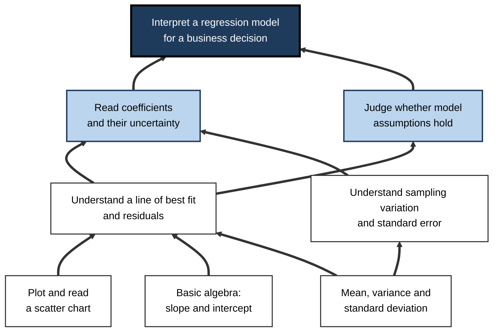
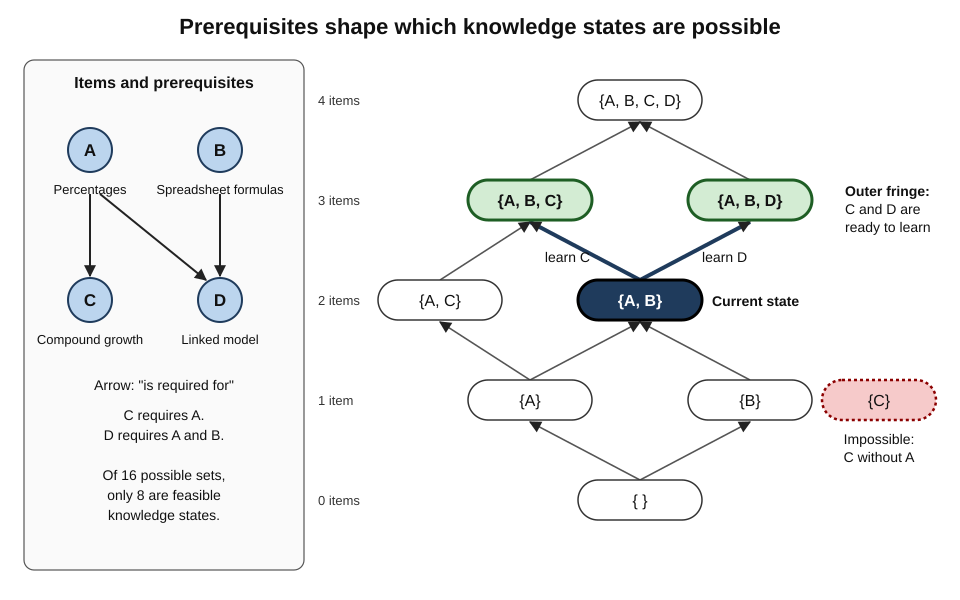
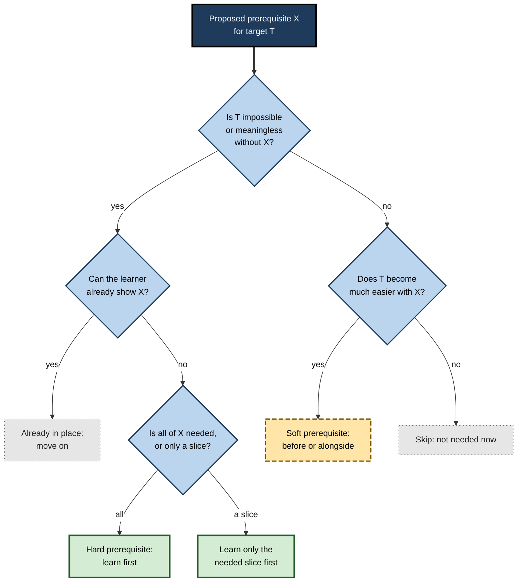
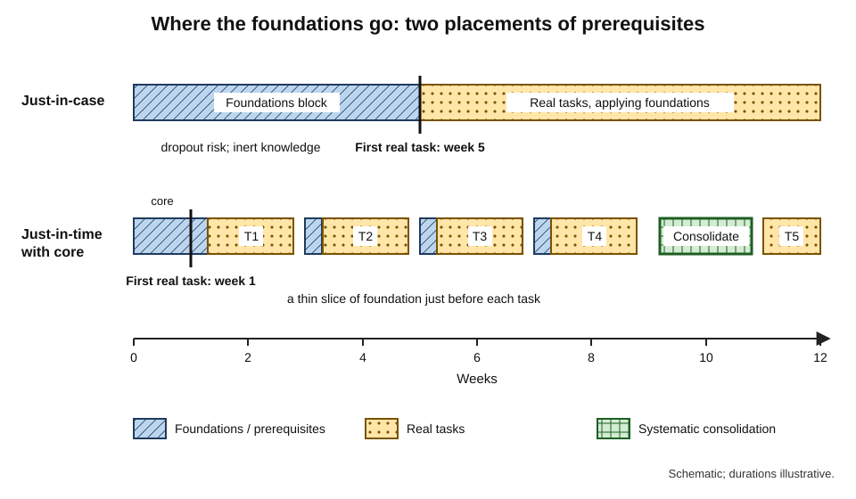
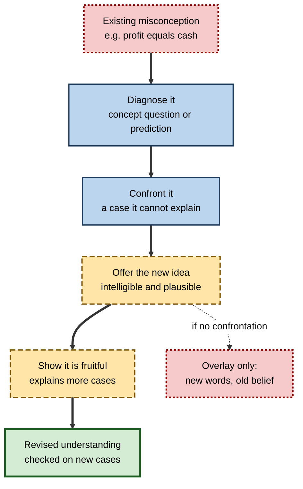
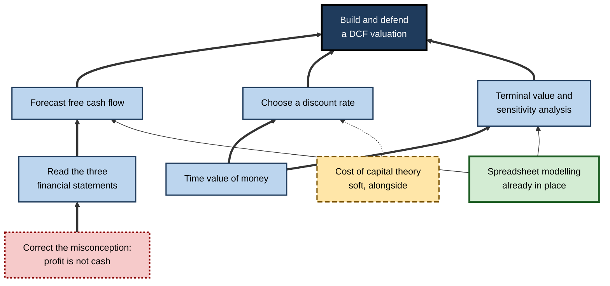

# A.3. Identifying Prerequisite Knowledge

Two people set out to learn machine learning. The first decides she must "do the maths properly first" and spends eight months on calculus textbooks before writing a line of model code — then discovers she needed perhaps a tenth of what she studied. The second dives straight into a tutorial on neural networks and is lost within an hour, because every step assumes he can multiply matrices. Both misjudged the same thing: **what must come first**.

> **Definition — Prerequisite knowledge:** knowledge or skill that must already be in place for a later piece of learning to be meaningful, efficient or possible.

**Why it matters**

- **Missing prerequisites make learning fail silently.** The learner reads, copies and nods along, but nothing connects; the cause is invisible unless sought.
- **Excess prerequisites waste time and drive people away.** Long "foundations first" phases delay real practice and deter learners who would have succeeded.
- **Prerequisites decide sequence.** They are the hard constraints on any roadmap's order.
- **They are central to fairness.** Prerequisites that are not genuinely needed act as gates that exclude capable people.

---

## What Counts as a Prerequisite

### Kinds of prerequisite

- **Hard prerequisite** — the later learning is impossible or meaningless without it.
  - *e.g.* understanding what a variable is before learning to solve equations.
- **Soft prerequisite** — the later learning is possible but slower or shallower without it.
  - *e.g.* knowing basic accounting makes learning corporate finance easier, but it can be picked up alongside.
- **Co-requisite** — knowledge best learned *at the same time* as the target, because each makes sense of the other.
  - *e.g.* statistical concepts learned alongside the analysis software used to apply them.
- **Gatekeeping prerequisite** — a requirement imposed by a course, profession or employer that is not functionally necessary for the learning itself.
  - *e.g.* requiring a calculus course before an introductory applied statistics course whose content uses none.

| | Hard | Soft | Co-requisite | Gatekeeping |
|---|---|---|---|---|
| Is the target learnable without it? | No | Yes, less efficiently | Yes, best learned together | Yes |
| Effect of skipping | Failure, confusion | Slower progress | Weaker integration | None on learning; may block access |
| Roadmap treatment | Place before | Place before or alongside | Interleave | Question; satisfy only if a credential needs it |

### Prerequisite knowledge and prior knowledge

- **Prior knowledge** — everything a learner already knows that bears on the new domain, helpful or not.
- **Prerequisite knowledge** — the subset that the new learning *depends on*.
- **Negative prior knowledge** — misconceptions and habits that **interfere** with new learning.
  - *e.g.* a learner who believes "profit means cash in the bank" will misread cash-flow statements.

> **Key point:** identifying prerequisites is not only asking *"what must be added?"* but also *"what must be corrected?"*

---

## Why Prior Knowledge Is So Powerful

### Knowledge as the main driver of new learning

- New information is understood by connecting it to what is already in **long-term memory**.
- With relevant prior knowledge, the learner recognises patterns, chunks information and spares the limited capacity of **working memory**.
- Without it, every element of new material must be held and processed separately — and overload follows.

**Study card — Simonsmeier and colleagues (2022), prior knowledge meta-analysis**

- **Design:** a meta-analysis of studies measuring domain-specific prior knowledge and later learning, across many domains and ages.
- **Results:**
  - prior knowledge was a **strong predictor of later knowledge** — learners who knew more at the start knew more at the end;
  - prior knowledge was only a **weak and inconsistent predictor of learning gains** — knowing more did not reliably mean *gaining* more.
- **Conclusion:** prior knowledge sets the **level** at which learners operate, but how much they gain depends on many other factors, including the quality of the prior knowledge and the instruction.

> **Watch out:** the slogan "the more you know, the faster you learn" is only partly supported. Relevant, accurate prior knowledge clearly helps; irrelevant or mistaken prior knowledge can slow or distort learning.

### The expertise reversal effect

> **Definition — Expertise reversal effect (Slava Kalyuga, Paul Ayres, Paul Chandler and John Sweller, 2003):** instructional methods that help learners with little prior knowledge become ineffective or even harmful for learners with more.

- *e.g.* fully worked examples help novices, but slow down learners who already know the method; they learn more from solving problems.
- **Implication for prerequisites:** a prerequisite check decides not only *what* to learn next but **how** to learn it.

### Readiness and the next step

- **Lev Vygotsky's zone of proximal development** — the range of tasks a learner cannot yet do alone but can do with help.
- A learner whose prerequisites are in place is **inside** the zone for the next topic; one whose prerequisites are missing is outside it, and help will not close the gap.

---

## Learning Hierarchies

### Gagné's question

**Study card — Robert Gagné (early 1960s), learning hierarchies**

- **Question asked of any target capability:** *"What would the learner have to be able to do already in order to learn this, given only instructions?"*
- **Method:** applied the question repeatedly, working downwards from a target task (such as solving a class of mathematics problems) to build a **hierarchy** of subordinate capabilities.
- **Test:** learners were assessed on every capability in the hierarchy.
- **Findings:**
  - learners who **failed** a subordinate capability rarely succeeded on the capability above it;
  - learners who **mastered** the subordinate capabilities usually learned the higher one readily.
- **Contribution:** a practical, testable method for identifying prerequisites — and for checking whether a proposed prerequisite really is one.

> **Definition — Learning hierarchy:** an arrangement of capabilities in which each higher capability depends on mastery of the ones beneath it.

**Figure 1.** A learning hierarchy for interpreting a regression model, built by repeatedly asking "what must come first?".

### Building a hierarchy in practice

1. **State the target** as an observable task.
2. **Ask Gagné's question** of the target; list each answer as a subordinate capability.
3. **Repeat** for each subordinate until reaching capabilities the learner can already demonstrate.
4. **Prune** — for each proposed link, ask whether the higher capability is *truly impossible* without the lower, or merely easier.
5. **Test** — check a few learners (or oneself) on the lower capabilities and see whether failures predict difficulty above.

> **Remember:** stop decomposing at the point where the learner can **already demonstrate** the capability. Everything below that is already in place.

---

## Knowledge Space Theory

### States, structures and fringes

**Study card — Jean-Paul Doignon and Jean-Claude Falmagne (1985), knowledge spaces**

- **Idea:** describe a learner's knowledge of a domain as the **set of problems they can solve** — their **knowledge state**.
- **Constraint:** prerequisite relations mean that only some states are possible.
  - If problem B requires A, no learner should be able to solve B without A; states containing B but not A are excluded.
- **Knowledge structure:** the family of all possible states, from the empty state to the full domain.
- **Key concept — the outer fringe:** the problems a learner is **ready to learn next**, because all their prerequisites are already in the learner's state.
- **Application:** the theory underlies adaptive assessment systems, notably ALEKS, developed in the 1990s, which asks a short sequence of questions to infer a learner's state and then offers only problems on its outer fringe.

> **Definition — Outer fringe:** the items not yet mastered whose prerequisites have all been mastered — the learner's best next steps.

> **Definition — Inner fringe:** the mastered items that could be removed from the state without making it impossible — typically the most recently learned, and the most fragile.

**Figure 2.** Knowledge states and the outer fringe in a small domain.

- **Why it matters for roadmaps:**
  - it formalises "what should I learn next?" as **the outer fringe**;
  - it shows that a well-designed assessment can locate a learner efficiently, because prerequisite structure rules out most states;
  - it explains why many orders are valid — any path up the structure respects the prerequisites.

> **Watch out:** the theory is mathematically elegant, but the evidence on adaptive systems built on it is **mixed** — results depend heavily on how they are used in classrooms. The structure is only as good as the prerequisite relations fed into it.

### From one learner to millions: data-driven prerequisites

- **Knowledge tracing** — statistical models (for example, Bayesian knowledge tracing, described by Albert Corbett and John Anderson in 1994) estimate the probability that a learner has mastered each skill from their pattern of right and wrong answers.
- **Prerequisite discovery from data** — when learners who fail item A also tend to fail item B, but not the reverse, A may be a prerequisite of B.
- **Limitation:** such patterns reflect the order in which material was **taught**, not only the order in which it **must** be learned.

---

## Methods for Identifying Prerequisites

### Six methods

- **Backward analysis** — Gagné's question applied downwards from the target.
  - Best for well-structured technical domains.
- **Curriculum comparison** — collecting the stated prerequisites of several respected courses on the target topic.
  - Items listed by nearly all are likely genuine; items listed by one may be habit or gatekeeping.
- **Error analysis** — studying where learners get stuck and asking what missing knowledge explains the error.
  - *e.g.* finance students who cannot discount cash flows usually lack fluency with exponents, not with finance.
- **Diagnostic pre-assessment** — short tests of candidate prerequisites before starting.
- **Attempt-and-see** — trying a real target task early and noting precisely what blocks progress.
  - Turns abstract worry ("do I know enough maths?") into specific gaps ("I cannot read summation notation").
- **Expert review** — asking practitioners which foundations they actually use and which they never touch.

| Method | What it reveals | Strength | Weakness |
|---|---|---|---|
| **Backward analysis** | Logical dependencies | Systematic, testable | Can over-decompose; misses practical shortcuts |
| **Curriculum comparison** | Consensus of educators | Quick; draws on experience | Inherits tradition and gatekeeping |
| **Error analysis** | Prerequisites that actually fail | Grounded in real difficulty | Needs observation of many learners |
| **Diagnostic pre-assessment** | This learner's specific gaps | Precise, personal | Needs good test items |
| **Attempt-and-see** | Gaps that block real tasks | Fast; motivating | Can be discouraging; misses subtle gaps |
| **Expert review** | What practitioners really use | Prunes unnecessary theory | Experts forget what they once needed |

> **In practice:** combine **attempt-and-see** with **diagnostic checks**. Try a small real task in the first week; for each obstacle, write the specific missing item; test that item directly; learn only that slice.

### Is it really a prerequisite?

**Figure 3.** Testing whether a proposed prerequisite should come first.

---

## Just-in-Case and Just-in-Time Prerequisites

### Two strategies

- **Just-in-case** — learn the full foundations first, in case they are needed.
  - Traditional in universities: mathematics before engineering, anatomy before clinical work.
- **Just-in-time** — learn each prerequisite at the moment a real task demands it, and only as much as the task demands.
  - Typical of self-taught practitioners and project-based courses.

| | Just-in-case | Just-in-time |
|---|---|---|
| Order | Foundations, then application | Application, pulling in foundations as needed |
| Motivation | Often low — purpose unclear | Often high — immediate need |
| Coherence of foundations | High — systematic coverage | Risk of gaps and fragmented understanding |
| Time to first real task | Long | Short |
| Risk | Over-learning; dropout; inert knowledge | Shaky foundations; repeated confusion |
| Suits | Regulated professions; deep specialisms; highly cumulative fields | Fast-moving practical fields; adult career changers |

> **Definition — Inert knowledge (from Alfred North Whitehead's "inert ideas", 1929):** knowledge that can be recalled when asked but is not used in situations where it would be relevant — a common result of learning foundations long before and apart from their use.

**Figure 4.** Just-in-case and just-in-time placement of prerequisites over time.

### The hybrid: minimum viable prerequisites

- **Identify the core slice** of each foundation that the first real tasks need — learn it **first**, properly.
- **Defer the rest** until tasks demand it, then return to it systematically.
- **Schedule a consolidation pass** — once the learner has used the foundations in several tasks, a structured review fills gaps and connects fragments.

> **Example:** for applied machine learning, a minimum viable mathematical core might be: vectors and matrix multiplication; the idea of a derivative as a rate of change and of gradient descent; probability distributions, expectation and variance. Proofs, eigen-decomposition and measure theory can wait until a task requires them — for many practitioners, they never do.

**Study card — Logue, Watanabe-Rose and Douglas (2016), remediation as a prerequisite**

- **Setting:** community colleges of the City University of New York; students assessed as needing remedial elementary algebra before college-level mathematics.
- **Design:** students were randomly assigned to:
  - traditional remedial algebra (the prerequisite route);
  - remedial algebra with extra workshop support;
  - **college-level introductory statistics with workshop support** — skipping the algebra prerequisite.
- **Results:** students placed directly into statistics with support passed at **higher** rates than those in remedial algebra, and went on to accumulate more college credits.
- **Conclusion:** for these students and this course, the algebra prerequisite was functioning partly as a **gate** rather than a genuine requirement.

> **Watch out:** this does not show that prerequisites are unnecessary in general. It shows that a **traditional** prerequisite can be weaker than assumed — and that the question must be tested for each target, not settled by custom.

---

## Misconceptions: Prerequisites to Remove

### Why wrong knowledge is worse than no knowledge

- A learner with **no** idea about a topic will build one from instruction.
- A learner with a **wrong** idea will often reinterpret instruction to fit it.
  - *e.g.* a programmer who reads `x = x + 1` as an impossible equation, not an update.
  - *e.g.* a manager who believes "more people on a late project speeds it up" will misread scheduling advice — Frederick Brooks (1975) argued that adding people to a late software project makes it later.

**Study card — Hestenes, Wells and Swackhamer (1992), the Force Concept Inventory**

- **Design:** a multiple-choice test of basic Newtonian concepts, with wrong answers built from common intuitive beliefs (for example, that a moving object needs a continuing force to keep moving).
- **Results:** many students who had passed university physics courses — some with good grades — still chose the intuitive, non-Newtonian answers.
- **Conclusion:** conventional instruction often leaves underlying misconceptions **intact**, even when students can solve textbook problems.
- **Legacy:** **concept inventories** have since been developed in many fields to diagnose misconceptions before and after instruction.

> **Definition — Concept inventory:** a diagnostic test whose wrong options are built from common misconceptions, so that answers reveal *how* a learner thinks, not only whether they are right.

### Conditions for changing a misconception

- **Posner, Strike, Hewson and Gertzog (1982)** proposed that learners replace a conception only when:
  1. they are **dissatisfied** with the existing one — it fails to explain something;
  2. the new one is **intelligible** — they can understand it;
  3. it is **plausible** — it could be true;
  4. it is **fruitful** — it explains more and opens new possibilities.

> **Mnemonic — "DIPF: Doubt, Intelligible, Plausible, Fruitful":** the four conditions for conceptual change.

**Figure 5.** How a misconception is replaced rather than merely overlaid.

> **In practice:** before learning a new field, ask a practitioner, *"What do newcomers most often believe that is wrong?"* — and test oneself on those beliefs first.

---

## Diagnosing One's Own Prerequisites

### Tests, not feelings

- **Familiarity is a poor guide.** "I did statistics at university" says nothing about whether standard deviation can be explained today.
- **Use performance checks** for each candidate prerequisite:
  - **explain** it in plain words without notes;
  - **solve** two or three typical problems unaided;
  - **apply** it inside a small task from the target domain.
- **Time-box the check** — a prerequisite check should take minutes per item, not days.

### Typical prerequisite checks by type

- **Concepts** — explain and give an example. *e.g.* "What is a standard error, and why does it shrink with sample size?"
- **Procedures** — perform without help. *e.g.* "Write a query joining two tables and filtering by date."
- **Vocabulary** — define key terms quickly. *e.g.* fifteen core terms of the domain, defined in a minute each.
- **Tools** — complete a basic operation. *e.g.* create, run and save a notebook.

> **Remember:** a prerequisite is **in place** only if it can be shown **unaided, today**. Anything else is a hope.

---

## Worked Example (illustrative): Prerequisites for a Discounted Cash-Flow Valuation

- **Situation:** Tomás, a marketing manager, wants to build and defend a discounted cash-flow (DCF) valuation of a small business within three months.

1. **State the target:** "Build a DCF model of a small company from its accounts and explain each assumption to a sceptical reviewer."
2. **Backward analysis** — what must be in place to learn this?
   - forecasting free cash flows; choosing a discount rate; calculating terminal value; sensitivity analysis.
3. **Repeat downwards** — for forecasting free cash flow: reading an income statement, balance sheet and cash-flow statement; distinguishing profit from cash. For discounting: time value of money; exponents; spreadsheet formulas.
4. **Classify and check:**

| Candidate | Type | Check | Tomás's result | Decision |
|---|---|---|---|---|
| Spreadsheet formulas and references | Hard | Build a small linked model | Passed | Already in place |
| Exponents and percentages | Hard | Five compound-growth problems | Passed slowly | Brief refresh |
| Time value of money | Hard | Discount three cash flows by hand | Failed | Learn first |
| Reading three financial statements | Hard | Explain a real company's statements | Partly | Learn first |
| Profit versus cash | Misconception check | Predict cash from a profitable but growing firm | Wrong | Confront first |
| Cost of capital theory | Soft | Explain the capital asset pricing model | Failed | Alongside discount-rate work |
| Advanced statistics | Gatekeeping for this target | — | — | Skip |

5. **Order:** profit-versus-cash misconception → time value of money → statement reading → then DCF components, with cost-of-capital theory learned alongside discount-rate choice.

**Figure 6.** The resulting prerequisite graph for the DCF target.

- **Conclusion:** Tomás avoids a two-month detour into general finance theory and statistics, and starts building partial models by week three.

> **Watch out:** the misconception check was the most valuable step. Without it, Tomás would have forecast cash flows from profits and produced a confidently wrong valuation.

---

## Prerequisites in Organisations

- **Entry diagnostics** — short assessments at the start of a learning path that allow people to **test out** of modules they already know.
- **Prerequisite chains in certification paths** — vendor and professional credentials often require lower-level credentials first.
  - Useful where they reflect genuine dependency; wasteful where they mainly sell courses.
- **Readiness checks before stretch assignments** — confirming a person has the foundations before giving them a high-stakes project.
- **Bridging modules** — short, targeted content for groups whose prerequisites differ, such as experienced hires from adjacent fields.

### Case study (illustrative): removing a foundations block from an analytics academy

- **Situation:** a retail bank ran a twelve-week analytics academy for employees moving into data roles. The first five weeks covered mathematics and statistics "foundations".
- **Problem:**
  - a large share of participants withdrew during the foundations block;
  - those who completed it often could not apply the statistics when analysis work began;
  - experienced participants were bored and disengaged.
- **Diagnosis:**
  - the foundations block was **just-in-case** and disconnected from tasks;
  - no entry diagnostic, so everyone sat through everything;
  - much of the mathematics was never used in the bank's actual analysis work.
- **Actions:**
  1. Analysts listed the mathematical and statistical ideas their real work used; the list was about a third of the original block.
  2. An entry diagnostic let participants skip foundations they could already demonstrate.
  3. The remaining foundations were split into short units placed **immediately before** the analysis tasks that needed them.
  4. A consolidation week near the end reviewed foundations systematically, now with concrete tasks to anchor them.
- **Result:** withdrawals fell; participants' use of statistical reasoning in their final projects improved, by the assessors' judgement; experienced participants finished sooner.
- **Side effects:** some participants with weak foundations needed extra coaching when the just-in-time units came too quickly.
- **Lesson:** prerequisites should be **tested, trimmed and placed close to use** — but a just-in-time design still needs a safety net for learners furthest from the start line.

---

## Open Questions

- **How can genuine prerequisites be distinguished from teaching habit at scale?**
  - Data-driven methods detect patterns in learners' answers, but these are confounded by the order of instruction.
- **How much fragmentation does just-in-time learning cause?**
  - Practitioners report patchy foundations; the long-term effects on adaptability have not been well studied.
- **Which traditional prerequisites are gates?**
  - Evidence from remedial-education trials suggests some are; systematic testing across professions is rare.
- **Can adaptive systems reliably infer a learner's state?**
  - Knowledge-space and knowledge-tracing models work in narrow, well-structured domains; their reach into ill-structured professional fields is unclear.
- **How should AI tools change what counts as prerequisite?**
  - If tools perform some foundational operations, what must still be understood in order to use and check them is unsettled.

---

## Summary

- A **prerequisite** is knowledge that later learning depends on; distinguish **hard, soft, co-requisite and gatekeeping** prerequisites.
- **Prior knowledge** includes helpful foundations and harmful **misconceptions**; identifying prerequisites means adding *and* correcting.
- Prior knowledge strongly predicts later knowledge but only weakly predicts gains (Simonsmeier and colleagues, 2022); the **expertise reversal effect** means prerequisite status changes how to learn, not only what.
- **Gagné's learning hierarchies** identify prerequisites by asking repeatedly what must already be possible; failures below predict failures above.
- **Knowledge space theory** models learners' states and the **outer fringe** — what they are ready to learn next.
- Methods: **backward analysis, curriculum comparison, error analysis, diagnostic pre-assessment, attempt-and-see, expert review** — best combined.
- **Just-in-case** foundations risk inert knowledge and dropout; **just-in-time** risks fragmentation; the hybrid is **minimum viable prerequisites** plus a consolidation pass.
- A randomised trial at CUNY found that some remedial prerequisites act as **gates**.
- **Misconceptions** must be diagnosed (e.g. concept inventories) and replaced via dissatisfaction, intelligibility, plausibility and fruitfulness.
- A prerequisite is in place only if it can be **shown unaided, today**.

---

## Self-Check

1. Define prerequisite knowledge and distinguish it from prior knowledge.
2. Distinguish hard, soft, co-requisite and gatekeeping prerequisites, with an example of each.
3. What did Simonsmeier and colleagues find about prior knowledge and learning?
4. Explain the expertise reversal effect and what it implies for prerequisite checks.
5. State Gagné's question and explain how learning hierarchies were tested.
6. What is a knowledge state, and what is the outer fringe?
7. Why can data on learners' answers mislead when used to discover prerequisites?
8. Compare just-in-case and just-in-time approaches to prerequisites.
9. What is inert knowledge, and how does it arise?
10. Summarise the CUNY randomised trial and what it does and does not show.
11. Why can a misconception be worse than no knowledge? Name the four conditions for conceptual change.
12. A colleague says, "I did statistics at university, so I have the prerequisites for this data course." How would you check?
13. Design a minimum viable prerequisite set for someone learning to build simple web applications, and say what you would defer.
14. A professional body requires a two-year general theory qualification before any practical training. How would you investigate whether it is a genuine prerequisite or a gate?

### Answer Key

1. Knowledge or skill that later learning depends on. Prior knowledge is everything relevant a learner already knows — including misconceptions; prerequisite knowledge is the subset the new learning needs.
2. Hard: understanding variables before solving equations. Soft: accounting basics before corporate finance. Co-requisite: statistical concepts with analysis software. Gatekeeping: calculus required before an applied statistics course that uses none.
3. Prior knowledge strongly predicted later knowledge, but only weakly and inconsistently predicted learning gains — it sets the level of performance more than the amount gained.
4. Methods that help novices, such as worked examples, can hinder learners with more knowledge. A prerequisite check should therefore determine both what to learn next and which methods suit the learner's level.
5. "What would the learner have to be able to do already to learn this, given only instructions?" Hierarchies were tested by assessing learners on all capabilities: failure on a subordinate capability predicted failure above it, and mastery predicted success.
6. A knowledge state is the set of problems a learner can solve. The outer fringe is the set of unmastered items whose prerequisites are all mastered — what the learner is ready to learn next.
7. Patterns of success and failure reflect the order in which material was taught as well as genuine dependency, so taught order can masquerade as prerequisite structure.
8. Just-in-case learns full foundations first — coherent but slow, demotivating and prone to inert knowledge. Just-in-time learns foundations when tasks demand them — motivating and efficient but at risk of gaps and fragmentation.
9. Knowledge that can be recalled but is not used when relevant; it arises when foundations are learned long before and apart from the situations that need them.
10. Students assessed as needing remedial algebra were randomly assigned to remedial algebra (with or without support) or directly to college statistics with workshop support; the statistics group passed at higher rates and earned more credits later. It shows that this traditional prerequisite acted partly as a gate; it does not show prerequisites are generally unnecessary.
11. A misconception leads learners to reinterpret instruction to fit the old belief. Conditions: dissatisfaction with the existing idea, and a new idea that is intelligible, plausible and fruitful.
12. Ask them to explain key concepts (standard deviation, sampling variation) without notes, solve a few typical problems unaided, and apply them inside a small analysis task. Only unaided performance today counts.
13. For example: core — basic programming (variables, functions, control flow), HTML and CSS structure, how a browser requests a page from a server, and using version control at a basic level. Defer — algorithms and data structures beyond basics, advanced database theory, performance optimisation, and framework internals, until tasks require them.
14. Compare practitioners' actual use of the theory with its content; analyse whether performance in practical training differs between those with and without it (for example, among entrants with alternative routes); review pass and attrition data; pilot an integrated route with a comparison group; and check which parts are tied to genuine safety or regulatory needs.

---

## Glossary

| Term | Meaning |
|---|---|
| Bayesian knowledge tracing | A statistical model estimating the probability that a learner has mastered each skill from their answers. |
| Co-requisite | Knowledge best learned at the same time as the target. |
| Concept inventory | A diagnostic test whose wrong options embody common misconceptions. |
| Conceptual change | The replacement of an existing conception by a new one. |
| Expertise reversal effect | Methods that help novices becoming ineffective or harmful for more knowledgeable learners. |
| Gatekeeping prerequisite | A required prior qualification or course that is not functionally necessary for the learning. |
| Hard prerequisite | Knowledge without which the target learning is impossible or meaningless. |
| Inert knowledge | Knowledge that can be recalled but is not used when relevant. |
| Inner fringe | Mastered items most recently added to a knowledge state, and the most fragile. |
| Just-in-case learning | Learning foundations in full before they are needed. |
| Just-in-time learning | Learning foundations when, and as far as, a task requires them. |
| Knowledge space theory | A mathematical theory modelling learners' possible knowledge states under prerequisite constraints. |
| Knowledge state | The set of problems in a domain that a learner can solve. |
| Learning hierarchy | An arrangement of capabilities in which each depends on those beneath it. |
| Minimum viable prerequisite | The smallest slice of a foundation needed for the first real tasks. |
| Misconception | A mistaken belief that interferes with learning correct ideas. |
| Outer fringe | Unmastered items whose prerequisites are all mastered. |
| Prerequisite knowledge | Knowledge or skill that later learning depends on. |
| Prior knowledge | Everything a learner already knows that bears on a new domain. |
| Soft prerequisite | Knowledge that makes later learning easier but is not strictly required. |
| Zone of proximal development | Tasks a learner cannot yet do alone but can do with help. |
