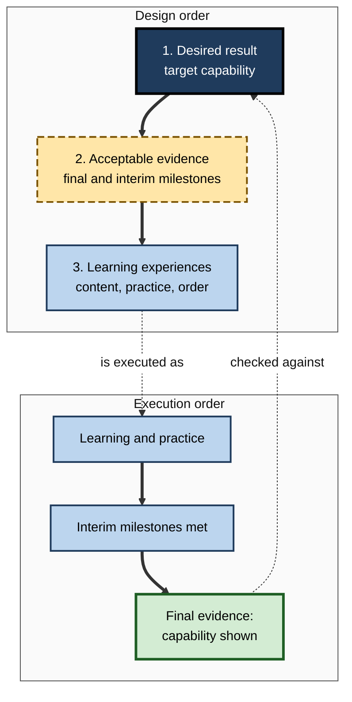
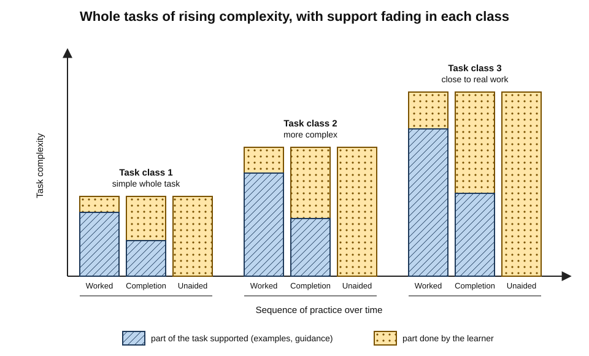
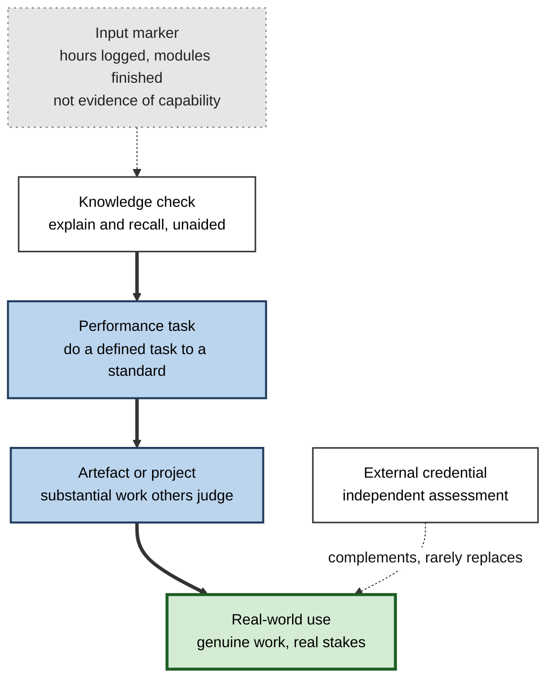
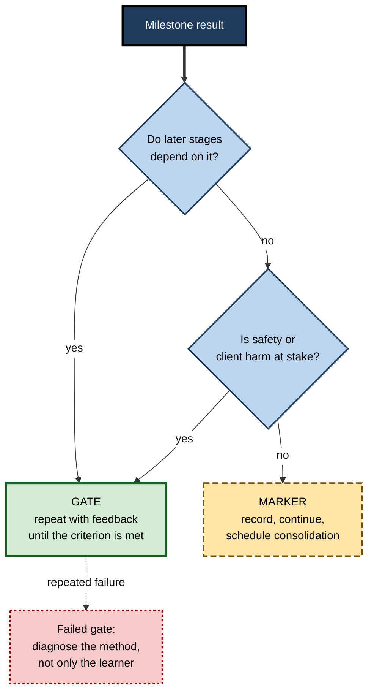
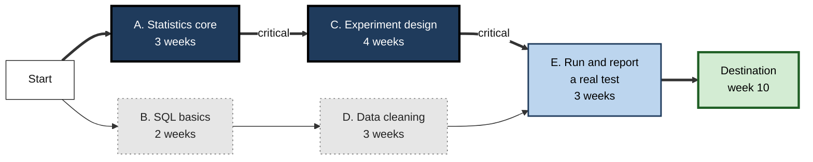
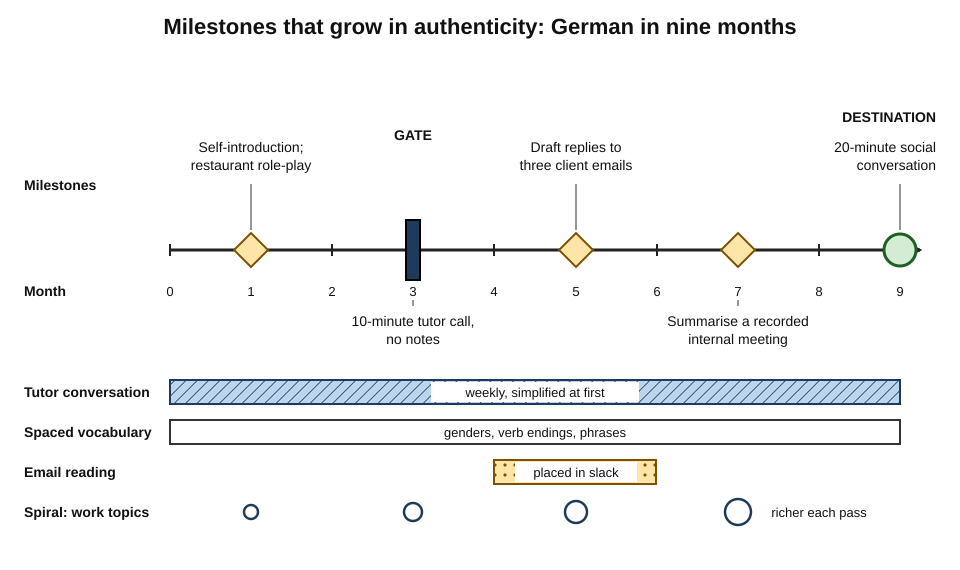

# C.4. Sequencing Learning Milestones

A new software engineer's onboarding plan reads: "Week 1 — complete orientation modules. Week 2 — read architecture documentation. Week 3 — complete security training." By week four she has finished everything and still has not changed a line of production code. Her colleague at another company ships a one-line fix on day two, a small feature in week two and takes a supervised on-call shift in week six. Both plans had **milestones**; only one sequenced them so that each step was a **real capability**, built on the last.

> **Definition — Learning milestone:** a planned checkpoint at which the learner demonstrates, against a stated criterion, a capability that marks meaningful progress towards the destination.

> **Definition — Sequencing:** deciding the order in which learning units, practice and milestones occur, so that each builds on what came before and leads efficiently to the target capability.

**Why it matters**

- **Order changes what is learned.** The same content in a different order can produce confusion or understanding, fragments or an integrated skill.
- **Milestones convert months into weeks.** A distant goal gives little guidance today; a milestone three weeks away does.
- **Milestones are the evidence.** Without them, progress is judged by effort and feeling — both poor guides.
- **Sequence decides when real practice starts** — and early real practice is one of the strongest drivers of motivation and transfer.

---

## Starting From the End: Backward Design

### The three stages

**Grant Wiggins and Jay McTighe, *Understanding by Design* (1998)**

1. **Identify desired results** — what the learner should understand and be able to do.
2. **Determine acceptable evidence** — what performances would show that the results have been achieved.
3. **Plan learning experiences** — only then choose content, activities and order.

- **The reversal:** most course design starts with content ("what shall we cover?"); backward design starts with **evidence** ("what would convince us?").
- **Consequence for roadmaps:** milestones are designed **before** the learning activities, and the activities exist to make the milestones achievable.

> **Key point:** a milestone is not a summary of what was studied. It is the **evidence** the whole sequence is built to produce.

**Figure 1.** Backward design: milestones are defined before the learning that leads to them.

---

## Principles of Sequencing

### Whole tasks from simple to complex

- **The problem with "all the parts first":** learning every component in isolation, then assembling, often leaves learners unable to **coordinate** the parts — and delays any experience of the real task.
- **Jeroen van Merriënboer's four-component instructional design (4C/ID, 1997)** proposes instead:
  - **task classes** — groups of whole, realistic tasks of equal difficulty, sequenced from simple to complex;
  - **supportive information** — the theory and mental models for each task class, given before or during it;
  - **procedural information** — step-by-step how-to, given just in time while performing;
  - **part-task practice** — extra drill only for routine components that must become automatic.
- **Within each task class, support fades:**
  - start with worked examples and heavily guided tasks;
  - move to completion tasks (part of the solution given);
  - end with conventional, unaided tasks.

**Figure 2.** Whole-task sequencing: task classes of rising complexity, with support fading within each.

> **Example (illustrative):** a junior auditor's first task class is auditing a small, clean set of accounts with a senior's worked file to follow; the second, a mid-sized company with a partly completed file; the third, a company with known control weaknesses, unaided. Every task is a **whole audit**; only the complexity and the support change.

### When parts first is right

**Naylor and Briggs (1963), task organisation and complexity**

- **Proposal:** the choice between whole-task and part-task practice depends on two properties of the task.
  - **Complexity** — the demands of each component.
  - **Organisation** — how tightly the components interact.
- **Prediction:**
  - highly organised tasks (components interlock in timing) → practise **whole**;
  - complex but loosely organised tasks (components fairly independent) → practise **in parts**, then combine.
- **Practical use:** drill independent routines (keyboard shortcuts, formulas, vocabulary) in parts; practise interdependent performances (a negotiation, a diagnosis, a live presentation) as wholes.

| | Whole-task sequencing | Part-task sequencing |
|---|---|---|
| Unit of practice | The full, realistic task, simplified | One component at a time |
| Builds best | Coordination, judgement, transfer | Fluency in routine components |
| Motivation | Early sense of real capability | Can feel disconnected from purpose |
| Risk | Overload if the simplest version is still too hard | Learner never learns to integrate |
| Suits | Highly interdependent tasks | Complex tasks with independent parts |

### Epitome first: the zoom lens

- **Charles Reigeluth's elaboration theory (late 1970s and early 1980s):** begin with an **epitome** — a simple but complete overview of the most fundamental ideas — then elaborate each part in successive passes.
- **Image:** a zoom lens, starting with the wide-angle view, zooming in on a part, zooming back out to see how it fits, then zooming into another.
- **Effect:** the learner always has a context for detail.

> **Example (illustrative):** a new analyst's first week covers the whole business model in one simple picture — how the company earns money, its main costs, its main customers — before any single function is studied in depth.

### Concrete before abstract — then fade

- **Concreteness fading** — a review by Emily Fyfe, Nicole McNeil, Ji Son and Robert Goldstone (2014) argued for starting with concrete, grounded examples, then progressively replacing them with abstract representations.
  - Concrete first → meaning; abstract later → generality and transfer.
- *e.g.* a finance trainee meets compounding first through a specific savings account, then a spreadsheet schedule, then the general formula.

### From examples to independence

- **Worked example → completion problem → independent problem.**
  - Research by Alexander Renkl, Robert Atkinson and colleagues in the early 2000s found that gradually **fading** worked-out steps improved learning compared with abrupt switches from examples to problems.
- **Ties to the expertise reversal effect:** as competence grows, examples should give way to problems — the sequence must move.

### Revisit and interleave across the sequence

- **Spiral returns** — core ideas reappear at greater depth in later stages rather than being "finished".
- **Spaced and mixed practice** — earlier skills are practised again later, mixed with new ones, which strengthens retention and the ability to choose the right method.

> **Remember — six sequencing principles:** start from the evidence; whole tasks simple to complex; parts only for independent routines; epitome before detail; concrete before abstract; fade support and revisit.

---

## Designing Milestones

### Kinds of milestone

- **Knowledge check** — recall and explanation, unaided.
  - *e.g.* explain the five main sources of cloud cost from memory.
- **Performance task** — doing a defined task to a standard.
  - *e.g.* configure and secure a small cloud environment from a written specification.
- **Artefact or project** — producing a substantial piece of work that others can judge.
  - *e.g.* a reproducible analysis, a design portfolio piece, a written legal opinion.
- **Real-world use** — performing the capability in genuine work, with real stakes.
  - *e.g.* leading a client workshop; handling a live support escalation.
- **External credential** — passing an assessment set by another body.
  - *e.g.* a professional examination or vendor certification.
- **Teaching or explaining** — explaining the capability to someone else so that they can use it.

**Figure 3.** Kinds of milestone, from weakest to strongest evidence of capability.

> **Watch out:** an external credential is strong evidence of what its examination measures — which may not be the target capability. Many certifications test recognition of facts more than performance of tasks.

### Input markers and output milestones

| | Input marker | Output milestone |
|---|---|---|
| Example | "Completed 40 hours of video"; "finished module 6" | "Built a working data pipeline that a reviewer accepted" |
| What it measures | Effort and exposure | Capability |
| Easy to record? | Very | Requires a task and a judge |
| Can it be gamed? | Easily — by clicking through | Hard, if the criterion is clear |
| Correct use | Tracking habits and pace | Judging progress and deciding next steps |

> **Key point:** input markers are useful for **habit and pace**; only output milestones are useful for **progress**. A roadmap needs both, and must never confuse them.

### Qualities of a good milestone

> **Mnemonic — SHOWN:** a milestone is good when the capability is
> - **S**pecific — one defined task or performance;
> - **H**ard enough — a genuine stretch from the previous milestone;
> - **O**bservable — produces evidence someone else could judge;
> - **W**ithout help — performed unaided, ideally after a delay;
> - **N**ext-step linked — its result decides what happens next.

- **Criterion-referenced** — judged against a stated standard, not against other learners.
- **Authentic** — as close as possible to the real task conditions.
- **Delayed where possible** — tested some days or weeks after the relevant learning, to show retention rather than short-term performance.
- **Judged by someone qualified** — a mentor, practitioner, assessor or a reliable automatic check.

### Spacing and grain of milestones

| Horizon | Typical interval | Purpose | Example |
|---|---|---|---|
| **Practice target** | Each session or week | Focus and habit | "Solve five join problems unaided" |
| **Capability milestone** | Every 3–6 weeks | Evidence of a new skill | "Analyse a real data set and present findings" |
| **Integrative milestone** | Every 3–6 months | Combination of skills in a whole task | "Deliver a small client project end to end" |
| **Destination** | 6–24 months | Target role or capability shown | "Working independently as a junior analyst" |

- **Too far apart** → drift; problems discovered late.
- **Too close together** → overhead; milestones become paperwork.

### Milestones and motivation

**Study card — Kivetz, Urminsky and Zheng (2006), the goal-gradient effect**

- **Background:** Clark Hull (1932) observed that rats ran faster as they approached food at the end of a runway — the **goal-gradient hypothesis**.
- **Design:** customers of a university café received coffee loyalty cards.
  - One version: 10 stamps needed for a free coffee, none pre-filled.
  - Other version: 12 stamps needed, 2 already filled — the same 10 purchases required.
- **Results:**
  - customers bought coffee **more frequently as they approached** the reward;
  - customers with the pre-filled 12-stamp card completed the card **faster**, though the effort required was identical.
- **Conclusion:** people accelerate as a goal approaches, and **perceived progress** itself increases effort.

- **Implications for milestone sequencing:**
  - motivation tends to sag in the **middle** of long stretches — so long stages benefit from intermediate milestones;
  - an early, achievable milestone creates a sense of progress that carries the learner forward;
  - each milestone resets the gradient for the next stage.

> **Watch out:** perceived progress can be manufactured — counting watched videos or completed modules raises the *feeling* of progress without capability. Use the goal-gradient effect to sustain effort towards **output** milestones, not to reward consumption.

---

## Gates, Mastery and Pace

### Gates and markers

- **Gate milestone** — must be passed before proceeding.
  - Appropriate when later stages genuinely depend on the capability, or when safety is at stake.
- **Marker milestone** — informs and celebrates, but does not block.
  - Appropriate when stages are loosely coupled, or when a learner can usefully continue while consolidating.

**Figure 4.** Deciding whether a milestone should be a gate or a marker.

### Mastery learning

- **Benjamin Bloom, "Learning for Mastery" (1968)** — most students can reach a high standard if given enough time and appropriate help.
  - Units end with **formative tests**; learners who do not reach the criterion receive **corrective** activities and retest before moving on.
- **Fred Keller's Personalised System of Instruction (1968)** — self-paced units; learners advance only after passing a unit test; tutors ("proctors") give immediate feedback.
- **The underlying idea** — from John Carroll's 1963 model of school learning — is that learners differ mainly in the **time** they need, so fixing time makes attainment vary, while fixing attainment makes time vary.

**Study card — Kulik, Kulik and Bangert-Drowns (1990), meta-analysis of mastery learning**

- **Design:** 108 controlled evaluations of mastery-learning programmes in colleges, high schools and upper elementary grades.
- **Results:**
  - mastery programmes raised final examination scores by about **half a standard deviation** — roughly from the 50th to the 70th percentile;
  - effects were considerably **larger on locally designed tests** than on standardised tests;
  - both Bloom-style and Keller-style programmes showed positive effects.
- **Conclusion:** gating progression on demonstrated mastery generally improves achievement.

> **Watch out:** Robert Slavin (1987, 1990) argued that the strongest effects came from short, experimenter-designed studies, and that effects on broad standardised measures over longer periods were much smaller. Bloom's later claim (1984) that tutoring with mastery learning could raise achievement by **two standard deviations** came from a few small studies; subsequent research on tutoring has generally found substantial but smaller effects. Mastery gating helps; its size is **debated**.

### Pace and calendar

- **Fixed-time sequences** — cohorts move together; simpler to organise; attainment varies.
- **Fixed-attainment sequences** — each learner moves when ready; fairer to capability; harder to schedule.
- **Hybrid** — fixed calendar for integrative milestones, flexible pace within stages.

---

## Dependencies, Parallel Tracks and the Critical Path

### Sequencing as scheduling

- A roadmap with dependencies is, formally, a **project network**: units are activities, prerequisites are precedence links.
- **The critical path method**, developed in the late 1950s by James Kelley and Morgan Walker for the DuPont company, finds the **longest chain** of dependent activities — which sets the **shortest possible** total duration.
- **Implications:**
  - units **on** the critical path cannot slip without delaying the destination;
  - units **off** it have slack and can be scheduled flexibly or in parallel;
  - shortening the roadmap means shortening the critical path, not working faster on side branches.

> **Formula — Critical path:** total duration = the longest sum of durations along any chain of dependent units. Example: chain A (3 weeks) → C (4 weeks) → E (3 weeks) = 10 weeks; parallel chain B (2) → D (3) → E (3) = 8 weeks. The minimum duration is **10 weeks**, and A and C are critical.

**Figure 5.** A learning roadmap as a dependency network with a critical path.

- **In this example:** B and D have two weeks of slack; the learner can study them in lighter weeks, while statistics and experiment design receive protected time.

---

## Worked Example (illustrative): Sequencing German for a Posting Abroad

- **Situation:** Arun, a sales engineer, moves to Munich in nine months. Clients speak English in formal meetings but German socially and in many emails. He has no German. He can give about five hours a week.

1. **Desired result** (backward design): "By month nine, hold 20-minute social conversations with clients, read and reply to routine emails, and follow the gist of internal meetings."
2. **Evidence** — define milestones first:

| Month | Milestone (unaided) | Type | Gate or marker |
|---|---|---|---|
| 1 | Introduce himself and his work for two minutes; order and pay in a restaurant role-play | Performance task | Marker |
| 3 | A 10-minute video call with a tutor about work and family, without notes | Performance task | Gate — core grammar and vocabulary needed later |
| 5 | Read three real client emails and draft replies a native speaker judges understandable | Artefact | Marker |
| 7 | Follow a recorded 15-minute internal meeting and summarise its decisions | Performance task | Marker |
| 9 | A 20-minute social conversation with a German colleague, assessed with a simple rubric | Real-world use | Destination |

3. **Sequence the learning:**
   - **Epitome first** — week 1: the sound system, 100 highest-frequency words, the basic sentence pattern.
   - **Whole tasks from the start** — every week includes a short real conversation with a tutor, simplified at first.
   - **Parts only for independent routines** — noun genders and verb endings drilled separately with spaced flashcards.
   - **Concrete before abstract** — case endings first met in fixed phrases ("mit dem Auto"), the rule system later.
   - **Spiral** — work topics revisited at months 1, 3, 5 and 7 with richer language each time.
4. **Critical path:** speaking practice and core grammar are critical; email reading has slack and is placed in months 4–6.

**Figure 6.** Arun's milestone sequence over nine months.

- **Conclusion:** every month contains real conversation; milestones grow in authenticity; the one gate falls where later stages depend on it.

> **Watch out:** Arun's first draft had "finish textbook chapters 1–6" as the month-three milestone. Chapters finished say nothing about whether he can hold a conversation — the capability his posting actually needs.

---

## Case Study (illustrative): Re-sequencing Engineering Onboarding

- **Situation:** a fintech company hired around a hundred engineers a year. Onboarding was a four-week sequence of documentation, recorded talks and compliance modules, followed by assignment to a team.
- **Problem:**
  - new engineers typically took two to three months to make a meaningful contribution;
  - many reported feeling "useless" for weeks; some early leavers cited onboarding;
  - teams complained that knowledge from the documentation weeks had to be retaught in context.
- **Diagnosis:**
  - the sequence was **parts first**, with no whole tasks for a month;
  - every milestone was an **input marker** (modules completed);
  - supportive information was front-loaded far from use.
- **Actions:**
  1. Defined the destination: "independently deliver a small feature through the full pipeline, and take a supervised on-call shift".
  2. Redesigned milestones as **output** evidence:
     - day 2 — development environment working; a one-line change merged with a mentor;
     - week 2 — a small, real bug fixed and released;
     - week 4 — a small feature designed, reviewed and shipped;
     - week 6 — an on-call shift shadowed; week 8 — a supervised shift as primary.
  3. Moved documentation and architecture talks to **just before** the milestone that needed them.
  4. Kept compliance modules but spread them across the first month.
  5. Paired each new engineer with an onboarding buddy who reviewed each milestone.
- **Result:** time to first meaningful contribution fell markedly, by teams' own reports; new engineers' satisfaction with onboarding rose; teams spent less time reteaching.
- **Side effects:** buddies needed protected time; some teams' codebases lacked suitable small tasks, which had to be curated.
- **Lesson:** sequencing milestones as **whole, real tasks of rising complexity** — with support placed just before need — transforms onboarding more than adding content.

---

## Professional Mastery: Sequencing for Others

- **Cohort sequences** must suit a range of starting points — use diagnostic entry, optional fast tracks and catch-up loops.
- **Competency-based progressions** sequence by entrustment: a learner moves from observing, to performing under direct supervision, to indirect supervision, to independence, for each professional activity.
- **Milestone inflation** — adding more and more checkpoints until learners spend more time proving than learning.
- **Goodhart's law** — the economist Charles Goodhart (1975) observed that a statistical regularity tends to break down once it is used as a target; in the form popularised by the anthropologist Marilyn Strathern, *"when a measure becomes a target, it ceases to be a good measure."*
  - Milestones that are easy to game (module completion, quiz scores with retakes) will be gamed.
- **AI-era milestones** — where tools can produce artefacts, milestones must specify **conditions**: what help is allowed, and whether the learner must explain or defend the work.

> **In practice:** the strongest professional sequences pair each integrative milestone with a short **oral defence** — the learner explains choices, alternatives and risks — which is hard to fake and reveals understanding.

---

## Open Questions

- **What is the optimal spacing of milestones?**
  - Intervals of weeks are common practice; little research compares milestone frequencies for adult self-directed learning.
- **How large are the benefits of mastery gating outside schools?**
  - Most evidence comes from classroom programmes; workplace and self-directed evidence is thin.
- **When does whole-task sequencing overload novices?**
  - The simplest whole task may still be too complex in some fields; how to judge this in advance is unsettled.
- **Can milestones remain valid when AI produces the artefacts?**
  - Assessment designers are experimenting with oral defences, process evidence and supervised tasks; which work best is unknown.
- **How should sequences adapt to individuals in real time?**
  - Adaptive systems resequence content in narrow domains; doing this for broad professional capabilities remains difficult.

---

## Summary

- A **milestone** is a planned checkpoint where a capability is demonstrated against a criterion; **sequencing** orders learning and milestones so each builds on the last.
- **Backward design** (Wiggins and McTighe): results → evidence → learning; milestones come first.
- Sequencing principles: **whole tasks simple to complex** (4C/ID, fading support); **parts** only for independent routines (Naylor and Briggs); **epitome first** (Reigeluth); **concrete before abstract**; worked examples faded to independence; **spiral and interleave**.
- Milestone kinds: knowledge check, performance task, artefact, real-world use, credential, teaching — with real-world use the strongest evidence.
- Distinguish **input markers** (effort) from **output milestones** (capability); good milestones are **SHOWN** — Specific, Hard enough, Observable, Without help, Next-step linked.
- The **goal-gradient effect** shows effort rises as goals approach and with perceived progress; use intermediate milestones to avoid mid-stage sag.
- **Gates** block until mastery; **markers** inform. **Mastery learning** raises achievement by about half a standard deviation (Kulik and colleagues, 1990), though effect sizes are debated.
- The **critical path** — the longest dependent chain — sets the minimum duration; off-path units have slack.
- Beware **milestone inflation** and **Goodhart's law**; in the AI era, specify conditions and use oral defences.

---

## Self-Check

1. Define a learning milestone and explain why "against a stated criterion" matters.
2. Describe the three stages of backward design and how they change roadmap building.
3. What are the four components of 4C/ID, and what happens to support within a task class?
4. According to Naylor and Briggs, when should a task be practised whole and when in parts?
5. What is an epitome in elaboration theory?
6. Distinguish an input marker from an output milestone, with examples.
7. Explain each letter of SHOWN.
8. Describe the coffee-card study and its implications for milestone sequencing.
9. When should a milestone be a gate rather than a marker?
10. Summarise the evidence on mastery learning, including the debate about its size.
11. Compute the critical path for: A (2 weeks) → B (5) → D (2); A → C (3) → D. Which units have slack?
12. A team's onboarding milestones are "watch all security videos", "read the wiki" and "complete the quiz". Redesign them.
13. A learner says, "I'll practise presentations only after I've learned all the theory of rhetoric." What sequencing advice would you give, and why?
14. How should milestones be designed when learners have access to AI tools that can produce the required artefacts?

### Answer Key

1. A planned checkpoint where the learner demonstrates a capability marking meaningful progress. Without a stated criterion, there is no way to decide whether the milestone was met; progress becomes a matter of opinion.
2. Identify desired results; determine acceptable evidence; plan learning experiences. In roadmaps, milestones (evidence) are designed before content is chosen, and content is selected to make the milestones achievable.
3. Task classes (whole tasks grouped by difficulty, simple to complex), supportive information, procedural information and part-task practice. Within each task class, support fades from worked examples to completion tasks to unaided tasks.
4. Practise whole when components are highly organised (interdependent); practise in parts when the task is complex but its components are fairly independent, then combine.
5. A simple but complete overview of a field's most fundamental ideas, given first, so that later detail has a context.
6. An input marker measures effort or exposure ("completed module 6"); an output milestone measures capability ("built a pipeline a reviewer accepted"). Markers track pace; only milestones show progress.
7. Specific (one defined task), Hard enough (a genuine stretch), Observable (evidence someone could judge), Without help (unaided, ideally delayed), Next-step linked (its result decides what happens next).
8. Customers bought coffee faster as they neared a free drink, and those given a 12-stamp card with two stamps pre-filled finished faster than those with a blank 10-stamp card. Effort rises near goals and with perceived progress, so long stages need intermediate milestones and early achievable wins — tied to real capability.
9. When later stages genuinely depend on the capability, or when safety or harm to clients is at stake.
10. Kulik and colleagues' meta-analysis of 108 evaluations found improvements of about half a standard deviation, larger on local tests than standardised ones. Slavin argued that long-term, broad effects are smaller; Bloom's two-sigma claim rested on few small studies.
11. Chain A→B→D = 2 + 5 + 2 = 9 weeks; chain A→C→D = 2 + 3 + 2 = 7 weeks. The critical path is A→B→D (9 weeks); C has 2 weeks of slack.
12. For example: "Day 3: identify five phishing indicators in real (sanitised) emails, unaided"; "Week 2: locate and use the deployment runbook to deploy a test service with a buddy observing"; "Week 4: explain the team's data-handling rules by applying them to three realistic scenarios, judged by a senior."
13. Practise short, simplified whole presentations from the start, introducing theory just before it is needed and as feedback reveals needs; presenting is a highly organised task whose parts interact, so it should be practised whole, with support fading.
14. Specify conditions (what assistance is allowed); include supervised or live performance; require explanation or oral defence of choices; assess process evidence such as drafts and reasoning; and include some unaided tasks where independent capability is the target.

---

## Glossary

| Term | Meaning |
|---|---|
| 4C/ID | Four-component instructional design: task classes, supportive information, procedural information, part-task practice. |
| Backward design | Designing learning by defining results and evidence before activities. |
| Completion task | A task in which part of the solution is provided for the learner to finish. |
| Concreteness fading | Moving from concrete representations to abstract ones over a sequence. |
| Critical path | The longest chain of dependent activities, which sets the minimum total duration. |
| Elaboration theory | Reigeluth's approach of starting with an epitome and elaborating in successive passes. |
| Epitome | A simple but complete overview of a field's most fundamental ideas. |
| Gate milestone | A milestone that must be passed before progressing. |
| Goal-gradient effect | The tendency for effort to increase as a goal approaches. |
| Goodhart's law | When a measure becomes a target, it ceases to be a good measure. |
| Input marker | A record of effort or exposure, such as hours or modules completed. |
| Learning milestone | A planned checkpoint where a capability is demonstrated against a criterion. |
| Marker milestone | A milestone that informs and motivates but does not block progress. |
| Mastery learning | Instruction in which learners progress only after demonstrating mastery of each unit. |
| Output milestone | A milestone that shows capability through performance or artefacts. |
| Part-task practice | Practising one component of a task separately. |
| Personalised System of Instruction | Keller's self-paced, unit-mastery method with immediate feedback. |
| Sequencing | Ordering learning units, practice and milestones. |
| Slack | Time by which an activity off the critical path can slip without delaying the destination. |
| Task class | A group of whole tasks of equivalent difficulty in 4C/ID. |
| Whole-task sequencing | Practising complete, realistic tasks from simple to complex. |
