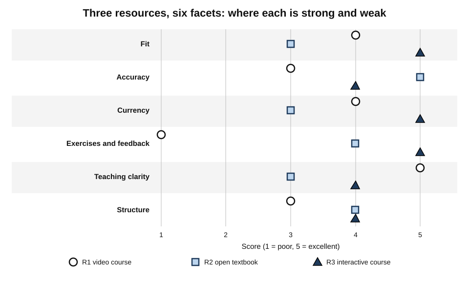
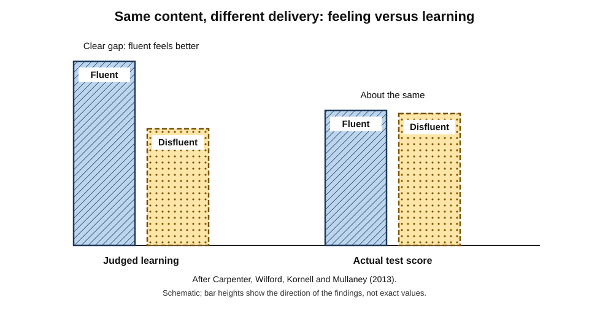
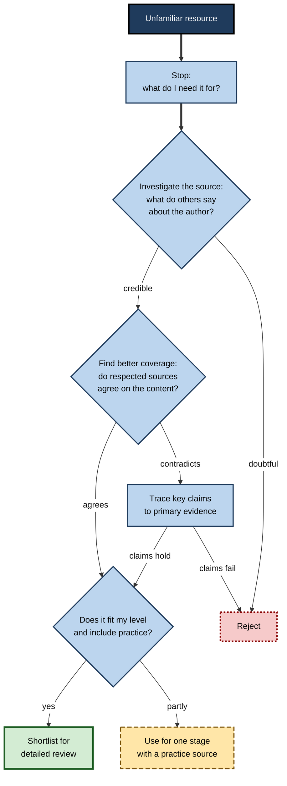
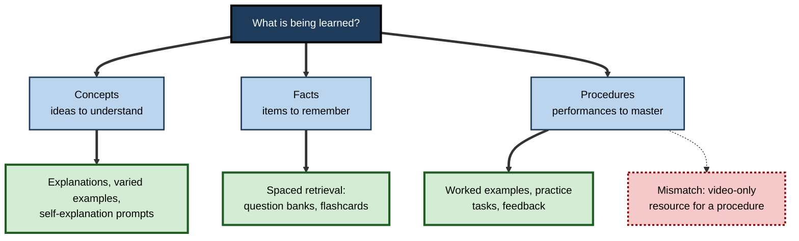
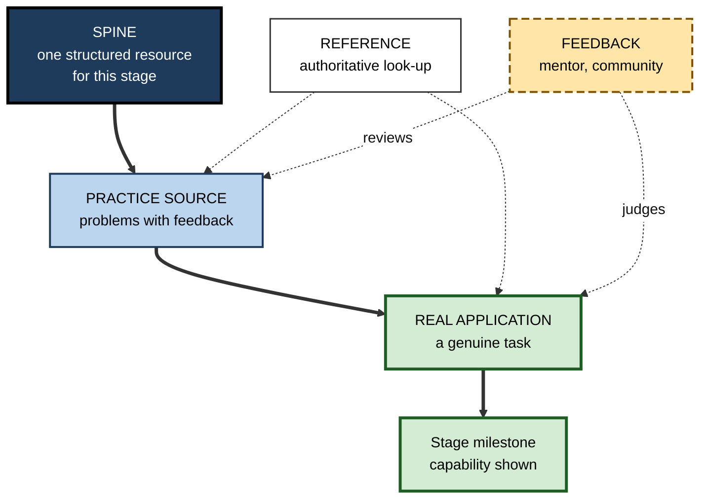

# A.5. Finding Quality Learning Resources

A search for "learn statistics" returns thousands of courses, books, videos and apps. The most popular video is entertaining, beautifully animated and watched by millions; a plain university problem set with worked solutions has a few hundred downloads. A learner who picks by popularity may enjoy every minute and still be unable to run a basic test a month later. Choosing resources is not a minor administrative step in a roadmap — it decides **what kind of practice** the learner will actually do.

> **Definition — Learning resource:** any source of information, instruction, practice or feedback that a learner uses to build capability — including texts, courses, videos, tools, practice environments, communities and people.

> **Definition — Resource quality:** the degree to which a resource is accurate, current, well designed for learning, and suited to a particular learner's level, goal and conditions. Quality is always **quality for a purpose**.

**Why it matters**

- **Abundance has moved the problem.** The difficulty is no longer finding *a* resource but recognising a *good* one quickly.
- **Resources shape method.** A video-only resource invites watching; a problem-rich resource forces practice.
- **Poor resources waste the scarcest input** — the learner's limited hours and motivation.
- **Bad information is learned as easily as good.** Inaccurate or outdated resources build misconceptions that must later be unlearned.

---

## Kinds of Learning Resource

- **Textbooks and books** — systematic, edited, coherent; slower to update.
- **Structured courses** — university modules, online courses, bootcamps; sequence, deadlines and often assessment.
- **Official documentation and standards** — authoritative and current for tools, laws and technical standards; usually written for reference, not learning.
- **Research literature and reviews** — the primary evidence; demanding to read; essential at advanced levels.
- **Video and audio** — vivid explanations and demonstrations; easy to consume passively.
- **Interactive practice environments** — problem sets, coding platforms, simulators, language exchanges; the closest to doing.
- **Communities and forums** — answers to specific questions, exposure to practice, feedback on work.
- **People** — mentors, tutors, colleagues; the richest source of tacit knowledge and feedback.
- **Work artefacts** — real reports, code bases, case files, contracts; show what good looks like in context.
- **AI assistants** — explanations and practice on demand; accuracy must be checked independently.

| Resource type | Main strength | Main weakness | Best role in a roadmap |
|---|---|---|---|
| **Textbook** | Coherent, systematic coverage | Can be dated; little feedback | Conceptual spine |
| **Structured course** | Sequence, pacing, assessment | Variable quality; low completion | Spine with built-in milestones |
| **Official documentation** | Authoritative, current | Written for reference, not teaching | Reference; later-stage depth |
| **Research literature** | Primary evidence | Demanding; fragmented | Depth and frontier knowledge |
| **Video and audio** | Vivid demonstration, accessible | Passive; illusion of understanding | Introductions and demonstrations |
| **Practice environment** | Doing with feedback | Can drill narrow skills | Core practice |
| **Community** | Specific answers; feedback | Uneven accuracy | Unblocking and review |
| **Mentor or tutor** | Tacit knowledge; tailored feedback | Scarce, costly | Diagnosis, review, judgement |

> **Key point:** different resource types do different jobs. A good roadmap uses **several types in deliberate roles**, rather than many resources of one type.

---

## What Makes a Resource Good

### Six facets of quality

> **Mnemonic — FACETS:** **F**it, **A**ccuracy, **C**urrency, **E**xercises and feedback, **T**eaching clarity, **S**tructure.

- **Fit** — matches the learner's level, goal, preferred language and available time.
  - A brilliant graduate text is a poor resource for a beginner; a beginner's course wastes an expert's time.
- **Accuracy** — content is correct, and the author is in a position to know.
  - Authority signals: qualifications, track record, editorial review, citations of primary evidence.
- **Currency** — up to date for the field's rate of change.
  - A ten-year-old book on contract principles may be fine; a ten-year-old book on cloud services is not.
- **Exercises and feedback** — opportunities to practise and find out whether one is right.
  - Problems with worked solutions, auto-graded exercises, projects with rubrics, reviewed assignments.
- **Teaching clarity** — explanations that build understanding: clear examples, signposting, absence of clutter.
- **Structure** — coherent sequence, clear objectives, a sense of what comes next.

**Figure 1.** Quality profiles of three resources on the six facets. (illustrative)

> **Remember:** a resource that scores high on everything except **exercises and feedback** is an explanation, not a learning resource. Pair it with a practice source.

### Practice beats presentation

**Study card — Koedinger, Kim, Jia, McLaughlin and Bier (2015), "Learning is not a spectator sport"**

- **Setting:** an online introductory psychology course combining text, video and interactive activities with feedback.
- **Design:** compared how strongly learners' amount of **doing** (interactive activities) versus **watching and reading** related to their final examination performance, with statistical controls.
- **Result:** doing interactive activities was associated with **substantially greater** learning per unit of activity than watching videos or reading — the authors estimated the benefit at around six times larger.
- **Conclusion:** the authors called this the **doer effect**: resources with plentiful practice and feedback outperform resources that only present.

> **Watch out:** the study was observational — learners chose how much to do — so the estimated size depends on the statistical model. Later analyses by the same group supported a causal interpretation, but the exact multiplier should not be quoted as a law. The direction is consistent with a large body of research on active practice.

### Polish is not quality

**Study card — Carpenter, Wilford, Kornell and Mullaney (2013), the fluent-instructor effect**

- **Design:** students watched a short science lecture video delivered by the same speaker in one of two styles.
  - **Fluent** — confident, well-paced, making eye contact, without notes.
  - **Disfluent** — hesitant, looking at notes, poorer delivery.
  - The **content was identical**.
- **Results:**
  - students who saw the fluent speaker **rated** their learning higher and predicted better test scores;
  - actual test scores were **about the same** in both groups.
- **Conclusion:** a smooth delivery creates an **illusion of learning**; production quality is a poor guide to educational quality.

**Figure 2.** Perceived and actual learning after fluent and disfluent delivery of the same content.

- **Related findings:**
  - **Seductive details** — interesting but irrelevant additions (anecdotes, decorative animations) tend to **reduce** learning of the core material, as shown in work by Shannon Harp and Richard Mayer (1998).
  - **Richard Mayer's multimedia principles** — among them coherence (cut extraneous material), signalling (highlight the essential) and segmenting (break into learner-paced parts) — give concrete markers of good design.

> **Watch out:** high ratings and enthusiastic reviews mostly measure **enjoyment**. A meta-analysis by Bob Uttl, Carmela White and Daniela Wong Gonzalez (2017) found student evaluations of university teaching to be essentially **unrelated** to how much students learned, once small-sample studies were set aside. Ratings are evidence about engagement, not about learning.

---

## Judging Credibility

### Two families of method

- **Checklist methods** — examine the resource itself against criteria.
  - The **CRAAP test** (Sarah Blakeslee, California State University, Chico, 2004): **C**urrency, **R**elevance, **A**uthority, **A**ccuracy, **P**urpose.
- **Lateral methods** — leave the resource and check what *others* say about its source and claims.
  - **SIFT** (Mike Caulfield, 2019): **S**top; **I**nvestigate the source; **F**ind better coverage; **T**race claims to their origin.

**Study card — Sam Wineburg and Sarah McGrew (2019), how experts evaluate online information**

- **Participants:** professional fact-checkers, university historians with doctorates, and undergraduates at a highly selective university.
- **Task:** evaluate the credibility of real websites and social-media posts — including sites from organisations with hidden agendas.
- **Results:**
  - historians and students tended to read **vertically** — staying on the page, studying its design, "About" section and content;
  - fact-checkers read **laterally** — quickly leaving the page and opening new tabs to see what other sources said about the organisation;
  - fact-checkers reached **more accurate** judgements in **less time**.
- **Conclusion:** credibility is better judged by checking a source's reputation **elsewhere** than by scrutinising the source itself.

> **Definition — Lateral reading:** evaluating a source by consulting other sources about it, rather than by examining only the source.

| | Checklist (e.g. CRAAP) | Lateral (e.g. SIFT) |
|---|---|---|
| Where attention goes | Inside the resource | Outside — what others say |
| Speed | Slow if done thoroughly | Fast, especially for unfamiliar sources |
| Vulnerability | Professional-looking sites pass easily | Depends on finding reliable outside sources |
| Best for | Structured review of shortlisted resources | First-pass screening of unknown sources |

**Figure 3.** Screening an unfamiliar learning resource.

### Evaluating claims about practice

- **Where a resource makes empirical claims** — "this technique doubles retention", "this framework predicts success" — ask:
  - **What is the evidence?** A single study, a review of many, or anecdote?
  - **Has it replicated?** Several prominent psychological findings have failed to replicate.
  - **Who benefits?** Vendors, authors and platforms have interests in their own methods.
- **A rough hierarchy of evidence** for claims about what works:
  1. systematic reviews and meta-analyses of well-designed studies;
  2. randomised experiments;
  3. well-controlled observational studies;
  4. case studies and expert opinion;
  5. testimonials and marketing.

> **Watch out:** a resource can be pedagogically excellent and still repeat a debunked claim — learning-styles matching is a common example. Judge **teaching quality** and **factual accuracy** separately.

---

## Fit: The Right Resource for This Learner, Now

### Level

- **Too easy** → boredom, redundant explanation; experts learn less from material designed for novices.
- **Too hard** → overload; the learner copies without understanding.
- **Quick level tests:**
  - read the table of contents — are most terms familiar, new, or incomprehensible?
  - attempt the first exercise of a middle chapter — can it be done with effort?

### Goal

- **Destination-matched** — a resource built for an examination is efficient for passing it, but may omit practical skill; a practitioner resource may ignore theory the examination needs.

### Material type

- **Concepts** → resources with explanations, varied examples and self-explanation prompts.
- **Facts** → resources that support spaced retrieval.
- **Procedures** → resources with worked examples, practice tasks and feedback.

**Figure 4.** Matching resource type to the kind of material being learned.

### Conditions

- **Time** — a forty-hour course for a learner with two hours a week is a twenty-week commitment.
- **Format and access** — mobile use while commuting, offline access, accessibility needs, language.
- **Cost** — free resources can be excellent; paid ones buy structure, feedback or credentials — not automatically quality.

---

## Completion, Commitment and the Consumption Trap

### What completion data show

**Study card — Justin Reich and José Ruipérez-Valiente (2019), "The MOOC pivot"**

- **Data:** six years of courses on a major open online course platform run by leading universities.
- **Findings:**
  - around half of those who registered **never started** the course;
  - completion rates remained **low** — well under one in ten for typical registrants — and had **not improved** over six years;
  - most learners did not return for a second year;
  - growth in participation was concentrated in the most affluent countries.
- **Conclusion:** access to high-quality free courses does not by itself produce learning; **commitment structures** matter.

- **Interpretations:**
  - many registrants intend only to sample, so low completion is not wholly failure;
  - but for learners who **do** intend to finish, completion is still far from assured.

> **In practice:** choose fewer resources and add commitment: a start date, a milestone, a study partner, or a paid track with deadlines if self-discipline is the constraint.

### The consumption trap

- **Tutorial loop** — following one tutorial after another, each feeling productive, without independent building.
  - Common in programming, design and data work; learners describe being stuck in "tutorial hell".
- **Resource hopping** — abandoning a resource at the first difficulty in favour of a new one that promises an easier route.
- **Collecting** — bookmarking, buying and saving far more than can ever be used.

> **Key point:** the cure is structural: **one spine at a time**, practice after every unit, and independent tasks at each milestone where no tutorial is followed.

---

## Building a Resource Stack

### Five roles

- **Spine** — one structured primary resource for the current stage.
  - *e.g.* a well-reviewed textbook or course.
- **Practice source** — problems or tasks with feedback.
  - *e.g.* a problem bank with solutions; a coding platform; a simulator.
- **Reference** — authoritative material for looking things up.
  - *e.g.* official documentation; a standard; a handbook.
- **Feedback and community** — people who can answer questions and judge work.
  - *e.g.* a mentor; a professional forum; a study group.
- **Real application** — a project or work task that uses the capability.
  - *e.g.* a small analysis for one's own team.

**Figure 5.** A resource stack for one stage of a roadmap.

| Role | Selection criterion | Common mistake |
|---|---|---|
| **Spine** | Fit and structure | Running two or three spines in parallel |
| **Practice source** | Volume and quality of feedback | Omitting it entirely |
| **Reference** | Authority and currency | Trying to learn from reference material from page one |
| **Feedback** | Expertise and availability | Asking only peers at the same level |
| **Real application** | Authenticity and stakes | Postponing it until "ready" |

> **Remember — one spine at a time.** Parallel spines duplicate explanations, confuse terminology and multiply unfinished resources. Switch spines only at stage boundaries, or after a deliberate decision that the current one is failing.

---

## Where Good Resources Are Found

- **Syllabi of respected programmes** — the readings and problem sets several good programmes share are rarely poor choices.
- **Practitioner recommendations** — ask, "Which resource actually made you able to do this?" rather than "What do you recommend?"
- **Professional bodies and regulators** — examination syllabi, approved texts, practice standards.
- **Open educational resources** — openly licensed course materials published by universities and others, often with problem sets and solutions.
- **Official documentation and standards** — for tools and regulated content, the primary source.
- **Libraries and their databases** — access to books and journals, and librarians skilled in searching.
- **Community-curated lists** — useful breadth, uneven quality; check maintenance dates.

> **In practice:** look for the same resource recommended **independently** by two or three kinds of source — a syllabus, a practitioner and a community. Independent agreement is a strong quality signal.

---

## Worked Example (illustrative): Choosing a Spine for Applied Statistics

- **Situation:** Mei, a market researcher, needs to run and interpret common statistical tests within four months, with about four hours a week. She has shortlisted three resources.
  - **R1** — a popular video course: high ratings, entertaining, few exercises.
  - **R2** — an open university textbook with problem sets and worked solutions, eight years old.
  - **R3** — a paid interactive course with auto-graded exercises in the analysis software her team uses, recently updated.

1. **Weight the facets** for her purpose: Fit 25%, Accuracy 15%, Currency 10%, Exercises and feedback 25%, Teaching clarity 15%, Structure 10%.
2. **Score each resource** from 1 to 5 after sampling a chapter and an exercise of each:

| Facet (weight) | R1 video course | R2 open textbook | R3 interactive course |
|---|---|---|---|
| Fit (0.25) | 4 | 3 | 5 |
| Accuracy (0.15) | 3 | 5 | 4 |
| Currency (0.10) | 4 | 3 | 5 |
| Exercises and feedback (0.25) | 1 | 4 | 5 |
| Teaching clarity (0.15) | 5 | 3 | 4 |
| Structure (0.10) | 3 | 4 | 4 |
| **Weighted score** | **3.15** | **3.65** | **4.60** |

*Illustrative figures.*

> **Formula — Weighted score:** Σ (weight × score). For R2: 0.25×3 + 0.15×5 + 0.10×3 + 0.25×4 + 0.15×3 + 0.10×4 = 0.75 + 0.75 + 0.30 + 1.00 + 0.45 + 0.40 = **3.65**.

3. **Decide roles:**
   - **R3** as the spine — strongest on fit and practice;
   - **R2** as the reference and for deeper conceptual chapters — accurate and free; statistics fundamentals change slowly, so its age matters little;
   - **R1** not used as a spine; perhaps one or two videos for a vivid introduction to a difficult idea.
4. **Add feedback** — a monthly review of her analyses by a statistician colleague.

- **Conclusion:** the resource with the **highest ratings** ranks last for her purpose, because its strengths are presentation and its weakness is practice.

> **Watch out:** weighted scores are only as good as the sampling behind them. Always try a chapter **and an exercise** before scoring — tables of contents and reviews hide teaching quality.

---

## Case Study (illustrative): Curating a Corporate Content Library

- **Situation:** a large insurer licensed several online content libraries, giving staff access to tens of thousands of courses and videos.
- **Problem:**
  - usage was concentrated in a few compliance and software courses;
  - managers could not identify good resources for specific roles;
  - many items were outdated or duplicated; staff reported "not knowing where to start".
- **Diagnosis:** **volume without curation** — no quality review, no mapping to roles, no practice or feedback attached.
- **Actions:**
  1. For eight priority roles, practitioners identified the **capabilities** that mattered (from existing skill maps).
  2. A small curation team, with practitioner reviewers, evaluated candidate resources using a short rubric — fit, accuracy, currency, practice and feedback, clarity, structure.
  3. For each capability, they selected **one spine, one practice source and one reference**, and attached a workplace task and a reviewer.
  4. Content not selected remained searchable but was not promoted.
  5. Each curated set was given an owner and a **review date**.
- **Result:** staff in the eight roles used curated sets far more than the open library; managers reported clearer development conversations; licence costs were later reduced by dropping an underused library.
- **Side effects:** curation took sustained effort; some popular but shallow content was criticised for exclusion; review dates slipped in busy periods.
- **Lesson:** in an abundant market, the organisation's value is **selection, sequencing and attached practice**, not the size of the catalogue.

---

## Professional Mastery in Resource Selection

- **Read primary sources as soon as feasible.** At advanced levels, secondary resources lag, simplify and sometimes distort.
- **Know the field's quality signals.** Peer-reviewed journals, respected publishers, standards bodies, maintainers of key tools — and their limitations (preprints, predatory journals, vendor-written "documentation" that is marketing).
- **Track resource decay.** Record when each resource was published or last updated, and set a review date in proportion to the field's rate of change.
- **Curate for others with transparency.** State why each resource was chosen, for whom, and what it lacks.
- **Treat AI-generated explanations and references as drafts.** Language models can produce fluent explanations and plausible but non-existent citations; claims and references must be checked against primary sources.

---

## Open Questions

- **How can educational quality be judged quickly at scale?**
  - Ratings track enjoyment; expert review is slow; automated quality measures are immature.
- **How large is the doer effect across domains?**
  - Evidence is strongest in online courses with built-in activities; its size for professional, ill-structured skills is less clear.
- **Do curated resource sets outperform open search?**
  - Organisations report benefits; controlled comparisons are rare.
- **What happens to resource quality as AI-generated content multiplies?**
  - Volume may rise faster than quality control; how learners will distinguish reliable sources is unresolved.
- **How should cost and quality trade off for learners with few resources?**
  - Free resources can be excellent but often lack feedback; how to provide feedback cheaply at scale is an open problem.

---

## Summary

- A **learning resource** is any source of information, instruction, practice or feedback; **quality** is always quality **for a purpose**.
- Resource types do different jobs: textbooks, courses, documentation, research, video, practice environments, communities, people, artefacts, AI assistants.
- Judge quality with **FACETS**: Fit, Accuracy, Currency, Exercises and feedback, Teaching clarity, Structure.
- The **doer effect**: practice with feedback is associated with far more learning than watching or reading (size debated).
- **Polish is not quality**: fluent delivery raises perceived but not actual learning; seductive details hurt; ratings track enjoyment, not learning.
- Judge credibility with **checklists (CRAAP)** for detailed review and **lateral reading (SIFT)** for screening; fact-checkers outperform experts who read vertically.
- Separate **teaching quality** from **factual accuracy**; weigh claims by the hierarchy of evidence.
- Fit by **level, goal, material type and conditions**.
- **MOOC completion** is low and stagnant; add commitment structures and avoid the **consumption trap**.
- Build a **resource stack**: spine, practice source, reference, feedback, real application — **one spine at a time**.
- Look for **independent agreement** among syllabi, practitioners and communities.

---

## Self-Check

1. Why is resource quality always "quality for a purpose"?
2. Name the six facets of FACETS and give a question to ask for each.
3. Summarise the doer-effect study and the caution attached to it.
4. Describe the fluent-instructor experiment and its lesson for choosing resources.
5. Why are high ratings weak evidence of learning?
6. Distinguish vertical from lateral reading, and summarise Wineburg and McGrew's findings.
7. Compare CRAAP and SIFT. When would you use each?
8. Arrange these in a rough hierarchy of evidence: a testimonial; a randomised experiment; a meta-analysis; a case study.
9. What did Reich and Ruipérez-Valiente find about open online courses, and what follows for roadmap design?
10. What is the consumption trap, and what structural remedies prevent it?
11. List the five roles in a resource stack and the common mistake for each.
12. Calculate R1's weighted score in the worked example and explain why the most highly rated resource ranks last for Mei.
13. A colleague learning cloud architecture is following three courses in parallel and has finished none. Advise them.
14. Your organisation wants to buy access to a second large content library. What questions would you ask first?

### Answer Key

1. The same resource can be excellent for one learner and useless for another, depending on level, goal, conditions and the type of material; quality is defined by fit to a purpose as well as intrinsic accuracy and design.
2. Fit — does it match my level, goal and time? Accuracy — is it correct, and is the author in a position to know? Currency — is it up to date for this field's pace? Exercises and feedback — can I practise and learn whether I am right? Teaching clarity — are explanations and examples clear and uncluttered? Structure — is there a coherent sequence with clear objectives?
3. In an online course, doing interactive activities was associated with much more learning per unit than watching or reading — estimated at around six times. It was observational, so the size depends on statistical modelling; the direction is robust.
4. Students saw the same content delivered fluently or disfluently; fluent delivery raised their ratings and predictions but not their test scores. Production polish creates an illusion of learning, so it should not drive selection.
5. Ratings mainly reflect enjoyment and engagement; a meta-analysis found student evaluations essentially unrelated to learning. Enjoyable resources can teach little.
6. Vertical reading stays on the source and examines it; lateral reading leaves it to see what others say. Fact-checkers, reading laterally, judged credibility more accurately and faster than historians and students.
7. CRAAP examines the resource's own currency, relevance, authority, accuracy and purpose — good for detailed review of a shortlist. SIFT stops, investigates the source elsewhere, finds better coverage and traces claims — good for rapid screening of unknown sources.
8. Meta-analysis; randomised experiment; case study; testimonial.
9. About half of registrants never started; completion was low and had not improved over six years; most learners did not return. Free access does not create learning; roadmaps need commitment structures such as start dates, milestones, partners or deadlines.
10. Endless tutorial-following, resource hopping and collecting, which feel productive without building independent capability. Remedies: one spine at a time, practice after every unit, independent tasks at milestones, switching resources only by deliberate decision.
11. Spine — running several in parallel; practice source — omitting it; reference — trying to learn from it from page one; feedback — asking only peers at the same level; real application — postponing it until "ready".
12. R1: 0.25×4 + 0.15×3 + 0.10×4 + 0.25×1 + 0.15×5 + 0.10×3 = 1.00 + 0.45 + 0.40 + 0.25 + 0.75 + 0.30 = 3.15. Its strengths — clarity and enjoyment — carry modest weight, while it scores lowest on exercises and feedback, which Mei weighted most heavily because she must be able to run tests herself.
13. Choose one course as the spine based on fit and practice quality; pause the others; add a practice environment and a real small architecture task; set a milestone in four to six weeks; consider a reviewer for designs; switch spines only after a deliberate review.
14. Which roles and capabilities is it for? What is current usage of the existing library and why? Who will curate and maintain quality? How will resources be linked to practice, feedback and workplace tasks? How will success be measured beyond logins and completions?

---

## Glossary

| Term | Meaning |
|---|---|
| CRAAP test | A checklist for evaluating sources: Currency, Relevance, Authority, Accuracy, Purpose. |
| Consumption trap | Repeatedly consuming resources without building independent capability. |
| Doer effect | The finding that doing interactive practice is associated with more learning than watching or reading. |
| FACETS | Fit, Accuracy, Currency, Exercises and feedback, Teaching clarity, Structure. |
| Fluent-instructor effect | Fluent delivery raising perceived, but not actual, learning. |
| Hierarchy of evidence | A ranking of study types by the strength of evidence they provide. |
| Lateral reading | Evaluating a source by consulting other sources about it. |
| Learning resource | Any source of information, instruction, practice or feedback used to build capability. |
| Multimedia principles | Evidence-based design guidelines for instructional materials, such as coherence and signalling. |
| Open educational resources | Openly licensed teaching and learning materials. |
| Resource quality | The accuracy, currency, design and fit of a resource for a purpose. |
| Resource stack | A deliberate combination of resources in distinct roles for one stage of learning. |
| Seductive details | Interesting but irrelevant material that reduces learning of core content. |
| SIFT | Stop, Investigate the source, Find better coverage, Trace claims. |
| Spine | The single structured primary resource for a stage of learning. |
| Tutorial loop | Following tutorial after tutorial without independent practice. |
| Vertical reading | Evaluating a source by examining only the source itself. |
