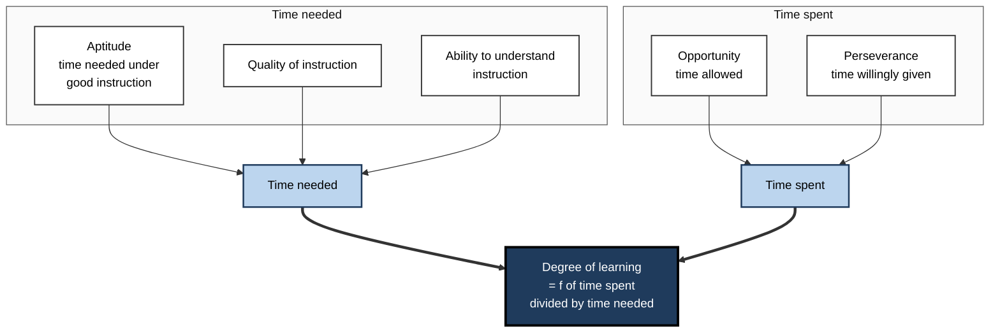
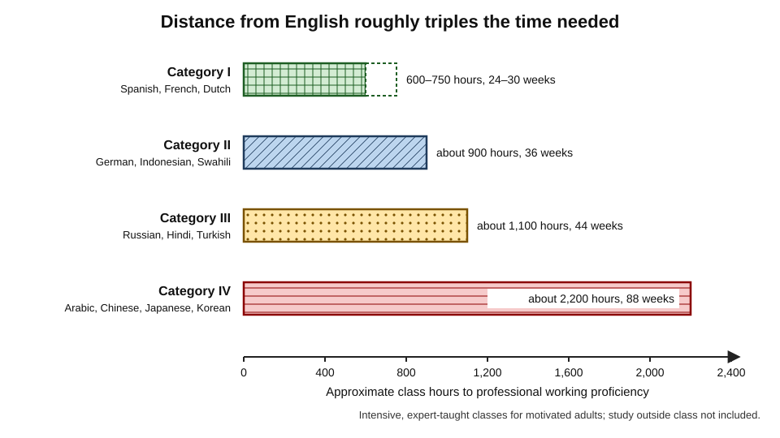
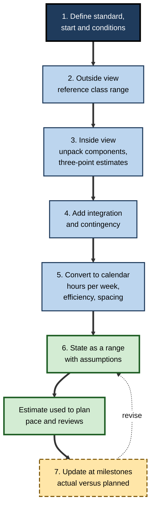
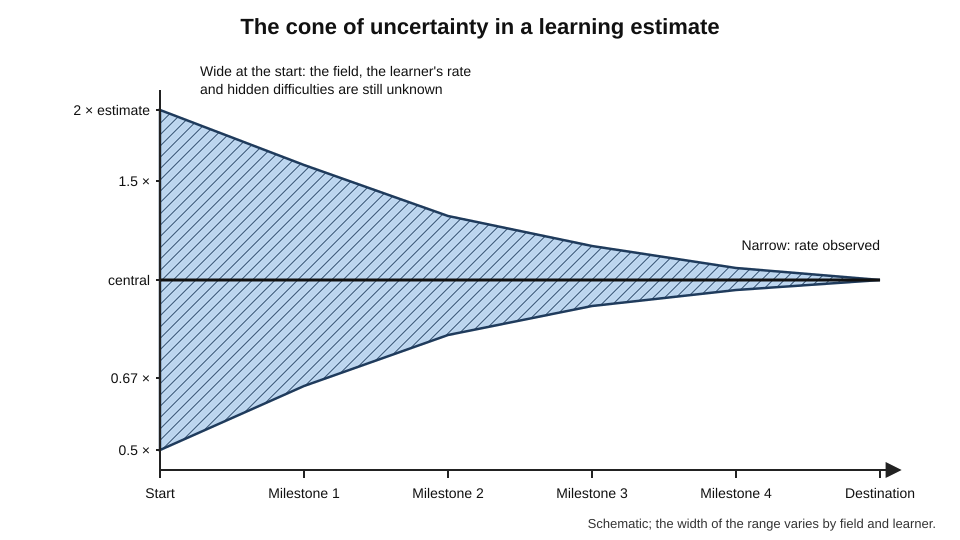
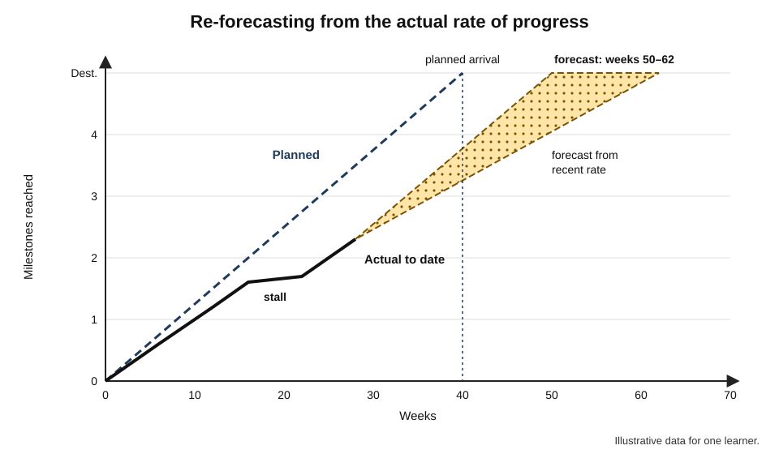

# C.6. Estimating Time to Competency

A coding school advertises "job-ready in twelve weeks". A manager tells a new hire she should be "fully up to speed in a month". A learner decides to become conversational in Japanese "by the summer". Each is a forecast of **how long learning will take** — and each will shape decisions about money, jobs and self-belief. Most such forecasts are made in seconds, on optimism, and turn out wrong in the same direction: too short.

> **Definition — Time to competency:** the effort (hours of study and practice) and the calendar time required for a particular learner to reach a defined standard of performance from a defined starting point.

**Why it matters**

- **Estimates drive commitments.** Career moves, course fees, project staffing and promotion timelines all rest on them.
- **Wrong estimates damage motivation.** A learner who expected three months and is still struggling at six often concludes they are "not cut out for it" — when the estimate, not the learner, was at fault.
- **Organisations lose money on optimism.** Under-estimated onboarding and reskilling leave people in roles before they are ready.
- **An estimate is a tool for planning, not a promise.** Used properly, it sets pace, reveals trade-offs and triggers review when reality diverges.

---

## What Is Being Estimated

### Three things that must be defined first

- **The standard** — what "competent" means, stated as a task and a criterion.
  - "Conversational Japanese" is undefined; "a 15-minute unscripted conversation about work and family with a native speaker, with occasional help" is estimable.
- **The starting point** — what the learner can already demonstrate.
- **The conditions** — weekly hours, access to practice and feedback, intensity, competing demands.

> **Key point:** an estimate without a defined standard is meaningless. "How long to learn Python?" has no answer; "how long, at five hours a week, from no programming, to write and test a 200-line data-cleaning script unaided?" does.

### Effort and calendar time

- **Effort** — the hours of focused learning and practice required.
- **Calendar time** — the elapsed weeks or months, which depend on hours per week, efficiency and interruptions.
- **Effective hours** are fewer than scheduled hours: sessions start late, are interrupted or are spent on low-value activity.

> **Formula — Calendar time:** weeks = effort hours ÷ (scheduled hours per week × efficiency). Example: 300 effort hours at 6 scheduled hours a week with 75% efficiency → 300 ÷ (6 × 0.75) = 300 ÷ 4.5 ≈ **67 weeks**, or roughly 15 months.

> **Watch out:** calendar time cannot be compressed indefinitely. Much learning benefits from **spacing** — practice distributed over days and weeks — so 300 hours crammed into six weeks will usually produce less durable capability than the same hours over six months.

---

## A Model of Time and Learning

### Carroll's model of school learning

- **John Carroll (1963)** proposed that the **degree of learning** depends on the ratio of the time a learner **actually spends** to the time they **need**.

> **Formula — Carroll's model:** degree of learning = f(time spent ÷ time needed). If a learner needs 40 hours and spends 30, they will reach roughly three-quarters of the standard; to reach it fully, they must spend the full 40.

- **Time needed** depends on:
  - **aptitude** — redefined by Carroll as the time a learner needs under good instruction, not a fixed ceiling;
  - **quality of instruction** — poor instruction increases the time needed;
  - **ability to understand instruction** — including language and prerequisite knowledge.
- **Time spent** depends on:
  - **opportunity** — the time allowed;
  - **perseverance** — the time the learner is willing to spend.

**Figure 1.** Carroll's model: what determines time needed and time spent.

- **Implications for estimation:**
  - learners genuinely differ in time needed — sometimes several-fold — so an average estimate fits few individuals;
  - better instruction and secure prerequisites **shorten** the time needed;
  - the model inspired mastery learning: hold the standard fixed and let time vary.

> **Remember:** aptitude, in Carroll's sense, is **speed**, not a limit. A slower learner is not a failed learner; they need more time.

---

## Reference Points: What the Evidence Offers

### Language learning: the Foreign Service Institute

**Study card — the US Foreign Service Institute's language difficulty categories**

- **Basis:** decades of experience training native English-speaking diplomats in intensive, full-time classes with small groups and expert teachers.
- **Target:** "professional working proficiency" in speaking and reading — level 3 on the Interagency Language Roundtable scale.
- **Approximate class time needed:**
  - **Category I** (e.g. Spanish, French, Dutch) — about **24–30 weeks**, or 600–750 class hours;
  - **Category II** (e.g. German, Indonesian, Swahili) — about **36 weeks**, or 900 hours;
  - **Category III** (e.g. Russian, Hindi, Turkish, Greek) — about **44 weeks**, or 1,100 hours;
  - **Category IV** (Arabic, Mandarin and Cantonese Chinese, Japanese, Korean) — about **88 weeks**, or 2,200 hours, usually including time in the country.
- **Lesson:** the "distance" from the learner's existing knowledge — here, English — roughly triples or quadruples time to competency.

**Figure 2.** Approximate class hours to professional working proficiency for native English speakers.

> **Watch out:** these figures come from **intensive, expert-taught classes** with highly motivated adult learners, plus substantial self-study outside class. A learner studying alone for a few hours a week should not divide them by weekly hours and expect the same result; self-directed effort is usually less efficient.

### The "10,000-hour rule"

- **Origin:** popularised by Malcolm Gladwell's *Outliers* (2008), drawing on K. Anders Ericsson's research on violinists (Ericsson, Krampe and Tesch-Römer, 1993), in which the best students had accumulated roughly ten thousand hours of practice by age twenty.
- **What Ericsson objected to:**
  - ten thousand was an **average** for one group at one age, not a threshold;
  - the hours were **deliberate practice** — focused, effortful, with feedback — not general experience;
  - different fields require very different amounts.
- **Macnamara, Hambrick and Oswald (2014)**, meta-analysis:
  - deliberate practice explained about a quarter of performance differences in games, about a fifth in music, less in sports, and very little in education and professions;
  - practice matters, but it is far from the whole story.

> **Watch out:** "10,000 hours" is neither a law nor a useful estimate for most professional goals. Competence for a job is reached long before world-class expertise, and the time depends on the standard, the starting point and the quality of practice.

### Structured programmes as reference classes

- **Formal programmes publish their own durations**, which encode long experience:
  - trade apprenticeships commonly run three to four years;
  - postgraduate medical training runs from several years to over a decade, depending on specialty;
  - professional examinations often publish recommended study hours per level — for example, the CFA Institute has long suggested roughly 300 hours of study per level of its programme.
- **Use them as reference points, not ceilings:** they show what a structured route with practice and assessment typically takes for a typical entrant.

---

## Why Estimates Are Too Short

### The planning fallacy

> **Definition — Planning fallacy (Daniel Kahneman and Amos Tversky, 1979):** the tendency to underestimate the time, cost and risk of future actions while overestimating their benefits — even when similar past tasks overran.

**Study card — Buehler, Griffin and Ross (1994), honours theses**

- **Design:** final-year psychology students predicted when they would finish their honours thesis.
  - They gave a realistic estimate, a best-case estimate ("if everything went as well as it possibly could") and a worst-case estimate.
- **Results:**
  - average realistic prediction: **about 34 days**; average actual time: **about 56 days**;
  - only about **30%** finished by their own predicted time;
  - the average actual time exceeded even the average **worst-case** prediction (about 49 days).
- **Conclusion:** people base forecasts on **plans and scenarios** for the task at hand and neglect their own **past experience** of overruns.

> **Key point:** even the worst case was too optimistic. Intuitive "pessimism" is not a sufficient correction.

### Causes

- **The inside view** — imagining the specific plan step by step, rather than asking how long similar efforts usually take.
- **Neglect of interruptions** — illness, work peaks, family events, travel; they are individually unpredictable but collectively certain.
- **Optimism and motivated reasoning** — the learner wants it to be quick.
- **Ignorance of the field** — beginners cannot see the hidden components that experts know take time.
- **Anchoring on marketing** — "learn in 30 days" claims set the reference point.

### Remedies with evidence

- **The outside view — reference-class forecasting.** Kahneman and Dan Lovallo (1993) contrasted the inside view with the **outside view**: identifying a class of similar past cases and using their actual outcomes as the base. Bent Flyvbjerg later applied the method to large projects.
- **Unpacking.** Justin Kruger and Matt Evans (2004) found that asking people to **list the component steps** of a multi-part task before estimating produced **longer and more accurate** estimates than estimating the task as a whole.
- **Recording past performance.** A learner who knows how long their last two learning projects took, against their estimates, has a personal correction factor.

| | Inside view | Outside view |
|---|---|---|
| Starting question | "How will I do this?" | "How long do cases like this usually take?" |
| Evidence used | The plan for this case | Outcomes of a reference class |
| Typical error | Too short; ignores interruptions | Ignores real differences of this case |
| Best use | Adjusting a base rate for specifics | Setting the base rate |

> **In practice:** start from the **outside view**, then adjust with the inside view — never the reverse.

---

## Methods of Estimation

### Five methods

- **Reference class** — find people who reached the same standard from a similar start; take the distribution of their times.
- **Bottom-up decomposition** — estimate each component of the skill map, sum, then add time for **integration** (combining skills in whole tasks) and **contingency**.
- **Three-point estimate** — for each component, estimate optimistic, most likely and pessimistic durations.
- **Learning-curve extrapolation** — after the first milestones, use the observed rate of progress to project the rest.
- **Expert judgement** — ask several experienced practitioners or teachers independently, then compare.

> **Formula — Three-point (PERT) estimate:** expected time = (optimistic + 4 × most likely + pessimistic) ÷ 6; standard deviation ≈ (pessimistic − optimistic) ÷ 6. Example: optimistic 40 hours, most likely 60, pessimistic 110 → (40 + 240 + 110) ÷ 6 = **65 hours**, standard deviation ≈ 70 ÷ 6 ≈ **12 hours**.

- **Origin:** the Program Evaluation and Review Technique was developed in the late 1950s for the US Navy's Polaris missile programme to schedule activities whose durations were uncertain.
- **Why it helps:** it forces the estimator to think about the **pessimistic tail**, which intuitive estimates ignore; the result is usually longer than the "most likely" figure.

| Method | Best when | Strength | Weakness |
|---|---|---|---|
| **Reference class** | Others have made similar journeys | Corrects optimism with real outcomes | Similar cases may be hard to find |
| **Bottom-up decomposition** | The skill map is known | Reveals hidden components | Misses integration time unless added |
| **Three-point estimate** | Components are uncertain | Captures the tail of delays | Inputs are still judgements |
| **Learning-curve extrapolation** | Early milestones are complete | Uses this learner's actual rate | Unavailable at the start; plateaus mislead |
| **Expert judgement** | Teachers or practitioners are available | Encodes experience of many learners | Experts forget how long it took them |

**Figure 3.** A procedure for estimating time to competency.

---

## Uncertainty and Updating

### Estimates narrow as learning proceeds

- **The cone of uncertainty** — a term from software project estimation, associated with Barry Boehm's work in the early 1980s and later Steve McConnell — describes how the plausible range of an estimate is widest at the start and narrows as work proceeds and unknowns are resolved.
- **For learning:**
  - at the start, the learner does not know the field, their own rate or the hidden difficulties — the range is wide;
  - after the first milestones, the learner's actual rate is visible — the range narrows.

**Figure 4.** The range of a time-to-competency estimate narrows as milestones are reached.

### Updating with actual rates

> **Formula — Rate-adjusted forecast:** remaining time = remaining planned effort × (actual effort so far ÷ planned effort so far). Example: the plan allotted 80 hours to the first two milestones; they took 110. The ratio is 110 ÷ 80 ≈ 1.4. If 220 planned hours remain, the revised forecast is 220 × 1.4 ≈ **300 hours**.

- **Caution:** early stages may be faster (familiar material) or slower (setting up, learning to learn the field) than later ones; apply the ratio with judgement.
- **Trigger points:** a ratio persistently above about 1.5 signals that the roadmap's scope, method or destination should be reviewed, not just the date.

### Plateaus and non-linear progress

- **Progress is rarely smooth.** Periods of rapid gain alternate with apparent stalls.
- **Classic report:** William Bryan and Noble Harter (1897, 1899), studying telegraph operators learning to receive Morse code, described **plateaus** in which performance stalled before rising again, which they explained as the learner consolidating lower-level habits into larger units.
- **Later scrutiny:** Fred Keller (1958) and others questioned how general such plateaus are; many later learning curves showed no clear plateau.

> **Watch out:** the classic "plateau" is **not a universal law** of learning. Stalls are common, but they can reflect fatigue, poor practice design, a missing prerequisite or a measurement that has stopped capturing improvement — each with a different remedy.

**Figure 5.** Planned, actual and forecast progress for one learner.

---

## What Changes the Time Needed

- **Distance from prior knowledge** — the closer the new field is to what the learner knows, the shorter the route (the FSI pattern).
- **Quality of instruction and feedback** — clear explanation, worked examples and fast feedback shorten time; poor resources lengthen it.
- **Practice density** — the share of time spent actively performing rather than watching or reading.
- **Access to authentic tasks** — real work accelerates capability that simulated work only approximates.
- **Spacing and intensity** — intensive programmes shorten calendar time; well-spaced practice improves retention; combining both is ideal but rarely possible.
- **Motivation and life load** — the strongest predictor of *calendar* time is often whether the planned hours actually happen.
- **The standard itself** — reaching "useful" is far quicker than reaching "independent", which is far quicker than "expert".

> **Mnemonic — "Distant Quality Practice Asks Steady Motivated Standards":** Distance, Quality, Practice density, Authentic tasks, Spacing and intensity, Motivation and load, Standard.

---

## Worked Example (illustrative): Estimating a Route to Junior Data Analyst

- **Situation:** Hannah, an operations coordinator comfortable with spreadsheets, wants to reach the level of a junior data analyst: "clean a real data set, query it with SQL, analyse it and present conclusions to a manager, unaided". She can study **8 hours a week** and expects about **70% efficiency**.

1. **Outside view.** She finds people who made the same move from similar starts — colleagues, community posts with dates, and a training provider's published outcomes. Most took **9–18 months** of part-time study, with a median around a year.
2. **Inside view: unpack and three-point estimate** (effort hours):

| Component | Optimistic | Most likely | Pessimistic | Expected (PERT) |
|---|---|---|---|---|
| SQL fundamentals to fluency | 40 | 60 | 110 | 65 |
| Data cleaning and spreadsheets to analytical level | 20 | 30 | 60 | 33 |
| Descriptive statistics and basic inference | 40 | 70 | 130 | 75 |
| A visualisation tool | 20 | 30 | 50 | 32 |
| Communicating results | 15 | 25 | 50 | 28 |
| **Integration: three end-to-end projects** | 60 | 90 | 160 | 97 |
| **Total** | | | | **330** |

*Illustrative figures.*

3. **Contingency** — add 15% for interruptions and rework → 330 × 1.15 ≈ **380 hours**.
4. **Calendar conversion** — 380 ÷ (8 × 0.7) = 380 ÷ 5.6 ≈ **68 weeks**, about **16 months**.
5. **Reconcile with the outside view** — 16 months lies inside the reference range but above its median; Hannah's statistics estimate may be cautious. She states her forecast as **12–18 months, most likely about 15**.
6. **Update rule** — at the first two milestones (SQL fluency, first project), compare actual with planned hours and recompute.

- **Conclusion:** her first instinct — "six months" — would have required about 14 effective hours a week, nearly three times what she can give.

> **Watch out:** most learners omit row six. **Integration** — combining components into whole tasks — is real work that component estimates do not include, and it is usually the largest single item.

---

## Time to Proficiency in Organisations

- **Time to proficiency** — the time a new hire or role-changer takes to perform at the expected standard — is a significant hidden cost: salary is paid in full while output is partial.
- **What organisations measure:**
  - time to first independent task;
  - time to a target productivity or quality level;
  - managers' judgement of readiness against role milestones.
- **What shortens it:**
  - structured onboarding with real work early;
  - a named mentor or buddy;
  - clear milestones and expectations;
  - pre-boarding of prerequisites before the start date.
- **What lengthens it:**
  - unclear role expectations;
  - isolation from experienced colleagues;
  - documentation-heavy, task-light onboarding.

> **In practice:** when asked "how long until she is up to speed?", answer with a **range, the standard, the assumptions and the checkpoints**: "Independent on routine cases in 8–12 weeks, assuming two mentored cases a week; we will check at week four."

### Case study (illustrative): a twelve-week promise

- **Situation:** Daniel, a 32-year-old retail manager, enrolled in a full-time twelve-week coding bootcamp advertising "job-ready in 12 weeks".
- **What happened:**
  - the course was intensive and well run; he completed it with a portfolio of three projects;
  - his first job applications produced few interviews; technical interviews revealed gaps in fundamentals and problem-solving under time pressure;
  - he spent a further **five months** studying part-time, building two more substantial projects and practising interview problems, before accepting a junior role.
- **Diagnosis:**
  - "job-ready" in the marketing meant **course completion**, not hireability in his local market;
  - the estimate ignored the **job-search phase**, itself a learning process;
  - he had used the inside view (the course schedule) rather than the outside view (how long graduates actually took to be hired).
- **Outside view he could have used:** graduates' reported time from completion to first job, and the share hired within six months, which reputable providers report through independent audits.
- **Result:** total time to a paid role was about **eight months** — still a successful transition, but with a financial plan built for three.
- **Lesson:** define the **standard** as the real destination (a job offer, independent performance), not the end of a course — and estimate from the outcomes of **people who went before**.

---

## Professional Mastery in Estimation

- **Keep a personal estimation record** — planned against actual for each learning project; the correction factor is often stable.
- **Estimate in ranges and say what would change them.**
- **Separate effort, calendar and readiness** — three different numbers often blurred into one.
- **Beware of estimates used as targets** — a forecast turned into a deadline creates pressure to declare competence early.
- **Distinguish competence levels** — "useful", "independent", "trusted with complex cases" — and estimate each.
- **AI and estimation:** tools may shorten some components (looking up syntax, drafting) while leaving others — judgement, integration, communication — largely unchanged; estimates should be revised component by component, not by a blanket discount.

---

## Open Questions

- **How large are individual differences in time needed for professional skills?**
  - Carroll's model predicts substantial variation; good measurements outside schools and language training are scarce.
- **Do AI tools shorten time to competency or only time to output?**
  - Early evidence suggests faster task completion; whether independent capability is reached sooner is unclear.
- **Which reference classes are trustworthy?**
  - Programme outcome data are often self-reported and selective; independent audits are uneven.
- **Can learning-curve models forecast individual progress reliably?**
  - Group curves are smooth; individual curves are noisy and include stalls of uncertain meaning.
- **What is the right trade-off between intensity and spacing for adult career changers?**
  - Intensive programmes shorten calendar time; their long-term retention compared with spaced study is not well established.

---

## Summary

- **Time to competency** = effort and calendar time to reach a **defined standard** from a **defined start** under stated **conditions**.
- Calendar weeks = effort ÷ (weekly hours × efficiency); spacing limits compression.
- **Carroll's model:** learning depends on time spent ÷ time needed; aptitude is speed, not a ceiling; better instruction shortens time needed.
- Reference points: **FSI** language categories (about 600–2,200 class hours); structured programme durations. The **10,000-hour rule** is a misreading of Ericsson's research.
- The **planning fallacy** makes estimates too short — in Buehler and colleagues' study, actual times exceeded even worst-case predictions.
- Remedies: **outside view** (reference-class forecasting), **unpacking**, personal records.
- Methods: reference class, bottom-up decomposition, **three-point (PERT)** estimates, learning-curve extrapolation, expert judgement — always add **integration** and contingency.
- The **cone of uncertainty** narrows as milestones are reached; update with the **actual-to-planned ratio**.
- **Plateaus** are common but not universal; diagnose their cause.
- In organisations, **time to proficiency** is a hidden cost; communicate estimates as ranges with assumptions and checkpoints.

---

## Self-Check

1. What three things must be defined before time to competency can be estimated?
2. Calculate calendar weeks for 240 effort hours at 5 scheduled hours a week and 80% efficiency.
3. State Carroll's model and explain what he meant by aptitude.
4. Summarise the FSI categories and one caution in using them for self-study.
5. What is wrong with the "10,000-hour rule"?
6. Describe the Buehler, Griffin and Ross study and its most striking result.
7. Distinguish the inside view from the outside view.
8. What did Kruger and Evans find about unpacking?
9. Compute a PERT estimate for optimistic 20, most likely 35, pessimistic 80 hours.
10. What is the cone of uncertainty, and what does it imply for roadmap reviews?
11. The first milestones took 90 hours against 60 planned; 200 planned hours remain. Forecast the remainder and say what else you would review.
12. Why is the classic learning plateau contested, and what should a learner do when progress stalls?
13. A manager wants a new analyst "fully productive in a month". How would you respond?
14. A friend plans to become a UX designer "in three months" while working full time. Build them a better estimate in outline.

### Answer Key

1. The standard (task and criterion), the starting point (what can already be demonstrated) and the conditions (hours, practice, feedback, competing demands).
2. 240 ÷ (5 × 0.8) = 240 ÷ 4 = 60 weeks.
3. Degree of learning = f(time spent ÷ time needed). Aptitude is the time a learner needs under good instruction — a rate, not a fixed limit.
4. Category I about 24–30 weeks (600–750 hours) to Category IV about 88 weeks (2,200 hours) for native English speakers in intensive, expert-taught classes. Self-study is usually less efficient, so the hours should not be transferred directly.
5. Ten thousand hours was an average for one group of elite violinists at age twenty, not a threshold; it concerned deliberate practice, not experience; requirements vary widely by field; and meta-analysis shows practice explains only part of performance differences, especially little in professions.
6. Students predicted thesis completion in about 34 days on average but took about 56; only about 30% finished by their predicted time; actual time exceeded even average worst-case predictions.
7. The inside view forecasts from the specific plan for this case; the outside view uses actual outcomes of a reference class of similar cases. Start outside, then adjust inside.
8. Listing the component steps of a multi-part task before estimating produced longer and more accurate estimates.
9. (20 + 4×35 + 80) ÷ 6 = (20 + 140 + 80) ÷ 6 = 240 ÷ 6 = 40 hours; standard deviation ≈ (80 − 20) ÷ 6 = 10 hours.
10. The plausible range of an estimate is widest at the start and narrows as work proceeds. Early estimates should be stated as wide ranges and reviewed at each milestone as the learner's real rate becomes known.
11. Ratio 90 ÷ 60 = 1.5; remainder ≈ 200 × 1.5 = 300 hours. A ratio of 1.5 also warrants reviewing scope, method, resources and prerequisites — not just moving the date.
12. Bryan and Harter's plateaus were not found consistently in later studies, so they are not a universal law. When progress stalls, diagnose: fatigue, poor practice design, a missing prerequisite or an insensitive measure — and respond accordingly.
13. Ask what "fully productive" means as tasks and standards; give a range based on past hires, with assumptions (mentoring, access to real work) and checkpoints — e.g. independent on routine requests in 6–10 weeks, reviewed at week four.
14. Define the standard (e.g. a portfolio of three case studies and passing design interviews for junior roles); take the outside view from people who made the move part-time; unpack components (research methods, interaction design, prototyping tools, portfolio projects, job search) with three-point estimates; add integration and contingency; convert using realistic weekly hours; state a range (likely well over a year part-time) and set update points.

---

## Glossary

| Term | Meaning |
|---|---|
| Calendar time | Elapsed time to reach a standard, depending on weekly hours, efficiency and interruptions. |
| Carroll's model | Degree of learning as a function of time spent divided by time needed. |
| Cone of uncertainty | The narrowing of an estimate's plausible range as work proceeds. |
| Deliberate practice | Focused, effortful practice aimed at specific improvements, with feedback. |
| Effective hours | The share of scheduled learning time actually spent productively. |
| Effort | Hours of focused learning and practice required. |
| Inside view | Forecasting from the specific plan for the case at hand. |
| Integration time | Time needed to combine component skills into whole tasks. |
| Outside view | Forecasting from the actual outcomes of similar past cases. |
| PERT estimate | A three-point estimate: (optimistic + 4 × most likely + pessimistic) ÷ 6. |
| Planning fallacy | The tendency to underestimate time and cost even when past tasks overran. |
| Plateau | A period in which measured performance stops improving before rising again. |
| Rate-adjusted forecast | Remaining time scaled by the ratio of actual to planned effort so far. |
| Reference-class forecasting | Basing an estimate on the distribution of outcomes in similar cases. |
| Time to competency | Effort and calendar time to reach a defined standard from a defined start. |
| Time to proficiency | In organisations, the time a person takes to perform at the expected standard in a role. |
| Unpacking | Listing a task's components before estimating its duration. |
