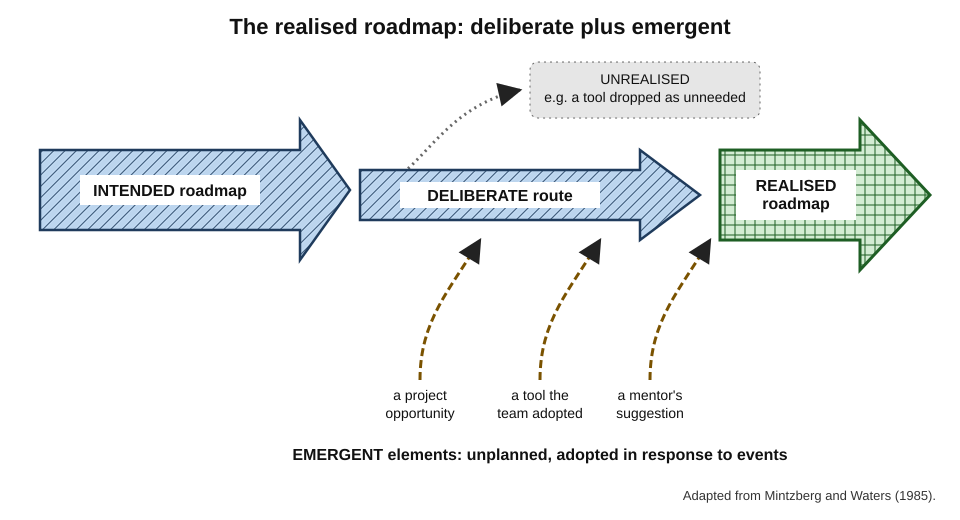
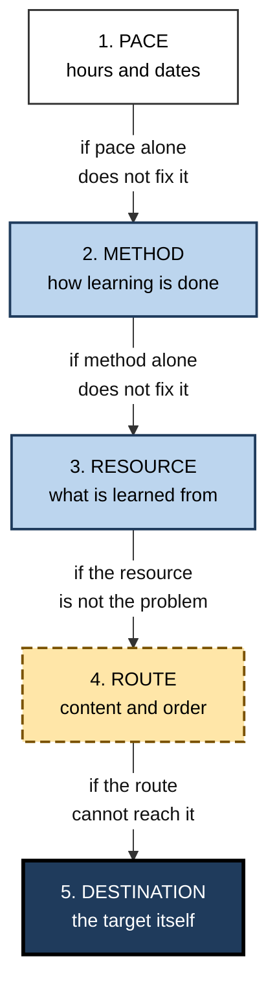
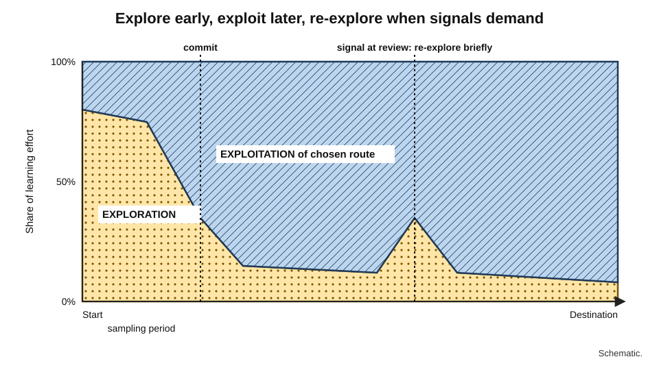
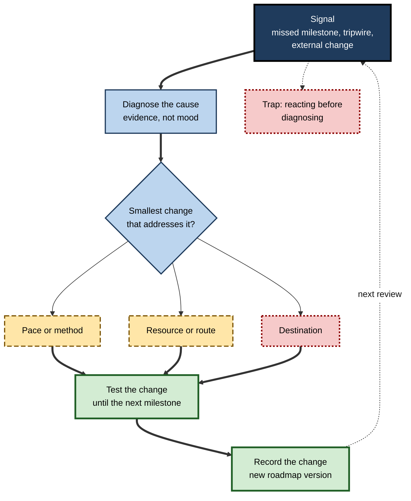

# C.7. Adapting Roadmaps as You Progress

Five months into a carefully built roadmap towards data science, a marketing analyst notices three things at once: two milestones have slipped by weeks, the third was surprisingly easy, and her employer has just reorganised around AI-assisted analytics, creating roles she had not known existed. She can push on exactly as planned, abandon the whole effort, or change something. What she should change — and how she decides — is the subject of roadmap **adaptation**.

> **Definition — Roadmap adaptation:** the deliberate revision of a learning roadmap's pace, methods, resources, route or destination in response to evidence about the learner's progress, circumstances or field.

**Why it matters**

- **Every roadmap is built on guesses** — about the field, the learner's rate and the future of work. Some guesses will be wrong.
- **Unrevised roadmaps fail in two ways.** They are followed past the point of usefulness, or abandoned entirely at the first serious surprise.
- **Adaptation is where much of the value lies.** A roadmap's first version reflects what the learner knew before starting; later versions reflect what they have learned about the field and themselves.
- **The skill transfers.** Revising plans in the light of evidence is the same capability needed in projects, strategy and careers.

---

## Plans as Hypotheses

### Planning is useful even when plans change

- **A remark attributed to Dwight Eisenhower:** "Plans are worthless, but planning is everything."
  - The value lies in the **thinking** planning forces — about goals, dependencies and risks — which prepares the planner to respond when events diverge.
- **A learning roadmap is a set of hypotheses:**
  - *this destination is worth reaching;*
  - *this route will get me there;*
  - *these resources and methods will work for me;*
  - *this pace is sustainable.*
- **Each milestone is a test** of those hypotheses.

> **Key point:** a missed milestone is **information about the plan**, not only a verdict on the learner.

### Deliberate and emergent strategy

**Study card — Henry Mintzberg and James Waters (1985), "Of strategies, deliberate and emergent"**

- **Context:** a study of how strategies actually formed in organisations over time.
- **Distinctions:**
  - **intended strategy** — what was planned;
  - **deliberate strategy** — the part of the intention that was actually realised;
  - **unrealised strategy** — intentions that were dropped;
  - **emergent strategy** — patterns of action that were never planned but arose in response to circumstances;
  - **realised strategy** — what actually happened: deliberate plus emergent.
- **Conclusion:** purely deliberate strategy is rare; effective organisations combine **intention with learning** as events unfold.

**Figure 1.** Intended, deliberate, emergent and realised routes in a learning roadmap.

- **Application to learning:**
  - some planned components will be dropped as unnecessary;
  - some unplanned ones — a tool the team adopts, a project opportunity — will become central;
  - the realised roadmap is the one that matters.

---

## What Can Change: Five Levels

Changes to a roadmap differ in size. A useful rule is to **change the smallest thing that solves the problem**.

1. **Pace** — hours per week, milestone dates.
   - *e.g.* stretching a milestone by three weeks during a busy work quarter.
2. **Method** — how learning is done.
   - *e.g.* replacing passive video study with problem sets; adding a weekly session with a tutor.
3. **Resource** — what is learned from.
   - *e.g.* switching to a textbook better matched to the learner's level.
4. **Route** — the content and order of the roadmap.
   - *e.g.* adding a missing prerequisite; dropping a component the destination does not need; resequencing.
5. **Destination** — the target capability itself.
   - *e.g.* refining "data scientist" to "analytics engineer"; or deciding the field is not for the learner.

**Figure 2.** Five levels of roadmap change, from smallest to largest.

| Level | Typical signal | Cost of changing | Example |
|---|---|---|---|
| **Pace** | Planned hours not happening | Low | Milestone moved from week 8 to week 11 |
| **Method** | Hours happen but milestones fail | Low to moderate | Replace re-reading with retrieval and problems |
| **Resource** | Confusion persists despite good method | Moderate | Change to a resource at the right level |
| **Route** | A missing prerequisite or unneeded component appears | Moderate to high | Insert a statistics unit; drop a tool |
| **Destination** | Evidence that the target is wrong, unreachable or unwanted | High | Retarget from data scientist to analytics engineer |

> **Watch out:** learners often jump straight to the largest change — "this isn't for me" — when a smaller one would have fixed the problem. Equally, they sometimes tinker with pace and method for months when the destination itself is no longer right.

---

## Signals That a Roadmap Needs Attention

### Internal signals

- **Milestone results**
  - missed or barely passed → something in pace, method, resource or route;
  - passed easily → the route may be too slow or the standard too low.
- **Rate of progress** — actual effort compared with planned; a large and persistent gap calls for review.
- **Energy and interest** — sustained loss of interest is data, not weakness; it may signal a mismatch of method or destination.
- **Errors that repeat** — the same type of mistake across tasks often points to a missing prerequisite.

### External signals

- **Changes in the field** — new tools, standards or regulations change what the destination requires.
- **Changes in the market** — demand for the target role rises, falls or reshapes.
- **Changes in the workplace** — reorganisations, new projects, new managers.
- **New information about the destination** — conversations with people in the target role reveal that it differs from what was imagined.
- **Unexpected opportunities** — a project, a secondment or an introduction that offers a better route.

### Personal signals

- **Life load** — health, caring responsibilities, financial pressure.
- **Changing values or goals** — what seemed worth pursuing a year ago may no longer be.

> **Mnemonic — "MERIT":** Milestones, Energy, Rate, Information from outside, Time available — the five things a review should examine.

---

## Biases That Distort Adaptation

### Persisting too long

**Study card — Hal Arkes and Catherine Blumer (1985), the sunk-cost effect**

- **Design:** a field experiment with a university theatre's season-ticket buyers.
  - Buyers were randomly assigned to pay the **full price**, or to receive one of two **discounts**.
- **Results:** in the first half of the season, those who had paid full price **attended more plays** than those who had received discounts.
- **Conclusion:** people continue an activity because of what they have **already spent**, even though past costs cannot be recovered and should not affect the decision.

> **Definition — Sunk-cost effect:** the tendency to continue an endeavour once an investment of money, effort or time has been made, because of that past investment rather than future value.

**Study card — Barry Staw (1976), escalation of commitment**

- **Design:** business students played the role of a corporate executive allocating research funds.
  - Some made an initial investment decision themselves; others inherited a decision made by someone else.
  - They then learned that the initial investment had performed **badly**, and made a second allocation.
- **Results:** students who were **personally responsible** for the failing initial decision invested **more** in the same division than those who had not made it.
- **Conclusion:** personal responsibility for a failing course of action increases commitment to it — partly to justify the original decision.

- **Learning versions:**
  - continuing an expensive course that is not working because it was expensive;
  - refusing to drop a destination announced publicly to colleagues;
  - finishing every chapter of a book that has stopped being useful.

### Switching too often

- **Novelty seeking** — a new course, tool or framework always looks more promising than the current difficult stage.
- **Resource hopping** — changing resource at every difficulty, never reaching depth with any.
- **Destination drift** — repeatedly retargeting after reading about a new hot role.
- **Abandonment after a single failure** — treating one missed milestone as proof of unsuitability.

| | Persisting too long | Switching too often |
|---|---|---|
| Driving bias | Sunk cost; escalation; status quo | Novelty; avoidance of difficulty; impatience |
| What it feels like | "I've come too far to change now" | "This new course will finally work" |
| Typical cost | Months on a dead route | Many beginnings, no endings |
| Corrective question | "If I were starting today, would I choose this?" | "Has this route had a fair test?" |
| Corrective device | Pre-set review triggers | Minimum commitment before switching |

**Status quo bias** — documented by William Samuelson and Richard Zeckhauser (1988) — adds a further pull towards whatever is already in place, independent of its merits.

> **Key point:** both errors are real. The aim is not to persist or to switch, but to **decide on evidence**, at planned moments, by pre-agreed rules.

### Grit and quitting

- **Angela Duckworth and colleagues (2007)** popularised **grit** — passion and perseverance for long-term goals — as a predictor of achievement.
- **Later evidence:** a meta-analysis by Marcus Credé, Michael Tynan and Peter Harms (2017) found grit only **modestly** related to performance and largely overlapping with conscientiousness; the perseverance component did most of the work.
- **The other side:** research by Carsten Wrosch and colleagues (2003) found that people who were better able to **disengage** from unattainable goals — and re-engage with new ones — reported better well-being.

> **Watch out:** "never give up" is not a principle of good learning design. Perseverance on a sound route is valuable; perseverance on an unsound one is waste. The skill is telling them apart.

---

## Exploration and Exploitation

### The trade-off

- **Exploration** — trying new routes, destinations or methods to learn which are best.
- **Exploitation** — committing to the best-known option to gain its benefits.
- Formalised in decision theory as the **multi-armed bandit** problem — a gambler choosing among slot machines with unknown payouts must balance trying machines to learn their rates against playing the best one found so far.
- **General lesson:** explore more **early**, when much is unknown and there is time to benefit from what is learned; exploit more **later**.

**Study card — Ofer Malamud (2011), specialisation timing and match quality**

- **Setting:** university students in Scotland, who traditionally specialised **later** and sampled several subjects first, compared with students in England, who specialised **at entry**.
- **Finding:** graduates who had specialised later were **less likely to switch** to an unrelated occupation after graduation.
- **Interpretation:** a period of sampling allowed students to learn about their own fit with fields, improving **match quality** — the gain outweighed the cost of later specialisation for many.

> **Definition — Match quality:** the degree of fit between a person's abilities and interests and the work or field they pursue.

**Figure 3.** Balancing exploration and exploitation over the life of a roadmap.

> **In practice:** build a deliberate **sampling period** into the start of a roadmap for an unfamiliar field — short, cheap experiments in two or three directions — before committing to a single destination.

---

## Methods of Adaptive Planning

### Rolling-wave planning

> **Definition — Rolling-wave planning:** planning near-term work in detail and later work only in outline, then progressively detailing later stages as they approach and more is known.

- **Near horizon (next 4–8 weeks):** specific resources, sessions and milestone tasks.
- **Middle horizon (next 2–6 months):** components and milestones, without session-level detail.
- **Far horizon (beyond):** destination and broad stages only.
- **Each review** moves the waves forward.

**Figure 4.** Rolling-wave planning: detail near, outline far.

```mermaid
%%{init: {'theme':'base','themeVariables':{'fontFamily':'Arial, Helvetica, sans-serif','fontSize':'15px','primaryColor':'#FFFFFF','primaryTextColor':'#111111','primaryBorderColor':'#222222','lineColor':'#333333','secondaryColor':'#F2F2F2','tertiaryColor':'#FFFFFF','clusterBkg':'#FAFAFA','clusterBorder':'#555555','edgeLabelBackground':'#FFFFFF','titleColor':'#111111'}}}%%
flowchart LR
    classDef core    fill:#1F3B5C,stroke:#000000,stroke-width:3px,color:#FFFFFF
    classDef key     fill:#BCD5EE,stroke:#1F3B5C,stroke-width:2px,color:#000000
    classDef muted   fill:#E6E6E6,stroke:#666666,stroke-width:1px,stroke-dasharray:2 4,color:#222222
    classDef good    fill:#D3ECD3,stroke:#1E5E24,stroke-width:3px,color:#000000

    N["NEAR: next 4-8 weeks<br/>sessions, resources,<br/>milestone task defined"]
    M["MIDDLE: 2-6 months<br/>components and<br/>milestones only"]
    F["FAR: beyond<br/>destination and<br/>broad stages"]
    R["Review<br/>at each milestone"]
    D["Destination"]

    N ==> M ==> F ==> D
    R -. "details the next wave" .-> M
    N -. "results feed" .-> R

    class N core
    class M key
    class F muted
    class R good
    class D good
```

### Review cycles

- **Plan–do–check–act** — the cycle associated with Walter Shewhart and W. Edwards Deming in quality management: plan a change, do it, check the result, act on what was learned.
- **Iterative methods from software** — the Agile Manifesto (2001) valued "responding to change over following a plan"; work proceeds in short iterations, each ending with a review and re-planning.
- **Applied to a roadmap:**
  - **weekly** — a five-minute check of pace;
  - **at each milestone** — a review of method, resources and route;
  - **quarterly** — a review of the destination itself.

### Tripwires and kill criteria

- **Tripwire** — a pre-set condition that forces a decision when reached.
  - *e.g.* "If I miss two consecutive milestones by more than three weeks, I will hold a full route review with my mentor."
- **Kill criteria** — conditions, set in advance, under which a route or destination will be abandoned.
  - *e.g.* "If by month nine I have not had three interviews for the target role despite meeting my milestones, I will retarget."
  - Advocated by the decision researcher and former professional poker player Annie Duke, among others, because decisions to quit are better made **before** sunk costs and emotions accumulate.
- **Minimum commitment** — a period during which no switching is allowed, to protect against hopping.
  - *e.g.* "I will use this textbook for at least four weeks before judging it."

> **Remember:** decide **in advance** both when you will reconsider and when you will **not**.

---

## Diagnosing a Missed Milestone

| Likely cause | Typical symptom | Smallest fix |
|---|---|---|
| **Estimate too optimistic** | Steady progress, but slower than planned | Re-forecast pace; keep route |
| **Planned hours not happening** | Low actual hours; erratic sessions | Reschedule; reduce scope; protect time |
| **Ineffective method** | Hours happen; little retained; fails unaided tasks | Shift to retrieval, problems, feedback |
| **Resource mismatch** | Persistent confusion or boredom | Change resource level or type |
| **Missing prerequisite** | Repeated errors of one kind; cannot follow explanations | Insert a targeted prerequisite unit |
| **Milestone too ambitious** | Close to passing; specific sub-skill weak | Split the milestone; add an intermediate step |
| **Destination no longer wanted** | Low energy across all components | Revisit the destination with fresh information |

**Figure 5.** Responding to a roadmap signal.

> **In practice:** keep a short **change log** on the roadmap — date, what changed, why, and what result is expected. It turns adaptation into learning about one's own learning, and prevents silent drift.

---

## Worked Example (illustrative): A Week-Twelve Review

- **Situation:** Kofi, a graphic designer, is twelve weeks into a nine-month roadmap towards a junior user-experience (UX) research role. He holds his first quarterly review.

1. **Gather evidence (MERIT):**
   - **Milestones:** M1 (conduct and summarise three user interviews) passed easily at week 4; M2 (design and run a usability test) passed at week 9, two weeks late; M3 (survey design and basic analysis) not yet attempted.
   - **Energy:** high for interviews and testing; low for statistics study.
   - **Rate:** 95 hours spent against 80 planned for M1–M2 — a ratio of about 1.2.
   - **Information from outside:** conversations with two UX researchers reveal their teams use quantitative surveys rarely, but expect fluency in **synthesising** qualitative research into recommendations.
   - **Time available:** a heavy work project is due in weeks 14–18.
2. **Diagnose:**
   - M2's lateness came from setting up testing tools — a one-off cost, not a slow rate.
   - Low energy for statistics may reflect a route that over-weights a component the destination needs less.
3. **Choose the smallest effective changes:**
   - **Pace:** stretch M3 by four weeks around the work project.
   - **Route:** reduce the statistics component to survey basics; add a new milestone on **research synthesis** — turning interview findings into prioritised recommendations, reviewed by a practitioner.
   - **Method:** for synthesis, practise on real public research reports, comparing his synthesis with the authors'.
   - **Destination:** unchanged — evidence supports it.
4. **Record** the change, the reasons and the expected result; set a tripwire: "If M3 slips beyond week 22, review with mentor."

| | Before review | After review |
|---|---|---|
| M3 | Survey design and statistical analysis, week 14 | Survey basics, week 18 |
| New milestone | — | Research synthesis reviewed by a practitioner, week 22 |
| Statistics share of time | About 25% | About 10% |
| Destination | Junior UX researcher | Unchanged |

*Illustrative figures.*

- **Conclusion:** two modest changes — pace and route — aligned the roadmap with what practitioners actually value and with Kofi's real constraints.

> **Watch out:** Kofi's first impulse was to drop research altogether and "go back to design" because statistics felt hard. Diagnosis showed the difficulty lay in a **component the destination barely needed**, not in the destination.

---

## Case Study (illustrative): Retargeting When the Field Moves

- **Situation:** Priya, a product manager at a software company, began a twelve-month roadmap to become a machine-learning engineer: programming depth, mathematics, model training and deployment.
- **Month five:**
  - she had met three of four milestones, but the mathematics and model-training components were taking roughly twice the planned time;
  - her company had begun building products on large pre-trained AI models and created a new role — **AI product manager** — combining product skills with practical understanding of model behaviour, evaluation and risk;
  - conversations with machine-learning engineers revealed that the engineering route would take at least another eighteen months of part-time study.
- **Bias check:** she noticed she was resisting change because she had told her team about her plan and had paid for an expensive course — a clear sunk-cost and escalation pattern.
- **Decision process:**
  1. Asked the reset question: "If I were starting today, with what I now know, which destination would I choose?"
  2. Compared the two destinations on match quality, time to reach and market demand.
  3. Mapped how much of her completed work transferred: almost all the programming and model-basics work was relevant to the new role.
- **Actions:**
  - **destination** changed to AI product manager;
  - **route** changed: dropped advanced mathematics and model-training depth; added model evaluation, AI risk and governance, and prompt and system design for products;
  - **milestones** reset: lead the evaluation plan for one AI feature; write a risk assessment reviewed by the company's AI governance lead.
- **Result:** within five further months she moved into the new role, with her earlier learning visibly useful; she continued learning machine learning as a **supporting** skill rather than a destination.
- **Side effects:** she had to explain the change to colleagues and accept that part of the course fee bought knowledge she would use less.
- **Lesson:** adaptation at the **destination** level is sometimes right — but only after checking evidence, transfer and biases, and with the change made explicit.

---

## Adapting Roadmaps in Organisations

- **Role-based paths age.** Tools, regulations and role expectations change; paths need owners and review dates.
- **Feedback from cohorts.** Aggregated milestone results show where many learners stall — a sign the path, not the learners, needs revision.
- **Mid-cycle development reviews.** Individual development plans revised only at annual appraisal fall out of date; quarterly check-ins keep them live.
- **Competency frameworks.** Revised as roles change; roadmaps built on them must follow.
- **Psychological safety for change.** Employees who fear that revising a development plan looks like failure will cling to outdated plans; managers should treat revision as normal.

---

## Open Questions

- **When should a learner persist and when should they quit?**
  - Research shows both persistence and disengagement can be adaptive; practical rules for telling which applies are largely untested.
- **How long should a sampling period be?**
  - Evidence on match quality supports some exploration; the optimal amount for adult career changers is unknown.
- **Do pre-set tripwires and kill criteria improve learning outcomes?**
  - They are recommended from decision research and practice; controlled studies in learning are scarce.
- **How fast must roadmaps adapt to AI-driven change in roles?**
  - Role definitions are shifting quickly; whether learners should plan for current or anticipated roles is unresolved.
- **How should organisations update paths without disrupting learners mid-route?**
  - Versioning and transition rules for organisational learning paths are rarely studied.

---

## Summary

- **Roadmap adaptation** is the deliberate revision of pace, method, resource, route or destination in response to evidence.
- Roadmaps are **hypotheses**; milestones test them; a missed milestone is information about the plan.
- **Mintzberg and Waters:** realised strategy combines **deliberate** and **emergent** elements; so does a realised roadmap.
- Five levels of change — **pace, method, resource, route, destination** — change the smallest thing that solves the problem.
- Review using **MERIT**: Milestones, Energy, Rate, Information from outside, Time available.
- Biases: **sunk cost** (Arkes and Blumer), **escalation of commitment** (Staw), status quo — and their opposites, novelty seeking and resource hopping.
- **Grit** predicts performance only modestly; the ability to **disengage** from unattainable goals is also adaptive.
- **Explore early, exploit later**; a sampling period can improve **match quality** (Malamud).
- Adaptive methods: **rolling-wave planning**, plan–do–check–act, iterative review cycles, **tripwires**, **kill criteria**, minimum commitment periods, and a **change log**.
- Diagnose before changing; in organisations, give paths owners, review dates and cohort feedback.

---

## Self-Check

1. Define roadmap adaptation and explain why a roadmap should be treated as a set of hypotheses.
2. Distinguish intended, deliberate, emergent and realised strategy, with a learning example of each.
3. List the five levels of roadmap change and the principle for choosing among them.
4. What does MERIT stand for?
5. Describe the Arkes and Blumer theatre-ticket study and its implication for learners.
6. What did Staw's 1976 experiment show about personal responsibility?
7. Compare the errors of persisting too long and switching too often, with a corrective question for each.
8. What does the evidence say about grit and about goal disengagement?
9. Explain the exploration–exploitation trade-off and Malamud's finding on specialisation timing.
10. What is rolling-wave planning, and why does it suit learning roadmaps?
11. Distinguish a tripwire, a kill criterion and a minimum-commitment period, with examples.
12. A learner has missed a milestone; they studied the planned hours but fail unaided tasks. Diagnose and recommend.
13. A colleague has changed their target role four times in eight months. What advice would you give?
14. Your organisation's onboarding path shows 60% of new hires failing the same week-six milestone. What should be done?

### Answer Key

1. The deliberate revision of pace, methods, resources, route or destination in response to evidence. A roadmap rests on guesses about the destination, route, methods and pace; each milestone tests them, so the roadmap must be revisable when evidence contradicts them.
2. Intended: the original plan (learn three tools). Deliberate: the parts realised as planned (two tools learned). Unrealised: dropped plans (the third tool). Emergent: unplanned patterns that arose (learning a tool the team adopted). Realised: what actually happened — deliberate plus emergent.
3. Pace, method, resource, route, destination. Change the smallest thing that solves the problem, moving up only when smaller changes do not.
4. Milestones, Energy, Rate, Information from outside, Time available.
5. Theatre-ticket buyers randomly assigned to pay full price attended more plays early in the season than discounted buyers — past spending influenced behaviour. Learners should judge whether to continue on future value, not on money or time already spent.
6. Students personally responsible for a failing initial investment invested more in it afterwards than those who had inherited the decision — responsibility escalates commitment.
7. Persisting too long (sunk cost, escalation): ask, "If I were starting today, would I choose this?" Switching too often (novelty, avoidance): ask, "Has this route had a fair test?"
8. Grit was only modestly related to performance in meta-analysis and overlaps with conscientiousness. Being able to disengage from unattainable goals and re-engage elsewhere is associated with better well-being. Both persistence and quitting can be adaptive.
9. Exploration gathers information about options; exploitation uses the best-known option. Explore early, exploit later. Malamud found that students who specialised later (in Scotland) were less likely to switch to unrelated occupations, suggesting sampling improved match quality.
10. Planning near-term work in detail and later work only in outline, progressively detailing as stages approach. It suits roadmaps because later stages depend on what is learned early and are too uncertain to plan precisely.
11. Tripwire: a pre-set condition forcing a review ("two milestones missed by three weeks → full review"). Kill criterion: a pre-set condition for abandoning ("no interviews by month nine despite milestones met → retarget"). Minimum commitment: a period with no switching ("use this textbook for four weeks before judging").
12. Hours happened, so pace is not the issue; failing unaided tasks suggests an ineffective method (passive study) or a missing prerequisite. Shift to retrieval and problem practice with feedback; check for repeated error types indicating a prerequisite gap.
13. Recognise the switching pattern; set a short structured sampling period with cheap experiments in the two most promising directions; choose based on evidence (conversations, small projects); then commit with a minimum-commitment period and pre-set review points.
14. Treat it as a path problem, not a learner problem: analyse where and why people fail (prerequisites, time, resources, milestone difficulty); interview recent hires and their mentors; revise the preceding stages or split the milestone; version the path and monitor the next cohort.

---

## Glossary

| Term | Meaning |
|---|---|
| Change log | A record of roadmap changes, their reasons and expected results. |
| Deliberate strategy | The part of an intended plan that is actually realised. |
| Emergent strategy | Patterns of action that arise without being planned. |
| Escalation of commitment | Increasing investment in a failing course of action, often to justify an earlier decision. |
| Exploitation | Committing to the best-known option to gain its benefits. |
| Exploration | Trying new options to learn which is best. |
| Goal disengagement | Withdrawing effort and commitment from an unattainable goal. |
| Grit | Passion and perseverance for long-term goals. |
| Kill criteria | Conditions, set in advance, under which a route or destination will be abandoned. |
| Match quality | The fit between a person's abilities and interests and their work or field. |
| Minimum commitment | A period during which a resource or route will not be switched. |
| Multi-armed bandit | A decision problem balancing exploration of options against exploitation of the best known. |
| Plan–do–check–act | An iterative cycle of planning, acting, checking results and adjusting. |
| Realised strategy | What actually happens: deliberate plus emergent elements. |
| Roadmap adaptation | Deliberate revision of a roadmap in response to evidence. |
| Rolling-wave planning | Detailed planning of near-term work and outline planning of later work, refined over time. |
| Status quo bias | A preference for the current state of affairs independent of its merits. |
| Sunk-cost effect | Continuing an endeavour because of past, unrecoverable investment. |
| Tripwire | A pre-set condition that forces a decision when reached. |
