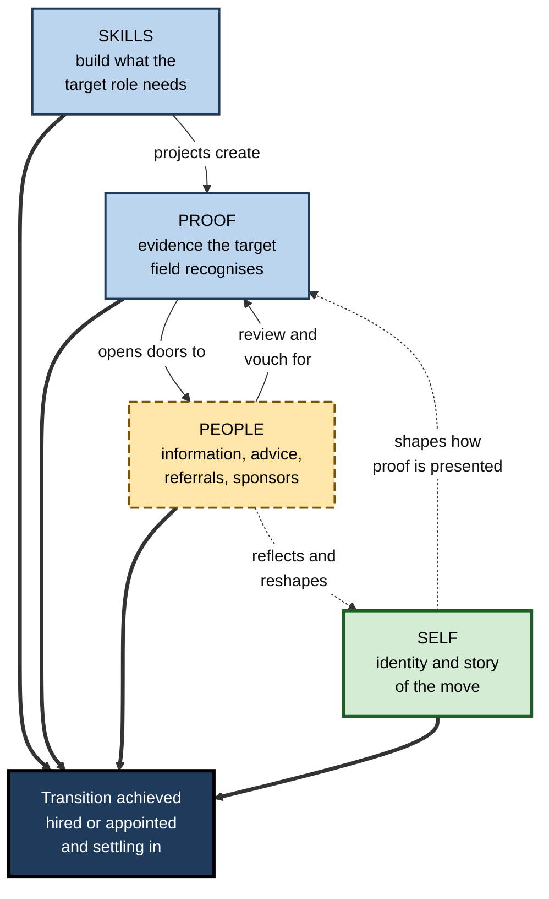
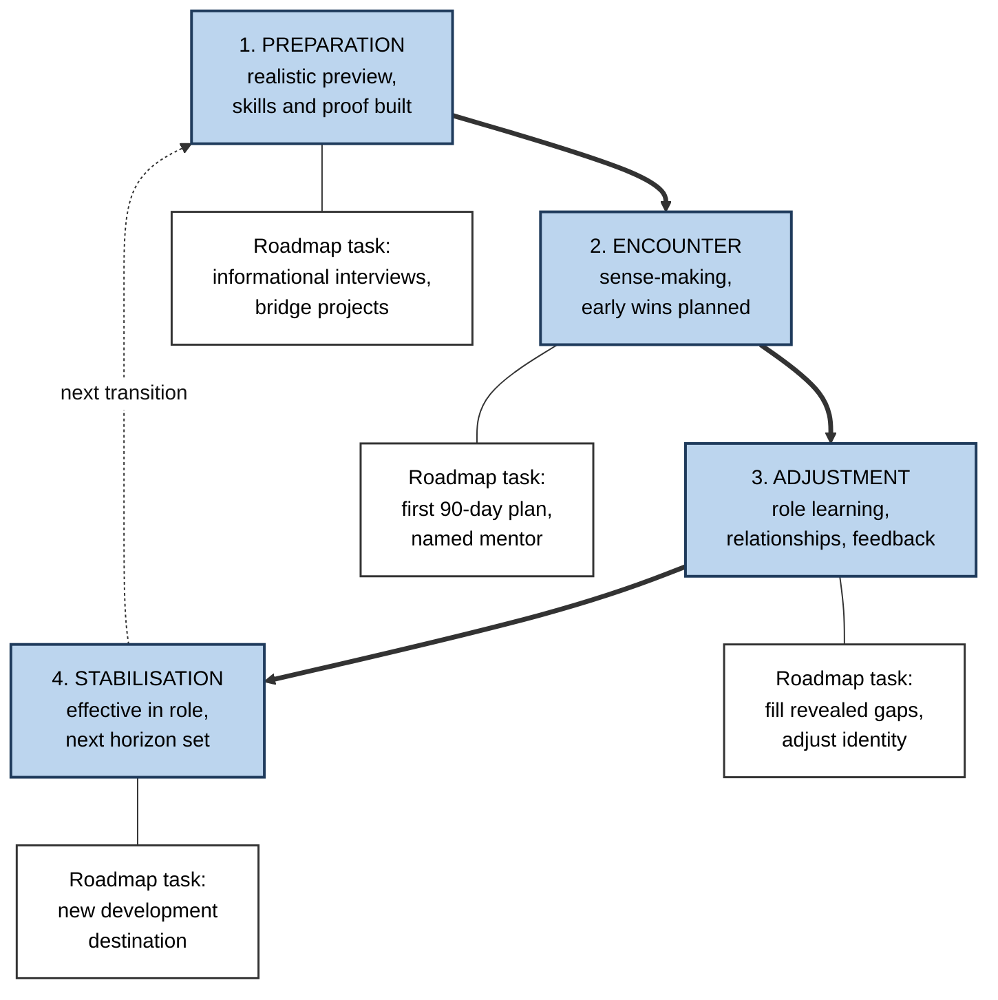
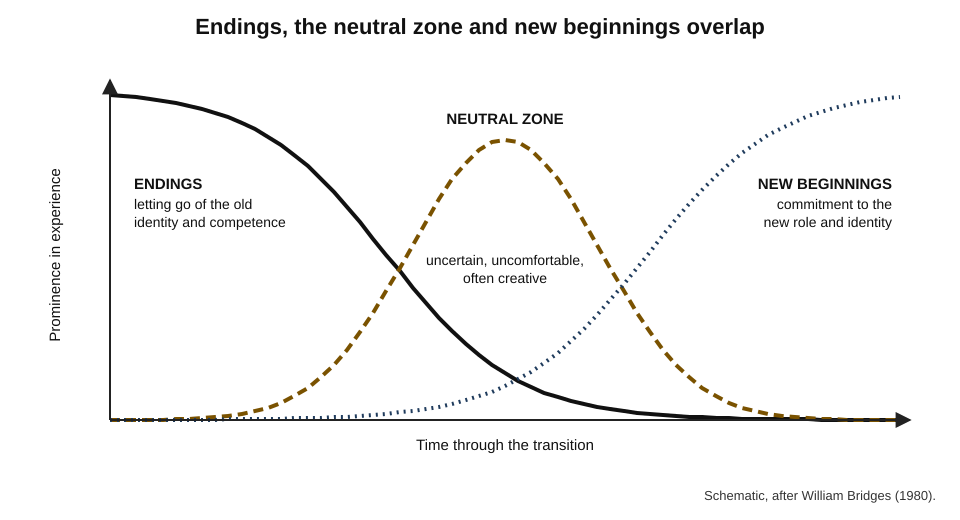
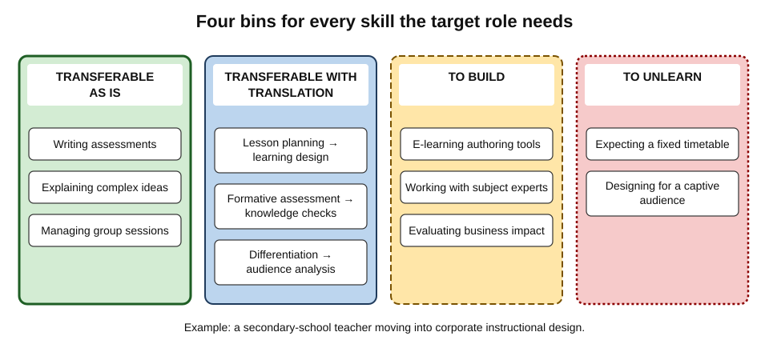
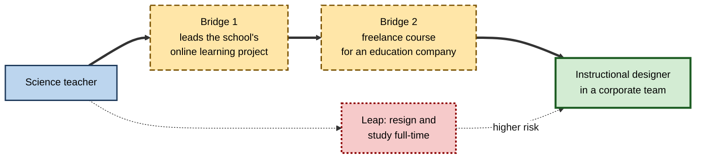

# C.8. Roadmaps for Career Transitions

A secondary-school science teacher wants to become a corporate instructional designer. She already designs lessons, assesses learning and explains difficult ideas every day — yet her applications go unanswered. What she lacks is not mainly knowledge: it is **evidence in the language of the new field**, **people** in that field who know her, and the **new professional identity** that lets her present herself convincingly. A roadmap for a career transition must build all of these, not only skills.

> **Definition — Career-transition roadmap:** a learning roadmap whose destination is a different role, function, occupation or sector, and which therefore combines building new capability with translating existing capability, creating credible evidence, gaining access to opportunities and forming a new professional identity.

**Why it matters**

- **Transitions are now normal.** Careers increasingly include several changes of role, employer and occupation over a working life.
- **Transitions are where learning is most intense** — and where the cost of a poor plan (lost income, lost confidence) is highest.
- **Skill alone rarely carries a transition.** Employers hire on evidence and trust; career changers often have capability without either.
- **Organisations depend on internal transitions** — promotions, redeployments and reskilling — to fill roles that the external market cannot.

---

## Kinds of Transition

- **Vertical** — stepping up within the same field.
  - *e.g.* senior engineer to engineering manager; associate to partner.
- **Lateral** — the same role in a new organisation or sector.
  - *e.g.* a financial analyst moving from banking to healthcare.
- **Cross-functional** — a new function in the same organisation.
  - *e.g.* customer support to product management.
- **Occupational** — a new occupation altogether.
  - *e.g.* teacher to instructional designer; lawyer to data-protection officer; nurse to clinical informatics specialist.
- **Re-entry** — returning after a career break.
  - *e.g.* a returner after five years of caring responsibilities.
- **Self-employment or portfolio** — leaving employment for consulting, freelancing or several part-time roles.

| Transition | Skill distance | Network distance | Identity change | Typical main obstacle |
|---|---|---|---|---|
| **Vertical** | Low to moderate | Low | Moderate — from doer to leader | Letting go of the old role's strengths |
| **Lateral** | Low | High | Low | Access and sector knowledge |
| **Cross-functional** | Moderate | Low | Moderate | Credibility in the new function |
| **Occupational** | High | High | High | Evidence, access and identity together |
| **Re-entry** | Variable | Moderate | Moderate | Currency of skills; confidence; bias |
| **Self-employment** | Moderate | High | High | Selling, finance and income risk |

> **Key point:** the further a transition moves on **skills, network and identity at once**, the longer it takes — and the more the roadmap must cover beyond learning.

---

## Four Tracks of a Transition Roadmap

> **Mnemonic — "Skills, Proof, People, Self":** the four tracks every transition roadmap must run in parallel.

- **Skills** — capabilities the target role needs and the learner lacks.
  - Built by study, practice and, above all, real projects.
- **Proof** — evidence that convinces people in the target field.
  - Portfolios, case studies, credentials the field recognises, references from practitioners, results from bridge work.
- **People** — relationships that provide information, advice, referrals and opportunities.
  - Practitioners in the target role, potential sponsors, communities of practice.
- **Self** — the learner's professional identity and story.
  - How they understand and present the move; what they keep, what they leave behind.

**Figure 1.** The four parallel tracks of a career-transition roadmap.

> **Watch out:** the most common failure is running only the **skills** track — collecting courses and certificates — while proof, people and identity stay unchanged. The result is a well-qualified applicant nobody in the target field knows or trusts.

---

## How Transitions Unfold

### The transition cycle

**Nigel Nicholson (1987), the transition cycle** — four recurring stages of any work-role transition:

1. **Preparation** — anticipation before the move: expectations, readiness, motivation.
2. **Encounter** — the first days and weeks: sense-making, surprise, emotional ups and downs.
3. **Adjustment** — learning the role, building relationships, changing oneself or the role.
4. **Stabilisation** — settled effectiveness — until the next transition begins the cycle again.

- **Each stage has typical problems:**
  - preparation — unrealistic expectations;
  - encounter — shock, disappointment, overload;
  - adjustment — misfit between person and role;
  - stabilisation — complacency.

**Figure 2.** The transition cycle and the roadmap's role at each stage.

### Surprise and sense-making

- **Meryl Reis Louis (1980)** studied newcomers entering organisations and argued that they experience **surprises** — differences between expectations and reality — which they must make sense of.
- **Implications:**
  - newcomers interpret surprises using frameworks from their **old** setting, often wrongly;
  - insiders who help interpret events greatly ease the transition.
- **For roadmaps:** a **realistic preview** of the target role — through conversations, shadowing and trial projects — reduces damaging surprises.

### Endings, the neutral zone and new beginnings

- **William Bridges, *Transitions* (1980):** distinguished **change** (an external event) from **transition** (the internal, psychological process of adjusting to it).
- **Three phases**, which overlap:
  1. **Endings** — letting go of the old identity, relationships and competence;
  2. **The neutral zone** — an uncomfortable in-between period in which the old is gone and the new not yet established;
  3. **New beginnings** — commitment to the new identity and role.

**Figure 3.** Overlapping phases of a transition over time.

> **Key point:** career changers often feel **less** competent in the neutral zone than they did before — a normal phase of transition, not evidence that the move was a mistake.

### Support and resources: the 4S model

**Nancy Schlossberg (from 1981)** — four sets of factors determine how well a person copes with a transition:

- **Situation** — timing, trigger, control, duration, other stresses.
- **Self** — personal characteristics, prior experience of change, resilience.
- **Support** — family, friends, colleagues, institutions.
- **Strategies** — the ways of coping and acting available to the person.

> **In practice:** assess the 4S **before** setting the pace of a transition roadmap. A person with little financial runway, heavy caring duties and few contacts in the target field needs a longer, more staged route than one with savings, time and a sponsor.

---

## Identity: Learning by Trying

### Crafting experiments

**Study card — Herminia Ibarra, *Working Identity* (2003)**

- **Research:** in-depth studies of professionals and managers who changed, or tried to change, careers — including lawyers, bankers, consultants, academics and managers.
- **Finding — the conventional model fails:** people who tried to "plan and implement" — first know exactly what they want, then execute — tended to stall.
- **Finding — successful changers "test and learn":**
  - **crafting experiments** — side projects, temporary assignments, courses, volunteering in the new area;
  - **shifting connections** — meeting people outside their usual circles, who reflect a different possible self;
  - **making sense** — reinterpreting their story so that the move becomes coherent.
- **Conclusion:** identity changes **through action**, not before it; clarity is usually a **result** of experimenting, not a prerequisite.

**Study card — Herminia Ibarra (1999), provisional selves**

- **Research:** junior consultants and investment bankers moving into senior client-facing roles.
- **Finding:** they experimented with **provisional selves** — trial versions of a professional identity, often borrowed from role models — then kept what worked and discarded what did not.
- **Lesson for vertical transitions:** observe several role models, try out their approaches, and evaluate them against feedback and one's own values.

> **Definition — Provisional self:** a trial version of a professional identity that a person tries out during a transition before committing to it.

> **Watch out:** "find your passion first" is weak advice for transitions. Evidence from Ibarra's work suggests that **acting first** — small, real experiments — produces the clarity that introspection alone does not.

---

## Gap Analysis for a Transition

### Mapping source against target

1. **Map the target role's skills** — from advertisements, frameworks and practitioner conversations.
2. **Map the source role's skills** — including tacit ones the learner takes for granted.
3. **Sort every target skill into four bins:**
   - **Transferable as is** — already held and recognised in the target field.
   - **Transferable with translation** — held, but described in the source field's language.
   - **To build** — genuinely new.
   - **To unlearn** — habits from the old role that will hinder the new one.

**Figure 4.** Sorting the target role's skills against what a career changer already has.

> **Example — translation:** a teacher's "differentiated lesson planning" becomes, in instructional design language, "designing learning experiences for audiences with varied prior knowledge"; "formative assessment" becomes "embedded knowledge checks and learner analytics".

### Evidence on transition pathways

**Study card — World Economic Forum with Boston Consulting Group (2018), *Towards a Reskilling Revolution***

- **Method:** used millions of US online job postings to measure the **similarity** between occupations by their skill, knowledge and experience requirements.
- **Two criteria for a good move:**
  - **viable** — the target is similar enough for a realistic transition;
  - **desirable** — the target offers stable or higher pay and growing demand.
- **Findings:**
  - under the model's assumptions, almost all workers in occupations expected to decline had at least one viable and desirable transition — **about 95%** of the 1.4 million workers modelled;
  - many such transitions required **substantial reskilling**;
  - the number of good options **rose sharply** when workers were willing to reskill more.
- **Conclusion:** transitions are usually possible but rarely free; skills data can reveal **adjacent** routes that individuals may not see.

> **Watch out:** such analyses measure similarity in **advertised** requirements and assume employers will hire on skills. In practice, hiring for transitions also depends on credentials, networks and employers' willingness to take a chance — which the models do not capture.

---

## Routes: Leaps, Ladders and Bridges

### Three route patterns

- **The leap** — leave the old role, study full-time, then seek the new role.
  - Fast when it works; high financial and identity risk.
- **The ladder** — move step by step through adjacent roles.
  - Lower risk; each step builds proof and contacts; slower.
- **The bridge** — use a hybrid role or project that sits between the old field and the new.
  - Often the most effective: the learner's old expertise is the reason they are trusted in the bridge role.

**Figure 5.** A bridge route from teaching to instructional design.

| | Leap | Ladder | Bridge |
|---|---|---|---|
| Speed | Fastest if successful | Slowest | Moderate |
| Financial risk | High | Low | Low to moderate |
| Proof generated | Mainly course-based | Real, but in adjacent roles | Real, in a hybrid of old and new |
| Use of existing expertise | Little | Some | High — it earns the bridge |
| Best when | Runway is long and the field hires on credentials | Organisations have clear internal steps | A hybrid role or project exists |

### Financial and personal runway

> **Formula — Runway:** runway in months = available savings ÷ (monthly costs − monthly income during the transition). Example: savings of 18,000, monthly costs of 3,000 and part-time income of 1,500 → 18,000 ÷ 1,500 = **12 months**.

- **Rule of thumb from estimation:** compare runway with a realistic, outside-view estimate of time to a paid role — and add a margin, since transitions typically take longer than planned.
- **If runway is shorter than the estimate:** choose a ladder or bridge route, or build the transition alongside current work.

---

## Proof and Translation

### What counts as proof

- **Work samples** — portfolios, case studies, code, designs, analyses, written work — ideally from real or realistic briefs.
- **Results from bridge work** — "redesigned the onboarding module; completion time fell by a third".
- **Recognised credentials** — those the target field actually asks for, not merely those available.
- **Practitioner endorsement** — references and introductions from people inside the field.

> **Remember:** proof must be **legible to the target field** — in its language, judged by its standards, relevant to its problems.

### Translating the story

- **Lead with the target role's problems**, then show how past experience solves them.
- **Translate vocabulary** — replace source-field jargon with target-field terms.
- **Claim the distinctive combination** — the career changer's rare mix of old and new expertise is often their main advantage.
  - *e.g.* a nurse in clinical informatics understands workflows that pure technologists do not.
- **Avoid two errors:**
  - **under-claiming** — treating old experience as irrelevant;
  - **over-claiming** — asserting competence in the new field that proof does not support.

---

## Worked Example (illustrative): Teacher to Instructional Designer

- **Situation:** Sarah, a secondary science teacher of eight years, wants a corporate instructional design role within 15 months. She can give 6 hours a week; she has 4 months of savings runway.

1. **4S check:** situation — chosen, not forced; self — strong communicator, anxious about corporate culture; support — a partner, no contacts in corporate learning; strategies — methodical planner.
2. **Gap analysis:**

| Target skill | Bin | Action |
|---|---|---|
| Analysing learning needs | Transferable with translation | Reframe teaching examples as needs analyses |
| Designing learning sequences | Transferable with translation | Rewrite a unit plan as a design document |
| Writing assessments | Transferable as is | Show in portfolio |
| E-learning authoring tools | To build | Short course plus two modules built |
| Working with subject experts | To build | Bridge project with a non-teaching client |
| Evaluating impact in business terms | To build | Learn evaluation models; apply to bridge project |
| Expecting a fixed school timetable | To unlearn | Practise project-based scheduling in bridge work |

3. **Route:** bridge — runway is too short for a leap.
4. **Four-track roadmap:**
   - **Skills** — months 1–4: authoring tool and design documentation; months 5–8: evaluation methods.
   - **Proof** — month 4: first module; month 8: a freelance module for a local business, with results; month 11: portfolio of three pieces.
   - **People** — from month 1: two informational conversations a month with corporate designers; join a professional community; ask one practitioner to review the portfolio.
   - **Self** — rewrite her professional summary at months 3, 7 and 11 as her identity shifts; practise interviews with a practitioner.
5. **Milestones and tripwire:** by month 11, portfolio reviewed positively by two practitioners; if no interviews by month 14, review the destination or extend the bridge.

- **Conclusion:** two-thirds of Sarah's work is in **proof, people and self** — and her teaching experience appears throughout as an asset, translated.

> **Watch out:** Sarah's first plan was a six-month certificate followed by applications. It ran only the skills track and would have left her with a credential, no portfolio and no contacts.

---

## Case Study (illustrative): From Ward Nurse to Clinical Informatics

- **Situation:** Tunde, a ward nurse with ten years' experience in a large hospital, was interested in technology but had no formal IT training. The hospital was preparing to introduce a new electronic patient record system.
- **Problem:** informatics roles typically asked for systems analysis skills and project experience he did not have; external courses alone seemed unlikely to make him credible.
- **Actions:**
  1. **Bridge role:** volunteered to be a **super-user** for his ward during the system roll-out — trained colleagues, collected problems and reported them to the implementation team.
  2. **Skills:** studied process mapping and basic data analysis in the evenings; learned the system's configuration logic from the implementation team.
  3. **Proof:** documented three workflow problems he had identified and the changes made to fix them; one reduced duplicate documentation time on his ward.
  4. **People:** the implementation lead became a mentor and later a **sponsor**, recommending him for a secondment.
  5. **Self:** began describing himself as "a nurse who designs better clinical workflows" rather than "a nurse who likes computers".
- **Result:** after a six-month secondment to the informatics team, he was appointed to a clinical systems analyst role — about two years after the roll-out began.
- **Side effects:** the secondment meant a temporary loss of shift allowances; some former colleagues saw the move as "leaving nursing".
- **Lesson:** a bridge role that **uses the old expertise** builds skills, proof, people and identity at the same time — far more effectively than courses alone.

---

## Landing: The First Months in the New Role

A transition roadmap does not end at the offer letter. The encounter and adjustment stages bring a second, intense round of learning.

### The landing plan

- **Michael Watkins, *The First 90 Days* (2003)** argued that leaders in new roles reach a **break-even point** — where they contribute more value than they consume — and that deliberate early planning brings it forward.
- **His STARS model** distinguishes situations a newcomer may inherit, each demanding a different early emphasis:
  - **Start-up** — building something new;
  - **Turnaround** — rescuing something in trouble;
  - **Accelerated growth** — scaling something that works;
  - **Realignment** — refocusing something drifting towards trouble;
  - **Sustaining success** — protecting something that works well.
- **Implication for career changers:** the first months need their own short roadmap — what to learn about the organisation, whom to meet, which early win to aim for — matched to the situation inherited.

### What the landing roadmap contains

- **Organisational learning** — how decisions are made, who holds influence, what "good work" means here.
- **Relationship mapping** — the people whose support matters most, met deliberately in the first weeks.
- **An early win** — a visible, modest contribution that uses the changer's distinctive combination of old and new expertise.
- **Gap closure** — skills revealed as missing only after arrival, added to the roadmap promptly.
- **Identity consolidation** — the shift from "former teacher who now designs courses" to "instructional designer with a teaching background".

> **Watch out:** career changers often try to prove themselves by working on everything at once. Early credibility comes more reliably from **one well-chosen win** and clear relationships than from visible busyness.

| | Before the move | First 90 days |
|---|---|---|
| Main learning focus | Capability and proof for the target field | This organisation's people, practices and standards |
| Main risk | Never being hired | Misreading the new culture through old frameworks |
| Key relationship | Practitioners who vouch and refer | Manager, peers and an insider who explains |
| Evidence that matters | Portfolio and references | Early results and colleagues' trust |

---

## Transitions in Organisations

- **Internal mobility** — moving existing employees into new roles is often cheaper and faster than external hiring, because firm-specific knowledge and relationships transfer.
- **Reskilling programmes** — structured academies retraining employees for roles in demand.
  - Strong programmes include **guaranteed bridge assignments**, not only courses.
- **Talent marketplaces** — internal platforms matching employees to projects and roles by skill, which can provide bridge experiences.
- **Redeployment** — when roles disappear, roadmaps from declining to growing roles reduce redundancies.
- **Manager behaviour** — managers who block internal moves to keep good staff are a common, quiet barrier.

> **In practice:** organisations that want internal transitions should fund the **proof** and **people** tracks — secondments, shadowing and sponsors — not only the skills track.

---

## Professional Mastery in Transitions

- **Treat transitions as experiments with stop rules** — small, cheap tests first; larger commitments as evidence grows.
- **Exploit the combination** — the most valuable career changers are rare hybrids.
- **Expect the neutral zone** — and plan support for it.
- **Mind bias and barriers** — older workers, returners and people from under-represented groups may face hiring bias; stronger proof and sponsorship partly offset it, but the barrier is structural, not personal.
- **Use AI tools carefully** — they can help translate experience into a new field's vocabulary and simulate interviews; they cannot supply proof, people or a genuine identity.
- **Plan the landing** — the first ninety days in the new role are part of the roadmap: early wins, relationships, and filling gaps revealed only on arrival.

---

## Open Questions

- **How much does skill similarity predict successful transitions?**
  - Pathway models use advertised requirements; outcomes of actual transitions are less studied.
- **Which bridges work best for which moves?**
  - Practitioners advocate bridge roles; systematic comparisons are rare.
- **How long does professional identity take to shift?**
  - Qualitative research describes the process richly; its typical duration and its predictors are uncertain.
- **Will skills-based hiring make transitions easier?**
  - Announcements are widespread; evidence of changed hiring for career changers is limited.
- **How will AI-driven job change alter transition routes?**
  - Many transitions may be from roles reshaped by AI to roles that are being created; which are durable is unknown.

---

## Summary

- A **career-transition roadmap** has a new role as its destination and must build capability, **translate** existing capability, create **proof**, gain **access** and form a new **identity**.
- Transitions vary — vertical, lateral, cross-functional, occupational, re-entry, self-employment — by **skill, network and identity distance**.
- Run four tracks: **Skills, Proof, People, Self**.
- Transitions unfold through Nicholson's **preparation, encounter, adjustment and stabilisation**; newcomers face **surprises** (Louis) and a **neutral zone** (Bridges); coping depends on Schlossberg's **4S** — situation, self, support, strategies.
- **Ibarra:** successful changers **test and learn** — crafting experiments, shifting connections, making sense; identity changes through action; **provisional selves** help vertical moves.
- **Gap analysis** sorts target skills into transferable as is, transferable with translation, to build, and to unlearn.
- Pathway analyses (WEF, 2018) show most transitions are possible but require reskilling; they omit hiring realities.
- Routes: **leap, ladder, bridge** — bridges that use old expertise are often most effective; compare **runway** with a realistic estimate.
- Proof must be **legible to the target field**; translate the story; avoid under- and over-claiming.
- Organisations should fund **proof and people**, not only skills.

---

## Self-Check

1. Define a career-transition roadmap and explain why it differs from a skills roadmap.
2. Compare vertical, lateral and occupational transitions on skill, network and identity distance.
3. Name the four tracks of a transition roadmap and the failure that results from running only one.
4. Describe Nicholson's transition cycle and one typical problem at each stage.
5. What did Louis find about newcomers' surprises, and what does it imply?
6. Distinguish change from transition in Bridges' sense; what is the neutral zone?
7. List Schlossberg's 4S and explain how they should affect a roadmap's pace.
8. Summarise Ibarra's findings in *Working Identity*.
9. What is a provisional self, and when is it useful?
10. Describe the four bins of a transition gap analysis, with an example of each.
11. What did the 2018 WEF reskilling analysis find, and what are its limitations?
12. Compare leap, ladder and bridge routes. Calculate runway for savings of 24,000, costs of 2,500 a month and income of 500 a month.
13. A lawyer wants to move into product management at a legal-technology company. Outline a four-track roadmap.
14. An organisation's reskilling academy has high course completion but few graduates move into new roles. Diagnose and propose changes.

### Answer Key

1. A roadmap whose destination is a new role, combining new capability with translating existing capability, creating proof, gaining access and forming an identity. A skills roadmap addresses only capability; transitions also depend on evidence, relationships and identity.
2. Vertical: low–moderate skill distance, low network distance, moderate identity change. Lateral: low skill, high network, low identity. Occupational: high on all three.
3. Skills, Proof, People, Self. Running only skills produces a well-qualified applicant whom no one in the target field knows or trusts.
4. Preparation (unrealistic expectations), encounter (shock, overload), adjustment (misfit between person and role), stabilisation (complacency).
5. Newcomers experience differences between expectations and reality and interpret them through old frameworks, often wrongly. Realistic previews and insiders who help interpret events ease the transition.
6. Change is the external event; transition is the internal psychological process of adjusting. The neutral zone is the in-between period when the old identity is gone and the new not established — often a time of reduced felt competence.
7. Situation, Self, Support, Strategies. Weak support, little financial runway or a forced, stressful situation call for a longer, more staged route.
8. People who tried to know exactly what they wanted before acting tended to stall; successful changers tested and learned through crafting experiments, shifting connections and making sense of the move. Identity changes through action.
9. A trial version of a professional identity, often borrowed from role models, tested and revised during a transition. It is useful especially in vertical moves into senior or client-facing roles.
10. Transferable as is (assessment writing for a teacher); transferable with translation (lesson planning as learning design); to build (authoring tools); to unlearn (expecting a fixed timetable).
11. Using job-postings similarity, it found that about 95% of modelled US workers in declining occupations had at least one viable and desirable transition, often requiring substantial reskilling, with options rising with more reskilling. Limitations: it relies on advertised requirements and assumes employers hire on skills, ignoring credentials, networks and hiring risk.
12. Leap: fast, high risk; ladder: slow, low risk; bridge: moderate speed, low risk, uses old expertise. Runway = 24,000 ÷ (2,500 − 500) = 24,000 ÷ 2,000 = 12 months.
13. Skills: product discovery, prioritisation, working with engineers, basic data analysis. Proof: lead a small internal tool project at the law firm; write product case studies; a practitioner-reviewed product specification. People: informational conversations with product managers at legal-tech firms; a community; seek a sponsor. Self: reframe as "a lawyer who designs products lawyers will actually use"; practise product interviews. Bridge: a legal-specialist or customer-facing role at a legal-tech company.
14. The academy runs only the skills track. Add guaranteed bridge assignments or secondments in target teams, mentors and sponsors in receiving functions, portfolio-style proof assessed by hiring managers, and manager incentives to release staff; measure placements and performance in new roles, not completions.

---

## Glossary

| Term | Meaning |
|---|---|
| 4S model | Schlossberg's factors in coping with transition: situation, self, support, strategies. |
| Break-even point | The moment a newcomer begins contributing more value than they consume. |
| Bridge role | A hybrid role or project between an old field and a new one. |
| Career-transition roadmap | A roadmap whose destination is a new role, function, occupation or sector. |
| Crafting experiments | Small, real trials of a possible new career, such as side projects or temporary assignments. |
| Gap analysis | Comparing a target role's requirements with current capability. |
| Internal mobility | Movement of employees into new roles within the same organisation. |
| Leap | A transition made by leaving the old role before entering the new one. |
| Neutral zone | Bridges' in-between phase when the old identity has ended and the new has not formed. |
| Proof | Evidence of capability that is legible to the target field. |
| Provisional self | A trial professional identity tested during a transition. |
| Realistic preview | Accurate information about a target role obtained before the move. |
| Runway | The months a person can sustain a transition financially. |
| Sense-making | Interpreting surprises and new experiences in an unfamiliar setting. |
| STARS model | Watkins's five inherited situations: start-up, turnaround, accelerated growth, realignment, sustaining success. |
| Transferable with translation | A skill already held but described in the old field's language. |
| Transition | The internal process of adjusting to a change in role or circumstances. |
| Transition cycle | Nicholson's stages: preparation, encounter, adjustment, stabilisation. |
| Viable and desirable transition | A move to a similar enough occupation that offers stable or better pay and demand. |
