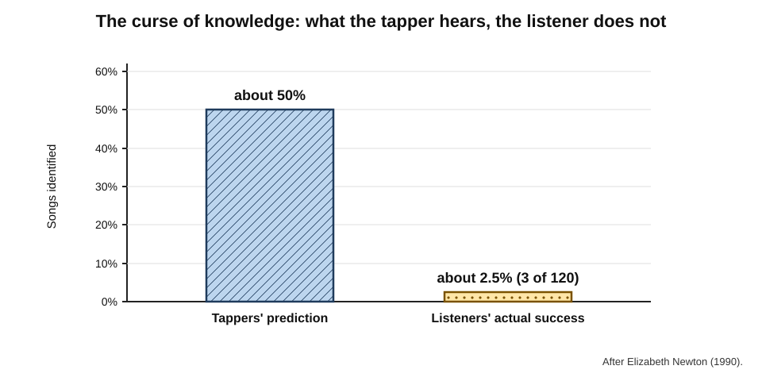
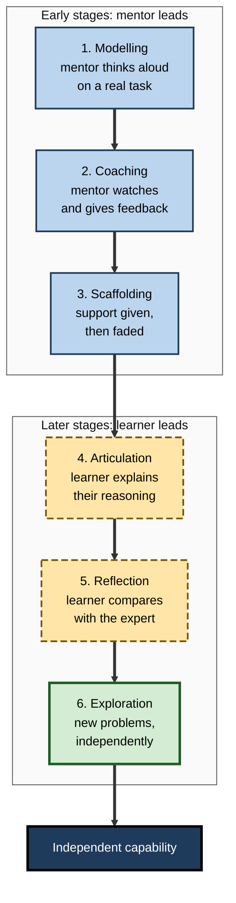
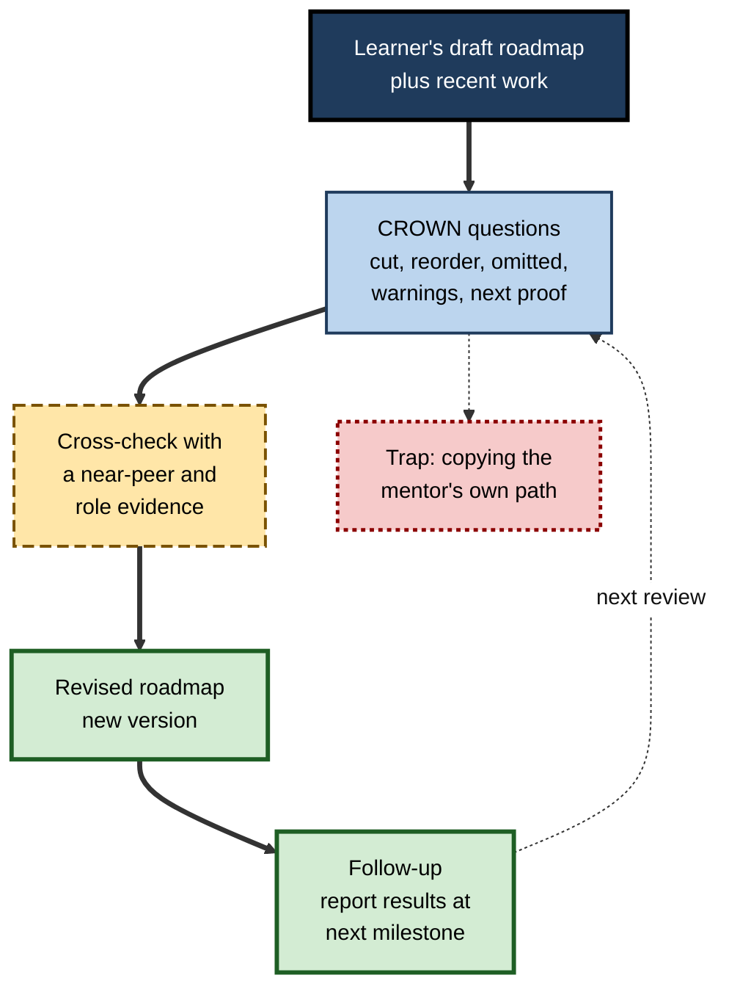
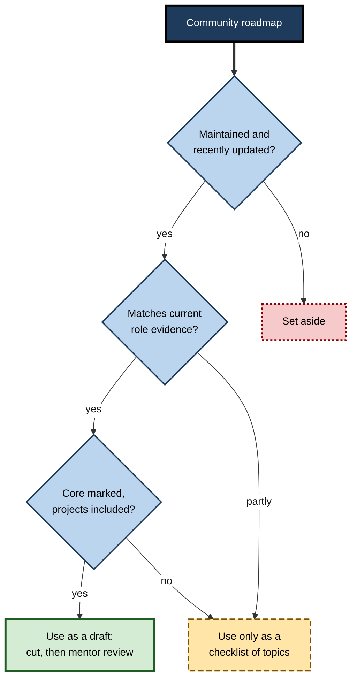
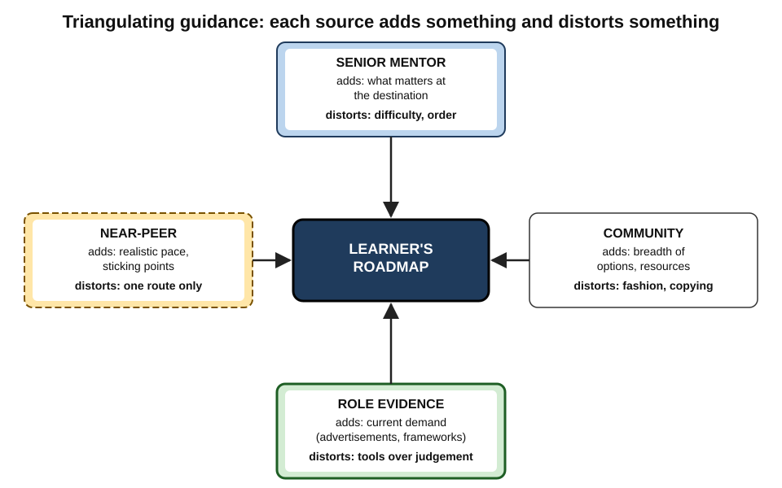

# C.9. Community and Mentor-Guided Roadmaps

A self-taught programmer downloads a popular community roadmap for web development: more than a hundred technologies in a sprawling diagram. He works through it for a year.

Then a senior engineer agrees to review his plan over coffee. In twenty minutes she crosses out half the items, adds two he had never heard of — reading other people's code and writing tests — and tells him to stop studying and **build something she can review**. Three months later he has his first job. The roadmap did not change because he learned more; it changed because **someone who had walked the route looked at it**.

> **Definition — Mentor-guided roadmap:** a learning roadmap designed, reviewed or adjusted with the help of an experienced practitioner who knows the destination from the inside.

> **Definition — Community roadmap:** a learning roadmap created, maintained or validated collectively by a community of learners and practitioners — for example, an openly published route for a profession or technology.

**Why it matters**

- **Learners cannot see what they do not know.** A route designed from outside a field misses its tacit priorities.
- **Experienced guides compress years into weeks** — by cutting what is unnecessary, adding what is invisible and warning about traps.
- **Communities aggregate many journeys** — the patterns of what worked and what wasted time across hundreds of learners.
- **Both sources have systematic biases.** Knowing them is what turns advice into a better roadmap rather than someone else's.

---

## Why Outside Guidance Helps

### Tacit knowledge and the view from inside

- **Tacit knowledge** — what practitioners know but rarely state — decides much of what matters in a field.
  - *e.g.* which tools are actually used, which skills interviewers really test, which errors cause real harm.
- **A practitioner can see the destination** — what the role demands day to day — in a way that job descriptions and course catalogues cannot convey.
- **A practitioner can see the learner** — their work, their gaps, their habits — from the outside.

### Experts misjudge difficulty: the expert blind spot

**Study card — Mitchell Nathan and Anthony Petrosino (2003), the expert blind spot**

- **Design:** trainee (preservice) teachers ranked algebra problems by how difficult they expected students to find them.
  - Problems were presented as symbolic equations, word equations or story problems.
- **Results:**
  - trainees with **more** advanced mathematics education were **more** likely to predict that symbolic equations would be easiest for students;
  - in related research by Kenneth Koedinger and Nathan, students actually performed **better** on simple story problems than on the equivalent symbolic equations.
- **Conclusion:** expertise in a subject can make the path *through* it harder to see; experts tend to assume the order in which the field is formally organised is the order in which it is best learned.

> **Definition — Expert blind spot:** the tendency of people with high subject expertise to misjudge the difficulties and natural learning sequence of novices.

### The curse of knowledge

**Study card — Elizabeth Newton (1990), tappers and listeners**

- **Design:** in a doctoral study at Stanford University, participants were assigned to be **tappers** or **listeners**.
  - Tappers tapped out the rhythm of well-known songs on a table.
  - Before listeners guessed, tappers predicted how often listeners would identify the songs.
- **Results:**
  - tappers predicted that listeners would identify about **half** of the songs;
  - listeners actually identified about **1 in 40** — 3 of the 120 songs tapped.
- **Conclusion:** once a person knows something, it is very hard to imagine not knowing it; the tapper "hears" the melody that the listener cannot.

**Figure 1.** Predicted and actual success in the tapping study.

> **Definition — Curse of knowledge:** the difficulty, once something is known, of imagining the perspective of someone who does not know it — a term used by Colin Camerer, George Loewenstein and Martin Weber (1989) in economics.

- **Implications for roadmaps:**
  - experts are excellent judges of **what** matters at the destination;
  - they are less reliable judges of **how hard** each step is and **in what order** a novice should take them;
  - they may skip steps that have become automatic for them.

### Near-peer guides

- **A near-peer** — someone only a stage or two ahead on the same route — remembers the difficulties vividly.
- **Olle ten Cate and Steven Durning (2007)**, reviewing near-peer teaching in medical education, described two advantages:
  - **cognitive congruence** — similar knowledge base, so explanations pitch at the right level;
  - **social congruence** — similar role and status, so learners ask questions more freely.
- **Limit:** near-peers know less about the destination and about less common paths.

| | Senior expert | Near-peer | Community |
|---|---|---|---|
| Knows the destination | Deeply | Partly | Unevenly |
| Remembers novice difficulties | Poorly | Well | Variably |
| Judges the learner's work | Expertly | Moderately | Occasionally |
| Availability | Scarce | Moderate | High |
| Typical bias | Expert blind spot; own career path | Own route only | Fashion, copying, survivorship |
| Best contribution | What to cut, what is missing, what matters | Realistic pacing and sticking points | Breadth of options and resources |

> **Key point:** the best guidance **combines** expert and near-peer views — the expert for the destination, the near-peer for the path.

---

## Mentoring: What the Evidence Shows

### Functions of a mentor

**Kathy Kram, *Mentoring at Work* (1985)** — two families of mentoring functions:

- **Career functions** — help with advancement:
  - **sponsorship** — advocating for the protégé;
  - **exposure and visibility** — introducing them to influential people;
  - **coaching** — advice on how to perform and navigate;
  - **protection** — shielding from unnecessary risk;
  - **challenging assignments** — work that stretches and develops.
- **Psychosocial functions** — help with identity and confidence:
  - **role modelling**;
  - **acceptance and confirmation**;
  - **counselling**;
  - **friendship**.

> **Mnemonic — "SEC-PC" for career functions:** Sponsorship, Exposure, Coaching, Protection, Challenging assignments.

### Outcomes

**Study card — Allen, Eby, Poteet, Lentz and Lima (2004), meta-analysis of mentoring outcomes**

- **Design:** combined results from many studies comparing mentored with non-mentored employees.
- **Results:**
  - mentored employees reported **better career outcomes** — compensation, promotions, career satisfaction, commitment and expectations of advancement;
  - effects on **objective** outcomes (pay, promotions) were **small**; effects on **subjective** outcomes (satisfaction, commitment) were larger;
  - career functions related more to objective outcomes, psychosocial functions to satisfaction with the mentor.
- **Conclusion:** mentoring is associated with real but modest career benefits.

> **Watch out:** most mentoring studies are **correlational**. People who are already promising may be more likely to attract mentors, so part of the apparent effect may reflect selection rather than mentoring itself.

### Formal and informal mentoring

- **Informal mentoring** — relationships that arise spontaneously from mutual interest.
- **Formal mentoring** — relationships arranged by an organisation's programme.
- **Belle Rose Ragins and John Cotton (1999)** found that protégés in **informal** relationships reported receiving more career-related mentoring, and higher compensation, than protégés in formal relationships.
- **Interpretation:** formal programmes can work, but matching, mentor commitment and clear purpose matter greatly; assigning a name is not the same as creating a relationship.

---

## Roles People Play in a Roadmap

- **Mentor** — advises on the destination, the route and career choices.
- **Coach** — helps the learner think through their own goals and obstacles; usually asks rather than tells.
- **Sponsor** — uses influence to open opportunities — bridge projects, interviews, promotions.
- **Teacher or tutor** — provides instruction and explanation.
- **Reviewer or assessor** — judges milestone evidence against a standard.
- **Near-peer guide** — advises on realistic pace and common sticking points.
- **Accountability partner** — a peer who agrees regular check-ins on progress.
- **Community** — a wider group offering resources, answers and feedback.

| Role | Main question they answer | Best moment in the roadmap |
|---|---|---|
| **Mentor** | "Is this the right destination and route?" | Design and quarterly reviews |
| **Coach** | "What is getting in my way, and what will I do?" | When stuck or deciding |
| **Sponsor** | "Who should give this person a chance?" | Bridge and landing stages |
| **Reviewer** | "Does this evidence meet the standard?" | Each milestone |
| **Near-peer** | "How long did this take you, and what tripped you up?" | Estimating and sequencing |
| **Accountability partner** | "Did you do what you planned?" | Weekly |

> **In practice:** one person rarely fills all roles. A strong roadmap names **who** will play each role — often three or four people — rather than seeking one perfect mentor.

---

## Cognitive Apprenticeship: Making Expert Thinking Visible

**Allan Collins, John Seely Brown and Susan Newman (1989)** proposed **cognitive apprenticeship** — applying the methods of traditional craft apprenticeship to cognitive skills such as reading, writing and mathematics, where the expert's thinking is normally invisible.

- **Six methods:**
  1. **Modelling** — the expert performs the task while thinking aloud.
  2. **Coaching** — the expert observes the learner and gives feedback.
  3. **Scaffolding** — the expert provides support, then gradually **fades** it.
  4. **Articulation** — the learner explains their reasoning.
  5. **Reflection** — the learner compares their performance with the expert's.
  6. **Exploration** — the learner tackles new problems independently.

**Figure 2.** Cognitive apprenticeship mapped onto the stages of a mentor-guided roadmap.

> **Key point:** the most valuable thing a mentor can do is often not to **advise** but to **show their thinking** on a real case — the tacit judgement that no roadmap can list.

---

## Working With a Mentor on a Roadmap

### Finding guidance

- **Start with a specific, small request.** "Would you look at my one-page plan for twenty minutes?" is far easier to accept than "Will you be my mentor?"
- **Look one or two levels up, not ten.** Senior leaders are scarce; experienced practitioners a few years ahead are more available and closer to the work.
- **Use existing structures** — professional bodies' mentoring schemes, alumni networks, employers' programmes, open-source projects with designated mentors.
- **Offer something back** — a summary of what was learned, help with a task, or simply evidence that the advice was used.
- **Assemble a small panel over time** — a mentor for the destination, a near-peer for the path, a reviewer for evidence.

### Before the conversation

- **Draft first.** Bring a one-page roadmap: destination, current position, components, sequence, milestones. Mentors respond far better to a draft than to "what should I learn?"
- **Bring evidence.** A piece of recent work, a milestone result, a specific difficulty.
- **Prepare specific questions.**

### The review questions

> **Mnemonic — CROWN:** ask a mentor to review a roadmap on five points:
> - **C**ut — what would you remove?
> - **R**eorder — what would you do earlier or later?
> - **O**mitted — what is missing that matters in the real role?
> - **W**arnings — where do people like me usually go wrong?
> - **N**ext proof — what evidence would convince you I am ready for the next step?

**Figure 3.** A mentor review of a roadmap.

### After the conversation

- **Cross-check** major advice with a second source — another practitioner, a near-peer, current role evidence.
- **Close the loop.** Report back what was changed and what happened. Mentors invest more in learners who visibly act on advice.
- **Keep reviews short and regular** — a thirty-minute review at each milestone is worth more than an occasional long conversation.

> **Watch out:** the most common distortion in mentor advice is **path replication** — recommending the route the mentor personally took, in conditions that may no longer exist. Ask, *"If you were starting today, what would you do differently?"*

### Asking for cases, not generalities

- **General questions** ("what skills matter?") produce general answers.
- **Case questions** ("what did you do the last time a client rejected your analysis?") reveal tacit knowledge.
- **Work-sample review** ("what would you change in this report?") is the richest of all.

---

## Community Roadmaps

### Forms

- **Open published roadmaps** — community-maintained diagrams and lists of what to learn for a role or technology.
- **Curated resource lists** — collaboratively maintained collections of resources on a topic.
- **Study groups and cohorts** — learners progressing through a shared route together.
- **Professional communities and forums** — where "what should I learn next?" is asked and answered daily.
- **Open-source and practice communities** — where newcomers learn by contributing to real projects, often with designated mentors.

### When crowds are wise — and when they are not

**Study card — Francis Galton (1907), "Vox populi"**

- **Setting:** a weight-judging competition at a livestock fair in Plymouth, England.
- **Data:** about 800 people paid to guess the dressed weight of an ox.
- **Result:** the **median** guess was within about **1%** of the true weight — closer than most individual experts.
- **Conclusion:** independent judgements, aggregated, can be remarkably accurate.

- **James Surowiecki, *The Wisdom of Crowds* (2004)**, argued that crowds are wise only under conditions:
  - **diversity** of opinion;
  - **independence** — people judge for themselves rather than copying;
  - **decentralisation** — local knowledge is drawn on;
  - **aggregation** — a mechanism combines the judgements.

> **Watch out:** community roadmaps often violate these conditions. Members copy popular roadmaps (no independence), the loudest voices dominate (poor aggregation), and those who succeeded are more visible than those who failed — **survivorship bias** — so the route that seems to work may simply be the one that survivors happened to take.

### Strengths and weaknesses

| | Strengths | Weaknesses |
|---|---|---|
| **Coverage** | Broad — shows the whole landscape | Lists everything, prioritises little |
| **Currency** | Updated by many contributors | Updates are irregular; stale branches persist |
| **Cost** | Free | Quality uneven |
| **Learner fit** | Many routes visible | Designed for no one in particular |
| **Validation** | Many eyes catch errors | Popularity substitutes for evidence |

### Evaluating a community roadmap

- **Who maintains it, and when was it last updated?**
- **Does it match current role evidence** — job advertisements and practitioner accounts?
- **Does it separate core from optional?** A good roadmap marks priorities; a poor one presents everything equally.
- **Does it include practice and projects, or only topics?**
- **Is there any evidence of outcomes** — learners who followed it and reached the destination?

**Figure 4.** Screening a community roadmap before using it.

**Figure 5.** Combining four sources of guidance into one roadmap.

---

## Worked Example (illustrative): Combining Three Community Roadmaps With a Mentor

- **Situation:** Aisha, a graphic designer, wants a front-end developer role within a year. She finds three popular community roadmaps.

1. **Compare the community roadmaps:**

| | Roadmap A | Roadmap B | Roadmap C |
|---|---|---|---|
| Items listed | About 120 | About 40 | About 25 |
| Last updated | Within months | Three years ago | Within a year |
| Core marked? | Yes, with optional branches | No | Yes |
| Projects included? | Few | None | One per stage |
| Matches local job adverts? | Mostly | Partly — older framework | Mostly |

*Illustrative figures.*

2. **Draft:** she takes Roadmap C's structure and projects, fills gaps from Roadmap A's core items, and drops Roadmap B.
3. **Near-peer check:** a developer hired a year earlier tells her that layout and accessibility took far longer than she has allowed, and that a portfolio of three real projects mattered more than any certificate.
4. **Mentor review (CROWN):**
   - **Cut** — two advanced frameworks: "learn one well; the others follow".
   - **Reorder** — version control and code review in month one, not month six.
   - **Omitted** — testing; reading other people's code; accessibility standards.
   - **Warnings** — "designers turning developers often over-polish visuals and under-test".
   - **Next proof** — "a small app with tests, reviewed by me, in eight weeks".
5. **Result:** a roadmap of about 30 items in five stages, each ending with a reviewed project, with a near-peer check-in monthly and a mentor review at each milestone.

- **Conclusion:** none of the three community roadmaps alone was right for her; combined with near-peer realism and expert judgement, they became a strong route.

> **Watch out:** Aisha's design background was an asset the community roadmaps ignored. Her mentor suggested she target roles where **design-to-code** collaboration matters — a destination refinement only a person who knew her could offer.

---

## Case Study (illustrative): A Mentored Route to Chartership

- **Situation:** a civil engineering consultancy hired around forty graduate engineers a year. Graduates aimed for **chartered** status with a professional institution, which requires documented evidence against a set of competence standards, a supervising engineer's support and a professional review interview.
- **Problem:**
  - many graduates took far longer than the firm expected to reach the review; some never applied;
  - graduates reported not knowing which experiences counted, and collected evidence only shortly before applying;
  - supervising engineers varied widely in how much guidance they gave.
- **Diagnosis:** a **prescribed destination** with a clear standard, but no **guided route** — mentoring was nominal, and graduates could not see which assignments would generate the evidence they needed.
- **Actions:**
  1. Each graduate built a **competence roadmap** in month one with their supervising engineer: which projects and roles over four years would produce evidence for each standard.
  2. Supervisors received short training in cognitive-apprenticeship methods — thinking aloud on design decisions, reviewing graduates' calculations, fading support.
  3. Each graduate was also paired with a **near-peer** — a recently chartered engineer — for monthly conversations on evidence-writing and pacing.
  4. Six-monthly reviews compared the roadmap with actual project allocations; resourcing managers were asked to place graduates on projects that filled evidence gaps.
- **Result:** over several cohorts, more graduates reached the professional review within the firm's target period, and review success rates improved, according to the firm's own tracking.
- **Side effects:** supervising engineers needed protected time; some project managers resisted moving graduates for development reasons.
- **Lesson:** a destination with a clear standard is not enough; a mentor-guided route **linked to real work allocation**, supported by near-peers, turns the standard into progress.

---

## Mentoring and Community in Organisations

- **Designing mentoring programmes:**
  - **purpose** — career development, onboarding, skill transfer or inclusion;
  - **matching** — by goal and expertise, with some choice for both parties;
  - **preparation** — training mentors in listening, questioning and feedback;
  - **structure** — agreed frequency, a first conversation about the roadmap, periodic review;
  - **evaluation** — beyond satisfaction, look for progress on development goals.
- **Reverse mentoring** — junior employees mentoring senior ones on new skills.
  - Popularised by General Electric's chief executive Jack Welch in 1999, who asked several hundred senior managers to learn about the internet from younger employees.
- **Internal communities of practice** — guilds and chapters that maintain shared role roadmaps and review members' work.
- **Mentoring and equity** — people tend to mentor those who resemble them (**homophily**), so informal mentoring can reproduce existing inequalities; formal programmes and sponsorship can partly counter this.

---

## Pitfalls and Ethics

- **Dependence** — the learner stops thinking for themselves and waits for instructions.
- **Cloning** — the mentor shapes the learner into a copy of themselves.
- **Outdated advice** — routes that worked a decade ago.
- **Conflicts of interest** — community roadmaps promoting the maintainer's paid course; mentors steering protégés towards their own teams.
- **Confidentiality and trust** — learners share weaknesses; mentors must not use them against them.
- **Power** — a mentor who is also the learner's line manager may find candour difficult in both directions.

> **Remember:** guidance improves a roadmap; it does not own it. The learner remains the **author** — weighing advice, testing it and taking responsibility for the route.

---

## Open Questions

- **How much does mentoring cause, rather than accompany, career success?**
  - Correlational designs dominate; selection effects are hard to remove.
- **Can community roadmaps be made more evidence-based?**
  - Few track learners' outcomes; methods for doing so are undeveloped.
- **How should expert and near-peer advice be weighted?**
  - Each has known biases; there is little research on combining them.
- **Can AI tools act as a mentor's first draft?**
  - They can simulate review questions; whether learners trust or act on such advice appropriately is unknown.
- **How can mentoring be made equitable at scale?**
  - Formal programmes help, but informal relationships still carry much of the benefit.

---

## Summary

- **Mentor-guided** and **community** roadmaps bring outside knowledge to a route that learners cannot fully design from outside a field.
- Experts know the destination but suffer the **expert blind spot** (Nathan and Petrosino) and the **curse of knowledge** (Newton's tappers); **near-peers** remember the path — combine both.
- **Kram:** mentors serve **career** (sponsorship, exposure, coaching, protection, challenging assignments) and **psychosocial** functions.
- Meta-analysis (Allen and colleagues, 2004): mentoring brings modest objective and larger subjective benefits; selection effects are likely. **Informal** relationships often deliver more than **formal** ones.
- Name people for distinct **roles**: mentor, coach, sponsor, reviewer, near-peer, accountability partner, community.
- **Cognitive apprenticeship:** modelling, coaching, scaffolding, articulation, reflection, exploration.
- Review roadmaps with mentors using **CROWN** — Cut, Reorder, Omitted, Warnings, Next proof; beware **path replication**; ask for cases and review work samples.
- **Community roadmaps** offer breadth and currency but often violate the conditions for crowd wisdom (diversity, independence, decentralisation, aggregation) and suffer **survivorship bias**.
- Organisations should design mentoring for purpose, matching, preparation, structure and evaluation, and counter **homophily**.
- The learner remains the **author** of the roadmap.

---

## Self-Check

1. Define a mentor-guided roadmap and a community roadmap.
2. What is the expert blind spot, and what did Nathan and Petrosino find?
3. Describe Newton's tapping study and its implications for experts advising novices.
4. What are cognitive and social congruence in near-peer guidance?
5. List Kram's career and psychosocial mentoring functions.
6. What did Allen and colleagues' meta-analysis find, and what is its main limitation?
7. Compare formal and informal mentoring.
8. Distinguish a mentor, a coach and a sponsor.
9. Describe the six methods of cognitive apprenticeship.
10. Explain each letter of CROWN.
11. What conditions make crowds wise, and how do community roadmaps often violate them?
12. Evaluate a community roadmap that lists 150 items equally, was last updated four years ago and includes no projects.
13. A mentor tells a learner to follow exactly the route the mentor took fifteen years ago. How should the learner respond?
14. Design a mentoring programme to help new data analysts build and follow learning roadmaps in their first year.

### Answer Key

1. A mentor-guided roadmap is designed, reviewed or adjusted with an experienced practitioner who knows the destination. A community roadmap is created, maintained or validated collectively by a community of learners and practitioners.
2. The tendency of people with high subject expertise to misjudge novices' difficulties and natural learning sequence. Trainee teachers with more advanced mathematics education predicted symbolic equations would be easiest, whereas students actually did better on simple story problems.
3. Tappers predicted listeners would identify about half of tapped songs; listeners identified about 1 in 40. Knowing something makes it hard to imagine not knowing it, so experts may misjudge difficulty and skip steps that have become automatic.
4. Cognitive congruence: a similar knowledge base, so explanations are pitched at the right level. Social congruence: similar role and status, so learners ask questions more freely.
5. Career: sponsorship, exposure and visibility, coaching, protection, challenging assignments. Psychosocial: role modelling, acceptance and confirmation, counselling, friendship.
6. Mentored employees reported better career outcomes, with small effects on objective outcomes and larger effects on subjective ones. Most studies were correlational, so selection may explain part of the effect.
7. Informal mentoring arises spontaneously and was associated with more career mentoring and higher pay than formal mentoring (Ragins and Cotton). Formal programmes can work if matching, commitment and purpose are well designed.
8. A mentor advises on destination, route and career choices; a coach helps the learner think through their own goals and obstacles, mostly by asking; a sponsor uses influence to create opportunities.
9. Modelling (expert thinks aloud), coaching (observes and gives feedback), scaffolding (support then faded), articulation (learner explains reasoning), reflection (learner compares with expert), exploration (learner tackles new problems independently).
10. Cut (what to remove), Reorder (what earlier or later), Omitted (what is missing that matters), Warnings (where people usually go wrong), Next proof (what evidence would show readiness for the next step).
11. Diversity, independence, decentralisation and aggregation. Community roadmaps are often copied (no independence), dominated by loud voices (poor aggregation) and shaped by survivorship bias.
12. It fails on prioritisation (everything equal), currency (four years old) and practice (no projects). Use it at most as a checklist of possible topics; build the route from current role evidence, a better-maintained roadmap, near-peer advice and a mentor review.
13. Thank the mentor and ask what they would do differently if starting today; identify which parts reflect lasting principles and which reflect conditions that have changed; cross-check with current role evidence and a near-peer; adopt the durable parts.
14. Purpose: build and follow first-year roadmaps. Matching: each analyst gets a senior mentor and a near-peer from the previous cohort. Preparation: mentors trained in CROWN reviews and cognitive apprenticeship. Structure: a roadmap conversation in month one, milestone reviews every six to eight weeks, monthly near-peer check-ins. Evaluation: milestone evidence and time to independent work, not only satisfaction.

---

## Glossary

| Term | Meaning |
|---|---|
| Accountability partner | A peer who checks regularly whether planned learning happened. |
| Career functions | Mentoring functions that aid advancement: sponsorship, exposure, coaching, protection, challenging assignments. |
| Coach | A person who helps a learner think through goals and obstacles, mainly by questioning. |
| Cognitive apprenticeship | Applying apprenticeship methods to make expert thinking visible: modelling, coaching, scaffolding, articulation, reflection, exploration. |
| Cognitive congruence | Similarity of knowledge between a near-peer guide and a learner. |
| Community roadmap | A roadmap created or validated collectively by a community. |
| CROWN | Cut, Reorder, Omitted, Warnings, Next proof — questions for a mentor's roadmap review. |
| Curse of knowledge | Difficulty imagining the perspective of someone who lacks one's knowledge. |
| Expert blind spot | Experts' tendency to misjudge novices' difficulties and learning sequence. |
| Homophily | The tendency to associate with, and mentor, people similar to oneself. |
| Mentor-guided roadmap | A roadmap designed or reviewed with an experienced practitioner. |
| Near-peer | A guide only a stage or two ahead on the same route. |
| Path replication | A mentor recommending their own historical route regardless of changed conditions. |
| Psychosocial functions | Mentoring functions that support identity and confidence. |
| Reverse mentoring | Junior employees mentoring senior ones. |
| Social congruence | Similarity of role and status between a near-peer guide and a learner. |
| Sponsor | A person who uses influence to create opportunities for another. |
| Survivorship bias | Drawing conclusions only from visible successes while failures are unseen. |
| Wisdom of crowds | The accuracy of aggregated independent judgements under the right conditions. |
