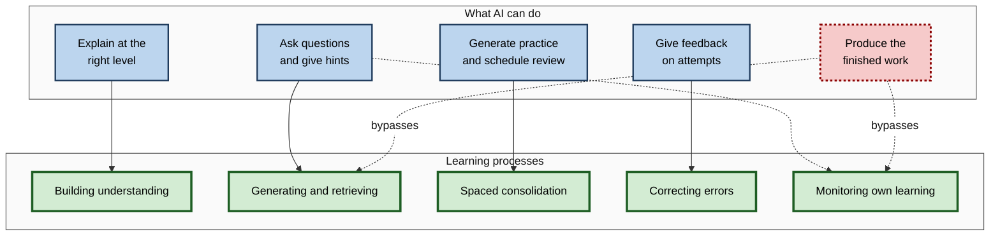
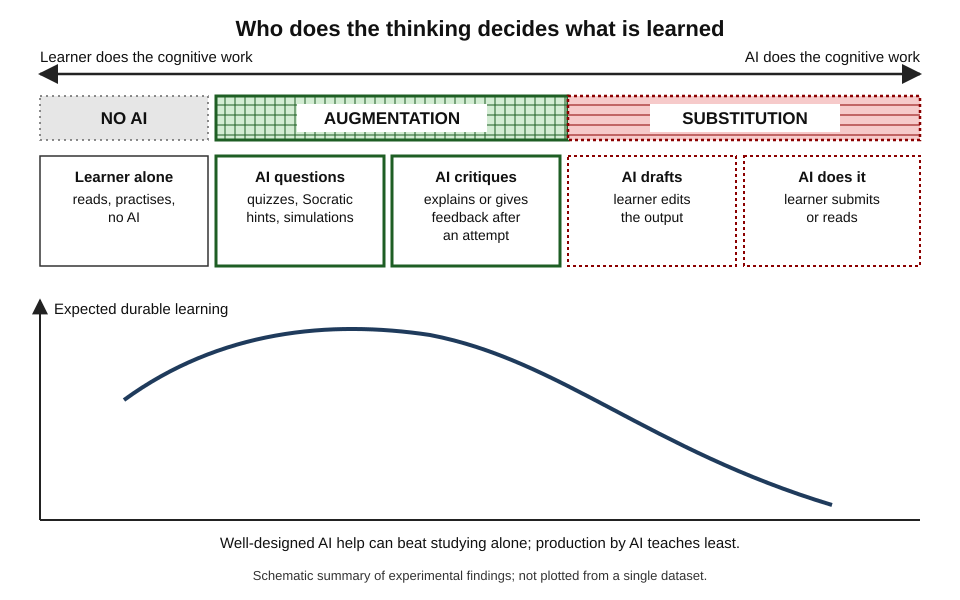
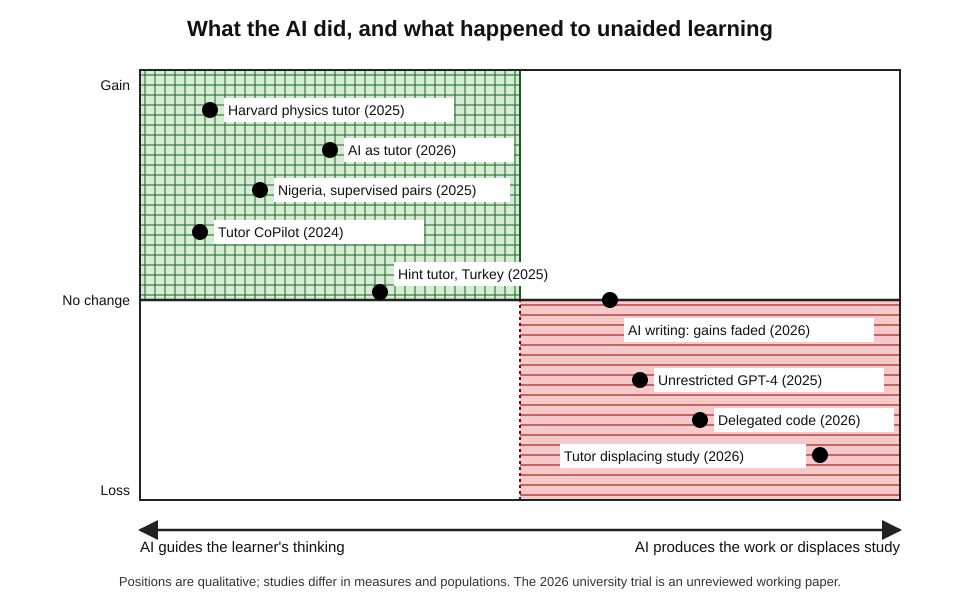
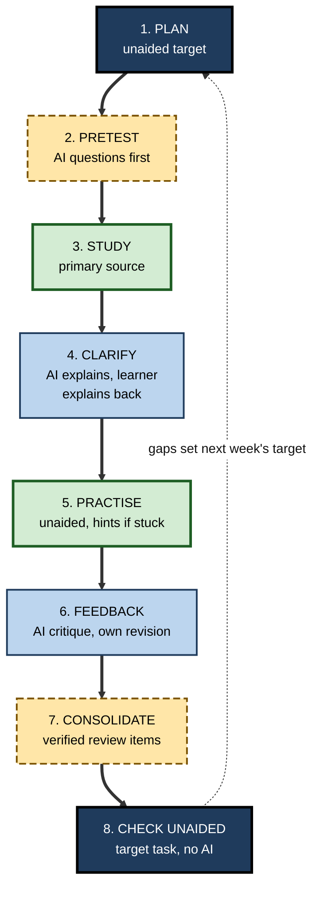
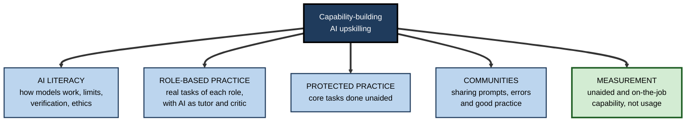
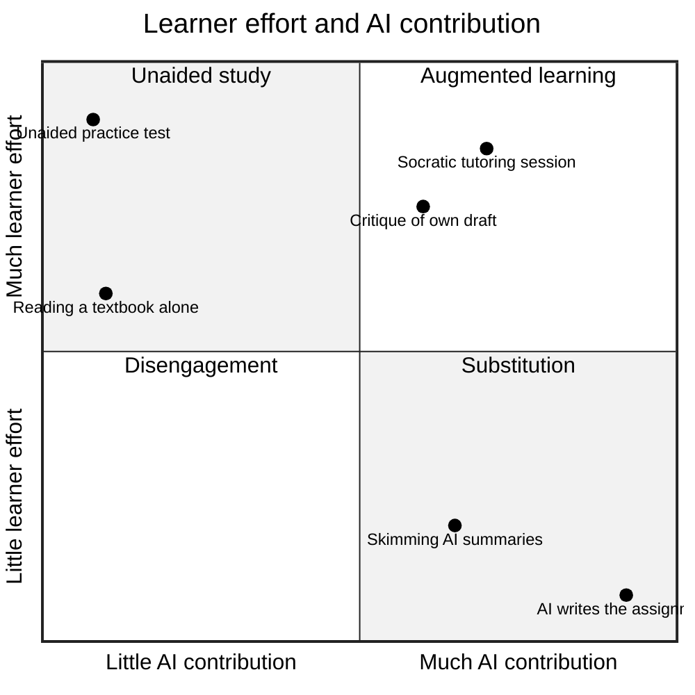

# B. AI-Assisted Learning

Two professionals set out to learn the same new field with the same AI assistant. One asks it to explain, summarise and draft, reads fluent answers every evening, and after three months can talk about the field but not work in it. The other attempts first, asks to be questioned, checks what she is told, and tests herself without the tool each week; after three months she can do the work unaided and uses the AI to go further. The difference was not the technology but **who did the thinking**.

> **Definition — AI-assisted learning:** the deliberate use of artificial intelligence by a learner to explain, question, generate practice, give feedback, schedule review, simulate situations or find and condense information — in ways that build the learner's own durable capability.

**Why it matters**

- Generative AI is now the most widely used learning aid in the world, used daily by most students and a large share of knowledge workers.
- Controlled studies since 2024 show that it can produce some of the largest learning gains ever recorded for educational technology — and, used differently, measurable **losses** in unaided capability.
- Learners rarely notice which is happening: assisted performance rises in both cases, and the feeling of learning is unreliable.
- For a self-directed professional, AI changes not *whether* to keep learning but *how* — and the skill of learning with AI has become part of learning how to learn.

---

## What AI-Assisted Learning Is

### Scope

- **Learner-directed** — the learner chooses the tools, roles and rules, rather than receiving an AI-enabled course designed by someone else.
- **Process-focused** — the concern is not the output the AI produces but the change in the learner.
- **Wide range of functions** — explanation, tutoring, questioning, practice generation, flashcards and scheduling, feedback, summarisation and research, simulation and role-play, translation and accessibility.
- **Embedded in work** — for professionals, much of it happens in the middle of real tasks, where learning and getting the job done are hard to separate.

### The central principle

> **Key point:** learning happens in the mind that does the **generating, retrieving, explaining and judging**. AI assistance helps when it makes more of that work possible or better targeted; it harms when it does that work instead of the learner.

- This principle explains almost every finding in the field:
  - hint-giving tutors help where answer-giving chatbots harm;
  - asking for explanations of code helps where asking for the code harms;
  - reading AI summaries saves time but teaches little;
  - AI-generated quizzes help when the learner answers them unaided.

### How AI maps onto the processes of learning

Learning science identifies a small number of processes that produce durable learning. Each can be supported — or bypassed — by AI.

**Figure 1.** How AI functions can support, or bypass, the core processes of learning.

---

## From Teaching Machines to Learning Partners

- **A century of attempts** — mechanical testing machines in the 1920s, Skinner's teaching machines in the 1950s, computer-based instruction from the 1960s, intelligent tutoring systems from the 1980s, adaptive platforms and online courses in the 2000s and 2010s.
- **What each generation offered** — small steps with feedback; step-level tutoring in narrow domains; adaptive sequencing; scale.
- **What changed in 2022** — large language models made open-ended, conversational, any-subject assistance available to anyone, without the years of expert authoring classic tutors required.
- **What did not change** — the mechanisms of learning, and the recurring pattern in which technologies are oversold, under-used, then settle into narrower uses that work.

> **Key point:** the best long-run evidence about AI tutoring comes from classic intelligent tutoring systems, which showed that **step-by-step guidance with feedback on each step** can approach the effectiveness of human tutors. Generative AI makes that kind of guidance available in any subject, but only if it is designed or prompted to provide it.

---

## Augmentation and Substitution

### Cognitive offloading

> **Definition — Cognitive offloading:** using physical action or external tools to reduce the cognitive demands of a task — for example writing a reminder, using a calculator or asking an AI (Evan Risko and Sam Gilbert, 2016).

- **Offloading is normal and often wise** — no one should memorise what they can reliably look up and rarely need.
- **The learning cost** — offloading the very processing that a learning task is designed to cause removes the learning.
- **The extended-mind view** — Andy Clark and David Chalmers (1998) argued that reliably used external resources can function as part of the mind; the view helps explain why skilled people with good tools are so capable, but it does not remove the need for internal knowledge to **use and judge** the tools.

### Augmentation versus substitution

> **Definition — Augmentation:** AI use in which the learner continues to do the essential cognitive work while the AI adds explanation, questions, feedback, practice or access.

> **Definition — Substitution:** AI use in which the AI performs the cognitive work a learning activity was meant to cause.

| | Augmentation | Substitution |
|---|---|---|
| Learner's first move | Attempts, predicts or recalls | Asks for the answer |
| AI's role | Tutor, questioner, critic, simulator, scheduler | Producer of the finished work |
| Feeling during use | Effortful, sometimes frustrating | Smooth and productive |
| Assisted performance | Moderate to high | High |
| Unaided performance later | Higher than before | Often no better, sometimes worse |
| Typical evidence | Hint-based tutors; conceptual questions | Unrestricted answer-giving; delegated code |

**Figure 2.** Who does the thinking: zones of AI use defined by the learner's and the AI's share of the cognitive work.

### Metacognitive laziness and critical thinking

- **Metacognitive laziness** — in a 2025 randomised study by Yizhou Fan and colleagues, students supported by ChatGPT improved their essays most but gained no more knowledge or transfer than others, and engaged less in planning, monitoring and evaluating their own work.
- **Knowledge workers** — a 2025 survey of 319 knowledge workers by Hao-Ping Lee and colleagues found that greater confidence in AI was associated with less critical-thinking effort.

**Study card — Michael Gerlich (2025)**

- **Design:** a survey and interview study of **666** participants in the United Kingdom across age groups and educational backgrounds, measuring frequency of AI tool use, cognitive offloading and critical-thinking performance.
- **Results:**
  - heavier AI use was associated with **lower** critical-thinking scores;
  - the association was partly explained (mediated) by greater **cognitive offloading**;
  - younger participants showed higher AI dependence and lower critical-thinking scores than older participants;
  - higher educational attainment was associated with better critical thinking regardless of AI use.
- **Limits:** correlational and largely self-reported; people who think less critically might simply use AI more.
- **Conclusion:** consistent with experimental findings, but on its own it cannot show that AI use **causes** weaker critical thinking.

> **Watch out:** widely shared claims that "AI is making people stupid" rest on a mix of strong experiments, small studies and correlational surveys. The **experimental** evidence supports a narrower, firmer claim: substituting AI for the thinking a task requires reduces the learning from that task.

---

## The Evidence in One Place

### Landmark studies, 2024–2026

| Study | Setting and design | Main result | Lesson |
|---|---|---|---|
| Bastani and colleagues (2025) | ~1,000 Turkish high-school maths students; GPT-4 chat, hint tutor or no AI | Practice up 48% and 127%; unaided exam down 17% with chat, unchanged with hint tutor | Answer-giving harms; guardrails remove most harm |
| Kestin and colleagues (2025) | 194 Harvard physics students; crossover, AI tutor versus active-learning class | Median gains more than double, in less time | Research-designed tutors can outperform strong teaching |
| De Simone and colleagues (2025) | Nigerian secondary students; six weeks, pairs, teacher-supervised | About 0.3 standard deviations | Structured, supervised use is highly cost-effective |
| Wang and colleagues (2024) | ~900 human tutors, ~1,800 pupils; AI suggestions to tutors | Mastery +4 points, +9 for weaker tutors | AI can raise learning through people |
| Anthropic (2026) | 52 developers learning a new library | Comprehension 17% lower with AI; high scorers asked conceptual questions | Use for understanding, not production |
| Contractor and Reyes (2026) | Proctored experiment with undergraduates | Gains persisted with AI as tutor, faded when AI wrote | Augmentation lasts; automation fades |
| Liu and colleagues (2026, working paper) | ~2,400 university students; course-integrated tutor access | Final grades down about 0.37 standard deviations | Access alone can displace effective study |

**Figure 3.** The controlled evidence arranged by what the AI did and whether unaided learning rose or fell.

### Five principles the evidence supports

1. **Thinking must stay with the learner** — gains follow designs in which learners attempt, explain and retrieve; losses follow designs in which AI produces.
2. **Design beats access** — giving people a powerful tool is not an intervention; structured pedagogy around it is.
3. **Complement, do not displace** — AI added to effective study helps; AI that replaces effective study can harm.
4. **Measure unaided and later** — assisted and immediate performance systematically overstate learning.
5. **Feelings mislead** — learners and even experts misjudge AI's effects on their own learning and work.

> **Remember:** design, displacement and measurement — most disagreements between studies dissolve once these three are compared.

---

## Core Practices of AI-Assisted Learning

### Prompting AI to teach rather than answer

- **Assign a role** — tutor, questioner, critic, examiner, sceptical client.
- **State the goal and level** — what the learner must be able to do unaided, and what they already know.
- **Set rules of engagement** — no answers before an attempt; one question at a time; hints in increasing steps; honest correction; no agreement under pressure.
- **Close with retrieval** — a summary from memory, corrected by the AI.
- **Use learning modes** — since 2025 the main assistants offer study or learning modes that build these rules in, though a determined learner can bypass them.

> **Example — a compact tutoring brief:** "Act as my tutor for bond pricing. I know basic algebra but not finance. Goal: price bonds and explain yield changes unaided in two weeks. Ask one question at a time; give the smallest hint when I am stuck; correct me plainly; finish by asking me to summarise from memory."

### Practices organised by learning process

- **Building understanding** — explanations work when they connect to prior knowledge, arrive in layers, state the limits of their analogies and are followed by the learner explaining back; graduated Socratic questioning goes further by leaving the reasoning itself to the learner, provided the learner has enough knowledge to reason with.
- **Retrieval and consolidation** — AI can generate unlimited questions, cases and flashcards and schedule them by predicted forgetting, but it defaults to low-level, sometimes wrong and excessive items; the learner's job is to select, edit, ground and then answer them unaided.
- **Fitting instruction to the learner** — adapting pace, difficulty, support and examples to what the learner **knows** is well supported, and purpose-built tutors with step-level feedback have the strongest evidence; adapting to preferred "learning styles" has none.
- **Handling information** — AI maps unfamiliar fields and triages reading at great speed, but summaries over-generalise and citations mislead, so the decisive sources must still be read.

| Learning process | AI at its best | AI at its worst |
|---|---|---|
| Understanding | Layered explanation after an attempt; Socratic questions | Fluent explanation read passively |
| Retrieval | Edited questions answered unaided | Questions with wrong keys, answered by recognition |
| Consolidation | Verified cards on a model-based schedule | Thousands of unvetted cards, abandoned |
| Adaptation | Diagnosis, then pitched practice and fading support | Personalisation to preference |
| Information | Orientation and triage before reading | Summaries instead of reading |

### AI across the cycle of self-regulated learning

Self-directed learners plan, monitor and reflect on their own learning. AI can strengthen each phase — or quietly take it over.

- **Forethought** — setting goals, choosing strategies, estimating effort.
  - *Support:* AI helps break a goal into sub-skills, suggests evidence-based strategies and drafts a schedule for the learner to adjust.
  - *Takeover:* the learner adopts an AI-generated plan without judging whether it fits their real needs.
- **Performance** — studying, practising, monitoring understanding as one goes.
  - *Support:* AI questions, gives hints, prompts self-explanation and flags errors.
  - *Takeover:* the AI does the practice, so there is nothing for the learner to monitor.
- **Self-reflection** — judging how well one did and why, and adjusting.
  - *Support:* AI asks reflective questions, compares the learner's self-assessment with actual results and suggests adjustments.
  - *Takeover:* the AI writes the reflection.

> **Definition — Self-regulated learning:** learning in which the learner actively plans, monitors and evaluates their own learning processes, motivation and behaviour, typically described as a cycle of forethought, performance and self-reflection (Barry Zimmerman).

| Phase | Question the learner owns | Good AI prompt | Warning sign |
|---|---|---|---|
| Forethought | What exactly do I need to be able to do? | "Help me break this goal into skills I can test unaided." | Plan accepted without changes |
| Performance | Do I actually understand this? | "Ask me to explain it back and tell me what is missing." | No errors ever made, because none attempted |
| Reflection | What worked, and what will I change? | "Compare my prediction of my score with my actual score." | Reflection written by the AI |

> **Key point:** metacognitive laziness is the takeover of these phases. The remedy is to keep the **questions** with the learner and give the AI only the job of helping answer them.

### Verification

- **Why** — AI errors arrive in the same confident voice as correct content; learners are least able to spot errors in what they are learning.
- **How** — trace important claims to independent sources; recompute numbers; look up every citation; test code; ask for counter-arguments; seek expert review in proportion to stakes.
- **What makes it possible** — the learner's own growing knowledge, which is why AI-assisted learning must keep building it.

> **Key point:** verification is not an extra step bolted onto learning with AI; it is part of the learning. Every check against a source is also an act of retrieval, comparison and judgement.

---

## Designing an AI-Assisted Study Workflow

A workflow turns principles into routine, so that good use does not depend on remembering rules in the moment.

### The weekly cycle

1. **Plan** — set the week's unaided target ("explain and apply X without notes or AI by Friday").
2. **Pretest** — answer a few AI-generated questions before studying, to prime attention and reveal gaps.
3. **Study a primary source** — read the textbook chapter, standard, documentation or paper oneself.
4. **Clarify with AI** — ask for explanation of what was unclear, connected to prior knowledge, then explain it back.
5. **Practise** — work AI-generated problems, cases or scenarios unaided; ask for hints only when stuck.
6. **Get feedback** — submit attempts for critique; revise oneself.
7. **Consolidate** — add a few verified items to spaced review.
8. **Check unaided** — at the end of the week, perform the target task without AI and compare with an expert answer.

**Figure 4.** A weekly workflow for AI-assisted study, with the learner's unaided work at both ends.

### A single session

| Phase | Learner does | AI does | Typical time |
|---|---|---|---|
| Warm-up | Answers recall questions from memory | Asks questions on earlier material | 5 minutes |
| New material | Reads source; predicts; attempts | Waits; then explains only what is missing | 15 minutes |
| Practice | Solves varied problems unaided | Gives graduated hints; checks steps | 15 minutes |
| Close | Writes summary from memory | Corrects summary; suggests review items | 5 minutes |

### Worked example (illustrative): a finance manager learns data analysis

A finance manager must analyse sales data in Python within six weeks.

| Week | Unaided target | AI roles | Unaided check |
|---|---|---|---|
| 1 | Load and inspect a data file | Tutor, quizmaster | Load an unseen file, describe it |
| 2 | Clean and filter data | Critic of own code | Clean a messy file without help |
| 3 | Group and summarise | Socratic questioner | Produce a regional summary |
| 4 | Visualise results | Explainer of chart choices | Chart a trend and explain it |
| 5 | Combine datasets | Error-spotting exercises | Join two files, verify row counts |
| 6 | End-to-end analysis | Sceptical reviewer | Full analysis presented to a colleague |

- **Rules throughout:** write code first; ask for explanations of errors, not fixes; verify every result against a known total; ten minutes of spaced review daily.
- **Outcome measure:** the week-six analysis done unaided and reviewed by a data analyst.

> **Watch out:** in week one, an AI could write the whole analysis in seconds. That would complete the task and teach nothing; the workflow exists to stop the tool's speed from quietly replacing the learner's growth.

---

## Responsibilities

- **Integrity** — follow the rules for each course, assessment and employer; disclose AI use where required; never present AI work as evidence of personal capability. AI-text detectors are unreliable and biased against second-language writers, so learners should keep drafts and version history as evidence of their process.
- **Privacy and confidentiality** — keep personal, client and confidential information out of unapproved tools; anonymise or fictionalise real cases for learning.
- **Fairness** — notice unequal access and skill, and bias in AI judgements; use accessibility features that AI makes possible.
- **Accountability** — remain responsible for anything learned, used or passed on.

> **In practice:** the ethical questions and the learning questions usually point the same way. Honest, verified, attempt-first use is also the use that teaches most.

---

## AI in Workplace Upskilling

### The scale of the challenge

- **Skill turnover** — in the World Economic Forum's 2025 Future of Jobs survey, employers expected about **39%** of workers' core skills to change by 2030, with AI and big data the fastest-growing skill area.
- **Self-driven adoption** — the 2024 Work Trend Index from Microsoft and LinkedIn reported that about three-quarters of knowledge workers used generative AI at work, many bringing their own tools, while only a minority had received training from their employer.
- **Regulation** — the EU AI Act requires organisations that deploy AI to ensure a sufficient level of **AI literacy** among their staff, from February 2025.

### AI as an engine of upskilling

- **Compressing the learning curve** — in a large customer-support study, an AI assistant raised novices' productivity far more than experts', apparently by spreading the practices of top performers.
- **Practice at scale** — role-play for sales, negotiation, feedback and leadership conversations; scenario practice for compliance and safety; code review for engineers.
- **Learning in the flow of work** — explanations and feedback at the moment of need, inside everyday tools.
- **Risks** — performance support mistaken for learning; deskilling where AI does routine work juniors used to learn from; unaided capability unmeasured.

**Figure 5.** Elements of an AI upskilling programme that builds capability rather than only usage.

### Case study (illustrative): an AI upskilling programme in a professional-services firm

- **Situation:** a 6,000-person accounting and advisory firm licensed an enterprise AI assistant for all staff in 2025. Usage dashboards showed high adoption within three months.
- **Problem:** quality reviewers found AI-drafted work papers with unsupported figures; junior staff could not explain analyses they had submitted; seniors spent more time reviewing.
- **Diagnosis:**
  1. training had covered **how to use** the tool, not **how to learn and verify** with it;
  2. success was measured by **usage**, not capability;
  3. juniors used the assistant to produce the work they had previously learned from.
- **Actions:**
  1. a short **AI-literacy** module on how models fail, verification and confidentiality;
  2. **role-based practice**: auditors used AI to generate risk scenarios to analyse unaided, then compared with AI and senior analyses;
  3. **protected practice**: first-year staff completed key work papers without AI each quarter, reviewed by seniors;
  4. **verification standards**: every figure traced to source with date; AI use disclosed in work papers;
  5. **communities**: monthly sessions sharing AI errors and effective prompts by service line;
  6. **measurement**: unaided technical assessments and review findings replaced usage counts as the main indicators.
- **Result:** over the following year, review findings related to AI-drafted content fell markedly, and juniors' unaided assessment scores rose above those of the previous cohort.
- **Lesson:** an AI upskilling programme succeeds when it treats AI as a means of **learning faster and checking better**, not merely of producing more.

---

## What Distinguishes Expert AI-Assisted Learners

| | Novice use | Expert use |
|---|---|---|
| First move | Asks for the answer | Attempts, then asks for critique |
| Roles | One: answer machine | Many: tutor, questioner, critic, simulator, scheduler |
| Explanations | Read and accepted | Explained back, tested by prediction |
| Practice | AI-written examples read | AI-generated problems solved unaided |
| Verification | Rare | Proportionate to stakes; sources traced |
| Evidence of learning | Feeling of progress | Unaided performance, after a delay |
| Relationship with people | AI replaces mentors | AI prepares for and extends human feedback |
| Over time | Dependence grows | Capability grows; AI use becomes more ambitious |

> **Key point:** the most skilled AI-assisted learners use AI **more** ambitiously than novices — but always to extend their own thinking, never to replace it.

**Figure 6.** Signs of a healthy and an unhealthy pattern of AI-assisted learning, by how much the learner and the AI contribute.

---

## Open Questions

- **Do the large short-term gains last?**
  - The most positive trials measured outcomes soon after short units; whether AI tutoring produces durable gains over months and years is unknown.
- **What exactly should still be learned?**
  - The knowledge needed to judge AI, act quickly and learn further is clearly still needed; how much more, field by field, is unsettled.
- **How can learning modes be made both effective and acceptable?**
  - Strict tutors frustrate and are bypassed; lenient ones collapse into answering.
- **Will AI narrow or widen gaps?**
  - Cheap tutoring could reach millions; early evidence also shows larger benefits for confident, self-directed learners and larger harms for others.
- **How will expertise be formed when AI does junior work?**
  - New forms of apprenticeship, simulation and protected practice are being tried; none is yet proven at scale.
- **Can research keep pace with the tools?**
  - Models change every few months; evaluation methods that generalise across versions are needed.

---

## Summary

- **AI-assisted learning** is the deliberate use of AI to explain, question, generate practice, give feedback, schedule review, simulate and research — in ways that build the learner's own capability.
- The central principle: **learning happens in the mind that does the thinking**. AI helps when it supports generation, retrieval, explanation and judgement, and harms when it substitutes for them.
- **Cognitive offloading** is normal, but offloading the processing a task is meant to cause removes the learning; **augmentation** builds capability, **substitution** replaces it. Studies point to **metacognitive laziness** and associations between heavy AI use and weaker critical thinking (largely correlational).
- Evidence 2024–2026: answer-giving chatbots lowered unaided maths performance; hint tutors avoided the harm; a research-designed Harvard tutor doubled gains; supervised use in Nigeria was highly cost-effective; AI suggestions improved human tutors; delegated code lowered comprehension; a course-integrated tutor that displaced study lowered grades.
- Five principles: thinking stays with the learner; **design beats access**; complement, do not displace; measure **unaided and later**; feelings mislead.
- Core practices: prompting AI to **teach rather than answer**, layered explanation with explain-back, Socratic questioning, personalisation to knowledge, edited practice, verified spaced review, careful research use, and **verification** as part of learning.
- Across the **self-regulated learning** cycle — forethought, performance, reflection — AI should help answer the learner's questions, not take the questions over.
- A **weekly workflow** — plan, pretest, study, clarify, practise, feedback, consolidate, check unaided — keeps the learner's own work at both ends.
- Responsibilities: integrity, privacy, fairness and accountability.
- **Workplace upskilling** needs AI literacy, role-based practice, protected unaided practice, communities and measurement of capability rather than usage.

---

## Self-Check

1. Define AI-assisted learning and state its central principle.
2. Explain how AI can support or bypass four core learning processes.
3. Define cognitive offloading. When is it wise, and when does it undermine learning?
4. Distinguish augmentation from substitution with an example of each in your own field.
5. What is metacognitive laziness, and what evidence suggests it?
6. Summarise Gerlich's 2025 study and explain why it cannot establish causation.
7. Compare the 2025 Turkish mathematics study with the 2025 Harvard physics trial. What explains their different results?
8. What did the 2026 course-integrated tutor trial report, and what principle does it illustrate?
9. State the five principles the evidence supports.
10. Write a tutoring brief for a topic you need to learn, following the rules for prompting AI to teach.
11. Describe the eight-step weekly workflow and explain why it begins and ends with unaided work.
12. Why is verification part of learning rather than an extra step?
13. Design the core elements of an AI upskilling programme for a team of fifty, and say how you would measure success.
14. A colleague says AI has made her "learn ten times faster", but she cannot perform core tasks when the tool is unavailable. Diagnose using the concepts here and propose a plan.

### Answer Key

1. The deliberate use of AI to explain, question, generate practice, give feedback, schedule review, simulate and research in ways that build the learner's own capability. Principle: learning happens in the mind that does the thinking; AI should support, not replace, that thinking.
2. Understanding: AI explains at the right level, or the learner merely reads. Generation and retrieval: AI asks questions, or produces answers. Consolidation: AI schedules review of verified items, or none occurs. Error correction: AI critiques attempts, or replaces them. Monitoring: AI prompts self-assessment, or the learner relies on fluency.
3. Using tools or actions to reduce cognitive demand. Wise for information easily looked up and rarely needed; harmful when the offloaded processing is what the task is meant to teach or when independent capability will be needed.
4. Augmentation: writing a contract clause, then asking AI for critique. Substitution: asking AI to write the clause and submitting it.
5. Handing over planning, monitoring and evaluation of one's own work to AI. Fan and colleagues found ChatGPT-supported students improved essays but not knowledge or transfer, with reduced self-regulation.
6. 666 participants; heavier AI use associated with lower critical thinking, partly via offloading, especially among younger people. It is correlational and self-reported; people with weaker critical thinking may use AI more.
7. Turkish study: unrestricted GPT-4 chat let students get answers — practice up, unaided exam down 17%; a hint tutor avoided the harm. Harvard: a tutor designed on learning principles with supplied solutions guided students step by step — gains more than doubled. The difference was design: production versus guided learner thinking.
8. Access reduced final grades by about 0.37 standard deviations, apparently by displacing existing study. Principle: complement effective learning, do not displace it; access is not an intervention.
9. Thinking stays with the learner; design beats access; complement, do not displace; measure unaided and later; feelings mislead.
10. A good brief states role, prior knowledge, unaided goal and deadline, rules (one question at a time, hints before answers, honest correction) and a closing summary from memory.
11. Plan, pretest, study a primary source, clarify with AI and explain back, practise unaided, get feedback, consolidate into spaced review, check unaided. Beginning with an unaided target and ending with an unaided check keeps attention on the learner's capability rather than assisted output.
12. Checking claims against sources requires retrieval, comparison and judgement — learning processes — and builds the knowledge that makes later checking possible.
13. AI literacy (failures, verification, confidentiality); role-based practice with AI as tutor and critic; protected unaided practice; communities sharing errors and prompts; measurement through unaided assessments and quality-review findings rather than usage.
14. Likely substitution, fluency illusion and dependence: high assisted performance mistaken for learning. Plan: attempt-first rules, learning modes, explain-back, weekly unaided tasks, spaced review of core knowledge, and an unaided assessment after a month.

---

## Glossary

| Term | Meaning |
|---|---|
| AI literacy | Understanding of how AI works, its limits and its responsible use. |
| AI-assisted learning | Deliberate learner use of AI that builds the learner's own capability. |
| Augmentation | AI use that leaves the essential thinking with the learner. |
| Cognitive offloading | Using tools or actions to reduce the cognitive demand of a task. |
| Displacement | AI use that crowds out effective learning activities. |
| Extended mind | The view that reliably used external resources can function as part of the mind. |
| Learning mode | An AI assistant setting that questions and scaffolds rather than answers. |
| Metacognitive laziness | Handing over planning, monitoring and evaluation of one's own learning to AI. |
| Protected practice | Core tasks deliberately performed without AI to build or maintain capability. |
| Self-regulated learning | Learning in which the learner plans, monitors and evaluates their own learning. |
| Substitution | AI use that performs the thinking a learning activity was meant to cause. |
| Unaided check | A test of capability performed without AI, ideally after a delay. |
| Verification | Checking AI output against independent sources, recomputation or experts. |
