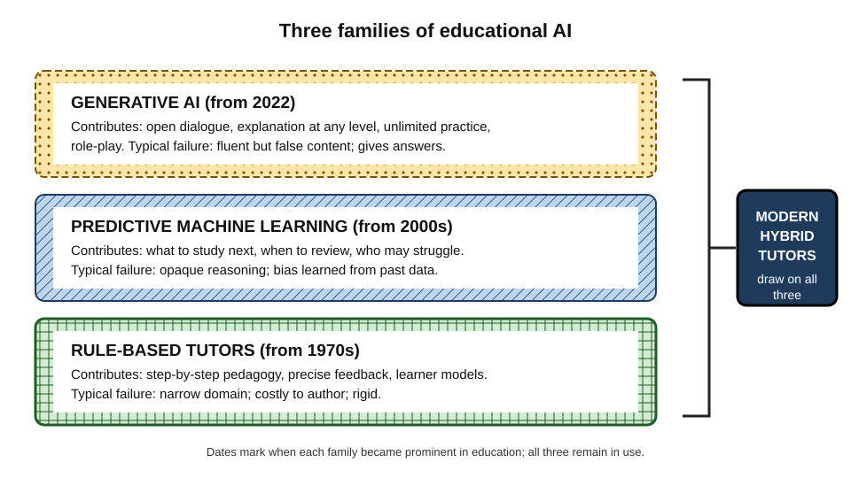
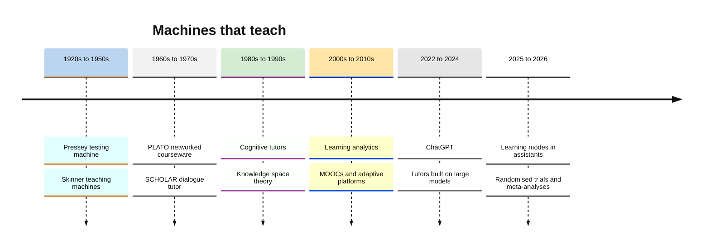
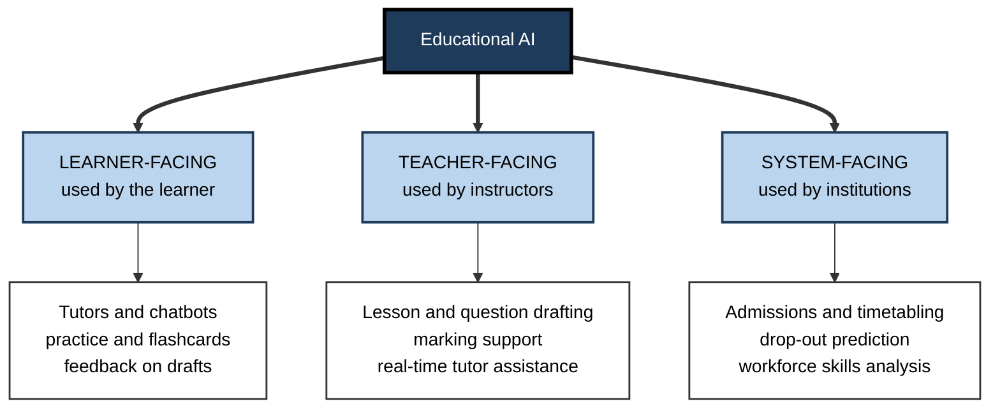
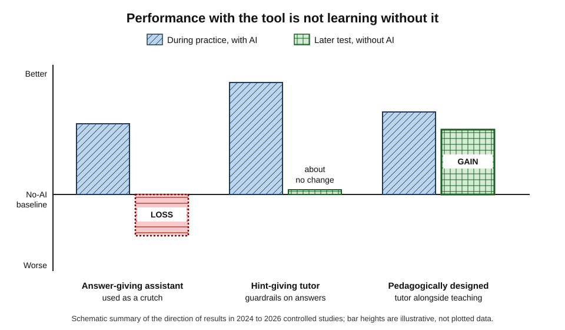
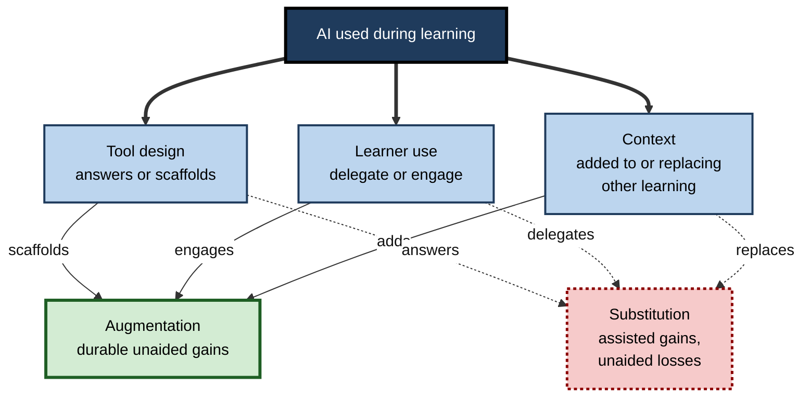
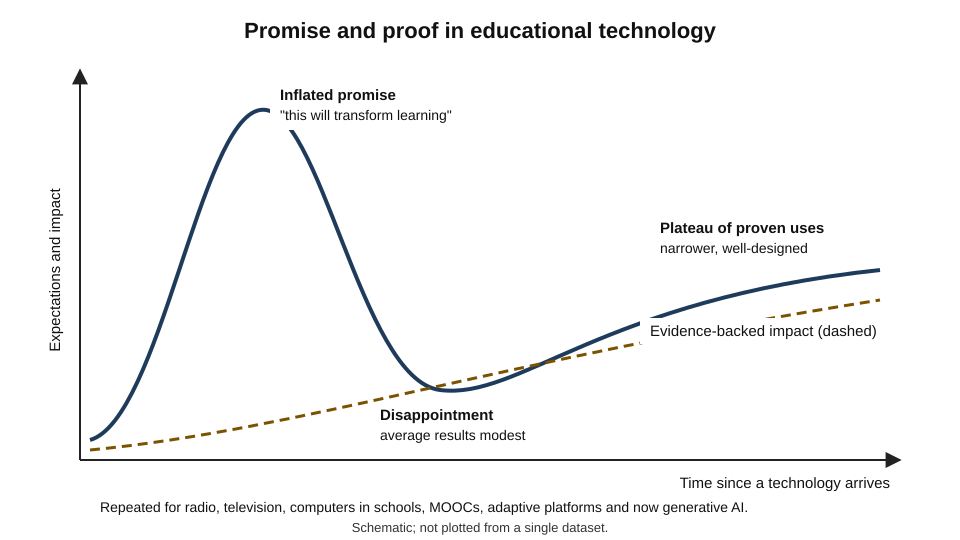

# G.1. Overview of AI in Education

In 2025 a secondary-school pupil in Benin City practised English grammar with a chatbot after school; an undergraduate at Harvard worked through fluid dynamics with a custom physics tutor; a new data analyst in Pune asked an assistant to explain a window function before a client call. Each was learning with artificial intelligence, yet the tools, the purposes and the results differed sharply. Some of these uses produced unusually large learning gains; others, in carefully controlled studies, left learners **worse off** than if they had never touched the tool.

> **Definition — Artificial intelligence in education (AIED):** the design, use and study of computational systems that perform tasks normally requiring human intelligence — explaining, questioning, assessing, adapting, predicting — in order to support teaching and learning.

**Why it matters**

- AI is now the most widely used study aid in history: within three years of the public release of ChatGPT in November 2022, large majorities of university students in several countries reported using generative AI for their studies.
- The same tool can **raise** or **lower** learning, depending on how it is designed and used; the difference is measurable and sometimes large.
- Every professional who learns independently — which, over a long career, means every professional — now makes daily choices about AI that shape what they will be able to do unaided.
- Education technology has a long record of **over-promising**; knowing that record protects learners and organisations from repeating it.

---

## What "AI" Means in Education

The phrase covers three quite different families of technology, which arrived in waves and still coexist.

### Three families of educational AI

- **Rule-based and knowledge-based systems**
  - Experts encode knowledge and teaching rules by hand: "if the student makes error X, show hint Y".
  - *e.g.* classic intelligent tutoring systems for algebra, physics and programming from the 1980s onwards.
  - **Strength:** precise, predictable, pedagogically designed.
  - **Weakness:** expensive to build — often estimated at many hours of expert authoring per hour of instruction — and confined to narrow domains.
- **Machine learning (predictive AI)**
  - Statistical models learn patterns from data: which learner is likely to drop out, which item is likely to be forgotten, which problem should come next.
  - *e.g.* adaptive maths platforms, flashcard schedulers, early-warning systems in universities.
  - **Strength:** improves with data; scales cheaply once built.
  - **Weakness:** opaque reasoning; can encode historical bias; needs large datasets.
- **Generative AI (large language models and related models)**
  - Models trained on vast text, image and code corpora generate new content in response to prompts.
  - *e.g.* general chatbots, AI tutors built on them, tools that draft questions, summarise papers or role-play a client.
  - **Strength:** open-domain, conversational, can explain anything at any level.
  - **Weakness:** produces fluent errors; no built-in model of the learner or of good pedagogy unless deliberately added.

> **Definition — Large language model (LLM):** a neural network trained on very large text collections to predict the next token of text; when scaled and further trained on human feedback, it can answer questions, explain, write and converse.

> **Definition — Generative AI:** AI that produces new text, images, audio, video or code rather than only classifying or predicting.

| | Rule-based tutors | Predictive machine learning | Generative AI |
|---|---|---|---|
| How knowledge enters | Hand-authored by experts | Learned from learner data | Learned from general text and code |
| Typical educational job | Step-by-step tutoring in one domain | Sequencing, scheduling, prediction | Explanation, dialogue, content creation |
| Breadth of domain | Narrow | Narrow to medium | Very broad |
| Main failure | Rigid; brittle outside its script | Hidden bias; wrong predictions | Fluent but false content; answer-giving |
| Pedagogy built in? | Yes, by design | Partly (sequencing rules) | Only if added through design or prompting |

**Figure 1.** Three families of educational AI, layered by when they emerged and what they contribute.

> **Key point:** most modern AI tutors are **hybrids** — a generative model for dialogue, wrapped in rules and prompts that impose pedagogy, sometimes with a predictive model tracking what the learner knows.

### What AI does in a learning episode

Any learning episode involves a small set of functions; AI can perform some or all of them.

- **Presenting** — explaining a concept, giving an example, showing a worked solution.
- **Eliciting** — asking a question, setting a problem, prompting the learner to explain.
- **Diagnosing** — inferring what the learner knows or misunderstands from their answers.
- **Responding** — giving feedback, hints, corrections or encouragement.
- **Sequencing** — choosing what comes next and when to review.
- **Producing** — doing the task itself: writing the essay, solving the problem, generating the code.

> **Watch out:** the last function — **producing** — is the one that most often replaces learning rather than supporting it. A tool that writes the essay has done the cognitive work the essay was meant to cause.

---

## A Short History of Machines That Teach

The ambition to automate teaching is nearly a century old; each generation promised a revolution and delivered something narrower but real.

### From teaching machines to intelligent tutors

- **Sidney Pressey (1920s)** — built a mechanical device that presented multiple-choice questions and would not advance until the right answer was chosen; an early automation of **testing with feedback**.
- **B. F. Skinner (1950s)** — "teaching machines" and **programmed instruction**: material broken into small steps, each requiring an active response with immediate reinforcement.
  - Lasting legacy: small steps, active response, immediate feedback, self-pacing.
  - Limitation: rigid linear sequences; little understanding of *why* a learner erred.
- **PLATO (from 1960, University of Illinois)** — one of the first large computer-assisted instruction systems, with networked terminals, online forums and courseware authored by teachers.
- **SCHOLAR (Jaime Carbonell, 1970)** — a geography tutor that could hold a limited mixed-initiative dialogue, often cited as the first intelligent tutoring system.
- **1980s–1990s: intelligent tutoring systems** — the term was popularised by Derek Sleeman and John Seely Brown's 1982 collection; John Anderson's group at Carnegie Mellon built **cognitive tutors** that modelled each step of a student's reasoning.
- **1990s–2000s: adaptive learning** — systems such as ALEKS, grounded in **knowledge space theory** (Jean-Paul Doignon and Jean-Claude Falmagne, 1985), mapped which topics a learner was ready for.

> **Definition — Programmed instruction:** a method in which material is presented in small, ordered steps, each requiring an active response that is immediately confirmed or corrected.

> **Definition — Intelligent tutoring system (ITS):** software that models the domain, the learner and teaching strategies in order to give individualised, step-by-step instruction and feedback.

### The data era and the hype cycle

- **2000s–2010s: learning analytics and educational data mining** — the analysis of learners' digital traces to predict success and improve courses.
- **2012: "the year of the MOOC"** — massive open online courses attracted millions of enrolments; completion rates proved low (commonly in single digits of percentage points), and participants were disproportionately already well educated.
- **2010s: adaptive-learning start-ups** — some promised that algorithms would personalise every lesson; one prominent company, Knewton, made sweeping claims, struggled to show results and was sold in 2019 for a fraction of its earlier valuation.

### The generative turn

- **November 2022** — ChatGPT released; its user base grew faster than any consumer application before it.
- **Early 2023** — many schools and universities first **banned** the tools, then within months moved to policies of guided use.
- **March 2023** — Khan Academy announced Khanmigo, a tutor built on GPT-4 and instructed not to give answers directly; Duolingo launched features built on the same model.
- **2024–2025** — field experiments and randomised trials of AI tutors appeared in schools and universities; results ranged from strongly positive to clearly harmful.
- **2025** — the major AI developers added dedicated learning modes to their general assistants (Anthropic's learning mode in April, OpenAI's study mode in July, Google's guided learning in August), each designed to question and scaffold rather than simply answer.
- **2026** — the first meta-analyses restricted to randomised trials, and the first large trials of AI tutors integrated into whole university courses, began to show how much **context and design** determine results.

**Figure 2.** Milestones in the automation of teaching, from mechanical testing machines to generative tutors.

> **Watch out:** the history is often told as a straight march of progress. It is better read as **repeated cycles** — inflated promise, disappointing average results, then a narrower set of uses that genuinely work.

---

## Who Educational AI Serves

A widely used classification, set out by Toby Baker and Laurie Smith in a 2019 report for the innovation foundation Nesta, sorts educational AI by **who uses it**.

- **Learner-facing AI** — used directly by the person learning.
  - *e.g.* tutors, chatbots, practice generators, flashcard schedulers, language-conversation partners, writing feedback.
- **Teacher-facing AI** — supports instructors and trainers.
  - *e.g.* drafting lesson plans, generating question banks, marking assistance, flagging struggling learners, assisting human tutors in real time.
- **System-facing AI** — supports institutions and organisations.
  - *e.g.* admissions screening, timetabling, drop-out prediction, skills-gap analysis across a workforce.

**Figure 3.** Learner-facing, teacher-facing and system-facing uses of educational AI.

> **Key point:** a self-directed professional lives mostly in the **learner-facing** layer, but the other two shape them too — the training their employer buys and the analytics that judge their progress are teacher- and system-facing AI.

### The learner-facing uses in detail

- **Explanation** — a concept explained at any level, with analogies and examples on demand.
- **Tutoring** — guided problem-solving with hints, questions and step-by-step feedback.
- **Practice generation** — questions, cases, flashcards and problems created from any material.
- **Feedback on work** — comments on drafts, code, designs, presentations.
- **Summarisation and research support** — condensing documents; finding, comparing and synthesising sources.
- **Simulation and role-play** — a sceptical client, an examiner, a patient, a negotiating counterpart, a job interviewer.
- **Language practice** — conversation, correction and translation at any hour.
- **Accessibility** — text-to-speech, simplified reading levels, live captions, translation for learners working in a second language.
- **Planning and reflection** — help structuring a learning plan or reviewing progress.

> **Example:** an operations manager preparing for a lean-management certification uses one assistant in four ways in a single week — to explain value-stream mapping, to quiz her on the seven wastes, to critique her draft improvement proposal and to play a sceptical plant director in a rehearsal.

---

## How People Actually Use It

Usage data reveal a gap between the uses that build learning and the uses that dominate.

### Evidence from usage

**Study card — Anthropic Education Report (April 2025)**

- **Data:** an analysis of over half a million anonymised conversations by users with university email addresses, classified by a privacy-preserving automated method.
- **Findings:**
  - students used the assistant most for **creating** and **analysing** — tasks high on Bloom's taxonomy — rather than for remembering or understanding;
  - roughly **half** of the conversations were **direct** — the student sought an answer or a finished product with little engagement — and half **collaborative**, with back-and-forth;
  - computer science was heavily over-represented relative to its share of students.
- **Conclusion:** much student use delegates **higher-order thinking** to the AI — the very work education is meant to develop.
- **Limits:** one provider's users; automated classification; no measure of what was learned.

- **Student surveys** — repeated surveys of UK undergraduates by the Higher Education Policy Institute found AI use rising from about two-thirds of students in 2024 to more than nine in ten in 2025, with explaining concepts and summarising articles the most common uses.
- **Workplace surveys** — the 2024 Work Trend Index from Microsoft and LinkedIn reported that about three-quarters of knowledge workers used generative AI at work, many bringing their own tools without employer guidance; fewer than half had received any training from their employer.

> **Definition — Shadow AI:** use of AI tools at work without the organisation's knowledge or approval; it raises risks for data confidentiality and makes learning with AI invisible to managers.

> **Watch out:** self-reported usage surveys measure **what people say they do**, and figures vary with sample and wording. The direction is consistent — near-universal use, rising quickly — but individual percentages should not be treated as precise.

---

## What the Evidence Says

### Kinds of evidence

- **Usage studies and surveys** — what people do and believe; cannot show effects on learning.
- **Laboratory experiments** — controlled, short, often with students; strong on cause, weak on realism.
- **Field experiments** — randomised trials in real classrooms or workplaces; the strongest evidence for policy.
- **Quasi-experiments** — comparisons of groups that were not randomly assigned; useful, but open to selection bias.
- **Meta-analyses** — pooled effects across studies; only as good as the studies pooled.

> **Remember:** the question that matters is not "did learners do better *with* the AI?" but "can learners do better **without** it, later, on new problems?" Many studies measure only the first.

### Results that point in both directions

- **Strongly positive results**
  - Harvard physics (published 2025): students learned more in less time from a carefully designed AI tutor than from an active-learning class, with median gains more than twice as large.
  - Nigeria (World Bank, 2025): six weeks of after-school sessions with a GPT-4-based assistant, guided by teachers and structured prompts, improved English results by about a quarter of a standard deviation.
- **Clearly negative results**
  - Turkish high schools (published 2025): unrestricted access to a GPT-4 chat assistant raised practice scores but **lowered** later unaided exam scores relative to students who never had it; a version designed to give hints rather than answers avoided the harm.
- **Mixed results**
  - A proctored 2026 experiment with undergraduates by Zara Contractor and Germán Reyes found that AI access raised immediate test scores; gains persisted when students used AI as a **tutor** (augmentation) but faded when it **wrote for them** (automation).

**Study card — Liu and colleagues (working paper, October 2026)**

- **Design:** randomised trial with about **2,400 undergraduates** across roughly 30 instructors and several disciplines at a large US public university; half were given access to an AI tutor integrated into their course.
- **Results:**
  - access **reduced** final grades by about **0.37 standard deviations**;
  - participation in the course's existing online learning activities fell sharply;
  - losses were larger among **first-generation** students.
- **Interpretation offered:** the tutor **displaced** engagement with existing, effective learning activities rather than adding to them.
- **Status:** a recent working paper, not yet peer-reviewed; details of the tutor's design matter for interpretation.

> **Key point:** AI tutoring is not one intervention. A tightly designed tutor used *alongside* good teaching can produce large gains; an answer-giving tool, or a tutor that *replaces* other effective activity, can produce losses.

### Pooled evidence

- **A 2026 meta-analysis** of 47 randomised controlled trials of AI interventions, published in *Educational Psychology Review*, reported a moderate-to-large average positive effect on academic outcomes (Hedges' *g* of about 0.68), with benefits rising up to roughly 20–25 hours of use and then levelling off.
- **Why to read it cautiously:**
  - many included trials were short, small and measured outcomes immediately;
  - "AI intervention" spans very different tools, from rule-based tutors to chatbots;
  - studies with positive results are more likely to be published;
  - negative field trials show that averages hide harmful designs.

> **Watch out:** some early meta-analyses of ChatGPT in education reported **very large** average effects. They were criticised for pooling weak designs — no control group, assisted outcome measures, very short studies. Large pooled effects from such literatures should be treated as **upper bounds**, not expectations.

**Figure 4.** What the controlled evidence suggests: assisted performance compared with later unaided performance under different designs.

### What separates helpful from harmful designs

| | Designs associated with gains | Designs associated with losses |
|---|---|---|
| What the AI does | Asks, hints, checks reasoning, explains after an attempt | Produces finished answers and products on request |
| Learner's role | Attempts first; explains; corrects | Copies, pastes or reads the answer |
| Relation to other teaching | Complements a course or teacher | Replaces practice, discussion or study activities |
| Outcome measured | Delayed, unaided, transfer | Assisted or immediate only |
| Human involvement | Teacher or facilitator structures use | Unsupervised, unguided |

**Figure 5.** Factors that decide whether AI assistance builds or replaces learning.

> **Definition — Augmentation (in learning):** AI use that leaves the learner doing the essential thinking while the tool adds explanation, feedback or practice.

> **Definition — Substitution (in learning):** AI use in which the tool performs the thinking the learning activity was meant to cause.

---

## Lessons From a Century of Educational Technology

### The media debate

- **Richard Clark (1983)** argued that media are "mere vehicles" that deliver instruction but do not influence learning, "any more than the truck that delivers our groceries causes changes in our nutrition"; what matters is the **instructional method**.
- **Robert Kozma (1991, 1994)** replied that some media make certain methods possible — simulations, for instance, allow learners to manipulate systems they could not otherwise touch.
- **Relevance today:** both were partly right. A generative model enables methods that were impractical before (open conversation, instant role-play, unlimited practice), but whether learning happens still depends on the **method** the learner and tool actually use.

> **Key point:** asking "does AI improve learning?" is like asking "do books improve learning?" — the answer depends on what is in them and what the reader does.

### Recurring patterns

- **Oversold and underused** — the historian of education Larry Cuban (2001) documented how successive technologies, from film and radio to computers, were adopted with great enthusiasm and changed classroom practice far less than predicted.
- **The rich get richer** — Justin Reich, in *Failure to Disrupt* (2020), showed that open online learning was used most by people who were already educated and self-motivated, so free technology could **widen** gaps.
  - *e.g.* a 2026 university trial of an AI tutor found larger losses for first-generation students.
- **Novelty effects** — new tools often show early gains that shrink as the novelty wears off; short studies overstate long-run benefits.
- **Measurement drift** — studies measure what the tool makes easy to measure (time on platform, completion, satisfaction) rather than durable capability.

> **Definition — Novelty effect:** a temporary improvement in engagement or performance caused by the newness of a tool rather than its lasting value.

> **Watch out:** claims that AI will "replace teachers" or "end the need to learn" have direct ancestors in claims made for radio (1920s), television (1950s), computers (1980s) and MOOCs (2012). Each technology found a place; none removed the need for effortful learning or for human guidance.

**Figure 6.** The recurring cycle of educational technology: inflated expectations, disappointment, then a narrower set of proven uses.

---

## Policy and Governance

Institutions and governments moved from alarm to frameworks within about two years.

- **UNESCO (2023), guidance for generative AI in education and research**
  - human-centred use; validation of tools before classroom use;
  - a suggested minimum age of **13** for independent use of general chatbots;
  - protection of data privacy and of teachers' professional role.
- **UNESCO (2024), AI competency frameworks** for students and teachers — understanding, ethical use and critical evaluation of AI as learning outcomes in their own right.
- **US Department of Education (2023)** — a report on AI and the future of teaching urging "humans in the loop" and evidence-based adoption.
- **European Union AI Act (adopted 2024)**
  - classifies several education uses as **high-risk** — determining admission, evaluating learning outcomes, steering learning and monitoring cheating — requiring risk management, data quality and human oversight;
  - **prohibits** emotion-recognition systems in education and workplaces (from February 2025);
  - requires organisations that deploy AI to ensure adequate **AI literacy** among their staff (from February 2025).

> **In practice:** for a professional learner the policy picture has three practical consequences — check the **rules of the institution or employer** before using AI on assessed or confidential work; expect AI literacy to be treated as a **required competence**; and expect high-stakes assessments to remain AI-free or tightly controlled.

---

## Choosing and Using AI as a Self-Directed Learner

### Categories of learner-facing tools

| Tool category | Typical strengths | Typical risks | Best use |
|---|---|---|---|
| General assistant | Breadth; explanation at any level; drafting | Answer-giving by default; confident errors | Explanation after an attempt; critique; role-play |
| Assistant in a learning mode | Questions and hints rather than answers | Can be bypassed; uneven across subjects | Working through problems one is meant to learn |
| Domain tutor | Curriculum-aligned; learner model; checked content | Narrow; may be expensive | Structured subjects such as maths, languages, coding |
| Source-grounded notebook | Answers tied to the learner's own documents | Still misreads sources; can be over-trusted | Studying a defined set of papers, policies or manuals |
| Practice and flashcard tools | Retrieval and spacing at scale | Low-quality or excessive generated items | Retaining what has been understood |

> **Definition — Source-grounded (retrieval-augmented) tool:** an AI system that retrieves passages from a specified document collection and bases its answers on them, usually citing the passages used.

### Worked example: building an AI-assisted plan for one learning goal

A management consultant moving into healthcare work must, within two months, understand hospital reimbursement well enough to lead client workshops.

1. **Define the unaided target** — "explain the main payment models, and diagnose a hospital's revenue problem from its data, in a workshop, without notes or AI".
2. **Separate what must be learned from what can be delegated** — core concepts and diagnostic reasoning must be in her head; formatting slides and drafting emails can be delegated.
3. **Assign AI roles to learning functions:**
   - *presenting* — ask for layered explanations of each payment model **after** reading a primary source;
   - *eliciting* — have the assistant quiz her, one question at a time, and wait for her answer;
   - *responding* — submit her own diagnosis of a case first, then ask for critique;
   - *simulating* — rehearse a workshop with the assistant playing a sceptical finance director.
4. **Verify** — check every factual claim about regulation against official documents; ask a healthcare colleague to review her case diagnoses.
5. **Measure unaided** — every second week, analyse a new case with no tools and compare with an expert's analysis.

| | Default use | Designed use |
|---|---|---|
| First move | Ask the AI to summarise reimbursement | Read one primary source, then ask for explanation of what was unclear |
| Practice | Read AI-written case analyses | Attempt the case, then request critique |
| Evidence of learning | Feeling of understanding after chats | Unaided case analysis every fortnight |
| Likely result | Fluent vocabulary; brittle under questioning | Durable understanding; credible in workshops |

> **Watch out:** the default use **feels** more productive, because it produces fluent text quickly. The feeling is not evidence of learning.

### Case study: a business school's first year with generative AI

- **Situation:** a business school allowed students full access to a general AI assistant across all first-year modules, with no guidance, in its first year after ChatGPT's release.
- **Problem:** by the spring term, coursework marks had risen while performance in invigilated examinations fell, and tutors reported students unable to explain their own submitted analyses.
- **Diagnosis:**
  1. most use was **direct** — assignments drafted by the assistant and lightly edited;
  2. weekly problem sets, previously the main practice, had become AI-completed;
  3. coursework had become a measure of **person plus tool**, examinations of the person alone.
- **Actions:**
  1. coursework redesigned around **in-class drafting, oral defence and reflection on process**;
  2. a learning-mode tutor configured to give hints and ask questions for problem sets;
  3. explicit teaching of AI roles — explainer, quizmaster, critic, sparring partner — and of verification;
  4. disclosure of AI use required on every submission.
- **Result:** the gap between coursework and examination marks narrowed over the following year; students rated the tutor as less convenient but reported understanding more.
- **Side effects:** more staff time for oral defences; some students used other, unconfigured tools at home.
- **Lesson:** the tool's **design** and the **assessment structure** around it decided whether AI was a tutor or a substitute.

---

## Open Questions

- **Which designs work for which learners?**
  - Positive and negative trials used different tools, subjects, ages and contexts; systematic comparisons are only beginning.
- **Do gains last?**
  - Most studies measure outcomes within days or weeks; effects over months and years are largely unknown.
- **Will AI narrow or widen inequality?**
  - Cheap tutoring could reach learners who never had a tutor, yet early evidence also shows larger harms or smaller gains for less advantaged groups.
- **What should still be learned?**
  - As AI performs more tasks, the knowledge needed to direct and judge it — and how to build that knowledge — is unsettled.
- **How should evidence keep pace?**
  - Models change every few months; a trial of last year's tool may not predict this year's.

---

## Summary

- **AIED** spans three families: **rule-based tutors** (precise, narrow), **predictive machine learning** (sequencing, scheduling, prediction) and **generative AI** (open-domain dialogue and content, with fluent errors). Modern tutors are often hybrids.
- AI can present, elicit, diagnose, respond, sequence and **produce**; production is the function most likely to replace learning.
- The history runs from **Pressey** and **Skinner** through **PLATO**, **SCHOLAR**, **cognitive tutors**, adaptive platforms and **MOOCs** to **generative tutors** and 2025 **learning modes** — repeated cycles of hype, disappointment and narrower proven uses.
- Uses can be **learner-, teacher- or system-facing**.
- Usage data show near-universal adoption and much **direct, delegating** use.
- Controlled evidence points both ways: large gains from well-designed tutors (Harvard physics, Nigeria); losses from answer-giving or activity-displacing use (Turkish maths; a 2026 university trial). Pooled averages are positive but should be read cautiously.
- The decisive variables are **tool design**, **learner use** and **context** — augmentation versus substitution — and whether outcomes are measured **later and unaided**.
- **Clark's** media argument still applies: method, not medium, causes learning.
- Policy (UNESCO, the EU AI Act) stresses human oversight, privacy and AI literacy.
- A self-directed learner should define an unaided target, assign AI to specific learning functions, verify, and test unaided.

---

## Self-Check

1. Name the three families of educational AI and give one strength and one weakness of each.
2. List the six functions AI can perform in a learning episode. Which is most likely to replace learning, and why?
3. What did Skinner's programmed instruction contribute that modern AI tutors still use?
4. Distinguish learner-facing, teacher-facing and system-facing AI with one example each.
5. What did the 2025 Anthropic usage analysis suggest about how students use AI, and what are its limits as evidence?
6. Why is "learners did better with the AI" weak evidence of learning?
7. Contrast the designs in the Harvard physics trial and the unrestricted assistant in the Turkish maths study, and explain their different outcomes.
8. What did the 2026 university trial of a course-integrated AI tutor find, and what mechanism was proposed?
9. Give three reasons to treat the pooled effect from a meta-analysis of AI interventions with caution.
10. Summarise the Clark–Kozma debate and its relevance to generative AI.
11. What is a novelty effect, and how could it mislead an organisation evaluating an AI tutor?
12. A training manager plans to give all new hires unrestricted access to a chatbot instead of the existing practice exercises. Using the evidence, predict the risks and propose a better design.
13. Design an AI-assisted plan for learning a new subject in six weeks, stating the unaided target and the AI role for each learning function.

### Answer Key

1. Rule-based: precise and pedagogically designed, but costly and narrow. Predictive ML: scales and improves with data, but opaque and can encode bias. Generative AI: open-domain and conversational, but produces fluent errors and gives answers unless designed otherwise.
2. Presenting, eliciting, diagnosing, responding, sequencing, producing. Producing, because when the tool does the task the learner skips the processing that creates durable learning.
3. Small steps, an active response at every step, immediate feedback and self-pacing.
4. Learner-facing: a chatbot that quizzes a student. Teacher-facing: a tool that drafts question banks for a trainer. System-facing: a drop-out prediction model used by a university.
5. Students mostly used AI for creating and analysing, and about half the conversations were direct answer-seeking — suggesting delegation of higher-order thinking. Limits: one provider, automated classification, no learning outcome measured.
6. Performance with the tool measures person plus tool; durable learning must be shown later, without the tool, on new problems.
7. The Harvard tutor was built on research-based pedagogy — structured, scaffolded, prompting active thinking — and complemented a course; the unrestricted assistant gave answers, which students used as a crutch, so practice scores rose and unaided exam scores fell. A hint-giving version largely avoided the harm.
8. Access reduced final grades by about 0.37 standard deviations, with larger losses for first-generation students; the tutor appeared to displace engagement with existing effective learning activities. It is an unreviewed working paper.
9. Short, small trials with immediate outcomes; heterogeneous interventions pooled together; publication bias; averages that hide harmful designs; outcomes sometimes measured with assistance.
10. Clark argued media merely deliver instruction and method causes learning; Kozma argued media enable some methods. Generative AI enables new methods (dialogue, role-play, unlimited practice), but learning still depends on the method actually used.
11. A temporary rise in engagement or performance due to newness. A short pilot could show gains that disappear, leading to a costly roll-out.
12. Risks: practice exercises displaced; answer-seeking; higher assisted but lower unaided performance; weaker learners harmed most. Better: keep practice; add a hint-giving tutor configured not to answer; require attempts before help; assess unaided after a delay; compare with a control group.
13. A good answer states a specific unaided performance target with a delay; assigns AI to explanation after reading, quizzing, critique of the learner's attempts and simulation; verifies facts against primary sources; keeps core tasks unaided; and schedules regular unaided tests.

---

## Glossary

| Term | Meaning |
|---|---|
| Adaptive learning | Instruction whose content or sequence adjusts to each learner's performance. |
| AIED | Artificial intelligence in education: the design, use and study of AI to support teaching and learning. |
| Augmentation | AI use in which the learner still does the essential thinking. |
| Generative AI | AI that produces new content such as text, images or code. |
| Intelligent tutoring system | Software modelling domain, learner and pedagogy to give individualised step-by-step tutoring. |
| Knowledge space theory | A model of which sets of topics a learner can know, used to decide what they are ready to learn next. |
| Large language model | A neural network trained on vast text to predict text, able to converse and explain. |
| Learner-facing AI | AI used directly by the person learning. |
| Learning analytics | Analysis of learners' digital traces to understand and improve learning. |
| MOOC | Massive open online course. |
| Novelty effect | A temporary gain caused by the newness of a tool. |
| Programmed instruction | Small ordered steps, each requiring a response with immediate feedback. |
| Shadow AI | Unapproved use of AI tools at work. |
| Source-grounded tool | An AI tool that bases answers on retrieved passages from specified documents. |
| Substitution | AI use in which the tool performs the thinking the activity was meant to cause. |
| System-facing AI | AI used by institutions for administration and planning. |
| Teacher-facing AI | AI that supports instructors and trainers. |
