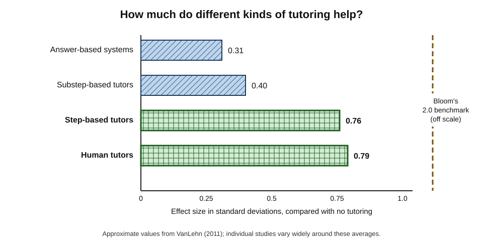
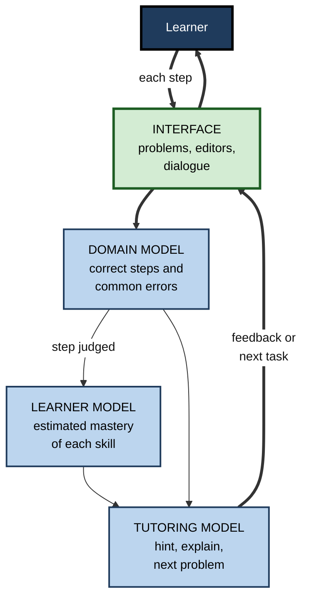
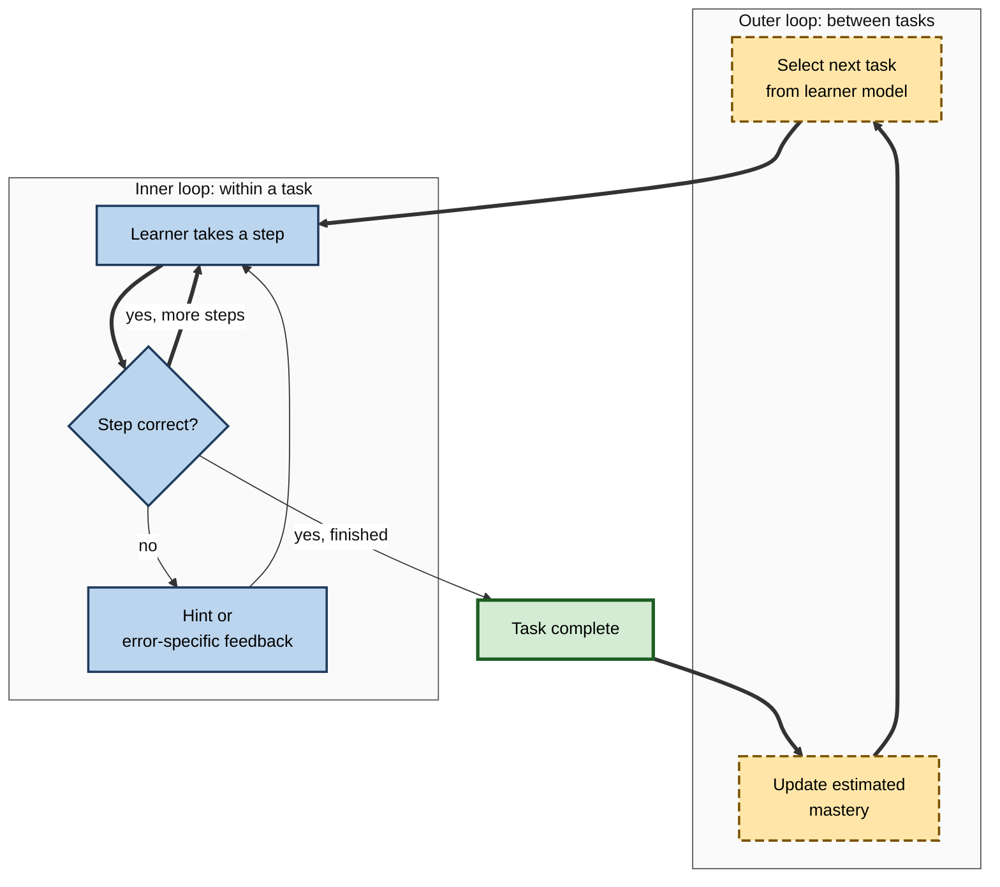
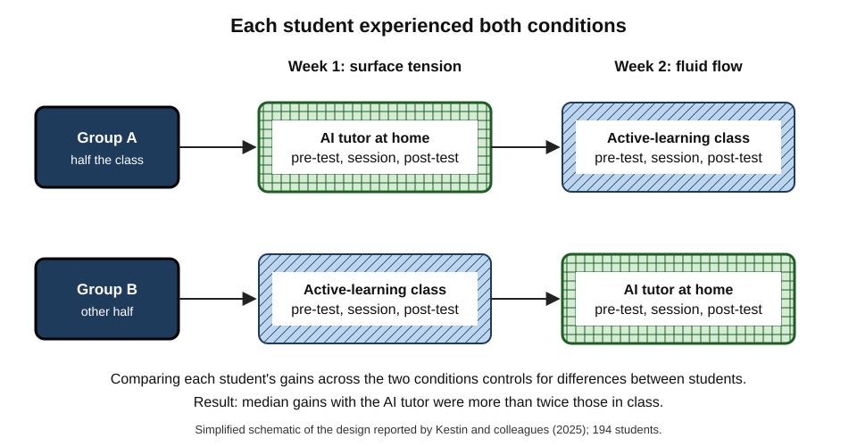
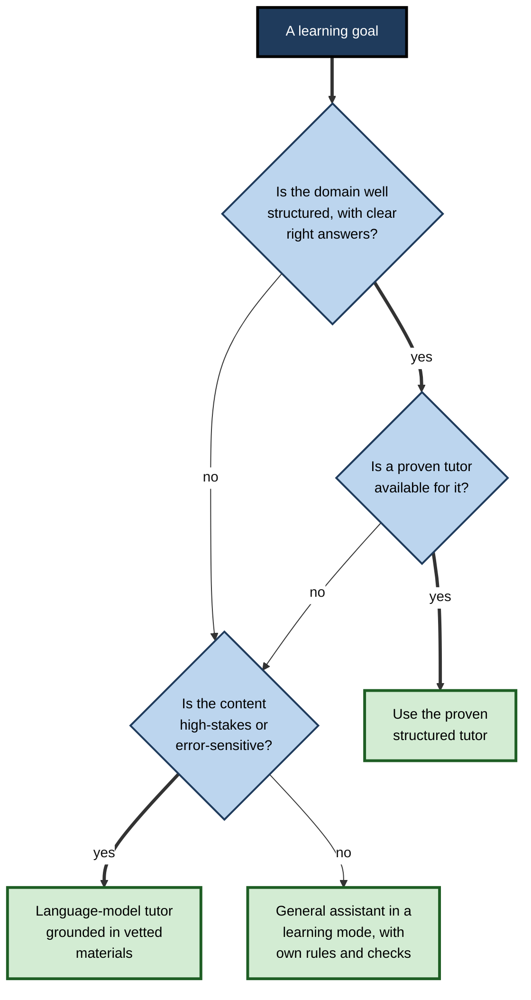

# G.10. AI Tutors and Intelligent Tutoring Systems

In the 1990s, Pittsburgh algebra students worked on a computer that watched every step and offered a hint tailored to each misstep. In 2023, Harvard physics students learned fluid dynamics at home with an AI tutor that conversed in plain language. Both aimed at the same goal: to give every learner a **personal tutor**.

> **Definition — Intelligent tutoring system (ITS):** software that models a subject, the individual learner and teaching strategies, and uses these models to provide step-by-step guidance, feedback and practice adapted to that learner.

> **Definition — AI tutor:** any AI system that teaches an individual learner interactively — including classic intelligent tutoring systems and tutors built on large language models.

**Why it matters**

- One-to-one tutoring is among the most effective forms of instruction known, but it is expensive and scarce.
- Classic intelligent tutors have decades of rigorous evidence, including large randomised trials; tutors built on large language models are newer, more flexible and far less tested.
- From 2024 to 2026 controlled trials of language-model tutors produced some of the largest — and some of the most negative — results in the history of educational technology.
- A self-directed professional who knows how tutors are built, and what the evidence shows, can choose and use them well rather than trusting marketing.

---

## The Tutoring Benchmark

### How effective is human tutoring?

- **Benjamin Bloom (1984), the "2 sigma problem":** studies by his doctoral students found that students tutored one-to-one, with mastery learning, scored about **two standard deviations** above students taught conventionally — the average tutored student outperformed about 98% of the comparison class.
- **Later, broader estimates are smaller:**
  - **Kurt VanLehn (2011)**, reviewing many studies, estimated the effect of human tutoring compared with no tutoring at about **0.79** standard deviations;
  - **Andre Nickow, Philip Oreopoulos and Vincent Quan (2020)**, in a meta-analysis of randomised trials of tutoring in schools, found a pooled effect of about **0.37** standard deviations — still large by education standards, with the biggest effects for tutoring by teachers and paraprofessionals, delivered frequently during the school day.

> **Watch out:** "two sigma" is often quoted as the established effect of tutoring. Bloom's figure came from a small number of studies combining tutoring with mastery learning; most later estimates are well below it. Tutoring is powerful, but the 2-sigma figure is an **upper benchmark**, not a typical result.

### VanLehn's comparison of tutoring types

**Study card — Kurt VanLehn (2011)**

- **Question:** how do different forms of computer tutoring compare with human tutoring?
- **Classification by granularity of interaction:**
  - **answer-based** systems — feedback only on final answers;
  - **step-based** tutors — feedback on each step of a solution;
  - **substep-based** tutors — dialogue about reasoning within steps;
  - **human tutors**.
- **Results (approximate effect sizes against no tutoring):**
  - answer-based: about **0.31**;
  - step-based: about **0.76**;
  - substep-based: about **0.40**;
  - human tutoring: about **0.79**.
- **Conclusion:** step-based intelligent tutors were nearly as effective as human tutors; finer-grained interaction did not keep adding benefit — an "**interaction plateau**".

**Figure 1.** Approximate effect sizes of tutoring types compared with no tutoring, from VanLehn's 2011 review.

> **Definition — Interaction plateau hypothesis:** VanLehn's proposal that tutoring effectiveness rises as interaction moves from final answers to individual steps, but rises little further as interaction becomes finer-grained.

> **Key point:** what matters most is that the learner does the reasoning **step by step** and gets **feedback on each step**. That principle applies just as much to language-model tutors.

---

## How an Intelligent Tutor Works

### Four components

- **Domain model** — what is to be learned: concepts, procedures, correct solution paths and common errors.
- **Learner (student) model** — the system's estimate of what this learner knows, updated from their actions.
- **Tutoring (pedagogical) model** — rules for what to do next: hint, explain, give a new problem, move on.
- **Interface** — how the learner interacts: equation editors, simulations, diagrams, dialogue.

**Figure 2.** The four components of an intelligent tutoring system and how they interact.

### The inner and outer loops

- **Kurt VanLehn (2006)** described tutoring systems as running two loops:
  - **inner loop** — within a problem, responding to each **step**: feedback, hints, error-specific messages;
  - **outer loop** — between problems, choosing **which task** comes next from the learner model.
- **Classic tutors** were strong at both.
- **Language-model tutors** are naturally strong in the inner loop (conversation about the current step) and often weak in the outer loop (no persistent, calibrated model of what the learner has mastered).

> **Definition — Inner and outer loop:** in tutoring systems, the inner loop gives help within a task, step by step; the outer loop selects the next task according to the learner's progress.

**Figure 3.** The inner loop works within a problem; the outer loop chooses the next problem.

### Families of classic tutors

- **Model-tracing tutors** — John Anderson's group at Carnegie Mellon built **cognitive tutors** grounded in the ACT-R theory of cognition; a set of production rules models correct and buggy steps, and each learner step is matched to a rule ("model tracing").
  - Became commercial algebra and geometry curricula used by hundreds of thousands of students.
- **Constraint-based tutors** — following Stellan Ohlsson's theory of learning from errors, Antonija Mitrovic's SQL-Tutor checked learners' database queries against constraints that any correct solution must satisfy, rather than modelling every solution path.
- **Example-tracing tutors** — authoring tools let teachers demonstrate solutions, which the tutor then uses to check learners' steps — much cheaper to build.
- **Dialogue tutors** — Arthur Graesser's AutoTutor held natural-language conversations, comparing student answers with expected ones and responding with pumps, hints and prompts.
- **Physics and engineering tutors** — the Andes physics tutor (VanLehn and colleagues, 2005) gave step-level feedback on homework problems and improved exam performance at the US Naval Academy.

> **Definition — Model tracing:** following a learner's problem-solving step by step by matching each step to rules representing correct or erroneous reasoning, so that errors can be identified as they occur.

### Why classic tutors stayed narrow

- **The authoring bottleneck** — building a model-tracing tutor required cognitive scientists, programmers and teachers to encode every correct step and common error; developers commonly reported **hundreds of hours** of expert work per hour of instruction.
- **Consequence** — classic tutors flourished where content is stable, well structured and widely taught (school algebra, introductory programming, database queries, physics problem-solving) and were rarely built for messy professional domains such as negotiation, management or design.
- **What changed in 2023** — a language model can converse about almost any domain without authoring, so the bottleneck shifted from **building** a tutor to **assuring its quality**.

> **Key point:** classic tutors were **accurate but narrow**; language-model tutors are **broad but unreliable**. Much current work combines the two — language-model dialogue constrained by vetted solutions, rubrics and learner models.

### Evidence from classic tutors at scale

- **Meta-analyses** of intelligent tutoring systems generally find moderate positive effects compared with conventional instruction, larger in university and adult settings and in narrowly defined skills, and smaller in large school deployments.
  - Saiying Steenbergen-Hu and Harris Cooper found small average effects in school mathematics and moderate effects in college settings.
  - Wenting Ma and colleagues (2014) estimated an average advantage of about **0.4** standard deviations over teacher-led group instruction and other computer instruction.
- **Large field trials:**
  - a RAND Corporation study by John Pane and colleagues (2014) of a cognitive-tutor algebra curriculum in about 150 schools found no significant effect in the first year but a gain of about **0.2** standard deviations in high schools in the **second** year of use — suggesting teachers and schools needed time to implement it well;
  - an ASSISTments homework-feedback platform evaluated by Jeremy Roschelle and colleagues (2016) in Maine raised end-of-year mathematics scores by about **0.18** standard deviations, with larger gains for lower-achieving students.

| Study | Setting | Approximate effect | Notes |
|---|---|---|---|
| VanLehn (2011) review | Many lab and field studies | Step-based tutors about 0.76 | Comparable to human tutors |
| Ma and colleagues (2014) meta-analysis | Varied settings | About 0.4 | Larger than most edtech |
| Pane and colleagues (2014), RAND | About 150 schools, algebra | About 0.2 in year two | No effect in year one |
| Roschelle and colleagues (2016) | Maine schools, homework | About 0.18 | Larger for low achievers |

> **Remember:** effects in the laboratory and in carefully run pilots are usually **larger** than effects in routine deployment at scale. Implementation — how teachers and learners actually use a tutor — matters as much as the tutor itself.

---

## Tutors Built on Large Language Models

### What changes

- **Open domain** — no hand-authored domain model; the tutor can discuss anything.
- **Natural dialogue** — learners can ask "why?" in their own words and get a response.
- **Cheap to build** — a capable tutor can be created in days by writing instructions and supplying materials.
- **New weaknesses:**
  - no reliable learner model unless one is added;
  - errors in content and in judging learners' answers;
  - **answer leakage** — a tendency to give the answer when pressed;
  - inconsistency between sessions;
  - little evidence about long-term learning.

> **Definition — Answer leakage:** the tendency of a tutor built on a general language model to reveal answers or full solutions, against its instructions, particularly when the learner insists.

### Evidence from controlled trials, 2024–2026

**Study card — Gregory Kestin, Kelly Miller and colleagues (Harvard; published in *Scientific Reports*, June 2025)**

- **Setting:** Physical Sciences 2, Harvard's largest introductory physics course, autumn 2023; **194** students.
- **Design:** a **crossover** randomised trial across two consecutive weeks on surface tension and fluid flow:
  - each student learned one topic in a well-run **active-learning** class session led by experienced instructors;
  - and the other topic at home with **PS2 Pal**, a GPT-4-based tutor;
  - each student thus served as their own control.
- **Tutor design:** built on research-based principles — structured step-by-step guidance; active engagement; managing cognitive load; prompting reasoning rather than giving answers; accurate feedback, supported by supplying the model with expert-written solutions; self-pacing.
- **Results:**
  - median learning gains with the AI tutor were **more than twice** those in the active-learning class;
  - students spent **less time** on average with the tutor;
  - students reported feeling more engaged and motivated with the tutor.
- **Limits:** short topics; immediate post-tests; students at a highly selective university; the tutor was a complement to, not a replacement for, the course.
- **Conclusion:** a carefully designed language-model tutor can outperform even strong classroom teaching on short units.

**Figure 4.** The crossover design of the 2025 Harvard physics trial: each student experienced both conditions.

**Study card — Martín De Simone and colleagues (World Bank, 2025)**

- **Setting:** nine public secondary schools in Edo State, Nigeria; first-year senior secondary students.
- **Design:** randomised trial of a **six-week** after-school programme in which students worked **in pairs** with a GPT-4-based assistant on English, under teacher supervision, with prompts designed to promote reasoning rather than shortcuts.
- **Results:**
  - about **0.31** standard deviations improvement on an assessment of English, digital and AI skills, and about **0.23** on English alone;
  - benefits across the ability range, largest for **female** students and those with higher initial performance;
  - one of the most cost-effective education programmes evaluated, by the authors' estimates equivalent to 1.5 to 2 years of typical learning.
- **Limits:** short duration; outcomes measured soon after; single region.

**Study card — Rose Wang and colleagues (Tutor CoPilot, 2024)**

- **Setting:** a remote tutoring programme in the southern United States serving about **1,800** school students, with about **900** tutors.
- **Design:** tutors were randomly given access to **Tutor CoPilot**, a language-model tool that suggested expert-like teaching moves in real time — for example prompting the tutor to ask a guiding question rather than give the answer.
- **Results:**
  - students whose tutors had access were about **4 percentage points** more likely to master topics;
  - for students of **lower-rated** tutors the gain was about **9 percentage points**;
  - tutors with access used more high-quality strategies and gave away answers less often;
  - the estimated cost was about **20 US dollars** per tutor per year.
- **Conclusion:** AI can raise learning **through** human tutors, spreading expert practice to less experienced ones.

- **Negative results** — the 2025 Turkish mathematics study found an unrestricted GPT-4 chatbot lowered later unaided exam performance; and an October 2026 working paper by Liu and colleagues reported that access to a course-integrated AI tutor across a large US university **reduced** final grades by about 0.37 standard deviations, apparently by displacing existing learning activities.

| | Harvard physics (2025) | Nigeria (2025) | Tutor CoPilot (2024) | Large US university (2026) |
|---|---|---|---|---|
| Who used the AI | Students, alone | Students, in pairs | Human tutors | Students, alone |
| Design | Research-based, structured, solutions supplied | Structured prompts, teacher supervision | Real-time suggestions to tutors | Course-integrated tutor access |
| Relation to teaching | Complement to a strong course | After-school addition | Inside human tutoring | Alongside existing activities |
| Result | Gains more than double | About 0.3 SD | +4 to +9 percentage points mastery | About −0.37 SD (working paper) |

> **Key point:** the successful trials share **structure**: deliberate pedagogy, step-by-step guidance, checked content, and human involvement or a strong surrounding course. Access to a tutor, by itself, is not an intervention.

---

## Choosing and Using an AI Tutor

### Criteria

- **Pedagogy** — does it ask before telling, give graduated hints, require explanations and resist giving answers?
- **Content accuracy** — is it grounded in vetted materials or solutions, or improvising from general training?
- **Learner model** — does it track mastery across sessions and choose what comes next, or start from nothing each time?
- **Step-level feedback** — does it respond to each step of reasoning, or only to final answers?
- **Alignment** — does its content match the learner's actual goal, syllabus or certification?
- **Evidence** — has it, or a similar design, been evaluated with delayed, unaided outcomes?
- **Data and privacy** — what is stored, for how long, and who can see it?

> **Mnemonic — "Please Check Learning Step And Evidence, Data":** Pedagogy, Content accuracy, Learner model, Step-level feedback, Alignment, Evidence, Data and privacy.

| Tutor type | Strengths | Weaknesses | Best for |
|---|---|---|---|
| Classic ITS in a structured domain | Proven pedagogy; accurate; strong learner model | Narrow; rigid; limited dialogue | Mathematics, programming, languages, certifications |
| Purpose-built language-model tutor | Dialogue plus designed pedagogy and checked content | Uneven evidence; may still leak answers | Courses and programmes that adopt it |
| General assistant in a learning mode | Any subject; immediately available | Weak learner model; content not vetted | Self-directed study across topics |
| General assistant with the learner's own rules | Fully flexible | Depends entirely on the learner's discipline | Experienced self-directed learners |

**Figure 5.** Choosing a kind of AI tutor for a learning goal.

### Using a tutor well

- **Set a cadence** — short, frequent sessions (three or four of 20–40 minutes a week) suit tutoring better than occasional marathons; tutoring research finds frequency matters.
- **Attempt every step** before asking for help; treat hints as a last resort, not a first move.
- **Keep the learner model honest** — answer without notes; do not ask others for answers during tutor sessions.
- **Combine with humans** — use the tutor for practice and explanation, and people for judgement, motivation and feedback on real work.
- **Test unaided** — at intervals, solve new problems without the tutor and compare with earlier performance.
- **Watch for displacement** — if the tutor replaces reading, practice or discussion that was working, overall learning may fall.

> **Watch out:** a tutor's internal progress bar measures **performance with the tutor**. Durable capability can only be shown by delayed, unaided tasks — ideally real work.

### Emotion and motivation in tutoring

- **Confusion can be productive** — Sidney D'Mello, Arthur Graesser and colleagues found that learners working with tutors often experienced confusion, and that confusion which was **resolved** was associated with better learning; **boredom** and **unresolved frustration** were associated with worse learning.
- **Affect-aware tutors** — some research systems detected boredom or frustration from interaction patterns, facial expressions or posture and adjusted their responses; evidence for benefits is mixed, and emotion detection raises privacy and legal concerns, especially in workplaces and education.
- **Motivational moves of expert tutors** — encouraging effort, attributing progress to strategy, offering choice and keeping challenge within reach.

> **Watch out:** a tutor that removes all confusion may also remove learning. The aim is confusion that the learner **resolves** with just enough help — not a frictionless experience.

### Configuring a tutor for oneself

When no purpose-built tutor exists, a learner can configure a general assistant. Successful research tutors suggest what to include.

- **Supply worked solutions or reference answers** to the AI where possible — both the Turkish and Harvard tutors gave the model correct solutions, which reduced its own errors in judging the learner.
- **State the pedagogy** — step-by-step guidance; ask before telling; one step at a time; hints before answers; explanation back.
- **State the scope** — the syllabus, standard or certification to be covered, and the materials to rely on.
- **Keep an external learner model** — a short running record of skills mastered and errors made, pasted at the start of each session.
- **Plan the outer loop oneself** — decide the sequence of topics and review; the assistant handles the inner loop.

| | Unconfigured assistant | Self-configured tutor |
|---|---|---|
| Content accuracy | Model's general knowledge | Checked against supplied solutions and materials |
| Pedagogy | Answers by default | Step-by-step, hints first, explain-back |
| Learner model | None | Learner's running record |
| Task sequence | Ad hoc | Planned by the learner |
| Closest to | A knowledgeable stranger | A structured tutoring programme |

---

## Tutors in the Workplace

- **Uses:** onboarding to systems and products; certification preparation; coaching on sales calls and customer conversations; software skills; compliance.
- **Tutors in the flow of work** — assistants that explain a step while the employee performs it blur tutoring and performance support; they speed work but may not build independent capability unless designed to fade.
- **Tutoring the tutors** — as Tutor CoPilot showed, AI may have as much impact by improving **human** coaches, mentors and trainers as by replacing them.

### Case study: a cloud certification programme

- **Situation:** an IT services firm needed 300 engineers to pass a professional cloud-architecture certification within six months; previous cohorts using video courses had a first-attempt pass rate below half.
- **Actions:**
  1. a language-model tutor was configured with the official exam guide, the firm's reference architectures and expert-written solutions to 200 design scenarios;
  2. the tutor was instructed to question and hint, never to give a full design before two attempts, and to require engineers to justify every architectural choice;
  3. a simple learner model tracked mastery of 25 exam domains and recommended the next scenario;
  4. engineers met weekly in small groups with a certified architect to review hard cases;
  5. a timed, unaided mock examination every month measured progress.
- **Result:** the first-attempt pass rate rose to about three-quarters; engineers reported the justification requirement as the most useful and most annoying feature.
- **Side effects:** about one in ten tutor responses on niche services contained errors, caught mostly in group reviews; the tutor was updated with corrections.
- **Lesson:** the gains came from a **designed** tutor inside a **structured programme** with **human review** and **unaided measurement** — the same ingredients as the successful research trials.

---

## Open Questions

- **Can language-model tutors maintain accurate learner models?**
  - Combining dialogue with the calibrated learner models of classic tutors is an active research area.
- **Do the large short-term gains last?**
  - The most positive trials measured outcomes soon after short units; durability over months is largely unknown.
- **Why do some deployments harm learning?**
  - Displacement of effective activities, answer-seeking and weak integration are suspected; the 2026 negative trial is not yet fully reported.
- **Who benefits most?**
  - Results differ by gender, prior attainment and background across studies; tutors may widen or narrow gaps depending on design.
- **What is the right division of labour between AI and human tutors?**
  - Evidence that AI can improve human tutors suggests hybrid models; their best form is unsettled.

---

## Summary

- An **intelligent tutoring system** models the domain, the learner and pedagogy to give step-level guidance; an **AI tutor** includes these and language-model tutors.
- **Human tutoring** is highly effective: Bloom's **2 sigma** is an upper benchmark; later estimates are about 0.4–0.8 standard deviations.
- **VanLehn (2011)**: answer-based about 0.31, step-based about 0.76, substep-based about 0.40, human about 0.79 — the **interaction plateau**; step-level reasoning with feedback is the key.
- ITS components: **domain, learner, tutoring models and interface**; **inner loop** within tasks, **outer loop** between them; families include **model-tracing**, constraint-based, example-tracing and dialogue tutors.
- At scale, classic tutors show moderate effects (about 0.2 in large school trials, about 0.4 in meta-analyses), with implementation mattering greatly.
- **Language-model tutors** add open dialogue and cheap creation but bring weak learner models, content errors and **answer leakage**.
- Trials 2024–2026: **Harvard physics** (gains more than double active learning), **Nigeria** (about 0.3 SD), **Tutor CoPilot** (+4 to +9 points via human tutors) — versus **harm** from unrestricted chatbots and from a tutor that displaced coursework.
- Classic tutors were limited by the **authoring bottleneck**; resolved confusion aids learning, boredom and frustration harm it; a self-configured tutor needs **supplied solutions, stated pedagogy, scope and an external learner model**.
- Choose tutors by **pedagogy, content accuracy, learner model, step-level feedback, alignment, evidence and data practices**; use them frequently, attempt first, combine with humans and **test unaided**.

---

## Self-Check

1. Define an intelligent tutoring system and distinguish it from a general chatbot.
2. What was Bloom's 2 sigma problem, and why is the figure best treated as an upper benchmark?
3. Summarise VanLehn's 2011 findings and the interaction plateau hypothesis.
4. Name the four components of an ITS and explain the role of each.
5. Distinguish the inner loop from the outer loop. Which are language-model tutors naturally good at?
6. Explain model tracing and how a constraint-based tutor differs.
7. What did the RAND study of a cognitive-tutor algebra curriculum find, and what does it suggest about implementation?
8. List four weaknesses of tutors built on general language models.
9. Describe the design and results of the 2025 Harvard physics trial and two of its limitations.
10. Compare the Nigeria trial and Tutor CoPilot. What do their designs have in common?
11. Why might a course-integrated AI tutor reduce grades, as one 2026 working paper reported?
12. List seven criteria for choosing an AI tutor.
13. A manager proposes replacing a bootcamp's practice labs with an AI tutor to save money. Using the evidence, advise.
14. Design a three-month plan for learning a structured technical skill with an AI tutor, including measurement.

### Answer Key

1. Software modelling domain, learner and teaching strategy to give adaptive, step-level tutoring. A general chatbot has no built-in learner model or pedagogy and answers by default.
2. Bloom reported tutored students about two standard deviations above conventional classes; the figure came from few studies combining tutoring with mastery learning, and later meta-analyses find smaller effects.
3. Answer-based about 0.31, step-based about 0.76, substep-based about 0.40, human about 0.79. Effectiveness rises from answer-level to step-level interaction but little beyond.
4. Domain model (what is correct and common errors), learner model (estimated mastery), tutoring model (what to do next), interface (how the learner interacts).
5. Inner loop: help within a task, step by step. Outer loop: selecting the next task from the learner model. Language-model tutors are naturally strong in the inner loop.
6. Model tracing matches each step to rules for correct or buggy reasoning; constraint-based tutors check solutions against constraints any correct solution must satisfy, without modelling every path.
7. No effect in year one; about 0.2 SD in high schools in year two — schools and teachers needed time to implement it well.
8. No reliable learner model; content and marking errors; answer leakage; inconsistency; little long-term evidence.
9. 194 students; crossover between active-learning class and an AI tutor built on research-based principles with expert solutions; median gains more than double, in less time. Limits: short units and immediate tests; a highly selective population.
10. Nigeria: students in pairs with structured prompts under teacher supervision, about 0.3 SD. Tutor CoPilot: AI suggestions to human tutors, +4 points (+9 for weaker tutors). Both embed AI in structured, human-supervised teaching.
11. It may have displaced engagement with effective existing activities, encouraged answer-seeking, and helped less those who needed most structure.
12. Pedagogy, content accuracy, learner model, step-level feedback, alignment with the goal, evidence and data practices.
13. Labs provide hands-on practice and human feedback; replacing them risks displacement losses. Instead add a designed tutor that hints and requires justification, keep labs, and measure unaided performance against a comparison cohort.
14. A good plan: choose a proven or grounded tutor; three or four short sessions a week; attempt every step; monthly unaided mock tests; weekly human review of hard problems; adjust by tracked mastery; final unaided performance on a real task.

---

## Glossary

| Term | Meaning |
|---|---|
| AI tutor | Any AI system that teaches an individual learner interactively. |
| Answer leakage | A language-model tutor revealing answers against its instructions. |
| Authoring bottleneck | The expert effort needed to encode a classic tutor's domain and errors. |
| Constraint-based tutor | A tutor checking solutions against constraints any correct answer must meet. |
| Domain model | A tutor's representation of correct knowledge and common errors. |
| Inner loop | Tutoring help within a task, step by step. |
| Intelligent tutoring system | Software modelling domain, learner and pedagogy for adaptive tutoring. |
| Interaction plateau hypothesis | Tutoring gains rise from answer- to step-level interaction, then level off. |
| Learner model | A tutor's estimate of what the learner has mastered. |
| Model tracing | Matching each learner step to rules for correct or buggy reasoning. |
| Outer loop | Selecting the next task from the learner model. |
| Step-based tutor | A tutor that gives feedback on each step of a solution. |
| Tutoring model | Rules deciding what a tutor does next. |
| Two sigma problem | Bloom's challenge to match the large effect of one-to-one tutoring in groups. |
