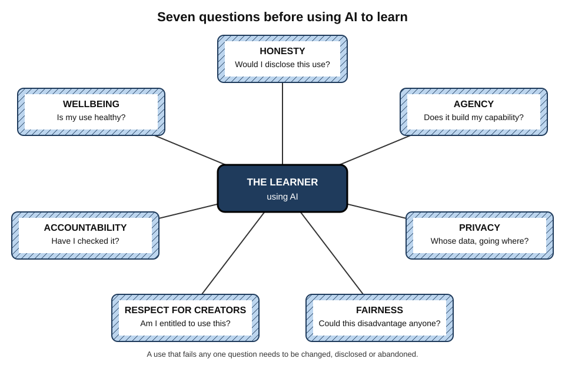
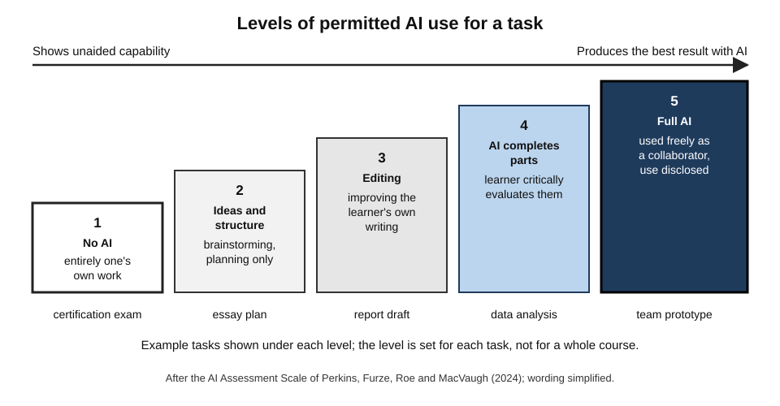
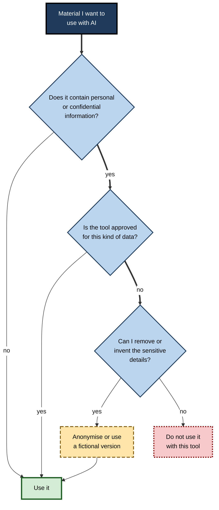
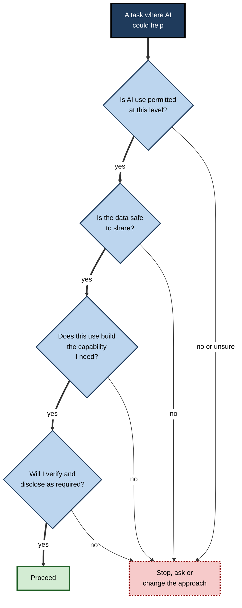
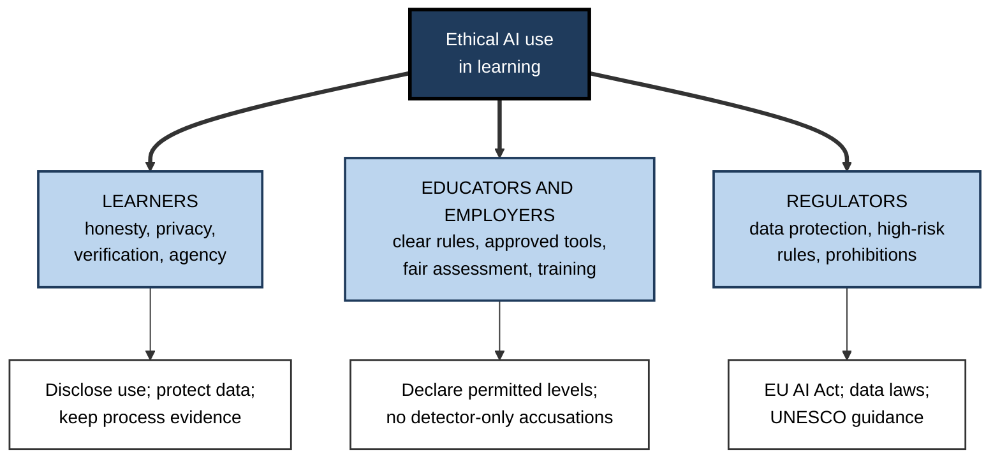

# G.11. Ethical Use of AI in Learning

A part-time MBA student who writes in her second language submits an essay she wrote herself; a detection tool flags it as "likely AI-generated" and she spends weeks proving her innocence. An analyst pastes a confidential supplier contract into a public chatbot to learn contract law, not realising the text may be retained. Neither set out to do wrong; both show that learning with AI raises questions of **honesty, fairness, privacy and responsibility**.

> **Definition — Ethical use of AI in learning:** using AI to learn in ways that are honest about what one has done, respect the rights and interests of others, protect personal and confidential information, treat people fairly, and preserve the learner's own development and wellbeing.

**Why it matters**

- Rules on AI use differ between institutions, courses, employers and professions — and are changing quickly; ignorance is rarely accepted as an excuse.
- Misrepresenting AI-produced work as one's own undermines credentials that others rely on, from degrees to professional certifications.
- Learning often involves real material — client files, patient cases, colleagues' work — whose confidentiality the learner is bound to protect.
- AI can widen or narrow educational inequality, depending on who has access and who is taught to use it well.
- The deepest ethical question is personal: whether a learner's use of AI is building their own capability or quietly hollowing it out.

---

## Principles for Ethical AI Use

### Seven principles

- **Honesty** — represent truthfully what one did and what the AI did.
- **Agency** — keep one's own thinking and development at the centre; use AI to grow capability, not to bypass it.
- **Privacy and confidentiality** — protect personal data and confidential information, one's own and others'.
- **Fairness** — avoid uses that disadvantage others, and notice when AI tools treat people unequally.
- **Respect for creators** — respect copyright, licences and attribution.
- **Accountability** — remain responsible for what one submits, decides and shares.
- **Wellbeing** — attend to dependence, stress and the health of one's own learning.

> **Mnemonic — "Honest Agents Protect Fair Rights, Accept Wellbeing":** Honesty, Agency, Privacy, Fairness, Respect for creators, Accountability, Wellbeing.

**Figure 1.** Seven principles for ethical use of AI in learning, each posing a question to ask before use.

| Principle | Question to ask | Typical breach |
|---|---|---|
| Honesty | Would I be comfortable disclosing exactly how I used AI? | Submitting AI-written work as one's own |
| Agency | Is this use building or replacing the capability I need? | Delegating every practice task |
| Privacy | Whose information am I sharing, and where does it go? | Pasting client or patient data into a public tool |
| Fairness | Could this disadvantage someone, or is the tool biased? | Relying on a biased AI judgement about a person |
| Respect for creators | Do I have the right to use this material this way? | Uploading licensed course materials to a public tool |
| Accountability | Have I checked what I am about to submit or act on? | Passing on unverified AI claims |
| Wellbeing | Is my use healthy and sustainable? | Anxiety when the tool is unavailable; endless use |

---

## Honesty and Integrity

### What counts as misconduct

- **Unauthorised use** — using AI where an assessment, examination or employer forbids it.
- **Misrepresentation** — presenting AI-generated work, ideas or analysis as one's own unaided work.
- **Fabrication** — submitting AI-invented data, quotations or references.
- **Ghost-writing by AI** — the modern equivalent of **contract cheating** (paying another person to do the work), with the same effect: a credential that certifies capability the holder does not have.

> **Definition — Academic integrity:** the commitment to honesty, trust, fairness, respect and responsibility in learning, teaching and research — including representing one's work truthfully.

> **Definition — Contract cheating:** having a third party complete assessed work that is then submitted as one's own; generative AI can play the third party's role.

### Spectrums of permitted use

Many institutions now specify **levels** of permitted AI use for each task rather than banning or allowing it outright.

- **Mike Perkins, Leon Furze, Jasper Roe and Jason MacVaugh (2024)** proposed an **AI Assessment Scale** with five levels:
  1. **No AI** — the work is completed entirely without AI;
  2. **AI-assisted idea generation and structuring** — AI for brainstorming and planning only;
  3. **AI-assisted editing** — AI may improve the clarity or quality of the student's own work;
  4. **Task completion with AI, human evaluation** — AI completes elements, which the student critically evaluates;
  5. **Full AI** — AI used freely as a collaborator, with use made explicit.
- Later revisions of the scale reworded the levels, but the core idea — a **declared** level for each task — has been widely adopted.

**Figure 2.** A scale of permitted AI use for a task, from none to full collaboration.

> **Remember:** the permitted level is set by the **task's purpose**. A task meant to show unaided capability (an examination, a certification, a coding interview) is at the "no AI" end; a task meant to produce the best possible result (a team proposal) may be at the "full AI" end.

### Disclosure

- **Why disclose** — readers, assessors and clients need to know what they are evaluating; disclosure also lets reviewers check the right things.
- **What to disclose** — which tool, for what parts of the work, and how outputs were checked.
- **How** — many institutions and style guides now provide formats for acknowledging or citing AI use; in workplaces, a short note in a document's method or cover email is common.

> **Example — a disclosure note:** "An AI assistant was used to suggest a structure for this report and to check grammar. All analysis, figures and conclusions are my own; sources were verified against the original documents."

### The problem with AI detectors

**Study card — Weixin Liang, James Zou and colleagues (2023)**

- **Design:** seven widely used AI-text detectors were tested on essays written by humans — some by **non-native English speakers** (essays from a standard English-proficiency test) and some by native-speaking US school students.
- **Results:**
  - the detectors classified the US students' essays almost entirely correctly as human;
  - but they misclassified **more than half** of the non-native speakers' essays as AI-generated on average;
  - simple prompting to make AI text more "literary" let it evade detection.
- **Conclusion:** detectors penalised the simpler vocabulary and sentence structures typical of second-language writers — **biased** and **easily evaded**.

- **Withdrawn tools** — in July 2023 OpenAI withdrew its own AI-text classifier, citing its low accuracy.
- **Implications:**
  - a detector score should never be the **sole** evidence of misconduct;
  - learners can protect themselves by keeping **process evidence** — drafts, notes, version history, sources consulted.

> **Watch out:** the belief that AI writing can be reliably detected is widespread and false. Equally false is the belief that undetectable use is acceptable use — integrity is about honesty, not detection.

### Integrity at work

- **Credentials and claims** — certifications, portfolio pieces and CVs should reflect what a person can actually do; AI-produced work presented as evidence of personal skill is misrepresentation.
- **Professional examinations** — most remain closed to AI; some professional bodies have sanctioned members for misconduct involving AI.
- **Client work** — many engagement letters and professional codes require disclosure of significant AI use, or at least accountability for its results.

---

## Privacy and Confidentiality

### What happens to what is typed

- **Inputs may be retained** — consumer AI services may store conversations, sometimes for long periods.
- **Inputs may be used for training** — depending on the provider and settings, conversations can be used to improve models.
- **Inputs may be reviewed** — some services allow human review of conversations for safety or quality.
- **Enterprise terms differ** — business and education versions often contractually exclude training on customer data and offer stronger controls.

### Information never to paste into an unapproved tool

- **Personal data** of others — names, contact details, identifiers, employee records.
- **Special-category data** — health, biometric, financial or similar sensitive information.
- **Client and employer confidential information** — contracts, strategies, unreleased results, deal terms.
- **Proprietary code and designs** — especially under non-disclosure agreements.
- **Credentials** — passwords, keys, access tokens.
- **Assessment content** — examination questions or answers one is bound to keep confidential.

> **Example — an industry wake-up call:** in 2023 several engineers at a major electronics manufacturer pasted confidential source code and internal meeting notes into a public chatbot while seeking help; the company responded by restricting employee use of external generative AI tools.

**Figure 3.** Deciding whether material can be used with an AI tool while learning.

> **In practice:** for learning purposes the details rarely matter. A **fictionalised** contract, a **synthetic** dataset or a case with names and figures changed teaches the same lesson without the risk.

### Law and professional duty

- **Data-protection law** — in the European Union the GDPR, in India the Digital Personal Data Protection Act 2023, and similar laws elsewhere require a lawful basis for processing personal data and safeguards when it is shared with service providers.
- **Professional confidentiality** — lawyers, doctors, accountants and many others owe duties of confidentiality that do not lapse because a tool is convenient.
- **Learning data about oneself** — tutors and practice tools record what a person does not know; in workplaces, such data could be used in performance decisions, and learners should know who can see it.

---

## Fairness and Equity

### Access

- **Unequal access** — the most capable models and tools often require paid subscriptions, fast connections and modern devices.
- **Unequal skill** — the benefits of AI depend heavily on knowing how to use it well; learners who already study effectively tend to gain most.
  - Justin Reich's research on earlier educational technology found that free online tools were used most by the already advantaged, a pattern he likened to a **Matthew effect**.
  - A 2026 university trial of a course-integrated AI tutor reported larger losses among **first-generation** students.
- **Language** — AI performs best in widely represented languages; speakers of others receive weaker support.

### Bias in AI judgements

- **Feedback and marking** — AI feedback can vary with dialect, writing style or names, reflecting patterns in training data; studies of automated essay scoring have long documented such risks.
- **Detection tools** — as the 2023 study showed, detectors disadvantage second-language writers.
- **High-stakes uses** — the EU AI Act treats AI used to evaluate learning outcomes, determine access to education or monitor cheating as **high-risk**, requiring risk management and human oversight.

### Accessibility

- **AI can remove barriers** — text-to-speech, speech-to-text, live captions, simplified reading levels, translation and personalised explanations help learners with disabilities and second-language learners.
- **Ethical use includes enabling these benefits** — bans that ignore accessibility can themselves be unfair.

> **Key point:** the same technology can **widen** gaps (through unequal access and skill) or **narrow** them (through cheap tutoring and accessibility). Which happens depends on design, policy and teaching, not on the technology itself.

---

## Respect for Creators

- **Training-data disputes** — authors, artists and publishers have brought legal actions against AI developers over the use of copyrighted works in training; outcomes differ by country and remain partly unsettled.
- **Authorship of outputs** — the US Copyright Office has stated that material generated by AI without sufficient human creative control is not protected by copyright, and US courts have upheld the requirement of human authorship.
- **Inputs** — uploading licensed textbooks, paid courses or paywalled articles to a public tool may breach licence terms even when the purpose is personal study.
- **Attribution** — ideas, data and text drawn from human sources should be credited to those sources, verified directly, not to the AI that surfaced them.

> **Watch out:** "the AI wrote it, so nobody owns it" does not mean anyone may use it freely; the output may reproduce protected material, and its use may be governed by the provider's terms and by the rules of the institution or employer.

---

## Agency and Wellbeing

### The ethics of one's own learning

- **Self-deception** — the most common ethical failure in AI-assisted learning harms only the learner: believing one has learned what the AI did.
- **Cognitive offloading** — handing thinking to tools is sensible for tasks one need not master, and self-defeating for tasks one must.
- **A duty to future clients** — professionals will be relied upon for knowledge and judgement; learning that was bypassed becomes a risk to others later.

> **Definition — Learner agency:** the capacity and willingness of a learner to direct their own learning — setting goals, choosing strategies, persisting and taking responsibility for outcomes.

### Dependence and emotional reliance

- **Signs of unhealthy dependence:**
  - anxiety or helplessness when the tool is unavailable;
  - inability to begin a task without prompting the AI;
  - declining confidence in one's own judgement;
  - long, unplanned sessions with little to show.
- **Companion-style AI** — some tools are designed for emotional engagement; for learners, attachment to an always-agreeable partner may displace the human relationships — mentors, peers, communities — that sustain learning.

### Environmental cost

- **Energy and water** — training and running large models consumes substantial electricity and water for cooling; estimates per query vary widely by model, provider and method, and published figures are contested.
- **Proportion** — the cost of one query is small, but very large volumes add up; heavy, low-value use has a real footprint.

> **Watch out:** both extremes are misleading — claims that each query is environmentally catastrophic, and claims that AI's footprint is negligible. Reliable, comparable figures are still emerging.

### Learning from other people's work

Much professional learning uses material created by colleagues — their code, reports, designs and feedback. AI makes it easy to process such material at scale, which raises its own questions.

- **Consent and expectation** — a colleague who shared a draft for comment did not necessarily agree to its being uploaded to an external tool.
- **Attribution** — insights learned from a colleague's analysis should be credited when reused, even if an AI helped extract them.
- **Feedback about people** — asking an AI to analyse a colleague's performance, emails or personality from their messages raises privacy and fairness concerns, and may breach employer policy or law.
- **Peer review** — using AI to draft feedback on a peer's work is acceptable where permitted, but the reviewer remains responsible for its fairness and accuracy, and should not upload confidential manuscripts or proposals to public tools.

### AI that assesses learners at work

- **Skills inference and analytics** — some organisations use AI to infer employees' skills from their work, to recommend learning, or to inform promotion and redeployment.
- **Risks** — inaccurate inferences; opaque criteria; data used for purposes employees did not expect; chilling effects on honest experimentation in learning.
- **Legal protections** — in the European Union, the GDPR restricts decisions with significant effects based **solely** on automated processing, and the EU AI Act classifies AI used in recruitment, promotion, task allocation and monitoring of workers as **high-risk**.
- **What a learner can ask** — what data about my learning is collected, who sees it, how it is used in decisions about me, and how I can correct it?

> **Watch out:** learning requires the freedom to make mistakes. If every practice attempt is recorded and fed into performance judgements, people will practise less and hide errors — the opposite of what learning systems are for.

### A personal charter for AI use in learning

Many experienced self-directed learners write down a few rules for themselves, which makes ethical choices quicker and more consistent.

- **What I will always do myself** — the core tasks and judgements my role depends on.
- **What I will never share** — categories of data, by name.
- **How I will disclose** — a standard note for work products.
- **How I will check** — the verification I apply to anything I pass on.
- **How I will keep my own capability** — regular unaided practice on core skills.
- **When I will ask** — whenever rules are unclear, before acting.

> **In practice:** a charter of six lines, reviewed every few months, does more for ethical practice than a long policy read once. It turns principles into habits.

---

## Making Ethical Decisions

### A decision routine

**Figure 4.** Questions to ask before using AI on a learning task.

### Worked example: a take-home certification case

A project manager is completing a take-home case study for a professional certification. The rules permit "reference materials" but say nothing explicit about AI.

| Option | Integrity | Learning | Risk |
|---|---|---|---|
| Ask AI to write the case answer | Misrepresentation | None | Certification withdrawn if discovered; incompetence later |
| Use AI to explain concepts, write the answer oneself | Uncertain — rules unclear | Good | Possible breach if AI counts as forbidden help |
| Ask the certifying body whether AI is permitted, then act on the answer | Clear | Depends on answer | Minimal |
| Use no AI; study with AI before starting the case | Clear | Good | Minimal |

- **Decision:** ask the certifying body; meanwhile, study with AI **before** the assessed work begins, and complete the case unaided.
- **Principle:** where rules are **unclear**, ask; where asking is impossible, choose the interpretation one would be comfortable defending publicly.

> **Remember:** the "newspaper test" — would one be comfortable if exactly how AI was used were reported to the assessor, the employer or the client? If not, the use probably fails the honesty principle.

### Case study: a trainee's reflective portfolio

- **Situation:** trainees in a healthcare programme must keep reflective logs on difficult clinical encounters, which are assessed and used to judge professional development.
- **Problem:** a trainee began pasting rough notes of encounters — including patients' ages, conditions and ward details — into a public chatbot and asking it to "write a reflective entry".
- **Issues identified by her supervisor:**
  1. **privacy** — identifiable patient information had been shared with an external service;
  2. **honesty** — the entries presented the AI's reflections as hers;
  3. **agency** — reflection is the learning activity itself; outsourcing it removed the benefit;
  4. **accountability** — the entries contained clinical generalisations the trainee had not checked.
- **Actions:**
  1. the incident was reported under the organisation's data-protection procedure;
  2. the trainee received guidance and rewrote the entries herself;
  3. the programme issued rules: AI may be used to suggest **reflective questions** or a **structure**, using **no** patient details; entries must be written by the trainee; AI use must be noted;
  4. a short training session on AI and confidentiality was added to induction.
- **Result:** later entries were shorter, more specific and judged more insightful by assessors; no further data incidents were reported that year.
- **Lesson:** ethical AI use in learning protects **others' information**, **the truth about one's work** and **the learning itself** — all three were at stake in a single habit.

---

## Governance

- **Institutional policies** — most universities and many schools now publish AI policies, increasingly with per-task levels of permitted use and disclosure requirements.
- **Employer policies** — define approved tools, permitted data and review requirements; learners in workplaces should know them.
- **International guidance** — UNESCO's 2023 guidance stresses human-centred use, validation of tools and data protection, and suggests a minimum age of 13 for independent use of general chatbots.
- **Regulation** — the EU AI Act prohibits emotion recognition in education and workplaces, classifies key educational uses as high-risk, and requires organisations deploying AI to ensure staff **AI literacy**.

**Figure 5.** Responsibility for ethical AI use is shared between learners, educators and employers, and regulators.

---

## Open Questions

- **What should "one's own work" mean when AI is everywhere?**
  - Norms of authorship are shifting; disclosure-based models are spreading, but consensus is far off.
- **How can assessment certify capability without surveillance?**
  - Invigilated tests, oral defences and process evidence work but are costly; remote proctoring raises privacy concerns.
- **Will AI narrow or widen inequality in learning?**
  - Evidence points both ways; policy choices about access and teaching will matter.
- **Who owns learning data?**
  - Tutors accumulate detailed records of what people do not know; rights over such data are unsettled.
- **How should environmental cost be weighed?**
  - Without reliable figures, learners and institutions cannot easily judge proportionate use.

---

## Summary

- **Ethical AI use in learning** is honest, protects data, treats people fairly, respects creators, keeps the learner accountable and preserves their development and wellbeing.
- Seven principles: **honesty, agency, privacy, fairness, respect for creators, accountability, wellbeing**.
- Misconduct includes unauthorised use, misrepresentation and fabrication; AI ghost-writing is a form of **contract cheating**.
- **AI assessment scales** declare permitted levels of use per task; the level follows the task's purpose. **Disclose** tool, purpose and checking.
- **AI detectors** are unreliable and **biased** against second-language writers (Liang and colleagues, 2023); never use them as sole evidence; keep **process evidence**.
- **Privacy:** inputs may be retained, trained on or reviewed; never paste personal, sensitive, confidential, proprietary or credential data into unapproved tools; **anonymise or fictionalise** for learning.
- **Fairness:** unequal access, skill and language support can widen gaps; AI judgements can be biased; accessibility benefits are real; the EU AI Act treats key educational uses as high-risk.
- **Respect creators:** licences, authorship rules and attribution to verified original sources.
- **Agency and wellbeing:** avoid self-deception and dependence; remember duties to future clients; weigh environmental cost proportionately.
- Decide with a routine: **permitted? data safe? builds capability? verified and disclosed?** — and the newspaper test.

---

## Self-Check

1. Define ethical use of AI in learning and list the seven principles.
2. Distinguish unauthorised use, misrepresentation and fabrication, with examples.
3. Why is AI ghost-writing compared with contract cheating?
4. Describe an AI assessment scale and explain how the permitted level should be chosen.
5. What should an AI disclosure note contain? Write one for a piece of your own work.
6. Summarise Liang and colleagues' 2023 detector study and its implications for institutions and learners.
7. What can happen to information typed into a consumer AI tool?
8. List five kinds of information that should not be entered into an unapproved tool.
9. How can a learner use real workplace cases for AI-assisted learning without breaching confidentiality?
10. Explain two ways AI can widen and two ways it can narrow educational inequality.
11. What does current US guidance say about copyright in AI-generated material, and what does that imply for learners?
12. What is learner agency, and why is self-deception an ethical as well as a practical issue?
13. Apply the four-question decision routine to: using AI to prepare for, and then to complete, an internal promotion assessment.
14. A colleague says: "If the detector cannot tell, it is fine." Respond, using the principles.

### Answer Key

1. Using AI in ways that are honest, respect others' rights, protect data, are fair and preserve the learner's development and wellbeing. Honesty, agency, privacy, fairness, respect for creators, accountability, wellbeing.
2. Unauthorised use: AI in a closed-book exam. Misrepresentation: submitting AI-written analysis as one's own. Fabrication: citing AI-invented references or data.
3. In both, a third party produces work submitted as one's own, so the credential certifies capability the holder lacks.
4. A declared level of permitted AI use for each task, from none to full collaboration with disclosure. Choose it by the task's purpose: tasks certifying unaided capability allow none; tasks aiming at the best product may allow full use.
5. Which tool, for which parts, and how outputs were checked; e.g. "AI suggested a structure and checked grammar; all analysis and conclusions are mine; sources verified."
6. Detectors misclassified more than half of non-native speakers' essays as AI while classifying native speakers' essays correctly, and were easily evaded. Institutions must not rely on them alone; learners should keep drafts and version history.
7. It may be stored, used to train models and reviewed by people, depending on provider and settings; enterprise terms often differ.
8. Others' personal data; sensitive health or financial data; client and employer confidential information; proprietary code under NDA; credentials; confidential assessment content.
9. Anonymise or fictionalise the case — change names, figures and identifying details — or use an approved enterprise tool cleared for that data.
10. Widen: unequal access to paid tools; unequal skill in using AI well. Narrow: cheap tutoring for those without tutors; accessibility features such as text-to-speech and translation.
11. Material generated without sufficient human creative control is not protected by copyright, and courts have upheld the human-authorship requirement. Learners cannot assume ownership of raw AI output, and must still respect others' rights and provider terms.
12. The capacity to direct one's own learning. Believing one has learned what the AI did harms the learner and, later, those who rely on their competence.
13. Preparing: permitted, uses no confidential data, builds capability, no disclosure needed — proceed with learning-oriented use. Completing: check the rules; if AI is not explicitly permitted, ask; if unanswered, complete unaided, since the assessment exists to show personal capability.
14. Integrity concerns honesty, not detection. Undisclosed use contrary to the rules misrepresents capability, undermines trust in credentials and leaves the learner without skills later; detectors are also unreliable in both directions.

---

## Glossary

| Term | Meaning |
|---|---|
| Academic integrity | Commitment to honesty, trust, fairness, respect and responsibility in learning and research. |
| AI assessment scale | A declared scale of permitted AI use for a task, from none to full collaboration. |
| AI detector | A tool claiming to identify AI-generated text; unreliable and prone to bias. |
| Contract cheating | Having a third party complete work submitted as one's own. |
| Disclosure | Stating which AI tools were used, for what, and how outputs were checked. |
| Fictionalisation | Altering identifying details of real material so it can be used safely for learning. |
| Learner agency | The capacity and willingness to direct one's own learning. |
| Misrepresentation | Presenting AI-produced work as one's own unaided work. |
| Newspaper test | Asking whether one would be comfortable if one's AI use were publicly reported. |
| Personal charter | A short set of self-chosen rules governing one's own AI use. |
| Process evidence | Drafts, notes and version histories showing how work was produced. |
| Special-category data | Sensitive personal data such as health or biometric information. |
