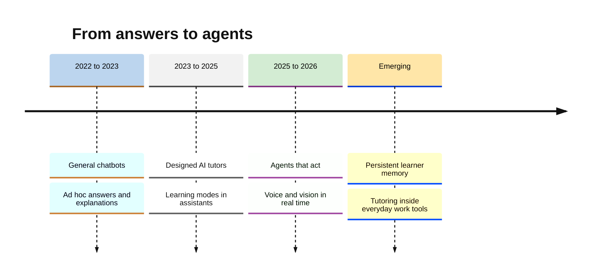
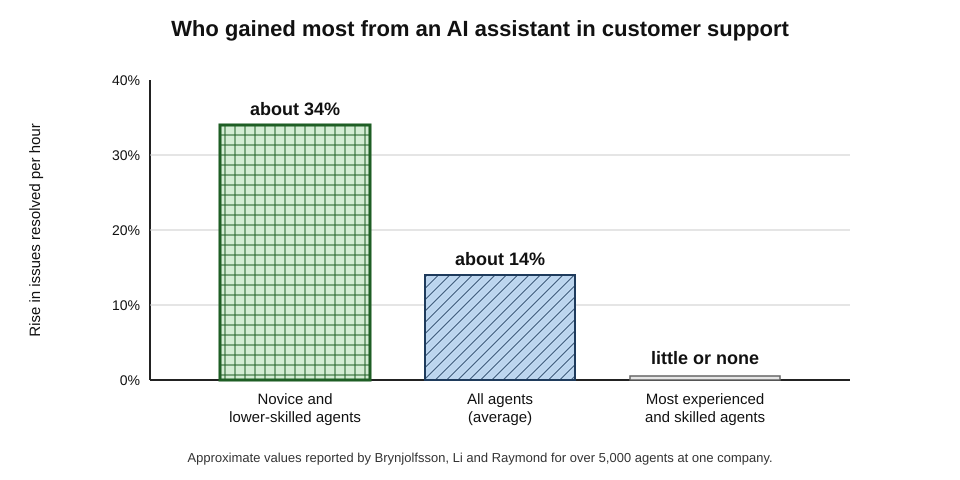
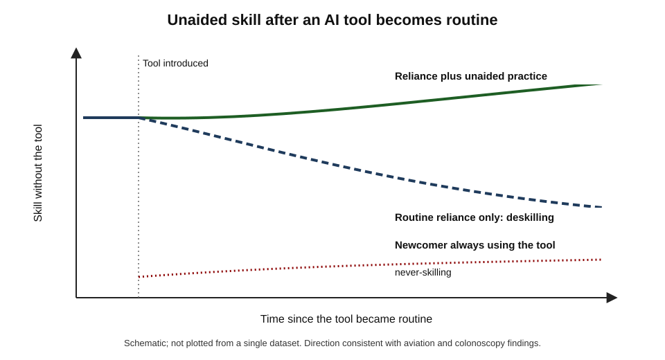
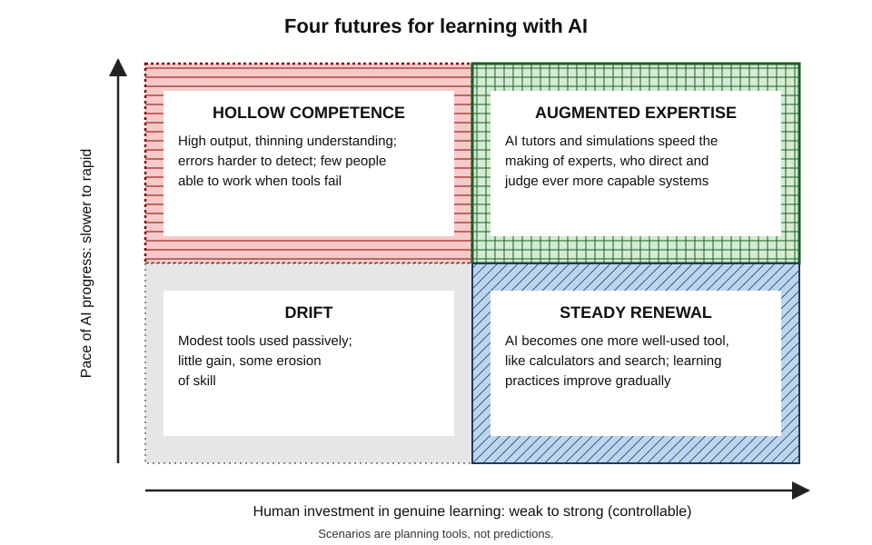
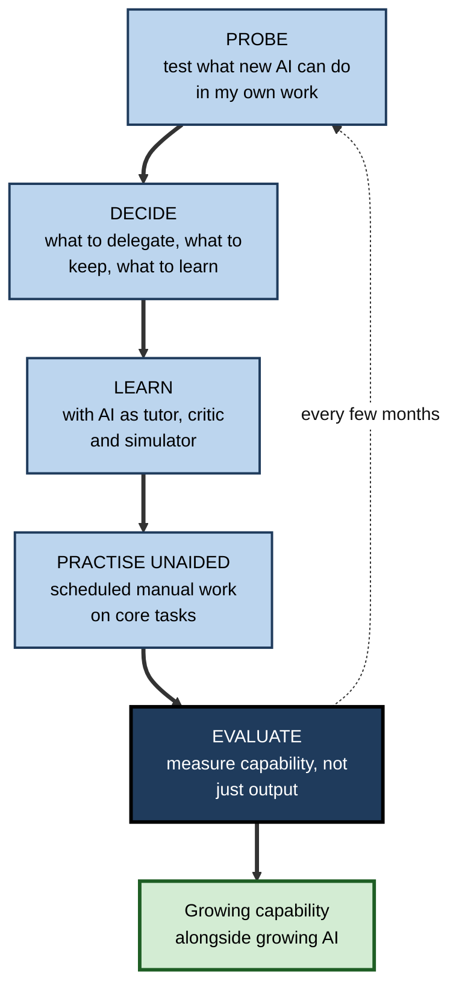

# G.12. Future of AI-Augmented Learning

For generations, junior lawyers learned by drafting the first versions of contracts, junior analysts by building the first models, and junior doctors by taking the first histories — routine work that seniors checked, corrected and explained. By 2026 AI could produce much of that first-draft work in minutes. If machines do the work through which beginners became experts, **how will the next generation of experts be made?**

> **Definition — AI-augmented learning:** learning in which AI systems extend what a person can understand, practise and accomplish, while the person continues to build durable capability of their own.

**Why it matters**

- AI capabilities relevant to learning — explanation, tutoring, feedback, simulation, autonomous task completion — improved faster between 2022 and 2026 than in the previous fifty years of educational technology.
- The same advances threaten the traditional routes by which people learned on the job, and evidence of **deskilling** has begun to appear.
- Employers expect a large share of workers' core skills to change within a few years; learning continuously, with and without AI, becomes a condition of a career rather than an option.
- Forecasts about education technology have a poor record; the professional task is to separate visible trends from speculation and to prepare for several possible futures.

---

## Trends Already Visible

### From answers to tutors to agents

- **2022–2023: conversational answers** — general chatbots explain, write and answer on demand; most learning use is ad hoc.
- **2023–2025: designed tutors** — products built on large models with pedagogical instructions; dedicated learning modes in major assistants (2025).
- **2025–2026: agents** — systems that take actions over many steps: searching, writing and running code, operating software, completing multi-stage tasks with limited supervision.
- **Throughout: multimodality** — real-time voice conversation, image and video understanding, screen sharing, generated diagrams and simulations.
- **Persistent memory** — assistants that remember a user's goals, history and preferences across sessions.
- **National programmes** — some governments began providing AI learning tools across school systems, for example Estonia's programme from 2025 giving secondary pupils and teachers access to AI assistants with training.

> **Definition — AI agent:** an AI system that pursues a goal by planning and taking a sequence of actions — using tools, software or the web — rather than only producing a single response.

**Figure 1.** How AI support for learning has developed since 2022, and the directions now visible.

### AI in the flow of work

- **Embedded assistance** — AI built into office suites, programming environments, customer-service consoles and design tools means much learning now happens **during** tasks.
- **Blurring** — the line between performance support (help to do the task now) and learning (capability to do it alone later) becomes hard to see.
- **Opportunity** — explanations at the exact moment of need, with real material.
- **Risk** — tasks completed without any change in the person.

---

## Evidence From the Workplace

### AI as a carrier of expertise

**Study card — Erik Brynjolfsson, Danielle Li and Lindsey Raymond (published 2025)**

- **Setting:** a software company's customer-support operation; over **5,000** agents, some given access to a generative AI assistant that suggested responses during live chats.
- **Results:**
  - productivity (issues resolved per hour) rose by about **14%** on average;
  - for **novice and lower-skilled** agents the gain was about **34%**; for the most experienced and skilled, there was little gain;
  - agents with access moved down the experience curve faster — agents with **two months** of tenure and AI performed about as well as agents with **six months** without it;
  - customer sentiment improved and staff attrition fell.
- **Interpretation:** the AI appeared to **disseminate the tacit practices of the best agents** to newer ones; there was also evidence that agents retained some improvements when the tool was unavailable, suggesting learning and not only assistance.
- **Limit:** one company, one kind of work; effects on long-term skill were not the main focus.

**Figure 2.** Productivity gains from an AI assistant in customer support, by agent experience and skill.

> **Key point:** AI can **compress** the early part of the learning curve by putting expert practice in front of novices — but whether it builds independent expertise, or a dependence that looks like expertise, depends on design and use.

### Perception is unreliable

**Study card — METR (July 2025)**

- **Design:** **16** experienced open-source developers completed **246** real tasks in large codebases they knew well, each task randomly assigned to allow or forbid AI tools.
- **Results:**
  - before the study, developers expected AI to make them about **24%** faster;
  - with AI allowed, they were in fact about **19% slower**;
  - afterwards, they still **believed** AI had made them about **20% faster**.
- **Conclusion:** even experts misjudge how AI affects their own work; self-reports of AI's benefits — to productivity or to learning — need checking against measurement.
- **Limits:** a small sample of highly experienced developers in familiar codebases, with tools of early 2025; results may differ for novices, unfamiliar code or newer tools.

> **Watch out:** "I learn so much faster with AI" is a perception, not a measurement. The METR finding, and the Turkish mathematics study in which students did not notice their own learning losses, both show how far feelings and outcomes can diverge.

---

## What Will Not Change

Technologies change quickly; the architecture of human memory and expertise does not. Several findings from learning science are likely to hold whatever AI becomes.

- **Durable memory still requires effortful processing** — retrieval, spacing and elaboration strengthen memory; reading fluent output does not.
- **Prior knowledge still governs new learning** — what a person already knows determines how quickly and deeply they learn more, and how well they can judge what they are told.
- **Expertise still requires deliberate practice** — K. Anders Ericsson's research on experts in music, sport, chess and medicine found that elite performance grows from long periods of practice at the edge of ability, with feedback, aimed at specific weaknesses; no tool has removed the need for that practice, though tools can make it better designed.
- **Working memory is still limited** — the number of new elements a person can handle at once is small, so instruction still has to be sequenced and scaffolded.
- **Transfer is still hard** — knowledge learned in one context does not automatically apply in another; varied practice and explicit comparison remain necessary.
- **Motivation is still social** — people persist for goals they value and in communities they belong to.

> **Key point:** AI changes the **tools** of learning profoundly, but not the **mechanisms** of learning. Predictions that ignore those mechanisms — "no one will need to know anything" — misread both the technology and the mind.

> **Definition — Deliberate practice:** practice designed to improve specific aspects of performance, at the edge of current ability, with immediate feedback and repetition, usually guided by a teacher or coach.

---

## The Risk of Deskilling

### Ironies of automation

- **Lisanne Bainbridge (1983), "Ironies of automation":** automating the routine parts of a job leaves humans with the hardest parts — handling rare failures — while depriving them of the routine practice that kept their skills sharp.
- **Aviation** — research on airline pilots (for example by Stephen Casner and colleagues, 2014) found that the cognitive skills needed for manual flying — keeping track of position, recognising abnormal situations — had declined among pilots who relied heavily on automation, and regulators encouraged airlines to give pilots regular manual-flying practice.

> **Definition — Deskilling:** the loss, or failure to develop, of human skill because a task has been automated or delegated to a tool.

> **Definition — Never-skilling:** the failure of a new practitioner to develop a skill at all, because a tool performed it from the start of their career.

### Evidence from medicine

**Study card — Krzysztof Budzyń and colleagues (published August 2025)**

- **Setting:** four endoscopy centres in Poland that introduced AI assistance for detecting precancerous growths (adenomas) during colonoscopy.
- **Design:** compared the **adenoma detection rate** of experienced endoscopists in colonoscopies performed **without** AI before and after the centres began routinely using AI in other procedures.
- **Results:** the detection rate in non-AI procedures fell from about **28%** to about **22%** after routine AI exposure.
- **Interpretation:** continuous reliance on the AI may have reduced clinicians' own vigilance and visual search — one of the first clinical signals of deskilling from AI.
- **Limits:** observational design; possible other changes over time; one specialty.

**Figure 3.** Skill over time with routine reliance on automation, compared with reliance plus deliberate unaided practice.

### The apprenticeship problem

- **How expertise has been built** — through graded exposure to real work: simple tasks first, then harder ones, with feedback from experienced people.
- **What AI changes** — the simple tasks are the ones most easily automated, so beginners may never do them; seniors, in turn, may stop explaining because the AI's draft is "good enough".
- **Possible consequences:**
  - fewer entry-level roles, or roles that consist of supervising AI output without the expertise to judge it;
  - a gap between the experts trained before AI and those trained after;
  - firms discovering, years later, that no one below senior level can do the work unaided.

> **Key point:** the long-run risk is not that AI makes people worse at their jobs today, but that it removes the **practice** through which people become good at them.

| | Upskilling path | Deskilling path |
|---|---|---|
| AI's role for juniors | Explains, critiques, simulates; juniors still do core tasks | Does core tasks; juniors approve output |
| Feedback | Seniors review juniors' own work and reasoning | Seniors review AI output |
| Unaided practice | Scheduled and assessed | Rare |
| Evaluation skill | Built through doing the work | Assumed but not developed |
| Ten-year outcome | Experts who can direct and judge AI | Supervisors who cannot tell when AI is wrong |

---

## What People Will Need to Learn

### Shifting skills

- **World Economic Forum, Future of Jobs Report (January 2025):** employers expected about **39%** of workers' core skills to change by 2030; **analytical thinking** remained the most-cited core skill, and **AI and big data** the fastest-growing; resilience, flexibility, curiosity and **lifelong learning** ranked high among rising skills.
- **Workplace surveys** in 2024–2025 found that many employees were teaching themselves AI skills faster than employers were providing training.

> **Watch out:** skills forecasts are employer expectations, not measurements of the future. Their direction is informative; their percentages are not precise predictions.

### Capabilities that rise in value

| Capability | Why AI raises its value | How it is built |
|---|---|---|
| Deep domain knowledge | Needed to direct, judge and correct AI | Effortful study and practice, retained by review |
| Problem framing | AI answers questions; people must choose the right ones | Case work, reflection, exposure to varied problems |
| Evaluation of output | AI produces more than can be trusted unchecked | Verification habits; feedback on judgements |
| Judgement under uncertainty | Decisions remain accountable to people | Experience with feedback; simulations; debriefs |
| Communication and relationships | Trust, persuasion and care remain human work | Practice with real and simulated counterparts |
| Ethical reasoning | Responsibility does not transfer to tools | Cases, codes, discussion, mentoring |
| Learning how to learn | Skills turn over faster | Applying learning science deliberately |

### Learning to direct AI

- **Specifying** — describing goals, constraints and quality standards clearly enough for a tool or agent to act on.
- **Decomposing** — breaking work into parts suited to AI and parts that need human judgement.
- **Supervising** — monitoring an agent's progress, catching drift and intervening.
- **Integrating** — combining AI output with human knowledge, context and relationships into something trustworthy.

> **In practice:** directing AI well is itself a skill that depends on **domain expertise**: a person who cannot do the task cannot specify it well, judge the result or recover when the agent fails.

### Assessment and credentials

If AI can complete many traditional assignments, the ways capability is certified must change.

| | Traditional assessment | Emerging assessment |
|---|---|---|
| Main evidence | Written products completed alone | Live performance, oral defence, process evidence |
| Setting | Take-home essays and problem sets | Invigilated tasks, simulations, work samples |
| AI policy | Usually banned | Declared per task; sometimes required and evaluated |
| What is certified | Ability to produce a product | Ability to perform, explain and judge, with and without AI |
| Signals to employers | Degrees and grades | Portfolios, skills-based assessments, verified work samples |

- **Skills-based hiring** — many employers have moved towards assessing what candidates can do rather than relying only on degrees; AI raises the importance of such assessments and the difficulty of keeping them honest.
- **Assessing AI-augmented performance** — some assessments now ask candidates to complete a task **with** AI and then to explain, critique and defend the result — measuring direction and evaluation rather than raw production.

### Organisations and learning functions

- **From courses to capability** — learning teams shift from producing content (which AI can generate) to designing practice, feedback, coaching and measurement.
- **AI coaches at scale** — role-play and feedback on sales calls, presentations and management conversations become available to every employee, not just senior leaders.
- **Measuring what matters** — completions and satisfaction become even less meaningful when AI can complete courses; organisations need delayed, unaided and on-the-job measures of capability.
- **Protecting the pipeline** — deliberate design of the practice through which juniors become seniors.

### The future of teachers and mentors

- **What AI takes over** — routine explanation, practice generation, first-pass feedback, much administrative work.
- **What stays human** — setting goals that matter; motivating; judging what a learner needs next in the full context of their life and work; modelling professional judgement and ethics; building communities of practice; vouching for a person's competence.
- **Evidence so far** — the most successful AI tutoring trials embedded the AI in human teaching (Harvard, Nigeria) or in human tutors' work (Tutor CoPilot), rather than replacing people.

> **Watch out:** confident predictions that AI will replace teachers echo predictions made for film, radio, television, computers and online courses. Each changed teaching; none replaced the human relationships at its centre.

---

## Possible Futures

Forecasts about technology and education are notoriously unreliable; scenarios are a way of preparing for several futures without betting on one.

**Figure 4.** Four scenarios for learning, by how fast AI capability grows and how much people invest in their own learning.

- **Augmented expertise** (rapid AI progress, strong human learning) — AI tutors and simulations accelerate the making of experts; humans direct and judge increasingly capable systems.
- **Hollow competence** (rapid AI progress, weak human learning) — output stays high while understanding thins; failures become harder to detect and recover from.
- **Steady renewal** (slower AI progress, strong human learning) — AI becomes one more well-used tool, as calculators and search engines did; learning practices improve gradually.
- **Drift** (slower AI progress, weak human learning) — modest tools, used passively, with little gain and some erosion of skill.

> **Key point:** the human axis — how much individuals and organisations invest in **genuine learning** — is the one they control. It decides the outcome in either AI future.

---

## Preparing Oneself

### Principles for a career-long strategy

- **Protect the foundations** — keep building the core knowledge of one's field in one's own head; it is what makes every AI tool safe to use.
- **Practise unaided on purpose** — schedule "manual flying": regular tasks without AI, to maintain and measure capability.
- **Use AI to go further, not to skip** — explanation, critique, simulation and practice at the edge of ability, rather than substitution for core work.
- **Learn to evaluate and direct** — verification, specification, supervision of agents.
- **Stay close to people** — mentors, peers and communities carry tacit knowledge, judgement and motivation that AI does not supply.
- **Track the frontier** — periodically test what new tools can and cannot do in one's own work; the boundary moves.

**Figure 5.** A cycle for keeping capability growing as AI changes.

### Worked example (illustrative): a quarterly frontier probe

A marketing analyst spends one hour each quarter testing what current AI tools can do on five of her real tasks, then decides what to delegate, what to keep and what to learn.

| Task | What the AI did this quarter | Decision | Learning implication |
|---|---|---|---|
| Weekly performance report | Accurate draft from the data, minor errors | Delegate; check totals | Keep the skill of spotting anomalies |
| Campaign segmentation | Plausible but statistically weak clusters | Keep; use AI as critic | Learn more about clustering validation |
| Client presentation narrative | Fluent, generic story | Keep; use AI for alternatives | Practise storytelling with real client data |
| Survey questionnaire design | Good structure, some leading questions | Co-produce; review every item | Learn question-wording principles |
| Budget negotiation with a vendor | Useful role-play partner | Keep; rehearse with AI | Practise under realistic pressure |

- **Result:** each quarter the boundary moves — tasks shift from "keep" to "delegate with checks" — and her learning effort moves to the judgement those tasks still require.
- **Principle:** the frontier is **jagged** and **moving**; only regular, first-hand testing on one's own work shows where it lies.

> **Watch out:** delegating a task does not end the need to understand it. The analyst can delegate the weekly report only because she can still tell when it is wrong.

### Case study (illustrative): redesigning junior training in a law firm

- **Situation:** a commercial law firm adopted AI drafting and review tools in 2025; first drafts of standard agreements that once took trainees a day appeared in minutes.
- **Problem:** within a year, partners noticed that second-year associates could check AI drafts for obvious errors but struggled to draft non-standard clauses or to explain why standard ones were structured as they were.
- **Diagnosis:** the firm had removed the drafting practice through which juniors had always learned, without replacing it.
- **Actions:**
  1. **protected practice** — trainees drafted a set number of agreements each quarter **without** AI, reviewed by a senior;
  2. **AI as critic** — trainees then compared their drafts with AI drafts and explained every difference;
  3. **simulation** — AI-played counterparties pushed back on clauses in negotiation exercises;
  4. **explicit teaching** — seniors ran short sessions on why standard clauses exist and when to depart from them;
  5. **measurement** — an unaided drafting assessment at the end of each training seat.
- **Result:** the next cohort's unaided drafting scores were well above those of the cohort trained with unrestricted AI; partners reported better judgement in client work.
- **Side effects:** protected practice cost trainee time that clients would not pay for; the firm treated it as an investment in future partners.
- **Lesson:** organisations must **deliberately design** the practice that AI removes, or the pipeline of expertise empties.

---

## Open Questions

- **Will AI tutoring close Bloom's 2 sigma gap at scale?**
  - Early trials are striking but short; whether large, lasting gains survive routine deployment is the central open question of educational technology.
- **How widespread will deskilling be, and can it be prevented?**
  - Signals from medicine and aviation are suggestive; systematic evidence across professions is lacking.
- **What will entry-level work look like?**
  - If AI performs junior tasks, new routes into expertise — simulations, protected practice, apprenticeships with AI — will need to be invented and tested.
- **Will AI change what it means to "know" something?**
  - If information is always available, the balance between knowing, knowing where to find and knowing how to judge may shift — but the evidence that expertise depends on internal knowledge remains strong.
- **Can research keep pace?**
  - Models change faster than trials can run; methods for evaluating rapidly evolving tools are themselves an open problem.
- **Who will benefit?**
  - Augmentation gains may flow most to those already skilled and self-directed; deliberate policy may be needed to spread them.

---

## Summary

- **AI-augmented learning** extends what people can understand and do while they keep building their own capability.
- Visible trends: chatbots → designed tutors and **learning modes** → **agents**; voice, vision, persistent memory; AI embedded in the **flow of work**; national programmes.
- Workplace evidence: an AI assistant raised customer-support productivity about **14%** on average and **34%** for novices, compressing the learning curve (Brynjolfsson, Li and Raymond); experienced developers were **19% slower** with AI yet believed they were faster (METR, 2025).
- **Deskilling**: Bainbridge's ironies of automation; manual-flying skill decline in pilots; adenoma detection fell from about 28% to 22% after routine AI use in colonoscopy. **Never-skilling** and the **apprenticeship problem** threaten the routes by which experts are made.
- Skills shift quickly (about **39%** of core skills expected to change by 2030, WEF 2025); rising capabilities include domain knowledge, problem framing, evaluation, judgement, communication, ethics and **learning how to learn**, plus **directing AI**.
- What will not change: effortful processing, prior knowledge, **deliberate practice**, limited working memory, difficult transfer and social motivation.
- Assessment moves towards **live performance, oral defence and process evidence**; organisations shift from content to practice, coaching and capability measurement; teachers and mentors keep the human core.
- Scenarios — augmented expertise, hollow competence, steady renewal, drift — turn on the controllable variable: **investment in genuine human learning**.
- Strategy: protect foundations, practise **unaided** on purpose, use AI to go further not to skip, learn to evaluate and direct, stay close to people, and probe the frontier regularly.

---

## Self-Check

1. Define AI-augmented learning and explain how it differs from simply using AI to complete tasks.
2. Describe the move from chatbots to designed tutors to agents, with one implication of each for learners.
3. Summarise the Brynjolfsson, Li and Raymond study. Why were gains largest for novices?
4. What did the METR study find, and what does it imply for judging AI's effect on one's own learning?
5. Explain Bainbridge's "ironies of automation" and give an example from aviation.
6. Describe the 2025 colonoscopy study and its limitations.
7. Distinguish deskilling from never-skilling.
8. What is the apprenticeship problem, and how might organisations respond?
9. Name five capabilities that rise in value with AI and how each is built.
10. Why does directing AI depend on domain expertise?
11. Describe the four scenarios and identify the variable individuals control.
12. List six principles for a career-long learning strategy in an AI-rich world.
13. A senior manager plans to stop hiring graduates because "AI does the junior work". Analyse the long-term risks and propose an alternative.
14. Design a personal "manual flying" routine for your own role.

### Answer Key

1. Learning in which AI extends understanding, practice and achievement while the person builds durable capability. Task completion by AI may leave the person unchanged.
2. Chatbots: instant answers, risk of substitution. Designed tutors: scaffolded learning, but answer leakage and weak learner models. Agents: AI performs multi-step work, raising the risk that learners never do the work themselves and the need to learn to specify and supervise.
3. Over 5,000 support agents; AI suggestions raised productivity about 14% on average and 34% for novices, with little gain for the most skilled; two months with AI matched six months without. The AI conveyed the practices of top agents, which novices lacked and experts already had.
4. Experienced developers were about 19% slower with AI but believed they were 20% faster. Self-perception of AI's benefit is unreliable; measure unaided capability and outcomes.
5. Automation takes routine tasks, leaving humans the hardest, rare ones while removing the practice that maintained their skill. Pilots relying heavily on automation showed declines in the cognitive skills of manual flying.
6. After routine AI use began, endoscopists' adenoma detection in non-AI colonoscopies fell from about 28% to 22%. Limits: observational, possible confounding changes, one specialty.
7. Deskilling: losing a skill once held through reliance on tools. Never-skilling: never acquiring the skill because a tool did it from the start.
8. Beginners lose the routine tasks through which expertise was built, so future experts may not develop. Responses: protected unaided practice, AI as critic and simulator, explicit teaching by seniors, and unaided assessment.
9. Domain knowledge (study and review), problem framing (varied cases and reflection), evaluation (verification with feedback), judgement (experience and simulation with debriefs), communication (practice with counterparts), ethics (cases and mentoring), learning how to learn (applied learning science).
10. Specifying a task, judging the result and recovering from failure all require knowing how the task should be done.
11. Augmented expertise, hollow competence, steady renewal, drift — defined by AI progress and human learning investment; individuals and organisations control their investment in genuine learning.
12. Protect foundations; practise unaided deliberately; use AI to go further, not skip; learn to evaluate and direct AI; stay close to people; probe the frontier regularly.
13. Risks: no pipeline of future seniors; loss of tacit knowledge; dependence on tools nobody can check; vulnerability when tools fail or change. Alternative: hire fewer but train deliberately — protected practice, AI-as-critic, simulations, mentoring and unaided assessments.
14. A good routine names core tasks, sets a frequency (for example weekly), performs them without AI, compares results with an expert or with AI afterwards, and records changes in capability over time.

---

## Glossary

| Term | Meaning |
|---|---|
| AI agent | An AI system that pursues goals by planning and taking multi-step actions. |
| AI-augmented learning | Learning in which AI extends what a person can do while they build their own capability. |
| Apprenticeship problem | The loss of routine practice through which beginners traditionally became experts. |
| Deskilling | Loss of human skill through automation or delegation. |
| Deliberate practice | Practice at the edge of ability on specific weaknesses, with feedback. |
| Flow of work | Learning or assistance delivered during real tasks rather than in separate courses. |
| Ironies of automation | Bainbridge's observation that automation leaves humans the hardest tasks while removing their practice. |
| Manual flying | By analogy with aviation, deliberate unaided practice of tasks normally done with AI. |
| Never-skilling | Never acquiring a skill because a tool performed it from the outset. |
| Performance support | Help to complete a task now, without necessarily building capability. |
| Scenario | A structured, plausible description of a possible future used for planning. |
