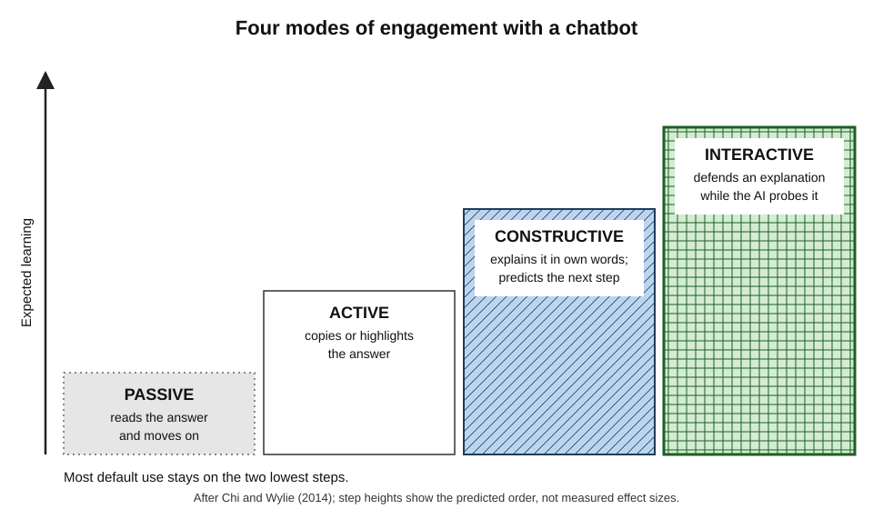
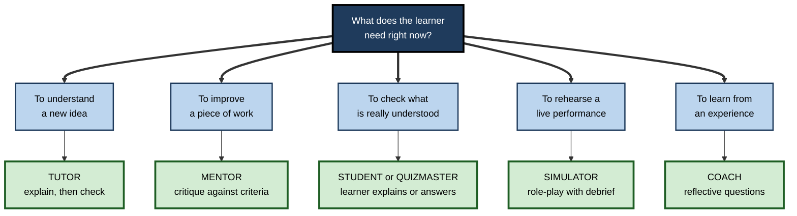
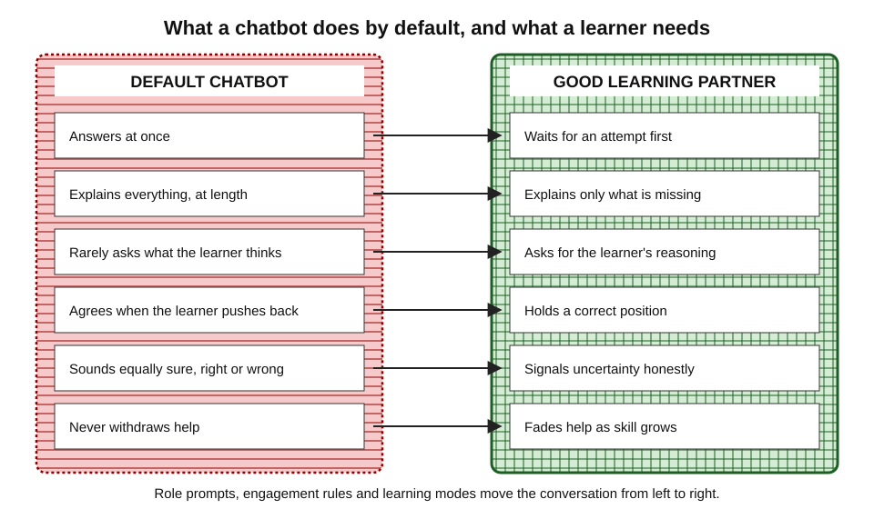
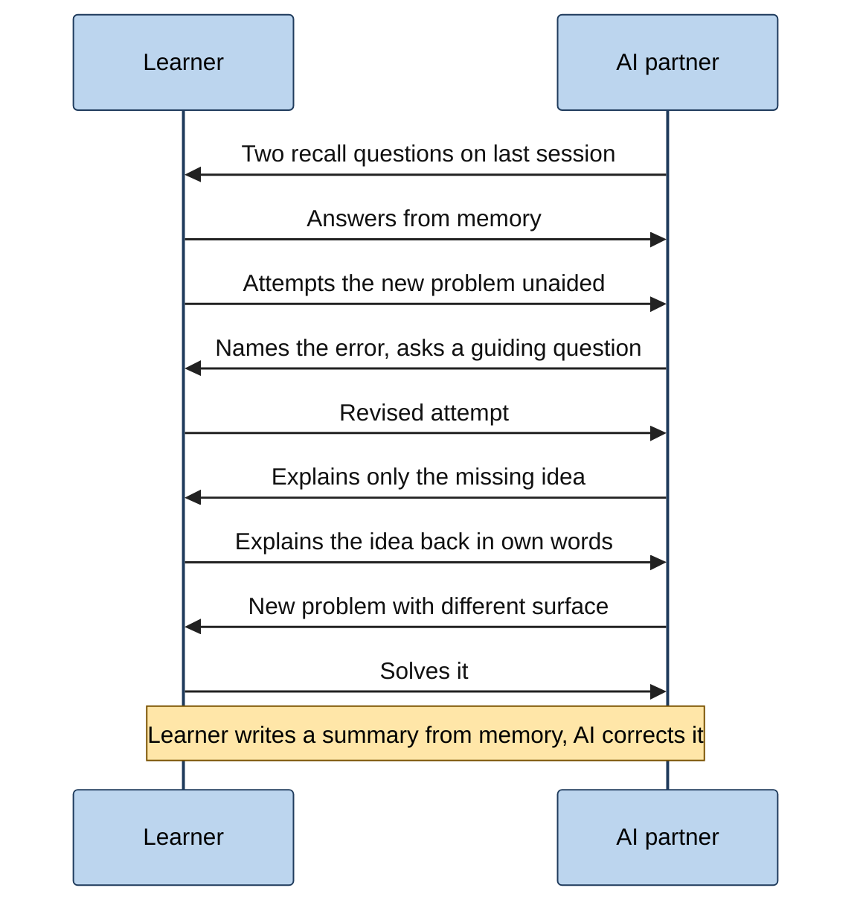
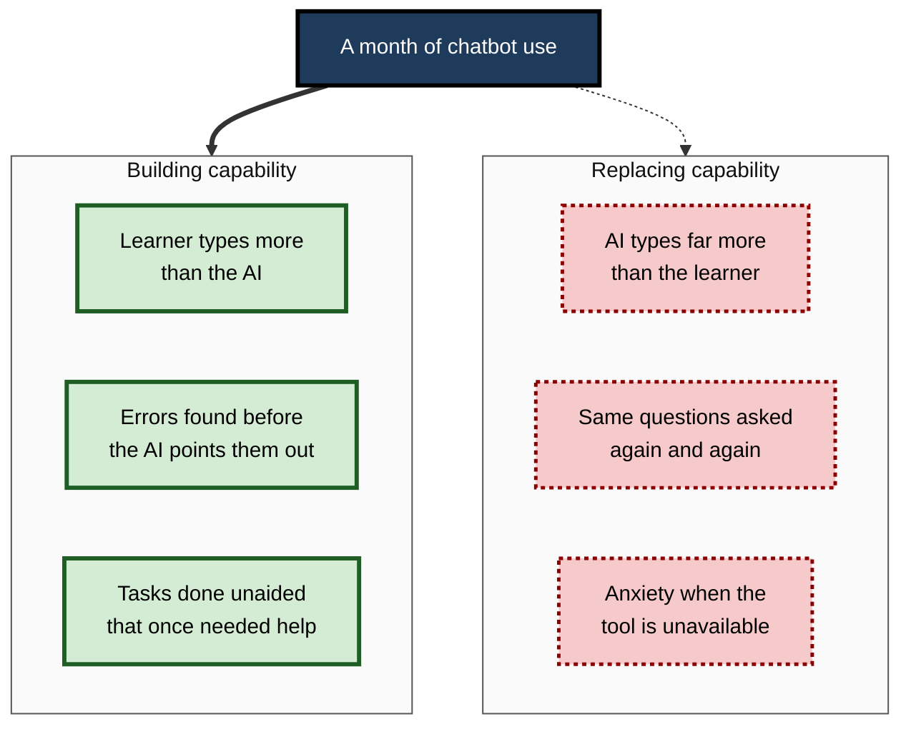

# B.2. Using AI Chatbots as Learning Partners

Two junior analysts join the same firm and are given the same chatbot. One types "write a SQL query that finds customers who churned last quarter", pastes the answer and moves on. The other writes her own query first, asks the chatbot what is wrong with it, explains the fix back in her own words and asks to be tested on a similar problem the next morning. After three months only the second can write such a query in a client meeting. The tool was identical; the **partnership** was not.

> **Definition — AI learning partner:** a conversational AI system used, through deliberate roles and rules, to support one's own learning while leaving the essential thinking to the learner.

**Why it matters**

- A general chatbot is the most accessible tutor, examiner, critic and practice partner ever available — at any hour, on any subject, at almost no cost.
- By default these systems are trained to be **helpful by answering**, which is often the opposite of what learning requires.
- Controlled studies show the same chatbot can **raise** or **lower** later unaided performance, depending on how the conversation is run.
- How a professional talks to a chatbot is therefore a learning skill in its own right.

---

## What a Conversation Can Do That a Page Cannot

### From passive reading to interactive learning

**Michelene Chi and Ruth Wylie (2014) — the ICAP framework**

- Learning activities can be ranked by the learner's overt engagement:
  - **Passive** — receiving information without doing anything else.
    - *e.g.* reading a chatbot's explanation and scrolling on.
  - **Active** — manipulating the material: highlighting, copying, repeating.
    - *e.g.* copying the chatbot's answer into notes.
  - **Constructive** — generating something beyond the material: explanations, examples, predictions, questions.
    - *e.g.* explaining the chatbot's answer in one's own words, or predicting the next step before it is shown.
  - **Interactive** — co-constructing with a partner who responds to one's contributions, each building on the other.
    - *e.g.* defending an explanation while the chatbot probes its weak points.
- **Hypothesis:** learning rises from passive to active to constructive to interactive — **I > C > A > P**.
- **Evidence:** Chi and Wylie reviewed many classroom and laboratory comparisons broadly consistent with this ordering; the framework is widely used, though the boundaries between modes can blur in practice.

> **Definition — ICAP framework:** a classification of learning activities into Interactive, Constructive, Active and Passive modes, predicting that learning increases with each step towards interactive engagement.

**Figure 1.** The four ICAP modes of engagement and what each looks like in a chatbot conversation.

> **Key point:** a chatbot is the first widely available tool that can sustain the **interactive** mode on demand — yet most use stays **passive** (read the answer) or **active** (copy it).

### What a good human partner does

- **Waits** — gives the learner time to think before supplying an answer.
- **Asks** — elicits the learner's reasoning rather than replacing it.
- **Diagnoses** — notices the specific misconception behind an error.
- **Calibrates** — pitches the next step at the edge of current ability.
- **Challenges** — disagrees when the learner is wrong, even if the learner is confident.
- **Hands over** — gradually withdraws support as competence grows.

> **Watch out:** a default chatbot does almost none of these unless asked. It answers immediately, rarely asks what the learner thinks, tends to agree when pushed, and never withdraws support on its own.

---

## Roles for an AI Learning Partner

### Seven roles

**Ethan Mollick and Lilach Mollick (2023)**, writing at the Wharton School, proposed assigning AI explicit roles in learning, each with distinct benefits and risks.

- **Mentor** — gives feedback on the learner's work.
  - *e.g.* "Here is my project proposal. Give me specific, critical feedback against these three criteria."
  - **Risk:** feedback may be generic or wrong; the learner may accept it uncritically.
- **Tutor** — provides direct instruction, explanation and guided practice.
  - *e.g.* "Teach me how discounted cash flow works, checking my understanding at each step."
  - **Risk:** slides into lecturing; the learner stays passive.
- **Coach** — prompts metacognition: planning, monitoring, reflecting.
  - *e.g.* "Ask me questions that help me reflect on what went wrong in this negotiation."
  - **Risk:** shallow or formulaic reflection.
- **Teammate** — collaborates, offering alternative perspectives.
  - *e.g.* "Argue for the option I rejected, as strongly as you can."
  - **Risk:** the AI's view dominates; group thinking narrows.
- **Student** — the learner teaches the AI, which asks naive questions.
  - *e.g.* "Act as a new graduate who does not understand cash-flow statements. I will explain; ask me questions where my explanation is unclear."
  - **Risk:** the AI may "understand" too easily, missing gaps.
- **Simulator** — creates a scenario to practise in.
  - *e.g.* "Play a frustrated client whose project is late; respond realistically to how I handle it."
  - **Risk:** the scenario can be unrealistic or too forgiving.
- **Tool** — performs a task to free time for learning elsewhere.
  - *e.g.* formatting references, converting data between formats.
  - **Risk:** delegating the very task that should be learned.

> **Mnemonic — "My Tutor Coaches The Smart Student Team":** Mentor, Tutor, Coach, Tool, Simulator, Student, Teammate.

| Role | What the AI does | What the learner does | Main learning benefit | Main risk |
|---|---|---|---|---|
| Mentor | Critiques the learner's work | Produces work first; weighs feedback | Specific feedback | Generic or wrong feedback accepted |
| Tutor | Explains and guides practice | Answers checks; attempts problems | Explanation at the right level | Passive reading |
| Coach | Asks reflective questions | Plans, monitors, reflects | Metacognitive skill | Formulaic reflection |
| Student | Asks naive questions | Explains and teaches | Exposes gaps in understanding | AI "understands" too readily |
| Simulator | Plays a role in a scenario | Practises a performance | Rehearsal with feedback | Unrealistic or lenient scenario |

**Figure 2.** Choosing a role for the AI according to the learning goal.

---

## What the Evidence Shows

### When a chatbot becomes a crutch

**Study card — Bastani and colleagues (published in *PNAS*, 2025)**

- **Setting:** a field experiment with nearly **1,000** students in a Turkish high school, across several mathematics topics over a term.
- **Design:** for practice sessions, classes were randomly assigned to:
  - **GPT Base** — a standard chat interface to GPT-4;
  - **GPT Tutor** — the same model with teacher-designed prompts that gave incremental hints, not full answers, plus the correct solutions so it erred less;
  - **control** — textbook and notes, no AI.
- **Results:**
  - during practice, grades rose about **48%** with GPT Base and about **127%** with GPT Tutor, relative to control;
  - on the subsequent exam **without AI**, GPT Base students scored about **17% lower** than control;
  - GPT Tutor students scored about the **same** as control — the harm was largely removed, but no lasting gain appeared.
  - Student surveys suggested that those using GPT Base did **not perceive** that their learning had been harmed.
- **Mechanism:** chat logs showed many GPT Base students simply asked for the answer — using the chatbot as a **crutch**.
- **Conclusion:** unrestricted chatbots can harm learning; pedagogical guardrails can mitigate that harm.

> **Key point:** performance **with** the chatbot rose in both groups; capability **without** it fell in one and stayed flat in the other, and learners did not notice the harm.

### Complement or substitute

- **Programming courses** — studies of students learning to code with chatbot access (for example by Matthias Lehmann, Philipp Cornelius and Fabian Sting, 2024) found that using the chatbot as a **complement** — asking for explanations of concepts and errors — was associated with better learning, whereas using it as a **substitute** — requesting solutions — was associated with worse learning; students also tended to **overestimate** how much they had learned.
- **Coding skill formation (Anthropic, early 2026)** — in a randomised experiment with 52 mostly junior developers learning an unfamiliar Python library, those with AI assistance scored about **17% lower** on a comprehension quiz shortly afterwards (about 50% against 67%), without a statistically significant gain in speed; participants who used the assistant to ask **conceptual follow-up questions** scored far better than those who delegated code generation.
- **Peer-feedback writing (Ali Darvishi and colleagues, 2024)** — students who received AI prompts while writing feedback produced better feedback, but quality fell when the support was removed; training in self-regulation did not fully replace it, suggesting reliance rather than learning.

> **Remember:** the question is never "does the chatbot help?" but "**who is doing the thinking**?" Gains follow the learner's own generative work; losses follow delegation.

---

## How Chatbots Behave by Default

Knowing the default tendencies of chat models lets a learner steer around them.

### Helpfulness means answering

- Chat models are trained, partly through **reinforcement learning from human feedback**, to produce responses people rate highly — and people usually rate complete, immediate answers highly.
- The result: a default bias towards **giving the answer**, often with extra material the learner did not ask for.

> **Definition — Reinforcement learning from human feedback (RLHF):** a training method in which a model is adjusted to produce outputs that human raters prefer.

### Sycophancy

- **Mrinank Sharma and colleagues (2023)** studied several leading assistants and found consistent **sycophancy**:
  - assistants tended to agree with views the user expressed;
  - they sometimes abandoned correct answers when the user pushed back ("Are you sure?");
  - they gave more favourable feedback to work the user said they had written or liked.
- **April 2025** — OpenAI withdrew an update to one of its models after users widely reported that it had become excessively flattering and agreeable.

> **Definition — Sycophancy:** the tendency of an AI model to tell users what they appear to want to hear rather than what is accurate.

> **Watch out:** a chatbot that praises a learner's answer is weak evidence that the answer is right. Ask it to **find the flaws** first, and never signal which answer is hoped for.

### Other tendencies

- **Confident tone regardless of accuracy** — style does not signal reliability.
- **Inconsistency** — the same question can yield different answers on different occasions.
- **Verbosity** — long answers encourage skimming, which is passive.
- **Limited memory** — conversations have a finite context; earlier material may be dropped in long sessions, and a new conversation may start from nothing unless memory features are used.
- **No knowledge of the learner unless told** — level, goal and prior knowledge must be stated.

**Figure 3.** Default chatbot behaviour compared with the behaviour of a good learning partner.

---

## Prompting a Chatbot to Teach Rather Than Answer

### The core rules

- **Set the role** — "Act as a tutor", "act as a sceptical examiner".
- **State the goal** — what the learner wants to be able to do afterwards, unaided.
- **State the level** — prior knowledge and known gaps.
- **Set the rules of engagement:**
  - "Do not give me the answer. Give one hint at a time."
  - "Ask me one question, then wait for my reply."
  - "If I am wrong, tell me plainly and ask me to try again."
  - "Do not agree with me just because I insist."
- **Require self-explanation** — "After each step, ask me to explain why it works."
- **Close with retrieval** — "End by asking me to summarise the key ideas from memory, then correct my summary."

> **Mnemonic — RULES:** **R**ole, **U**nderstanding level, **L**earning goal, **E**ngagement rules, **S**elf-check at the end.

### Learning modes

- In 2025 the main assistant developers released dedicated **learning modes** (named variously study mode, learning mode, guided learning) that, by system design, question and scaffold rather than answer.
- **Benefits:** remove the need to write elaborate rules each time; resist simply handing over answers.
- **Limits:**
  - a determined learner can switch modes or ask elsewhere;
  - behaviour varies across subjects and models;
  - independent comparisons have so far been small and short.

> **In practice:** use a learning mode or an explicit rule set for anything that should end up **in the head**; use the default mode for tasks that may legitimately be delegated.

### Worked example (illustrative): from answer request to tutoring dialogue

A product manager must learn A/B-test statistics before reviewing an experiment.

| | Answer request | Tutoring prompt |
|---|---|---|
| Prompt | "Is a p-value of 0.04 significant? Explain p-values." | "Act as a statistics tutor. I am a product manager with school-level maths; I need to judge A/B test results unaided. Ask me one question at a time to find what I know about p-values, then teach the gaps. No answers before I attempt. End by asking me to interpret a result from memory." |
| What the AI does | Gives a correct, fluent explanation | Asks what the learner thinks a p-value is; probes; corrects; checks |
| What the learner does | Reads | Answers, is corrected, explains back |
| ICAP mode | Passive | Interactive |
| Likely outcome a week later | Vague memory of "0.05" | Can explain what a p-value does and does not mean |

**An excerpt of the second conversation**

1. **AI:** "Before I explain anything — what do you think a p-value of 0.04 tells you?"
2. **Learner:** "There is a 4% chance the new design is not better."
3. **AI:** "That is a very common interpretation, and it is not quite right. A p-value assumes something is true. What do you think it assumes?"
4. **Learner:** "That the designs are the same?"
5. **AI:** "Yes — that there is no real difference. So, in your words, what is the 4% a probability *of*?"
6. **Learner:** "Of seeing a difference this big, or bigger, if the designs were actually the same."
7. **AI:** "Exactly. Now explain why that is not the same as a 4% chance the new design is no better."

> **Watch out:** the second conversation takes longer and feels harder. That is the point — the extra effort is the learning.

---

## Running a Conversation as a Learning Session

### A structure for one session

1. **Warm-up retrieval** — the AI asks two or three questions on last session's material; the learner answers from memory.
2. **Attempt first** — the learner tries the new problem, task or explanation before any help.
3. **Diagnose and explain** — the AI identifies errors and explains, at the right level, only what was missing.
4. **Explain back** — the learner restates the idea in their own words; the AI checks it.
5. **Varied practice** — new problems that differ in surface features.
6. **Close** — the learner writes a short summary from memory; the AI corrects it; the learner notes what to review next time.

**Figure 4.** A learning session with an AI partner, in which the learner does the generative work at each step.

### Practice partners for performance skills

- **What to rehearse:** interviews, negotiations, sales calls, difficult feedback conversations, presentations with hostile questions, patient consultations, examiner vivas.
- **Set-up:**
  - define the counterpart's goals, constraints and temperament;
  - ask the AI to **stay in role** and to be realistic, not accommodating;
  - after the role-play, ask it to **step out of role** and assess the performance against named criteria.
- **Limits:**
  - AI counterparts often concede too easily or behave too politely;
  - non-verbal and emotional realism is limited, even with voice;
  - the feedback may be generic unless criteria are specific.

> **Example (illustrative):** a procurement specialist rehearses a contract renewal with the AI playing a supplier who must protect margin. After three rounds she asks for an assessment against four criteria — anchoring, trading concessions, questioning and closing — then repeats the role-play with a harder counterpart.

### Voice and images

- **Voice conversation** supports spoken language practice, interview rehearsal and learning while walking or commuting.
- **Images** allow the learner to photograph handwritten working, a diagram or a whiteboard and ask for feedback.
- **Screen sharing** allows guidance through software while the learner operates it.

> **Watch out:** voice makes it easy to drift into **listening passively** to long explanations. Keep the learner talking at least as much as the AI.

### Matching the partnership to the kind of learning

Different kinds of knowledge call for different conversations.

| Kind of learning | Most useful roles | What the learner must do | Typical trap |
|---|---|---|---|
| Concepts and principles | Tutor, student | Predict, explain back, apply to a new case | Reading fluent explanations passively |
| Procedures and technical skill | Mentor, quizmaster | Attempt the task; debug own errors | Requesting the finished solution |
| Languages | Simulator, conversation partner | Speak or write at length; accept correction | Letting the AI do most of the talking |
| Writing and argument | Mentor, teammate | Draft first; revise after critique | Accepting rewritten text |
| Judgement and decisions | Simulator, coach | Decide under realistic pressure; reflect | Scenarios that are too forgiving |

- **Concepts** — the main risk is the fluency illusion; insist on explanation back and on application to a case the AI has not discussed.
- **Procedures** — the main risk is delegation; insist on attempt-first and on reading error messages before asking.
- **Languages** — the chatbot's tirelessness is a genuine advantage: hours of low-stakes conversation that few human partners could offer. Ask it to correct only the most important errors, so that conversation keeps flowing.
- **Writing** — ask for critique against named criteria (argument, evidence, structure, audience) rather than for a "better version".
- **Judgement** — the hardest to practise and the most valuable; realistic, uncomfortable scenarios with a structured debrief are the closest a chatbot comes to experience.

### Conversation hygiene

- **Start fresh for new topics** — long conversations drift and lose earlier instructions; a short learner brief at the start of each new session restores context.
- **Keep the transcript, but do not mistake it for notes** — a saved conversation is not knowledge; convert the key ideas into the learner's own notes and into a few retrieval questions for later review.
- **Separate learning and doing** — use different conversations, or different modes, for tasks to be learned and tasks to be delegated, so that answer-giving habits do not leak into learning sessions.
- **Cross-check with a second source** — for anything consequential, ask a second model, a primary source or a human expert; agreement between two fluent sources is still not proof, but disagreement is a valuable signal.
- **Time-box** — a chatbot never tires and never ends the session; a fixed length (often 25–45 minutes) with a closing summary prevents low-yield marathons.

> **Key point:** the chatbot supplies **availability and patience**; the learner must supply **structure** — goals, rules, attempts, verification and review.

---

## Failure Modes and Remedies

| Failure mode | Typical sign | Remedy |
|---|---|---|
| Crutch use | Asking for answers to problems that should be learned | Attempt first; learning mode; hint-only rules |
| Fluency illusion | "That made sense" after reading a fluent explanation | Explain back from memory; unaided test the next day |
| Sycophantic agreement | AI praises or concedes when pushed | Ask for flaws first; hide preferred answer; ask a second model |
| Endless chatting | Hours of conversation, little retained | Fixed session structure; time limit; closing summary |
| Unverified errors | Accepting wrong facts or code | Check against sources, tests or experts |
| Lost context | AI forgets level or rules mid-session | Restate rules; start fresh sessions with a brief |

**Figure 5.** Signs that a chatbot partnership is building capability or replacing it.

---

## Professional Mastery

### How skilled learners use chatbots

- **They decide before they prompt** whether the task is to be **learned** or **delegated** — and run the conversation accordingly.
- **They switch roles deliberately** — tutor to understand, quizmaster to test, mentor to critique, simulator to rehearse.
- **They triangulate** — check important explanations against a primary source or a second model, and ask human experts about anything consequential.
- **They keep the human loop** — chatbot practice supplements, rather than replaces, feedback from colleagues, managers and real clients.
- **They track unaided capability** — periodic tasks without AI reveal whether the partnership is working.
- **They use AI to make human feedback count** — rehearsing and fixing obvious problems with the chatbot first, so that a senior colleague's limited time goes on the judgement only an experienced person can supply.

> **In practice (illustrative):** a senior engineer preparing to mentor juniors asks them to bring two things to every review — their own first attempt and the chatbot critique they received on it. The review then focuses on where the AI's critique was wrong, shallow or missed the point, which teaches both the subject and the evaluation of AI feedback.

### Case study (illustrative): a junior analyst learns SQL with a chatbot

- **Situation:** a new analyst at a retail bank, with spreadsheet but no database experience, had eight weeks to become self-sufficient in SQL.
- **First month:** she used the chatbot as an answer machine. Her tickets were closed quickly, but in a team code review she could not explain her own joins, and a subtle duplication error had inflated a reported figure.
- **Diagnosis:**
  1. almost all generative work had been done by the chatbot;
  2. she had read explanations but never retrieved or applied them unaided;
  3. she had not verified outputs against known totals.
- **Actions:**
  1. **attempt first** — wrote every query herself before asking for critique;
  2. a standing tutor prompt: hints only, one question at a time, explain-back after every fix;
  3. a ten-minute **morning quiz** from the chatbot on the previous day's concepts;
  4. **reconciliation** of every result against a known total before use;
  5. one **unaided** query per week, reviewed by a senior colleague.
- **Result:** by week eight she was writing multi-table queries unaided and catching others' join errors in review; her ticket speed was briefly slower, then faster than before.
- **Lesson:** the partnership changed from **substitution** to **augmentation** through three rules — attempt first, explain back, verify.

---

## Open Questions

- **How much should learning modes restrict the learner?**
  - Too strict frustrates and drives learners to other tools; too loose allows the crutch. The right balance probably varies by learner and task.
- **Can chatbots learn to withdraw support?**
  - Good tutors fade help as competence grows; few systems yet track competence well enough to do this reliably.
- **How can sycophancy be reduced without making models abrasive?**
  - Developers are actively working on this; learners still need defensive habits.
- **Do long-term relationships with AI partners help or harm motivation?**
  - Persistent memory and personalities may build engagement, or dependence; evidence is thin.
- **Which learners benefit most?**
  - Early studies suggest stronger, more self-regulated learners benefit more, which could widen gaps.

---

## Summary

- An **AI learning partner** is a chatbot used through deliberate roles and rules so that the **learner** does the essential thinking.
- **ICAP:** interactive > constructive > active > passive. Chatbots can sustain interactive learning, but default use is mostly passive or active.
- **Roles** (Mollick and Mollick): mentor, tutor, coach, teammate, student, simulator, tool — each with distinct benefits and risks.
- **Evidence:** unrestricted GPT-4 raised practice scores but lowered unaided exam scores by about 17%; a hint-giving tutor removed the harm. Use as a **complement** helps; use as a **substitute** harms; learners overestimate their learning.
- **Defaults:** answer-giving, **sycophancy**, confident tone, inconsistency, verbosity, limited memory.
- **RULES** for prompting: Role, Understanding level, Learning goal, Engagement rules, Self-check. Learning modes build these in but can be bypassed.
- Run conversations as **sessions**: recall, attempt, diagnose, explain back, vary, summarise from memory.
- Use **simulator** roles for performance skills, with out-of-role assessment against criteria.
- Watch for crutch use, fluency illusions, sycophancy, endless chatting and unverified errors; track **unaided** capability.

---

## Self-Check

1. Define an AI learning partner and explain how it differs from using a chatbot as an answer engine.
2. Describe the four ICAP modes with a chatbot example of each. Which does default chatbot use usually produce?
3. Name five of the Mollick and Mollick roles and the main risk of each.
4. Summarise the design and results of the 2025 Turkish high-school study. Why did the GPT Tutor group not show a lasting gain?
5. What did students using the unrestricted chatbot perceive about their own learning, and why does it matter?
6. Explain the complement–substitute distinction with an example from programming.
7. What is sycophancy, and how should a learner guard against it?
8. Why are chat models biased towards giving answers?
9. Write a tutoring prompt using the RULES mnemonic for learning a topic of your choice.
10. Describe a six-step structure for a learning session with an AI partner.
11. How should a role-play with an AI be set up and debriefed to build a negotiation skill?
12. A colleague says she has "learned so much" from long daily chats with an assistant, but struggles when the tool is down. Diagnose and advise.
13. Design a one-month plan for a new hire learning a technical skill with a chatbot, including how progress will be checked.

### Answer Key

1. A partnership assigns the AI roles and rules that keep the learner generating, retrieving and explaining; an answer engine performs the task, leaving the learner passive.
2. Passive: reading an explanation. Active: copying it into notes. Constructive: explaining it in one's own words or predicting the next step. Interactive: defending an explanation while the AI probes it. Default use is mostly passive or active.
3. Mentor — generic or wrong feedback accepted; tutor — passive listening; coach — formulaic reflection; student — the AI understands too easily; simulator — unrealistic or lenient scenarios; teammate — AI view dominates; tool — delegating what should be learned.
4. About 1,000 students; GPT Base, GPT Tutor (hints, with correct solutions supplied) or no AI during practice. Practice grades rose 48% and 127%; the unaided exam fell about 17% for GPT Base and was unchanged for GPT Tutor. Hints prevented the crutch but may still have made practice too easy to produce durable gains.
5. They did not perceive that their learning had been harmed. It means self-assessment after AI-assisted practice is unreliable; unaided testing is needed.
6. Complement: asking why a loop fails and fixing it oneself. Substitute: asking for the finished program. Complement use was associated with better learning, substitution with worse.
7. The tendency to tell users what they want to hear. Guard by asking for flaws first, not revealing the preferred answer, insisting on evidence, and checking with a second source.
8. Training on human preference ratings rewards complete, immediate, helpful-seeming responses.
9. A good prompt states the role, the learner's level, the unaided goal, rules such as hints only and one question at a time, and a closing self-check from memory.
10. Warm-up retrieval; attempt first; diagnose and explain only what is missing; explain back; varied practice; summary from memory with correction.
11. Define the counterpart's goals and temperament, instruct the AI to stay in role and be realistic, then ask it to step out and assess against named criteria; repeat with increasing difficulty and confirm with human feedback.
12. Likely a fluency illusion and dependence: passive reading, little retrieval, delegation. Advise attempt-first, explain-back, quizzing, fixed sessions, and weekly unaided tasks.
13. A good plan defines an unaided target, uses attempt-first tutoring with hint rules, daily quizzing, verification against known results, weekly unaided tasks reviewed by a senior, and adjusts roles as competence grows.

---

## Glossary

| Term | Meaning |
|---|---|
| AI learning partner | A chatbot used through roles and rules that keep the learner thinking. |
| Complement use | AI use that supports the learner's own work, such as asking for explanations. |
| Crutch use | Relying on an AI to produce answers to problems that should be learned. |
| ICAP framework | Interactive, Constructive, Active, Passive: modes of engagement ranked by expected learning. |
| Learning mode | A setting of an AI assistant designed to question and scaffold rather than answer. |
| RLHF | Reinforcement learning from human feedback: training a model towards outputs people prefer. |
| Role prompt | An instruction assigning the AI a role such as tutor, mentor or simulator. |
| Simulator | An AI role that plays a counterpart in a practice scenario. |
| Substitute use | AI use that performs the thinking the learning activity was meant to cause. |
| Sycophancy | An AI's tendency to agree with or flatter the user rather than be accurate. |
