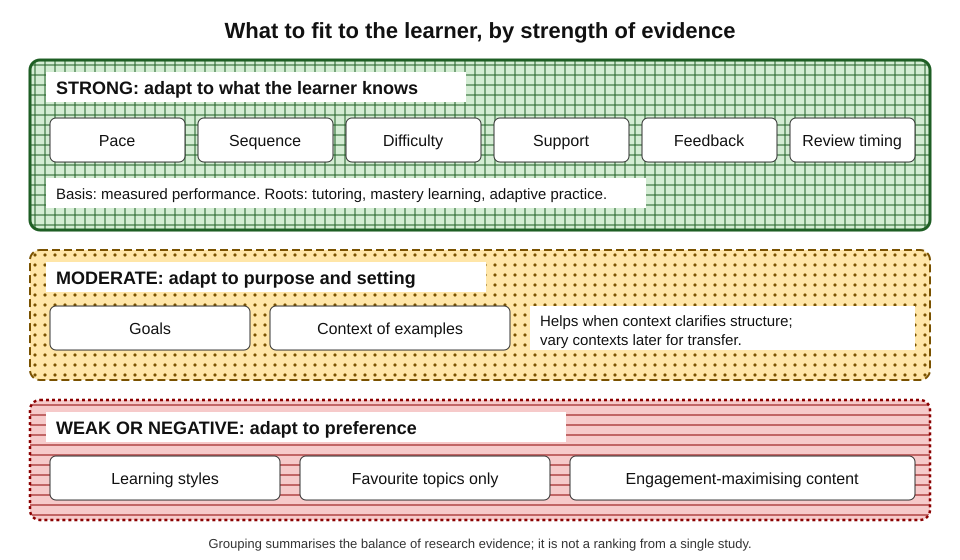
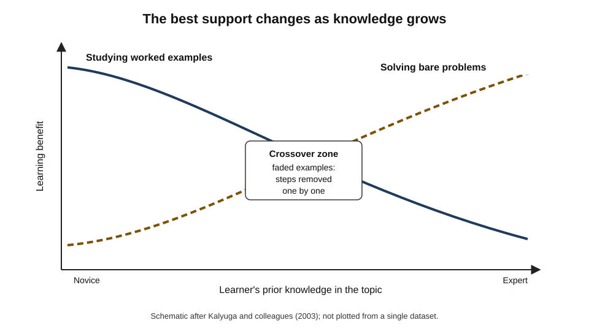
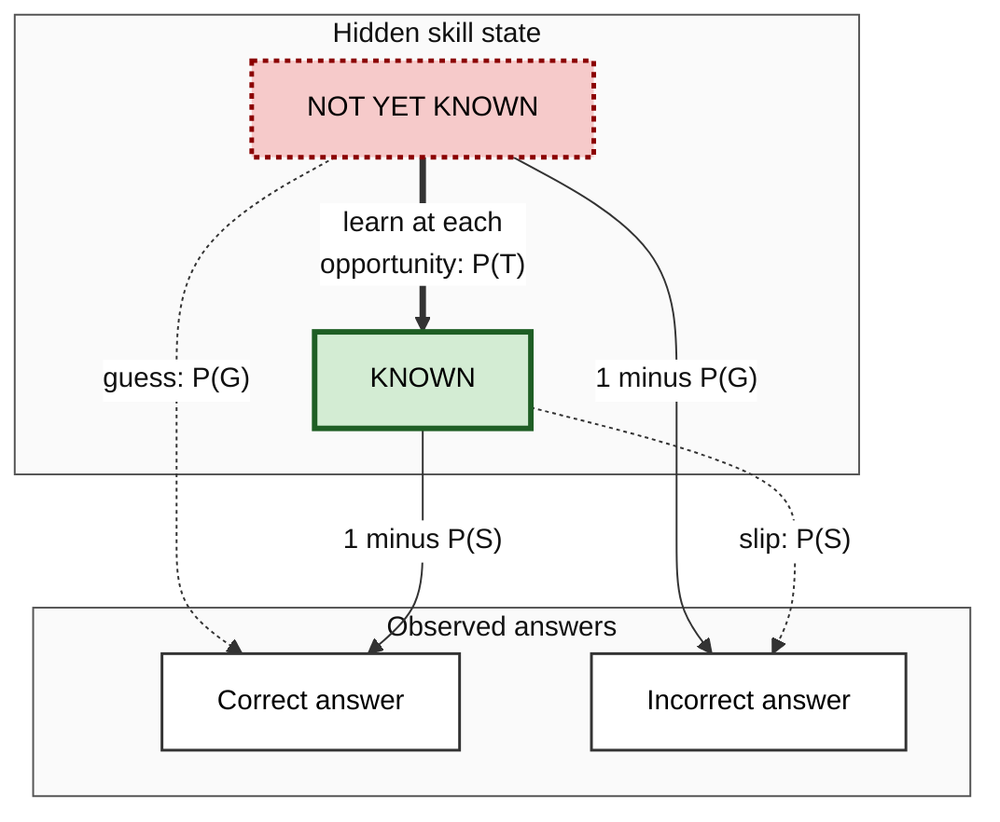
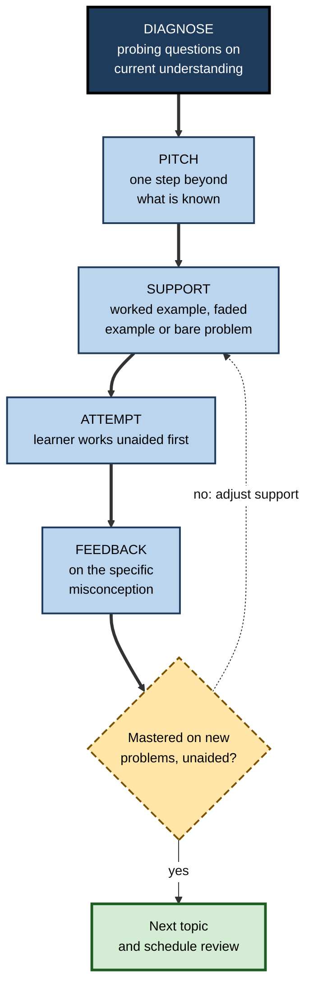
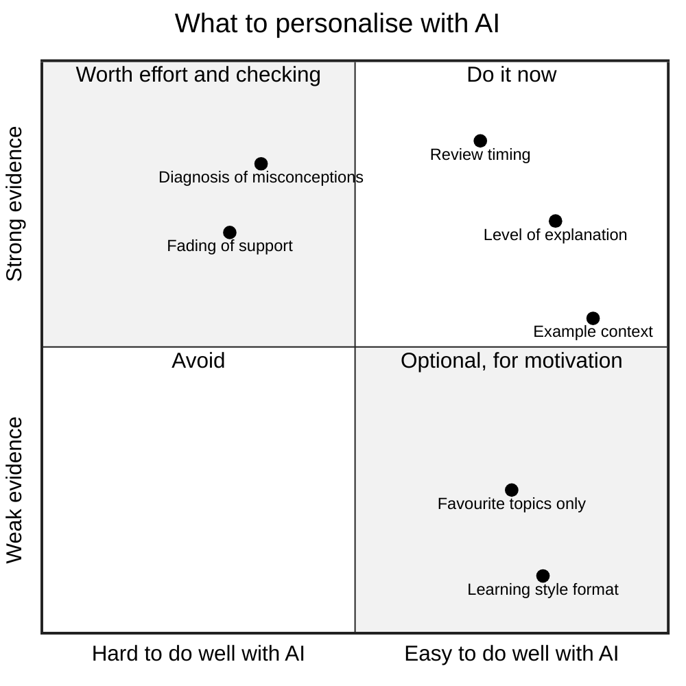

# G.3. Personalized Learning With AI

Two new hires sit through the same three-hour data-protection workshop. One studied information law at university and spends the session answering email; the other has never heard of a lawful basis for processing and is lost by the second slide. The workshop failed both: one was taught what she already knew, the other too much too fast. Fitting instruction to the person is one of the oldest ambitions in education, and AI has made it cheap.

> **Definition — Personalised learning:** instruction in which the pace, sequence, difficulty, support, examples or feedback adjust to an individual learner's current knowledge, goals and needs.

**Why it matters**

- What a learner **already knows** is the strongest single predictor of what they will learn next; one-size instruction ignores it.
- One-to-one tutoring — the most personalised form of teaching — has long been among the most effective, but was affordable only for a few.
- AI can now diagnose, adapt and generate tailored material for anyone, at almost no marginal cost.
- But "personalisation" is also one of the most abused words in education technology: some popular forms have **no evidence** behind them, and some actively harm learning.

---

## What Can Be Personalised

### Eight dimensions

- **Pace** — how fast the learner moves on.
  - *e.g.* staying on a topic until mastered rather than moving on with the class.
- **Sequence or path** — which topic comes next.
  - *e.g.* skipping known material; detouring to a missing prerequisite.
- **Difficulty** — the challenge level of practice.
  - *e.g.* problems just beyond current reach.
- **Support** — how much scaffolding, hinting or worked guidance is given.
  - *e.g.* full worked examples for a novice; bare problems for an expert.
- **Context of examples** — the setting in which ideas are illustrated.
  - *e.g.* explaining probability through cricket for one learner, through clinical trials for another.
- **Feedback** — what is commented on, and how.
  - *e.g.* targeting the specific misconception behind an error.
- **Timing of review** — when material comes back.
  - *e.g.* items scheduled by each learner's own forgetting.
- **Goals** — what the learning is for.
  - *e.g.* the same accounting topic taught for a future auditor and for a start-up founder.

**Figure 1.** Dimensions along which instruction can be fitted to a learner, grouped by how strongly evidence supports them.

> **Key point:** the dimensions with the strongest evidence adjust instruction to what the learner **knows** — pace, sequence, difficulty, support, feedback and review. Adjusting to what the learner **prefers** has far weaker support.

---

## The Ideas Behind Personalisation

### Prior knowledge

- **David Ausubel (1968):** "The most important single factor influencing learning is what the learner already knows. Ascertain this and teach him accordingly."
- **Implication:** personalisation starts with **diagnosis**. Without a good estimate of current knowledge, adaptation is guesswork.

### Mastery learning

- **Benjamin Bloom (1968)** proposed that most students could reach high standards if given enough time and corrective feedback.
  - Teach a unit → formative test → corrective activities for those who have not mastered it → retest → move on only when mastered.
- **Bloom (1984), the "2 sigma problem":** studies by his students found that tutored students performed about two standard deviations above conventionally taught students; Bloom challenged researchers to find group methods as effective.
  - Later analyses suggest the typical tutoring advantage is **smaller** than two standard deviations — but still substantial.

> **Definition — Mastery learning:** an approach in which learners advance only after demonstrating a set standard on the current unit, with corrective instruction for those who have not yet reached it.

### The zone of proximal development and scaffolding

- **Lev Vygotsky (1930s):** the **zone of proximal development** is the gap between what a learner can do alone and what they can do with guidance.
- **David Wood, Jerome Bruner and Gail Ross (1976):** **scaffolding** — temporary support from a tutor that is reduced as competence grows.
  - Tutors recruited interest, simplified the task, kept direction, marked critical features, controlled frustration and demonstrated.

> **Definition — Zone of proximal development (ZPD):** the range of tasks a learner cannot yet do alone but can do with guidance.

> **Definition — Scaffolding:** temporary, adjustable support that enables a learner to complete a task beyond their current independent ability, and that is withdrawn as they improve.

### The expertise reversal effect

- **Slava Kalyuga, Paul Ayres, Paul Chandler and John Sweller (2003):** instructional methods that help novices — detailed worked examples, integrated explanations — can **hinder** more knowledgeable learners, for whom the guidance is redundant and adds load.
- **Consequence:** the right amount of support **changes** as the learner improves; static instruction is wrong for someone at almost every point.

**Figure 2.** The expertise reversal effect: worked examples help novices most, while problem-solving practice becomes better as knowledge grows.

> **Definition — Expertise reversal effect:** the finding that instructional support beneficial for novices becomes neutral or harmful for learners with more expertise.

> **Remember:** personalise **to knowledge**, adjust **as knowledge grows**, and **withdraw support** in step with competence.

---

## Personalisation That Does Not Work

### Learning styles

- **The claim:** people learn better when taught in their preferred "style" — visual, auditory, kinaesthetic and so on.
- **The test:** Harold Pashler, Mark McDaniel, Doug Rohrer and Robert Bjork (2008) set out the evidence a valid test would need — learners classified by style, randomly assigned to matched or mismatched instruction, with a **crossover** interaction in results.
  - They found almost no studies with such a design that supported the claim, and several that contradicted it.
- **What does matter:** the best modality depends on the **content** (a map is best shown, a pronunciation best heard), not the learner's preference.

> **Watch out:** many AI products advertise "personalisation to your learning style". There is no good evidence this improves learning. An AI that asks "are you a visual learner?" and adapts accordingly is personalising on a myth.

### Personalising to preference rather than need

- **Learners prefer what feels easy** — re-reading over testing, massed over spaced practice, explanations over attempts.
  - An AI that adapts to stated preferences or to engagement metrics will drift towards **less effective** methods.
- **Engagement optimisation** — systems tuned to time-on-platform or satisfaction can reward entertaining but shallow content.
- **Seductive details** — interesting but irrelevant material inserted to engage learners can **reduce** learning by drawing attention away from the core ideas (Shannon Harp and Richard Mayer, 1998).
- **Narrowing** — always choosing what a learner is interested in can trap them in a comfortable subset and leave gaps.

> **Definition — Seductive details:** interesting but irrelevant additions to instructional material that tend to impair learning of the central content.

| | Personalisation to knowledge | Personalisation to preference |
|---|---|---|
| What adapts | Pace, path, difficulty, support, review | Format, style, topics the learner likes |
| Basis | Measured performance | Stated likes; engagement data |
| Evidence | Substantial (tutoring, mastery, adaptive practice) | Weak to negative (learning styles) |
| Typical risk | Inaccurate diagnosis | Drift towards ease and entertainment |
| Best use | Core of any adaptive design | Motivation, if it does not displace effort |

---

## How Machines Model a Learner

### The learner model

> **Definition — Learner model (student model):** a system's representation of what a particular learner knows, misunderstands and can do, updated from their responses.

- **Overlay model** — the learner's knowledge is a subset of the expert's; each skill is marked as known or not yet known.
- **Bug or misconception model** — specific wrong ideas are represented, so that errors can be diagnosed, not just counted.
  - *e.g.* John Seely Brown and Richard Burton (1978) catalogued systematic "bugs" in children's subtraction, such as always subtracting the smaller digit from the larger.
- **Probabilistic models** — the system holds a **probability** that each skill is known and updates it with every answer.

### Bayesian knowledge tracing

- **Albert Corbett and John Anderson (1995)** introduced **Bayesian knowledge tracing (BKT)** for cognitive tutors. Each skill has four parameters:
  - **P(L₀)** — probability the skill is already known before practice;
  - **P(T)** — probability of learning it at each practice opportunity;
  - **P(G)** — probability of a correct answer by **guessing** when not known;
  - **P(S)** — probability of an incorrect answer by **slipping** when known.
- After each answer, the system updates its estimate that the skill is known, then adds the chance of learning from that opportunity.
- When the estimate passes a threshold (often 0.95), the skill is treated as **mastered** and practice moves on.

> **Formula — BKT update after a correct answer:** P(L | correct) = P(L) × (1 − P(S)) ÷ [P(L) × (1 − P(S)) + (1 − P(L)) × P(G)]; then P(L)new = P(L | correct) + (1 − P(L | correct)) × P(T).

**Worked example — one correct answer**

- Starting estimate P(L) = 0.30; guess 0.20; slip 0.10; learning 0.20.
1. Evidence step: 0.30 × 0.90 = 0.27; 0.70 × 0.20 = 0.14; 0.27 ÷ (0.27 + 0.14) = **0.66**.
2. Learning step: 0.66 + (1 − 0.66) × 0.20 = 0.66 + 0.07 = **0.73**.
- After an **incorrect** answer the evidence step instead gives 0.30 × 0.10 ÷ (0.30 × 0.10 + 0.70 × 0.80) = 0.03 ÷ 0.59 = **0.05**, then the learning step raises it to about **0.24**.
- **Interpretation:** one correct answer is strong but not conclusive evidence; the guess and slip parameters stop a single lucky or careless response from deciding mastery.

**Figure 3.** Bayesian knowledge tracing: a hidden skill state inferred from observed answers.

### Later models

- **Item response theory** — models the probability of a correct answer from the learner's ability and the item's difficulty; used in computer-adaptive testing, where each question is chosen to be maximally informative about the learner.
- **Elo-style ratings** — borrowed from chess: learner and item ratings rise and fall after each encounter; simple and widely used in adaptive practice systems.
- **Deep knowledge tracing** — Chris Piech and colleagues (2015) used recurrent neural networks to predict performance across many skills at once; later work found that well-tuned simpler models often perform comparably, so the gain from complexity is debated.
- **Language-model learner models** — a generative tutor can infer, from conversation, what the learner seems to know; the inference is flexible but **unreliable and unauditable**, and it disappears between sessions unless memory is used.

> **Definition — Computer-adaptive testing:** testing in which each question is selected according to the learner's previous answers, so that ability is estimated precisely with fewer questions.

> **Watch out:** a chatbot "remembering" a learner's level is not a calibrated learner model. It may confidently treat a learner as expert after one good answer, or forget a recurring misconception.

---

## Personalisation With Generative AI

### What generative models add

- **Unlimited tailored content** — explanations, examples and problems written for one learner, on demand.
- **Diagnosis through dialogue** — open questions and explanations reveal misconceptions that multiple-choice items miss.
- **Context personalisation** — examples set in the learner's job, sector or interests.
- **Language and register** — explanation in the learner's first language or at a chosen reading level.
- **Goal-shaped instruction** — the same topic taught for different professional uses.

### Context personalisation: the evidence

**Study card — Candace Walkington (2013)**

- **Setting:** secondary-school students learning algebra with a cognitive tutor.
- **Design:** some students received word problems rewritten to match interests they had reported — sport, music, games, social media; others received the standard problems.
- **Results:**
  - students with personalised problems performed better on those problems;
  - the benefit was greatest for students who were **struggling**, and some carried over to later, non-personalised units.
- **Conclusion:** connecting abstract content to familiar contexts can aid understanding and engagement — provided the mathematics itself is unchanged.

- **Earlier evidence** — Diana Cordova and Mark Lepper (1996) found that personalising and contextualising a maths learning game increased both motivation and learning.
- **Generative AI** makes such rewriting effortless, so the main questions become **quality** (is the mathematics still right?) and **relevance** (is the context genuinely illuminating or merely decorative?).

> **Example (illustrative):** a nurse learning statistics asks for every example to be set in ward data — infection rates, length of stay, medication errors. The concepts are identical; the familiar setting frees attention for the statistical idea itself.

> **Watch out:** context personalisation helps when the context makes the **structure** of the problem clearer; it hurts when it adds seductive detail or when the learner later fails to recognise the same structure in an unfamiliar setting. Vary contexts once the idea is grasped.

### Adapting level and support

- **Diagnose first** — ask the AI to probe current understanding with a few questions before explaining anything.
- **Pitch at the edge** — request explanations one step beyond what the learner can already do.
- **Shift support with expertise:**
  - novice → worked examples with self-explanation prompts;
  - intermediate → partially completed examples ("fading");
  - advanced → bare problems, then critique.
- **Re-diagnose** — periodically ask for a fresh assessment rather than trusting the AI's earlier impression.

> **Watch out:** a diagnosis is only as good as the questions behind it. If the AI probes only with recognition questions ("which of these is correct?"), it will overestimate knowledge; ask it to use open questions, explanations and transfer problems, which reveal misconceptions that recognition hides.

### Personalised feedback

Feedback is where personalisation most directly changes learning, and also where it most often goes wrong.

- **Feedback is powerful but variable.**
  - Avraham Kluger and Angelo DeNisi (1996), reviewing over 600 effect sizes, found feedback improved performance on average — yet in about **a third** of cases it made performance **worse**.
  - Feedback harmed most when it directed attention to the **self** (praise, criticism, comparison) rather than to the **task** and how to improve it.
  - A 2020 meta-analysis by Benedikt Wisniewski, Klaus Zierer and John Hattie found a medium average effect, largest for feedback containing rich **task, process and self-regulation** information.
- **What AI can personalise in feedback:**
  - the **specific error** in this learner's work, not a generic comment;
  - the **likely misconception** behind it;
  - the **next step** pitched at the learner's level;
  - the **amount** of feedback, so that the most important point is not buried.
- **What AI tends to get wrong:**
  - **over-praise** — sycophantic encouragement that reads as self-focused feedback;
  - **over-correction** — dozens of comments, all treated as equally important;
  - **fixing instead of telling** — rewriting the work, which removes the learner's chance to revise it.

> **Definition — Task-focused feedback:** information about the work and how to improve it, as opposed to judgements about the person who produced it.

| | Generic AI feedback | Personalised, task-focused feedback |
|---|---|---|
| Focus | "Great work, a few suggestions" | The two errors that matter most in this draft |
| Diagnosis | Lists surface issues | Names the misconception causing them |
| Level | Same for every learner | Pitched at what this learner can act on next |
| Form | Rewritten text or code | A hint or question; the learner revises |
| Effect on learning | Polished product; little change in the learner | Revision skill and understanding improve |

> **In practice:** ask for feedback in the form "the single most important problem, why it matters, and a question that will help me fix it myself" — then revise before asking for more.

### Personalising for motivation

- **Self-determination theory** (Edward Deci and Richard Ryan) holds that motivation is sustained when three needs are met:
  - **autonomy** — a sense of choice and ownership;
  - **competence** — a sense of making progress at a manageable challenge;
  - **relatedness** — a sense of connection to others.
- **Choice helps, within limits** — a meta-analysis by Erika Patall, Harris Cooper and Jorgianne Robinson (2008) found that offering choice generally increased intrinsic motivation and effort, though too many options reduced the benefit.
- **AI and motivation:**
  - autonomy — the learner chooses topics, contexts and pace;
  - competence — tasks pitched at the edge of ability give frequent experiences of progress;
  - relatedness — the weak point: an AI partner is not a community, and over-reliance on it may displace human learning relationships.

> **Watch out:** motivation features that work by flattering the learner or gamifying trivial actions can raise engagement without raising learning. Motivation should serve effortful practice, not replace it.

**Figure 4.** An adaptive learning loop that a learner can run with an AI tutor.

---

## Personalised Pathways at Work

### Workplace systems

- **Learning experience platforms** in many organisations recommend courses, articles and videos based on role, stated interests, peers' activity and inferred skills.
- **Skills inference** — some systems estimate an employee's skills from their job history, projects and documents, then suggest learning to close gaps.
- **Adaptive compliance training** — a pre-assessment lets employees **test out** of modules they already master, saving time while targeting real gaps.

> **Watch out:** recommendation engines often optimise **clicks and completions**, which favours popular, short, easy content. A recommendation is not a diagnosis.

| | Recommendation by popularity | Diagnosis-based adaptation |
|---|---|---|
| Input | What similar people clicked or completed | What this person can and cannot do |
| Output | Courses and content to browse | Specific practice targeted at gaps |
| Strength | Discovery of new material | Efficient closure of real gaps |
| Weakness | Rewards easy, popular content | Needs good assessment items |
| Evidence of learning | Rarely measured | Built into the loop |

### Case study (illustrative): adaptive compliance training in a bank

- **Situation:** a bank required 8,000 staff to complete four hours of annual anti-money-laundering training; completion was high, but internal audits kept finding the same errors in suspicious-activity reporting.
- **Problem:** experienced staff resented repeating known material and clicked through; newer staff passed the end quiz by recognition without understanding the reporting thresholds.
- **Actions:**
  1. replaced the linear course with an **adaptive pre-assessment** of scenario questions mapped to twelve skills;
  2. staff who demonstrated mastery of a skill **skipped** its module;
  3. gaps triggered short scenario practice with feedback on the specific misjudgement;
  4. an AI tutor, restricted to the bank's own policy documents, answered follow-up questions and generated new cases in each employee's business line;
  5. a delayed scenario test three months later checked retention.
- **Result:** average training time fell by more than half; the most common audit errors declined over the following year; staff satisfaction rose.
- **Side effects:** the item bank needed constant refreshing as staff shared answers; a few skills proved hard to assess with scenarios.
- **Lesson:** personalisation that **starts with diagnosis** and **ends with delayed testing** saved time and improved behaviour; personalisation of format alone would have done neither.

---

## Running Personalisation for Oneself

### A learner brief

Generative tools personalise only as well as they are briefed. A short, maintained **learner brief** pasted at the start of each session gives continuity.

- **Goal** — the unaided performance wanted, and by when.
- **Current knowledge** — what is secure, what is shaky, what is new.
- **Known misconceptions** — errors found in earlier sessions.
- **Preferred contexts** — the work setting in which examples help most.
- **Rules** — attempt first; hints before answers; diagnose before explaining.
- **Next review** — which items are due.

> **Example — a learner brief for financial modelling:** "Goal: build a three-statement model for a mid-sized manufacturer unaided in eight weeks. Secure: income statement, basic Excel. Shaky: working capital, deferred tax. Misconception found: I treat depreciation as a cash outflow. Contexts: manufacturing. Rules: probe before explaining; no full solutions until I attempt."

| | Unbriefed session | Briefed session |
|---|---|---|
| First AI move | Generic explanation | Probing questions on shaky areas |
| Level | Guessed, often wrong | Set by evidence from earlier sessions |
| Examples | Generic | In the learner's sector |
| Misconceptions | Rediscovered or missed | Targeted from the start |
| Continuity | None | Builds on previous sessions |

> **In practice:** update the brief after each session in one or two lines — what was mastered, what error appeared. The update is itself a short act of retrieval and reflection.

> **Watch out:** a learner brief is personal data. Avoid including confidential employer information, and check what the tool stores and how it is used.

### Balancing personalisation with challenge

- **Do not personalise away difficulty** — spacing, interleaving and retrieval feel harder and work better; an AI asked to make things "easier" may remove them.
- **Mix contexts** — once a concept is grasped in a familiar setting, practise it in unfamiliar ones to build transfer.
- **Keep some common curriculum** — professional fields have shared knowledge that everyone must hold, whatever their interests.

**Figure 5.** Which aspects of instruction are worth personalising, by strength of evidence and ease of doing so with AI.

---

## Open Questions

- **Can generative tutors diagnose reliably?**
  - Dialogue reveals rich evidence, but whether models infer misconceptions as accurately as validated assessments is largely untested.
- **How much personalisation is too much?**
  - Shared curricula, common examples and peer learning have value that individual paths may erode.
- **Who controls the learner model?**
  - Persistent AI memory raises questions of privacy, accuracy and the learner's right to inspect and correct what is held about them.
- **Does context personalisation transfer?**
  - Learners taught in familiar contexts may struggle to recognise the same structure elsewhere; the balance is not well understood.
- **Will personalisation widen gaps?**
  - Self-directed, knowledgeable learners brief tools well and benefit most; less confident learners may not.

---

## Summary

- **Personalised learning** adjusts pace, sequence, difficulty, support, examples, feedback, review timing and goals to the individual.
- Strongest evidence: personalising to **knowledge** — rooted in **Ausubel** (prior knowledge), **Bloom** (mastery learning, the 2 sigma tutoring advantage), **Vygotsky** (ZPD), **Wood, Bruner and Ross** (scaffolding) and the **expertise reversal effect**.
- Weak or negative evidence: personalising to **learning styles** (Pashler and colleagues, 2008) or to preference and engagement, which drifts towards ease and **seductive details**.
- **Learner models**: overlay, misconception and probabilistic models; **Bayesian knowledge tracing** updates the probability of mastery from correct and incorrect answers using guess, slip and learning parameters; IRT, Elo and deep knowledge tracing extend it.
- **Generative AI** adds unlimited tailored content, dialogue-based diagnosis and **context personalisation** (Walkington, 2013), but its implicit learner models are unreliable.
- **Personalised feedback** works when it is **task-focused**, specific and pitched at the next step; AI tends to over-praise, over-correct and rewrite. Motivation is supported through **autonomy, competence and relatedness**, the last being AI's weak point.
- At work, **diagnosis-based** adaptation (test-out, targeted practice, delayed testing) beats **popularity-based** recommendation.
- For oneself: maintain a **learner brief**, diagnose before explaining, shift support as expertise grows, vary contexts, and never personalise away desirable difficulty.

---

## Self-Check

1. Define personalised learning and list the eight dimensions along which instruction can be personalised.
2. Which dimensions have the strongest evidence, and what do they have in common?
3. Explain Ausubel's principle and its implication for AI tutoring.
4. What is mastery learning, and what was Bloom's 2 sigma problem?
5. Define the zone of proximal development and scaffolding, and explain how they relate.
6. Describe the expertise reversal effect and its consequence for static instruction.
7. Why is personalisation to learning styles not supported? What evidence would be needed?
8. Explain why an AI that personalises to a learner's preferences may reduce learning.
9. Using BKT with P(L) = 0.5, P(G) = 0.25, P(S) = 0.1 and P(T) = 0.1, compute the updated estimate after one correct answer.
10. Why is a chatbot's memory of a learner's level not equivalent to a learner model?
11. Summarise Walkington's 2013 study and state one risk of context personalisation.
12. Contrast popularity-based recommendation with diagnosis-based adaptation in workplace learning.
13. Write a learner brief for a skill you are developing, and explain how it should change over time.
14. An edtech vendor offers "AI that adapts to each employee's learning style and favourite topics". Evaluate the offer and suggest what to ask for instead.

### Answer Key

1. Instruction whose pace, sequence, difficulty, support, examples or feedback adapt to the learner. Dimensions: pace, sequence, difficulty, support, context of examples, feedback, review timing, goals.
2. Pace, sequence, difficulty, support, feedback and review — all adjust to what the learner currently knows, measured by performance.
3. What the learner already knows is the strongest influence on learning, so instruction should start by diagnosing it. An AI tutor should probe before explaining.
4. Advancing only after demonstrating mastery of each unit, with corrective instruction. Bloom reported tutored students about two standard deviations above classroom-taught students and challenged researchers to match that in groups; later estimates of the tutoring advantage are smaller.
5. ZPD: tasks possible with guidance but not yet alone. Scaffolding: temporary support enabling work within the ZPD, withdrawn as competence grows.
6. Support that helps novices (detailed worked examples) becomes redundant or harmful for more expert learners, so fixed instruction is mis-pitched for most learners most of the time.
7. Properly designed tests — learners classified by style, randomly assigned to matched or mismatched instruction, showing a crossover interaction — have almost never supported it. The best modality depends on content, not preference.
8. Learners prefer methods that feel easy and engaging; adapting to preference drifts towards re-reading, entertainment and seductive details and away from effortful, effective practice.
9. Evidence step: 0.5 × 0.9 = 0.45; 0.5 × 0.25 = 0.125; 0.45 ÷ 0.575 = 0.78. Learning step: 0.78 + 0.22 × 0.1 = 0.80.
10. It is an informal, uncalibrated impression from conversation, which may overreact to one answer, miss recurring errors and vanish between sessions; a learner model is a systematic, updated estimate per skill.
11. Algebra word problems personalised to students' interests improved performance, especially for struggling students, with some carry-over. Risk: decorative context adds seductive detail or limits transfer to unfamiliar settings.
12. Popularity-based systems suggest what others clicked, favouring easy content and rarely measuring learning; diagnosis-based systems assess what the person can do and target practice at gaps, with learning measured in the loop.
13. A good brief states goal, secure and shaky knowledge, misconceptions found, useful contexts, rules and next reviews; it is updated after each session as skills are mastered and new errors appear.
14. Learning styles lack evidence and favourite-topic adaptation risks narrowing and ease. Ask instead for diagnostic pre-assessment, test-out, targeted practice on gaps, fading support, spaced review and delayed measurement of learning.

---

## Glossary

| Term | Meaning |
|---|---|
| Bayesian knowledge tracing | A model updating the probability that a skill is known after each answer, using guess, slip and learning parameters. |
| Computer-adaptive testing | Testing that chooses each question according to earlier answers. |
| Context personalisation | Setting examples and problems in contexts familiar to the learner. |
| Deep knowledge tracing | Neural-network models predicting performance across many skills. |
| Expertise reversal effect | Support that helps novices hinders more expert learners. |
| Item response theory | Models of correct-answer probability from learner ability and item difficulty. |
| Learner brief | A short, maintained summary of a learner's goal, knowledge, errors and rules, given to an AI tutor each session. |
| Learner model | A system's representation of what a learner knows and misunderstands. |
| Learning styles | The unsupported claim that matching instruction to preferred sensory style improves learning. |
| Mastery learning | Advancing only after demonstrating a standard on the current unit. |
| Overlay model | A learner model marking which parts of expert knowledge the learner has. |
| Personalised learning | Instruction adapted to an individual's knowledge, goals and needs. |
| Scaffolding | Temporary support withdrawn as competence grows. |
| Seductive details | Interesting but irrelevant additions that impair learning. |
| Self-determination theory | The theory that motivation depends on autonomy, competence and relatedness. |
| Task-focused feedback | Feedback about the work and how to improve it, not about the person. |
| Zone of proximal development | Tasks a learner can do with guidance but not yet alone. |
