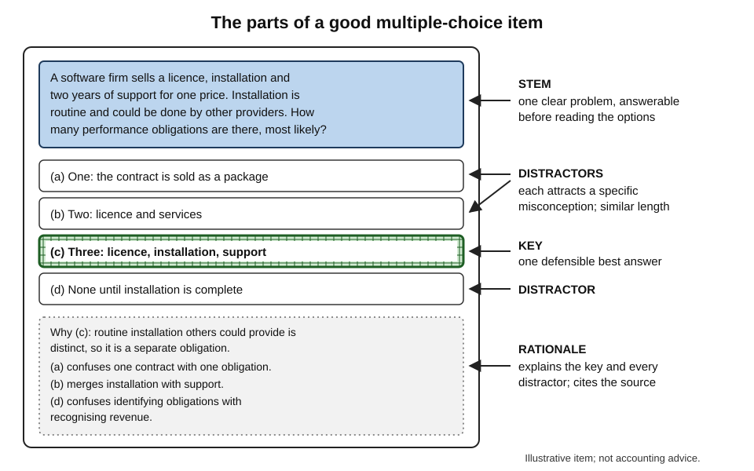
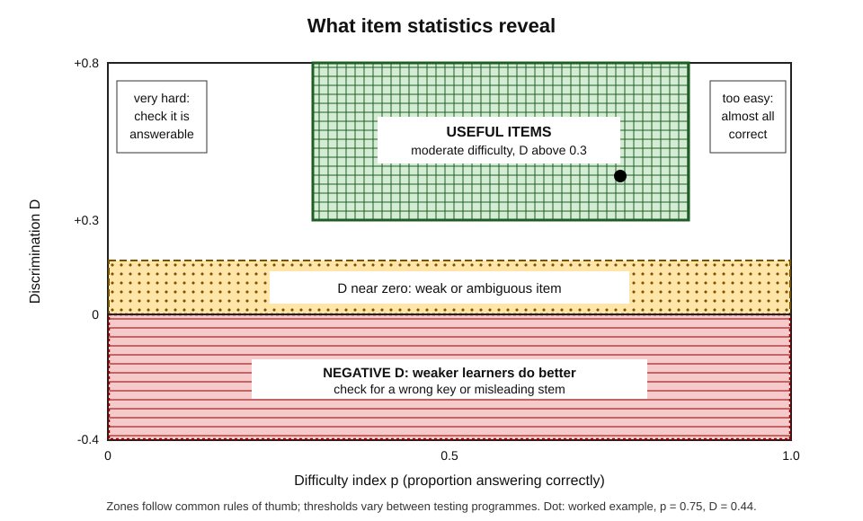
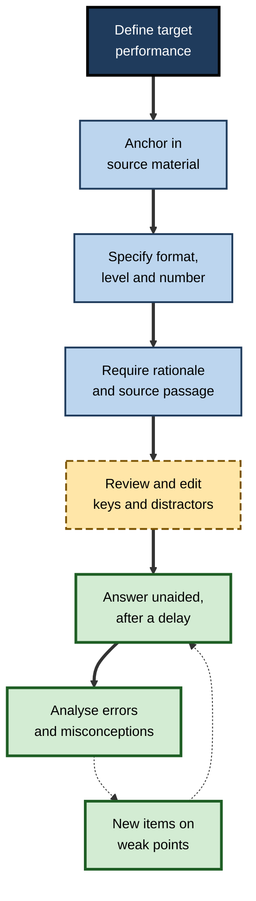
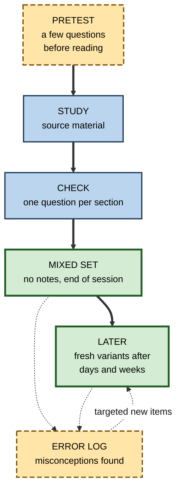
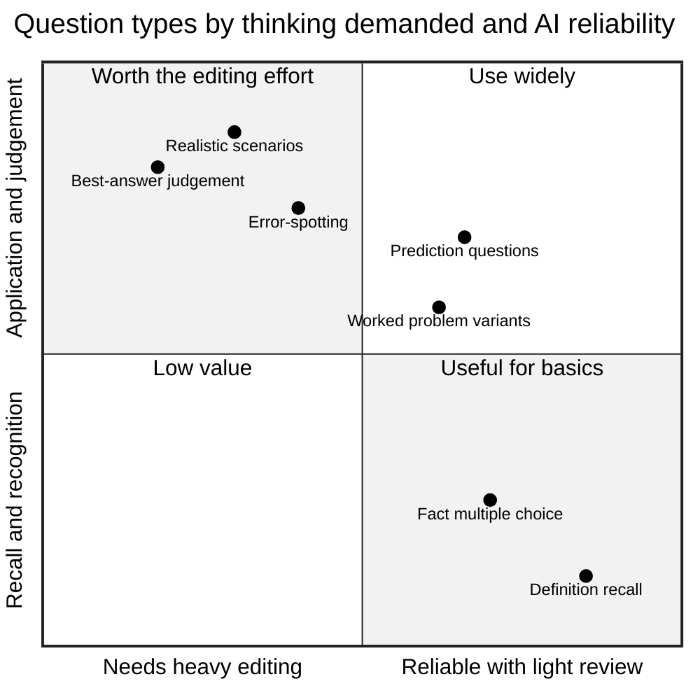

# G.4. AI-Generated Practice Questions

A trainee accountant uploads her revision notes on revenue recognition and asks an AI assistant for fifty multiple-choice questions. She answers them all and scores 92%, then struggles in the examination: the questions had tested definitions she could recognise, three keys were wrong, and none asked her to apply the standard to a messy contract. Practice questions are powerful learning tools — but only if the questions are **good**.

> **Definition — AI-generated practice question:** a question, problem or task produced by an AI system for a learner to answer from memory or reasoning, with an answer key or model answer and, ideally, feedback explaining it.

**Why it matters**

- Answering questions from memory produces more durable learning than re-reading the same material; until recently, the bottleneck was the **effort of writing** good questions.
- AI removes that bottleneck: questions on any material, at any level, in any quantity, in seconds.
- It also introduces new risks — wrong keys, trivial items, clueing, over-production — that can quietly make practice less effective or even teach errors.
- Judging and improving AI-generated questions is therefore a core skill for any self-directed learner, trainer or assessor.

---

## Why Practice Questions Work

### Three mechanisms

- **Retrieval** — answering from memory strengthens the memory and makes it more accessible later, an effect documented for over a century and repeatedly confirmed in classrooms and workplaces.
- **Diagnosis** — a wrong answer shows exactly what is not yet known, so study time can be targeted.
- **Pretesting** — answering questions **before** studying, even when most answers are wrong, can improve later learning of the material.
  - Lindsey Richland, Nate Kornell and Liche Sean Kao (2009) found that attempting to answer questions on a text before reading it improved later recall of the tested information compared with simply studying longer.

> **Definition — Pretesting effect:** the finding that attempting to answer questions before learning the material, even unsuccessfully, improves later learning of it.

### Matching practice to the target

- **Transfer-appropriate processing** — C. Donald Morris, John Bransford and Jeffery Franks (1977) showed that memory performance depends on how well the processing during learning matches the processing demanded at test.
- **Implication:** questions must demand the same kind of thinking as the real performance.
  - A pharmacist who must spot dangerous interactions in prescriptions needs prescription-based questions, not definitions of interaction types.
  - A project manager who must handle scope creep needs scenario questions, not lists of change-control steps.

> **Definition — Transfer-appropriate processing:** the principle that learning is best demonstrated when the mental processes required at test match those used during learning.

> **Key point:** the value of a practice question lies less in its correctness format than in **what thinking it forces**. Recognition questions force recognition; application questions force application.

---

## The Anatomy of a Good Question

### Parts of a multiple-choice item

- **Stem** — the question or problem, ideally answerable without seeing the options.
- **Key** — the single correct or best answer.
- **Distractors** — plausible wrong options, ideally based on **real misconceptions**.
- **Rationale** — an explanation of why the key is right and each distractor wrong.

**Figure 1.** The anatomy of a well-constructed multiple-choice item.

### Item-writing principles

**Thomas Haladyna, Steven Downing and Michael Rodriguez (2002)** reviewed textbooks and research to set out widely used item-writing guidelines. Among the most important:

- **One clear problem in the stem** — the learner should know what is asked before reading the options.
- **Plausible distractors** — each wrong option should attract someone with a specific misunderstanding.
- **Similar length and grammar across options** — the longest, most qualified option should not be the key.
- **No "all of the above"** — it rewards partial knowledge; use "none of the above" sparingly.
- **Avoid negatives** — "Which is NOT…" adds reading load and confusion; if used, emphasise the negative.
- **No clues** — no grammatical mismatches, repeated words from the stem or absolute terms ("always", "never") that give the answer away.
- **Test important content** — not trivia, page numbers or exact wording.

> **Watch out:** AI-generated items very often violate the length and clueing rules — the key is the longest, most carefully qualified option, and distractors are obviously wrong. A test-savvy learner can then score well without knowing the content, which inflates confidence.

### Levels of thinking

- Questions can target any level of the revised Bloom's taxonomy:
  - **remember** — "Which standard governs revenue from contracts with customers?";
  - **understand** — "Why must performance obligations be identified before price is allocated?";
  - **apply** — "Given this software contract with installation and two years' support, how many performance obligations are there?";
  - **analyse** — "Which features of this contract suggest the installation is not distinct?";
  - **evaluate** — "Was the finance team's timing of revenue defensible? Justify.";
  - **create** — "Draft the revenue-recognition note for this contract."
- AI defaults strongly towards **remember** and **understand** unless asked otherwise.

| Question format | Thinking it best tests | AI strength | AI risk |
|---|---|---|---|
| Multiple choice | Recognition; with care, application and discrimination | Fast to generate many | Weak distractors; wrong keys; clueing |
| Short answer and free recall | Recall without cues | Easy to generate | Marking requires a clear model answer |
| Scenario or case | Application, analysis, judgement | Rich, varied contexts | Unrealistic details; ambiguous best answer |
| Error-spotting | Discrimination; debugging | Can plant specific errors | May plant errors that are not errors |
| Explain-why | Understanding; self-explanation | Good prompts | Marking explanations is less reliable |
| Worked problem | Procedural skill | Unlimited variants | Arithmetic or logic slips in solutions |

---

## What Research Says About AI-Generated Questions

### Quality

- **Systematic evidence** — a 2025 systematic review and network meta-analysis of studies using large language models to write multiple-choice questions for health-professions education concluded that GPT-4-class models could produce questions of quality broadly similar to human-written items, whereas earlier and smaller models (such as GPT-3.5 and Llama 2) produced worse items.
  - Only about a third of the included studies compared AI items directly with human items, and only about half actually gave the questions to students.
- **Psychometric comparisons** — several studies in medical specialties, including a 2026 study in imaging, found no significant difference in **difficulty** or **discrimination** between AI-generated and expert-written items once the AI items had been reviewed.
- **Student performance** — some studies found students scored **lower** on AI-assisted items than on human-written ones (one classroom study reported scores about 9% lower), which may reflect harder items, more ambiguous items, or both.

> **Watch out:** "comparable quality" in these studies usually means quality **after expert review and editing**, in a domain with well-defined content. Raw output on unfamiliar material, reviewed by a learner who is still learning it, is a different matter.

### Common flaws

- **Wrong or disputable keys** — the "correct" answer is wrong, or two options are defensible.
- **Factual errors in stems or rationales** — fluent but false statements.
- **Implausible distractors** — options no informed person would choose, making items too easy.
- **Clueing** — the key is longest, most specific or echoes the stem.
- **Low cognitive level** — definition and recall items dominate.
- **Near-duplicates** — the same idea tested many times in slightly different words.
- **Drift from the source** — questions on material not in the supplied text, sometimes from the model's general knowledge, sometimes invented.
- **Over-production** — hundreds of items where twenty well-chosen ones would do.

### Measuring item quality

> **Definition — Item difficulty index (p):** the proportion of test-takers who answer an item correctly; high values mean easy items.

> **Definition — Discrimination index (D):** how well an item separates stronger from weaker test-takers, often the proportion correct in the top-scoring group minus the proportion correct in the bottom-scoring group.

> **Formula — Difficulty and discrimination:** p = number correct ÷ number of test-takers; D = p(upper group) − p(lower group). Example: in a cohort of 60, 45 answer correctly → p = 0.75. Of the top 16 scorers, 15 are correct (0.94); of the bottom 16, 8 are correct (0.50) → D = 0.94 − 0.50 = **0.44**, a well-discriminating item.

- **Rules of thumb:**
  - D above about 0.3 — good discrimination;
  - D near zero — the item does not separate learners and may be ambiguous;
  - **negative** D — weaker learners do better than stronger ones, which usually signals a **wrong key** or a misleading stem.
- **Distractor analysis** — a distractor chosen by almost nobody is not working; one chosen mostly by strong learners may in fact be correct.

**Figure 2.** Reading item statistics: which combinations of difficulty and discrimination signal a useful item, and which signal a problem.

> **In practice:** trainers who generate item banks with AI should pilot items, compute p and D, and inspect any item with low or negative discrimination before using it in assessment. A self-directed learner cannot compute these alone, but can watch for the same signals — an item that is answered correctly by guessing, or one on which careful reasoning keeps producing the "wrong" answer.

---

## Generating Good Questions With AI

### A workflow

1. **Define the target performance** — what the learner must be able to do, under what conditions.
2. **Anchor in a source** — supply the text, standard, policy or notes, and instruct the AI to use **only** that material.
3. **Specify format, level and number** — e.g. "eight scenario questions at the *apply* and *analyse* levels".
4. **Demand rationales and sources** — for every item, the reason the key is right, why each distractor is wrong, and the passage that supports it.
5. **Review and edit** — check keys against the source; strengthen distractors; delete trivia and duplicates.
6. **Answer unaided** — without notes or AI, ideally after a delay.
7. **Analyse errors** — for each wrong answer, identify the misconception; ask the AI for a new item targeting it.
8. **Refresh** — retire items answered correctly several times; generate new variants so that answers are not simply memorised.

**Figure 3.** A workflow for generating, checking and using AI practice questions.

> **Mnemonic — TARGET:** **T**arget performance, **A**nchor in a source, **R**equired format and level, **G**ive rationales, **E**dit before use, **T**est yourself unaided.

### Worked example: improving a generated item

A finance analyst studying the five-step revenue model in the international standard IFRS 15 asks for practice items.

**First attempt — default output**

- *Stem:* "What is the first step of the IFRS 15 five-step model?"
- *Options:* (a) Identify the contract with a customer; (b) Recognise revenue; (c) Pay the supplier; (d) Prepare a budget.
- **Problems:**
  - *remember* level only;
  - two distractors — (c) and (d) — are not part of the model at all, so the item is trivially easy;
  - tests the order of a list, not the use of the standard.

**Revised prompt**

- "Using only the attached summary of IFRS 15, write four multiple-choice questions at the *apply* level. Each must describe a realistic contract and ask a judgement the standard requires. Distractors must reflect common misunderstandings. Give the rationale for each option and quote the supporting sentence."

**Improved item**

- *Stem:* "A software firm sells a licence, installation and two years of support for one price. The installation is routine and could be performed by other providers. How many performance obligations does the contract most likely contain?"
- *Options:* (a) One — the contract is sold as a package; (b) Two — licence and services; (c) **Three — licence, installation and support**; (d) None until installation is complete.
- *Rationale:* routine installation that others could provide is generally **distinct**, so it is a separate obligation; (a) confuses a single contract with a single obligation; (b) wrongly merges installation and support; (d) confuses identifying obligations with recognising revenue.

| | Default item | Improved item |
|---|---|---|
| Bloom level | Remember | Apply |
| Distractors | Absurd | Based on real misconceptions |
| Matches real task? | No | Yes — judging contracts |
| Can be answered by elimination? | Yes | Not without understanding |
| Rationale | None | Explains every option, cites source |

> **Watch out:** the improved item is better but still **AI-written**. The analyst must confirm the rationale against the standard or a qualified colleague — especially the judgement that installation is "distinct", which depends on facts in real contracts.

### Building distractors from real misconceptions

The quality of a multiple-choice item depends above all on its distractors, and good distractors come from **how people actually get things wrong**.

1. **Ask for the misconceptions first** — "List the five most common misunderstandings learners have about performance obligations, with an example of each."
2. **Validate the list** — compare it with the learner's own error log, a teacher's experience or published guidance; discard misconceptions nobody really holds.
3. **Build one distractor per misconception** — each wrong option should be the answer a person holding that misconception would choose.
4. **Label each distractor in the rationale** — so that choosing it tells the learner which misconception to fix.

> **Key point:** a distractor that attracts nobody wastes an option; a distractor built on a real misconception turns every wrong answer into a **diagnosis**.

### Calibrating difficulty

- **Aim for success most of the time, but not all of the time** — practice in which learners succeed on perhaps two-thirds to four-fifths of items is commonly recommended: hard enough to require effort, easy enough to sustain motivation and give useful feedback.
- **Ask for graded sets** — "three items a beginner should get right, three an intermediate learner should get right, two that should challenge an expert".
- **Adjust from results** — if every item is answered correctly, request harder items or a higher Bloom level; if most are wrong, request more basic items or study before practising further.
- **Distinguish difficulty from obscurity** — a hard item requires deeper reasoning; an obscure one merely asks about rarely mentioned detail. AI asked to "make it harder" often produces obscurity rather than depth.

> **Watch out:** such success-rate figures are practical guidance, not precise laws; the right difficulty depends on the purpose. A pretest is meant to be failed; a final check before an examination should be at examination standard.

### Grounding

- **Ungrounded generation** — the AI writes from its general training; errors and out-of-scope items are more likely.
- **Grounded generation** — the AI writes from supplied material; items are more relevant and checkable, though misreadings still occur.
- **Best practice** — supply the source, ask for quoted support, and spot-check quotations against the original.

> **Definition — Grounded generation:** producing content from supplied source material rather than from the model's general training, ideally with citations to the passages used.

---

## Beyond Multiple Choice

### Open-answer questions and AI marking

- **Why open answers** — recall without cues is harder and usually produces stronger learning than recognition; explanations reveal understanding that options hide.
- **AI as marker:**
  - large language models can compare a learner's answer with a model answer and a rubric, giving immediate feedback;
  - studies of automated short-answer scoring with such models report agreement with human markers that is often reasonable on well-defined questions but **inconsistent** on open, nuanced ones, and sensitive to how the rubric is written.
- **Making AI marking more reliable:**
  - write or approve the **model answer** first;
  - give a **rubric** with specific required points;
  - ask the AI to quote which parts of the answer meet which points;
  - mark a sample oneself and compare.

> **Watch out:** AI markers can be **lenient** — accepting vague answers that use the right vocabulary — and **sycophantic**, softening judgements when the learner argues. A learner who disputes a mark and "wins" may simply have pressured the model.

### Scenario, error-spotting and prediction questions

- **Scenarios** — a short realistic case with a decision to make; closest to real professional performance.
  - *e.g.* "A patient on warfarin is prescribed a new antibiotic; what should the pharmacist check and why?"
- **Error-spotting** — work containing a planted error; the learner must find and explain it.
  - *e.g.* a SQL query with a subtle join error; a contract clause with a missing condition.
- **Prediction** — "what happens if…?" before the answer is revealed.
  - *e.g.* "If interest rates rise by one point, what happens to the present value of this bond, and roughly by how much?"
- **Compare and contrast** — "how does X differ from Y, and when would each be used?"

> **Example:** a cloud engineer asks the AI to produce ten short architecture diagrams in text, each containing one design flaw — a single point of failure, a missing encryption layer, an over-privileged role. Finding and explaining each flaw is much closer to a design review than any definition question.

### Learner-generated questions

- **Generating questions is itself a learning activity.**
  - Barak Rosenshine, Carla Meister and Saul Chapman (1996) reviewed studies in which students were taught to generate their own questions about texts; reading comprehension improved, with larger effects on researcher-designed tests than on standardised ones.
- **A hybrid with AI:**
  - the learner writes questions first;
  - the AI critiques them — level, clarity, distractor quality;
  - the AI adds questions on topics the learner missed;
  - the learner answers the combined set later.

| | Self-written questions | Raw AI-generated questions | AI-generated, then edited |
|---|---|---|---|
| Time cost | High | Very low | Moderate |
| Learning from creating them | Substantial | None | Some, through checking and editing |
| Coverage | Biased towards what the learner noticed | Broad, may include trivia | Broad and pruned |
| Error risk | Learner's own misconceptions | Wrong keys, invented content | Reduced, not removed |
| Best use | Deepening a topic | Rapid first pass | Most regular practice |

---

## Using AI Questions in a Study Cycle

### Placing questions in time

- **Before study** — a short pretest on the topic primes attention to what matters.
- **During study** — a question after each section to check understanding before moving on.
- **After study** — a mixed set, without notes, at the end of the session.
- **Later** — spaced review of the same ideas with fresh question variants, so the learner retrieves the idea rather than recognising a remembered item.

**Figure 4.** When to use AI-generated questions in a cycle of study.

### Calibration

- **Rate confidence before checking** — a quick "sure / unsure / guess" on each answer.
- **Look at the mismatches** — confident errors are the most valuable to fix, because they would go unnoticed in real work.

> **Remember:** a high score on AI questions means little unless the questions were **hard enough**, **correct**, **matched to the real task** and answered **without help**.

**Figure 5.** Question types placed by the level of thinking they demand and how reliably AI produces them without heavy editing.

---

## Professional and Organisational Use

### Building item banks

- **Uses:** certification preparation, onboarding knowledge checks, product training, compliance refreshers, internal academies.
- **Good practice:**
  - subject-matter experts review **every** item before live use;
  - items are piloted and analysed for difficulty and discrimination;
  - each item is tagged to a skill and a source;
  - items are refreshed regularly to reduce answer-sharing;
  - generation uses only material the organisation is entitled to use.

> **Watch out:** feeding licensed textbooks, client documents or confidential policies into a public AI tool to generate questions may breach copyright, licence terms or confidentiality. Use approved tools and owned or licensed material.

### Case study: a product certification item bank

- **Situation:** a software company needed 400 questions for a new partner certification across six product modules, with only two subject-matter experts available.
- **Actions:**
  1. product documentation was loaded into an approved, source-grounded AI tool;
  2. the tool generated about 900 draft scenario and multiple-choice items, each with rationale and source citation;
  3. a junior team removed duplicates and obvious trivia, cutting the set to 520;
  4. the two experts reviewed all 520, rejecting or rewriting about one in five — mostly for wrong or disputable keys, outdated features and implausible distractors;
  5. 400 items were piloted with 80 internal staff; items with discrimination below 0.2 or negative were revised or dropped.
- **Result:** the bank was ready in six weeks rather than the estimated five months; post-launch item statistics were similar to the company's older, fully human-written certifications.
- **Side effects:** expert review became the bottleneck; a handful of flawed items surfaced only after launch, through candidate appeals.
- **Lesson:** AI shifted expert effort from **writing** to **reviewing** — a large saving, but not one that removed the need for expertise.

---

## Open Questions

- **Do AI-generated questions produce the same learning as expert-written ones?**
  - Most studies examine item quality, not the long-term learning of those who practise with them.
- **Can AI write genuinely hard, high-level items reliably?**
  - Evaluation and judgement items need nuanced "best answers" that experts may dispute; AI performance here is uneven.
- **How should learners review items they cannot yet judge?**
  - The person who most needs the practice is least able to spot a wrong key; grounding and citations help, but do not solve this.
- **Will easy question generation lead to over-testing?**
  - Unlimited questions can crowd out reading, discussion and real practice.
- **How reliable is AI marking of open answers across subjects and languages?**
  - Evidence is growing but mixed, and highly sensitive to rubric quality.

---

## Summary

- **AI-generated practice questions** remove the effort of writing questions, making retrieval, diagnosis and **pretesting** cheap.
- Questions must match the real task (**transfer-appropriate processing**); the thinking a question forces matters more than its format.
- A good item has a clear **stem**, a correct **key**, **distractors** based on real misconceptions and a **rationale**; item-writing guidelines (Haladyna, Downing and Rodriguez) forbid clueing, "all of the above" and trivia.
- AI defaults to **low-level** items and often violates clueing rules; common flaws include **wrong keys**, implausible distractors, near-duplicates, drift from source and over-production.
- Research: GPT-4-class models can produce items comparable to experts' **after review**; evidence on learning outcomes is thin.
- Item statistics: **difficulty (p)** and **discrimination (D)**; negative D often signals a wrong key.
- Workflow — **TARGET**: target performance, anchor in a source, required format and level, give rationales, edit, test unaided.
- Go beyond MCQs: open answers with rubric-based AI marking (lenient and sycophantic risks), scenarios, error-spotting, prediction; **learner-generated** questions add their own benefit.
- In organisations, AI shifts expert effort from writing to **reviewing**; copyright and confidentiality must be respected.

---

## Self-Check

1. Define an AI-generated practice question and explain why such questions became important after 2022.
2. Describe the pretesting effect and how AI makes it easier to use.
3. What is transfer-appropriate processing, and what does it imply for choosing question formats?
4. Name the four parts of a multiple-choice item and the role of each.
5. List five item-writing guidelines and explain which ones AI most often breaks.
6. Write one question on the same topic at the *remember* level and one at the *apply* level.
7. Summarise what research shows about the quality of AI-generated multiple-choice items, and its main limitation.
8. In a group of 50, 20 answer an item correctly. Of the top 14 scorers, 4 are correct; of the bottom 14, 7 are correct. Compute p and D and interpret them.
9. Explain grounded generation and why it reduces but does not remove errors.
10. How can AI marking of open answers be made more reliable, and what are its typical biases?
11. Compare self-written, raw AI-generated and edited AI-generated questions.
12. A colleague scores 95% on 200 AI-generated questions and feels ready for a certification. What questions should be asked before trusting that score?
13. Design a two-week practice plan for a new topic using AI-generated questions, including pretesting, spacing and error analysis.

### Answer Key

1. A question, task or problem produced by AI with a key or model answer and feedback. Before 2022 the effort of writing good questions limited practice; generative AI made questions instantly available on any material.
2. Attempting questions before studying improves later learning, even if most answers are wrong. AI can produce a few pretest questions on any material immediately before reading.
3. Learning is shown best when processing at test matches processing during learning, so practice questions should demand the kind of thinking the real performance requires — scenarios for judgement, problems for procedures.
4. Stem (the problem), key (the right answer), distractors (plausible wrong answers based on misconceptions), rationale (explanation of each option).
5. One clear problem in the stem; plausible distractors; similar option lengths; no "all of the above"; no clues; avoid negatives; test important content. AI most often breaks plausibility of distractors, length and clueing, and the importance rule.
6. Remember: "What is the first step of the five-step model?" Apply: "Given this contract, how many performance obligations are there, and why?"
7. GPT-4-class models can produce items broadly comparable to expert items in difficulty and discrimination after expert review; older models are worse. Limitations: few direct comparisons, few studies with students, and little evidence on learning outcomes.
8. p = 20 ÷ 50 = 0.40 (moderately hard). D = 4/14 − 7/14 = 0.29 − 0.50 = −0.21. Negative discrimination: weaker learners do better, suggesting a wrong key or a misleading stem; review it before use.
9. Generating from supplied material rather than general training, ideally with citations. It keeps items in scope and checkable, but the model can still misread, over-generalise or misquote the source.
10. Approve a model answer first, use a specific rubric, ask the AI to quote which parts meet which points, and compare with a human-marked sample. Biases: leniency towards vocabulary without understanding; sycophancy when challenged.
11. Self-written: costly, creation itself aids learning, biased coverage. Raw AI: very cheap, broad but error-prone and often trivial. Edited AI: moderate cost, some learning from checking, broader and more accurate — the best default for regular practice.
12. Were the questions correct, at the right cognitive level and matched to the certification tasks? Were they answered unaided and after a delay? Were they new items or memorised repeats? Were distractors plausible? Is there any external check, such as an official practice exam?
13. A good plan includes pretests before each study block, a check question per section, an end-of-session mixed set, fresh variants on days 2, 5 and 12, a confidence rating per answer, an error log driving targeted new items, and a final unaided scenario test.

---

## Glossary

| Term | Meaning |
|---|---|
| Discrimination index | How well an item separates stronger from weaker test-takers. |
| Distractor | A plausible wrong option in a multiple-choice item. |
| Grounded generation | Producing content from supplied sources rather than general training. |
| Item difficulty index | The proportion of test-takers answering an item correctly. |
| Key | The correct or best answer to an item. |
| Pretesting effect | Better later learning after attempting questions before study. |
| Rationale | An explanation of why the key is right and distractors wrong. |
| Rubric | A set of criteria for judging an answer. |
| Scenario question | A short realistic case requiring a decision or judgement. |
| Stem | The question or problem part of an item. |
| Transfer-appropriate processing | Learning is best shown when test processing matches learning processing. |
