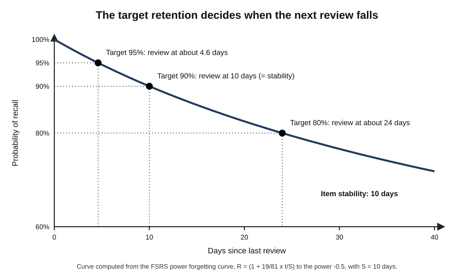
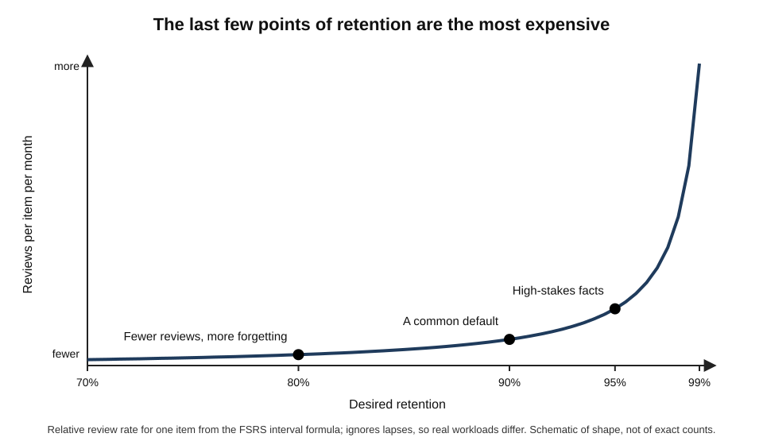
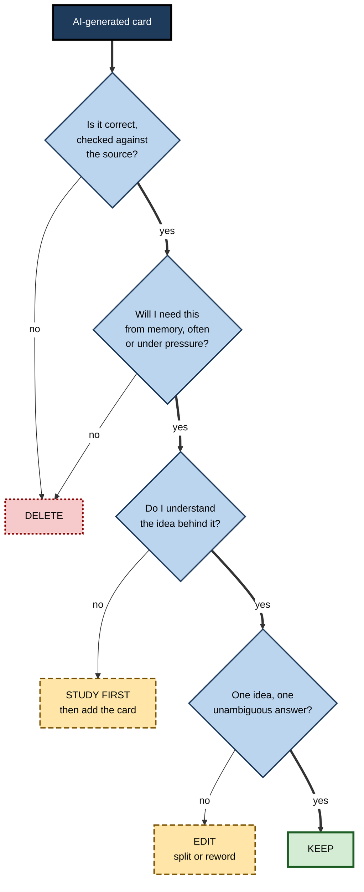
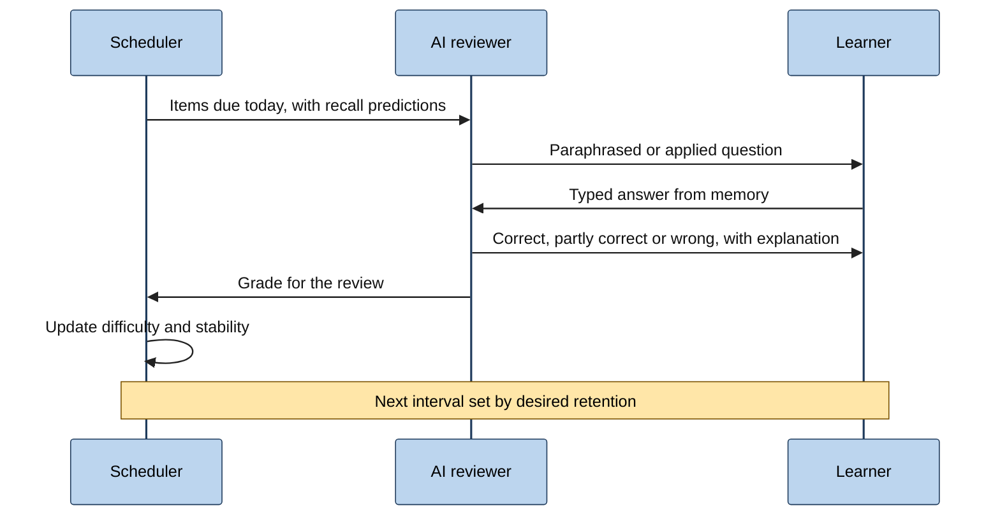
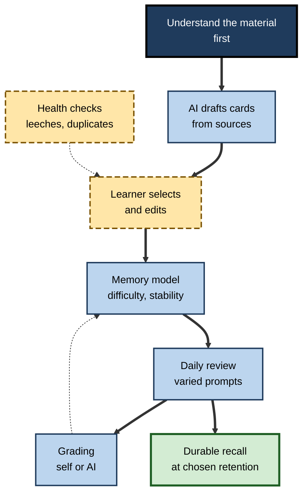

# G.5. AI-Powered Spaced Repetition

A cardiology registrar keeps 4,000 flashcards on drug doses, trial results and guideline thresholds. For years a fixed rule decided when each card returned. Now a model trained on her own review history schedules each card just before she is predicted to forget it, and a language model drafts new cards from the guidelines she reads. Her review time has fallen and her retention has risen.

> **Definition — AI-powered spaced repetition:** spaced review of material in which machine-learned models predict each learner's forgetting to schedule reviews, and in which AI may also create, grade or present the review items.

**Why it matters**

- Spacing review over time produces far better long-term retention than massing it — but the best timing differs for every item and every person.
- Hand-set rules (fixed interval multipliers) waste time on easy items and lose hard ones; learned models can do better.
- Generative AI removes the main barrier to using flashcards — the effort of **writing** good cards — but introduces risks of poor, wrong or excessive cards.
- For professionals who must retain large bodies of exact knowledge — doses, codes, regulations, terminology, vocabulary — the combination can save hours a week.

---

## From Rules to Learned Models

### What a scheduler must predict

- A scheduler decides **when** each item should next be reviewed.
- To do so it must estimate, for each item and learner, **how quickly memory decays** and **how much each review strengthens it**.
- Early systems used fixed rules — the Leitner box (boxes reviewed at increasing intervals) and the SM-2 algorithm (intervals multiplied by an "ease" factor adjusted after each answer).
- Learned models instead **fit** decay and strengthening to data from millions of reviews, and increasingly to the individual learner's own history.

> **Definition — Scheduler:** the algorithm that decides when each item in a spaced-repetition system is next shown.

> **Definition — Retrievability:** the probability that an item can be recalled at a given moment.

### Half-life regression

**Study card — Burr Settles and Brendan Meeder (Duolingo, 2016)**

- **Problem:** language learners at Duolingo practised millions of words; fixed schedules did not fit the very different difficulty of different words for different learners.
- **Model — half-life regression:**
  - recall probability decays exponentially with time since the last practice;
  - each word, for each learner, has a **half-life** — the time after which recall probability falls to 50%;
  - the half-life is predicted from features such as how often the word has been seen and recalled correctly or incorrectly, and properties of the word itself.
- **Results:** the model predicted recall more accurately than established rules such as Leitner and Pimsleur schedules; deployed to learners, it was associated with improved engagement and practice.
- **Conclusion:** a simple, interpretable learned model can beat hand-set rules at scale.

> **Formula — Half-life regression:** p = 2^(−Δ ÷ h), where p is the predicted recall probability, Δ the time since last practice and h the item's half-life. Example: if h = 6 days and 3 days have passed, p = 2^(−0.5) ≈ **0.71**; after 12 days, p = 2^(−2) = **0.25**.

### The stability–retrievability model behind FSRS

- **The FSRS family of schedulers** (the Free Spaced Repetition Scheduler, developed openly by Jarrett Ye and contributors from 2022 and adopted as an option in the Anki flashcard program in 2023) builds on a **three-component model of memory**, descending from Piotr Wozniak's work on SuperMemo:
  - **Difficulty (D)** — how hard the item is for this learner; affects how much stability grows after each review;
  - **Stability (S)** — the time, in days, for retrievability to fall from 100% to 90%; a measure of how durable the memory is;
  - **Retrievability (R)** — the current probability of recall, which falls as time passes.
- **After each review** the model updates stability:
  - a successful recall raises stability — more so when retrievability was **low** (a harder, more effortful recall), when the item is **easy**, and when stability is still **small**;
  - a failure (a "lapse") lowers stability sharply.
- **The parameters** governing these updates are fitted to the learner's own review history by optimisation, so the scheduler adapts to how that person forgets.

> **Definition — Memory stability:** in stability-based schedulers, the time it takes for an item's recall probability to fall to a set level (90% in FSRS); larger stability means slower forgetting.

> **Key point:** the model formalises a classic finding — **retrieval that is harder because time has passed strengthens memory more** — and uses it to space reviews as far apart as is safe.

**Figure 1.** How recall probability decays after a review, and how the desired retention level determines the next interval.

### Worked example: choosing the interval

In recent FSRS versions the forgetting curve has a power-law shape:

> **Formula — FSRS forgetting curve:** R(t) = (1 + F × t ÷ S)^C, with F = 19/81 and C = −0.5, chosen so that R = 0.9 when t = S. Solving for the interval that gives a desired retention r: t = (S ÷ F) × (r^(1/C) − 1).

A compliance officer's card on a reporting threshold has stability **S = 10 days**.

| Desired retention r | Calculation | Next interval |
|---|---|---|
| 0.95 | (10 ÷ 0.2346) × (1 ÷ 0.9025 − 1) = 42.6 × 0.108 | about **4.6 days** |
| 0.90 | (10 ÷ 0.2346) × (1 ÷ 0.81 − 1) = 42.6 × 0.235 | **10 days** (= S) |
| 0.80 | (10 ÷ 0.2346) × (1 ÷ 0.64 − 1) = 42.6 × 0.5625 | about **24 days** |

- **Interpretation:** raising desired retention from 90% to 95% more than **halves** the interval — roughly doubling reviews for this card — while lowering it to 80% more than **doubles** the interval.
- **Note:** some later versions make the curve's shape itself a learnable parameter, so exact numbers vary; the logic is unchanged.

> **Watch out:** the arithmetic shows why chasing near-perfect retention is expensive. The last few percentage points of retention cost a disproportionate number of reviews.

### Optimising the schedule itself

- **Behzad Tabibian, Manuel Gomez-Rodriguez and colleagues (2019)** framed review scheduling as an optimal-control problem and derived an optimal policy in which the **rate of review is proportional to the probability of having forgotten**; analyses of language-learning data suggested learners whose review patterns resembled this policy remembered more.
- **Modern schedulers** often simulate thousands of possible futures for a learner's collection to choose the desired retention that minimises review time for a given amount of knowledge retained.

---

## The Trade-off Between Retention and Workload

### Desired retention

> **Definition — Desired retention:** the target probability of recall at the moment a review is due; the scheduler sets intervals so that items are reviewed when retrievability falls to this level.

- **Higher desired retention** → shorter intervals → more reviews per day → less forgetting.
- **Lower desired retention** → longer intervals → fewer reviews → more lapses, each needing relearning.
- **The relation is steeply non-linear:** simulations by FSRS developers and users show daily workload rising sharply as desired retention approaches 100%.

**Figure 2.** Daily review workload rises steeply as desired retention approaches 100%.

| | Desired retention around 80% | Around 90% | Around 95–97% |
|---|---|---|---|
| Daily reviews | Fewest | Moderate | Many |
| Lapses and relearning | Frequent | Occasional | Rare |
| Suits | Large, low-stakes collections; hobby learning | Most professional study | Safety-critical facts; days before an examination |
| Main risk | Too much forgotten when needed | Balanced | Burnout; abandoned reviews |

> **In practice:** set desired retention by the **cost of forgetting**. A paediatric nurse's dose card justifies 95%; a vocabulary card for a language learned for pleasure may sit at 85%. Many systems allow different settings for different collections.

### Why AI scheduling saves time

- **Easy items are pushed further out** — no need to keep seeing what is already secure.
- **Hard items come back sooner** — before they are lost.
- **The learner's own forgetting is learned** — two learners with the same card get different schedules.
- **Benchmarks** run on large public collections of anonymised review histories have found model-based schedulers such as FSRS predict recall more accurately than SM-2-style rules, which translates into fewer reviews for the same retention.

> **Watch out:** most comparisons of schedulers measure **prediction accuracy** on past review data, not learning outcomes in randomised trials. Better prediction is a strong reason to expect efficiency gains, but the size of the real-world benefit varies.

---

## Generating Cards With AI

### What makes a good card

**Piotr Wozniak (1999), "Twenty rules of formulating knowledge"** — principles still widely followed:

- **Understand before memorising** — cards should hold what has been understood, not replace understanding.
- **Minimum information principle** — each card tests **one** small, precise idea.
- **Cloze deletion** — a sentence with a key word removed is often an efficient format.
- **Avoid sets and enumerations** — "list the seven…" cards are hard to retain; break them up or use mnemonics.
- **Combat interference** — make similar items clearly distinguishable.
- **Personalise and add context** — link to the learner's own examples.
- **Keep wording optimal** — short, unambiguous, with one correct answer.

> **Definition — Minimum information principle:** the rule that each review item should test a single, simple idea, so that it is easy to recall and schedule precisely.

> **Definition — Cloze deletion:** a review item formed by deleting a key word or phrase from a sentence, which the learner must supply.

### What AI does well and badly

- **Does well:**
  - converting a page of notes into many atomic cards in seconds;
  - producing cloze deletions from definitions and rules;
  - generating reverse cards (term → definition and definition → term);
  - adding brief context or an example to each card.
- **Does badly:**
  - **over-producing** — fifty cards where eight capture what matters;
  - choosing **trivial** details (dates of minor amendments, exact phrasings);
  - writing **ambiguous** prompts with several defensible answers;
  - introducing **errors**, especially in numbers, doses, dates and citations;
  - creating cards for material the learner **does not yet understand**.

> **Watch out:** every unnecessary card is a **recurring cost** — reviewed for months or years. Over-production by AI is the commonest way an AI-assisted collection becomes unsustainable and is abandoned.

### Worked example: from notes to cards

A data-protection officer's note reads: "Under the GDPR, a personal-data breach must be notified to the supervisory authority without undue delay and, where feasible, within 72 hours of becoming aware of it, unless it is unlikely to result in a risk to individuals."

| Raw AI output | Problem | Edited card |
|---|---|---|
| "What must be done under GDPR?" | Vague; many answers | "Within how many hours must a qualifying breach usually be notified to the supervisory authority?" → 72, where feasible |
| "Explain breach notification fully." | Not atomic | Split into three cards: deadline; trigger (becoming aware); exception (unlikely to result in risk) |
| "What article covers breach notification?" | Low-value detail for this learner | Deleted |
| "Must every breach be notified?" → "Yes" | **Wrong** | "When is notification to the authority not required?" → when the breach is unlikely to result in a risk to individuals |

- **Result:** five raw cards became four good ones; one would have taught an error.

**Figure 3.** Deciding whether an AI-generated card should be kept, edited or deleted.

### A specification for card generation

Asking well cuts the editing burden sharply.

- **Source** — "Use only the attached guideline; quote the sentence each card comes from."
- **Selection** — "Choose only facts a practising clinician would need from memory; skip history, article numbers and examples."
- **Form** — "One idea per card; use cloze deletion for definitions; questions for thresholds; no lists longer than three."
- **Quantity** — "No more than ten cards for this page."
- **Context** — "Add one short clause of context so each card makes sense out of order."
- **Flags** — "Mark any card where the source is ambiguous or where you are unsure."

> **In practice:** ask the AI to list **candidate facts** first, choose from the list, and only then ask for cards. Choosing from a list is faster than deleting cards, and the act of choosing is itself a useful review of the material.

> **Remember:** generate generously, **keep sparingly**. The decision about what deserves a place in long-term review is the learner's, not the AI's.

---

## AI in the Review Itself

### Grading free recall

- **Typed answers instead of self-rating** — rather than the learner judging "I knew it", the AI compares a typed answer with the card's answer and judges correctness.
- **Benefits:**
  - removes self-generous grading ("I sort of knew that");
  - accepts paraphrases and synonyms a string match would reject;
  - can explain what was missing.
- **Risks:**
  - leniency towards answers that use the right words without the right meaning;
  - inconsistency between sessions;
  - extra time per review.

### Varied prompting

- **Paraphrased cues** — the AI asks for the same fact in different words each time, so the learner retrieves the idea rather than recognising the card's familiar wording.
- **Applied variants** — "a breach discovered on Friday afternoon: when is the deadline?" instead of "how many hours?".
- **Linking questions** — "how does this deadline relate to the duty to inform affected individuals?"

> **Key point:** with fixed cards, learners can come to recognise the **card** rather than recall the **knowledge**. Varied, applied prompts restore genuine retrieval and encourage transfer.

### Conversational review

**Figure 4.** A conversational review session in which the AI varies cues and grades free recall while a scheduler sets the next review.

### Keeping the collection healthy

- **Duplicate detection** — semantic search can find cards that test the same idea in different words.
- **Leech detection** — cards failed repeatedly are flagged; the usual cure is to **rewrite or relearn**, not to keep reviewing.
- **Pruning** — knowledge that is no longer needed (an old version of a regulation, a retired product) should be retired.
- **Updating** — when a guideline changes, the AI can find every affected card.

> **Definition — Leech:** a review item that is forgotten repeatedly despite many reviews, usually because it is badly formulated, interferes with similar items or was never understood.

---

## What Deserves Long-Term Review

When an AI can answer almost any factual question in seconds, the case for memorising anything must be made explicitly.

### Why memory still matters

- **Speed** — consultations, negotiations, incidents and examinations leave no time to look things up.
- **Judgement** — checking an AI's answer requires knowing enough to notice when it is wrong; a learner who has offloaded all the facts cannot evaluate the tool.
- **Thinking with knowledge** — experts reason with what is in their heads.
  - William Chase and Herbert Simon (1973) showed that chess masters recalled meaningful board positions far better than novices, but not random ones: their advantage lay in thousands of stored **chunks** of familiar patterns.
  - The same holds in medicine, law, engineering and finance: pattern recognition depends on knowledge held in long-term memory.
- **Learning more** — new knowledge attaches to old; a sparse memory makes every new topic harder.

> **Definition — Chunk:** a meaningful unit of stored knowledge, such as a familiar pattern of chess pieces or a standard contract structure, that experts recognise and recall as a single item.

> **Key point:** the purpose of spaced review in an AI-rich workplace is not to compete with the AI at storing facts, but to hold the **knowledge needed to think, decide quickly and judge the AI**.

### Choosing what goes into review

| Kind of knowledge | Put it under spaced review? | Best review form |
|---|---|---|
| Thresholds, doses, limits used under pressure | Yes, high retention | Exact-answer cards, AI-graded |
| Core terminology of the field | Yes | Cloze and reverse cards |
| Key principles and their reasons | Yes | "Explain why" prompts, varied by AI |
| Common error patterns and warning signs | Yes | Scenario prompts: "what is wrong here?" |
| Procedures used weekly | Usually not; practice maintains them | Scheduled practice tasks |
| Rarely used detail, easy to look up | No | Reference notes |
| Material not yet understood | Not yet | Study first, then add |

### Spacing beyond flashcards

- **Spaced problems** — a scheduler can bring back **types of problem** rather than facts; an AI generates a fresh variant each time, so the learner practises the method, not a remembered answer.
  - *e.g.* a financial analyst's deck holds "value a growing perpetuity", "compute weighted average cost of capital"; each review is a new problem with new numbers.
- **Spaced explanations** — prompts such as "explain to a client why diversification reduces risk" return at increasing intervals; the AI checks the explanation against key points.
- **Spaced cases** — short clinical, legal or engineering cases that require recognising a learned pattern in new surface details.
- **Spaced reading** — returning to key passages of an important document at intervals, a practice sometimes called incremental reading.

> **Example:** a site-reliability engineer schedules five incident patterns — memory leak, cascading retry storm, expired certificate, DNS misconfiguration, noisy neighbour. On each review the AI writes a new short incident log, and she must name the likely pattern and the first two diagnostic steps.

> **Watch out:** spaced problems and explanations are harder to grade than flashcards, and AI grading of them is less reliable. Keep the reference answer, or key points, attached to each item, and spot-check the AI's judgements.

### Review data and privacy

- **Review histories are personal data** — they reveal what a person does not know, how fast they forget and when they study.
- **In workplaces**, such data could be used to judge employees; learners should know who can see it and for what purpose.
- **Good practice:** prefer tools that store data locally or under clear terms; keep employer confidential material out of personal tools; separate learning data from performance evaluation.

---

## Designing an AI-Powered Review System

**Figure 5.** The components of an AI-powered spaced-repetition system and the learner's decisions within it.

### Choices to make

- **What goes in** — knowledge needed **from memory**: facts used under time pressure, terminology, thresholds, core formulas, vocabulary, the key ideas needed to judge AI output in one's field.
- **What stays out** — material easily looked up and rarely needed; material not yet understood; whole arguments better learned by explanation and practice.
- **Desired retention** — set by the cost of forgetting.
- **Daily budget** — a sustainable number of minutes, with new-card limits so that workload does not explode weeks later.
- **Grading method** — honest self-grading for simple items; AI grading of typed answers where self-grading is too generous.

> **In practice:** a common professional pattern is 10–20 minutes of review a day, a limit of 10–20 new cards a day, desired retention of about 90%, and a weekly half-hour to add and prune cards from that week's learning.

### Habits that defeat even a good scheduler

- **Adding too many new cards** — each new card generates reviews for weeks; a burst of additions produces a wave of reviews about a fortnight later.
- **Skipping days, then bingeing** — the model can absorb irregularity, but long gaps produce many lapses and discouragement.
- **Generous self-grading** — marking a hesitant, partial recall as correct teaches the model the wrong stability.
- **Cramming outside the schedule** — extra reviews right before a test inflate short-term recall and can confuse the model's estimates unless the software accounts for them.
- **Never deleting** — collections grow until review time becomes unsustainable.
- **Treating review as learning** — cards maintain knowledge; they do not build understanding, which needs explanation, practice and application.

> **Watch out:** most abandoned spaced-repetition systems fail through **workload**, not through poor scheduling. The strongest protections are a cap on new items and a willingness to delete.

### Case study: a pharmacology revision programme

- **Situation:** a hospital pharmacy department wanted junior pharmacists to retain high-risk drug information — doses, interactions, monitoring thresholds — after induction.
- **Old approach:** a printed handbook and an annual quiz; quiz scores were high immediately after induction and much lower six months later.
- **Actions:**
  1. senior pharmacists selected about 300 **must-know** facts;
  2. an AI tool drafted cards from the hospital's own formulary; seniors reviewed every card, rejecting about a quarter for errors, ambiguity or low value;
  3. juniors reviewed in an app with a model-based scheduler, desired retention set at 95% for high-risk items and 88% for others;
  4. typed answers for dose cards were graded automatically against the exact reference value;
  5. every guideline update triggered a search for affected cards.
- **Result:** unannounced checks at six months showed much better retention of high-risk facts than in the previous cohort, with about ten minutes of review a day.
- **Side effects:** some juniors added hundreds of unreviewed AI cards of their own and fell behind; a cap on new cards was introduced.
- **Lesson:** the gains came from **expert selection**, **verified cards** and a **model-based schedule** together — not from AI generation alone.

---

## Open Questions

- **Do AI-generated cards produce the same learning as self-written ones?**
  - Writing cards is itself a learning act; whether editing AI drafts preserves that benefit is not yet well established.
- **How far can scheduling improve?**
  - Model-based schedulers already predict recall well; remaining gains may be small compared with gains from better items.
- **Can schedulers model relations between items?**
  - Most treat each card independently, though reviewing one idea affects memory for related ones.
- **Does varied AI prompting improve transfer?**
  - The idea is well grounded, but direct evidence for AI-varied review is limited.
- **What should professionals still memorise?**
  - As AI answers more questions instantly, the case for memorising rests on speed, judgement and checking AI output — arguments that need clearer evidence by field.

---

## Summary

- **AI-powered spaced repetition** uses machine-learned models to predict forgetting and schedule reviews, and AI to create, grade and present items.
- **Half-life regression** (Settles and Meeder, 2016): p = 2^(−Δ/h), with half-lives predicted from practice history.
- **FSRS** models **difficulty, stability and retrievability**, fits parameters to each learner and sets intervals from a **desired retention**; at 90% the interval equals stability, at 95% it roughly halves, at 80% it more than doubles.
- **Workload rises steeply** as desired retention approaches 100%; set it by the **cost of forgetting**.
- Model-based schedulers predict recall better than fixed rules; most evidence is predictive, not from randomised learning trials.
- Good cards follow **Wozniak's** rules — understand first, **minimum information**, cloze deletions, no long lists.
- AI drafts cards quickly but **over-produces**, picks trivia, writes ambiguous prompts and introduces errors: generate generously, **keep sparingly**, verify.
- AI can **grade typed recall**, **vary prompts** to prevent card recognition, and keep collections healthy by finding duplicates, leeches and outdated items.
- In an AI-rich workplace, review holds the knowledge needed for **speed, judgement and further learning**; schedule **problems, explanations and cases** as well as facts.
- Real gains come from expert selection, verified items and model-based schedules together.

---

## Self-Check

1. Define AI-powered spaced repetition and name the two broad roles AI plays in it.
2. What must a scheduler predict, and how do learned models differ from fixed rules?
3. Using half-life regression, compute recall probability when h = 4 days and 8 days have passed.
4. Define difficulty, stability and retrievability in the FSRS model.
5. Why does a successful recall at low retrievability raise stability more than one at high retrievability?
6. Using the FSRS formula, show that the interval equals stability when desired retention is 90%.
7. A card has stability 20 days. Roughly what interval would desired retention of 80% give?
8. Explain the retention–workload trade-off and how desired retention should be set.
9. State four of Wozniak's rules for formulating cards and explain the minimum information principle.
10. List four typical faults of AI-generated cards.
11. What are the benefits and risks of AI grading of typed answers?
12. Why do varied and applied prompts matter in long-term review?
13. What is a leech, and how should it be handled?
14. A colleague imports 2,000 AI-generated cards from a textbook in one week and is overwhelmed a month later. Diagnose and advise.

### Answer Key

1. Spaced review in which machine-learned models predict forgetting to schedule reviews; AI schedules, and also creates, grades or presents items.
2. When each item's recall probability will fall to a target, which depends on decay rate and strengthening by review. Fixed rules apply the same multipliers to all; learned models fit decay and strengthening to data, including the learner's own history.
3. p = 2^(−8/4) = 2^(−2) = 0.25.
4. Difficulty: how hard the item is for the learner, affecting stability growth. Stability: days for recall probability to fall to 90%. Retrievability: current recall probability.
5. Effortful retrieval after more forgetting strengthens memory more — a desirable difficulty — so the model grants a larger stability increase.
6. With r = 0.9: r^(1/C) = 0.9^(−2) = 1/0.81 = 1.2346; minus 1 = 0.2346 = 19/81 = F; t = (S/F) × F = S.
7. About 2.4 × 20 ≈ 48 days.
8. Higher retention needs shorter intervals and many more reviews, rising steeply near 100%; lower retention saves time but increases forgetting. Set it by the cost of forgetting each kind of item.
9. Understand before memorising; minimum information; cloze deletion; avoid sets; combat interference; optimise wording. Minimum information: one simple idea per card so it is easy to recall and schedule precisely.
10. Over-production; trivial details; ambiguous prompts; factual errors; cards for material not yet understood.
11. Benefits: honest grading, acceptance of paraphrase, explanations. Risks: leniency to right words with wrong meaning, inconsistency, time per review.
12. Learners otherwise learn to recognise the card's wording; varied and applied cues force genuine retrieval and encourage transfer to real situations.
13. An item failed repeatedly despite reviews, usually from poor formulation, interference or lack of understanding. Rewrite, split, add context or relearn the idea rather than keep reviewing.
14. Mass import of unselected, unverified cards — including trivia and material not understood — created an unsustainable workload. Suspend most cards; keep only verified, must-know items; cap new cards per day; add cards only after understanding; prune regularly.

---

## Glossary

| Term | Meaning |
|---|---|
| Chunk | A meaningful unit of stored knowledge that experts recognise as a whole. |
| Cloze deletion | A sentence with a key part removed for the learner to supply. |
| Desired retention | The target recall probability when a review falls due. |
| Difficulty (in FSRS) | How hard an item is for a learner; affects stability growth. |
| FSRS | Free Spaced Repetition Scheduler: an open, model-based scheduler using difficulty, stability and retrievability. |
| Half-life regression | A model predicting each item's half-life from practice history. |
| Half-life | Time after which recall probability falls to 50%. |
| Lapse | A failed recall of a previously learned item. |
| Leech | An item forgotten repeatedly despite many reviews. |
| Memory stability | Time for recall probability to fall to a set level; durability of a memory. |
| Minimum information principle | Each item should test one simple idea. |
| Retrievability | Current probability of recalling an item. |
| Scheduler | The algorithm that decides when items are reviewed. |
