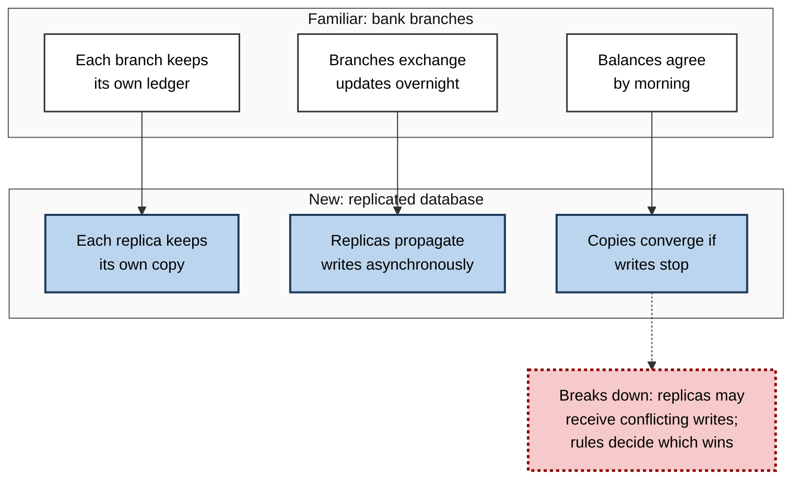
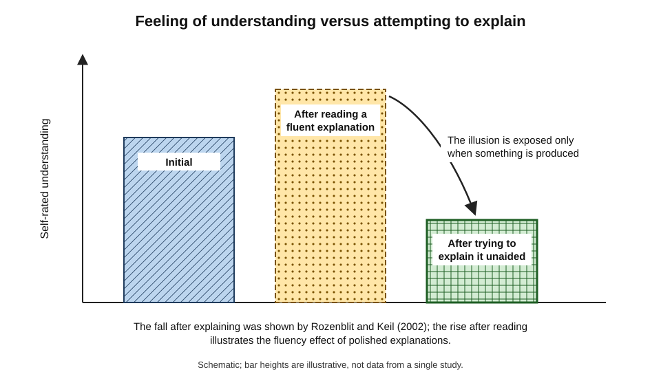
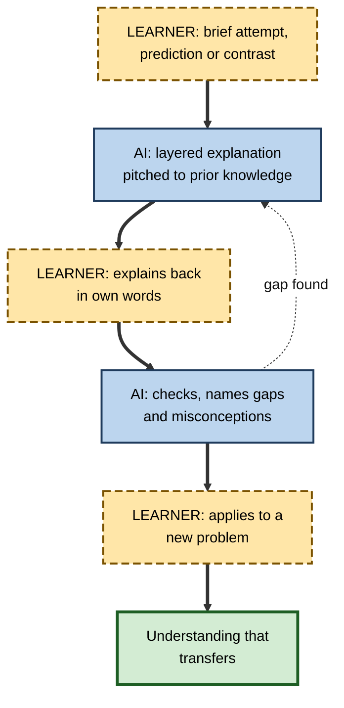
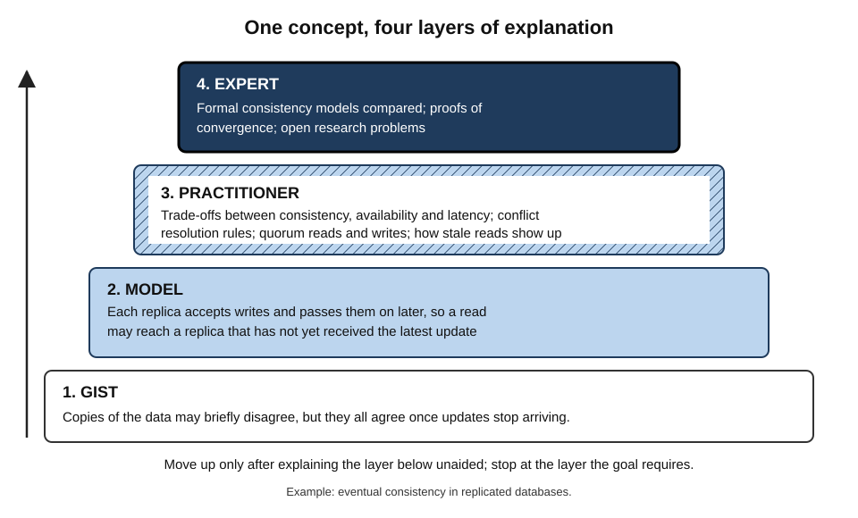
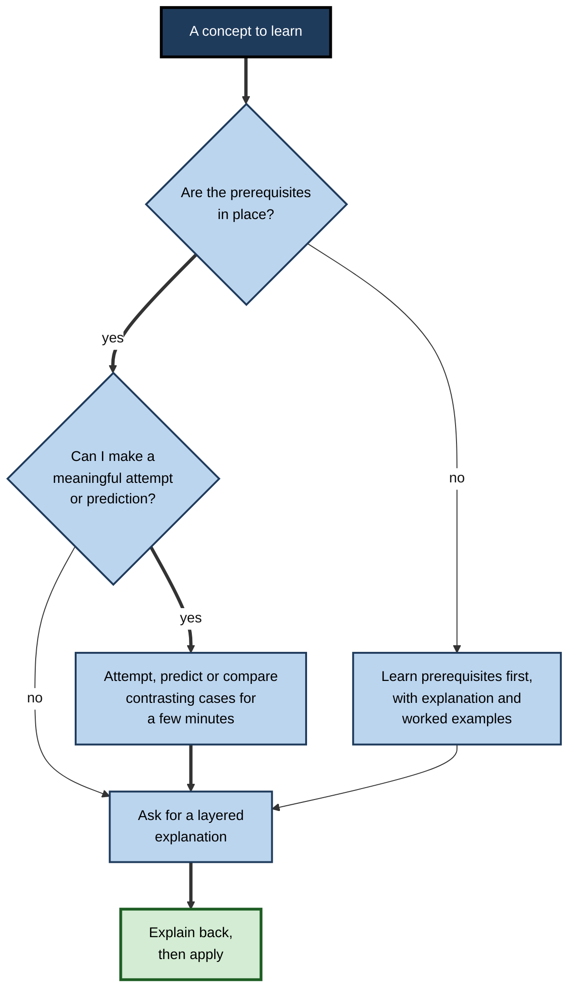

# G.6. Using AI for Concept Explanation

A backend engineer asks an AI assistant to explain eventual consistency. The answer is lucid, well structured and illustrated with a neat analogy about bank branches. She nods along, closes the window and, the next morning, cannot explain to a colleague why her application occasionally shows stale data. Generative AI is the most patient explainer ever built, but an explanation that has been **read** is not yet an idea that has been **understood**.

> **Definition — Concept explanation:** communication that helps a learner build a mental model of an idea — what it is, how it works, why it holds and how it relates to what the learner already knows.

**Why it matters**

- Understanding concepts is what lets knowledge **transfer** to new problems, rather than staying tied to the examples in which it was learned.
- AI can explain anything, at any level, with as many examples and analogies as needed — a capability no textbook or teacher could match for breadth and patience.
- Yet explanations are among the most **over-rated** forms of instruction: research shows they often fail unless they are adapted to the learner and followed by the learner's own thinking.
- Fluent AI explanations are especially prone to producing the **feeling** of understanding without its substance.

---

## What Makes an Explanation Work

### Why explanations often fail

**Jörg Wittwer and Alexander Renkl (2008)** reviewed research on instructional explanations and found their effects frequently small. Explanations worked best when they:

- **were adapted to the learner's prior knowledge** — neither repeating what is known nor skipping what is missing;
- **focused on concepts and principles** — the why, not only the steps;
- **were integrated into the learner's own activity** — given when the learner needed them, during problem-solving;
- **did not replace the learner's own explaining** — followed by tasks requiring the learner to apply or explain.

> **Key point:** an explanation is an **input** to learning, not the learning itself. What the learner does next decides whether it becomes understanding.

### The ingredients of a good explanation

- **Connection to prior knowledge** — starting from what the learner already understands.
- **Mechanism** — what causes what, step by step.
- **Concrete examples** — several, varied in surface features, so that the general idea stands out.
- **Non-examples and contrasts** — cases that look similar but are not instances, which sharpen the boundary of the concept.
- **Analogies** — mapping the structure of a familiar domain onto the new one.
- **Visual representation** — a diagram of structure or process alongside words.
- **Anticipated misconceptions** — naming the common wrong idea and why it is wrong.
- **Application** — a problem in which the idea must be used.

| Ingredient | Why it helps | Prompt to an AI |
|---|---|---|
| Prior knowledge | New ideas attach to existing ones | "I know relational databases well; explain by contrast with them." |
| Mechanism | Builds a causal model, not a label | "Walk through what happens, step by step, when two replicas receive conflicting writes." |
| Varied examples | General idea separates from surface | "Give three examples from different industries." |
| Non-examples | Sharpens the boundary | "Give a case that looks like this but is not, and explain why." |
| Analogy with limits | Imports structure from a known domain | "Give an analogy, then say exactly where it breaks down." |
| Misconceptions | Prevents a common wrong model | "What do people usually get wrong about this?" |

### Contrasting cases and the time for telling

- **Daniel Schwartz and John Bransford (1998), "A time for telling"** — students who first analysed **contrasting cases** (sets of examples differing in key features) and then heard a lecture learned more than students who summarised a text before the same lecture.
  - The contrasts prepared them to notice what the explanation was explaining.
- **Implication for AI use:** before requesting the full explanation, ask for **two or three contrasting cases** and try to work out what distinguishes them.

> **Definition — Contrasting cases:** examples chosen to differ in a few critical features, so that comparing them reveals what matters for a concept.

### Analogies: powerful and dangerous

- **Dedre Gentner (1983), structure-mapping theory:** a good analogy maps **relations** (A causes B, X contains Y) from a familiar domain onto a new one, not surface features.
- **Mary Gick and Keith Holyoak (1980, 1983):** people given a story about an army converging on a fortress from many directions rarely used it spontaneously to solve an analogous medical problem (destroying a tumour with many weak rays) — but did far better when **told** the story was relevant, or when they had **compared two** analogous stories.
- **Lessons:**
  - an analogy helps only if the learner sees the **structural** correspondence;
  - comparing **two** analogies helps extract the shared principle;
  - every analogy **breaks down** somewhere, and the break points are where misconceptions start.

**Figure 1.** An analogy maps relations from a familiar domain onto a new one, and every analogy has a point where it breaks down.

> **Watch out:** AI is very good at producing vivid analogies and poor at volunteering their limits. Always ask where the analogy fails — otherwise the learner may carry the analogy's false implications into real work.

---

## The Illusion of Understanding

### The illusion of explanatory depth

**Study card — Leonid Rozenblit and Frank Keil (2002)**

- **Design:** participants rated how well they understood everyday devices — a zip, a flush toilet, a cylinder lock — then wrote step-by-step explanations of how each worked, then rated their understanding again.
- **Results:** ratings **fell** sharply after attempting the explanation; people had believed they understood mechanisms far better than they did.
- **Conclusion:** familiarity with a thing, and with talk about it, is easily mistaken for understanding of how it works; the illusion is strongest for **explanatory** knowledge.

> **Definition — Illusion of explanatory depth:** the tendency to believe one understands how something works in far more detail than one does, revealed when one tries to explain it.

**Figure 2.** Confidence in understanding before and after trying to explain a mechanism, and the effect of reading a fluent AI explanation.

### Why AI explanations strengthen the illusion

- **Fluency** — well-written text is easy to process, and ease of processing feels like understanding.
- **Coherence** — AI explanations are tidy; real understanding includes knowing where the messy cases are.
- **Recognition** — after reading, every term looks familiar, so the learner recognises rather than reconstructs.
- **No demand** — reading requires nothing to be produced, so gaps stay hidden.

### Evidence from AI-assisted learning

**Study card — Anthropic coding-skills experiment (published early 2026)**

- **Design:** 52 mostly junior software developers learned an unfamiliar Python library for asynchronous programming through a self-guided tutorial; half could use an AI assistant able to write correct code on demand.
- **Results:**
  - the AI group scored about **17% lower** on a comprehension quiz covering debugging, code reading, code writing and concepts (about 50% against 67%);
  - the time saved by using AI was small and not statistically significant;
  - **how** participants used the AI mattered: those who mostly **delegated** code generation scored lowest; those who asked the AI to **explain** concepts, asked conceptual follow-up questions, or generated code and then worked to **understand** it scored much better.
- **Conclusion:** using AI for **explanation and comprehension** preserved learning; using it for **production** undermined it.
- **Limits:** a small sample, a single short task and a quiz soon afterwards.

- **Search versus chatbot** — Matthias Stadler, Maria Bannert and Michael Sailer (2024) compared students researching a scientific question with a chatbot or a conventional search engine: chatbot users experienced **lower cognitive load** but produced **weaker reasoning** in their written justifications, suggesting that the effort saved was partly effort that would have built understanding.

> **Key point:** the same AI that explains well can **replace** the learner's effort to make sense of things. Explanation helps when it is followed by the learner's own construction; it hurts when it substitutes for it.

---

## The Learner's Half of the Work

### Self-explanation

- **Michelene Chi and colleagues (1989)** found that students who learned most from worked physics examples **explained the steps to themselves** — why each step followed, what principle it used — while weaker students merely read them.
- **Chi and colleagues (1994)** showed that **prompting** students to self-explain while reading a biology text improved their understanding, especially of complex ideas.
- **With AI:** after every explanation, the learner restates it, predicts the next step, or applies it — and asks the AI to check.

> **Definition — Self-explanation:** generating explanations for oneself of why steps, facts or examples make sense, while studying.

### Explain-back and teach-back

- **Explain-back** — "Here is my explanation of eventual consistency. What is wrong or missing?"
- **Teach-back** — the AI plays a confused learner, and the learner must teach it until its questions are answered.
- **Prediction** — "If the network partitions for ten minutes and both sides accept writes, what will a user see afterwards?" — answered before the AI explains.

### When to explain, when to attempt first

- **Explicit instruction for novices** — Paul Kirschner, John Sweller and Richard Clark (2006) argued that minimally guided discovery is inefficient for novices, who learn best from clear explanations and worked examples.
- **Productive failure** — Manu Kapur's studies found that students who first tried to solve complex problems on their own, usually failing, and were **then** taught the canonical solution, often showed better conceptual understanding and transfer than students taught first.
- **A workable synthesis:**
  - for genuinely new, complex material — a **brief** attempt or contrasting-case analysis, then a clear explanation;
  - for material with prerequisites missing — explanation first, then worked examples, then problems;
  - in both cases — the learner must produce something after the explanation.

> **Watch out:** the debate between explicit instruction and productive failure is **unsettled** and depends on learner knowledge, the complexity of the material and how the failure phase is designed. Neither "always explain first" nor "always struggle first" is supported.

**Figure 3.** An explanation cycle in which the learner's attempts and explanations surround the AI's explanation.

---

## Changing Misconceptions

Explanations are hardest when the learner already holds a **wrong** idea. A clear account of the right idea often fails to displace it.

### Why misconceptions persist

- **They work, up to a point** — "heavier objects fall faster" matches everyday experience with feathers and stones; "more staff means faster delivery" matches small projects.
- **They are connected** — a misconception is embedded in other beliefs, so changing one idea threatens several.
- **New information is assimilated** — the learner reinterprets the correct explanation to fit the old idea, often without noticing.

### Conditions for conceptual change

**George Posner, Kenneth Strike, Peter Hewson and William Gertzog (1982)** proposed that a learner replaces a conception only when the new one meets four conditions:

1. **Dissatisfaction** — the learner sees that the existing idea fails.
2. **Intelligibility** — the new idea can be understood.
3. **Plausibility** — it seems possibly true and consistent with other knowledge.
4. **Fruitfulness** — it explains more, or solves problems the old idea could not.

> **Definition — Conceptual change:** the restructuring of an existing, often intuitive, understanding into a more accurate one, as opposed to adding new facts to it.

> **Mnemonic — "Doubt It, Prove Fruit":** Dissatisfaction, Intelligibility, Plausibility, Fruitfulness.

### Refutation and threshold concepts

- **Refutation texts** — explanations that **state** the misconception, **explicitly refute** it and then explain the correct idea.
  - Reviews of science-education research (for example by Christine Tippett, 2010) found refutation texts generally more effective at changing misconceptions than standard expository texts.
  - AI can produce them readily: "State the common misconception about this, explain why it seems right, show why it is wrong, then explain the correct idea."
- **Threshold concepts** — Jan Meyer and Ray Land (2003) described concepts that are **transformative** (they change how a subject is seen), **irreversible** (hard to unlearn), **integrative** (they connect other ideas) and often **troublesome** (counter-intuitive).
  - *e.g.* opportunity cost in economics; the time value of money in finance; recursion in programming; materiality in auditing.
  - Learners may stay in a "liminal" state for some time, able to use the words before grasping the idea.

> **Definition — Threshold concept:** a concept that, once understood, transforms a learner's view of a subject and connects many of its other ideas, but is often troublesome to grasp.

> **In practice:** for a threshold concept, ask the AI for a refutation-style explanation, several contrasting cases and a prediction task in which the misconception gives a **wrong** answer the learner can see fail. Seeing the old idea fail creates the dissatisfaction on which change depends.

> **Example:** a junior project manager believes adding developers to a late project will speed it up. The AI is asked to state that belief, ask her to predict the effect of doubling a team in week ten of a twelve-week project, then walk through the costs of onboarding and coordination. Her prediction fails on her own numbers, and the explanation that follows — the principle that adding people to a late software project tends to make it later, associated with Fred Brooks (1975) — sticks.

---

## Prompting for Explanations

### The CLEAR pattern

- **C — Connect** to what the learner knows: "I am an accountant; explain by analogy with things I know."
- **L — Layer** the levels: "Explain in one sentence, then one paragraph, then at the level of a practitioner."
- **E — Examples and non-examples**: "Give three varied examples and one near-miss."
- **A — Analogy with limits**: "Give an analogy and say where it breaks down."
- **R — Reverse**: "Now ask me to explain it back, and correct me."

> **Mnemonic — CLEAR:** Connect, Layer, Examples, Analogy, Reverse.

### Layered explanation

**Figure 4.** Layered explanation: the same concept at increasing depth, each layer building on the one below.

- **Layer 1 — the gist:** one sentence capturing the core idea.
- **Layer 2 — the model:** the mechanism and main parts.
- **Layer 3 — the practitioner's view:** trade-offs, edge cases, how it is used and how it fails.
- **Layer 4 — the expert's view:** formal definitions, competing models, open problems.

> **In practice:** stop at the layer the goal requires, but always test the layer below unaided before moving up. A practitioner-level explanation built on a misunderstood gist is a house on sand.

### Worked example: learning eventual consistency

| | Passive request | CLEAR-structured session |
|---|---|---|
| Opening | "Explain eventual consistency." | "I know single-server relational databases. First give me two contrasting scenarios — one strongly consistent, one eventually consistent — and let me guess the difference." |
| Explanation | One long, fluent answer | Gist, then mechanism, then trade-offs, each checked |
| Analogy | Bank branches, unqualified | Bank branches, plus where it breaks: conflicting writes and conflict-resolution rules |
| Learner output | None | Explains back; predicts behaviour during a network partition |
| Check | None | Applies it: explains the stale-data bug in her own application |
| Next morning | Vague memory of "eventually it syncs" | Can explain the trade-off between consistency and availability to a colleague |

**A short excerpt of the second session**

1. **Learner:** "In scenario B the user sees an old basket total because the read hit a replica that had not yet received the update?"
2. **AI:** "Yes. What would have to be true for the user always to see the new total?"
3. **Learner:** "Every read would go to a replica that has confirmed the latest write — or reads and writes would need to overlap on enough replicas."
4. **AI:** "Exactly — that is the idea behind quorum reads and writes. What does it cost?"
5. **Learner:** "Latency, and availability if some replicas cannot be reached."

> **Watch out:** the AI's correct answers in such a session do not prove the learner understands; the learner's **own** answers, unprompted, the next day, do.

---

## Can the Explanation Be Trusted?

### Typical errors in AI explanations

- **Plausible but wrong mechanisms** — a confident causal story that is not how the thing works.
- **Over-simplifications that harden into misconceptions** — "electrons orbit like planets", "the brain uses only 10%".
- **Outdated content** — explanations of standards, regulations or software versions that have changed.
- **Mixed conventions** — notation or terminology from different sources blended together.
- **Arithmetic and logic slips** — less common in recent models, but still present, especially in long derivations.
- **Answering a different question** — explaining a related concept with the same name.

### Checking explanations

- **Ask for the source** — "which standard, textbook chapter or documentation section says this?" — then check that source.
- **Ask for confidence and alternatives** — "how certain is this? Are there competing explanations?"
- **Cross-check** — compare with a second model or, better, a primary source.
- **Test predictively** — if the explanation is right, what should happen in a specific case? Run the code, do the calculation, check the data.
- **Ask an expert** about anything that will be used in consequential work.

> **Remember:** an explanation that leads to **correct predictions** in new cases is trustworthy enough to build on; one that merely **sounds** right is not.

| | Textbook explanation | Human expert | AI explanation |
|---|---|---|---|
| Adapted to learner | No | Yes, if attentive | Yes, if briefed |
| Availability | Always | Limited | Always |
| Accuracy | Usually reviewed | High in own field | Variable; must be checked |
| Responds to questions | No | Yes | Yes |
| Admits uncertainty | Rarely needed | Often | Inconsistently |
| Risk of fluency illusion | Moderate | Lower — experts ask questions | High |

---

## Multimodal Explanation

- **Words and pictures** — Richard Mayer's research on multimedia learning found that people generally learn more deeply from words combined with relevant pictures than from words alone (the **multimedia principle**), provided the picture shows structure or process.
- **Coherence** — extraneous material, however interesting, tends to reduce learning; ask AI for **lean** explanations.
- **Signalling** — highlighting the organisation of the explanation (headings, numbered steps) helps learners follow it.
- **Segmenting** — complex explanations delivered in learner-paced segments are easier to learn than continuous ones.
- **AI capabilities:** diagrams generated as text descriptions or images, code that can be run, simple simulations, worked numerical examples.

> **Definition — Multimedia principle:** people learn better from words and relevant pictures together than from words alone.

> **Watch out:** this is a principle about **content** — showing a process or structure visually — not about "visual learners". Everyone benefits from a good diagram of a process; nobody benefits from matching explanations to a supposed learning style.

**Figure 5.** Choosing whether to ask for an explanation now or to attempt first.

---

## Professional Mastery

### How experts use AI explanations

- **To enter an adjacent field quickly** — a lawyer learning enough machine learning to advise on AI regulation; an engineer learning finance to build a business case.
- **To fill specific gaps** — "explain only the part of this paper's method I do not follow".
- **To prepare others** — generating several explanations at different levels, then choosing and adapting the best for a client or team.
- **To stress-test their own understanding** — asking the AI to find holes in their explanation.

### Case study: an engineer moves into battery systems

- **Situation:** a mechanical engineer with a thermal-systems background joined an electric-vehicle team and had six weeks to contribute to battery-pack design reviews.
- **First approach:** long AI explanations of lithium-ion chemistry, read in the evenings. She felt well informed, but in her first design review she could not explain why a proposed fast-charging profile risked lithium plating.
- **Diagnosis:** passive reading; no explanation back; no application; no connection to what she already knew well.
- **Actions:**
  1. **connect** — asked for every concept to be explained by analogy with heat transfer and fluid flow, which she knew deeply, with the limits of each analogy stated;
  2. **predict first** — before each explanation, wrote down what she expected to happen;
  3. **explain back** — wrote a one-paragraph explanation of each concept and asked for corrections;
  4. **apply** — analysed two real design-review documents per week with the AI checking her reasoning;
  5. **verify** — checked key claims against the team's internal design standards and with a senior cell engineer.
- **Result:** by week six she was raising substantive questions in reviews; her thermal background became an asset, because she could see heat-generation issues others missed.
- **Lesson:** the explanations did not change; what changed was that she **did something** with every one of them.

---

## Open Questions

- **Do AI explanations produce durable understanding at scale?**
  - Short experiments suggest it depends on use; long-term field evidence is scarce.
- **Can AI adapt explanations to prior knowledge reliably?**
  - It adapts when told; whether it can infer prior knowledge accurately from dialogue is uncertain.
- **How should AI signal uncertainty in explanations?**
  - Consistent, calibrated statements of confidence remain an unsolved design problem.
- **Does easy explanation erode learners' tolerance of confusion?**
  - Productive struggle may become rarer when an explanation is always one question away.
- **What is the right balance between telling and struggling?**
  - The explicit-instruction and productive-failure literatures have not been reconciled for AI-supported learning.

---

## Summary

- A **concept explanation** helps a learner build a mental model of what an idea is, how it works and why.
- Explanations often fail (**Wittwer and Renkl, 2008**) unless adapted to prior knowledge, focused on principles, integrated into the learner's activity and followed by the learner's own work.
- Good explanations connect to prior knowledge, give **mechanisms**, varied **examples and non-examples**, **analogies with stated limits**, visuals and anticipated misconceptions; **contrasting cases** prepare learners for telling.
- Analogies map **relations** (Gentner); people rarely transfer them spontaneously (Gick and Holyoak) — compare analogies and find where they break.
- The **illusion of explanatory depth** (Rozenblit and Keil) is amplified by fluent AI text; in a 2026 experiment, AI use for production lowered comprehension, while use for explanation and comprehension preserved it.
- **Self-explanation**, explain-back, teach-back and prediction convert explanation into understanding.
- Explicit instruction and **productive failure** both have support; a brief attempt, then explanation, then application, is a sound default.
- Misconceptions resist plain explanation; **conceptual change** needs dissatisfaction, intelligibility, plausibility and fruitfulness; **refutation texts** and prediction tasks help, especially for **threshold concepts**.
- Use **CLEAR**: Connect, Layer, Examples, Analogy, Reverse; check explanations against sources and by **prediction**.
- Use words with relevant pictures (**multimedia principle**), lean and segmented.

---

## Self-Check

1. Define concept explanation and explain why understanding matters for transfer.
2. According to Wittwer and Renkl, under what conditions do instructional explanations work?
3. List six ingredients of a good explanation and write an AI prompt for each of two of them.
4. What did Schwartz and Bransford find about contrasting cases and telling?
5. Explain structure-mapping theory and the Gick and Holyoak findings. What do they imply for AI analogies?
6. Describe the Rozenblit and Keil study and why AI explanations may strengthen the illusion it revealed.
7. Summarise the 2026 coding-skills experiment and the difference between high- and low-scoring patterns of AI use.
8. What is self-explanation, and how should it be used after reading an AI explanation?
9. Compare explicit instruction and productive failure, and state a reasonable default for AI-assisted learning.
10. Describe the CLEAR pattern and use it to design a prompt for learning a concept of your choice.
11. List four typical errors in AI explanations and three ways to check an explanation.
12. What is the multimedia principle, and how does it differ from learning-styles claims?
13. A graduate says AI explanations make everything "click" but she forgets it all within days. Diagnose and prescribe.

### Answer Key

1. Communication that helps a learner build a mental model of what an idea is, how it works and why. Understanding of principles lets knowledge be applied to new situations rather than only to the learned examples.
2. When adapted to prior knowledge, focused on concepts and principles, integrated into the learner's ongoing activity, and not a replacement for the learner's own explaining.
3. Prior knowledge, mechanism, varied examples, non-examples, analogy with limits, visuals, misconceptions, application. E.g. "Give an analogy and say where it breaks down"; "Give a near-miss case that is not an example and explain why."
4. Students who analysed contrasting cases before a lecture learned more from it than those who summarised a text first; the contrasts prepared them to understand the explanation.
5. Good analogies map relations, not surface features. People rarely applied an analogous story spontaneously but did when told to or after comparing two analogies. AI analogies should be compared, made explicit and checked for where they fail.
6. People rated their understanding of devices, tried to explain them and rated it much lower afterwards. Fluent, coherent AI text and familiar terms create a feeling of understanding without requiring any production that would expose gaps.
7. 52 developers learned a new library; AI users scored about 17% lower on comprehension with no significant time saving. Delegating code generation scored lowest; asking conceptual questions or working to understand generated code scored much better.
8. Generating explanations for oneself of why steps or ideas make sense. After an AI explanation, restate it, predict, apply it and ask the AI to check.
9. Explicit instruction suits novices lacking prerequisites; productive failure can improve conceptual understanding when learners can attempt meaningfully. Default: a brief attempt or prediction, then explanation, then explanation back and application.
10. Connect to what is known, layer from gist to practitioner level, give examples and non-examples, give an analogy with limits, then reverse — learner explains back and is corrected.
11. Plausible but wrong mechanisms; harmful over-simplifications; outdated content; mixed conventions; slips; answering a different question. Check by asking for and verifying sources, cross-checking, testing predictions, and consulting experts.
12. People learn better from words with relevant pictures than words alone. It concerns how content is best represented for everyone, not matching instruction to individual sensory preferences.
13. A fluency illusion: passive reading with no retrieval, explanation back or application. Prescribe prediction before explanation, explain-back after, application to new problems, and next-day unaided recall.

---

## Glossary

| Term | Meaning |
|---|---|
| Analogy | A mapping of relations from a familiar domain onto a new one. |
| Concept explanation | Communication that helps a learner build a mental model of an idea. |
| Conceptual change | Restructuring an existing understanding into a more accurate one. |
| Contrasting cases | Examples differing in critical features, compared to reveal what matters. |
| Explain-back | Restating an explanation in one's own words for checking. |
| Explicit instruction | Clear, direct teaching with explanations and worked examples. |
| Illusion of explanatory depth | Overestimating one's understanding of how things work. |
| Layered explanation | Explaining a concept at successive levels of depth. |
| Multimedia principle | Words with relevant pictures produce deeper learning than words alone. |
| Productive failure | Attempting problems before instruction, then learning the canonical solution. |
| Refutation text | An explanation that states, refutes and replaces a misconception. |
| Self-explanation | Explaining to oneself why steps or ideas make sense while studying. |
| Structure-mapping theory | Gentner's account of analogy as the mapping of relations between domains. |
| Teach-back | Teaching an AI that plays a confused learner, to expose gaps. |
| Threshold concept | A transformative, integrative and often troublesome concept in a field. |
