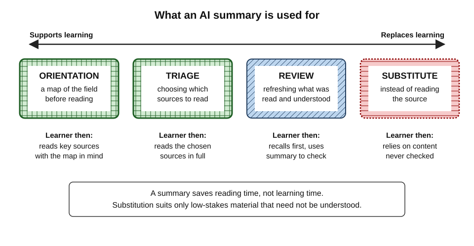
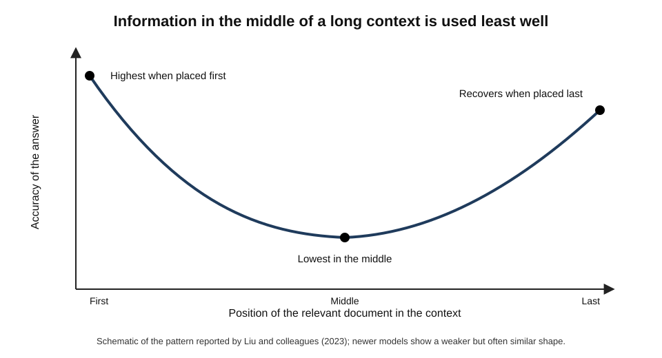
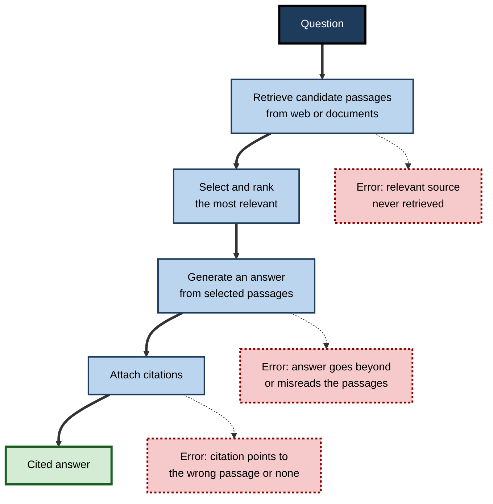
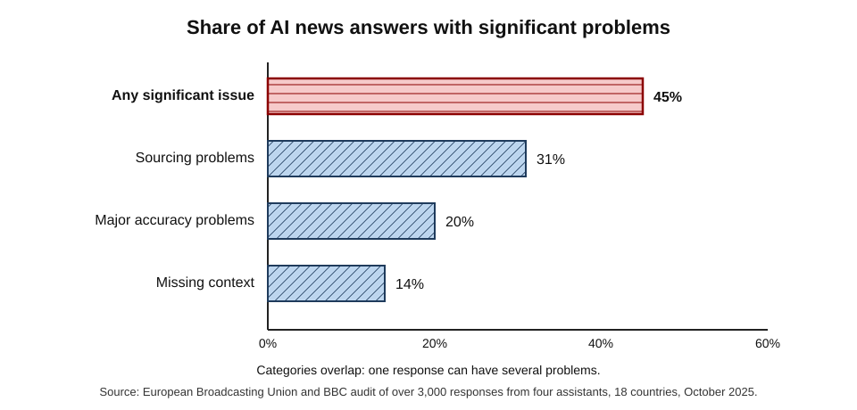
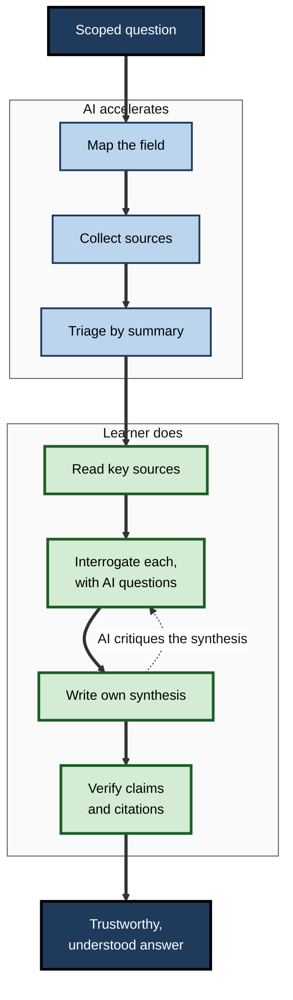

# G.7. AI Tools for Summarization and Research

A policy analyst has two days to brief a minister on the evidence for a four-day working week. She asks a research assistant tool to find and summarise the main studies. The brief is polished, until a colleague notices that one cited trial is said to show productivity gains its authors never reported, and another reference does not exist. A summary is only as trustworthy as the **checking** behind it, and only as educational as the **thinking** the reader still does.

> **Definition — AI summarisation:** the use of AI to produce a shorter version of one or more texts that preserves their main content.

> **Definition — AI research assistance:** the use of AI tools to find, select, read, compare and synthesise sources on a question.

**Why it matters**

- Professionals face more relevant reading than they can ever complete: papers, reports, regulations, contracts, documentation, transcripts.
- AI can triage, condense and connect material at extraordinary speed, making unfamiliar fields accessible within hours.
- Independent audits in 2025 found that AI assistants misrepresented or mis-sourced information in a large share of their answers; errors in research briefs travel into decisions.
- Reading someone else's summary — human or AI — teaches far less than making one; using AI summaries well requires knowing what they are **for**.

---

## Summaries and Learning

### Reading a summary versus making one

- **Generation effect** — Norman Slamecka and Peter Graf (1978) found that information people **generate** themselves is remembered better than information they merely read.
- **Summarising as a study strategy** — John Dunlosky and colleagues' influential 2013 review rated summarisation of **low utility** overall, because many learners summarise poorly without training; learners who **can** summarise well, in their own words, do benefit.
- **Reading an AI summary** is a passive act: the selection, compression and connection — the very work that builds understanding — has been done by the tool.

> **Key point:** an AI summary saves **time spent reading**; it does not save **time spent learning**. If the goal is to understand and remember, the learner must still do the selecting, compressing and connecting.

### Four uses of a summary

- **Triage** — deciding whether a document is worth reading at all.
  - *e.g.* screening 60 search results to find the 8 that matter.
- **Orientation** — getting the map before reading the territory.
  - *e.g.* a one-page overview of a field's main positions before reading key papers.
- **Review** — refreshing memory of something already read and understood.
  - *e.g.* a summary of a contract reviewed last month, before a negotiation.
- **Substitute** — replacing reading altogether.
  - Appropriate only for low-stakes material that need not be understood or remembered.

**Figure 1.** Four uses of an AI summary, from the most to the least supportive of learning.

| | Triage | Orientation | Review | Substitute |
|---|---|---|---|---|
| Purpose | Choose what to read | Build a map before reading | Refresh what was learned | Avoid reading |
| Learner reads source? | Selected sources, yes | Yes, afterwards | Already has | No |
| Learning value | Indirect but real | High, if followed by reading | Moderate | Low |
| Main risk | Wrongly discarding a key source | Map biases later reading | Summary differs from what was read | Errors and omissions unseen |

---

## How AI Summarisation Works and Fails

### Extractive and abstractive summaries

- **Extractive** — selects and stitches together sentences from the source.
  - Faithful in wording, but can lose connections and context.
- **Abstractive** — rewrites the content in new words.
  - Fluent and compact, but can **introduce** claims the source does not make.
- **Large language models** produce abstractive summaries by default.

> **Definition — Faithfulness (of a summary):** the extent to which every claim in a summary is supported by the source.

### Characteristic failures

- **Hallucinated content** — statements not present in the source.
- **Omission** — leaving out caveats, limitations, minority findings or the one sentence that changes the meaning.
- **Over-generalisation** — turning a cautious, limited finding into a broad claim.
- **Positional bias** — over-weighting the beginning and end of long documents.
- **Merging sources** — attributing one source's claim to another when summarising several.
- **Flattening disagreement** — presenting a contested field as a consensus.

**Study card — Uwe Peters and Benjamin Chin-Yee (2025)**

- **Design:** thousands of summaries of scientific abstracts and full articles, generated by ten widely used language models, were compared with the original texts and with summaries written by experts for medical journals.
- **Results:**
  - most models produced **broader generalisations** than the originals — for example converting a past-tense, sample-specific finding ("was effective in this trial") into a present-tense, general claim ("is effective");
  - model summaries were **several times more likely** to over-generalise than the expert summaries;
  - explicitly asking for accuracy did not remove the problem and, in some models, made it worse.
- **Conclusion:** over-generalisation is a systematic tendency of LLM summarisation, not an occasional slip — especially dangerous in medicine, policy and any field where the scope of a finding matters.

> **Definition — Over-generalisation (in summaries):** stating a finding more broadly than the evidence allows — removing qualifiers, changing past to present tense, or extending a result from a sample to everyone.

### Lost in the middle

**Study card — Nelson Liu and colleagues (2023)**

- **Design:** language models were given long contexts containing many documents, with the one relevant document placed at different positions, and asked questions requiring it.
- **Results:** performance was highest when the relevant information was at the **beginning** or **end** of the context and dropped markedly when it was in the **middle** — a U-shaped curve.
- **Conclusion:** a long context window does not guarantee that a model uses all of the context equally well.
- **Status:** later models with longer contexts improved on these tests, but positional effects have not disappeared entirely.

**Figure 2.** The "lost in the middle" pattern: accuracy in using information by its position in a long context.

> **Watch out:** asking a model to "summarise this 200-page report" invites positional bias. Ask for section-by-section summaries, or ask targeted questions about specific sections.

### Prompting for faithful summaries

- **Specify the structure** — "Summarise as: question, method, sample, main findings with numbers, limitations stated by the authors, authors' own conclusion."
- **Preserve hedges** — "Keep the authors' qualifiers and tense; do not generalise beyond the sample."
- **Quote the decisive sentences** — "For each main finding, quote the sentence from the paper that supports it."
- **Ask what is missing** — "What important information does the abstract leave out that a reader would need?"
- **Name the audience and purpose** — "for a hospital manager deciding whether to pilot this programme".
- **Summarise in parts** — section by section for long documents, then a synthesis of the parts.

> **In practice:** the most efficient learning routine with summaries is **compare-then-read**: write a three-sentence summary of a source from a quick skim, compare it with the AI summary, note the differences, then read the sections where the two disagree. The comparison is generative work, and the disagreements point straight at what deserves careful reading.

---

## The Landscape of AI Research Tools

### Retrieval-augmented generation

> **Definition — Retrieval-augmented generation (RAG):** a design in which a system first retrieves passages relevant to a question from a document collection or the web, then generates an answer based on them, usually citing the passages used.

**Figure 3.** How a retrieval-augmented research tool produces a cited answer, and where errors enter.

### Kinds of tools

- **Search-augmented chat assistants** — answer questions with live web search and citations.
- **"Deep research" agents** (from late 2024 and early 2025) — run many searches over minutes, read dozens of pages and write a long cited report.
- **Academic research assistants** — search scholarly databases, summarise papers, extract methods and results into tables.
- **Source-grounded notebooks** — answer only from documents the user uploads, citing passages; some generate audio overviews or study guides.
- **Document assistants** inside office software — summarise meetings, email threads and files the user can access.

| Tool type | Strength | Typical weakness | Best learning use |
|---|---|---|---|
| Search-augmented assistant | Fast, current, cited | Weak sources; mis-cited claims | Orientation; finding leads |
| Deep research agent | Breadth; long synthesis | Confident errors buried in long text; dated figures | First map of an unfamiliar field |
| Academic assistant | Scholarly sources; method extraction | Coverage gaps; misread results | Building a literature matrix |
| Source-grounded notebook | Restricted to known documents | Still misreads; only as good as uploads | Studying a defined set of sources |
| Office document assistant | Works on one's own files | Confidentiality; omissions | Review of meetings and threads |

### How accurate are they?

**Study card — European Broadcasting Union and BBC (October 2025)**

- **Design:** journalists from **22 public-service media organisations** in **18 countries**, working in **14 languages**, evaluated more than **3,000** responses from four widely used AI assistants to questions about the news.
- **Results:**
  - **45%** of responses had at least one **significant** issue;
  - **31%** had serious **sourcing** problems — missing, misleading or incorrect attributions;
  - **20%** contained major **accuracy** problems, including outdated or invented details;
  - one assistant had significant issues in about three-quarters of its responses.
- **Conclusion:** errors were systemic, across languages and countries, not isolated glitches.

**Figure 4.** Share of AI assistant news responses with significant problems in the 2025 international audit.

- **Citation tests** — a 2025 study by researchers at Columbia University's journalism school asked eight AI search tools to identify the source of quoted news excerpts; collectively they were wrong in **more than 60%** of cases, often confidently.
- **Fabricated references** — earlier chatbots frequently invented academic references that looked real; newer search-connected tools do so less, but still cite sources that do not support the claim.

> **Watch out:** a citation is not evidence that a claim is in the source. Audits repeatedly find citations that point to real pages saying something different.

---

## Researching a New Field With AI

### A workflow

1. **Scope** — write the question precisely, and what kind of answer is needed (a decision, an overview, a method).
2. **Map** — ask an AI for an orientation: main positions, key terms, landmark studies, leading researchers, main controversies. Treat the map as a **hypothesis**.
3. **Collect** — find sources through search tools and scholarly databases; ask the AI for search terms one would not have thought of.
4. **Triage** — use AI summaries of abstracts and executive summaries to choose what to read.
5. **Read the key sources oneself** — the five to ten that matter most, in full or in their decisive sections.
6. **Interrogate** — ask questions of each source with AI help: "What exactly was measured? What are the limitations? What would a sceptical reviewer say?"
7. **Synthesise oneself** — write one's own synthesis first; then ask the AI to critique it and point out sources or views missed.
8. **Verify** — check every claim and citation that will be relied upon against the source itself.

> **Mnemonic — "Some Maps Can Trick Readers; Interrogate, Synthesise, Verify":** Scope, Map, Collect, Triage, Read, Interrogate, Synthesise, Verify.

**Figure 5.** A research workflow in which AI accelerates mapping, collecting and triage, while reading, synthesis and verification stay with the learner.

### Building a map of a new field

Researching to **learn** a field differs from researching to answer one question: the aim is a durable mental map that will make all later reading faster.

- **The skeleton of a field** — most fields can be organised around a handful of elements:
  - the **central questions** it tries to answer;
  - the main **schools of thought** or competing models;
  - the **landmark studies** or cases everyone refers to;
  - the **methods** it trusts and distrusts;
  - the **live controversies** and what would settle them;
  - the **vocabulary** that insiders use with precise meanings.
- **Using AI to draft the skeleton** — ask for each element separately, with named studies and dates, then treat the draft as a list of claims to confirm.
- **Rebuilding it oneself** — after reading the key sources, redraw the map from memory, then compare it with the AI draft. Differences show either errors in the draft or gaps in one's reading.

> **Definition — Concept map:** a diagram of concepts connected by labelled links that state their relationships, used to represent and test understanding of a domain (developed by Joseph Novak and colleagues from the 1970s).

> **Example:** an HR business partner moving into people analytics asks for the skeleton of the field. She confirms three of the five "landmark studies" the AI lists, finds that one is a popular article rather than a study and that another is misdated, and adds two methods debates — on the ethics of employee monitoring and on causal inference from observational HR data — that the draft had missed.

### Keeping up with a field

- **Alerts and digests** — AI tools can monitor new papers, regulatory updates or industry news and produce weekly digests.
- **Benefits** — breadth of coverage that no individual could manage; early warning of important changes.
- **Risks:**
  - **volume** — digests can become one more stream that is skimmed and forgotten;
  - **selection bias** — the tool's choice of what is "important" may follow popularity rather than significance;
  - **shallow awareness** — knowing that something was published is not knowing what it found.
- **A sustainable routine** — skim the digest weekly; select at most one or two items to read in full; record a few lines on what changed in one's understanding.

| | Digest skimmed weekly | Digest plus one source read in full |
|---|---|---|
| Breadth of awareness | High | High |
| Depth of understanding | Low | Builds steadily |
| Ability to discuss with experts | Superficial | Credible on the items read |
| Risk of acting on errors | Higher | Lower — key claims checked |

> **Key point:** AI makes **awareness** cheap. **Understanding** still costs reading, thinking and checking — so the scarce resource is choosing what to understand.

### Judging the sources an AI finds

AI tools retrieve sources of very different quality and often present them with equal confidence. The learner must weigh them.

| Kind of source | What it can show | Typical weakness | How much to rely on it |
|---|---|---|---|
| Systematic review or meta-analysis | The overall pattern across many studies | Only as good as the studies pooled | High, if recent and well conducted |
| Randomised controlled trial | Cause and effect in one setting | May not generalise; may be small | High for its setting |
| Observational study | Associations in real populations | Confounding; cannot prove cause | Moderate; look for converging evidence |
| Preprint | The newest findings | Not yet peer-reviewed; may change | Provisional |
| Industry or consultancy report | Market data; practitioner surveys | Commercial interest; opaque methods | Low to moderate; check methods |
| Opinion, blog or news article | Context; interpretation | Selective; second-hand | Low as evidence; useful for leads |

- **Retractions** — AI tools may cite papers that have been retracted, or summarise findings later corrected; for important claims, check that the source still stands.
- **Recency** — figures in regulation, technology and markets go out of date quickly; note the date of every number.
- **Second-hand claims** — a report citing a statistic is not the source of the statistic; trace it to the original.
- **Converging evidence** — confidence should rest on several independent sources agreeing, not on one fluent synthesis.

> **Watch out:** AI syntheses tend to present a field as more settled than it is. When a summary says "research shows", ask **which** research, **how much** of it and whether any credible studies disagree.

### Reading with AI rather than instead of it

- **Define as you read** — ask for definitions of unfamiliar terms in the context of the paper.
- **Explain the figure** — "what does this graph show, and what would it look like if the hypothesis were false?"
- **Locate the evidence** — "which table supports the claim in the abstract?"
- **Challenge** — "list the strongest objections to this paper's conclusion".
- **Compare** — "how does this study's sample and method differ from the other two I have read?"

> **In practice:** a **literature matrix** — one row per source, columns for question, sample, method, main result, limitations — is a powerful synthesis tool. AI can draft the rows from abstracts, but every cell used in a conclusion should be checked against the paper itself.

### Worked example: auditing an AI summary

A product manager asks for a summary of a published trial of a workplace well-being programme and checks it against the paper.

| AI summary claim | What the paper says | Verdict |
|---|---|---|
| "The programme reduced burnout." | Burnout fell slightly; the difference was not statistically significant | **Over-generalised** |
| "A randomised trial of 1,200 employees." | Randomised by site; 1,200 employees across 12 sites | Correct, but omits clustering |
| "Productivity rose 12%." | 12% figure is from a separate company survey cited in the introduction | **Mis-attributed** |
| "Effects lasted a year." | Follow-up was six months | **Wrong** |
| "Authors recommend wide adoption." | Authors call for larger trials before adoption | **Reversed** |

- **Verdict:** of five claims, one was accurate, one incomplete and three would have misled a decision.
- **Time taken to audit:** about fifteen minutes with the paper open — far less than the cost of a wrong decision.

> **Remember:** check the claims that **matter for the decision** — numbers, direction of effects, conditions and the authors' own conclusions.

---

## Professional Use and Responsibilities

### Confidentiality and rights

- **Uploading documents** to an AI tool may send them to a third party; client files, unpublished data and personal information need approved tools.
- **Copyright and licences** — uploading paywalled papers or licensed reports to a public tool may breach terms.
- **Attribution** — work built on AI summaries should cite the **original sources**, verified, not the AI.

### Summaries of meetings and documents at work

- **Meeting summaries** — AI note-takers now summarise calls and list actions.
  - Benefits: a searchable record; fewer people need to attend purely to stay informed.
  - Risks: mis-attributed statements; decisions recorded that were only discussed; nuance and disagreement lost; participants speaking less candidly when recorded.
- **Thread and document summaries** — condensing long email chains, tickets or policy documents.
  - Risk: the one exception, condition or objection buried in a long thread is exactly what summaries omit.
- **The learning cost** — a junior professional who reads summaries of meetings instead of attending them, or summaries of client documents instead of reading them, misses the tacit knowledge carried in how experienced colleagues argue, decide and qualify.

> **Remember:** verify AI meeting summaries before they become the official record — especially actions, owners, deadlines and decisions — and read the source for anything that will be acted on.

### Case study: a market scan built on a deep research tool

- **Situation:** a strategy consultant was asked for a two-day scan of the European market for heat pumps and used a deep research agent to produce a 25-page cited report in under an hour.
- **Problem:** in review, a partner found that the headline market-size figure came from an outdated forecast, a quoted growth rate was attributed to the wrong organisation, and one cited industry report could not be found.
- **Diagnosis:**
  1. the report was treated as a **finished product** rather than a **first map**;
  2. no figure had been traced to its original source;
  3. the consultant had read none of the underlying reports and could not defend the analysis.
- **Actions:**
  1. the agent's report was re-used as a **source list and question list**;
  2. the consultant read the five most important primary sources;
  3. every number in the final deck was traced to an original document, with date;
  4. the AI was then asked to critique the consultant's own synthesis for gaps.
- **Result:** the final scan took a day and a half instead of two days — still a saving — and the consultant could answer the client's challenges in the meeting.
- **Lesson:** deep research tools are excellent **cartographers** and poor **witnesses**: they map territory quickly but cannot be trusted to testify to facts.

---

## Open Questions

- **Can summarisation be made reliably faithful?**
  - Better retrieval and citation checking help, but over-generalisation and omission remain stubborn.
- **What does heavy reliance on summaries do to expertise?**
  - Deep reading builds the background knowledge that makes later reading faster; if summaries replace it, expertise may grow more slowly.
- **How should research agents show uncertainty?**
  - Long, fluent reports hide which claims are well supported and which are weak.
- **Will AI flatten disagreement in fields?**
  - Summaries tend to present consensus; minority positions and new findings may be under-represented.
- **How should credit flow to original authors?**
  - If readers consume summaries instead of sources, the incentives that sustain research and journalism may weaken.

---

## Summary

- **AI summarisation** condenses texts; **AI research assistance** finds, reads, compares and synthesises sources.
- Reading a summary is passive; the **generation effect** means learners learn most from making their own. Use AI summaries for **triage**, **orientation** and **review**, rarely as a **substitute**.
- LLM summaries are **abstractive** and can be unfaithful: hallucination, omission, **over-generalisation** (Peters and Chin-Yee, 2025), positional bias ("**lost in the middle**", Liu and colleagues, 2023), merged sources and flattened disagreement.
- Research tools rely on **retrieval-augmented generation**; errors enter at retrieval, generation and citation.
- Audits in 2025 (EBU and BBC; Columbia University researchers) found **significant problems in nearly half** of AI news answers and **mis-attribution in most citation tests**.
- Workflow: scope, map, collect, triage, **read key sources oneself**, interrogate, **synthesise oneself**, **verify** every relied-upon claim.
- Weigh sources by type — reviews and trials over reports and opinion; check **recency**, **retractions** and **original** sources; use **compare-then-read** to turn summaries into learning.
- Read **with** AI — definitions, figures, evidence location, objections, comparisons — not instead of reading.
- Protect confidentiality, respect licences and cite verified **original** sources.

---

## Self-Check

1. Distinguish AI summarisation from AI research assistance.
2. Why does reading an AI summary teach less than writing one? Name the relevant effect.
3. Describe the four uses of a summary and the main risk of each.
4. Distinguish extractive from abstractive summaries and explain why the difference matters for faithfulness.
5. List five characteristic failures of AI summaries, with an example of over-generalisation.
6. Describe the "lost in the middle" study and its practical implication.
7. Explain retrieval-augmented generation and where errors can enter.
8. Summarise the 2025 EBU and BBC audit. What does it imply for professional research?
9. Why is a citation not evidence that a claim is supported?
10. Describe the eight-step research workflow and say which steps should stay with the learner.
11. A summary says "the intervention is effective"; the paper says "was effective in one small trial; replication is needed". Name the failure and its risk.
12. What responsibilities apply when uploading documents to AI research tools?
13. You must understand a new regulation in a week. Design an AI-assisted research and learning plan.

### Answer Key

1. Summarisation condenses given texts; research assistance also finds, selects, compares and synthesises sources on a question.
2. Selecting, compressing and connecting ideas is the work that builds understanding; reading someone else's summary skips it. The generation effect: self-generated information is remembered better.
3. Triage (risk: discarding a key source); orientation (map biases reading); review (summary differs from what was read); substitute (errors and omissions unseen, little learning).
4. Extractive selects source sentences; abstractive rewrites. Abstractive summaries can introduce unsupported claims, so faithfulness must be checked.
5. Hallucination, omission of caveats, over-generalisation, positional bias, merging sources, flattening disagreement. E.g. "reduced symptoms in this trial" becoming "cures the condition".
6. Models used information best at the start or end of a long context and worst in the middle. Summarise long documents section by section or ask targeted questions.
7. Retrieve relevant passages, select them, generate an answer and cite. Errors: missing key sources, generation beyond or against the passages, citations pointing to the wrong place.
8. Over 3,000 responses evaluated by journalists in 18 countries: 45% had significant issues, 31% sourcing problems, 20% major accuracy problems. AI outputs must be verified before use in any consequential work.
9. Audits find citations that point to real pages that do not say what is claimed, or to the wrong source; the link must be followed and the claim checked.
10. Scope, map, collect, triage, read, interrogate, synthesise, verify. Reading key sources, synthesising and verifying must stay with the learner; AI accelerates mapping, collecting and triage.
11. Over-generalisation; a decision could be based on far stronger evidence than exists.
12. Use approved tools for confidential or personal data; respect copyright and licence terms; cite verified original sources rather than the AI.
13. A good plan: an AI orientation to the regulation's structure and key terms; reading the actual text of key articles; AI-generated questions and explanations checked against official guidance; a self-written summary critiqued by AI; verification with a compliance expert; unaided application to cases.

---

## Glossary

| Term | Meaning |
|---|---|
| Abstractive summary | A summary that rewrites content in new words. |
| AI research assistance | AI help in finding, reading, comparing and synthesising sources. |
| AI summarisation | AI production of a shorter version of texts preserving main content. |
| Concept map | A diagram of concepts and labelled relationships representing understanding. |
| Deep research agent | An AI tool that runs many searches and writes a long cited report. |
| Extractive summary | A summary built from sentences selected from the source. |
| Faithfulness | The extent to which a summary's claims are supported by the source. |
| Generation effect | Better memory for self-generated than for read information. |
| Literature matrix | A table of sources by question, method, result and limitations. |
| Lost in the middle | Weaker use of information placed in the middle of a long context. |
| Over-generalisation | Stating a finding more broadly than the evidence allows. |
| Preprint | A research paper shared publicly before peer review. |
| Retrieval-augmented generation | Retrieving relevant passages, then generating a cited answer from them. |
| Triage | Using summaries to decide what deserves full reading. |
