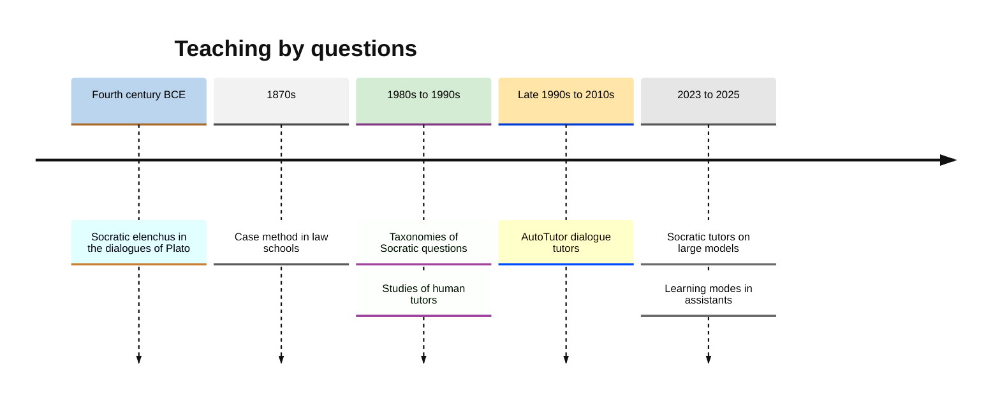
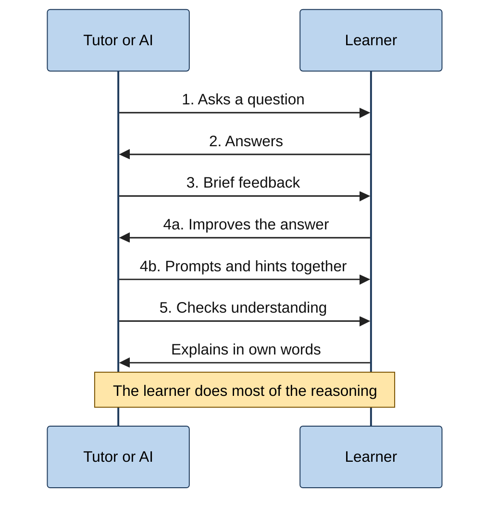
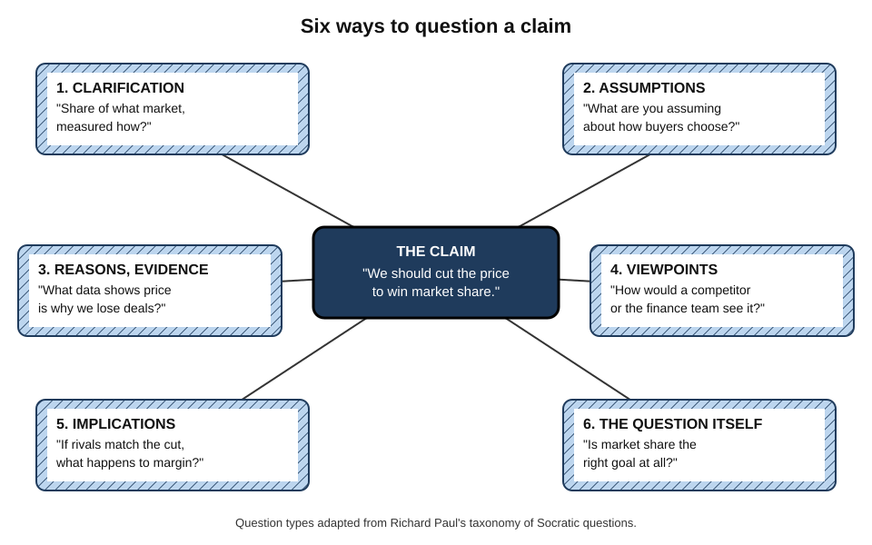
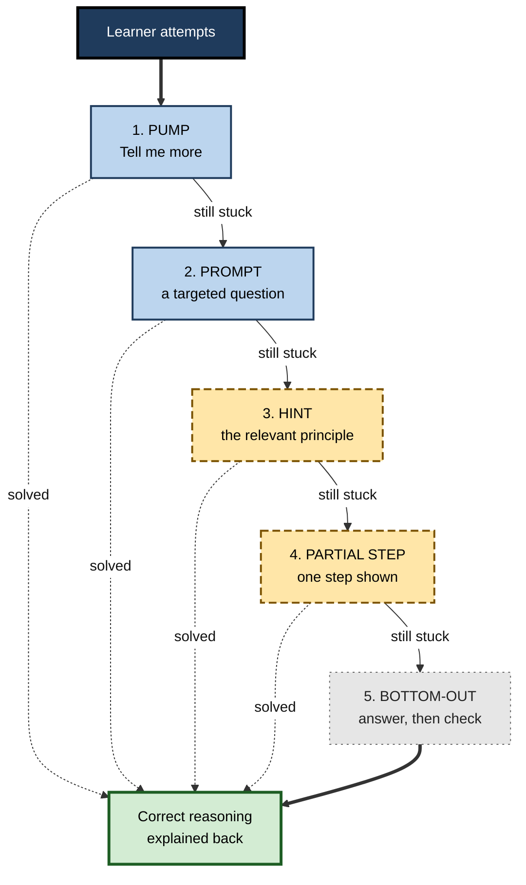
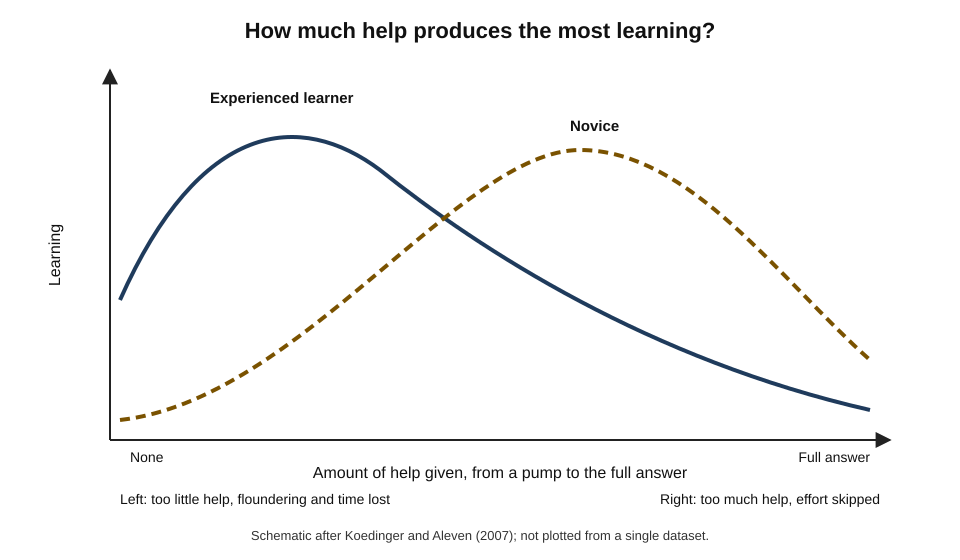
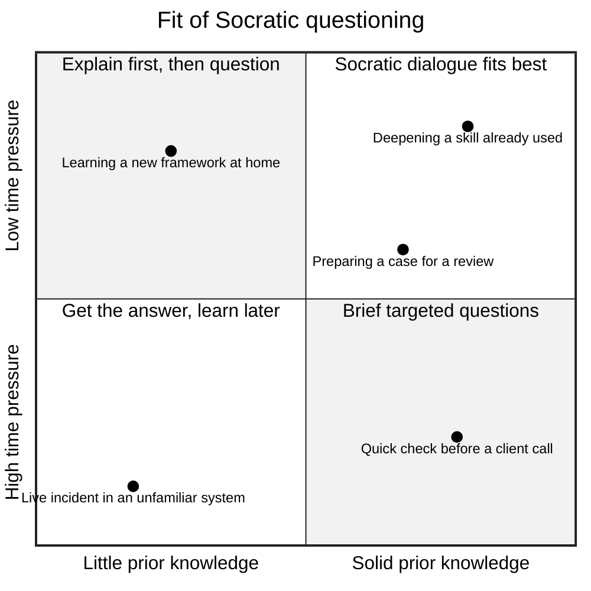

# B.8. Socratic AI: Questioning-Based Learning

In Plato's dialogue *Meno*, Socrates draws a square in the sand and asks an uneducated servant boy how to double its area. The boy answers "double the side", is led by questions to see that this quadruples the area, and is then guided, still only by questions, to discover that the square on the diagonal is the answer.

Twenty-four centuries later, an AI tutor asked for the derivative of x squared replies: "What happens to the area of a square when its side grows a little?" The method is the same: **the learner builds the answer; the teacher builds the questions**.

> **Definition — Socratic questioning:** a method of teaching through disciplined, sequenced questions that lead learners to examine their beliefs, expose contradictions and construct understanding for themselves.

> **Definition — Socratic AI:** an AI tutor or assistant configured to teach mainly by asking questions, giving graduated hints and withholding direct answers, so that the learner does the reasoning.

**Why it matters**

- Generating an answer, even with help, produces more durable learning than reading one; questioning is the most direct way to make a learner generate.
- Default chatbots answer immediately — the opposite of Socratic teaching — and controlled studies show this can harm later unaided performance.
- From 2023 onwards, AI tutors and the 2025 learning modes of the major assistants were built around Socratic principles; knowing what good questioning looks like lets a learner judge and steer them.
- Questioning is also how professionals learn judgement — through case discussion, review and challenge — and AI can now supply a tireless, if imperfect, questioner.

---

## The Socratic Tradition

### Elenchus and the midwife

- **Elenchus** — the questioning technique attributed to Socrates in Plato's early dialogues:
  1. the partner states a belief ("courage is endurance");
  2. Socrates secures agreement to further propositions;
  3. he shows these contradict the original belief;
  4. the partner is left in **aporia** — perplexity — and must reconsider.
- **The midwife (maieutic) image** — in the *Theaetetus*, Socrates compares himself to a midwife who does not give birth to ideas but helps others deliver their own.
- **The *Meno*** — used by Plato to argue that learning is "recollection"; read today mainly as a demonstration that questions can lead a learner to discover a result.

> **Definition — Aporia:** a state of puzzlement reached when a person realises their existing beliefs cannot answer a question; in Socratic teaching, the starting point for real inquiry.

> **Watch out:** the historical Socrates mostly **refuted** and rarely delivered positive answers; many dialogues end in aporia. Modern "Socratic teaching" — guided questioning towards a known answer — is a later adaptation. Neither is a precise, single method.

### From Athens to the classroom and the courtroom

- **Law schools (from the 1870s)** — Christopher Columbus Langdell at Harvard introduced the **case method**, in which professors question students about appellate cases, pressing them to extract and test the underlying principles; it became known as the "Socratic method" in legal education.
- **Critical-thinking education (from the 1980s)** — Richard Paul and Linda Elder developed taxonomies of Socratic questions to teach reasoning across subjects.
- **Tutoring research (1990s)** — studies of human tutors examined how questions, hints and feedback are actually used.
- **Intelligent tutors (from the late 1990s)** — Arthur Graesser's **AutoTutor** held natural-language dialogues using a repertoire of pumps, hints and prompts.
- **Generative AI (from 2023)** — tutors built on large language models were instructed to question rather than answer; in 2025 major assistants added Socratic learning modes.

**Figure 1.** The Socratic method from ancient dialogue to AI tutors.

---

## Why Questioning Teaches

### Mechanisms

- **Generation** — producing an answer creates a stronger memory than reading it.
- **Retrieval** — each question forces recall of relevant knowledge, strengthening it.
- **Self-explanation** — "why?" and "how do you know?" questions make the learner articulate reasons.
- **Gap detection** — trying to answer reveals what is not known, which reading never does.
- **Conflict** — a question that exposes a contradiction creates the dissatisfaction needed to revise a misconception.
- **Ownership** — conclusions reached oneself are more convincing, and more readily applied, than conclusions handed over.

> **Key point:** a good question transfers the cognitive work **from the teacher to the learner** — which is where learning happens.

### Elaborative interrogation

- **The technique:** prompting learners to answer "why is this true?" about facts they study.
- **Michael Pressley and colleagues (1987)** found that adults who answered "why" questions about sentences ("the hungry man got into the car") remembered them much better than those who read explanations or simply read the sentences.
- **John Dunlosky and colleagues (2013)** rated elaborative interrogation of **moderate** utility: effective, particularly when learners have some prior knowledge, though less studied with complex materials.

> **Definition — Elaborative interrogation:** generating explanations for why stated facts are true, typically by answering "why?" questions.

### What the tutoring research shows

**Study card — Michelene Chi and colleagues (2001), "Learning from human tutoring"**

- **Design:** university students learned about the human circulatory system from tutors.
  - **Normal tutoring** — tutors taught as they wished, often explaining at length.
  - **Prompting-only tutoring** — the same tutors were restricted to **content-free prompts** ("What do you think?", "Could you explain that further?", "What does that mean?"), without explaining or giving feedback.
- **Results:** students in prompting-only sessions talked and reasoned much more, and learned **about as much** overall as students with normal tutoring, and in some measures of deeper understanding did as well or better.
- **Conclusion:** much of what makes tutoring effective is what it makes the **learner** do — construct, explain, reflect — not only what the tutor says.

> **Watch out:** this does not mean explanations are useless. Prompting worked for learners with a textbook and some knowledge; for complete novices, explanation is often needed before questions can be answered.

**Arthur Graesser and Natalie Person (1994)** found that in classrooms students asked very few questions — on the order of a few per hour across a whole class — and that in tutoring students asked many more, though still few **deep** questions (why, how, what if). Questions mostly came from tutors.

- **The five-step tutoring frame** (Graesser, Person and Joseph Magliano, 1995), common in human tutoring:
  1. tutor asks a question;
  2. student answers;
  3. tutor gives brief feedback;
  4. tutor and student collaboratively improve the answer;
  5. tutor checks the student's understanding.

**Figure 2.** The five-step frame common in human tutoring, which a Socratic AI tutor can follow.

### Expert tutors

- **Mark Lepper and Maria Woolverton (2002)** studied highly effective tutors and summarised their qualities in the acronym **INSPIRE**:
  - **I**ntelligent — deep subject and pedagogical knowledge;
  - **N**urturant — supportive, building rapport;
  - **S**ocratic — asking far more than telling;
  - **P**rogressive — moving from easier to harder problems;
  - **I**ndirect — giving feedback subtly, often through questions;
  - **R**eflective — asking students to articulate and generalise;
  - **E**ncouraging — building confidence and motivation.

> **Mnemonic — INSPIRE:** Intelligent, Nurturant, Socratic, Progressive, Indirect, Reflective, Encouraging.

---

## Kinds of Socratic Question

### Six types

Adapted from **Richard Paul's** taxonomy of Socratic questions:

- **Clarification** — "What exactly do you mean by…?"
  - *e.g.* "When you say the project is 'at risk', at risk of what?"
- **Probing assumptions** — "What are you taking for granted?"
  - *e.g.* "You assume the customer will renew. Why?"
- **Probing reasons and evidence** — "How do you know?"
  - *e.g.* "What data supports the claim that churn is rising?"
- **Viewpoints and perspectives** — "How would someone else see this?"
  - *e.g.* "How would the finance director describe this decision?"
- **Implications and consequences** — "What follows if that is true?"
  - *e.g.* "If we cut the price by 10%, what happens to the margin and to competitors?"
- **Questions about the question** — "Why does this question matter? Is it the right one?"
  - *e.g.* "Are we asking how to reduce cost when we should be asking whether to offer this service at all?"

> **Mnemonic — "Clever Assistants Rarely Volunteer Instant Answers":** Clarification, Assumptions, Reasons, Viewpoints, Implications, Asking about the question.

**Figure 3.** Six kinds of Socratic question, each opening a different line of thinking.

| Question type | Thinking it develops | Typical AI prompt to request it | Professional use |
|---|---|---|---|
| Clarification | Precision of concepts | "Ask me to define each key term I use." | Requirements; contracts |
| Assumptions | Awareness of premises | "Identify and question my assumptions." | Forecasts; business cases |
| Reasons and evidence | Justification | "For each claim, ask what my evidence is." | Analysis; audit; diagnosis |
| Viewpoints | Perspective-taking | "Ask how three stakeholders would see this." | Negotiation; change management |
| Implications | Consequential reasoning | "Ask what follows if I am right, and if I am wrong." | Strategy; risk |
| Question about question | Problem framing | "Challenge whether I am solving the right problem." | Consulting; product design |

### Question depth

- **Shallow questions** — who, what, when; answerable by recall.
- **Deep questions** — why, how, what if, what if not, how do we know; requiring causal, logical or goal-based reasoning.
- **Good Socratic sequences** begin with what the learner can answer, then deepen step by step.

---

## Graduated Help: the Hint Ladder

A Socratic tutor must decide how much help to give after each answer. AutoTutor and later systems formalised a ladder of increasingly specific moves.

- **Pump** — a content-free nudge: "What else?", "Tell me more."
- **Prompt** — a question seeking a specific word or idea: "And the force on the object is called…?"
- **Hint** — a pointer to the relevant principle: "Think about what happens to momentum in a collision."
- **Partial solution** — one step worked out, the rest left to the learner.
- **Assertion or bottom-out** — the answer or step stated, followed by a check that it is understood.

> **Definition — Hint ladder:** a sequence of increasingly specific forms of help — from content-free prompts to the full answer — given only as needed, so that the learner does as much of the reasoning as they can.

**Figure 4.** The hint ladder: help increases one rung at a time, and only after an attempt.

> **Key point:** the aim is to give the **least** help that lets the learner make progress. Each rung skipped is reasoning the learner did not do.

### The assistance dilemma

- **Kenneth Koedinger and Vincent Aleven (2007)** named the **assistance dilemma**: giving too little help leaves learners floundering and wastes time; giving too much prevents the effort that builds learning.
- **The resolution depends on:**
  - the learner's prior knowledge;
  - the difficulty of the step;
  - the cost of time;
  - whether the goal is learning or getting the task done.

> **Definition — Assistance dilemma:** the problem of balancing giving and withholding help so that learners neither flounder nor skip the effort that produces learning.

**Figure 5.** The assistance dilemma: learning is greatest at an intermediate level of help that shifts with the learner's knowledge.

---

## Socratic AI in Practice

### Evidence from AI tutors

- **Hint-giving versus answer-giving** — in the 2025 Turkish high-school field experiment by Hamsa Bastani and colleagues, a GPT-4 tutor prompted to give hints rather than answers avoided the drop in unaided exam performance that students using a standard chatbot suffered.
- **Course-integrated, research-designed tutors** — the Harvard physics tutor that outperformed active-learning classes (published 2025) was explicitly designed to guide step by step and not to reveal full solutions.

**Study card — Yizhou Fan and colleagues (2025), "Beware of metacognitive laziness"**

- **Design:** a randomised experiment with university students writing an essay task with one of four kinds of support: **ChatGPT**, a **human expert** in chat, **writing-analytics** tools, or **no extra support**.
- **Results:**
  - the ChatGPT group improved its **essay scores** most;
  - but **knowledge gain** and **transfer** did not differ significantly between groups;
  - the groups differed in the frequency and sequence of their self-regulated learning processes; ChatGPT users showed less of the planning, monitoring and evaluation that indicates metacognitive engagement.
- **Conclusion:** the authors warned of **metacognitive laziness** — dependence on AI that improves the product in the short term while the learner's own regulation of learning goes idle.

> **Definition — Metacognitive laziness:** the tendency, when an AI tool is available, to hand over the planning, monitoring and evaluating of one's own work and learning, improving immediate output without improving underlying capability.

> **Key point:** answer-giving AI tends to switch off the learner's own questioning; Socratic AI is an attempt to switch it back on.

### Building a Socratic session

**A prompt specification**

- **Role and stance** — "Act as a Socratic tutor. Your goal is my understanding, not my comfort."
- **Diagnosis first** — "Begin by asking what I already think about this."
- **One question at a time** — "Ask one question, then stop and wait."
- **Hint ladder** — "If I am stuck, give the smallest hint possible; give the answer only after three attempts, and then ask me to explain it back."
- **Honesty** — "If my answer is wrong, say so clearly. Do not agree with me to be kind."
- **Question types** — "Use clarification, assumption, evidence and implication questions."
- **Close** — "End by asking me to summarise what I now understand and what I am still unsure of."

### Worked example (illustrative): a Socratic dialogue on pricing

A junior product marketer believes that cutting price always increases revenue.

1. **AI (clarification):** "When you say revenue increases, revenue from what — this product alone, or the whole range?"
2. **Learner:** "This product."
3. **AI (assumption):** "What are you assuming about how customers respond to a lower price?"
4. **Learner:** "That more people buy."
5. **AI (implication):** "Suppose you cut the price by 20% and sales volume rises by 10%. What happens to revenue?"
6. **Learner:** "Price times volume… 0.8 times 1.1 is 0.88. Revenue falls by 12%."
7. **AI (reasons):** "So what would have to be true about customers for a price cut to raise revenue?"
8. **Learner:** "Volume would have to rise by more than 25%, to make up the 20% cut."
9. **AI (viewpoint):** "How might a competitor respond, and how would that change your answer?"
10. **Learner:** "They might match the cut, so our volume would not rise as much."
11. **AI (question about the question):** "Is revenue even the right goal here? What about margin?"
12. **Learner:** "Margin falls even faster, because the cost per unit does not change."

> **Formula — Revenue after a price change:** new revenue ÷ old revenue = (1 + price change) × (1 + volume change). With a 20% cut and 10% volume rise: 0.8 × 1.1 = 0.88, a **12% fall**. Break-even volume rise = 1 ÷ 0.8 − 1 = **25%**.

- **What the learner built:** the idea of **price elasticity** — that whether a price cut raises revenue depends on how strongly volume responds — without being told the term until the end.
- **Close:** the AI then names the concept, defines it and asks the learner to explain when demand is likely to be elastic or inelastic.

| | Told directly | Led by questions |
|---|---|---|
| Time taken | Two minutes | Ten minutes |
| Learner's activity | Reading a definition | Calculating, predicting, revising a belief |
| Misconception | Possibly retained alongside the new fact | Confronted and replaced |
| Likely transfer | Can recite the definition | Can reason about a new pricing decision |

---

## When Socratic Questioning Fails

### Failure modes

- **Guess-what-I-am-thinking** — leading questions with one hidden "right" answer, which turn reasoning into mind-reading.
- **Disguised lecturing** — "Wouldn't you agree that…?" questions that are statements in question form.
- **Endless questioning** — no progress, rising frustration, no closure.
- **Questions beyond the learner's knowledge** — the learner has nothing to reason with.
- **Caving under pressure** — the AI gives the full answer as soon as the learner insists or claims urgency.
- **Mis-diagnosis** — the AI misreads the learner's answer and questions the wrong thing.
- **False confidence** — the AI "confirms" a wrong conclusion the learner reached.

| Failure | What it feels like | Remedy |
|---|---|---|
| Guess-what-I-am-thinking | "I don't know what you want" | Ask for open questions; allow several valid answers |
| Endless questioning | Frustration; no progress | Set a hint ladder with a bottom-out after a fixed number of attempts |
| Beyond knowledge | Blank; random guesses | Ask for a short explanation or worked example first |
| Caving | Answer appears when the learner pushes | Restate the rule; use a learning mode |
| False confirmation | Wrong idea praised | Ask the AI to check reasoning against a source; verify independently |

### When to choose another method

- **No prior knowledge** — begin with explanation and worked examples; question afterwards.
- **Simple facts or conventions** — there is nothing to discover in a file-naming rule or a statutory deadline; look them up and retrieve them later.
- **Time-critical tasks** — in an incident or a client deadline, get the answer; schedule a Socratic review afterwards.
- **High frustration** — a learner overwhelmed by confusion learns little; reduce the challenge, then resume.

**Figure 6.** When Socratic questioning fits, by prior knowledge and time pressure.

---

## Becoming One's Own Socrates

### Self-questioning

- **Alison King (1992)** taught students to use **generic question stems** while studying lectures and texts — "What is a new example of…?", "How does … affect …?", "What are the strengths and weaknesses of…?", "How is … different from …?", "Why is … important?"
  - Students who generated and answered such questions understood and remembered lecture material better than those who reviewed or summarised.
- **AI as a training partner** — the learner writes their own questions about material; the AI evaluates their depth, suggests deeper versions and models question types the learner underuses.

> **In practice:** before asking an AI anything during study, write down the **question one would ask oneself**, and attempt it. Over time this internalises the questioning that Socratic AI supplies externally — the real goal of the method.

### Socratic AI for professional judgement

- **Pre-decision challenge** — "Here is my recommendation. Ask me the six hardest questions a sceptical board would ask, one at a time."
- **Assumption audits** — "List the assumptions my forecast depends on, and ask me how confident I am in each."
- **Post-mortems and reviews** — "Question me about this failed project until we reach root causes, not symptoms."
- **Devil's advocate** — "Argue against my position and make me defend it."

> **Example (illustrative):** before presenting a market-entry recommendation, a strategy analyst asks the AI to play a sceptical investment committee. Its questions about currency risk and distributor exclusivity expose two assumptions she had not tested; she researches both before the real meeting.

### Socratic AI in groups

- **Seminar support** — an AI can pose a sequence of questions to a small group working on a case, keeping the discussion moving while the group, not the AI, supplies the reasoning.
- **Structured disagreement** — the AI can be asked to give each member a different perspective to defend, then question each position in turn.
- **Benefits** — every member must reason aloud; quieter members get a turn; the group sees how its assumptions differ.
- **Risks** — groups may defer to the AI as an authority; one confident member may answer for everyone; the AI may miss the social dynamics a human facilitator would notice.

> **In practice:** a project team runs a fifteen-minute AI-questioned review at the end of each sprint — "What did we assume would happen? What actually happened? What would we do differently, and how will we know if it worked?" — with a rotating member responsible for answering first. The questions are generic; the value lies in the team having to answer them aloud.

### Case study (illustrative): a junior auditor learns materiality

- **Situation:** a first-year auditor could recite the definition of **materiality** — the threshold above which a misstatement could influence users' decisions — but applied fixed percentage benchmarks mechanically, missing qualitatively important items.
- **Approach:** her manager set up weekly 30-minute Socratic sessions with an AI tutor restricted to the firm's audit methodology, with rules: one question at a time, hints before answers, explain-back at the end.
- **Typical session:**
  1. the AI presented a short case — a small misstatement in directors' remuneration;
  2. asked whether it was material, and why;
  3. probed her assumption that "below the threshold means immaterial";
  4. asked how a shareholder or regulator would view the item;
  5. asked what would follow if it were left uncorrected;
  6. closed by asking her to state a general rule in her own words.
- **Result:** within two months her working papers began to flag qualitative materiality issues; in review, her manager found her reasoning explicit and defensible.
- **Caveats:** in two sessions the AI accepted a flawed rule she proposed; her manager caught both in review, which became a lesson in checking AI confirmations.
- **Lesson:** Socratic AI built **judgement** — the ability to reason with a concept in context — that definitions and checklists had not.

---

## Open Questions

- **Can AI diagnose well enough to choose the right next question?**
  - Good Socratic teaching depends on reading the learner's thinking accurately; AI diagnosis is improving but unreliable.
- **How strict should Socratic modes be?**
  - Strict modes frustrate and may drive learners to answer-giving tools; loose modes collapse into answering.
- **Does AI questioning build self-questioning?**
  - The hope is internalisation; evidence that learners become better self-questioners after AI tutoring is scarce.
- **Is Socratic AI equally effective across subjects?**
  - Mathematics and science have clear right answers; in ethics, design or strategy, questioning towards a predetermined answer is more problematic.
- **What happens to motivation?**
  - Constant questioning can feel like interrogation; how to keep it encouraging, as expert tutors do, is not well understood.

---

## Summary

- **Socratic questioning** teaches through sequenced questions that lead learners to examine beliefs and construct understanding; **Socratic AI** applies this through questions, graduated hints and withheld answers.
- Origins: Socratic **elenchus** and **aporia**, the midwife image, the *Meno*; later the law-school case method, Paul's question taxonomies, tutoring research and **AutoTutor**.
- Questioning works through **generation, retrieval, self-explanation, gap detection, conflict and ownership**; **elaborative interrogation** has moderate utility.
- **Chi and colleagues (2001)**: content-free prompting produced learning comparable to full tutoring — the learner's construction drives learning. **INSPIRE** describes expert tutors.
- Six question types: **clarification, assumptions, reasons and evidence, viewpoints, implications, questions about the question**.
- The **hint ladder** (pump, prompt, hint, partial step, bottom-out) gives the least help needed; the **assistance dilemma** is balancing too little against too much.
- Evidence: hint-giving AI avoided harms of answer-giving AI; ChatGPT support improved essays but not knowledge or transfer, with signs of **metacognitive laziness**.
- Failure modes: guess-what-I-am-thinking, disguised lectures, endless questioning, questions beyond knowledge, caving, false confirmation.
- Use other methods for novices without prerequisites, simple facts, urgent tasks and high frustration.
- The goal is **self-questioning** (King, 1992) and better **professional judgement**.

---

## Self-Check

1. Define Socratic questioning and Socratic AI.
2. Describe the elenchus and the state of aporia. How does modern Socratic teaching differ from the historical Socrates?
3. Explain four mechanisms through which answering questions produces learning.
4. What is elaborative interrogation, and how did Dunlosky and colleagues rate it?
5. Summarise the design and finding of Chi and colleagues' 2001 study. What caveat applies?
6. Describe the five-step tutoring frame.
7. Name Paul's six types of Socratic question and give a workplace example of each.
8. Describe the hint ladder and explain why the least sufficient help is preferred.
9. What is the assistance dilemma, and on what does its resolution depend?
10. Summarise the "metacognitive laziness" study and its implication for AI design.
11. A product's price falls by 25% and volume rises by 20%. What happens to revenue? What volume rise would keep revenue unchanged?
12. Name four failure modes of Socratic AI and the remedy for each.
13. When should a learner choose explanation over Socratic questioning?
14. Write a prompt specification for a Socratic session on a topic you are learning, and explain how you would judge whether the session worked.

### Answer Key

1. Socratic questioning: teaching through sequenced questions leading learners to examine beliefs and construct understanding. Socratic AI: AI configured to teach mainly by questions and graduated hints, withholding answers.
2. Elenchus: securing agreement to propositions that contradict the partner's belief, producing aporia — puzzlement that motivates inquiry. Socrates mostly refuted and often left questions open; modern Socratic teaching guides learners towards known answers.
3. Generation (self-produced answers are better remembered), retrieval (recall strengthens memory), self-explanation (articulating reasons), gap detection, conflict that motivates conceptual change, ownership of conclusions.
4. Generating explanations for why facts are true; rated moderate utility — effective, especially with prior knowledge, but less studied with complex materials.
5. Tutors either taught normally or used only content-free prompts; students in prompting sessions reasoned more and learned about as much. Caveat: students had materials and some knowledge; complete novices often need explanation first.
6. Tutor asks; student answers; tutor gives brief feedback; both improve the answer; tutor checks understanding.
7. Clarification ("what do you mean by at risk?"), assumptions ("why assume renewal?"), reasons and evidence ("what data shows rising churn?"), viewpoints ("how would finance see it?"), implications ("what follows from a 10% cut?"), question about the question ("is cost the right question?").
8. Pump, prompt, hint, partial step, bottom-out with a check. The least sufficient help preserves as much of the learner's reasoning as possible; each skipped rung removes learning.
9. Balancing too little help (floundering, wasted time) against too much (skipped effort). It depends on prior knowledge, step difficulty, cost of time and whether the goal is learning or task completion.
10. ChatGPT support raised essay scores but not knowledge gain or transfer, with reduced metacognitive processes. AI for learning should keep learners planning, monitoring and evaluating — for instance through questioning rather than doing.
11. 0.75 × 1.2 = 0.90, a 10% fall. Break-even volume rise = 1 ÷ 0.75 − 1 ≈ 33%.
12. Guess-what-I-am-thinking (ask for open questions); endless questioning (bottom-out after set attempts); beyond knowledge (explanation or worked example first); caving (restate rules or use a learning mode); false confirmation (verify against sources).
13. When prerequisites are missing, when the content is a simple fact or convention, when time pressure is high, or when frustration is blocking progress.
14. A good specification sets the role, diagnosis first, one question at a time, a hint ladder with bottom-out, honesty about errors, question types and a closing summary. Judge success by unaided explanation and application the next day, not by how the session felt.

---

## Glossary

| Term | Meaning |
|---|---|
| Aporia | Puzzlement reached when existing beliefs cannot answer a question. |
| Assistance dilemma | Balancing giving and withholding help so learners neither flounder nor skip effort. |
| Bottom-out hint | The final rung of help: the answer itself, followed by a check. |
| Case method | Teaching through questioning about real cases, notably in law schools. |
| Elaborative interrogation | Generating explanations for why facts are true. |
| Elenchus | Socratic questioning that exposes contradictions in a belief. |
| Hint ladder | Increasingly specific forms of help given only as needed. |
| INSPIRE | Qualities of expert tutors: Intelligent, Nurturant, Socratic, Progressive, Indirect, Reflective, Encouraging. |
| Maieutic | Of the "midwife" method: helping others bring forth their own ideas. |
| Metacognitive laziness | Handing over planning, monitoring and evaluation of one's work to AI. |
| Pump | A content-free prompt such as "tell me more". |
| Socratic AI | AI configured to teach mainly through questions and graduated hints. |
| Socratic questioning | Teaching through sequenced questions that lead learners to construct understanding. |
