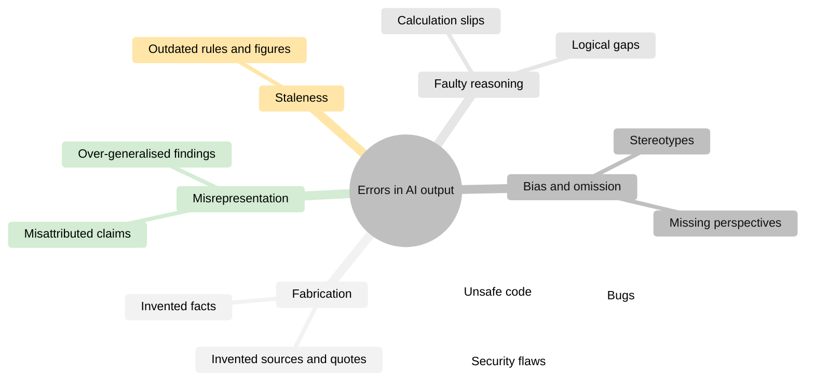
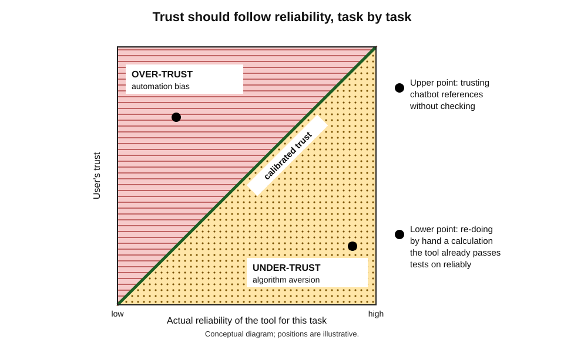
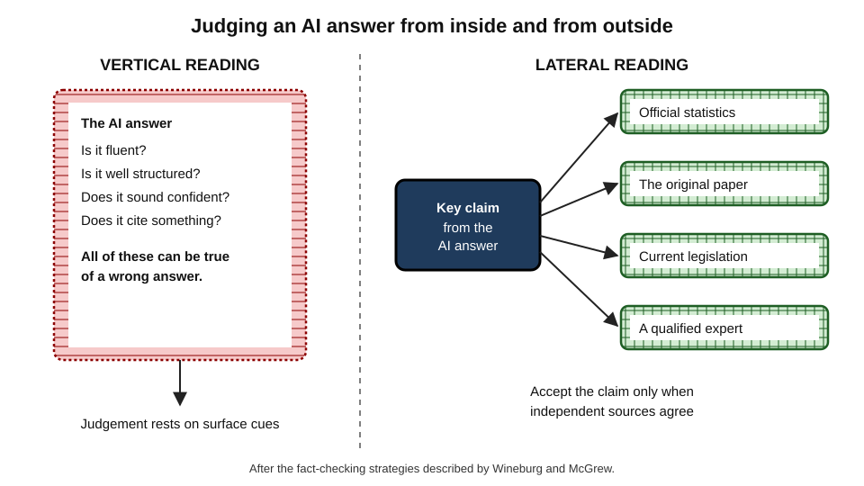
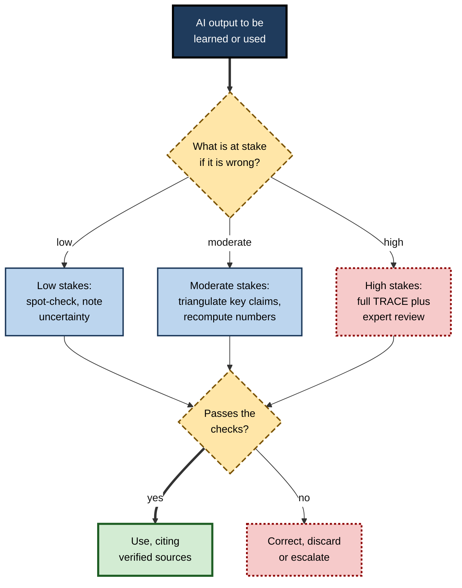
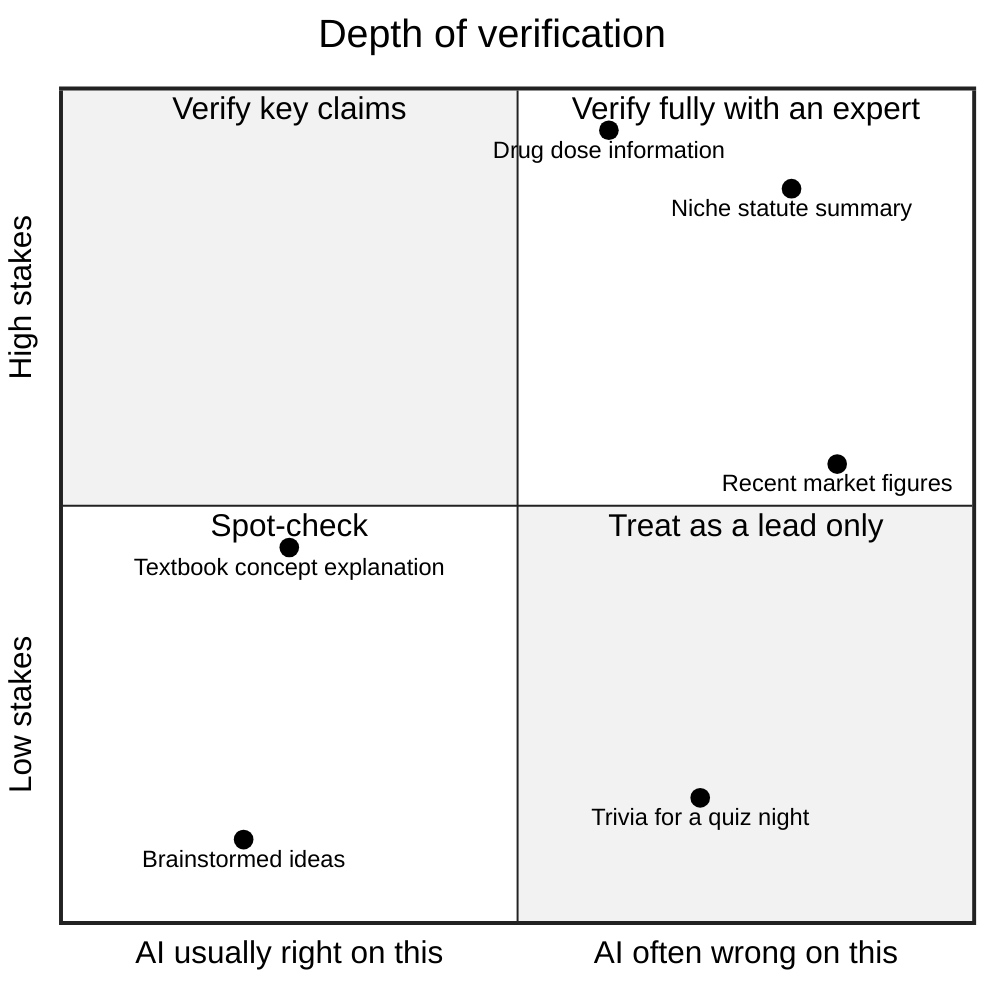

# G.9. Critical Evaluation of AI-Generated Content

In 2023 a New York lawyer filed a brief in a personal-injury case against an airline citing six earlier court decisions. None existed: a chatbot had invented them, complete with plausible names, quotations and page numbers, and had assured him they were real when he asked. The judge fined the lawyers and their firm. The tool's error was predictable; the professional failure was not checking. In an age of fluent machine-generated text, the ability to **evaluate** content has become as important as the ability to produce it.

> **Definition — Critical evaluation of AI-generated content:** the systematic judgement of whether AI output is accurate, complete, well supported, unbiased and fit for its purpose, before it is learned, used or passed on.

> **Definition — Hallucination (in AI):** output that is fluent and plausible but false or unsupported — invented facts, sources, quotations or reasoning — presented as if true.

**Why it matters**

- Generative AI produces errors **in the same confident voice** as correct content, so surface cues of quality no longer signal reliability.
- A learner who absorbs AI errors does not merely fail a task — they **learn** something false, which is harder to correct later.
- Professionals remain accountable for what they submit, sign or advise, whatever tool produced the first draft.
- Evaluating AI output is now a core skill of every knowledge profession, and the human contribution that grows in value as AI produces more.

---

## Why AI Output Goes Wrong

### The mechanism

- **Prediction, not lookup** — a language model generates the most plausible continuation of text given its training; it does not consult a database of verified facts unless connected to one.
- **Plausibility is not truth** — a fabricated court case with a realistic name and citation format is, statistically, very plausible text.
- **Rewarded guessing** — researchers at OpenAI argued in a 2025 paper that common training and evaluation methods reward a confident guess over an admission of uncertainty, much as a multiple-choice test rewards guessing, which encourages hallucination.
- **Knowledge limits** — training data has a cut-off date, gaps and errors; rare or specialised facts are least reliable.
- **Reasoning errors** — multi-step calculations, logic and planning can fail even when each step looks reasonable.
- **Agreement with the user** — models tend to adopt the user's framing and assumptions, and may abandon correct answers under pressure (sycophancy).
- **Retrieval errors** — search-connected tools can fetch poor sources, misread good ones or attach the wrong citation.

> **Key point:** errors are not random glitches that will soon disappear; they follow from how the systems work. Rates have fallen with newer models, but **no model is error-free**, and errors are hardest to spot where the user knows least.

### Kinds of error

**Figure 1.** Kinds of error in AI-generated content.

| Error type | Example | How it is usually detected |
|---|---|---|
| Fabricated fact | A statistic with no real source | Searching for the original source |
| AI-error log | A personal record of AI mistakes met, used to learn their patterns. |
| Fabricated citation | A paper or case that does not exist | Looking up every reference |
| Misattribution | A real finding credited to the wrong study | Reading the cited source |
| Outdated content | A superseded tax threshold | Checking the current official text |
| Reasoning error | A wrong total in a financial calculation | Recomputing independently |
| Unsafe code | An injection vulnerability in a database query | Tests, review, security scanning |
| Bias or omission | A "standard practice" that holds only in one country | Asking for other jurisdictions and perspectives |

### Evidence on fabricated references

**Study card — William Walters and Esther Isabelle Wilder (2023)**

- **Design:** the researchers asked ChatGPT (versions based on GPT-3.5 and GPT-4) to write short literature reviews on a range of topics and then checked every citation.
- **Results:**
  - about **55%** of GPT-3.5's citations and about **18%** of GPT-4's were **fabricated** — the works did not exist;
  - many of the **real** citations contained substantive errors in details such as authors, dates or titles.
- **Conclusion:** chatbot-generated references could not be trusted without checking, even from the stronger model.
- **Status:** later, search-connected tools fabricate references less often, but still attach real references to claims they do not support.

### Evidence on code

- **Hammond Pearce and colleagues (2022)** generated programs with an AI coding assistant for scenarios involving common security weaknesses; roughly **40%** of the generated programs contained vulnerabilities.
- **Neil Perry and colleagues (2023)** found in a user study that participants with access to an AI assistant wrote **less secure** code than those without, yet were **more likely to believe** their code was secure.

> **Watch out:** the Perry finding generalises: AI assistance can lower quality while **raising confidence**. Confidence after using AI is not evidence of correctness.

---

## The Human Side of Error

### Automation bias

> **Definition — Automation bias:** the tendency to favour suggestions from automated systems and to under-check them, leading to errors of commission (following wrong advice) and omission (missing problems the system did not flag).

- **Raja Parasuraman and Dietrich Manzey (2010)** reviewed studies in aviation, medicine and process control: automation bias appeared in experts as well as novices, was not removed simply by training, and was stronger when people were busy or the system was usually reliable.
- **The reliability paradox** — the more often a tool is right, the less people check it, and the more damaging its rare errors become.
- **Knowledge workers** — a 2025 survey study of 319 knowledge workers by Hao-Ping Lee and colleagues found that greater confidence in AI was associated with less critical thinking effort, while greater self-confidence was associated with more.

### Explanations do not automatically help

- **Gagan Bansal and colleagues (2021)** found that AI explanations increased people's acceptance of AI recommendations **whether or not** the recommendations were correct — explanations made people trust more, not check better.
- **Helena Vasconcelos and colleagues (2023)** found that explanations reduced over-reliance when they made **verification easier** than simply trusting — for instance, when checking the explanation took less effort than solving the task oneself.

> **Key point:** the design question is not "does the AI explain itself?" but "does the explanation make **checking** cheaper than **trusting**?"

### Calibrated trust

> **Definition — Calibrated trust:** trust in a tool that matches its actual reliability for a given kind of task — neither over-trust (relying where it is unreliable) nor under-trust (refusing it where it is reliable).

- **Algorithm aversion** — Berkeley Dietvorst, Joseph Simmons and Cade Massey (2015) found people abandoned forecasting algorithms after seeing them err, even when the algorithms outperformed humans.
- **Algorithm appreciation** — Jennifer Logg, Julia Minson and Don Moore (2019) found people often weighted advice more when told it came from an algorithm than from a person.
- **The goal** — trust that varies by **task**: high where the tool is demonstrably reliable and errors are cheap to catch; low where it is weak or errors are costly.

**Figure 2.** Calibrated trust: trust should rise with a tool's demonstrated reliability for a task, avoiding over-trust and under-trust.

### The novice's paradox

- **Evaluating requires knowledge** — spotting a wrong legal principle, a misapplied statistical test or an insecure function needs expertise in that field.
- **Learners lack it by definition** — the person who most needs AI explanation is least able to detect its errors.
- **Implications for learners:**
  - learn the field's **core** well enough to recognise nonsense;
  - prefer AI uses where outputs are **checkable** — code that can be run, calculations that can be redone, claims with traceable sources;
  - lean on **grounded** tools and authoritative materials for unfamiliar content;
  - keep a **log of AI errors** met in one's field — the patterns become a personal early-warning system.

> **Remember:** knowledge is the best defence against AI error. Every hour spent building one's own understanding makes every later hour with AI safer.

---

## Methods of Evaluation

### Lateral reading

**Study card — Sam Wineburg and Sarah McGrew (2017, published 2019)**

- **Design:** professional fact-checkers, PhD historians and Stanford undergraduates evaluated unfamiliar websites and social-media claims while thinking aloud.
- **Results:**
  - historians and students read **vertically** — staying on the page, judging it by its design, "about" section and content;
  - fact-checkers read **laterally** — leaving the page within seconds, opening new tabs to find what **other** sources said about the site and its claims;
  - fact-checkers reached accurate judgements faster and more often.
- **Conclusion:** credibility is best judged by **what others say** about a source, not by the source's own presentation.

> **Definition — Lateral reading:** evaluating a source or claim by consulting other, independent sources about it, rather than by examining the source itself in depth.

**Figure 3.** Vertical and lateral reading applied to an AI answer.

- **Application to AI** — an AI answer has no "about page" and its fluency signals nothing. The only reliable check is **lateral**: trace each important claim to independent, authoritative sources.

### SIFT

**Mike Caulfield's SIFT** method, widely taught in information literacy:

- **S — Stop** — pause before accepting or sharing; notice an emotional or confident reaction.
- **I — Investigate the source** — who is behind it, and what is their expertise and interest?
- **F — Find better coverage** — look for trusted sources reporting the same thing.
- **T — Trace** claims, quotes and media to their original context.

> **Mnemonic — SIFT:** Stop, Investigate, Find, Trace.

### Verification by kind of content

- **Facts and figures** — find the primary source (official statistics, legislation, the original paper); note the date.
- **Citations** — look up every one: does it exist, and does it say what is claimed?
- **Calculations** — recompute independently, or at least estimate the order of magnitude.
- **Reasoning** — check each step; try a counterexample; ask whether the conclusion follows.
- **Code** — run it, test edge cases, read it, scan for security issues; never deploy code one cannot explain.
- **Advice** in law, medicine, finance, safety — check against current authoritative guidance; consult a qualified person when the stakes are real.
- **Summaries** — compare decisive claims with the source.

### The TRACE routine

- **T — Triangulate** — does an independent, authoritative source agree?
- **R — Recompute** — redo numbers and logic oneself.
- **A — Ask for sources, then check them** — and the passage, not just the title.
- **C — Challenge** — ask for counter-arguments and counterexamples; ask "what would make this wrong?"
- **E — Expert review** — in proportion to the stakes.

> **Mnemonic — TRACE:** Triangulate, Recompute, Ask and check sources, Challenge, Expert review.

**Figure 4.** A verification routine for AI output, scaled to the stakes.

### Scaling verification to risk

- **Stakes** — how bad is it if the content is wrong? (A brainstorm versus a regulatory filing.)
- **Error likelihood** — how often is AI wrong on this kind of content? (Common knowledge versus a niche statute, recent events, numbers.)
- **Detectability** — will an error be caught later anyway? (Code with tests versus advice that goes straight to a client.)

**Worked example — scoring four AI outputs from 1 (low) to 3 (high)**

| Output | Stakes | Error likelihood | Hard to detect later | Total | Verification |
|---|---|---|---|---|---|
| Ideas for a team-building event | 1 | 1 | 1 | 3 | Glance |
| Explanation of a standard statistics concept | 2 | 1 | 2 | 5 | Check against a textbook |
| Summary of a new regulation for a client | 3 | 2 | 3 | 8 | Full TRACE and expert review |
| Code for a payment calculation | 3 | 2 | 1 | 6 | Tests, review, recomputed examples |

> **Formula — Verification priority (heuristic):** priority = stakes + error likelihood + difficulty of later detection, each scored 1–3. Totals of 7–9 call for full verification and expert review; 3–4 for a glance. Example: 3 + 2 + 3 = **8**, full review.

> **Watch out:** this is a practical heuristic, not a validated instrument. Its value lies in forcing an explicit decision instead of a habit of either checking nothing or checking everything.

**Figure 5.** How deeply to verify, by the stakes of an error and the likelihood of AI error for that kind of content.

### Worked example: checking a regulatory claim

A learning-and-development manager asks an assistant whether a planned tool that reads trainees' facial expressions to gauge engagement is lawful in the European Union. The answer: "The EU AI Act bans all emotion-recognition systems."

1. **Triangulate** — the official text of the Act and the European Commission's guidance show the prohibition applies to emotion recognition in **workplaces and educational institutions**, with exceptions for medical or safety reasons — not to all settings.
2. **Recompute** — the dates matter: the prohibitions applied from **February 2025**; the manager notes the date of the guidance consulted.
3. **Ask and check sources** — the assistant is asked for the article number; the cited article is read in full, including its exceptions.
4. **Challenge** — "In what circumstances would such a system be allowed?" reveals the medical and safety exceptions and the separate rules for uses outside work and education.
5. **Expert review** — because a procurement decision depends on it, the company's legal team confirms the reading.

| | AI answer | Verified position |
|---|---|---|
| Scope | All emotion recognition | Emotion recognition in workplaces and education |
| Exceptions | None mentioned | Medical and safety reasons |
| Practical conclusion | Banned everywhere | The planned training tool falls within the prohibition |
| Confidence | Implied certainty | Confirmed against the text and by legal counsel |

- **Lesson:** the AI's conclusion for this case happened to be right, but its stated rule was **over-general** — and would have misled the next decision about a different setting.

> **Watch out:** a right answer for the wrong reason is still a hazard for a learner, because it is the **reason** that gets learned and reused.

---

## Evaluating Beyond Accuracy

### Bias and perspective

- **Training data reflect the world unevenly** — over-representing some languages, countries, professions and viewpoints.
- **Typical effects:**
  - "standard practice" that is standard only in one jurisdiction;
  - stereotyped examples and images;
  - mainstream positions presented as consensus, minority positions omitted.
- **Probes:**
  - "How would this differ in India, the European Union and the United States?"
  - "What would critics of this view argue?"
  - "Whose perspective is missing from this account?"

### Completeness and fitness for purpose

- **Correct but incomplete** — an answer can be accurate in every sentence yet omit the exception that matters.
- **Right answer, wrong question** — a fluent answer to a slightly different question.
- **Wrong level** — too simple for a decision, too technical for a client.
- **Ask:** "What important considerations have not been mentioned?" — then judge whether the list is credible.

### Domain-specific checks

Every field has characteristic AI failure patterns; experienced professionals learn to look for them first.

- **Software**
  - code that runs but fails edge cases; insecure defaults; out-of-date library interfaces;
  - **invented packages** — studies of code-generating models found that a notable share of suggested software packages did not exist, especially from open models; attackers can register such names with malicious code;
  - check: tests, code review, dependency verification, security scanning.
- **Law**
  - fabricated or misquoted authorities; the wrong jurisdiction; repealed or amended provisions;
  - check: every authority in an official database; the current version of each statute.
- **Medicine and pharmacy**
  - outdated guidelines; doses for the wrong population; missing contraindications;
  - check: current national guidelines and formularies; never rely on AI for patient-specific decisions without professional verification.
- **Finance and accounting**
  - wrong dates, units or currencies; superseded standards; arithmetic slips in multi-step calculations;
  - check: recompute; reconcile to source data; confirm the standard in force.
- **Data analysis**
  - the wrong statistical test; code that silently drops missing rows; plausible charts from mis-joined tables;
  - check: row counts at each step; reproduce key numbers by another route; ask whether the method suits the data.

> **In practice:** keep a short **AI-error log** — date, tool, task, what was wrong, how it was caught. After a few months the log reveals the error patterns in one's own field and becomes the most useful verification guide a professional can have.

### Evaluating AI feedback on one's own work

Learners increasingly receive feedback from AI on drafts, code, designs and presentations. Such feedback needs evaluating as carefully as any other output.

- **Typical weaknesses:**
  - **flattery** — praise that is not earned, especially when the learner signals pride in the work;
  - **genericity** — comments that would fit any draft ("consider adding more detail");
  - **false precision** — confident corrections that are themselves wrong;
  - **inconsistency** — different verdicts on the same work in different sessions.
- **Tests for useful feedback:**
  - does each comment point to a **specific** place in the work?
  - does it explain **why** the point matters, against a stated criterion?
  - would a knowledgeable colleague **agree**?
  - does acting on it actually **improve** the work when judged independently?

> **In practice:** submit the same piece of work twice in separate sessions, once described as one's own and once as a colleague's, and compare the feedback. Large differences reveal how much of the response is flattery rather than judgement.

### Self-evaluation by the AI

- **Asking a model to check its own work** sometimes catches errors, especially simple ones, but models also confidently confirm their own mistakes.
- **A second, independent model** can surface disagreements; agreement is weak evidence, disagreement a strong signal to investigate.
- **Neither replaces** checking against authoritative sources.

---

## Professional Practice

### Accountability does not transfer

- **Legal sanctions** — courts in several countries have sanctioned lawyers for filing AI-fabricated citations since the 2023 New York case, and many courts now require disclosure or certification of AI use in filings.
- **Customer-facing AI** — in *Moffatt v Air Canada* (2024), a Canadian tribunal held the airline responsible for incorrect refund information given by its website chatbot, rejecting the argument that the chatbot was responsible for its own statements.
- **Professional codes** — accountancy, legal, medical and engineering bodies increasingly state that members remain responsible for AI-assisted work.

### Case study: a junior analyst's AI-assisted forecast

- **Situation:** a junior analyst in a consumer-goods firm used an AI assistant to build a demand forecast for a product launch and to write the accompanying memo.
- **Problem:** the memo cited an industry growth rate, a competitor's market share and a seasonal adjustment method; the forecast went to the leadership team.
- **Discovery:** a finance manager, sceptical of the growth rate, traced it: the figure came from a report about a **different region**; the competitor share was **three years old**; the seasonal method had been applied to monthly data with a quarterly factor, **overstating** peak demand by about a third.
- **Diagnosis:**
  1. no claim had been traced to a primary source;
  2. the calculation had not been recomputed independently;
  3. the analyst had trusted the output because it was well written and internally consistent.
- **Actions:**
  1. every external figure in planning documents now carries a source and date;
  2. forecasts are reproduced by a second analyst from raw data before sign-off;
  3. the analyst kept an AI-error log and shared patterns in a monthly team session.
- **Result:** the corrected forecast reduced the launch inventory order substantially, avoiding likely write-offs; the error log became a training resource for new joiners.
- **Lesson:** fluency and internal consistency are not evidence; **traceability** and **independent recomputation** are.

### Building evaluation into team learning

- **Four-eyes review** of AI-assisted work where stakes are high.
- **Disclosure norms** — saying which parts were AI-assisted helps reviewers know what to check.
- **Shared error libraries** — documented examples of AI failure in the team's own domain.
- **Practice with planted errors** — giving new staff AI outputs containing deliberate mistakes to find, which trains evaluation directly.

> **In practice:** one of the most effective ways to teach evaluation is to give learners AI answers in their own field that contain **real, subtle errors** and ask them to find and explain them. It builds domain knowledge and scepticism at the same time.

---

## Open Questions

- **Will hallucination be solved?**
  - Rates have fallen with retrieval, better training and calibrated refusals, but whether they can approach zero for open-ended generation is disputed.
- **How can verification keep pace with volume?**
  - AI produces content far faster than people can check it; organisations have not settled how much checking is enough.
- **Can AI reliably signal its own uncertainty?**
  - Calibrated confidence would make evaluation far cheaper; current signals are inconsistent.
- **Does reliance erode the knowledge needed to evaluate?**
  - If learners offload too much, they may lose the expertise that makes checking possible — a loop not yet well studied.
- **Who is liable when evaluation fails?**
  - Law and professional regulation are still adapting to shared human–AI responsibility.

---

## Summary

- **Critical evaluation** judges AI output for accuracy, completeness, support, bias and fitness for purpose before it is learned or used. **Hallucination** is fluent but false or unsupported output.
- Errors follow from **prediction rather than lookup**, rewarded guessing, knowledge limits, reasoning failures, sycophancy and retrieval errors; no model is error-free.
- Error types: fabrication, misattribution, staleness, faulty reasoning, unsafe code, bias and omission. **Walters and Wilder (2023)** found many chatbot references fabricated; studies of AI code found frequent vulnerabilities and **raised confidence**.
- **Automation bias** affects experts too and grows with tool reliability; explanations help only when they make **checking cheaper than trusting**; the aim is **calibrated trust**.
- The **novice's paradox**: those who most need AI are least able to judge it — so build core knowledge and prefer checkable uses.
- Methods: **lateral reading** (Wineburg and McGrew), **SIFT**, verification by content type and the **TRACE** routine; scale effort by **stakes, error likelihood and detectability**.
- Evaluate **bias, completeness and fitness for purpose**, not only accuracy; self-checks by AI help but do not replace sources.
- Each field has characteristic failure patterns — invented packages, wrong jurisdictions, outdated guidelines, silent data errors; an **AI-error log** makes them visible.
- **Accountability stays with the professional**, as courts and tribunals have confirmed; teams should build traceability, recomputation, disclosure and error libraries into practice.

---

## Self-Check

1. Define critical evaluation of AI content and hallucination.
2. Explain why language models produce fluent errors, giving three distinct causes.
3. Name six kinds of error in AI output and how each is usually detected.
4. Summarise the Walters and Wilder study and its practical lesson.
5. What did Perry and colleagues find about AI-assisted code and confidence?
6. Define automation bias and explain the reliability paradox.
7. Under what conditions do AI explanations reduce over-reliance?
8. Distinguish over-trust, under-trust and calibrated trust, with reference to algorithm aversion and appreciation.
9. Describe the novice's paradox and three ways a learner can manage it.
10. What did Wineburg and McGrew find about fact-checkers, and how does lateral reading apply to AI answers?
11. Explain SIFT and TRACE.
12. Score and decide verification depth for: an AI summary of a court judgment to be sent to a client.
13. Why are bias and completeness part of evaluation, and how can they be probed?
14. A team leader wants new graduates to use AI freely but worries about errors. Design an approach that builds both productivity and evaluation skill.

### Answer Key

1. Systematic judgement of whether AI output is accurate, complete, supported, unbiased and fit for purpose before use. Hallucination: fluent, plausible output that is false or unsupported.
2. Models predict plausible text rather than look up verified facts; training and evaluation can reward confident guessing; data have gaps and cut-offs; reasoning can fail; models adopt users' assumptions; retrieval can fetch or cite wrongly.
3. Fabricated facts (search for sources), fabricated citations (look up references), misattribution (read the source), outdated content (check current official text), reasoning errors (recompute), unsafe code (tests, review, scans), bias or omission (ask for other perspectives).
4. Many chatbot-generated references were fabricated (about 55% for GPT-3.5, 18% for GPT-4), and many real ones had errors. Every AI-supplied reference must be checked.
5. AI-assisted participants wrote less secure code but were more confident it was secure.
6. The tendency to favour and under-check automated suggestions. The more reliable a tool usually is, the less it is checked, so rare errors do more damage.
7. When the explanation makes verifying the AI cheaper than simply trusting it or solving the task oneself.
8. Over-trust relies on AI where it is unreliable; under-trust rejects it where it is reliable; calibrated trust matches reliability by task. Algorithm aversion shows people abandon good algorithms after seeing errors; appreciation shows people may over-weight algorithmic advice.
9. Evaluation needs knowledge that learners lack. Manage it by building core knowledge, preferring checkable outputs, using grounded tools and authoritative materials, and keeping an error log.
10. Fact-checkers left a site quickly to see what independent sources said, outperforming historians and students who read vertically. For AI, fluency signals nothing; important claims must be traced to independent sources.
11. SIFT: Stop, Investigate the source, Find better coverage, Trace claims to their origin. TRACE: Triangulate, Recompute, Ask for and check sources, Challenge with counterexamples, Expert review.
12. Stakes 3, error likelihood 2–3, hard to detect later 3: total 8–9 — full TRACE, reading the judgment itself and review by a qualified lawyer before sending.
13. Content can be accurate yet partial, one-sided or unfit for the purpose. Probe by asking for other jurisdictions, critics' views, missing perspectives and omitted considerations.
14. A good approach: free use for low-stakes tasks; stakes-based verification rules; source and date on every external figure; four-eyes review for high-stakes work; disclosure of AI use; a shared error library; regular exercises finding planted errors in domain-specific AI output; continued building of core knowledge.

---

## Glossary

| Term | Meaning |
|---|---|
| Algorithm appreciation | Giving more weight to advice because it comes from an algorithm. |
| Algorithm aversion | Abandoning algorithms after seeing them err, even when they outperform people. |
| Automation bias | Favouring and under-checking automated suggestions. |
| Calibrated trust | Trust that matches a tool's actual reliability for a task. |
| Critical evaluation | Systematic judgement of output's accuracy, support, bias and fitness for purpose. |
| Fabricated citation | A reference to a source that does not exist. |
| Hallucination | Fluent, plausible AI output that is false or unsupported. |
| Lateral reading | Judging a source or claim by consulting independent sources about it. |
| Misattribution | Crediting a claim to the wrong source. |
| SIFT | Stop, Investigate the source, Find better coverage, Trace to the original. |
| TRACE | Triangulate, Recompute, Ask and check sources, Challenge, Expert review. |
| Vertical reading | Judging a source by examining the source itself. |
