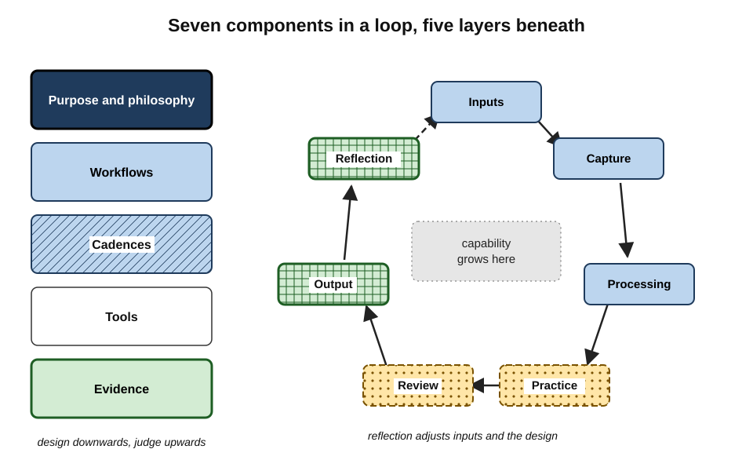
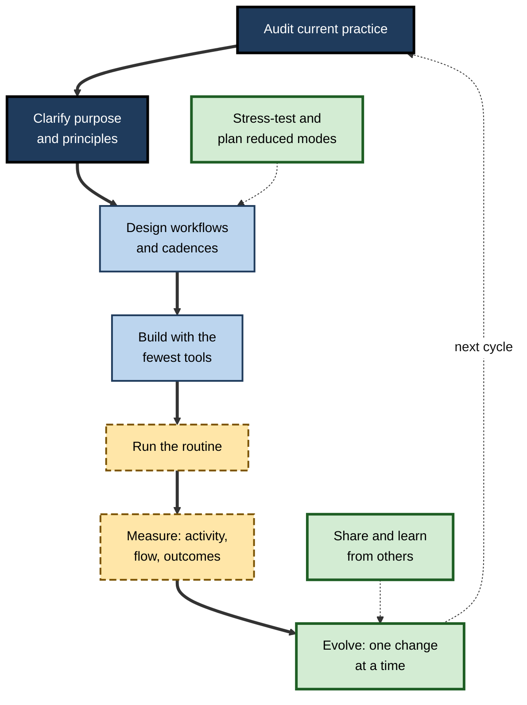
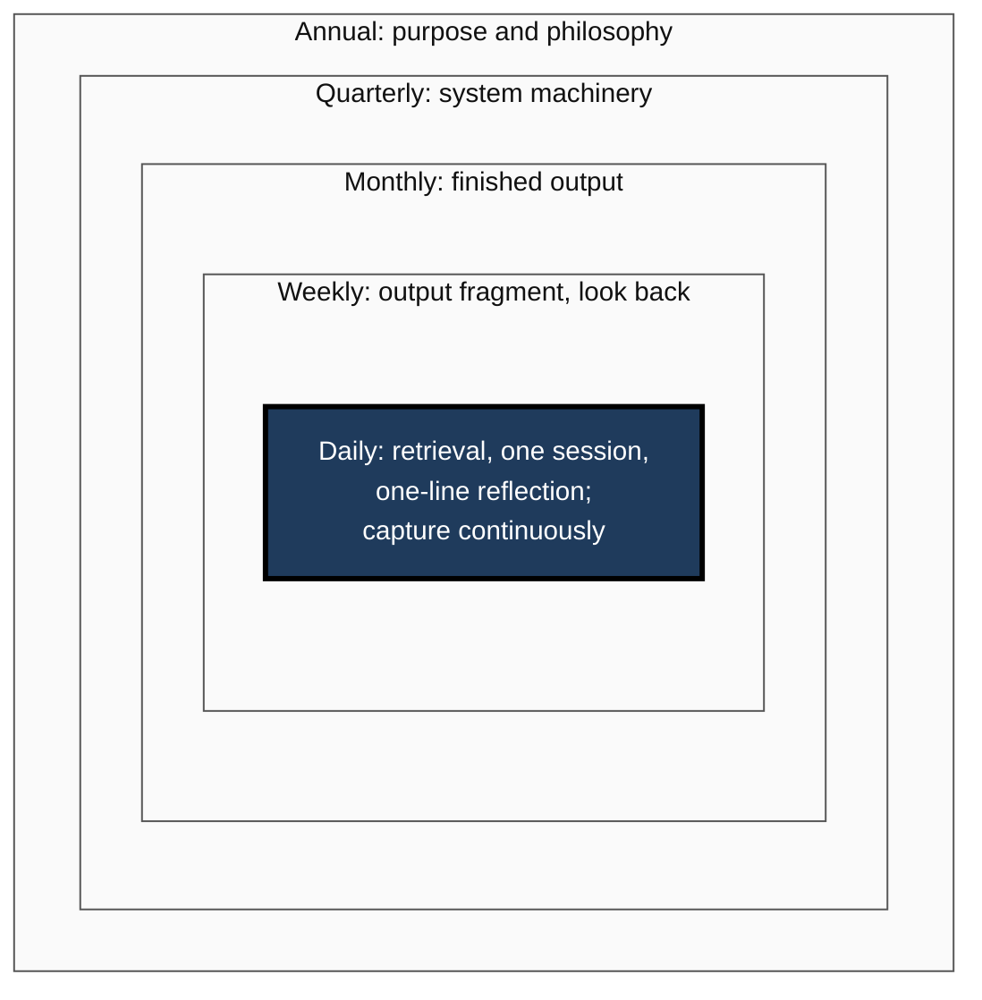
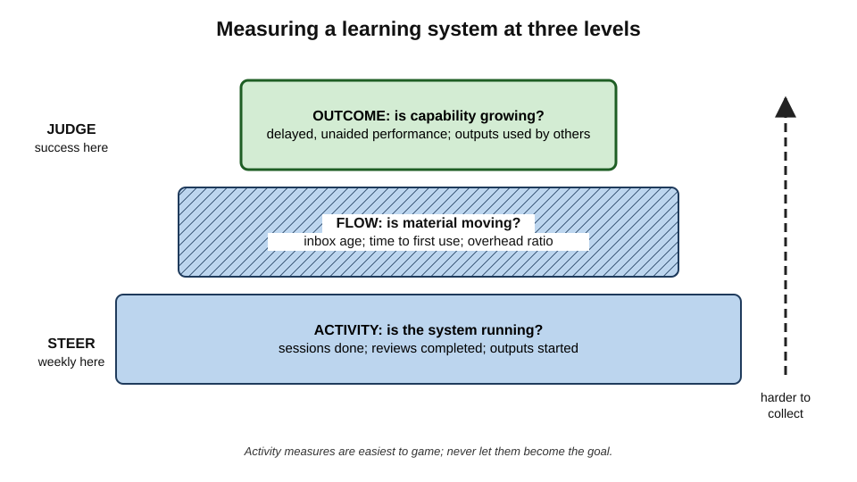
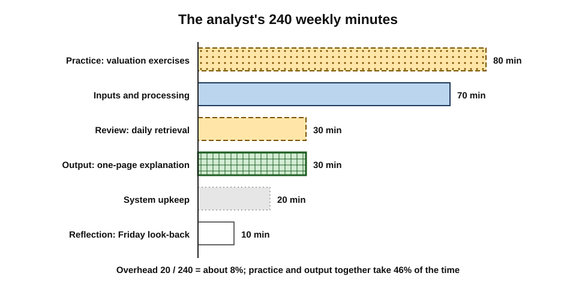

# H. Building a Personal Learning System

Every professional learns, but few have **built** anything to learn with. Most adult learning runs on a scatter of habits, apps, good intentions and occasional courses, assembled by accident and never examined. Building a personal learning system means treating one's own learning as a designed thing — with a purpose, connected parts, routines, tools, evidence of results and a way of improving — so that capability keeps growing across decades, jobs and changes in the field.

> **Definition — Building a personal learning system:** the deliberate design, construction, operation and continuing improvement of the connected purposes, practices, routines and tools through which one person — or a team — turns experience and information into durable, usable capability.

**Why it matters**

- **Formal education ends; learning does not.** Over a forty-year career, most of what a professional needs will be learned after qualification, without a syllabus or a teacher.
- **Fields change faster than careers.** Software, medicine, law, finance and management all renew much of their working knowledge within a career.
- **Effort without design is largely wasted.** Hours of reading and watching that are never processed, practised, reviewed or used leave little behind.
- **Design is a professional skill.** The same habits of mind used to design products, processes and organisations can be applied to one's own learning.

---

## From Habits to a System

### What changes when learning is designed

- **Without a system:** activities are chosen by mood, algorithm or deadline; nothing connects them; nobody checks whether they work.
- **With a system:** activities are chosen for a purpose; each feeds the next; results are checked and the design is improved.

| | Accumulated habits | Designed system |
|---|---|---|
| Origin | Accident, imitation, convenience | Deliberate design from a stated purpose |
| Connections between activities | Few; each stands alone | Defined hand-offs from input to use |
| Response to disruption | Collapse, then slow restart | Planned reduced modes and recovery |
| Evidence of results | Feelings of progress | Delayed, unaided performance and real outputs |
| Change over time | Drift, or sudden wholesale replacement | Small, logged, evaluated changes |
| Typical outcome | Busy but static | Steady, compounding capability |

> **Key point:** the difference between a learner with a system and one without is rarely talent or hours. It is that the first has **connected** the activities, **checked** the results and **kept improving** the arrangement.

### The learner as designer

- A personal learning system has a **designer**, an **operator** and a **user** — and all three are the same person.
- This creates a characteristic risk: the designer's enthusiasm can crowd out the user's learning. Much of the craft of building a system lies in keeping the design **in service of** the learning.

> **Definition — Personal learning system:** the designed, connected set of purposes, practices, routines and tools through which a person repeatedly takes in, works on, retains, applies and reflects on knowledge and skill, with feedback that improves the arrangement.

---

## Roots of the Idea

- **Commonplace books** of the Renaissance and Enlightenment — notebooks of extracts kept under headings for later writing — paired capture with intended use; John Locke published an indexing method for them in 1686.
- **Benjamin Franklin's** self-education in the eighteenth century combined model texts, delayed reconstruction from notes, comparison with the original and correction — an early closed loop of practice and feedback.
- **Self-directed and self-regulated learning research** from the 1970s onwards — Malcolm Knowles on adults directing their own learning; Barry Zimmerman, Philip Winne and Allyson Hadwin on the cycle of planning, monitoring and adapting — supplied the theory.
- **Personal learning environments**, proposed between about 2005 and 2007 by educational technologists including Scott Wilson, Graham Attwell and Stephen Downes, moved ownership of learning tools from institutions to individuals.
- **Personal knowledge mastery**, Harold Jarche's "seek, sense, share", framed professional learning as a continuous discipline connected to networks.
- **Digital note systems, spaced-repetition software and AI assistants** in the 2010s and 2020s gave every component powerful new tools — and new ways to mistake tool use for learning.

> **Key point:** across five centuries the technology changed completely; the underlying functions — **keep, process, practise, review, use, reflect** — did not.

---

## The Architecture of a Personal Learning System

### Seven components

A complete system performs seven functions, each of which can be carried out on paper, in software or in conversation.

- **Inputs** — chosen sources and experiences.
- **Capture** — keeping the small fraction worth keeping.
- **Processing** — turning it into one's own connected understanding.
- **Practice** — retrieving and applying it unaided.
- **Review** — revisiting it at intervals so that it lasts.
- **Output** — using it to produce something real.
- **Reflection** — judging both the learning and the system, and deciding what to change.

> **Mnemonic — "Ice Cream Prevents Poor Revision On Rainy days":** Inputs, Capture, Processing, Practice, Review, Output, Reflection.

### Five layers

- **Purpose and philosophy** — why the person learns, what capability they value, the principles that govern choices.
- **Workflows** — the hand-offs between components.
- **Cadences** — when each workflow runs.
- **Tools** — the media that hold artefacts and support actions.
- **Evidence** — signals showing whether capability is actually growing.

**Figure 1.** The architecture of a personal learning system: seven components in a loop, set within layers from purpose to evidence.

> **Remember:** **design from the top down** — purpose, then workflows, then cadences, then tools — and **judge from the bottom up**, from evidence.

### Where systems usually break

- **Between capture and processing** — the commonest break: material is saved but never worked on.
- **Between practice and output** — knowledge is retained but never used, so it neither transfers nor attracts feedback.
- **At reflection** — the system runs unchanged for years after it stops fitting.

> **Watch out:** the most visible part of a system — its tools — is the least important and the most often changed. Most systems that fail have a **missing hand-off**, not a bad app.

---

## Principles of Design

Building a learning system borrows principles from engineering, design, operations and ecology.

| Principle | Origin discipline | Meaning for a learning system |
|---|---|---|
| Fitness for purpose | Engineering and design | Every component must serve the stated capability goal |
| Closing the loop | Cybernetics and control | Each component hands off to the next; results feed back into design |
| Minimal sufficient complexity | Software engineering; Gall's observation that working complex systems grow from working simple ones | Start simple; add parts only for a demonstrated, recurring need |
| Low-friction defaults | Behavioural science; interface design | Make the most valuable action the easiest one |
| Balanced flow | Operations management; Little's law | Capture no faster than processing can absorb |
| Graceful degradation | Reliability engineering | Define reduced modes so disruption weakens rather than stops the system |
| Evidence-led evolution | Quality improvement | Change one thing at a time; judge after weeks; keep a log |
| Portability | Information management | Keep artefacts in open formats that outlive any tool |

> **Key point:** the principles reinforce one another. A simple system with closed loops and balanced flow is easier to keep resilient, easier to measure and easier to evolve.

---

## The Life Cycle of a System

A personal learning system is never finished. It passes through a recurring cycle.

**Figure 2.** The life cycle of a personal learning system.

### Starting from evidence and purpose

- **Audit before designing.** People misjudge their own learning time and methods; a short period of honest records — a two-week log, a look at what happened to recently saved material, a check of what can actually be done unaided — shows where the real problems lie.
- **Clarify the philosophy.** Beliefs about knowledge, purposes and positions on recurring trade-offs — depth or breadth, theory or practice first, what to learn and what to look up or delegate — decide every later design choice, so they are worth writing down as a few testable principles.

### Designing and building

- **Choose tools last**, for fit with workflow, context and constraints rather than for features or supposed "learning styles", and prefer those whose data can leave in open formats.
- **Design the daily routine** around anchored, protected sessions of distinct types — acquiring, processing, practising, reviewing, producing — each with a minimum version for bad days.
- **Join capture, review and output** into a single loop, so that each artefact has a next destination and real outputs pull learning towards use.
- **Fit learning into real lives** by embedding it in work, using short gaps for retrieval, pairing it with low-attention activities, protecting a few deep blocks and pruning low-value inputs.

### Running, measuring and evolving

- **Measure at three levels** — activity, flow and outcome — so that the system is steered by leading signals and judged by lagging ones.
- **Evolve deliberately**, because roles, expertise and fields change; a system tuned for a trainee rarely fits a partner, and growing expertise makes some early structures counter-productive.
- **Match complexity to demand**: the right amount is the least that meets the essential complexity of the learning, which is far more for a pharmacologist memorising thousands of interactions than for a manager learning to coach.
- **Think in systems** — stocks such as capability and backlog, flows such as learning and forgetting, feedback loops, delays and leverage points — to explain why intuitive fixes often backfire.
- **Stress-test** against crunches, illness, device loss and motivation collapse, and plan graceful degradation and recovery.
- **Share and adapt**, borrowing principles rather than configurations from others and, where people learn together, building shared team systems.

---

## Cadences

Each component runs at its natural rhythm; the system's cadences nest inside one another.

| Cadence | Typical activities | Purpose |
|---|---|---|
| Continuous | Capture as things arise | Keep what matters without interrupting work |
| Daily | Short retrieval; one focused session; one-line reflection | Spacing; steady progress |
| Several times a week | Processing captured material | Prevent backlogs; turn material into understanding |
| Weekly | An output fragment; a look back at the week's learning | Use and feedback; course correction |
| Monthly | A finished, shared output | Transfer; evidence; feedback from others |
| Quarterly | Review of the system's machinery; pruning | Remove friction and debt; one or two changes |
| Annually | Review of purpose, philosophy and the record of capability gained | Keep the system pointed at the right goals |

**Figure 3.** Nested cadences of a personal learning system, from continuous capture to the annual review.

> **In practice:** most professionals need only **three** cadences to start — a daily session, a weekly output and a quarterly system review. The others can be added as the system matures.

---

## Measuring a System

### Three levels of measurement

- **Activity** — is the system running?
  - Sessions done (standard or minimum); reviews completed; outputs started.
- **Flow** — is material moving through it?
  - Inbox age; share of captured items processed; time from capture to first use; overhead ratio.
- **Outcome** — is capability growing?
  - Delayed, unaided performance; tasks now done without help; outputs used by others; feedback.

**Figure 4.** Three levels of measurement for a learning system, from activity to outcome.

> **Formula — Overhead ratio:** time spent maintaining the system ÷ total learning time. Example: 30 minutes of upkeep in a 5-hour learning week → 30 ÷ 300 = **10%** — a common working ceiling.

> **Watch out:** activity measures are the easiest to collect and the easiest to game. When a measure becomes a target it ceases to be a good measure — Goodhart's law — so streaks, hours and card counts should steer the system, never define its success.

### The capability ledger

- The single most informative outcome record is a short list headed **"A year ago I could not… Now, unaided, I can…"**, with each entry verified by a test, an output or another person's observation.
- An empty ledger after hundreds of hours is the clearest possible sign that the **system**, not the effort, needs to change.

---

## What the Evidence Shows

- **Strong evidence for the components.** Retrieval practice, spaced review, elaboration, self-explanation, interleaving and generation are among the most replicated findings in learning research.
- **Good evidence for self-regulation.** Meta-analyses of school and university learners associate self-regulated learning strategies with achievement and find that training in them tends to help, with wide variation by programme.
- **Good evidence for some design mechanisms.** Implementation intentions ("when X, I will Y") have medium-to-large effects on following through, according to a 2006 meta-analysis by Peter Gollwitzer and Paschal Sheeran; habits typically take around two months to become automatic, with wide individual variation.
- **Thin evidence for whole systems.** Few controlled studies compare adults with and without an integrated personal system; much writing on the subject is practitioner testimony.

> **Watch out:** testimonies about transformative systems suffer from **survivorship bias** — collapsed systems are rarely written up — and from **novelty effects**. Several popular supporting claims have weakened under replication, including advantages for handwritten over typed notes and the strength of "choice overload". A sound system rests on the **well-replicated component findings**, not on the enthusiasm of its advocates.

| Claim | Status of evidence |
|---|---|
| Retrieval and spacing improve long-term retention | Very strong; widely replicated |
| Generating and explaining improve understanding | Strong |
| Implementation intentions improve follow-through | Strong; medium-to-large average effect |
| Matching methods to "learning styles" improves learning | Not supported |
| Handwritten notes are reliably better than typed notes | Not reliably replicated |
| Integrated personal systems outperform well-chosen techniques alone | Plausible; largely untested |

---

## Systems Across Professions

| Profession | Characteristic demand | Typical system emphasis |
|---|---|---|
| Medicine and pharmacy | Large volumes of exact knowledge; regulated development records | Spaced review; case logs; reflection tied to patients seen |
| Law | Changing rules; judgement; client confidentiality | Precedent and deal notes; current-awareness inputs; separation of client material |
| Software engineering | Fast-changing tools; deep concepts | Sandbox practice; code review as feedback; decision records |
| Consulting | Many sectors; frequent client outputs | Pull-driven capture; reusable frameworks; debriefs after engagements |
| Research | Long horizons; large literatures | Reference management; linked notes; regular writing output |
| Management | Judgement about people and organisations | Embedded learning; structured reflection; mentoring |

- In several professions, formal development schemes are moving from counting **hours** towards demonstrating **competence** — a shift that suits a well-built personal system, which already measures what the person can do rather than what they attended.

---

## Personal Systems and Organisations

- **Organisations shape what is possible.** Protected learning time, stretch assignments, mentoring and learning budgets make personal systems easier to run; relentless delivery pressure makes them fragile.
- **Teams need systems too.** Shared knowledge behaves like a stock that grows through onboarding, pairing and documentation and drains through turnover and stale documents; teams that design for this — with named owners, protected time, decision records and psychological safety — learn faster than teams that leave it to chance.
- **Personal and organisational purposes should be aligned but distinct.** A personal system serves a career that will outlast any one employer, so its core artefacts should be portable — while respecting confidentiality.

> **In practice:** strong professionals treat mandatory development schemes as a **minimum input** and let their personal system decide how those inputs are processed, practised and used.

---

## Learning Systems in the AI Era

- **AI can support every component** — suggesting sources, summarising, linking notes, generating practice questions, critiquing drafts, answering questions about team knowledge.
- **The central risk is hollowing out.** If assistants do the processing, retrieval and producing, the learner's own capability does not grow — the "shifting the burden" pattern, in which a quick fix weakens the fundamental solution.
- **A design principle follows:** let AI **question, test and critique** the learner's work; keep the **effortful steps** — explaining, retrieving, producing first drafts, judging — with the person.
- **New decisions become central:** what must be held in memory for judgement and speed, what can be looked up, and what can be delegated while keeping enough knowledge to check it.

> **Watch out:** a system in which an assistant summarises everything and the learner reads the summaries looks complete — capture, notes, even flashcards exist — but the learning has been removed from it.

---

## Worked Example: Building a First System in One Afternoon

A financial analyst in a mid-sized firm wants to become competent in corporate valuation within a year. She has about **four hours a week** and has never designed her learning.

**Step 1 — audit (the preceding fortnight):** about 3 hours a week of reading articles and watching videos; nothing practised; 120 saved items, 6 reopened.

**Step 2 — purpose and principles:**

- *Purpose:* "Build and defend a discounted-cash-flow valuation of a real company, unaided, by next autumn."
- *Principles:* "Practise on real companies"; "explain to prove understanding"; "fundamentals before fashions".

**Step 3 — design with the fewest tools:** a notebook for processing, a plain-text notes folder, a spaced-repetition app for formulas and definitions, the calendar.

**Step 4 — allocate the budget:**

| Activity | Component | Weekly minutes |
|---|---|---|
| Textbook chapter, two sessions | Inputs and processing | 70 |
| Valuation exercises on real companies | Practice | 80 |
| Daily retrieval, 6 × 5 minutes | Review | 30 |
| One-page explanation for a colleague | Output | 30 |
| Friday look-back | Reflection | 10 |
| System upkeep | Overhead | 20 |
| **Total** | | **240** |

> **Formula — Overhead ratio:** 20 ÷ 240 ≈ **8%** — within the 10% ceiling.

**Figure 5.** The analyst's four weekly hours allocated across the components of her first system.

**Step 5 — plan for disruption:** minimum version — five review items and one formula derived from memory; restart rule — after a missed week, return with the minimum version on the next Monday.

**Step 6 — measures:** monthly, value a new company from scratch and compare with published analyst ranges; quarterly, review the system and change one thing.

**Result after a year:** she has valued nine companies, presented two valuations internally and was asked to join a deal team.

> **Watch out:** her first draft allocated two hours a week to "reading about valuation" and nothing to practice. The single most valuable design decision was moving time from **inputs** to **practice and output**.

---

## Case Study: Three Years, One Evolving System

### Case study: a hospital registrar builds and rebuilds

- **Situation:** a junior doctor beginning specialist training in respiratory medicine, working rotating shifts.
- **Year 1 — first build:**
  1. An audit showed she read guidelines on her phone after night shifts and retained little.
  2. She wrote a one-page philosophy: "learn from patients first; prove understanding by explaining; keep review short and daily".
  3. She designed a loop: a pocket notebook for questions arising on the ward → twice-weekly processing into short notes in her own words → review questions in a spaced-repetition app → a monthly teaching session for medical students.
  4. Routines were anchored to shift events ("after handover") rather than clock times, with a five-minute minimum version.
- **Year 2 — stress and evolution:**
  1. A run of night shifts and a family illness sent her into minimum mode for six weeks; capped reviews and a written restart plan brought her back within ten days.
  2. Her quarterly review found the review deck had grown to 3,000 items; she pruned it to 1,200, keeping principles and high-risk facts.
  3. As her expertise grew, summaries of standard guidance added little; she shifted processing towards difficult cases and disagreements between guidelines.
- **Year 3 — sharing:**
  1. Junior colleagues asked how she prepared for examinations; she shared her principles and loop, not her deck, and helped two of them build their own.
  2. Her department adopted her monthly case-teaching format as a shared practice.
- **Result:** she passed her specialty examinations at the first attempt, and her supervisor's assessment singled out her clinical reasoning on complex cases.
- **Lesson:** the system succeeded not because its first design was perfect, but because it was **built from evidence**, **resilient under stress**, **evolved with her expertise** and **improved by being shared**.

---

## What Distinguishes the Best Learning Systems

- **Simple at the core** — a few tools, clearly connected; complexity only where the learning demands it.
- **Output-centred** — regular, real production that tests understanding and attracts feedback.
- **Honest in measurement** — judged by what can be done unaided, after a delay, not by hours or streaks.
- **Resilient** — designed for bad weeks as well as good ones.
- **Evolving** — changed deliberately as goals and expertise change, with the record kept.
- **Owned** — built from the learner's own evidence and principles, not copied whole from someone else.
- **Generous** — shared in ways that help others build their own.

> **Key point:** the best systems are often **unremarkable to look at**. Their sophistication lies in what the learner does with them — deep processing, demanding practice, steady output and candid reflection.

---

## Open Questions

- **Do integrated personal systems outperform well-chosen techniques used alone?**
  - The components are well studied; whole systems in adult professionals are not.
- **How much structure suits whom?**
  - Expertise reversal suggests structure should fall with expertise, but learners judge their own expertise poorly.
- **How should AI be placed in personal and team systems?**
  - Early evidence suggests tool design determines whether assistance supports or replaces learning; long-term effects are unknown.
- **What are cheap, valid measures of system quality?**
  - Delayed tests and output reviews are valid but effortful; lighter indicators are mostly unvalidated.
- **How much of the benefit comes from the act of design itself?**
  - Building a system requires metacognitive reflection that may itself drive much of the improvement.
- **How can organisations support personal systems without controlling them?**
  - Protected time and mentoring help; surveillance-style measurement may undermine the autonomy that self-directed learning needs.

---

## Summary

- **Building a personal learning system** is the deliberate design, operation and improvement of connected purposes, practices, routines and tools that turn experience into durable capability.
- Designed systems differ from accumulated habits in **purpose, connection, resilience, evidence and evolution**; the learner is designer, operator and user at once.
- The idea descends from **commonplace books**, **Franklin's** self-education, **self-regulated learning** research, **personal learning environments** and **personal knowledge mastery**; functions endure while tools change.
- **Architecture:** seven components — **Inputs, Capture, Processing, Practice, Review, Output, Reflection** — within five layers — **purpose, workflows, cadences, tools, evidence**. Most failures are **missing hand-offs**, especially between capture and processing and between practice and output.
- **Design principles:** fitness for purpose, closed loops, minimal sufficient complexity, low-friction defaults, balanced flow, graceful degradation, evidence-led evolution, portability.
- **Life cycle:** audit → purpose and principles → design → build → run → measure → stress-test → evolve → share.
- **Cadences** nest from continuous capture to an annual review; start with daily, weekly and quarterly.
- **Measure** activity, flow and outcome; keep the **overhead ratio** under about 10%; beware **Goodhart's law**; keep a **capability ledger**.
- **Evidence** is strong for components, good for self-regulation and implementation intentions, thin for whole systems; learning styles are unsupported and several popular claims have weakened.
- Systems differ by **profession**; **teams** need shared systems with owners, protected time and psychological safety.
- In the **AI era**, let assistants question and critique while the person keeps the effortful steps.
- The best systems are **simple, output-centred, honest, resilient, evolving, owned and generous**.

---

## Self-Check

1. Define building a personal learning system and explain why it matters over a long career.
2. Compare accumulated habits with a designed system on four attributes.
3. Why is it a risk that the designer, operator and user of the system are the same person?
4. Name the seven components and the five layers, and state the direction in which each should be designed and judged.
5. Where do learning systems most often break, and why are tools rarely the real problem?
6. Explain four design principles and the discipline each comes from.
7. Describe the life cycle of a system from audit to sharing.
8. Which three cadences are enough to start, and what does each accomplish?
9. Distinguish activity, flow and outcome measures, with an example of each.
10. Calculate the overhead ratio for 45 minutes of upkeep in a 6-hour learning week, and interpret it.
11. Summarise the state of the evidence for components, self-regulation and whole systems.
12. How should AI assistants be placed in a learning system, and what is the main risk?
13. In the analyst's worked example, what was the most valuable design decision, and why?
14. A senior engineer has used the same flashcard-heavy system since qualifying ten years ago. He now leads a team and feels his learning has stalled. Using the architecture, life cycle and design principles of personal learning systems, diagnose the problem and outline a rebuilt system.

### Answer Key

1. The deliberate design, construction, operation and improvement of the connected purposes, practices, routines and tools that turn experience and information into durable capability. It matters because most career learning happens after formal education, fields change faster than careers, and undesigned effort is largely wasted.
2. Origin (accident vs design from purpose); connections (isolated vs defined hand-offs); response to disruption (collapse vs planned modes); evidence (feelings vs delayed, unaided performance); change (drift vs logged, evaluated changes).
3. The designer's enthusiasm for improving the system can crowd out the user's learning — tinkering and meta-work replace study — so design must stay in service of learning.
4. Inputs, capture, processing, practice, review, output, reflection; purpose and philosophy, workflows, cadences, tools, evidence. Design top-down from purpose; judge bottom-up from evidence.
5. Between capture and processing, between practice and output, and at reflection. Tools are the easiest layer to change and the least influential; failures usually come from missing hand-offs.
6. E.g. closing the loop (cybernetics): each component feeds the next and results feed back; minimal sufficient complexity (software engineering): start simple and add only for demonstrated need; balanced flow (operations, Little's law): capture no faster than processing; graceful degradation (reliability engineering): define reduced modes.
7. Audit current practice; clarify purpose and principles; design workflows and cadences; build with the fewest tools; run the routine; measure activity, flow and outcomes; stress-test and plan reduced modes; evolve one change at a time; share and adapt from others; repeat.
8. Daily session (spacing and steady progress), weekly output (use and feedback), quarterly system review (removing friction and debt; one or two changes).
9. Activity: sessions completed. Flow: inbox age or time from capture to first use. Outcome: a task done unaided after a delay.
10. 45 ÷ 360 = 12.5% — above the 10% ceiling; simplify the system.
11. Components (retrieval, spacing, elaboration, generation) — very strong; self-regulation and implementation intentions — good; whole integrated systems — plausible but largely untested, with practitioner testimony prone to survivorship and novelty effects.
12. Let AI question, test and critique while the learner keeps explaining, retrieving, drafting and judging. The risk is hollowing out — assistants doing the effortful steps, so capability does not grow.
13. Moving time from inputs (reading about valuation) to practice on real companies and regular output, because practice and output build and test usable capability.
14. Goals have changed (a missed major version); expertise reversal makes much of the flashcard deck redundant; system debt has accumulated; outputs and reflection on leadership are missing. Rebuild: audit; rewrite philosophy around leading engineers; prune the deck to essentials; add embedded learning from team situations, mentoring inputs and structured reflection after key meetings; add outputs such as design reviews and teaching; keep the overhead low; plan reduced modes; review quarterly.

---

## Glossary

| Term | Meaning |
|---|---|
| Architecture | The arrangement of components and layers that make up a learning system. |
| Building a personal learning system | Deliberately designing, operating and improving the connected means by which a person turns experience into capability. |
| Cadence | The rhythm at which a part of the system runs, from continuous to annual. |
| Capability ledger | A record of what can now be done unaided that could not be done before. |
| Closing the loop | Ensuring each component hands off to the next and results feed back into design. |
| Component | One of the seven functions of a learning system: inputs, capture, processing, practice, review, output, reflection. |
| Evidence layer | The signals that show whether a system is producing capability. |
| Goodhart's law | When a measure becomes a target, it ceases to be a good measure. |
| Graceful degradation | Keeping essential functions running at reduced capacity under stress. |
| Hand-off | The defined step by which an artefact passes from one component to the next. |
| Hollowing out | AI or other tools performing the effortful steps of learning, so that capability does not grow. |
| Life cycle | The recurring sequence of auditing, designing, building, running, measuring, evolving and sharing a system. |
| Overhead ratio | System maintenance time divided by total learning time. |
| Personal learning environment | The tools, communities and resources an individual uses to direct their own learning. |
| Personal learning system | The designed, connected purposes, practices, routines and tools through which a person learns, with feedback that improves them. |
| Self-regulated learning | Learning in which the learner plans, monitors, controls and evaluates their own learning. |
| Survivorship bias | Drawing conclusions only from visible successes. |
| Team learning system | A shared arrangement of the seven components for a group that learns together. |
| Workflow | A defined sequence of hand-offs between components. |
