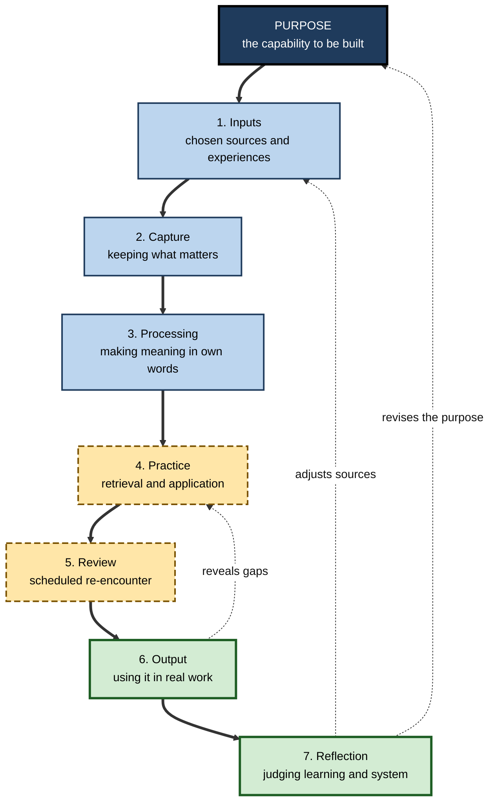
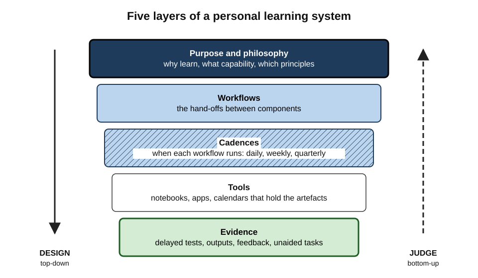
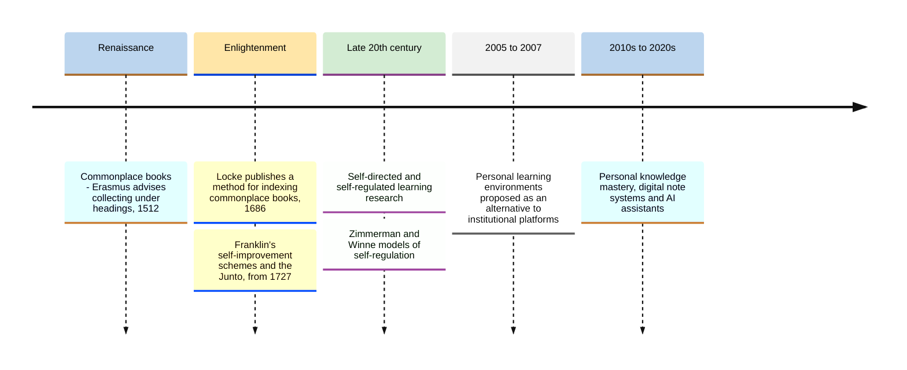
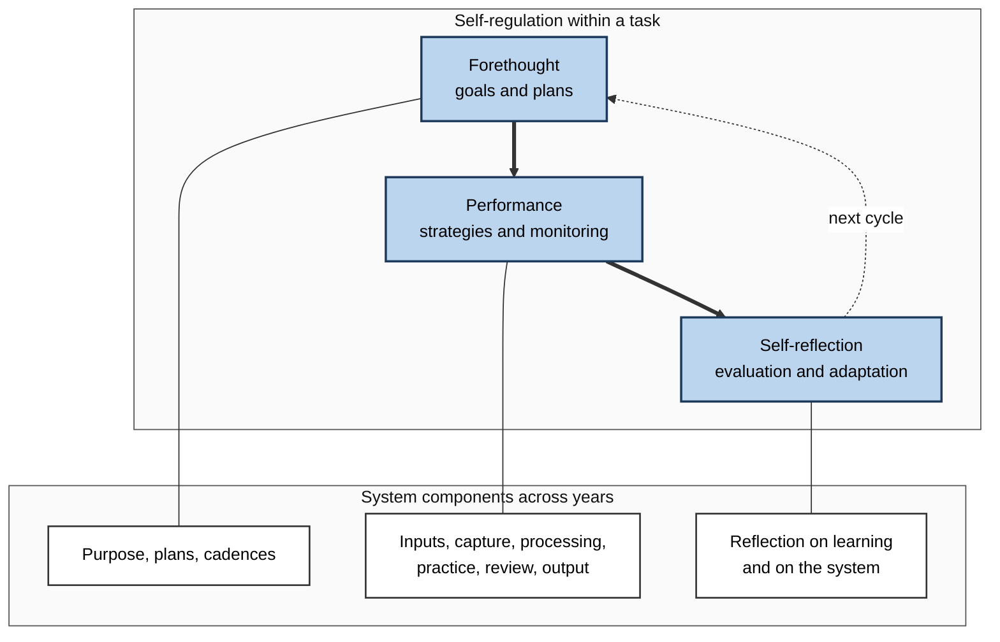
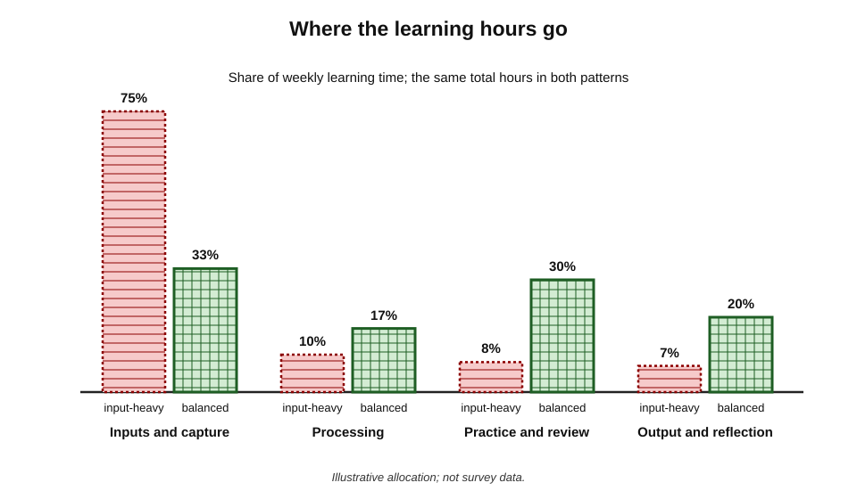
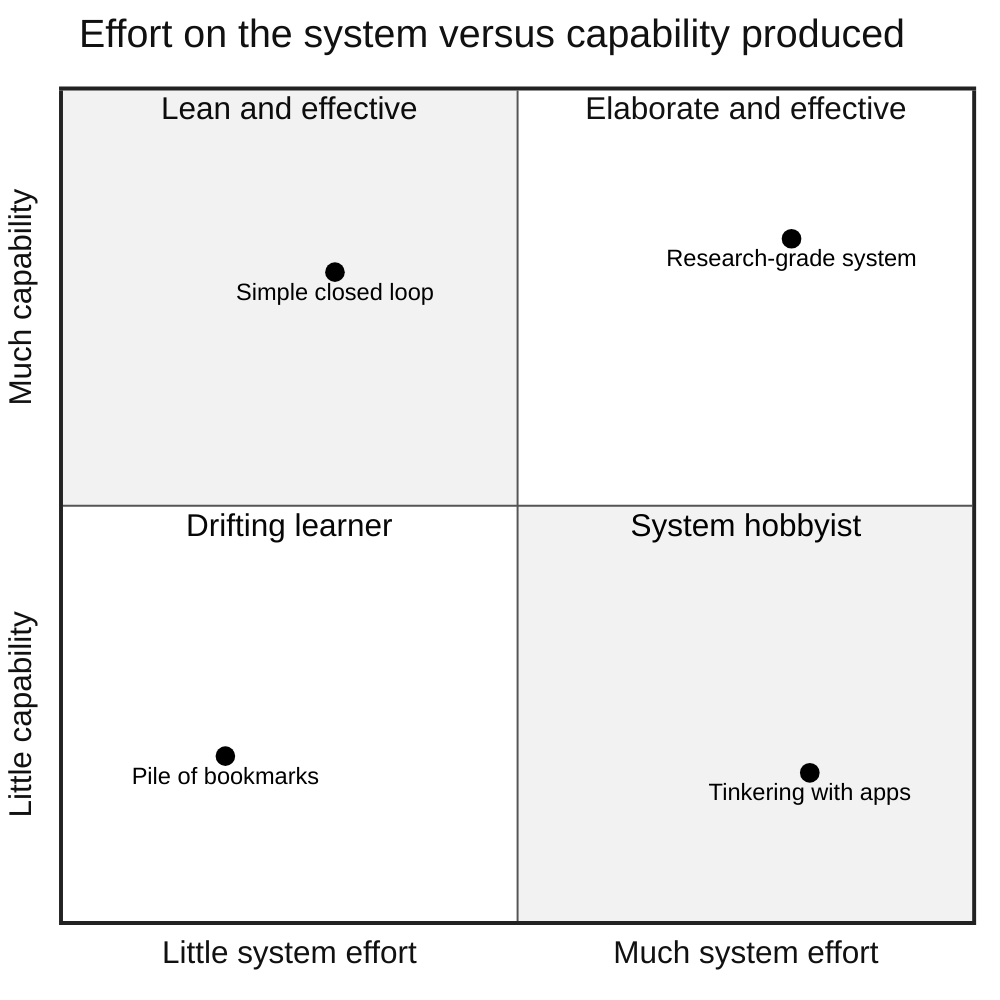

# H.1. What is a Personal Learning System?

Two analysts join the same firm in the same month. Both read widely, enrol in online courses and save dozens of articles a week. A year later one can explain, build and defend work in three new areas; the other has bookmarks, four unfinished courses and a vague sense of having "read about" many things. What differed was not effort but **architecture**: one turned what came in into something that stayed and could be used; the other had a pile.

> **Definition — Personal learning system (PLS):** the deliberately designed, connected set of purposes, practices, routines and tools through which one person repeatedly takes in, works on, retains, applies and reflects on knowledge and skill — together with the feedback that keeps the arrangement itself improving.

**Why it matters**

- **Most adult learning is self-managed.** After formal education ends, nobody sets the syllabus, schedules the revision or checks retention — the person must supply all of it.
- **Effort is not the bottleneck.** Many professionals already spend hours each week reading, listening and watching; what is missing is the conversion of that input into durable, usable capability.
- **Components that work in isolation fail in combination.** Excellent note-taking is wasted if notes are never reviewed; excellent review is wasted if nothing is ever applied.
- **Careers now outlast skills.** A system that keeps capability renewing is worth more over forty years than any single course.

---

## Learning Without a System

Most people do not lack learning activities; they lack **connections between them**.

**What accumulates when there is no system**

- **Piles of input** — saved articles, podcast queues, course subscriptions, purchased books.
- **Orphaned notes** — written once, scattered across apps and notebooks, never reopened.
- **Bursts and droughts** — an intense fortnight before a certification, then months of nothing.
- **Unclosed loops** — ideas noted as "try this at work" that are never tried.
- **Invisible progress** — no record of what has been learned, so no way to judge what works.

> **Definition — Collector's fallacy:** the mistaken feeling that saving or collecting information is the same as learning it.

**Typical symptoms in working life**

- **Rediscovery** — reading an article and realising halfway through that it was read, and saved, a year earlier.
- **Shallow familiarity** — recognising a term in a meeting but being unable to explain or use it.
- **Course graveyards** — many enrolments, few completions, fewer applications.
- **Learning that never reaches the work** — a manager attends a coaching workshop yet runs one-to-ones exactly as before.

> **Key point:** without a system, learning effort is **spent but not invested** — it produces a short-lived feeling of progress rather than accumulating capability.

> **Watch out:** the remedy is not simply "more discipline". Willpower applied to a badly designed flow produces the same pile faster. The design must change.

---

## What Makes Something a System

### Elements, interconnections, purpose

> **Definition — System (Donella Meadows, 2008):** an interconnected set of elements that is coherently organised in a way that achieves something.

- **Elements** — the parts.
  - In learning: activities (reading, practising, reviewing), artefacts (notes, flashcards, code, drafts) and tools (notebooks, apps, calendars).
- **Interconnections** — the relationships and flows between parts.
  - In learning: the **hand-offs** — a highlighted passage becomes a note; a note becomes a practice question; a practice question becomes a scheduled review.
- **Purpose** — what the whole is for.
  - In learning: durable, transferable capability that serves the person's work and life.

> **Key point:** Meadows observed that a system's behaviour depends least on its elements and most on its interconnections and purpose. Swapping one note-taking app for another rarely changes results; changing **what happens to a note after it is written** often does.

### A system is not a habit, a method, a tool or a plan

| | Answers the question | Example | Typical failure when used alone |
|---|---|---|---|
| **Habit** | What do I do automatically, cued by context? | Reading for twenty minutes after breakfast | Reading continues, but nothing is retained or used |
| **Method** | How do I carry out one learning activity well? | A note-taking or self-testing technique | Excellent notes that are never reviewed |
| **Tool** | What do I use to do it? | A notebook, a flashcard app, an editor | Tool collecting; endless migration between apps |
| **Plan** | What will I learn, in what order, by when? | A six-month route into data engineering | A good route walked with poor learning practices |
| **System** | How do all of these connect, and how do I know it works? | Purposes, routines, methods, tools and feedback joined into a loop | Over-engineering, if it grows faster than its use |

- A **personal learning system contains** habits, methods, tools and plans; it is the arrangement that makes them work together.
- A **learning plan or roadmap** says *where* learning should go; the system is the vehicle that carries the learner there and back again for every new destination.

### Properties of a well-designed system

- **Closure** — every loop closes: inputs are processed, processed material is practised, practice is reviewed, learning is used.
- **Low friction** — the common actions take seconds, not minutes.
- **Reliability** — it still runs on a bad week, at reduced capacity.
- **Visibility** — the learner can see what is in progress, what is due and what has been achieved.
- **Proportion** — its maintenance cost is small relative to the learning it produces.
- **Adaptability** — it can absorb a new subject, a new job or a new tool without collapse.

> **Mnemonic — "Cats Like Reading Very Profound Articles":** Closure, Low friction, Reliability, Visibility, Proportion, Adaptability.

---

## The Seven Components

A complete personal learning system performs seven functions. Each can be done on paper, in software or in conversation; what matters is that each exists and that each feeds the next.

**Figure 1.** The seven components of a personal learning system and the flow between them.

### 1. Inputs

- **Function:** bring new knowledge, skill models and experience into the system.
- **Forms:**
  - **formal** — courses, certifications, textbooks;
  - **informal** — articles, podcasts, documentation, videos;
  - **social** — conversations, mentors, communities, code reviews;
  - **experiential** — projects, incidents, stretch assignments, mistakes.
- **Design question:** which sources deserve attention, and which are noise?
- **Failure when weak:** an "information diet" set by whatever algorithms and inboxes deliver.

> **Example:** a cybersecurity engineer deliberately limits regular inputs to two vendor advisories, one practitioner newsletter, one textbook chapter a week and the team's incident reviews — and drops a dozen feeds that produced anxiety rather than understanding.

### 2. Capture

- **Function:** keep the small fraction of input worth keeping, quickly and in one trusted place.
- **Design question:** what is captured, where, and with what context (source, date, why it mattered)?
- **Failure when weak:** good ideas lost; or the opposite — everything captured, nothing filtered.

### 3. Processing

- **Function:** turn captured material into **understanding** — the learner's own explanation, connected to what is already known.
- **Activities:** paraphrasing, summarising in one's own words, asking "why does this work?", linking to prior knowledge and examples, noting disagreements.
- **Why it matters:** the depth of processing at encoding strongly shapes later memory; material merely copied is remembered far worse than material elaborated.
- **Failure when weak:** notes that are transcripts — accurate, extensive and inert.

> **Definition — Elaboration:** adding meaning to new information by explaining it, connecting it to existing knowledge or generating examples.

### 4. Practice

- **Function:** build retrievable knowledge and fluent skill.
- **Activities:** self-testing, solving problems, rehearsing procedures, deliberate practice on weaknesses.
- **Failure when weak:** familiarity without capability — the learner "knows it when they see it" but cannot produce it.

### 5. Review

- **Function:** revisit learned material at intervals so that it survives.
- **Activities:** scheduled retrieval, spaced flashcard review, periodic re-solving of key problems.
- Spaced review is among the best-established effects in learning science; dedicated spaced-repetition software automates the scheduling.
- **Failure when weak:** steady leakage — last year's learning quietly forgotten.

### 6. Output

- **Function:** use the learning to produce something real.
- **Forms:** explanations, memos, presentations, code, designs, decisions, teaching a colleague, published writing.
- **Why it matters:**
  - output is the strongest test of understanding — gaps that survive reading are exposed by trying to explain or build;
  - output is where **transfer** happens — learning reaches the work;
  - output creates **evidence** of capability for others.
- **Failure when weak:** a private library of knowledge that never changes anything.

### 7. Reflection

- **Function:** step back and judge both **the learning** (what was learned, what remains unclear) and **the system** (what is working, what is friction, what to change).
- **Failure when weak:** the system ossifies; the same mistakes recur; effort drifts away from the person's real goals.

> **Mnemonic — "Ice Cream Prevents Poor Revision On Rainy days":** Inputs, Capture, Processing, Practice, Review, Output, Reflection.

### Comparing the components

| Component | Core question | Strength of research support for the activity | Most common failure |
|---|---|---|---|
| Inputs | What deserves my attention? | Moderate — source quality and prior knowledge matter | Algorithm-driven diet |
| Capture | What is worth keeping? | Mixed — note-taking helps mainly when it involves processing | Hoarding |
| Processing | What does it mean, and how does it connect? | Strong for elaboration and self-explanation | Transcribing instead of thinking |
| Practice | Can I produce it unaided? | Very strong for retrieval and deliberate practice | Re-reading instead of testing |
| Review | Will it still be there next year? | Very strong for spacing | No schedule; reviews pile up |
| Output | Can I use it to make something? | Strong for generation, explanation and teaching | Learning stays private |
| Reflection | What should change? | Moderate — benefits depend on structure and follow-through | Reflection without action |

> **Key point:** the research is strongest for the **middle** of the loop (processing, practice, review) — and yet the **ends** (deliberate inputs, real output, reflection that changes the system) are where unsystematic learners most often fail.

> **Watch out:** the components are **functions, not stages to be completed in order once**. A single afternoon may cycle through several of them many times; an expert at work may move straight from input to output and capture afterwards.

---

## Layers of a Personal Learning System

A system can be described at five layers, from the reasons for learning down to the evidence that it works.

**Figure 2.** The five layers of a personal learning system, designed from the top down.

- **Purpose and philosophy** — why the person learns, what kind of capability they value, which principles govern choices.
  - *e.g.* "Learn for depth in one field and literacy in its neighbours"; "Prefer building to reading".
- **Workflows** — the hand-offs between components.
  - *e.g.* every book chapter → three questions in own words → answered from memory next morning.
- **Cadences** — when each workflow runs.
  - *e.g.* daily practice block, weekly review of notes, monthly output, quarterly system review.
- **Tools** — the media that hold artefacts and support actions.
  - *e.g.* a paper notebook for capture, a text-based notes app, a spaced-repetition app, a calendar.
- **Evidence** — signals showing whether the system produces capability.
  - *e.g.* delayed self-tests, completed outputs, feedback from colleagues, tasks now done unaided.

> **Remember:** design **top-down** — purpose, workflows, cadences, then tools; judge **bottom-up** — from evidence.

> **Watch out:** the most common design error is to start at the tool layer — choosing an app and letting its features dictate the workflow. Tools are the easiest layer to change and the least important.

---

## Where the Idea Comes From

The phrase is modern; the practice is old. Each era had tools, but the functions — keep, process, practise, use, reflect — recur.

**Figure 3.** Milestones in the history of deliberately organised self-learning.

### Commonplace books

- **What they were:** notebooks in which readers copied passages, quotations, facts and observations under topic headings for later use in writing and speaking.
- **Erasmus, *De Copia* (1512):** advised students to collect material under headings so it could be retrieved when composing.
- **John Locke** published a method for indexing commonplace books (in French in 1686; in English in 1706) — an early solution to the **retrieval problem** that every capture system faces.
- **Lesson:** capture was always paired with an **intended output** — the commonplace book existed to feed the owner's writing and argument.

### Benjamin Franklin's self-education

**Study card — Franklin's essay-reconstruction method (described in his *Autobiography*)**

- **Design:** as a young printer's apprentice, Franklin wanted to improve his prose.
  - He read essays from *The Spectator* and jotted brief hints of each sentence's meaning.
  - After a few days he tried to rewrite the essays from his hints alone, without the original.
  - He then compared his version with the original and corrected his faults.
  - At times he turned the essays into verse and back again, to enlarge his vocabulary.
- **What it shows:** a complete loop — **input** (a model text), **capture** (hints), **delay**, **output from memory** (reconstruction), **feedback** (comparison) and **correction**.
- **Conclusion:** long before learning science named retrieval practice and feedback, a self-taught learner built them into a repeatable procedure.

- **The virtues scheme:** Franklin kept a small book with a page for each of thirteen virtues, focused on one virtue a week and marked daily lapses — a tracking and reflection cadence.
- **The Junto (1727):** a weekly club of tradesmen who debated questions and shared books — a **social input and output** channel.

### Self-directed and self-regulated learning

- **Malcolm Knowles (1975)** described self-directed learning — adults diagnosing their needs, setting goals, finding resources and evaluating outcomes — as the normal mode of adult learning.
- **Barry Zimmerman** (from the 1980s) modelled **self-regulated learning** as a cycle of **forethought** (goals, plans, motivation), **performance** (strategies, self-monitoring) and **self-reflection** (evaluation, attributions, adaptation).
- **Philip Winne and Allyson Hadwin (1998)** described four phases: **defining the task**, **setting goals and plans**, **enacting tactics**, and **adapting** — the last being a change to how one studies in future.

> **Definition — Self-regulated learning (SRL):** learning in which the learner actively plans, monitors, controls and evaluates their own cognition, motivation and behaviour in pursuit of goals.

### Personal learning environments

- **Context, 2004–2007:** universities ran institution-owned virtual learning environments; learners increasingly used blogs, feeds, wikis and social tools outside them.
- **Scott Wilson** (2005) sketched a "future VLE" built around the learner rather than the course; **Graham Attwell** and **Stephen Downes** (both 2007) argued that the **personal learning environment** was a concept about learner control, not a piece of software.
- **Lesson:** ownership moved from the institution to the person — the environment follows the learner from course to job to job.

> **Definition — Personal learning environment (PLE):** the set of tools, communities and resources an individual uses to direct their own learning, as opposed to a platform provided by an institution.

### Personal knowledge mastery and the digital era

- **Harold Jarche** proposed **Seek → Sense → Share** as the core of personal knowledge mastery: find and filter sources, make sense through reflection and practice, and share with networks and colleagues.
- Digital note systems, card-index methods such as the sociologist Niklas Luhmann's Zettelkasten, and popular "second brain" approaches (Tiago Forte's capture–organise–distil–express sequence) gave capture and processing new tools — but none of them alone is a whole learning system, because practice, review and feedback on capability sit largely outside them.

> **Key point:** across five centuries, the recurring insight is the same — **keeping is not knowing**. Every durable approach couples capture to processing, use and reflection.

---

## Three Kinds of Learning Infrastructure

| | Institutional learning platform | Personal learning environment | Personal learning system |
|---|---|---|---|
| Owned by | The organisation or university | The learner | The learner |
| Emphasis | Delivering and assessing courses | Choosing tools, sources and networks | The whole loop, including practice, output and feedback |
| Lifespan | The course or the employment | Ongoing | The whole career |
| Decides what to learn | Mostly the institution | The learner | The learner, guided by an explicit purpose |
| Evidence of success | Completions, grades | Rarely defined | Delayed retention, outputs, transfer to work |
| Typical weakness | Learning stops when the course ends | Many tools, weak workflows | Can become over-engineered |

---

## The Theory Underneath: Self-Regulation and Feedback

### A system is a self-regulation cycle made durable

- Self-regulated learning describes what a learner does **within one task**: plan, act, monitor, adjust.
- A personal learning system **externalises** that cycle so it runs **across years and subjects**, without depending on the learner remembering to do it.
  - Forethought → **purpose, plans and cadences**.
  - Performance and self-monitoring → **processing, practice and review**, with visible queues and records.
  - Self-reflection → **reflection** on learning and on the system.

**Figure 4.** The self-regulation cycle and the system components that make it durable.

### Feedback turns routine into a system

- A sequence of activities with **no feedback** is a **ritual** — it may continue for years whether or not it works.
- **Feedback** — evidence about results compared with intentions — is what lets a system correct itself.
- The cybernetic idea dates to **Norbert Wiener (1948)**: a system steers by comparing its output with a goal and acting on the difference.
- **Two loops in learning:**
  - **learning feedback** — "Do I know this? Can I do it unaided after a week?";
  - **system feedback** — "Is my way of learning producing capability at a reasonable cost?"

> **Definition — Feedback loop:** a chain in which the result of an action returns as information that influences the next action.

### What the evidence does and does not show

- **Strong evidence for the components.** Retrieval practice, spaced review, elaboration, self-explanation and generation are among the best-replicated effects in learning research.
- **Good evidence for self-regulation.** Meta-analyses of school and university learners find that self-regulation strategies are positively associated with achievement, and that training learners in them tends to improve outcomes, with effects varying widely by programme quality.
- **Thin evidence for whole systems.** There are few controlled studies comparing adults *with* and *without* an integrated personal system; much writing on the subject is practitioner testimony.

> **Watch out:** testimonies of the form "this system transformed my learning" suffer from **survivorship bias** (failed systems are rarely written up) and from the **novelty effect** (anything new feels productive for a while). Judge a system by its delayed results, not its author's enthusiasm.

---

## Building From Functions, Not From Fashion

### Design principles

- **Start from purpose.** Define what capability the system is meant to build in the next year.
- **Cover every function minimally before perfecting any.** A crude loop that closes beats an elegant fragment.
- **Design the hand-offs.** For each component, specify what triggers the next step and where the artefact goes.
- **Keep one trusted home per artefact type.** One capture inbox, one notes collection, one review queue.
- **Make the default action easy.** Put the next practice question where the eye falls first.
- **Build in a reduced mode.** Decide in advance what the system does in a bad week.
- **Schedule system reflection separately** from learning reflection — quarterly is common.
- **Measure what matters.** Delayed, unaided performance and real outputs, not hours or pages.

> **Remember:** a personal learning system succeeds when **what goes in comes out changed** — as capability the person can use without the notes.

### Worked example: mapping a pharmacist's learning onto the components

A hospital pharmacist wants to become the department's go-to person for paediatric dosing. She lists everything she currently does to learn and maps it.

| Component | What she currently does | Gap | Fix |
|---|---|---|---|
| Inputs | Reads journal alerts; attends monthly talks | Generic; little paediatric focus | Subscribe to one paediatric formulary update; shadow the paediatric ward round fortnightly |
| Capture | Photographs slides; prints articles | Scattered; no context recorded | One notebook section per drug class; note source, date and "why it matters" |
| Processing | Highlights printed articles | Highlighting is passive | Write a three-line plain-language summary and one worked dose calculation per new item |
| Practice | None | No retrieval | Weekly five-case dosing quiz written from her own notes |
| Review | None | Learning fades | Revisit each quiz at one week, one month, three months |
| Output | Answers colleagues' questions ad hoc | Not deliberate | Draft one quick-reference card a month for the ward team |
| Reflection | Annual appraisal only | Too infrequent | Fifteen-minute monthly look-back: which cards were used, which questions she could not answer |

1. **Diagnosis:** her inputs were adequate; the system broke between capture and practice — nothing she read was ever retrieved.
2. **Smallest change with most effect:** the weekly five-case quiz, because it forces processing beforehand and creates material for review.
3. **Evidence to look for after three months:** fewer look-ups during real dosing checks; colleagues using her reference cards; correct answers to unseen cases.

> **Watch out:** the temptation is to fix the most visible gap — usually the tools ("I need a better app"). The most valuable fix is usually a **missing hand-off**.

---

## How Professionals Use Personal Learning Systems

### Across professions

- **Medicine.** Many regulators require evidence of continuing development; in the United Kingdom, doctors have undergone **revalidation** since 2012, built on annual appraisal with supporting evidence and reflection.
  - Strong practitioners treat this as the visible part of a private system: case logs, reading linked to patients seen, and audits of their own practice.
- **Law.** Some regulators have moved from counting training hours to requiring continuing competence; the Solicitors Regulation Authority in England and Wales replaced a minimum-hours requirement with a competence-based approach in 2016.
- **Software engineering.** Engineers keep "today I learned" logs, solve small practice problems (katas), maintain sandbox projects and learn through code review — inputs, practice and output tightly coupled to daily work.
- **Consulting and finance.** Learning is driven by engagements; strong practitioners debrief each engagement, keep reusable frameworks and explain new sector knowledge to colleagues within days.

### Hours-based versus outcome-based development

| | Hours-based development | Outcome-based personal system |
|---|---|---|
| Unit of account | Hours attended, credits logged | Capability demonstrated |
| Typical evidence | Certificates of attendance | Outputs, delayed tests, feedback, changed practice |
| Learner's question | "Have I done enough hours?" | "What can I now do that I could not?" |
| Strength | Easy to audit | Measures what matters |
| Weakness | Rewards attendance, not learning | Harder to verify; needs judgement |

> **In practice:** treat any mandatory development scheme as a **minimum input**, and let the personal system decide how those inputs are processed, practised and used.

### Where effort usually goes

**Figure 5.** Illustrative allocation of learning time in an input-heavy pattern and in a balanced system.

- **Input-heavy pattern:** most time consumed by reading, watching and listening; little left for practice, output and reflection.
- **Balanced pattern:** less input, more time **working on** what came in.

> **Key point:** for most busy professionals, the cheapest improvement is not more input but a **reallocation** — fewer sources, processed more deeply, practised, and used.

### The AI-era picture

- AI assistants can support every component: suggesting sources, summarising, generating practice questions, critiquing outputs.
- The design risk is that they **replace processing** — the very effortful step that creates understanding — rather than supporting it.

> **Watch out:** a system in which an assistant summarises everything and the learner reads the summaries has fast inputs and weak learning. Keep the effortful steps — explaining, retrieving, producing — with the person.

---

## Case Study: From Collector to Practitioner

### Case study: a data analyst's first system

- **Situation:** a data analyst at a retail company aimed to move into machine-learning work within eighteen months.
- **Problem:** after nine months she had six partially completed online courses, about four hundred saved articles, notes in three apps and no model in production. A team lead's verdict: "knows the vocabulary, cannot yet build".
- **Diagnosis:**
  1. **Inputs** were abundant but unfiltered.
  2. **Capture** was heavy; **processing** almost absent — notes were copied code and quotations.
  3. There was **no practice** without the course's scaffolding and **no review**.
  4. **Output** was nil; nothing reached her actual work.
  5. **Reflection** happened only as guilt.
- **Actions:**
  1. Wrote a one-sentence purpose: "Be able to build, validate and explain a churn model on company data by June."
  2. Cut inputs to one textbook, one course and the team's internal code.
  3. Archived the four hundred articles unread, keeping a list of titles.
  4. Introduced a **daily 40-minute block**: twenty minutes of new material, twenty minutes re-implementing that material from memory in a notebook on company data.
  5. Added a **Friday review**: re-solve one earlier exercise without notes; write the week's key idea in plain English.
  6. Set a **monthly output**: a short internal write-up or a working notebook shown to the team lead.
  7. Held a **quarterly system review**: what to stop, start and keep.
- **Result:** within four months she had shipped a prototype churn model reviewed by the data-science team; by the twelfth month she had moved into a junior machine-learning role.
- **Side effects:** fewer topics covered than before; she felt "less up to date" with the field.
- **Lesson:** her capability grew when the system **closed the loop to output**, not when it gathered more input.

---

## Failure Modes

**Figure 6.** Common ways personal learning systems fail, arranged by how much effort goes into the system and how much capability comes out.

- **Tool-first design** — the app's features dictate the workflow.
  - Remedy: write the workflow on paper first.
- **The collector** — capture without processing.
  - Remedy: cap the inbox; process or discard weekly.
- **The hobbyist** — tinkering with the system becomes a pleasant substitute for learning.
  - Remedy: measure system time against learning time; cap the former.
- **Brittleness** — the system works only in ideal weeks.
  - Remedy: design a minimum mode for travel, illness and crunch periods.
- **No output** — knowledge stays private and untested.
  - Remedy: one small output per cycle, however modest.
- **No system reflection** — the same friction persists for years.
  - Remedy: a short scheduled review of the system itself.
- **The borrowed system** — copying a famous person's set-up whole.
  - Remedy: borrow principles, not configurations; the context differs.

> **Watch out:** "having a system" can become part of a person's identity and a source of satisfaction in itself. The test remains external: **what can the person now do?**

---

## Open Questions

- **Do integrated personal systems outperform well-chosen individual techniques?**
  - Component techniques are well studied; controlled comparisons of whole systems in adult professionals are scarce.
- **How much structure is optimal, and for whom?**
  - Novices may benefit from more scaffolding and experts from less; the trade-off is not well mapped.
- **How should AI assistants be placed in the loop?**
  - Early studies suggest tool design decides whether assistance supports or replaces learning; long-term effects on independent capability are unknown.
- **How can system quality be measured cheaply?**
  - Delayed tests and output reviews are valid but effortful; lighter indicators are mostly unvalidated.
- **Does the benefit lie in the system or in the reflection that building one requires?**
  - The act of designing a system may itself drive much of the improvement, through increased metacognition.

---

## Summary

- A **personal learning system** is the designed, connected set of purposes, practices, routines and tools through which a person takes in, works on, retains, applies and reflects on learning, with feedback that improves the arrangement.
- Without one, effort produces **piles** — saved input, orphaned notes, bursts and droughts, unclosed loops — and the **collector's fallacy**.
- A system (Meadows) has **elements, interconnections and purpose**; behaviour depends most on the **hand-offs** and the purpose.
- It contains, but differs from, **habits, methods, tools and plans**.
- Seven components: **Inputs, Capture, Processing, Practice, Review, Output, Reflection** ("Ice Cream Prevents Poor Revision On Rainy days").
- Good systems show **closure, low friction, reliability, visibility, proportion and adaptability**.
- Five layers — **purpose, workflows, cadences, tools, evidence**; design top-down, judge bottom-up.
- The idea descends from **commonplace books**, **Franklin's** self-education, **self-regulated learning** research, **personal learning environments** and **personal knowledge mastery**.
- Evidence is strong for the **components**, good for **self-regulation**, thin for **whole systems** — beware survivorship and novelty effects.
- Professionals use systems to go beyond **hours-based** development to **demonstrated capability**.
- Common failures: tool-first design, collecting, tinkering, brittleness, no output, no system reflection, borrowed systems.

---

## Self-Check

1. Define a personal learning system and explain each part of the definition.
2. Explain the collector's fallacy and give two workplace symptoms of it.
3. Using Meadows' definition, identify the elements, interconnections and purpose of a learning system.
4. How does a system differ from a habit, a method, a tool and a plan?
5. Name the seven components and state the core question each answers.
6. Why is processing distinguished from capture?
7. Which components have the strongest research support, and which do unsystematic learners most often neglect?
8. Describe the five layers of a system and the direction in which each should be designed and judged.
9. Describe Franklin's essay-reconstruction method and identify the components it contains.
10. Distinguish an institutional learning platform, a personal learning environment and a personal learning system.
11. How does a personal learning system relate to self-regulated learning?
12. Why should claims that a particular system "transformed" someone's learning be treated cautiously?
13. A consultant reads constantly, keeps meticulous notes and feels well informed, yet struggles to apply new frameworks with clients. Diagnose the likely gaps and propose three changes.
14. A manager proposes evaluating a team's learning by hours logged on the learning platform. Explain the weakness and suggest better evidence.

### Answer Key

1. A deliberately designed, connected set of purposes, practices, routines and tools through which a person repeatedly takes in, works on, retains, applies and reflects on learning, plus feedback that improves the arrangement. *Designed* — not accidental; *connected* — parts hand off to one another; *repeatedly* — it runs across subjects and years; *feedback* — it corrects itself.
2. The belief that saving information equals learning it. Symptoms: rediscovering already-saved articles; recognising terms without being able to explain or use them; many course enrolments, few completions.
3. Elements: activities, artefacts and tools. Interconnections: hand-offs such as note → question → scheduled review. Purpose: durable, transferable capability serving the person's goals.
4. A habit is an automatic cued behaviour; a method is how to do one activity well; a tool is the medium; a plan states what to learn and when. A system connects all of them and adds feedback on whether the whole works.
5. Inputs (what deserves attention?), Capture (what is worth keeping?), Processing (what does it mean and connect to?), Practice (can I produce it unaided?), Review (will it last?), Output (can I make something with it?), Reflection (what should change?).
6. Capture only keeps material; processing transforms it into the learner's own understanding through elaboration and connection. Depth of processing drives later memory; copying alone produces inert notes.
7. Strongest: processing (elaboration, self-explanation), practice (retrieval) and review (spacing). Most neglected: deliberate inputs, real output and reflection that changes the system.
8. Purpose and philosophy, workflows, cadences, tools, evidence. Design from purpose downwards so tools serve workflows; judge from evidence upwards so results drive changes.
9. He noted brief hints of a model essay, waited days, rewrote it from the hints, compared it with the original and corrected faults. Components: input, capture, delay, output from memory (practice), feedback and correction (reflection).
10. Institutional platform: owned by an organisation, course-centred, ends with the course. PLE: learner-owned tools, sources and networks. PLS: learner-owned whole loop including practice, output and feedback, guided by an explicit purpose and judged by capability.
11. SRL describes planning, monitoring and adapting within a learning task; a PLS externalises and makes durable that cycle across subjects and years, through purposes, cadences, visible queues and scheduled reflection.
12. Survivorship bias — failed systems are rarely reported; the novelty effect — new systems feel productive temporarily; lack of controlled comparison; self-report rather than delayed measures.
13. Gaps: practice, output and reflection — inputs and capture are strong, but nothing is retrieved or applied. Changes: convert each new framework into a short case to solve from memory; apply one framework in a low-stakes internal discussion within a week; hold a brief monthly review of which frameworks were actually used and why.
14. Hours measure exposure, not capability, and reward attendance. Better evidence: delayed unaided performance on realistic tasks; outputs produced; peer or client feedback; observed changes in practice compared with a baseline.

---

## Glossary

| Term | Meaning |
|---|---|
| Capture | Keeping the worthwhile fraction of input in a trusted place, with context. |
| Closure | The property of a system in which every loop is completed, so input becomes usable capability. |
| Collector's fallacy | Mistaking the saving of information for learning it. |
| Commonplace book | A notebook of copied passages and observations organised under headings for later use. |
| Elaboration | Adding meaning by explaining, connecting and generating examples. |
| Feedback loop | A chain in which results return as information that shapes the next action. |
| Hand-off | The defined step by which an artefact passes from one component to the next. |
| Inputs | The sources and experiences that bring new knowledge and skill models into a system. |
| Novelty effect | A temporary improvement or enthusiasm caused by something being new. |
| Output | Using learning to produce something real, such as an explanation, artefact or decision. |
| Personal knowledge mastery | Harold Jarche's approach to learning through seeking, sensing and sharing. |
| Personal learning environment | The tools, communities and resources a person uses to direct their own learning. |
| Personal learning system | A designed, connected set of purposes, practices, routines and tools for learning, with feedback that improves it. |
| Practice | Activities that build retrievable knowledge and fluent skill, such as self-testing. |
| Processing | Turning captured material into one's own connected understanding. |
| Reflection | Judging what has been learned and how well the system is working, and deciding what to change. |
| Review | Revisiting learned material at intervals so it is retained. |
| Self-regulated learning | Learning in which the learner plans, monitors, controls and evaluates their own learning. |
| Survivorship bias | Drawing conclusions only from cases that succeeded and were therefore visible. |
| System | An interconnected set of elements coherently organised to achieve something. |
