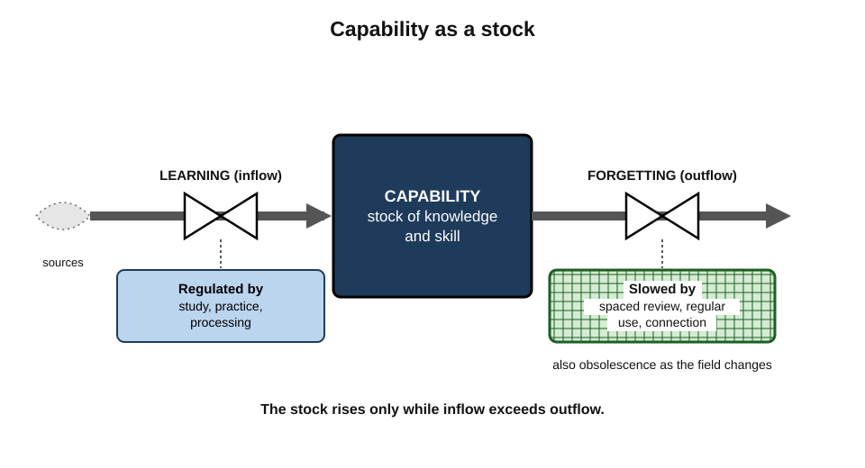
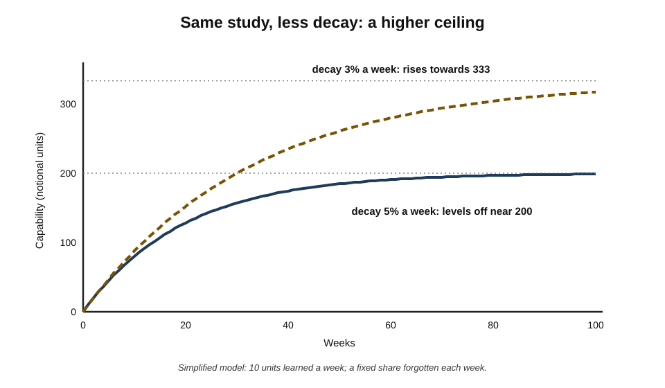
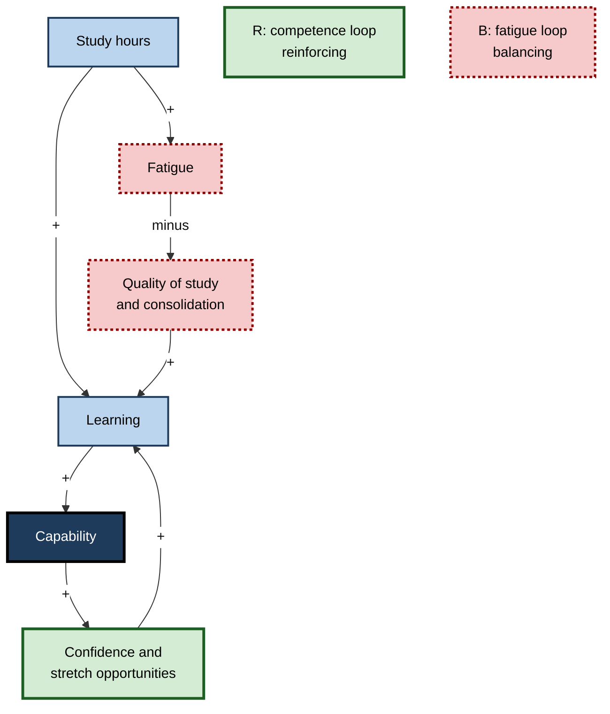
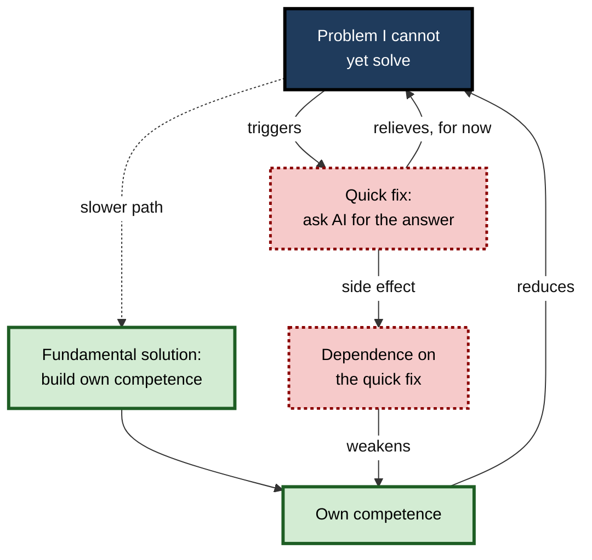
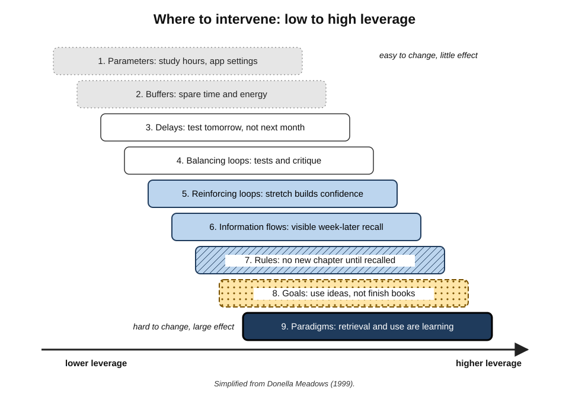

# H.10. Systems Thinking Applied to Learning

An operations manager facing a certification exam doubles his study hours. His scores fall. More study means later nights; less sleep means weaker consolidation and poorer concentration; poorer results prompt still more study. Each step looks sensible, and together they form a loop that defeats its own purpose. Seeing such loops — and the stocks, flows and delays behind them — is what **systems thinking** contributes to learning.

> **Definition — Systems thinking:** a way of understanding situations as wholes made of interacting parts, attending to stocks, flows, feedback loops and delays in order to explain behaviour over time and find effective points of intervention.

**Why it matters**

- **Learning outcomes emerge from interactions**, not from single activities: sleep, workload, motivation, review and use all affect one another.
- **Intuitive fixes often backfire.** More hours, more tools, more input can each worsen results through loops that are not obvious.
- **Delays mislead.** The effects of good practice appear weeks later; the costs of bad practice too. Without a systems view, learners react to the wrong signals.
- **Leverage varies enormously.** Some changes — to goals, rules and information — alter behaviour far more than adjusting hours or settings.

---

## Where Systems Thinking Comes From

- **Cybernetics** — Norbert Wiener (1948) and W. Ross Ashby (1956) studied control and communication through **feedback** in machines and organisms.
- **General systems theory** — the biologist Ludwig von Bertalanffy argued from the 1940s that common principles govern systems across biology, engineering and society.
- **System dynamics** — Jay Forrester at the Massachusetts Institute of Technology developed, from the late 1950s, methods for modelling **stocks, flows and feedback** in industrial and urban systems (*Industrial Dynamics*, 1961).
- **The Limits to Growth (1972)** — Donella Meadows and colleagues used system dynamics to model population, resources and industrial growth.
- **Peter Senge, *The Fifth Discipline* (1990)** — brought systems thinking into management, describing recurring **system archetypes** and the "learning organisation".
- **Donella Meadows, *Thinking in Systems* (2008)** — a widely used introduction to stocks, flows, loops and leverage points.

> **Key point:** the same small set of ideas — **stocks, flows, feedback, delays, leverage** — explains behaviour in supply chains, ecosystems and personal learning.

---

## Stocks and Flows

### The bathtub

> **Definition — Stock:** an accumulation that can be measured at a moment — the water in a bath, money in an account, knowledge in memory.

> **Definition — Flow:** a rate of change of a stock — water in through the tap and out through the drain; learning in, forgetting out.

- A stock changes only through its flows.
- Stocks create **inertia**: they cannot change instantly, which is why capability takes time to build and does not vanish overnight.

### Stocks in a learning system

- **Capability** — knowledge and skill held by the person.
  - Inflow: learning. Outflow: forgetting and obsolescence.
- **Capture backlog** — unprocessed items.
  - Inflow: capture. Outflow: processing or discarding.
- **Review queue** — items due for review.
  - Inflow: new items and items falling due. Outflow: reviews completed.
- **Body of work** — outputs produced.
  - Inflow: production. Outflow: obsolescence.
- **Energy and motivation** — reserves that fund effort.
  - Inflow: rest, success, meaning. Outflow: effort, stress, setbacks.
- **Network and reputation** — relationships and others' trust.
  - Inflow: contribution and sharing. Outflow: neglect.

**Figure 1.** Capability as a stock, with learning flowing in and forgetting flowing out, and the activities that regulate each flow.

### Equilibrium: why decay matters as much as learning

> **Formula — Stock change:** stock next period = stock now + inflow − outflow. If forgetting removes a fixed share *d* of the stock each period and learning adds *L*, the stock settles where inflow equals outflow: **S\* = L ÷ d**.

**Worked example: two ways to raise long-term capability**

A learner adds about **10 units** of knowledge a week (*L* = 10) and, without review or use, loses about **5%** of what she holds each week (*d* = 0.05). The units are notional, for comparison only.

1. **Current equilibrium:** S\* = 10 ÷ 0.05 = **200 units**.
2. **Option A — study 20% more:** L = 12 → S\* = 12 ÷ 0.05 = **240 units** (+20%).
3. **Option B — reduce decay through review and use:** d = 0.03 → S\* = 10 ÷ 0.03 ≈ **333 units** (+67%).
4. **Both:** S\* = 12 ÷ 0.03 = **400 units**.

| Option | Inflow L | Decay d | Long-term stock | Change |
|---|---|---|---|---|
| Current | 10 | 0.05 | 200 | — |
| More study | 12 | 0.05 | 240 | +20% |
| More review and use | 10 | 0.03 | 333 | +67% |
| Both | 12 | 0.03 | 400 | +100% |

**Figure 2.** How capability approaches its equilibrium under the current pattern and with reduced decay.

> **Key point:** for most established learners, **reducing the outflow** — through spaced review, regular use and connection — raises long-term capability more than increasing the inflow.

> **Watch out:** the model is a deliberate simplification. Real forgetting is not a fixed percentage; it slows for well-learned material and varies by item and person. The **qualitative** lesson — that the level a stock reaches depends on both inflow and outflow — holds regardless.

---

## Feedback Loops

### Two kinds of loop

> **Definition — Reinforcing loop:** a feedback loop in which a change produces more change in the same direction — growth or decline that accelerates.

> **Definition — Balancing loop:** a feedback loop that counteracts change, pushing a stock towards a goal or limit.

### Reinforcing loops in learning

- **The competence loop (virtuous):** more capability → more confidence and opportunity → more demanding work → more learning → more capability.
- **The avoidance loop (vicious):** weaker capability → anxiety → avoidance of practice → less learning → weaker capability.
- **The Matthew effect** — the sociologist Robert Merton (1968) described how recognised scientists accumulate further recognition; the psychologist Keith Stanovich (1986) applied the idea to reading, where early readers read more and pull further ahead.

### Balancing loops in learning

- **The fatigue loop:** more study hours → more fatigue → lower quality and retention → less effective learning per hour.
- **The workload loop:** more learning → more capability → more responsibility → less time to learn.
- **The goal loop:** gap between current and desired capability → more effort → gap narrows → effort relaxes.

**Figure 3.** A causal loop diagram of the competence and fatigue loops in learning.

- **Reading the signs:** "+" means the two variables move in the **same** direction; "minus" means they move in **opposite** directions.
- A loop with an even number of "minus" links is reinforcing; an odd number makes it balancing.

> **In practice:** when results stall despite effort, look for the **balancing loop** that is resisting — fatigue, workload, lost opportunities — rather than simply pushing harder on the reinforcing one.

---

## Delays

### Why delays cause oscillation

**Study card — John Sterman (1989): the beer distribution game**

- **Design:** participants managed one stage of a simulated beer supply chain — retailer, wholesaler, distributor or factory — placing orders without seeing the whole chain; orders and deliveries took several weeks to arrive.
- **Results:** a small, one-off rise in customer demand produced large **oscillations** in orders and inventory along the chain; participants typically over-ordered, then cut orders sharply, and blamed others or the demand for the swings.
- **Conclusion:** people systematically **misperceive feedback with delays** — they ignore what is already "in the pipeline" and over-correct.

### Delays in learning

- **Practice → retention:** benefits of spacing and testing appear days or weeks later.
- **Learning → career outcomes:** months or years.
- **Bad habits → damage:** cramming feels effective now; the cost appears at the next use.
- **Consequences:**
  - learners **abandon good practices** before their effects arrive;
  - they **overreact** to a bad week by redesigning everything;
  - they **credit the wrong change** for results caused by something done earlier.

> **Remember:** judge learning changes after **weeks**, not days; account for what is already "in the pipeline" before adding more.

---

## Nonlinearity and Thresholds

- **Plateaus** — capability may appear flat for long periods before a jump, as underlying knowledge reorganises.
- **Thresholds** — some ideas become usable only once prerequisite knowledge passes a critical level; below it, effort seems wasted.
- **Tipping points** — a reinforcing loop can switch direction: a learner who passes a confidence threshold starts seeking challenge; one who falls below it starts avoiding.
- **Compounding** — small consistent gains accumulate multiplicatively when each gain makes the next easier.

> **Formula — Compounding illustration:** a 1% improvement per week compounds to 1.01⁵² ≈ **1.68** — about 68% in a year — while a 1% decline compounds to 0.99⁵² ≈ **0.59**.

> **Watch out:** compounding arithmetic is an **illustration**, not a law of learning. Real capability does not grow by a fixed percentage; gains slow as mastery approaches. The useful point is that **consistency** accumulates in ways single efforts do not.

---

## System Archetypes in Learning

Peter Senge and colleagues described recurring structures — **archetypes** — that produce familiar patterns of behaviour.

### Shifting the burden

- **Structure:** a problem has a **quick symptomatic fix** and a **slower fundamental solution**. The quick fix relieves the symptom, reducing pressure to pursue the fundamental solution — whose capacity then atrophies.
- **Learning example:** asking an AI assistant for every answer (quick fix) relieves the pressure of not knowing; independent competence (fundamental solution) is never built; dependence grows.

**Figure 4.** The shifting-the-burden archetype applied to answer-seeking with AI assistance.

### Other archetypes

| Archetype | Structure | Learning example | Leverage |
|---|---|---|---|
| Fixes that fail | A fix works now but has delayed side effects that worsen the problem | Cramming passes this exam but leaves little retained, so the next exam needs even more cramming | Accept slower, spaced study; look past the immediate result |
| Shifting the burden | A quick fix displaces a fundamental solution, which atrophies | Constant AI answers prevent competence from forming | Use the quick fix only alongside building the fundamental capability |
| Limits to growth | A reinforcing loop of growth meets a balancing limit | Rising study hours meet fatigue and family limits; returns fall | Work on the limit (sleep, schedule), not on pushing harder |
| Success to the successful | Two activities compete for resources; the one ahead gets more | Time flows to the favourite topic; the neglected one falls further behind | Allocate resources by goal, not by momentum |
| Eroding goals | When a gap persists, the goal is lowered instead of effort raised | "Fluent in a year" quietly becomes "basic conversation someday" | Anchor goals externally; review them deliberately |

> **Key point:** archetypes are **diagnostic templates**. Recognising the shape of a problem points directly at where to intervene.

---

## Leverage Points

### Where to intervene

- **Donella Meadows (1999)** ranked places to intervene in a system, from weakest to strongest. A simplified version for learning:
  1. **Parameters** — numbers such as study hours, review intervals, app settings. *Lowest leverage.*
  2. **Buffers and stocks** — e.g. building a reserve of spare time or energy.
  3. **Delays** — shortening the time between action and feedback.
  4. **Balancing loops** — strengthening corrective feedback (tests, critique).
  5. **Reinforcing loops** — strengthening virtuous cycles (stretch → confidence → stretch).
  6. **Information flows** — making the right information visible at the right time.
  7. **Rules** — commitments and constraints (WIP limits, "no new tools for a year").
  8. **Goals** — what the system is for.
  9. **Paradigms** — the beliefs from which goals arise. *Highest leverage.*

**Figure 5.** Leverage points in a learning system, from low to high, with examples.

> **Example — the same problem at different leverage points:** a learner forgets most of what she reads.
> - Parameter: read more slowly (low leverage).
> - Delay: test herself the next day rather than at month's end.
> - Information flow: keep a visible record of what she could recall a week later.
> - Rule: "No new chapter until the previous one is recalled from memory."
> - Goal: from "finish books" to "be able to use ideas".
> - Paradigm: from "reading is learning" to "retrieval and use are learning".

> **Watch out:** high-leverage points are often **counter-intuitive** and **resisted** — changing a goal or a belief feels more threatening than adding an hour of study. Meadows noted that people often push leverage points in the wrong direction.

### Bottlenecks

- In any flow, one stage limits the whole — the idea at the heart of Eliyahu Goldratt's theory of constraints (*The Goal*, 1984). Improving any other stage does not raise output until the constraint is relieved.

---

## Measuring a System

### Leading and lagging indicators

> **Definition — Leading indicator:** a measure that changes before the outcome of interest and helps predict it.

> **Definition — Lagging indicator:** a measure of the outcome itself, available only after the fact.

| | Leading indicators | Lagging indicators |
|---|---|---|
| Learning examples | Sessions completed; inbox age; review completion; outputs in progress | Delayed test results; tasks done unaided; promotions; client outcomes |
| Timing | Available now | Weeks to years later |
| Controllability | High | Low |
| Risk | Can be gamed or pursued for their own sake | Arrive too late to steer by |
| Best use | Steering the system week to week | Judging whether the system works |

### Goodhart's and Campbell's laws

- **Goodhart's law** — after the economist Charles Goodhart (1975) — is usually stated as "when a measure becomes a target, it ceases to be a good measure" (a phrasing popularised by the anthropologist Marilyn Strathern).
- **Campbell's law** — the social scientist Donald Campbell (1976) observed that the more a quantitative indicator is used for decisions, the more it is subject to corruption and the more it distorts the process it measures.
- **Learning examples:**
  - targeting daily streaks → trivial sessions logged to keep the streak;
  - targeting cards reviewed → easy cards favoured;
  - targeting hours → hours spent passively.

> **Key point:** use **leading indicators to steer** and **lagging indicators to judge**, and never let a single indicator become the goal.

---

## Emergence and Purpose

> **Definition — Emergent property:** a property of a whole system that none of its parts has on its own.

- **Capability is emergent.** No single session, note or flashcard contains expertise; it arises from many interacting activities over time.
- **Resilience is emergent.** A learning system survives disruption because of the way its parts relate — minimum versions, anchors, buffers — not because any one part is strong.
- **The purpose a system actually serves** is revealed by its behaviour, not by its stated goals. Meadows advised watching what a system does over time to infer its real purpose.
  - *e.g.* a system officially "for mastery" that in practice produces certificates and streak counts is, behaviourally, a system for **visible activity**.

> **Watch out:** improving each part separately does not guarantee a better whole. A faster capture tool, a larger review deck and a longer study block can each be "improvements" that together overload the processing step and lower overall learning.

---

## A One-Page Method for Learners

Systems thinking is most useful when applied quickly and concretely.

1. **Name the behaviour over time** that is puzzling or unwelcome.
   - *e.g.* "My retention has fallen for three months despite more study."
2. **Sketch the stocks** involved — capability, backlog, energy, time available.
3. **Draw the main flows** into and out of each stock.
4. **Add the loops** — which variables push which, and in what direction?
   - Mark each loop as reinforcing or balancing.
5. **Mark the delays** — where do effects take weeks to show?
6. **Look for an archetype** — does the shape match fixes that fail, shifting the burden, limits to growth, success to the successful, or eroding goals?
7. **Choose a leverage point** as high as is practical — an information flow, a rule or a goal rather than a parameter.
8. **Predict** what should happen, and over what period, if the model is right.
9. **Test** the change and compare the result with the prediction.

**Worked example in brief: the stalled language learner**

- **Behaviour:** vocabulary review takes longer each month; speaking has not improved.
- **Stocks:** review queue (rising), speaking skill (flat), motivation (falling).
- **Loops:**
  - **success to the successful** — easy vocabulary review gets the time; speaking practice, harder and less pleasant, gets less and falls further behind;
  - **limits to growth** — each new card adds future reviews, so review time grows until it crowds out everything else.
- **Delay:** cards added now create reviews for months.
- **Leverage chosen:** a **rule** — no new cards until two speaking sessions a week are done; and a **goal** change, from "words known" to "minutes of conversation".
- **Prediction:** review time stabilises within a month; speaking improves within two to three months.
- **Result:** as predicted, with a temporary fall in "words learned" that no longer mattered.

> **Key point:** the method replaces **pushing harder on the visible variable** with **finding the structure that produces the behaviour**.

---

## Systems Thinking in Teams and Organisations

- **Teams have the same structures.** Shared knowledge is a stock; onboarding and documentation are inflows; staff turnover and outdated documents are outflows.
- **Common team archetypes:**
  - **shifting the burden** — a single expert answers every question, so others never learn and the expert becomes a bottleneck;
  - **fixes that fail** — emergency training after each incident, without changing the conditions that caused it;
  - **eroding goals** — learning time promised in planning but quietly sacrificed every sprint.
- **Leverage in teams** usually lies in **rules** (protected learning time, pairing norms), **information flows** (visible decision records, post-incident reviews) and **goals** (capability treated as a deliverable).
- Senge's **learning organisation** is, in these terms, one whose structures keep its capability stock rising faster than it depreciates.

---

## Case Study: The Study Spiral

### Case study: an operations manager breaks a balancing loop

- **Situation:** an operations manager preparing for a supply-chain certification while running a distribution centre.
- **Problem:** practice-exam scores fell from 68% to 59% over six weeks despite study hours rising from 6 to 12 a week.
- **Diagnosis (causal loops):**
  1. **Fatigue loop:** extra study came from sleep (down about an hour a night) → poorer concentration and consolidation.
  2. **Fixes that fail:** each poor score triggered a weekend cram → brief improvement, then decline.
  3. **Delay:** spaced review started in week 3 had not yet had time to show effects, so he abandoned it in week 5.
  4. **Leverage misplaced:** he was adjusting a parameter (hours) while the paradigm was "more hours equals more learning".
- **Actions:**
  1. **Rule:** no study after 22:00; sleep protected at seven hours.
  2. **Hours cut** to 8 a week, redistributed as daily 60-minute morning sessions.
  3. **Information flow:** a weekly unaided ten-question quiz on material from two weeks earlier, recorded in a simple chart.
  4. **Paradigm:** shift from hours to retrieval — every session opened with recall.
  5. **Patience with delay:** committed to the new pattern for six weeks before judging.
- **Result:** after a dip in week 1, scores rose to 74% by week 6 and 81% by week 10; he passed comfortably.
- **Side effects:** short-term anxiety about "studying less"; his manager noticed better decisions at work, plausibly from better sleep.
- **Lesson:** the obstacle was a **balancing loop** and a **delay**, not lack of effort; higher-leverage changes (a rule, an information flow, a paradigm) beat a larger parameter.

---

## Limits of Systems Thinking

- **Models simplify.** A causal loop diagram omits most of reality; different people draw different diagrams of the same situation.
- **Quantities are uncertain.** In personal learning, flows and decay rates are rarely measured precisely; numerical models are illustrations.
- **Everything can be explained after the fact.** Loops can be drawn to rationalise any outcome; the test is whether the model **predicts** and guides better decisions.
- **Analysis can replace action.** Elaborate diagramming is another form of meta-work.

> **In practice:** use systems thinking **qualitatively and briefly** — sketch the stocks, the main loops and the delays on one page, choose a high-leverage change, and test it.

---

## Open Questions

- **Can personal learning dynamics be modelled usefully with real data?**
  - Learning analytics may make stocks and flows measurable; whether models improve individual decisions is untested.
- **How large are the delays between practice and visible benefit for complex professional skills?**
  - Known for simple memory tasks; poorly characterised for judgement and expertise.
- **Which archetypes are most common in self-directed learning?**
  - Practitioners recognise several; systematic studies are lacking.
- **How does AI change the loops?**
  - AI may strengthen reinforcing loops (rapid feedback) or create shifting-the-burden dependence; the balance is unclear.
- **Do people trained in systems thinking manage their learning better?**
  - Systems-thinking training improves performance in some management simulations; transfer to personal learning is unexamined.

---

## Summary

- **Systems thinking** explains behaviour through **stocks, flows, feedback loops, delays and leverage** — drawn from cybernetics (Wiener, Ashby), system dynamics (Forrester), Meadows and Senge.
- **Stocks** (capability, backlog, review queue, energy, network) change only through **flows**; they create inertia.
- Equilibrium **S\* = L ÷ d**: reducing **decay** through review and use often raises long-term capability more than adding study.
- **Reinforcing loops** (competence, avoidance, Matthew effect) accelerate change; **balancing loops** (fatigue, workload, goal-seeking) resist it.
- **Delays** cause misperception and oscillation (Sterman's beer game); judge changes after weeks.
- **Nonlinearity**: plateaus, thresholds, tipping points, compounding (illustrative only).
- **Archetypes**: fixes that fail, **shifting the burden** (e.g. AI answers displacing competence), limits to growth, success to the successful, eroding goals.
- **Leverage points** (Meadows, 1999): parameters are weakest; information flows, rules, goals and **paradigms** strongest.
- Measure with **leading indicators to steer** and **lagging indicators to judge**; beware **Goodhart's** and **Campbell's** laws.
- Systems thinking has limits: simplification, uncertain quantities, after-the-fact rationalisation, meta-work.

---

## Self-Check

1. Define systems thinking and name its five core ideas.
2. Distinguish a stock from a flow, and give two stocks in a learning system with their inflows and outflows.
3. Calculate the equilibrium capability for L = 8 and d = 0.04, then for d = 0.02. What does the comparison show?
4. Distinguish reinforcing and balancing loops with a learning example of each.
5. How can the sign rule tell whether a loop is reinforcing or balancing?
6. Describe Sterman's beer distribution game and its lesson for learners.
7. Give three consequences of delays in learning.
8. Explain the shifting-the-burden archetype using AI assistance.
9. Match each archetype to a learning example: fixes that fail; limits to growth; eroding goals.
10. List Meadows' leverage points in simplified form and explain why paradigms rank highest.
11. A learner forgets what she reads. Propose interventions at three different leverage points.
12. Distinguish leading and lagging indicators and explain how each should be used.
13. State Goodhart's law and give a learning example.
14. A software engineer studies more each month but feels he is falling further behind; his team's demands also grow as he improves. Draw (in words) the loops involved and suggest high-leverage changes.

### Answer Key

1. Understanding situations as wholes of interacting parts to explain behaviour over time. Core ideas: stocks, flows, feedback loops, delays, leverage points.
2. A stock is an accumulation measured at a moment; a flow is its rate of change. Capability (in: learning; out: forgetting, obsolescence); capture backlog (in: capture; out: processing, discarding).
3. 8 ÷ 0.04 = 200; 8 ÷ 0.02 = 400. Halving decay doubles long-term capability — reducing outflow is powerful.
4. Reinforcing: capability → confidence → stretch → learning → capability. Balancing: study hours → fatigue → lower quality → less learning per hour.
5. Count the negative links: an even number (including zero) gives a reinforcing loop; an odd number gives a balancing loop.
6. Participants managed a supply chain with delayed orders and deliveries; a small demand change caused large oscillations as they over-ordered and over-corrected, ignoring the pipeline. Learners likewise overreact to short-term results and abandon practices before delayed benefits appear.
7. Abandoning good practices too early; overreacting to bad weeks; crediting the wrong change for results.
8. A quick fix (asking AI for answers) relieves the pressure of not knowing, reducing pressure to build competence (the fundamental solution); dependence grows and competence atrophies.
9. Fixes that fail: cramming that requires ever more cramming. Limits to growth: rising study hours meeting fatigue. Eroding goals: lowering a fluency target instead of raising effort.
10. Parameters, buffers, delays, balancing loops, reinforcing loops, information flows, rules, goals, paradigms. Paradigms generate the goals, rules and structures beneath everything else, so changing them changes the whole system.
11. E.g. delay — test the next day; information flow — record week-later recall; rule — no new chapter until the last is recalled; goal — from finishing books to using ideas; paradigm — from reading-as-learning to retrieval-and-use.
12. Leading indicators change before outcomes and are controllable (sessions, inbox age) — use them to steer. Lagging indicators measure outcomes later (delayed tests, unaided tasks) — use them to judge.
13. When a measure becomes a target, it ceases to be a good measure. E.g. targeting a daily streak leads to trivial sessions logged to keep it.
14. Reinforcing competence loop (more skill → more responsibility opportunities) coupled with a balancing workload loop (more skill → more demands → less time to learn) and possibly limits to growth (fatigue). High-leverage changes: a rule protecting learning time negotiated with his manager; embedding learning in new responsibilities; changing the goal from covering everything to mastering the few areas that matter; making retention visible with a delayed self-test.

---

## Glossary

| Term | Meaning |
|---|---|
| Balancing loop | A feedback loop that counteracts change and pushes towards a goal or limit. |
| Causal loop diagram | A diagram of variables linked by arrows marked as moving in the same or opposite direction. |
| Delay | A time lag between a cause and its effect. |
| Emergent property | A property of a whole system that none of its parts has alone. |
| Equilibrium | The level at which a stock's inflow equals its outflow. |
| Flow | A rate of change of a stock. |
| Goodhart's law | When a measure becomes a target, it ceases to be a good measure. |
| Lagging indicator | A measure of an outcome, available only after the fact. |
| Leading indicator | A measure that changes before an outcome and helps predict it. |
| Leverage point | A place in a system where a small change produces a large effect. |
| Matthew effect | The tendency for early advantages to accumulate into larger ones. |
| Paradigm | The underlying beliefs from which a system's goals and rules arise. |
| Reinforcing loop | A feedback loop that amplifies change in the same direction. |
| Shifting the burden | An archetype in which a quick fix displaces and weakens a fundamental solution. |
| Stock | An accumulation that can be measured at a moment. |
| System archetype | A recurring structure of loops that produces a characteristic pattern of behaviour. |
| System dynamics | Jay Forrester's method of modelling stocks, flows and feedback over time. |
| Systems thinking | Understanding situations as wholes of interacting parts, through stocks, flows, loops and delays. |
