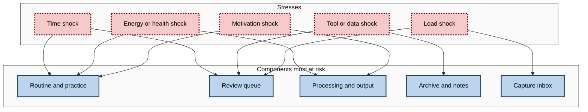
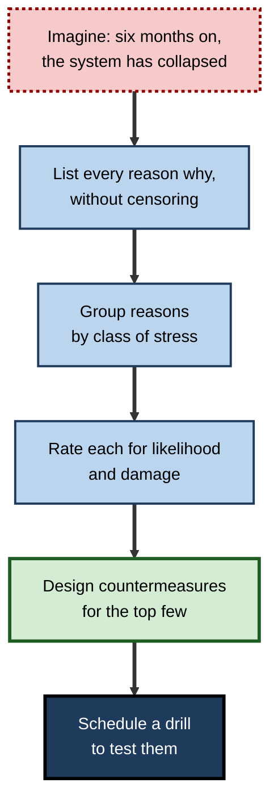
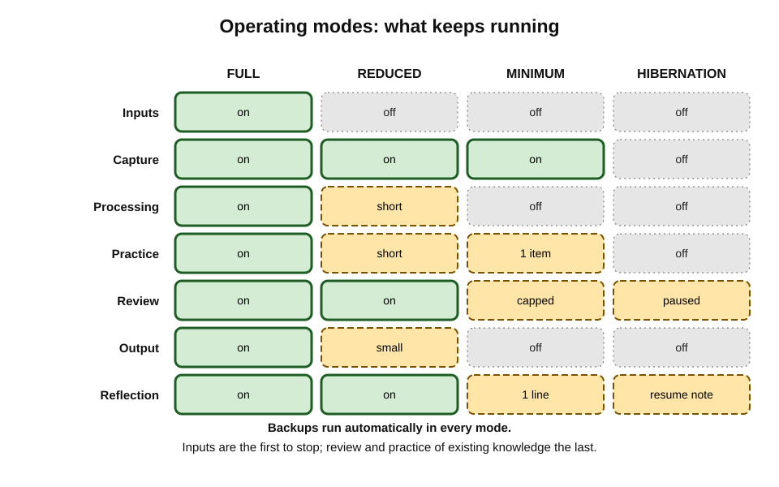
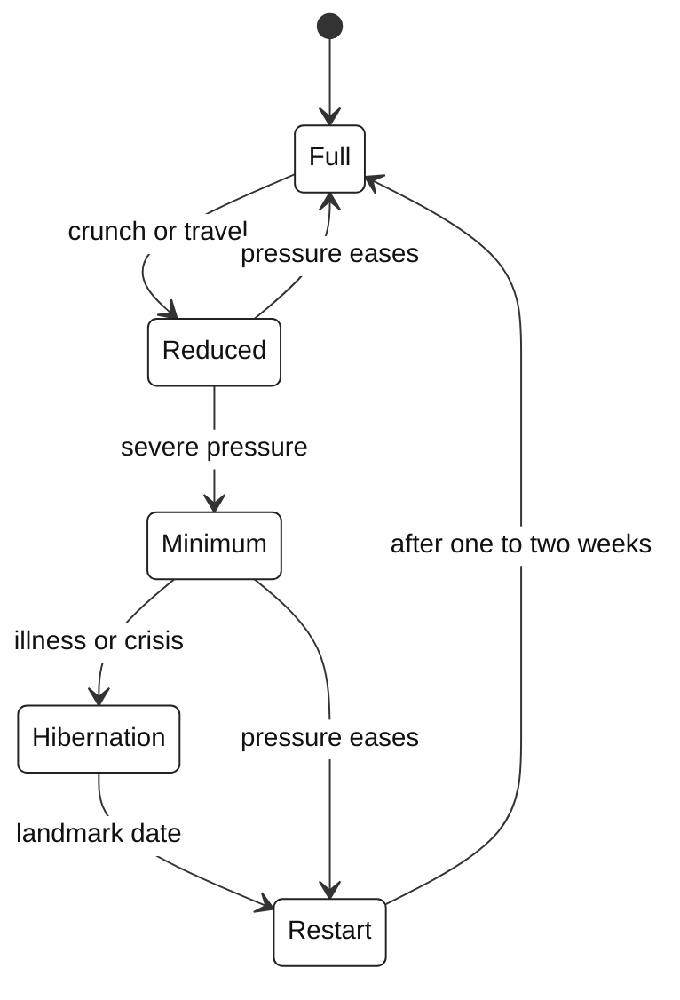
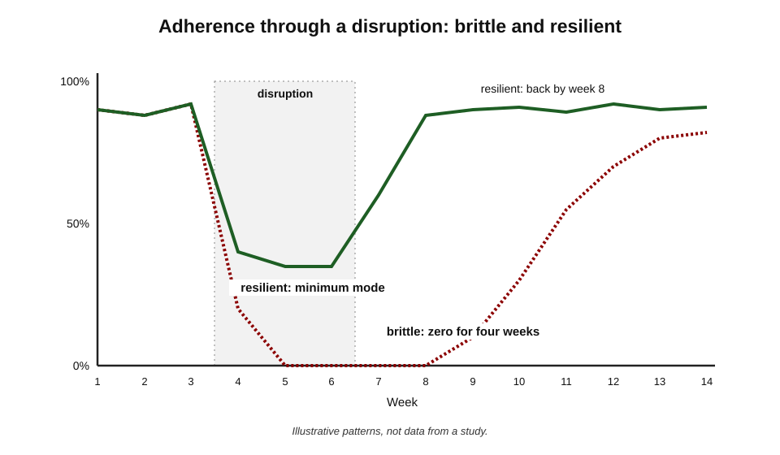

# C.11. Stress-Testing Your Learning System

A strategy consultant had a learning system that worked beautifully in ordinary weeks. Then came a three-week client crunch, followed by the theft of her laptop on a train. Her routines stopped, her review queue swelled to an impossible size, and her notes — never backed up outside one application on that laptop — were gone. It took her four months to learn again with any regularity. The system had never been tested against anything other than a normal week.

> **Definition — Stress-testing a learning system:** deliberately examining how a system behaves under adverse conditions — overload, disruption, loss or failure of its parts — and redesigning it so that it keeps working at reduced capacity or recovers quickly.

**Why it matters**

- **Disruption is certain; only its timing is unknown.** Illness, travel, crunch periods, job changes and tool failures happen to everyone.
- **Most systems are designed for normal weeks** and fail completely, rather than partly, under stress.
- **The cost of collapse is mostly in the restart.** Lost habits, swollen backlogs and lost data can take months to recover from.
- **Stress-testing is cheap in advance and expensive afterwards.** An hour of foresight can save months.

---

## Robustness, Resilience and Antifragility

> **Definition — Robustness:** the ability of a system to keep functioning, unchanged, under stress.

> **Definition — Resilience:** the ability of a system to absorb disruption, keep its essential functions and recover — an idea developed in ecology by C. S. Holling (1973).

> **Definition — Antifragility:** Nassim Nicholas Taleb's term (2012) for systems that **gain** from stress, disorder and volatility, rather than merely surviving them.

| | Robust system | Resilient system | Antifragile system |
|---|---|---|---|
| Response to stress | Resists; continues as before | Bends, degrades gracefully, recovers | Improves because of the stress |
| Typical design features | Strong parts, margins | Minimum modes, backups, restart plans | Deliberate exposure to challenge; learning from each failure |
| Learning example | A routine so short it survives any week | A routine with planned reduced versions and a recovery protocol | Using each disruption — a new role, a failed project — as material for learning |
| Weakness | Rigid; costly margins | Some loss during disruption | Concept loosely defined; easy to over-claim |

> **Watch out:** "antifragility" is a provocative and useful idea, but it is defined loosely and is often applied to anything that recovers. In learning, the defensible version is narrow: **some stresses, used deliberately, produce learning** — failures analysed, new roles embraced, difficult feedback sought.

> **Key point:** for most learners, the practical aim is **resilience** — keeping the essentials alive through disruption and returning quickly afterwards.

---

## What Can Go Wrong: Classes of Stress

- **Time shocks** — a project crunch, travel, exam season, a new baby, caring for a relative.
- **Energy and health shocks** — illness, injury, poor sleep, burnout.
- **Motivation shocks** — a setback, failure, boredom, loss of purpose.
- **Context shocks** — new job, redundancy, relocation, change of field.
- **Tool and data shocks** — outages, a service shutting down, price rises, account loss, device theft, file corruption.
- **Load shocks** — a sudden flood of material, such as a new role with a mountain of unfamiliar knowledge.
- **Social shocks** — losing a mentor, a study partner or a community.

> **Mnemonic — "The Early Morning Commuter Takes Long Strolls":** Time, Energy and health, Motivation, Context, Tools and data, Load, Social.

**Figure 1.** Classes of stress and the components of a learning system they most often damage.

---

## Methods of Stress-Testing

### The pre-mortem

**Study card — Mitchell, Russo and Pennington (1989): prospective hindsight**

- **Design:** participants were asked to explain possible future outcomes, either as things that **might** happen or as things that **had already** happened ("imagine it is a year from now and the project has failed — why?").
- **Results:** imagining that the outcome had already occurred increased the number and specificity of reasons people could generate for it.
- **Conclusion:** framing a future failure as a certainty — **prospective hindsight** — helps people identify causes they would otherwise miss.

- **Gary Klein (2007)** turned this into the **pre-mortem**: before a project starts, the team imagines it has failed and writes down every reason why.

**Applied to a learning system:**

1. "It is six months from now. My learning system has completely collapsed."
2. Write, without censoring, every reason why it might have happened.
3. Group the reasons by stress class.
4. For the most likely and most damaging, design a countermeasure now.

**Figure 2.** A pre-mortem for a personal learning system.

### Scenario walk-throughs

- Choose concrete scenarios and walk each component through them.

| Scenario | Routine | Review queue | Notes and archive | Output | Likely failure |
|---|---|---|---|---|---|
| Three-week project crunch | Minimum version only | Grows ~3× normal | Unaffected | Paused | Review backlog overwhelming on return |
| Two weeks of illness | Stops | Grows | Unaffected | Paused | Habit cue lost; restart delayed |
| Laptop stolen | Disrupted for days | Safe if cloud-hosted | Lost if not backed up | Lost drafts | Permanent data loss |
| Note app shuts down with 60 days' notice | Unaffected | Unaffected | At risk | Unaffected | Hurried, incomplete migration |
| New role with large new domain | Overloaded | Swamped by new items | Inbox floods | Delayed | Capture outstrips processing |

> **In practice:** three scenarios — a **crunch**, an **illness** and a **device loss** — expose most weaknesses in most personal systems.

### Failure mode and effects analysis

- **Failure mode and effects analysis (FMEA)** was developed in the United States military in the late 1940s and adopted in aerospace, automotive and healthcare engineering.
- Each possible failure is scored for:
  - **Severity (S)** — how bad the consequences would be;
  - **Occurrence (O)** — how likely it is;
  - **Detection (D)** — how hard it is to notice before damage is done (higher = harder).

> **Formula — Risk priority number:** RPN = S × O × D, each scored 1–10. Example: severity 9, occurrence 3, detection 8 → RPN = 9 × 3 × 8 = **216**.

### Worked example (illustrative): an FMEA of a product analyst's system

| Failure mode | Effect | S | O | D | RPN | Countermeasure |
|---|---|---|---|---|---|---|
| Notes lost with device | Years of processed notes gone | 9 | 3 | 8 | 216 | Automatic off-device backup; monthly restore test |
| Review backlog after crunch | Reviews abandoned entirely | 6 | 7 | 3 | 126 | Cap daily reviews; "review holiday" mode |
| Morning slot lost to new meeting pattern | Routine collapses | 7 | 5 | 4 | 140 | Second anchor on the commute; minimum version |
| Notes app raises price sharply | Forced migration | 5 | 4 | 2 | 40 | Plain-text export each quarter |
| Motivation collapses after failed exam | System abandoned | 8 | 3 | 6 | 144 | Pre-written recovery protocol; mentor check-in |

*Illustrative figures.*

1. **Ranking by RPN:** device loss (216) → motivation collapse (144) → slot loss (140) → review backlog (126) → price rise (40).
2. **Insight:** the highest risk is **not the most likely** failure but a rare, severe and **silent** one — data loss is not noticed until it is too late.
3. **Action order:** backups first; then the recovery protocol; then the second anchor.

> **Watch out:** RPN scores are **judgements**, and multiplying ordinal ratings has known mathematical weaknesses. Use the method to **structure thinking and order priorities**, not as precise measurement. Many practitioners also treat any failure with very high severity as a priority regardless of its RPN.

### Single points of failure

> **Definition — Single point of failure:** a part whose failure alone stops the whole system.

- **Common single points in personal systems:**
  - one device holding everything;
  - one time slot carrying all practice;
  - one account or vendor;
  - one mentor or study partner on whom motivation depends;
  - one person's memory of how the system works (for team systems).
- **Remedy:** duplicate the critical ones, or make sure their failure degrades rather than stops the system.

### Drills

- **Restore drill** — once a quarter, restore a sample of notes from backup on another device. A backup never restored is a hope, not a backup.
- **Minimum-week drill** — deliberately run one week in minimum mode to check that it is genuinely sustainable and that the return to normal is smooth.
- **Offline drill** — run a day without internet access to check which components depend on connectivity.
- **Analogy — chaos engineering:** the streaming company Netflix publicised in 2011 a tool called Chaos Monkey that randomly disabled parts of its own production systems, so that engineers would build services able to survive failures. Personal drills apply the same idea on a small scale: cause controlled failures to discover weaknesses before real ones do.

---

## Stress-Testing Each Component

Each component has characteristic weak points. A quick check of each, once or twice a year, finds most of them.

- **Inputs**
  - *Test:* if the main source disappeared tomorrow — a course withdrawn, a newsletter closed, a mentor moving on — what would replace it?
  - *Weak point:* dependence on a single source or person.
- **Capture**
  - *Test:* can capture happen with the phone flat, offline or lost? Is there a paper fallback?
  - *Weak point:* capture tied to one app on one device.
- **Processing**
  - *Test:* how many days of capture can accumulate before processing becomes overwhelming?
  - *Weak point:* no expiry rule, so backlogs grow without limit.
- **Practice**
  - *Test:* does practice depend on one time slot, one location or one piece of equipment?
  - *Weak point:* a single anchor that disappears with a change of schedule.
- **Review**
  - *Test:* what would the queue look like after three weeks without reviewing? Is there a daily cap?
  - *Weak point:* uncapped queues that punish absence.
- **Output**
  - *Test:* are drafts stored somewhere safe and accessible from another device?
  - *Weak point:* unfinished work held only locally.
- **Reflection**
  - *Test:* would a disruption be noticed and logged, or would the system simply fade?
  - *Weak point:* no explicit mode declaration, so lapses go unacknowledged until the habit is gone.

> **Key point:** most component weaknesses fall into three patterns — **dependence on one thing**, **queues without caps** and **no defined fallback**.

### Load shocks: entering a new domain

- A new role, a promotion or a change of field can multiply the material to learn overnight.
- **Typical failure:** capture everything, process little, review nothing; the system silts up within weeks.
- **Countermeasures:**
  - **pull, not push** — capture only what current tasks need, plus a small allowance for foundations;
  - **a temporary structured path** — a short curated sequence for the new domain, rather than open-ended reading;
  - **raise processing capacity deliberately** for a defined period, by suspending other learning;
  - **ask people, not documents** — in a new organisation, experienced colleagues compress months of reading into minutes of explanation.

### The resume note

- Before any planned disruption — and as soon as possible after an unplanned one — write a short **resume note**:
  - the current focus and the next concrete step;
  - where the active material is stored;
  - which review items or topics to restart with;
  - the date or landmark for restarting.
- A resume note turns "Where was I?" — a common reason restarts stall — into a two-minute task.

---

## Designing for Resilience

### Graceful degradation

> **Definition — Graceful degradation:** a system's ability to keep its most important functions working, at reduced capacity, when parts fail or resources shrink.

- Decide in advance **which components survive** at each level of stress, and in what order others are switched off.

**Figure 3.** Four operating modes of a learning system, from full operation to hibernation.

- **Full mode** — all components running.
- **Reduced mode** — inputs cut; processing and practice shortened; review and a small output kept.
- **Minimum mode** — a few minutes of review or one practice item a day; capture continues; nothing new is started.
- **Hibernation** — everything paused except backups and a dated note of where to resume.

> **Key point:** the order of survival matters. **Review and practice of what is already learned** should be the last to go, because they protect the existing stock; **new input** should be the first, because it is the easiest to resume.

### Redundancy and backups

- **The 3-2-1 rule** — a guideline widely used for data protection and often credited to the photographer Peter Krogh: keep **three** copies of important data, on **two** different kinds of storage, with **one** copy off-site.
- **Applied to learning artefacts:**
  - the working copy;
  - an automatic backup to a second service or drive;
  - a periodic export in an open format stored elsewhere.

> **Remember:** **back up automatically, export openly, restore regularly.**

### Buffers and slack

- **Slack** — spare capacity deliberately left unused — makes systems more adaptable; the software-management writer Tom DeMarco (2001) argued that organisations run at full utilisation lose the ability to respond to change.
- **In a learning system:**
  - plan for about **70–80%** of the time that seems available;
  - keep the review queue below its maximum sustainable size;
  - leave one evening a week unscheduled as a buffer.

### Loose coupling and modularity

- **Loose coupling** — components can fail or change without bringing down the others.
  - *e.g.* review items stored independently of the notes app; a capture method that works on paper if the phone dies.
- **Modularity** — each component can be replaced on its own.

### Capping the queues

- Large backlogs are the most common source of post-disruption collapse.
- **Countermeasures:**
  - a **daily cap** on reviews, so that a backlog spreads over days rather than arriving at once;
  - **expiry** for capture items not processed within a set period;
  - a **review holiday** — a planned pause, after which overdue items are rescheduled gradually.

---

## Recovering After a Lapse

### Why restarts fail

- **The "what-the-hell" effect** — research on dieting by Janet Polivy and Peter Herman found that people who broke a diet often abandoned restraint altogether. A related idea, the **abstinence violation effect** described by Alan Marlatt in relapse-prevention research, holds that a single lapse interpreted as total failure tends to become a full relapse.
- **Backlog dread** — returning to hundreds of overdue reviews is discouraging enough to delay the restart further.
- **Lost cues** — the anchor that triggered the routine may have changed during the disruption.

### Fresh starts

**Study card — Dai, Milkman and Riis (2014): the fresh-start effect**

- **Design:** analysis of gym attendance, internet searches for "diet" and commitments on a goal-setting website, in relation to calendar landmarks.
- **Results:** aspirational behaviour rose after **temporal landmarks** — the start of a week, a month or a year, a birthday, a public holiday.
- **Conclusion:** landmarks create a psychological separation from past failures and prompt new beginnings.

- **Use for recovery:** plan the restart for a natural landmark — the next Monday, the first of the month — and treat it explicitly as a new start.

### A recovery protocol

1. **Declare the mode** — "I am in hibernation until the project ends on the 15th."
2. **Set a restart date** at a landmark.
3. **Restart with the minimum version** for the first week — not with the full routine.
4. **Triage the backlog** — reschedule overdue reviews across several weeks; archive stale captures.
5. **Re-anchor** — confirm or replace the routine's cue.
6. **Return to full mode** in the second or third week.
7. **Log** the disruption and what helped.

**Figure 4.** How a learning system moves between modes during disruption and recovery.

> **Watch out:** the most damaging response to a lapse is **self-criticism followed by an ambitious restart** — a full routine plus "catching up" on everything missed. It recreates the overload that made the system fragile. Restart small.

---

## Measuring Resilience

- **Recovery time** — days from the end of a disruption to normal adherence.
- **Depth of dip** — how far adherence or output fell during the disruption.
- **Retention through disruption** — a capability spot-check before and after a break.

> **Formula — Retention through disruption:** score on a spot-check after the break ÷ score before it. Example: 17 of 20 items before a four-week break, 14 of 20 after → 14 ÷ 17 ≈ **82%** retained.

**Figure 5.** Weekly adherence for a brittle and a resilient system through a three-week disruption.

- **Brittle pattern:** adherence falls to zero, stays there long after the disruption, and returns slowly.
- **Resilient pattern:** adherence drops to minimum mode, never reaches zero, and returns to normal within one or two weeks.

> **Key point:** the most important resilience metric is not how little the system dips, but **how quickly it returns**.

---

## Case Study (illustrative): The Consultant's Crunch and the Stolen Laptop

### Case study (illustrative): rebuilding a system to survive

- **Situation:** a strategy consultant learning financial modelling and the energy sector alongside client work.
- **Problem:** a three-week crunch stopped her routine; her review queue reached over 900 overdue items; days later her laptop was stolen, taking two years of notes held only in one desktop application. Four months passed before she learned regularly again.
- **Diagnosis (post-mortem, then pre-mortem for the future):**
  1. **Single point of failure:** one device held all notes.
  2. **No graceful degradation:** the routine had only one version.
  3. **Uncapped queue:** the backlog arrived all at once on her return.
  4. **No recovery protocol:** she tried to restart at full intensity and "catch up", failed twice, and gave up.
- **Actions:**
  1. **Backups:** notes moved to plain-text files with automatic cloud sync, plus a monthly export to an external drive (3-2-1).
  2. **Restore drill** each quarter.
  3. **Four modes** defined in writing, with the components kept in each.
  4. **Review cap** of 60 a day; "review holiday" setting for crunches.
  5. **Recovery protocol** on one page, starting with a minimum week at a landmark date.
  6. **Second anchor:** a 10-minute review on the airport train, so travel weeks still had a cue.
- **Result:** in the next crunch, a month-long merger project, she ran minimum mode throughout; adherence never fell below about 30%; she was back to full mode eight days after the project ended; a capability spot-check showed about 90% retention.
- **Side effects:** about an hour to set up backups and write the protocol; a small monthly maintenance task.
- **Lesson:** the system that failed was not badly designed for normal weeks — it was **untested for abnormal ones**. Resilience came from a few cheap features: backups, modes, caps and a recovery plan.

---

## Using Stress to Learn

- **Disruptions are also inputs.** A new role, a failed project, a difficult client or a crisis contains intense learning — if captured and processed.
- **Practices:**
  - a brief **incident note** after any significant setback: what happened, why, what to do differently;
  - treating a sudden new responsibility as a **stretch assignment** with explicit learning goals;
  - asking for **feedback** at moments of failure, when it is most informative.
- **Limits:** severe stress — bereavement, serious illness, burnout — is not a learning opportunity to be optimised. Rest and recovery come first.

> **In practice:** the most resilient learners keep a minimal **reflection** habit even in hibernation — one line a day about what the crisis is teaching — so that disruption feeds the system rather than only interrupting it.

---

## Stress-Testing in Teams and Organisations

- **Business continuity planning** — organisations plan for the loss of systems, sites and key people; teams can apply the same thinking to shared knowledge.
- **Key-person risk** — when one expert holds critical knowledge, their absence stops work; documented knowledge, pairing and rotation reduce the risk.
- **Team drills** — reviewing whether onboarding material lets a new colleague do a core task unaided; testing whether a shared knowledge base can be restored.
- **Learning time under pressure** — teams often abandon all learning in crunch periods; a team-level minimum mode (a short weekly session) preserves continuity.

---

## Open Questions

- **Which design features most improve recovery after disruption?**
  - Minimum versions, caps and recovery protocols are plausible; comparative evidence in adult learning is lacking.
- **How much is lost during typical disruptions?**
  - Skill decay over non-use is documented, but the effect of short, partial disruptions on professional learning is less studied.
- **Do fresh-start interventions help learners restart?**
  - Evidence comes mostly from exercise, saving and goal-setting; transfer to learning routines is likely but untested.
- **Is antifragility a useful concept for individual learning?**
  - The idea is appealing but loosely defined; it is unclear how to measure "gaining from disorder".
- **How should systems prepare for unknown future shocks, such as rapid changes in AI tools?**
  - Portability and modularity are sensible hedges; their value against unforeseeable change cannot be tested in advance.

---

## Summary

- **Stress-testing** examines how a learning system behaves under overload, disruption and failure, and redesigns it to degrade gracefully and recover.
- **Robustness** resists; **resilience** (Holling, 1973) absorbs and recovers; **antifragility** (Taleb, 2012) gains from stress — loosely defined; resilience is the practical aim.
- Classes of stress: **Time, Energy and health, Motivation, Context, Tools and data, Load, Social** ("The Early Morning Commuter Takes Long Strolls").
- Methods: **pre-mortem** (prospective hindsight — Mitchell et al., 1989; Klein, 2007), **scenario walk-throughs**, **FMEA** with **RPN = S × O × D**, **single-point-of-failure** analysis, and **drills** (restore, minimum-week, offline), in the spirit of chaos engineering.
- Design for resilience: **graceful degradation** through four modes (full, reduced, minimum, hibernation), keeping review and practice of existing knowledge last; **3-2-1 backups**; **slack**; **loose coupling**; **capped queues**.
- Recovery: avoid the **what-the-hell** and abstinence-violation patterns; use the **fresh-start effect** (Dai et al., 2014); follow a protocol — declare mode, landmark restart, minimum first, triage backlog, re-anchor.
- Measure **recovery time**, **depth of dip** and **retention through disruption**; speed of return matters most.
- Disruptions can feed learning through incident notes and stretch goals — but severe stress calls for rest first.

---

## Self-Check

1. Define stress-testing a learning system and give two reasons it matters.
2. Distinguish robustness, resilience and antifragility, with a learning example of each.
3. Name the seven classes of stress.
4. Describe prospective hindsight and how a pre-mortem uses it.
5. Walk a "two weeks of illness" scenario through routine, review queue and notes, identifying the likely failure.
6. Calculate the RPN for a failure with severity 7, occurrence 6 and detection 2, and compare it with one scored 9, 2, 9.
7. What are the limitations of RPN scoring?
8. What is a single point of failure? List three common ones in personal systems.
9. Explain the purpose of restore, minimum-week and offline drills.
10. Describe the four operating modes and explain which components should be the last to stop.
11. State the 3-2-1 backup rule and apply it to learning artefacts.
12. What is the fresh-start effect, and how can it support recovery?
13. Calculate retention through disruption if a learner scores 12 of 15 before a break and 9 of 15 after.
14. A graduate engineer's system consists of one evening study block, an app with 3,000 flashcards and notes on a single laptop. She is about to start a role involving frequent travel. Stress-test the system and propose changes.

### Answer Key

1. Deliberately examining how a system behaves under overload, disruption or failure and redesigning it to keep working or recover quickly. Reasons: disruption is certain; most systems fail completely under stress; restarts are costly.
2. Robust: resists stress unchanged (a five-minute routine that survives any week). Resilient: degrades and recovers (planned minimum mode and recovery protocol). Antifragile: gains from stress (turning a failed project into structured learning).
3. Time, energy and health, motivation, context, tools and data, load, social.
4. Imagining a future outcome as already having happened increases the number and specificity of reasons generated. A pre-mortem asks people to imagine the system has collapsed and list why, then design countermeasures.
5. Routine stops; review queue grows; notes are unaffected. Likely failure: lost habit cue and backlog dread delaying restart.
6. 7 × 6 × 2 = 84; 9 × 2 × 9 = 162. The rare, severe, hard-to-detect failure ranks higher.
7. Scores are subjective; multiplying ordinal ratings is mathematically questionable; very severe failures may deserve priority regardless of RPN. Use it to structure thinking, not to measure precisely.
8. A part whose failure alone stops the system. Examples: one device; one time slot; one vendor or account; one mentor.
9. Restore: confirms backups actually work. Minimum-week: checks minimum mode is sustainable and return is smooth. Offline: reveals dependence on connectivity.
10. Full, reduced, minimum, hibernation. Review and practice of existing knowledge should stop last because they protect the existing stock; new input stops first.
11. Three copies, two kinds of storage, one off-site: working notes, automatic backup to another service or drive, periodic open-format export stored elsewhere.
12. Aspirational behaviour increases after temporal landmarks. Schedule the restart at a landmark and frame it as a new beginning.
13. 9 ÷ 12 = 75%.
14. Single points of failure: one evening slot (lost on travel nights), one laptop (data loss), a large uncapped deck (backlog after travel). Changes: add a second anchor in transit and a minimum version; back up notes automatically with an open-format export; cap daily reviews and prune the deck; write a recovery protocol; run a minimum-week drill before the first long trip.

---

## Glossary

| Term | Meaning |
|---|---|
| 3-2-1 rule | Keep three copies of data, on two kinds of storage, with one off-site. |
| Abstinence violation effect | The tendency for a single lapse, seen as total failure, to become a full relapse. |
| Antifragility | Taleb's term for systems that gain from stress and disorder. |
| Chaos engineering | Deliberately causing controlled failures to build systems that survive real ones. |
| Failure mode and effects analysis | A method for listing possible failures and rating their severity, occurrence and detectability. |
| Fresh-start effect | Increased aspirational behaviour after temporal landmarks. |
| Graceful degradation | Keeping the most important functions working at reduced capacity under stress. |
| Hibernation | An operating mode in which only backups and a resume note are maintained. |
| Loose coupling | Design in which components can fail or change without bringing down others. |
| Pre-mortem | Imagining that a plan has failed in order to identify reasons in advance. |
| Prospective hindsight | Imagining a future event as already having happened, to improve explanation. |
| Recovery time | Days from the end of a disruption to normal adherence. |
| Resilience | The ability to absorb disruption, keep essential functions and recover. |
| Resume note | A short record of current focus, next step and restart date, written before or during a disruption. |
| Risk priority number | Severity × occurrence × detection, used to rank failure modes. |
| Robustness | The ability to keep functioning unchanged under stress. |
| Single point of failure | A part whose failure alone stops the whole system. |
| Slack | Spare capacity deliberately left unused to allow adaptation. |
| Stress-testing | Examining a system's behaviour under adverse conditions and redesigning it to cope. |
| What-the-hell effect | Abandoning restraint altogether after a single lapse. |
