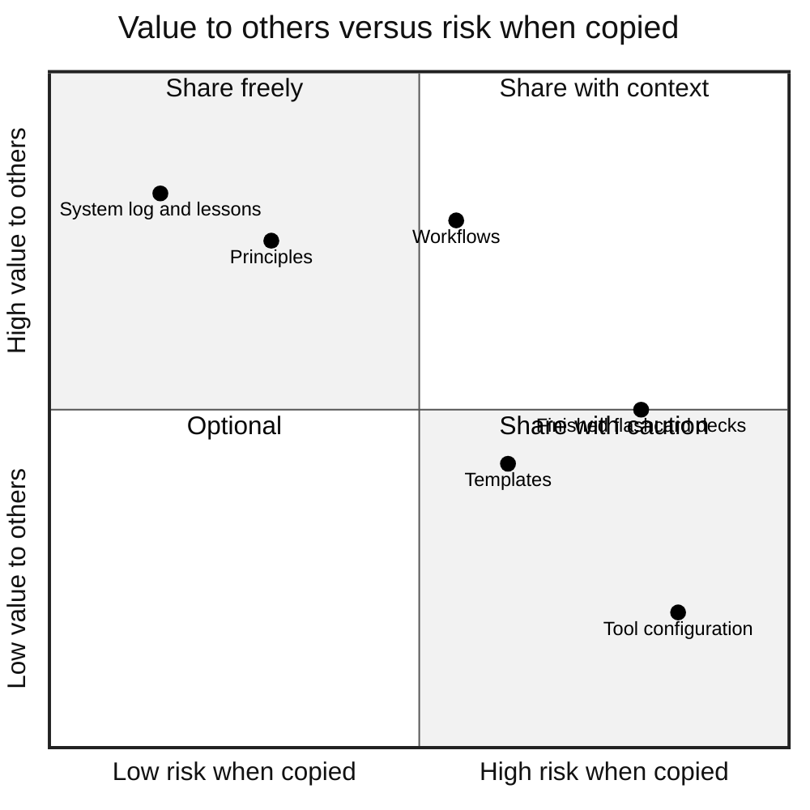
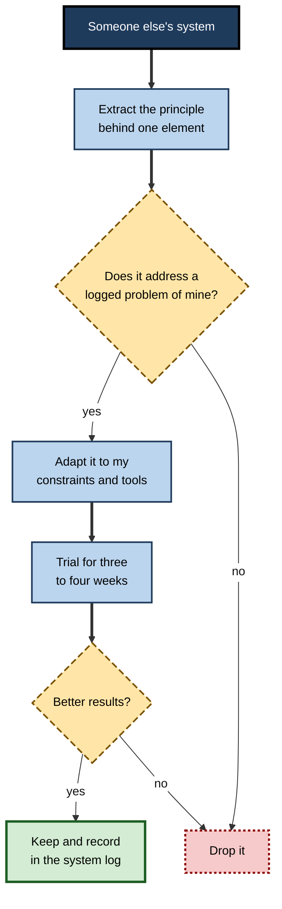
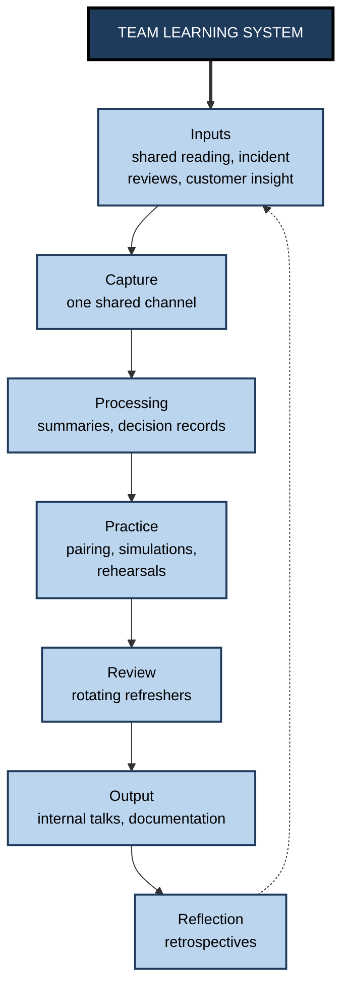
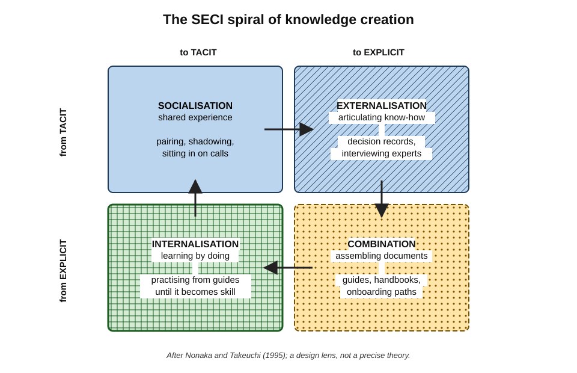
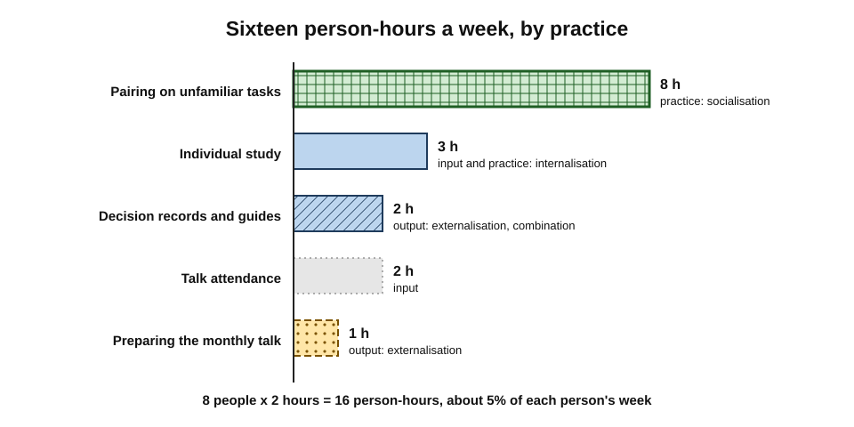

# H.12. Sharing and Evolving Your System

A data engineer kept a private set of practice exercises, decision notes and a weekly routine. When two new colleagues struggled, she shared it, and adapted by the team it became the group's onboarding programme and halved the time newcomers took to work unaided. A colleague elsewhere copied a well-known author's elaborate system and abandoned it within a month. One system grew by being **shared and adapted**; the other failed by being **copied without fit**.

> **Definition — Sharing and evolving a learning system:** making one's learning principles, workflows, templates or artefacts available to others, improving the system through their feedback and use, and — where people learn together — building and maintaining a shared system for a team.

**Why it matters**

- **Private systems have blind spots.** Others notice friction, gaps and unexamined assumptions the owner no longer sees.
- **Shared systems multiply value.** One person's tested workflow can save a team months.
- **Teams need learning systems too.** Shared knowledge, onboarding and collective capability depend on the same components as individual learning.
- **Copying is not sharing.** Adopting another person's configuration without understanding its context usually fails.

---

## Why Share a System

- **Feedback on the machinery** — others ask "why do you do that?" and expose habits that no longer serve.
- **Accountability** — a system explained to others is more likely to be followed.
- **Consolidation** — explaining one's methods clarifies them; explaining to others is itself a powerful learning activity.
- **Reputation and relationships** — sharing useful practices builds trust and connections.
- **Team efficiency** — common practices make collaboration and onboarding easier.
- **Generosity** — many professionals learned from others' openness and return the favour.

> **Key point:** sharing serves the **sharer** as much as the receiver — the system improves through the feedback it attracts.

---

## What Can Be Shared

| Item | Value to others | Main risk | How to share well |
|---|---|---|---|
| Principles | High; transferable across contexts | Too abstract to act on | Pair each with the rule and mechanism it produced |
| Workflows | High; shows the hand-offs | Copied without its context | Describe the constraints it was designed for |
| Templates | Moderate; saves set-up time | Encourages form over substance | Explain the thinking each field prompts |
| Artefacts (notes, question sets) | Moderate to high in the same domain | Others skip the processing that made them valuable | Share as examples, encouraging others to make their own |
| Outputs | High for colleagues in the field | Confidentiality | Remove client and personal data |
| System log and lessons | High; shows what failed and why | Little | Include failures, not just successes |

**Figure 1.** Kinds of shareable item placed by their value to others and their risk when copied.

> **Remember:** share **principles and lessons freely**, **workflows with context**, and **configurations and ready-made artefacts with caution**.

---

## Sharing Well

### Explain the context

- **Who the system was designed for** — role, field, experience level.
- **Constraints** — time available, devices, employer rules, family circumstances.
- **Purpose** — what capability it was built to develop.
- **Evidence** — what changed as a result, and how that was judged.

### Share principles, not just configurations

- A configuration answers **"what do you do?"**; a principle answers **"why?"** — and only the "why" transfers to someone else's circumstances.

> **Example:** "I review twenty questions every morning on the train" is a configuration. "I schedule retrieval in the slot with the most reliable cue and the least competition, and I keep it short enough to survive bad days" is a principle anyone can apply.

### Show failures as well as successes

- Accounts of systems are usually written by people for whom they worked, at the moment they worked.
- **Survivorship bias** makes shared systems look more reliable than they are.
- **Honest sharing** includes what was tried and dropped, and what still fails.

### The cargo-cult trap

- In a 1974 commencement address, the physicist Richard Feynman described **"cargo cult science"** — imitating the outward forms of science without its essential discipline — after accounts of islanders who, after the Second World War, built imitation airstrips hoping planes would land.
- **Applied to learning systems:** copying someone's apps, templates and schedules — the visible form — without the processing, practice and feedback that made the system work.

> **Watch out:** the more polished and photogenic a shared system, the greater the risk that it is copied for its **appearance**. The parts that make systems work — effortful retrieval, honest reflection, real output — are the least visible.

### Privacy, confidentiality and attribution

- **Remove** client, patient, employer and personal data before sharing artefacts.
- **Respect licences** — shared notes may include copyrighted material; excerpts and own-words summaries are safer than copies.
- **Attribute** methods and ideas to their originators.

---

## Working Out Loud and Learning in Public

> **Definition — Working out loud:** making one's work and learning visible to others as it happens, in order to build relationships, invite help and improve the work.

- **Bryce Williams (2010)** summarised the idea as "observable work plus narrating your work".
- **John Stepper's *Working Out Loud* (2015)** developed it into a structured practice, often run in small peer circles meeting weekly for several weeks.
- **Learning in public** — sharing notes, questions and early outputs openly — is a related practice among software developers, writers and researchers.

**Benefits**

- Feedback arrives earlier and from more people.
- Connections form with others learning similar things.
- Visible progress creates accountability.
- A body of public work accumulates as evidence of capability.

**Risks**

- **Exposure** — mistakes are public; some fields and employers penalise this.
- **Performance pressure** — sharing for approval rather than learning; polishing instead of thinking.
- **Confidentiality** — work details may not be shareable.

> **In practice:** many professionals find a middle path — **working out loud inside the organisation** or with a small trusted circle, and publishing only selected, polished outputs externally.

---

## Adopting Ideas From Others' Systems

### Borrow, test, adapt

**Figure 2.** Borrowing an element from someone else's system and adapting it to fit.

1. **Extract the principle** behind the element, not just its form.
2. **Check the fit** — does it solve a problem the learner actually has, as shown by an audit or log?
3. **Adapt** it to the learner's time, tools and constraints.
4. **Trial** one element at a time for three to four weeks.
5. **Keep or drop** on the evidence; record the result.

> **Key point:** adopt **one element at a time** from others, never a whole system. A whole borrowed system brings someone else's assumptions, constraints and problems with it.

---

## Evolving Through Feedback

### Channels

- **Mentor review** — a mentor examines the system's artefacts and asks hard questions.
- **System-review partners** — two peers explain their systems to each other once a quarter and each suggests one change.
- **Communities** — groups of practitioners compare methods, often around a shared field or tool.
- **Users of one's outputs** — colleagues who rely on one's work notice gaps.

### Asking good questions

- **Vague:** "What do you think of my system?"
- **Specific:**
  - "Which part looks like it costs more than it returns?"
  - "What would you remove?"
  - "Where would this break in a busy month?"
  - "What am I not doing that you would expect?"

> **Remember:** **specific questions get usable feedback; general questions get compliments.**

---

## Helping Someone Build Their Own System

Mentors, managers and experienced colleagues are often asked "How do you learn?" The most useful answer is not a copy of one's own system but help in building theirs.

1. **Start with their purpose** — what capability do they need, by when, and why?
2. **Audit before advising** — ask to see their current notes, routines and outputs; trace one recent item through their components.
3. **Find the one broken hand-off** — usually between capture and processing, or between practice and output.
4. **Offer principles with examples** — show how one's own system handles that hand-off, and explain why it works.
5. **Let them design the mechanism** — the tool, slot and template should fit their life, not the mentor's.
6. **Agree a short trial** — three to four weeks — and a check-in date.
7. **Review evidence, not effort** — what can they now do, recall or produce that they could not before?

> **Watch out:** experienced people tend to recommend their **current** system, which fits their present expertise. A newcomer may need what the mentor used years earlier — more structure, more worked examples, more review — an instance of the expertise reversal effect.

### Communities built around systems

- **Practitioner communities** — groups of people sharing methods for learning, note-taking or professional development — offer ideas, templates and encouragement.
- **Benefits:** exposure to many approaches; troubleshooting help; motivation.
- **Risks:**
  - discussion drifts towards tools and configurations rather than learning outcomes;
  - elaborate set-ups attract attention and admiration, rewarding complexity;
  - members compare systems rather than capabilities.
- **Healthy norms:** asking "what did it help you learn or produce?"; sharing failures; valuing simple systems that work.

---

## Shared Learning Systems for Teams

A team that learns together needs the same seven components as an individual — inputs, capture, processing, practice, review, output and reflection — but each must work across several people.

### How a team system maps onto the components

**Figure 3.** The components of a team learning system and typical team practices for each.

### Theories of team knowledge

**Study card — Ikujiro Nonaka and Hirotaka Takeuchi (1995): the SECI model**

- **Setting:** studies of product development in Japanese companies such as Honda, Canon and Matsushita.
- **Model:** organisational knowledge is created through four conversions between **tacit** knowledge (in people's heads and skills) and **explicit** knowledge (written, codified):
  - **Socialisation** — tacit to tacit, through shared experience (apprenticeship, pairing);
  - **Externalisation** — tacit to explicit, by articulating it (writing down how an expert decides);
  - **Combination** — explicit to explicit, by assembling documents and data into new wholes;
  - **Internalisation** — explicit to tacit, by learning from documents and making them one's own through practice.
- **Conclusion:** knowledge creation is a **spiral** through all four modes; teams that only document (combination) or only work alongside one another (socialisation) miss half the cycle.

**Figure 4.** The SECI model of knowledge conversion, with team learning practices for each mode.

> **Watch out:** the SECI model has been influential but also criticised — for example for blurring the tacit–explicit distinction as the philosopher Michael Polanyi originally drew it, and for generalising from a small set of Japanese cases. It remains a useful **design lens** rather than a precise theory.

- **Transactive memory** — Daniel Wegner (from 1985) described how groups share the work of remembering: each member knows **who knows what**, so the group's memory exceeds any individual's.
  - A team system should make this visible: an index of who holds which expertise.

**Study card — Amy Edmondson (1999): psychological safety and team learning**

- **Design:** a study of 51 work teams in a manufacturing company, combining surveys, interviews and observation.
- **Results:** teams whose members believed it was safe to take interpersonal risks — asking questions, admitting mistakes, raising concerns — engaged in more **learning behaviour** (seeking feedback, discussing errors, experimenting), which was in turn associated with better performance.
- **Conclusion:** **psychological safety** is a precondition for team learning.

> **Definition — Psychological safety:** a shared belief that a team is safe for interpersonal risk-taking.

### Individual and team systems compared

| | Individual system | Team system |
|---|---|---|
| Owner | One person | Shared; each component needs a named owner |
| Main stock | Personal capability | Collective capability and documented knowledge |
| Biggest risk | Personal disruption | Key-person loss; silos; stale documentation |
| Feedback | Self, mentor, outputs | Peers, retrospectives, incidents, customers |
| Motivation | Personal purpose | Shared purpose plus psychological safety |
| Typical failure | Collecting without using | Documents nobody reads; learning time sacrificed to delivery |
| Measure of success | What the person can do unaided | What a newcomer or the team can do without the expert |

### Design rules for team systems

- **Name an owner for each component** — someone who keeps the capture channel tidy, someone who runs the monthly talk.
- **Keep it light** — a small number of practices done reliably beats an elaborate programme done occasionally.
- **Protect time** — a fixed share of working time, defended in planning.
- **Treat documentation as output** — writing a decision record or guide is learning for the writer and an input for others.
- **Test with newcomers** — the best measure of a team system is how quickly a new member can do core tasks without help.
- **Reduce key-person risk** — pair experts with learners; rotate responsibilities.

### Indicators that a team system is working

- **Time to unaided work** — how long a newcomer takes to complete core tasks without help.
- **Expert interruption rate** — how often experienced members are pulled away to answer basic questions.
- **Bus factor** — the number of people who would have to leave before a critical area of knowledge was lost; higher is safer.
- **Documentation freshness** — the share of key documents reviewed within their stated review period.
- **Learning time kept** — the share of protected learning time actually used, especially in busy periods.
- **Reuse** — how often decision records and guides are consulted or cited in new work.

> **Formula — Bus factor illustration:** if only 1 of 8 team members can maintain the billing pipeline, its bus factor is **1** — a single point of failure; pairing two more people raises it to **3**.

> **Remember:** measure **team capability and resilience**, not individual minutes logged.

---

## Evolving a Shared System

### Governance and versions

- **Shared systems need agreed change rules**: who can change a template, how proposals are discussed, when changes take effect.
- **Version and log changes**, as an individual would, so the team can see what changed and why.
- **Retire practices deliberately** — shared systems accumulate rituals that outlive their purpose.

### Lessons from open-source development

- In "The Cathedral and the Bazaar" (1997), Eric Raymond contrasted carefully controlled "cathedral" development with the open "bazaar" style of the Linux project, and summarised one of its strengths as **Linus's law**: "given enough eyeballs, all bugs are shallow".
- **Applied to shared learning systems:**
  - many users find flaws faster than one owner;
  - **forks** — local variants — are healthy if good changes flow back;
  - clear documentation lets newcomers contribute.

> **Key point:** a shared system improves fastest when **many people use it, report problems and propose changes**, and a light governance process decides what is adopted.

---

## Worked Example: A Learning System for an Eight-Person Data Team

A data team agrees to dedicate **two hours per person per week** to learning, protected in sprint planning.

**Step 1 — budget:**

> **Formula — Team learning budget:** people × hours each per week. 8 × 2 = **16 person-hours a week**, about 5% of a 40-hour week each.

**Step 2 — allocation (per week):**

| Practice | Component | Who | Person-hours |
|---|---|---|---|
| Pairing on unfamiliar tasks | Practice (socialisation) | 4 pairs × 1 h | 8 |
| Monthly internal talk, prepared in rotation | Output (externalisation) | 1 presenter × 4 h ÷ 4 weeks | 1 |
| Talk attendance | Input | 8 × 1 h ÷ 4 weeks | 2 |
| Decision records and guide updates | Processing and output (externalisation, combination) | 4 people × 0.5 h | 2 |
| Individual study of shared material | Input and practice (internalisation) | 6 × 0.5 h | 3 |
| **Total** | | | **16** |

**Figure 5.** Allocation of the data team's sixteen weekly learning hours by practice.

**Step 3 — measure:** time for a new hire to complete a standard pipeline change unaided.

- Before: about **10 weeks**.
- After two quarters: about **6 weeks**.

> **Formula — Reduction:** (10 − 6) ÷ 10 = **40%** less time to unaided work.

**Step 4 — evolve:** at each quarterly retrospective the team drops one practice that is not paying off and trials one proposal; after the first quarter they replaced a weekly reading club (low attendance) with the pairing hour.

> **Watch out:** the 40% improvement coincided with a better-documented codebase and a calmer quarter. Without a comparison, the team cannot attribute all of it to the learning system — a common limit of workplace evaluations.

---

## Case Study: From Private Practice to Team Programme

### Case study: a data engineer's system becomes onboarding

- **Situation:** a senior data engineer had a personal system of graded practice exercises, decision notes and a weekly routine.
- **Problem:** two new hires were struggling; the team had no onboarding beyond reading documentation; the senior engineers were constantly interrupted with basic questions (a shifting-the-burden pattern).
- **Actions:**
  1. **Shared principles first** — "practise on real pipelines in a sandbox", "write down every decision and why" — and her exercises as examples.
  2. **Explained context** — her exercises assumed familiarity with one cloud platform; newcomers from other platforms needed a preliminary set.
  3. **Invited feedback** — newcomers marked exercises that were unclear; colleagues added exercises from recent incidents.
  4. **Created a shared repository** with a simple change process and a changelog.
  5. **Added pairing** for the hardest exercises, converting senior engineers' interruptions into planned sessions.
  6. **Measured** time to first unaided pipeline change.
- **Result:** within a year onboarding time roughly halved; interruptions to senior engineers fell; three other teams forked the repository, and two improvements flowed back.
- **Side effects:** maintenance needed an owner — she rotated the role quarterly to avoid becoming a single point of failure.
- **Lesson:** the system improved more in one year of shared use than in three years of private use, because **many users exposed flaws** and contributed material.

---

## Ethics and Risks

- **Autonomy** — a team system should support individual learning, not impose one person's preferred methods on everyone.
- **Surveillance** — team learning dashboards can slide into monitoring; measure team capability, not individual minutes.
- **Confidentiality** — shared knowledge bases must respect client and data rules.
- **Credit** — acknowledge contributors to shared systems.
- **Inclusion** — check that formats and schedules work for colleagues with different needs, time zones and caring responsibilities.

### AI and shared systems

- Teams increasingly feed shared documentation into AI assistants, which then answer colleagues' questions.
- **Benefits:** faster access to team knowledge; fewer interruptions of experts.
- **Risks:**
  - outdated or wrong documents produce confident wrong answers;
  - newcomers may get answers without building understanding — shifting the burden from learning to the assistant.
- **Countermeasures:** document owners and review dates; onboarding that still requires unaided practice.

---

## Open Questions

- **How much does sharing improve the sharer's own system?**
  - Plausible through feedback and explanation; little direct evidence for personal learning systems.
- **When does learning in public help, and when does it harm?**
  - Benefits of feedback and network must be weighed against exposure and performance pressure; effects likely vary by field and person.
- **What makes team learning systems last?**
  - Many team programmes fade within a year; the roles of ownership, protected time and leadership are under-studied.
- **How should AI-mediated team knowledge be governed?**
  - Accuracy, ownership and the effect on newcomers' learning are open problems.
- **Can systems designed for one culture transfer to another?**
  - Models such as SECI were drawn from particular national and corporate contexts; transfer is debated.

---

## Summary

- **Sharing and evolving a system** means making principles, workflows, templates and artefacts available, improving them through feedback, and building shared systems for teams.
- Sharing brings **feedback, accountability, consolidation, relationships and efficiency**; copying without fit fails.
- Share **principles and lessons freely**, **workflows with context**, **configurations and artefacts with caution**; show failures; beware **survivorship bias** and **cargo-cult** copying (Feynman, 1974); protect confidentiality and attribute ideas.
- **Working out loud** (Williams, 2010; Stepper, 2015) and **learning in public** bring earlier feedback and connections, with risks of exposure and performance pressure.
- Adopt from others by **borrow, test, adapt** — one element at a time, for a logged problem.
- Seek **specific** feedback from mentors, review partners and communities.
- Team systems have the same **seven components**; **SECI** (Nonaka and Takeuchi, 1995) describes knowledge conversion; **transactive memory** (Wegner) makes "who knows what" visible; **psychological safety** (Edmondson, 1999) enables team learning.
- Team design rules: owners, lightness, protected time, documentation as output, newcomer tests, reduced key-person risk.
- Shared systems evolve through governance, versions and open contribution (**Linus's law**).
- Respect autonomy, avoid surveillance, protect confidentiality, credit contributors; govern **AI-mediated** team knowledge carefully.

---

## Self-Check

1. Define sharing and evolving a learning system.
2. Give four benefits of sharing one's system, including one for the sharer.
3. Which items are safest to share freely, and which carry most risk when copied? Why?
4. Distinguish a configuration from a principle, with an example.
5. What is cargo-cult copying, and how does it apply to learning systems?
6. Define working out loud and list two benefits and two risks.
7. Describe the borrow, test, adapt process.
8. Rewrite "What do you think of my system?" as three specific feedback questions.
9. Map a team's practices onto the seven components of a learning system.
10. Describe the four modes of the SECI model with a team example of each.
11. What is transactive memory, and how can a team system support it?
12. Summarise Edmondson's (1999) findings and their implication for team learning systems.
13. Calculate a team learning budget for 12 people at 1.5 hours each a week, and propose an allocation across at least three practices.
14. A manager wants to roll out a team learning dashboard showing each member's weekly learning minutes. Evaluate the proposal and suggest a better measure.

### Answer Key

1. Making one's learning principles, workflows, templates or artefacts available to others, improving the system through their feedback and use, and building and maintaining shared systems where people learn together.
2. Feedback on blind spots; accountability; consolidation through explanation (benefit to the sharer); relationships and reputation; team efficiency.
3. Freely: principles and system lessons — high value, low risk, transferable. Most risk: tool configurations and ready-made artefacts — copied without context, they bypass the processing and fit that made them work.
4. Configuration: what is done ("twenty questions on the morning train"). Principle: why ("schedule retrieval in the slot with the most reliable cue, short enough to survive bad days"). Only principles transfer.
5. Imitating visible forms without the essential discipline (Feynman's "cargo cult science"). In learning: copying apps, templates and schedules without the retrieval, reflection and output that made the original system work.
6. Making work and learning visible as it happens to build relationships and improve it. Benefits: earlier feedback; connections; accountability; a visible body of work. Risks: public mistakes; performance pressure; confidentiality problems.
7. Extract the principle behind one element; check it addresses a logged problem; adapt it to one's constraints; trial for three to four weeks; keep or drop on evidence and record.
8. "Which part looks costlier than it returns?" "What would you remove?" "Where would this break in a busy month?"
9. Inputs: shared reading and incident reviews; capture: one shared channel; processing: summaries and decision records; practice: pairing and simulations; review: rotating refreshers; output: talks and documentation; reflection: retrospectives.
10. Socialisation (pairing on a hard task); externalisation (writing down how an expert decides); combination (assembling guides into an onboarding handbook); internalisation (a newcomer practising from the handbook until it becomes skill).
11. Group members knowing who knows what, so the group remembers more than any individual. Support it with a visible expertise index and rotation so that knowledge is not confined to one person.
12. Teams with higher psychological safety showed more learning behaviour, associated with better performance. Team learning systems must make it safe to ask, admit errors and experiment — otherwise practices become ritual.
13. 12 × 1.5 = 18 person-hours a week. E.g. pairing 8 h; individual study 4 h; documentation and decision records 3 h; monthly talk preparation and attendance 3 h.
14. Minutes measure exposure, invite gaming (Goodhart's law) and risk surveillance, damaging psychological safety. Better: team-level capability measures such as newcomer time to unaided core tasks, reduced key-person dependence, and quality of documentation.

---

## Glossary

| Term | Meaning |
|---|---|
| Bus factor | The number of people whose loss would leave a critical area of knowledge without anyone able to maintain it. |
| Cargo-cult copying | Imitating the visible form of a practice without its essential substance. |
| Combination | SECI mode converting explicit knowledge into new explicit knowledge. |
| Externalisation | SECI mode converting tacit knowledge into explicit form. |
| Fork | A local variant of a shared system or project. |
| Internalisation | SECI mode converting explicit knowledge into tacit skill through practice. |
| Key-person risk | Dependence on one person whose absence would stop work. |
| Learning in public | Openly sharing notes, questions and early outputs while learning. |
| Linus's law | "Given enough eyeballs, all bugs are shallow." |
| Psychological safety | A shared belief that a team is safe for interpersonal risk-taking. |
| SECI model | Nonaka and Takeuchi's model of knowledge creation through four conversions. |
| Socialisation | SECI mode transferring tacit knowledge through shared experience. |
| Survivorship bias | Drawing conclusions only from visible successes. |
| Team learning system | A shared arrangement of inputs, capture, processing, practice, review, output and reflection for a team. |
| Transactive memory | A group's shared system for knowing who knows what. |
| Working out loud | Making work and learning visible to others as it happens. |
