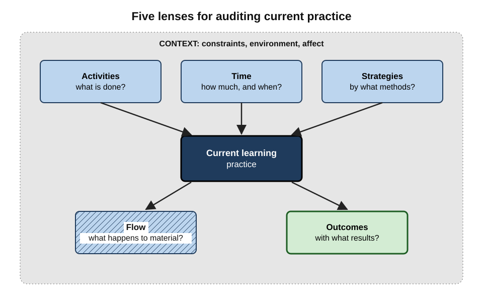
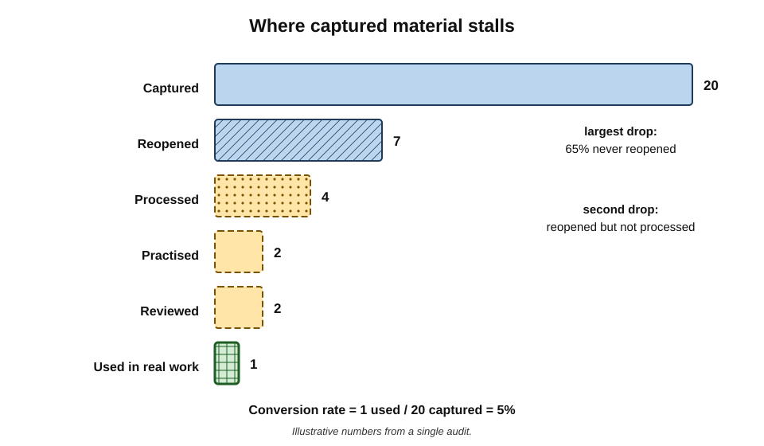
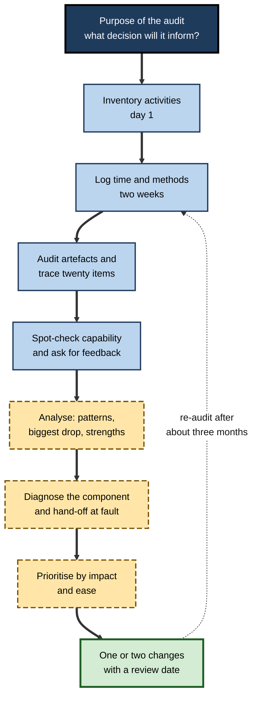
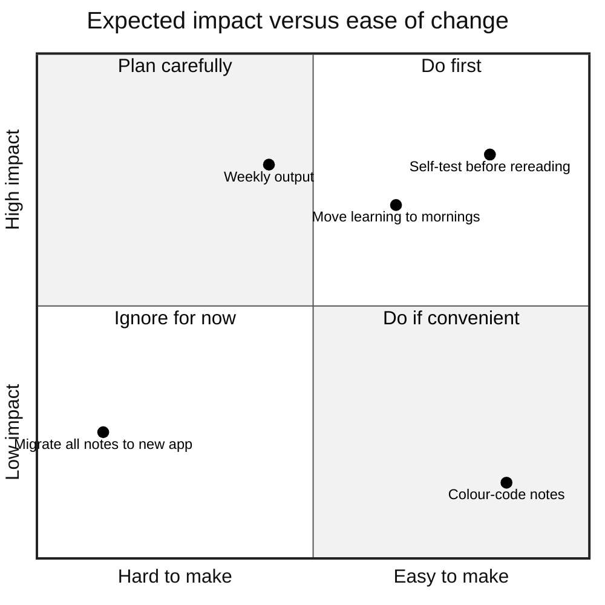
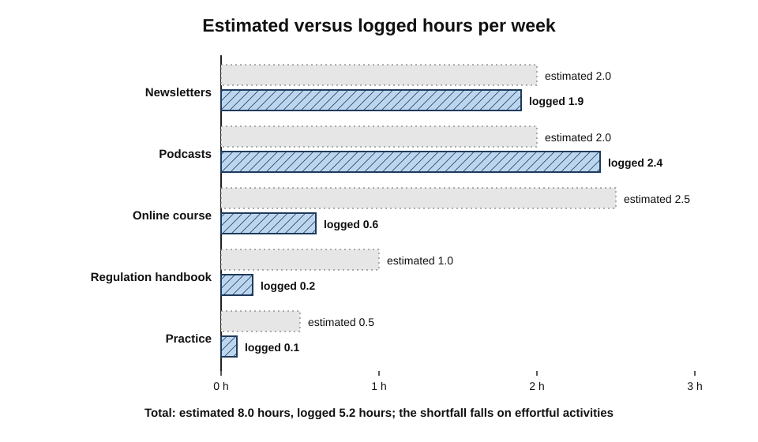

# H.2. Assessing Your Current Learning Practices

A software engineer is certain she studies "about an hour a day". She keeps a simple log for two weeks and finds three and a half hours a week, most of it watching conference videos at double speed, and almost none of it practising. Nothing about her ambition was wrong; her picture of her own learning was. Every redesign of a learning system starts from the same place — an honest account of what is happening now.

> **Definition — Learning practice audit:** a structured, evidence-based examination of how a person currently learns — what they do, how much and when, by what methods, what happens to the material, and with what results — carried out before the way of learning is redesigned.

**Why it matters**

- **People misjudge their own learning habits**, in time spent, in methods used and in results achieved.
- **Redesign without diagnosis** copies someone else's solution to someone else's problem.
- **Strengths are easy to destroy.** An audit identifies what already works, so it is kept rather than replaced in a burst of enthusiasm.
- **A baseline makes later change visible.** Without one, nobody can tell whether a new system helped.

---

## Why Self-Knowledge About Learning Is Unreliable

### Memory for routine behaviour is reconstructive

- People do not store a running record of how they spend ordinary hours; asked later, they **reconstruct** an estimate from beliefs about what they *usually* or *ought to* do.
- **Time-use research** comparing estimates with diaries — notably by the sociologists John Robinson and Geoffrey Godbey — found that people who report very long working weeks tend to **overestimate** them relative to their own diaries.
- Learning time is especially prone to error: it is fragmented, mixed with work and coloured by intention.

> **Definition — Time-use diary:** a record, made at or near the time, of what a person was doing in successive short intervals across a day.

### Beliefs about strategies are often mistaken

**Study card — Karpicke, Butler and Roediger (2009)**

- **Design:** university students listed the strategies they used when studying and ranked them; some were also asked what they would do after reading a text with time left over.
- **Results:**
  - a large majority listed **rereading**, and more than half ranked it as their main strategy;
  - very few chose **self-testing** as a primary strategy, and those who tested themselves mostly did so to check, not to learn.
- **Conclusion:** the most popular strategies were among the least effective; learners' choices are guided by how studying **feels**, not by what works.

- **Kornell and Bjork (2007)** found a similar pattern in a survey of students: self-testing was used mainly as a diagnostic, and study decisions were often driven by deadlines rather than by a plan.
- **Fluency illusions** — material that feels easy to read seems well learned — mislead experienced professionals as much as students.

### Outcomes are judged at the wrong moment

- Learners usually judge a session by how it **felt at the end**, when short-term performance is at its peak.
- The real question — what remains weeks later, and whether it can be used — is rarely asked.

> **Key point:** an audit replaces **impressions** with **records**: of time, of methods, of what happened to the material, and of what can actually be done.

> **Watch out:** the act of recording changes behaviour — known in behavioural research as the **reactivity of self-monitoring**. Expect the first days of a log to look better than normal; keep logging long enough (about two weeks) for ordinary patterns to return.

---

## Five Lenses for an Audit

**Figure 1.** Five lenses for examining current learning practice, set within the person's context.

### Activities — what is done

- An **inventory** of every way the person currently learns.
  - *e.g.* courses, books, podcasts, newsletters, documentation, mentoring, meetings, side projects, conferences, AI chats.
- Note which are **chosen** and which are **default** (arriving by habit, algorithm or obligation).

### Time — how much and when

- **Quantity** — real hours per week, from the log, not from memory.
- **Distribution** — one long block or many short ones; weekday or weekend; regular or in bursts.
- **Timing** — when energy and attention are highest, and whether learning gets those hours or the leftovers.

### Strategies — how it is done

- The **methods** used inside each activity.
  - *e.g.* reading once versus reading then self-testing; watching tutorials versus building alongside them.
- Compare each with what the evidence shows to be effective.

### Flow — what happens to the material

- Follow material **through** the components: captured → processed → practised → reviewed → used.
- Find where it **stalls** and where it **leaks**.

### Outcomes — with what results

- What the person can **now do**, unaided, that they could not do before.
- What has been **produced** — outputs, decisions, artefacts.
- What **others observe** — feedback from colleagues, clients, assessors.

**Context surrounds all five**

- **Constraints** — workload, caring responsibilities, commuting, shift patterns.
- **Environment** — interruptions, noise, devices, workspace.
- **Affect** — which activities feel energising and which feel like a chore.

> **Mnemonic — "A Tidy Shelf Finds Order":** Activities, Time, Strategies, Flow, Outcomes.

---

## Methods of Gathering Evidence

### The main methods

- **Learning inventory** — a written list of every source and activity, with approximate frequency.
  - Quick; reveals breadth and defaults, not quality.
- **Time-use log** — two weeks of recording learning activity in 15- or 30-minute units.
  - The single most informative method; moderate effort.
- **Experience sampling** — brief prompts at random moments asking "What are you doing? How focused are you?"
  - Developed by Mihaly Csikszentmihalyi and colleagues from the 1970s; good for attention and energy patterns.
- **Digital traces** — calendar entries, app usage statistics, browser history, course platform records, flashcard statistics.
  - Objective and cheap; incomplete and context-free.
- **Artefact audit** — opening every notes folder, notebook and saved-items list and counting what exists and what was ever revisited.
  - Reveals capture versus processing balance with brutal clarity.
- **Strategy questionnaire** — structured questions about methods, such as those based on the Motivated Strategies for Learning Questionnaire (Pintrich and colleagues, 1991).
  - Systematic, but still self-report.
- **Capability spot-check** — a small unaided test of things learned three to six months ago.
  - The most direct evidence of retention.
- **External feedback** — asking a manager, mentor or peer what they have seen change.
  - Captures transfer to work; depends on the observer's attention.

| Method | What it reveals best | Effort | Main bias |
|---|---|---|---|
| Learning inventory | Range and defaults | Low | Omits invisible learning, such as on-the-job problem-solving |
| Time-use log | Real quantity and timing | Medium | Reactivity in early days |
| Experience sampling | Attention and energy | Medium | Interrupts; small samples |
| Digital traces | Objective use of tools | Low | Context-free; misses offline learning |
| Artefact audit | Capture–processing balance | Low to medium | Embarrassment leads to hasty clean-ups before counting |
| Strategy questionnaire | Methods in use | Low | Answers reflect beliefs, not behaviour |
| Capability spot-check | Retention and transfer | Medium | Choice of items may be too easy |
| External feedback | Change visible at work | Low for the learner | Halo effects; limited observation |

> **Remember:** combine at least one **record** (log or traces), one **artefact** check and one **capability** check. Self-report alone repeats the original illusion.

### Self-report versus trace data

| | Self-report (estimates, questionnaires) | Traces and records (logs, app data, artefacts) |
|---|---|---|
| Captures intentions and reasons | Yes | No |
| Accurate on quantity | Weak | Strong |
| Captures offline and informal learning | Yes | Often not |
| Susceptible to social desirability | High | Low |
| Effort | Low | Low to medium |
| Best use | Explaining *why* patterns occur | Establishing *what* actually happens |

---

## Auditing Strategies Against the Evidence

### The evidence base in brief

**Study card — Dunlosky, Rawson, Marsh, Nathan and Willingham (2013)**

- **Design:** a review of ten widely used learning techniques, judged on evidence across learners, materials, tasks and retention intervals.
- **Results:**
  - **high utility** — practice testing; distributed (spaced) practice;
  - **moderate utility** — elaborative interrogation; self-explanation; interleaved practice;
  - **low utility** — summarisation; highlighting and underlining; the keyword mnemonic; imagery for text; rereading.
- **Conclusion:** the techniques learners use most are generally rated lowest; the most effective are among the least used.

### Comparing current methods with better substitutes

| Common practice | Rated utility | Why it persists | Better substitute | What the substitute adds |
|---|---|---|---|---|
| Rereading notes | Low | Feels fluent and safe | Closing the notes and recalling key points | Retrieval effort |
| Highlighting | Low | Feels productive; leaves visible marks | Writing a question in the margin for each key point | Processing and material for practice |
| Watching tutorials | Not rated; usually passive | Easy; entertaining | Pausing to predict the next step, then building it unaided | Generation and application |
| Cramming before a deadline | Low for long-term retention | Deadlines drive behaviour | Several short sessions spread over days | Spacing |
| Practising one problem type at a time | Lower than mixing for discrimination | Smooth progress | Mixing types once each is understood | Discrimination between problem types |

> **Watch out:** the 2013 ratings concern **specific techniques for students learning from text and problems**. They are not verdicts on every use — highlighting can help as a first pass if followed by processing, and summarisation done well by skilled learners can be effective. The audit question is whether a technique is followed by effortful work.

> **Key point:** the strategy audit is not about adopting a list of "approved" techniques; it is about spotting where **feeling productive** has been substituted for **effortful processing and retrieval**.

---

## Following the Material: The Flow Audit

The flow audit asks what happens to things after they enter the system.

### Tracing a sample

1. Take the **last twenty items** captured — saved articles, notes, highlighted passages, course modules.
2. For each, ask in turn:
   - was it ever **reopened**?
   - was it **processed** into the learner's own words or connected to other knowledge?
   - was it **practised** — recalled or applied unaided?
   - was it **reviewed** later?
   - was it **used** — in work, writing, a decision or teaching?
3. Count how many items survive each step.

**Figure 2.** An illustrative flow audit of twenty captured items, showing where material stalls.

### Ratios that summarise flow

> **Formula — Conversion rate:** items used ÷ items captured. Example: 1 used ÷ 20 captured = **5%**.

> **Formula — Processing rate:** items processed ÷ items captured. Example: 4 ÷ 20 = **20%**.

- **Backlog age** — the age of the oldest unprocessed item.
  - A backlog older than a few months is effectively an archive, not a queue.
- **Biggest drop** — the step with the largest proportional loss is the first design target.

> **Key point:** the step with the **largest drop** is usually more informative than any average — it shows which hand-off is missing.

> **Watch out:** a conversion rate is not meant to reach 100%. Much capture is legitimately speculative. The question is whether **anything** reliably makes it to use, and whether the losses happen by **choice** (deliberate discarding) or by **neglect**.

---

## Auditing Outcomes

### The capability ledger

- A two-column record: **"Twelve months ago I could not…"** and **"Now I can, unaided…"**
  - *e.g.* "write a window function in SQL"; "lead a client workshop without a script"; "read a cash-flow statement and spot working-capital problems".
- Each entry should be **observable** and, ideally, **verified** — by a spot-check, an output, or someone else's observation.

### Other outcome signals

- **Retention** — a spot-check of items learned months ago.
- **Transfer** — whether learning appears in real tasks, not only in exercises.
- **Outputs** — what has been produced that depended on recent learning.
- **Speed** — tasks now done faster or with fewer look-ups.
- **Feedback** — what others notice.

> **In practice:** a short, honest capability ledger is often more revealing than a year of activity statistics. An empty ledger after hundreds of hours is the clearest possible signal that the system, not the effort, needs to change.

> **Watch out:** this is a **coarse** outcome check for redesign purposes. Detailed tracking of progress over time, and formal self-assessment of knowledge, are separate practices with their own methods.

---

## Context, Constraints and Affect

- **Energy map** — for each part of the day, rate typical alertness; compare with when learning actually happens.
  - Learning is often given the **leftover** hours — late evenings after demanding work.
- **Interruption map** — where and when concentration is broken: notifications, colleagues, family, open-plan noise.
- **Obligation map** — fixed commitments that limit options: school runs, on-call rotas, travel.
- **Affect inventory** — which activities are enjoyed, which are dreaded, which are done only out of guilt.
  - Enjoyed activities are cheap to sustain; dreaded ones need redesign or a smaller dose.

> **Example:** a sales manager finds she learns best between 7 and 8 a.m. but schedules learning at 9 p.m. "because mornings are for email". The audit's most valuable finding is not a technique but a **timing swap**.

---

## The Diagnostic Interview

Records show *what* happens; a structured self-interview, or one conducted by a mentor, explains *why*. Good questions are concrete and tied to recent events rather than to general habits.

**Questions by lens**

- **Activities**
  - Which three sources taught me something I actually used in the last month?
  - Which sources do I consume out of habit, guilt or fear of missing out?
- **Time**
  - When did I last spend an uninterrupted hour learning something difficult?
  - What displaced learning on the days it did not happen?
- **Strategies**
  - After my last study session, what did I do to check that I had understood?
  - When I get something wrong, what happens next?
- **Flow**
  - What was the last thing I learned that I later used? How did it get from source to use?
  - Where do things I save usually end up?
- **Outcomes**
  - What can I do now, without help, that I could not do a year ago?
  - What would a colleague say has changed in my work?

**Interviewing technique**

- **Ask about the last instance, not the usual case.** "Last Tuesday evening" yields facts; "usually" yields ideals.
  - The approach mirrors the **critical incident technique** developed by John Flanagan (1954), which grounds analysis in specific, recent events.
- **Follow one thread to the end.** Pursue a single item from discovery to use before moving on.
- **Record verbatim phrases.** Expressions such as "I keep meaning to" and "I should really" mark intentions that the system does not support.
- **Separate fact-finding from judgement.** Diagnose later, with the records alongside.

> **In practice:** mentors who ask "show me the last thing you learned and how you learned it" often uncover more in ten minutes than a year of "How is your development going?" conversations.

---

## The Audit Process

**Figure 3.** The sequence of a learning practice audit, from preparation to the first change.

---

## Interpreting the Results

### From symptoms to diagnoses

| Symptom found in the audit | Likely cause | Component at fault | First change to try |
|---|---|---|---|
| Large saved-items backlog, little reopened | Capture without a processing step | Capture → processing | A weekly session that processes or deletes |
| Notes extensive but rarely revisited | No review cadence | Review | Fixed short review slot; questions written into notes |
| Feels knowledgeable; fails unaided tasks | Recognition, not recall | Practice | Self-test before rereading |
| Learning never appears in work | No output step | Output | One small application within a week of each topic |
| Many sources, little depth | Unfiltered inputs | Inputs | Cut to a few sources tied to purpose |
| Learning only in bursts before deadlines | No routine; deadline-driven | Cadence | Short regular slot anchored to an existing habit |
| Same complaints every year | No system reflection | Reflection | Scheduled quarterly review of the system |

### Prioritising changes

- **Impact** — how much the change would improve outcomes if made.
- **Ease** — how little time, money and willpower it needs.
- **Start with high-impact, high-ease changes**; plan larger redesigns separately.

**Figure 4.** Candidate changes from an audit, placed by expected impact and ease.

### Strengths are findings too

- Ask what **already works** and why.
  - *e.g.* "I always remember what I discuss with colleagues" → social processing is a strength to build on.
- Protect strengths during redesign; many new systems fail because they displace a working habit with an untested one.

> **Key point:** the purpose of interpretation is a **small number of targeted changes**, each tied to a specific broken hand-off — not a wholesale replacement.

---

## Worked Example: A Two-Week Audit of a Product Manager

A product manager at a fintech firm believes he spends "about eight hours a week" learning about payments regulation and product analytics. He audits for two weeks.

**Step 1 — inventory:** three newsletters, two podcasts, one online analytics course, a regulation handbook, weekly meetings with the compliance team, and frequent AI chats asking for explanations.

**Step 2 — the log (weekly average):**

| Activity | Estimated hours | Logged hours | Main method |
|---|---|---|---|
| Newsletters and articles | 2.0 | 1.9 | Skim once |
| Podcasts | 2.0 | 2.4 | While commuting |
| Online course | 2.5 | 0.6 | Watch videos |
| Regulation handbook | 1.0 | 0.2 | Read |
| Practice or application | 0.5 | 0.1 | Rarely |
| **Total** | **8.0** | **5.2** | — |

**Figure 5.** Estimated compared with logged weekly learning hours in the worked example.

**Step 3 — flow trace of twenty items:** 7 reopened, 3 processed, 1 practised, 1 used (in a product requirement).

> **Formula — Worked conversion:** 1 ÷ 20 = **5%** conversion; biggest drop between reopened (7) and processed (3).

**Step 4 — capability spot-check:** asked to explain, without notes, three regulatory concepts from articles saved two months earlier, he could explain one.

**Step 5 — diagnosis:**

1. **Time** was 35% below his estimate, and the deficit fell almost entirely on the **effortful** activities (course, handbook, practice).
2. **Inputs** were dominated by passive, easy formats.
3. The **processing** hand-off was missing.
4. **Strength:** the weekly compliance meetings — he remembered everything discussed there.

**Step 6 — changes:**

- After each compliance meeting, write three plain-language points and one question; ask the question the following week (**builds on the strength**).
- Replace one podcast with twenty minutes of the handbook on the commute home, followed by one self-test question on arrival.
- Re-audit in three months.

> **Watch out:** the instinctive response — "I need to find more time" — would have missed the finding. He did not need more hours; he needed the hours he had to include **processing and retrieval**.

---

## Assessment in Professional and Organisational Settings

### Personal audits and organisational needs analysis

| | Organisational learning needs analysis | Personal learning practice audit |
|---|---|---|
| Question asked | What capabilities does the organisation lack? | How does this person learn, and how well? |
| Unit of analysis | Roles, teams, skills gaps | One person's activities, methods and outcomes |
| Typical evidence | Performance data, competency frameworks, surveys | Logs, artefacts, spot-checks, feedback |
| Typical output | Training priorities and budgets | A redesigned personal system |
| Blind spot | How people actually learn day to day | Organisational priorities, unless deliberately included |

- The two are **complementary**: needs analysis says *what* to learn; a practice audit says whether the person's *way* of learning will get them there.

### Uses by mentors, coaches and educators

- **Ask to see artefacts.** Mentors learn more from opening a mentee's notes than from asking how study is going.
- **Use the flow trace in coaching.** Following one recent item through the components often produces the insight in minutes.
- **Clinical and legal practice** often require reflective records for continuing development; an audit of those records shows whether reflection leads to changed practice.

### Auditing AI use

- Review a sample of recent AI conversations and classify each:
  - **answer-seeking** — asking for the output;
  - **explanation-seeking** — asking for understanding;
  - **practice-seeking** — asking to be quizzed or critiqued.
- A pattern dominated by answer-seeking signals that tools may be **substituting** for processing rather than supporting it.

---

## Case Study: The Busy Partner Who Was Not Learning

### Case study: an audit in an accounting firm

- **Situation:** a newly promoted audit partner needed to master sustainability reporting standards within a year to lead new engagements.
- **Problem:** after six months he described himself as "reading constantly" but could not lead a client conversation on the topic without a specialist present.
- **Diagnosis / Actions:**
  1. **Two-week log:** 4.5 hours a week of reading, nearly all of it news commentary and firm newsletters; no time on the standards themselves.
  2. **Artefact audit:** 140 forwarded emails marked "read later", 12 opened.
  3. **Spot-check:** he could name the main frameworks but not explain their disclosure requirements.
  4. **Strength found:** he learned quickly in conversation with clients and from preparing presentations.
  5. **Changes:** commentary cut to fifteen minutes a week; two 45-minute sessions on primary standards with a self-written question set; a commitment to present one topic internally each month; the "read later" folder archived.
- **Result:** within four months he led two client workshops alone; partners began referring sustainability questions to him.
- **Side effects:** he felt less "up to date" with the news, and colleagues noticed fewer forwarded articles.
- **Lesson:** the audit revealed that his inputs were about the subject rather than **of** the subject, and that his real strength — learning through preparing output — was unused.

---

## Pitfalls in Self-Assessment of Practice

- **Auditing to confirm** — gathering only evidence that the current approach is fine.
  - Remedy: include one external source — a spot-check or someone else's view.
- **Perfectionist over-measurement** — tracking so much that the audit becomes a project in itself.
  - Remedy: two weeks, a handful of measures, then stop.
- **Judging too early** — reading a pattern from three days of data.
- **Moralising** — treating findings as character flaws rather than design problems.
  - Remedy: ask "what in the design made this the easy option?"
- **Ignoring invisible learning** — on-the-job problem-solving and conversation, which rarely appear in logs.
  - Remedy: add a daily one-line "what did I learn at work today?" entry during the audit.
- **Changing everything at once** — making it impossible to tell which change helped.
  - Remedy: one or two changes per cycle.

> **Remember:** an audit is a **design input**, not a verdict. Its job is to find the one or two hand-offs whose repair will release the most learning.

---

## Open Questions

- **How accurate are professionals' estimates of their own learning time?**
  - Time-use research covers work and leisure broadly; studies specific to adult self-directed learning are scarce.
- **Which cheap indicators predict long-term capability?**
  - Flow ratios and capability ledgers are plausible but largely unvalidated as predictors.
- **How much does auditing itself improve learning?**
  - Self-monitoring is known to change behaviour; whether audit effects persist after logging stops is unclear.
- **How should invisible workplace learning be captured?**
  - Much expertise grows through problem-solving and conversation that leaves few traces.
- **How should AI interaction data be interpreted?**
  - Classifying conversations as supportive or substitutive is a judgement call without agreed criteria.

---

## Summary

- A **learning practice audit** examines how a person currently learns before redesign.
- Self-knowledge is unreliable: **time estimates** are reconstructed and often inflated; **strategy beliefs** favour fluent but weak methods (rereading over self-testing); outcomes are judged too early.
- Five lenses — **Activities, Time, Strategies, Flow, Outcomes** ("A Tidy Shelf Finds Order") — within **context, constraints and affect**.
- Methods: inventory, **two-week time log**, experience sampling, digital traces, **artefact audit**, strategy questionnaire, **capability spot-check**, external feedback. Combine a record, an artefact check and a capability check.
- The **strategy audit** compares methods with evidence (Dunlosky et al., 2013) and looks for where feeling productive has replaced processing and retrieval.
- The **flow audit** traces twenty items through the components; the **largest drop** shows the missing hand-off; conversion and processing rates summarise flow.
- The **capability ledger** records what can now be done unaided.
- Interpretation maps symptoms to components, prioritises by **impact and ease**, and protects **strengths**.
- Pitfalls: confirming, over-measuring, judging early, moralising, ignoring invisible learning, changing everything at once.

---

## Self-Check

1. Define a learning practice audit and state two reasons for doing one before redesigning a system.
2. Why are people's estimates of their learning time unreliable?
3. Summarise the Karpicke, Butler and Roediger (2009) findings and their implication.
4. What is the reactivity of self-monitoring, and how should an audit allow for it?
5. Name the five lenses of an audit and the contextual factors surrounding them.
6. Compare self-report and trace data as sources of evidence.
7. Which techniques did Dunlosky and colleagues rate as high utility, and why should the low ratings not be over-applied?
8. Describe how to trace a sample of captured items, and calculate the conversion rate if 3 of 30 items are used.
9. What is a capability ledger, and what makes an entry credible?
10. Why should strengths be recorded in an audit?
11. Explain how an organisational needs analysis and a personal practice audit complement each other.
12. In the worked example, why was "find more time" the wrong conclusion?
13. A designer's audit shows a large bookmark backlog, extensive notes never revisited and good performance only on tasks repeated weekly. Diagnose the components at fault and propose two first changes.
14. A colleague wants to start an audit by moving all notes to a new app "so the data is clean". Advise them.

### Answer Key

1. A structured, evidence-based examination of current activities, time, methods, flow and outcomes before redesign. Reasons: self-knowledge is unreliable; redesign without diagnosis fixes the wrong thing; it identifies strengths to keep; it creates a baseline.
2. Routine time is not recorded in memory; estimates are reconstructed from beliefs about usual or ideal behaviour, so they drift towards intention; fragmented learning time is especially hard to recall.
3. Most students relied on rereading and few used self-testing as a learning strategy; those who tested did so to check knowledge. Implication: learners choose methods that feel effective, so practice must be checked against evidence, not preference.
4. Recording behaviour changes it, usually for the better at first. Log for about two weeks so normal patterns return, and interpret the earliest days with caution.
5. Activities, Time, Strategies, Flow, Outcomes; surrounded by constraints, environment and affect.
6. Self-report captures reasons, intentions and offline learning but is weak on quantity and prone to social desirability. Traces are accurate on quantity and resist bias but lack context and miss informal learning. Use traces for *what*, self-report for *why*.
7. Practice testing and distributed practice. The ratings concern particular techniques used by students on specific materials; low-rated techniques can help as first steps if followed by effortful processing.
8. Take the last twenty or so items; for each, check whether it was reopened, processed, practised, reviewed and used; count survivors at each step. Conversion = 3 ÷ 30 = 10%.
9. A record of things that could not be done a year ago and can now be done unaided. Credible entries are observable and verified by a spot-check, an output or someone else's observation.
10. Redesigns often replace working habits with untested ones; recording strengths ensures they are protected and built upon.
11. Needs analysis identifies what capability is lacking; a practice audit reveals whether the person's way of learning can deliver it. Together they align content and method.
12. Logged time showed the hours he had were spent on passive inputs; the missing ingredient was processing and retrieval within existing hours, not additional hours.
13. Faults: inputs/capture without processing (backlog), no review cadence (notes not revisited), practice confined to repetition of familiar tasks (weak transfer). First changes: a weekly session that processes or discards saved items into questions; brief mixed practice applying techniques to unfamiliar briefs.
14. Moving tools first changes the data being audited, consumes effort and assumes the problem is the tool. Audit the existing practice as it is, find the broken hand-offs, and choose tools only after deciding the workflow.

---

## Glossary

| Term | Meaning |
|---|---|
| Artefact audit | Examining existing notes, files and saved items to see what exists and what was ever used. |
| Backlog age | The age of the oldest unprocessed item in a capture store. |
| Capability ledger | A record of what can now be done unaided that could not be done before. |
| Capability spot-check | A small unaided test of things learned some months earlier. |
| Conversion rate | Items used divided by items captured. |
| Critical incident technique | Analysing specific, recent events rather than general habits, after John Flanagan (1954). |
| Digital traces | Records left by tools, such as app statistics, calendar entries and browsing history. |
| Experience sampling | Collecting brief reports at random moments about activity and attention. |
| Flow audit | Tracing captured material through processing, practice, review and use. |
| Fluency illusion | Mistaking ease of processing for learning. |
| Learning inventory | A list of all current sources and activities used for learning. |
| Learning needs analysis | An organisational assessment of capability gaps and training priorities. |
| Learning practice audit | A structured examination of how a person currently learns, before redesign. |
| Processing rate | Items processed divided by items captured. |
| Reactivity of self-monitoring | The change in behaviour caused by the act of recording it. |
| Time-use diary | A record of activities in successive short intervals, made at or near the time. |
