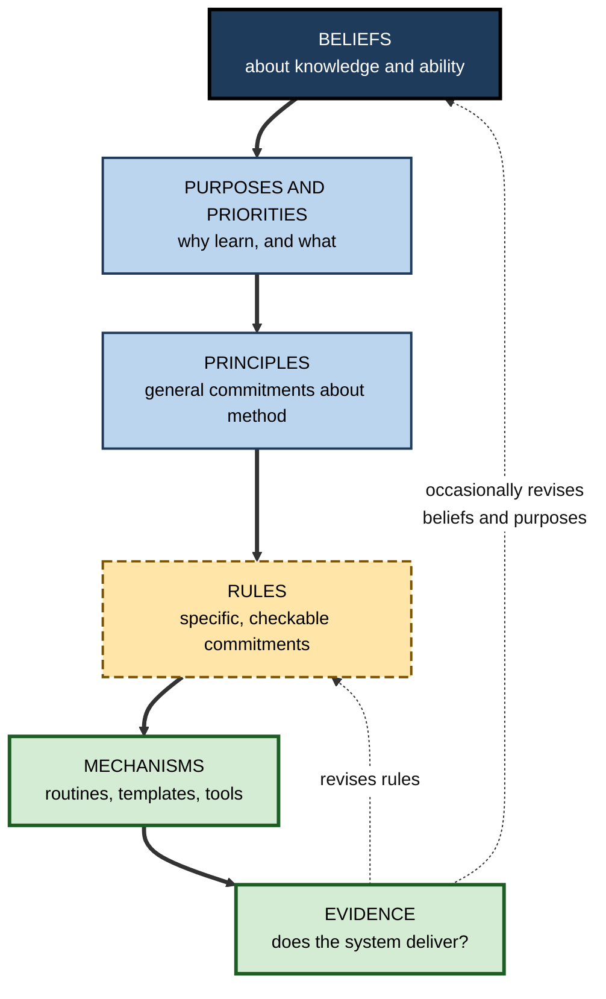
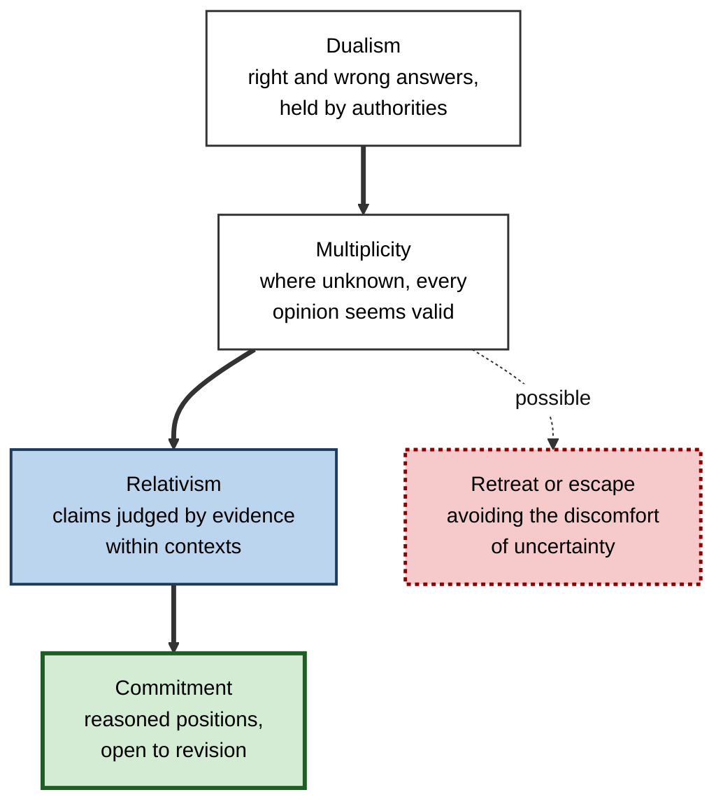
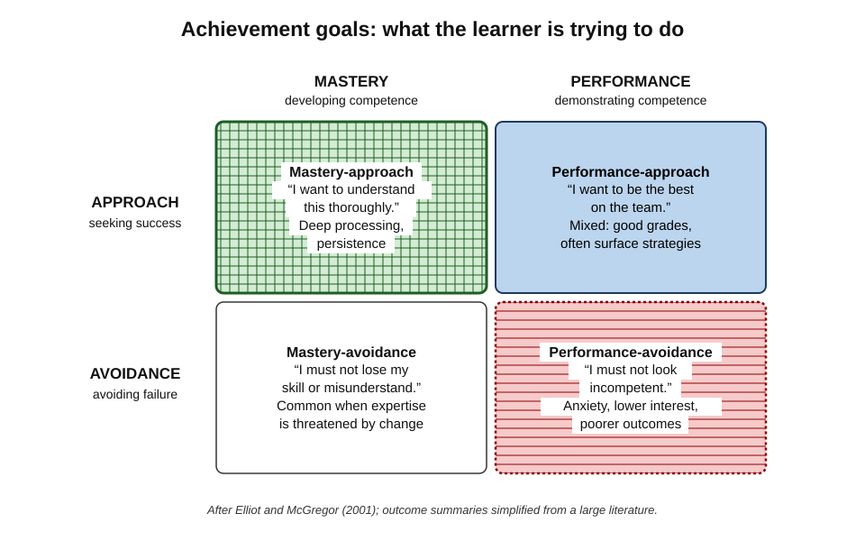
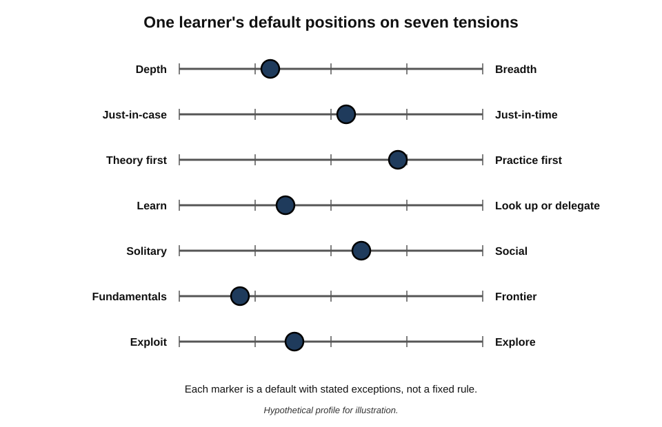
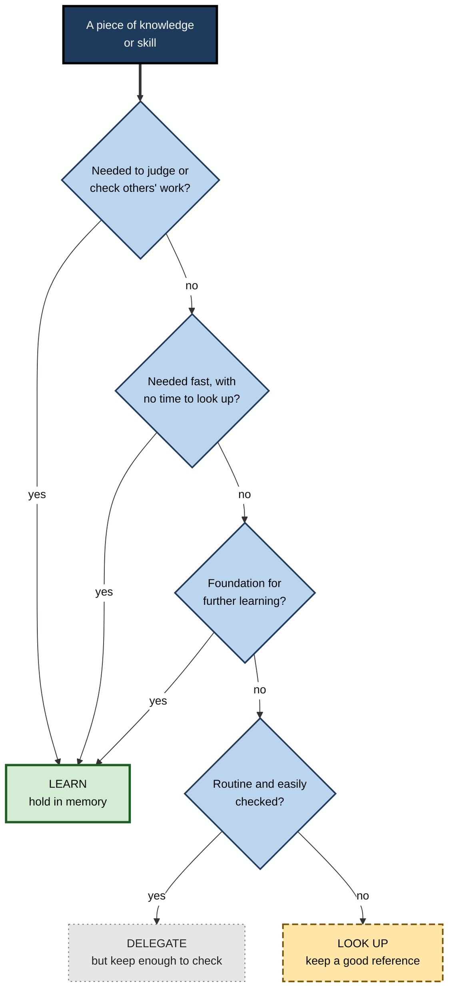

# C.3. Defining Your Learning Philosophy

Two engineers are handed the same unfamiliar cloud platform. One reads the architecture documentation end to end before touching anything; the other deploys a small service within the hour and reads only when something breaks. Neither has thought about it, yet each is acting on a **philosophy** — beliefs about what knowledge is, how it is best gained and what it is for. Unexamined, such beliefs quietly decide every design choice in a learning system; examined, they become a source of direction and consistency.

> **Definition — Learning philosophy:** the coherent set of beliefs, values and principles a person holds about what learning is, what is worth learning, why, and how it is best done — which guides the choices made in their learning system.

**Why it matters**

- **Every system embodies a philosophy.** A system built around collecting summaries assumes knowledge is information to be stored; one built around building projects assumes knowledge is capability to be exercised.
- **Unstated beliefs cause inconsistent choices** — enrolling in a theory-heavy course while believing one learns only by doing, then blaming oneself for abandoning it.
- **Principles reduce decision fatigue.** A short set of principles answers hundreds of small questions — which course, which book, whether to take on a stretch project — in advance.
- **A philosophy survives tool changes.** Apps come and go; principles carry from one set-up to the next.

---

## What a Learning Philosophy Contains

A complete philosophy has six parts, from deep beliefs to practical boundaries.

- **Beliefs about knowledge** — what knowing is: simple or complex, certain or provisional, received or constructed.
- **Beliefs about ability** — whether capability is fixed or can be built.
- **Purposes** — why the person learns at all.
- **Priorities** — what is worth learning, and what is not.
- **Principles of method** — how learning is best done, for this person, in this work.
- **Boundaries** — what will deliberately *not* be learned, or will be looked up or delegated.

> **Mnemonic — "Kind People Prefer Plain Practical Boundaries":** Knowledge beliefs, Potential (ability) beliefs, Purposes, Priorities, Principles of method, Boundaries.

**Figure 1.** How a learning philosophy flows from beliefs to the mechanisms of a learning system.

> **Key point:** a philosophy is useful only to the extent that it reaches the bottom of this chain. A principle with no rule or mechanism attached is a sentiment.

---

## Beliefs About Knowledge

### Epistemic beliefs

> **Definition — Epistemic beliefs:** a person's beliefs about the nature of knowledge and of knowing — how certain, how structured and how acquired it is.

**Study card — Marlene Schommer (1990)**

- **Design:** university students completed a questionnaire on beliefs about knowledge and learning, then read passages presenting tentative, conflicting evidence and wrote conclusions.
- **Belief dimensions identified:**
  - **simple knowledge** — knowledge is isolated facts rather than interrelated concepts;
  - **certain knowledge** — knowledge is fixed rather than evolving;
  - **quick learning** — learning happens quickly or not at all;
  - **fixed ability** — the ability to learn is innate.
- **Results:**
  - a stronger belief in **quick learning** predicted oversimplified conclusions, poorer test performance and overconfidence in one's own understanding;
  - a stronger belief in **certain knowledge** predicted inappropriately absolute conclusions from tentative evidence.
- **Conclusion:** beliefs about knowledge shape how people process and judge what they learn.

- **Barbara Hofer and Paul Pintrich (1997)** reorganised the field into beliefs about the **nature of knowledge** (certainty, simplicity) and the **nature of knowing** (where knowledge comes from, how claims are justified).

### How beliefs show up in a learning system

| Belief | Less sophisticated form | More sophisticated form | Effect on system design |
|---|---|---|---|
| Structure | Knowledge is a list of facts | Knowledge is connected concepts | Collecting facts versus linking ideas and building models |
| Certainty | Experts know the answers | Knowledge is provisional and revised | Memorising conclusions versus tracking evidence and debates |
| Source | Authorities hand down knowledge | Knowledge is constructed and justified | Waiting for courses versus testing claims oneself |
| Speed | Learning is quick or impossible | Understanding builds gradually | Abandoning hard topics versus planning repeated passes |
| Ability | The capacity to learn is fixed | The capacity to learn grows with practice | Avoiding difficulty versus seeking it deliberately |

> **Watch out:** "more sophisticated" does not mean "everything is uncertain". In many professional areas — drug interactions, tax rules, safety procedures — some knowledge is settled and must be learned exactly. Sophistication means **matching certainty to the evidence**, not doubting everything.

### Intellectual development: William Perry's scheme

- **William Perry (1970)** interviewed Harvard undergraduates over their college years and described a progression of positions.
  - **Dualism** — knowledge is right or wrong; authorities have the answers.
  - **Multiplicity** — where answers are unknown, all opinions seem equally valid.
  - **Relativism** — claims are judged by evidence and reasoning within contexts.
  - **Commitment within relativism** — the person makes reasoned commitments while accepting they may be revised.

**Figure 2.** William Perry's positions of intellectual development, from dualism to commitment.

- **Relevance to adult learners:** a professional's learning philosophy should sit at **commitment** — clear principles held firmly enough to act on, loosely enough to revise when evidence changes.

---

## Beliefs About Ability

### Implicit theories of intelligence

- **Carol Dweck** and colleagues distinguished two implicit theories:
  - **entity theory** ("fixed mindset") — ability is a fixed quantity;
  - **incremental theory** ("growth mindset") — ability grows with effort, strategy and help.
- **Theorised consequences:** entity theorists avoid challenges that might reveal low ability; incremental theorists treat difficulty as a normal part of learning.

**Study card — Blackwell, Trzesniewski and Dweck (2007)**

- **Design:** students moving into secondary school were followed over two years; a related intervention taught some that the brain strengthens with learning.
- **Results:** incremental beliefs were associated with rising mathematics grades over the transition; the downward trend in grades was halted in the intervention group but continued in the control group.
- **Conclusion:** beliefs about ability appeared to influence responses to difficulty and subsequent achievement.

> **Watch out:** later evidence is **more modest**. Two meta-analyses by Victoria Sisk and colleagues (2018) found weak overall associations between mindset and achievement and small average effects of mindset interventions. A large national experiment in the United States (David Yeager and colleagues, 2019) found small but real effects, concentrated among lower-achieving students. Mindset is a **useful precondition**, not a powerful lever on its own.

### What matters for a personal system

- A system that schedules **deliberate difficulty** — self-testing, stretch projects, feedback — only makes sense to someone who believes difficulty builds capability.
- Equally important is the belief that **method matters**: that the right strategy, not just more effort, is what converts difficulty into learning.

> **Key point:** the useful belief is not "I can learn anything if I try hard" but "**my capability grows with the right kind of practice, and I can design that practice**".

---

## Purposes: Why Learn at All?

### Achievement goals

- Research on achievement goals distinguishes **mastery goals** (developing competence) from **performance goals** (demonstrating competence relative to others).
- **Andrew Elliot and Holly McGregor (2001)** crossed these with **approach** (seeking success) and **avoidance** (avoiding failure).

**Figure 3.** The two-by-two framework of achievement goals.

- **Mastery-approach** — "I want to understand this thoroughly."
  - Associated with deeper processing and persistence.
- **Mastery-avoidance** — "I must not lose the skill I have" or "I must not misunderstand."
  - Common among experienced professionals facing change.
- **Performance-approach** — "I want to be the best on the team."
  - Associated with good grades in some studies but more surface strategies in others.
- **Performance-avoidance** — "I must not look incompetent."
  - Consistently associated with anxiety, lower interest and poorer outcomes.

> **In practice:** a learning philosophy that states a **mastery** purpose ("become able to…") produces different system choices from one stating a performance purpose ("be seen as…") — fewer certificates collected for display, more projects attempted for capability.

### Professional purposes

- **Competence** — doing the current job well.
- **Growth** — preparing for the next role or field.
- **Security** — remaining employable as work changes.
- **Curiosity** — the intrinsic satisfaction of understanding.
- **Contribution** — being useful to colleagues, clients and the field.
- **Identity** — becoming a certain kind of professional.

- Purposes are **plural** but should be **ranked**: when time is short, which wins?
- **Autonomous motivation** — learning because the purpose is one's own — is associated with persistence and deeper engagement, a central finding of self-determination theory developed by Edward Deci and Richard Ryan.

> **Watch out:** purposes stated only in terms of external reward ("to get promoted") tend to collapse once the reward is achieved or becomes unlikely. Durable philosophies pair external purposes with at least one intrinsic one.

---

## Core Tensions a Philosophy Must Resolve

Every learner faces the same set of trade-offs. A philosophy is largely a set of **default positions** on them, with stated exceptions.

### Depth and breadth

- **Depth** — sustained mastery of one area; essential for distinctive expertise.
- **Breadth** — working knowledge across many areas; essential for connecting, translating and adapting.
- **Typical resolution:** one deep area plus deliberate literacy in neighbours, adjusted by career stage.

### Just-in-time and just-in-case

- **Just-in-time** — learning what the current task requires, when it requires it.
  - High relevance and immediate application; risk of shallow, fragmented knowledge.
- **Just-in-case** — learning foundations before they are needed.
  - Builds the prior knowledge that makes later learning faster; risk of learning things never used.
- **Typical resolution:** just-in-case for **foundations** with long-lasting value; just-in-time for **specifics** that change quickly.

### Theory first and practice first

- **Theory first (top-down)** — understand principles, then apply.
  - Suits domains where errors are costly and principles are stable (medicine, structural engineering, law).
- **Practice first (bottom-up)** — try, struggle, then study.
  - Suits domains with cheap experimentation (software, design, writing); productive struggle before instruction can improve later understanding.
- **Typical resolution:** match to the cost of error in the domain.

### Learn, look up or delegate

- **Learn** — hold in memory for fluent, unaided use and judgement.
- **Look up** — rely on reference material when needed.
- **Delegate** — hand to a colleague, a specialist or an AI system.
- **Typical resolution:** learn what is needed for judgement, speed and further learning; look up what is rare and stable; delegate what is routine and checkable.

### Solitary and social

- **Solitary** — reading, practice and reflection alone; controllable and deep.
- **Social** — discussion, mentoring, teaching, communities; exposes blind spots and builds networks.
- **Typical resolution:** solitary processing anchored by regular social testing of understanding.

### Fundamentals and frontier

- **Fundamentals** — ideas that have lasted decades (statistics, writing, negotiation, data structures).
- **Frontier** — the newest tools and techniques.
- The **Lindy effect**, popularised by Nassim Nicholas Taleb, holds that the longer a non-perishable idea has survived, the longer it is likely to survive.
- **Typical resolution:** spend most effort on fundamentals and a deliberate, smaller share on the frontier.

> **Watch out:** the Lindy effect is a **heuristic**, not a law. Some long-standing ideas are abruptly overturned, and some new tools become permanent. Use it to set proportions, not to dismiss new developments.

### Exploration and exploitation

- **James March (1991)** distinguished **exploration** (searching for new possibilities) from **exploitation** (refining existing competences) in organisational learning, and showed that adaptive systems tend to over-exploit because its returns are surer and faster.
- **For individuals:** exploitation deepens current expertise; exploration samples new fields that may become future expertise.
- **Typical resolution:** a protected share of learning time for exploration, larger early in a career and at transition points.

### Comparing the tensions

| Tension | Pole A | Pole B | Lean towards A when | Lean towards B when |
|---|---|---|---|---|
| Depth – breadth | Mastery of one area | Literacy across many | Building distinctive expertise | Leading, integrating, changing field |
| Just-in-case – just-in-time | Foundations first | Learn when needed | Knowledge is stable and foundational | Knowledge changes fast or is task-specific |
| Theory – practice first | Principles before action | Action before principles | Errors are costly | Experiments are cheap |
| Learn – delegate | Hold in memory | Look up or hand off | Judgement, speed or further learning depend on it | Rare, stable or routinely checkable |
| Solitary – social | Alone | With others | Deep processing is needed | Blind spots and transfer need testing |
| Fundamentals – frontier | Long-lasting ideas | Newest tools | Building a base | Competitive advantage depends on novelty |
| Exploit – explore | Refine current strengths | Sample new fields | Mid-career depth | Early career, transitions, stagnation |

**Figure 4.** A personal profile of positions on seven learning tensions.

**Figure 5.** Deciding whether to learn, look up or delegate a piece of knowledge.

---

## From Philosophy to System

### Principles, rules and mechanisms

- **Principle** — a general commitment about method.
  - *e.g.* "Learn by building."
- **Rule** — a specific, checkable commitment derived from it.
  - *e.g.* "Every topic studied for more than two weeks produces a working artefact."
- **Mechanism** — the routine, template or tool that makes the rule happen by default.
  - *e.g.* a project folder created when a topic starts, with a deadline in the calendar for the artefact.

> **Definition — Learning principle:** a short, general commitment about how one learns, stated so that it can guide choices and be translated into specific rules.

**Further examples of the chain**

- **Principle:** "Understanding is proved by explanation."
  - **Rule:** each week, explain one new idea in writing to an imagined colleague.
  - **Mechanism:** a recurring Friday calendar slot and a one-page template.
- **Principle:** "Fundamentals before fashions."
  - **Rule:** at least two-thirds of study time on long-lived subjects.
  - **Mechanism:** a quarterly time tally by category.
- **Principle:** "Look up the rare; learn the frequent."
  - **Rule:** anything looked up three times becomes a practice item.
  - **Mechanism:** a tally mark in the reference note each time it is consulted.

### Properties of good principles

- **Actionable** — they change what is done tomorrow.
- **Discriminating** — they rule things out; "learn effectively" rules out nothing.
- **Few** — roughly five to nine, few enough to remember.
- **Testable** — it is possible to tell whether they are being followed.
- **Owned** — written in the person's own words, from their own experience.
- **Revisable** — held with commitment but reviewed against evidence.

> **Mnemonic — "A Dog Fetches The Old Rope":** Actionable, Discriminating, Few, Testable, Owned, Revisable.

> **Watch out:** borrowed principles ("learn in public", "always be reading") often fail because they solved **someone else's** constraints. Test any borrowed principle against one's own audit evidence before adopting it.

---

## Writing a Learning Philosophy Statement

### Precedent

- In higher education, academics commonly write a **teaching philosophy statement** — a short account of their beliefs about learning, their goals for students and how their teaching enacts them — for appointments and promotion.
- A **learning philosophy statement** applies the same discipline to one's own learning.

### Structure

1. **Purpose** — why the person learns, in ranked order.
2. **Beliefs** — what they believe about knowledge and ability in their field.
3. **Positions on the tensions** — defaults and exceptions.
4. **Principles** — five to nine, each with at least one rule.
5. **Boundaries** — what they will not learn, will look up, or will delegate.
6. **Evidence of success** — what would show the philosophy is working.

### The process

1. **Collect evidence** from past learning: what worked, what failed, what was enjoyed.
2. **Draft freely**, then cut to one page.
3. **Test each principle** against the properties above.
4. **Derive rules and mechanisms** for each principle.
5. **Live with it** for a quarter.
6. **Revise** after reviewing the evidence.

### Worked example (illustrative): a user-experience researcher's statement

A UX researcher at a health-technology company drafts her statement after an audit showed she had completed many courses but felt unconfident in quantitative methods.

**Draft (before testing):**

- "I believe in lifelong learning."
- "I want to stay up to date with the latest UX trends."
- "I learn best by reading widely."

**Problems found:**

1. "Lifelong learning" is not discriminating — it rules nothing out.
2. "Latest trends" contradicts her evidence: the trend articles she read left nothing usable.
3. "Reading widely" contradicts her audit: she retained best what she applied in studies.

**Revised statement (excerpt):**

| Part | Statement | Derived rule |
|---|---|---|
| Purpose | 1. Be able to design and analyse mixed-methods studies unaided. 2. Be trusted by clinicians as a research partner. | Each quarter, one study where she owns the quantitative analysis |
| Belief | Research skill grows through doing studies and having them critiqued | Every analysis reviewed by a statistician colleague |
| Tension: theory or practice | Practice first, with theory pulled in when stuck | Read methods texts only in response to a live problem |
| Tension: fundamentals or frontier | Fundamentals of statistics and study design before tools | Two-thirds of study time on fundamentals |
| Principle | Explanation proves understanding | Explain each new method to the design team in fifteen minutes |
| Boundary | Will not track design-trend publications | Unsubscribe from trend newsletters; one curated digest a month |
| Evidence | Clinicians ask for her analyses; she can defend methods under questioning | Note each request and each challenge in a monthly review |

- **Verdict:** the revised statement rules things out, translates into rules and states what success looks like.

> **Watch out:** a philosophy statement is not a mission statement for display. Its value lies in the **rules it generates** and in the decisions it makes easier — not in its prose.

---

## Philosophies Seen in Practice

### Recurring archetypes

- **The craftsperson** — mastery through long, attentive practice and high standards.
  - The sociologist Richard Sennett (*The Craftsman*, 2008) described craft as the desire to do a job well for its own sake, developed through repetition, problem-finding and dialogue between hand and head.
- **The builder** — learning by making things that work.
  - Captured in the physicist Richard Feynman's blackboard note, found after his death in 1988: "What I cannot create, I do not understand."
- **The scholar** — learning through systematic study of foundations and literature.
- **The generalist** — learning through sampling many fields and connecting them.
  - David Epstein (*Range*, 2019) argued that broad early sampling benefits performance in unpredictable fields.
- **The networker** — learning through people: conversations, communities, mentors.

> **Watch out:** arguments for one archetype often rely on **selected examples** — famous generalists or famous specialists. The research behind such claims is mixed and domain-dependent; the archetypes are useful as lenses, not as prescriptions.

| Archetype | Typical inputs | Typical outputs | Strength | Typical blind spot |
|---|---|---|---|---|
| Craftsperson | Practice, feedback from masters | Refined work | Depth and quality | Slow to adapt to new fields |
| Builder | Problems, documentation | Working artefacts | Transfer to real work | Gaps in theory |
| Scholar | Texts, research | Syntheses, explanations | Strong foundations | Weak application |
| Generalist | Many fields | Connections, translations | Adaptability | Lack of a distinctive depth |
| Networker | Conversations, communities | Shared knowledge, introductions | Speed and blind-spot correction | Shallow personal processing |

- Most mature professionals **blend** two or three archetypes, with one dominant.

---

## Case Study (illustrative): From Credentials to Capability

### Case study (illustrative): a network engineer rewrites her philosophy

- **Situation:** a network engineer with nine years' experience had earned eleven vendor certifications.
- **Problem:** passed over for an architecture role; feedback said she "knows the products but cannot design from first principles".
- **Diagnosis:**
  1. Her implicit philosophy was "**credentials prove competence**" — a performance-approach purpose.
  2. Her system was built around exam preparation: question banks, video courses, memorised configurations.
  3. Her beliefs about knowledge were closer to **certain knowledge** — exam answers — than to design trade-offs.
- **Actions:**
  1. Wrote a learning philosophy statement with a mastery purpose: "Be able to design networks that meet business requirements and explain the trade-offs."
  2. Adopted the principles "design before configure" and "explain trade-offs aloud".
  3. Derived rules: one design exercise a fortnight, critiqued by an architect; no new certifications for a year.
  4. Boundaries: vendor-specific syntax would be looked up, not memorised.
- **Result:** after a year she led two design reviews and was appointed to an architecture role at the next opening.
- **Side effects:** a temporary sense of loss — certifications had provided a visible scoreboard; the new system's progress was harder to display.
- **Lesson:** the bottleneck was not her effort or tools but the **purpose and beliefs** her system silently encoded.

---

## Philosophies in Organisations and in the AI Era

### Personal and organisational philosophies

- Organisations also hold learning philosophies — explicit or implicit — about how people should develop: courses, on-the-job experience, mentoring, communities.
- **Alignment helps:** a person whose philosophy favours learning through projects thrives where stretch assignments are available.
- **Misalignment is common:** compliance-driven organisations may reward course completions while the individual's philosophy values capability; a personal philosophy lets the person meet requirements minimally and invest elsewhere.

### The AI era

- AI systems make the **learn, look up or delegate** decision central: much that once had to be learned can now be delegated.
- A philosophy must state what the person will **keep in the head** so that they can judge, check and extend AI outputs.
- **Principle examples:**
  - "Use AI to question me, not to answer for me, while I am learning something."
  - "Delegate drafting; never delegate the judgement of whether the draft is right."

> **In practice:** professionals increasingly record explicit AI principles alongside their learning principles — what they will use assistants for, and what they will deliberately do themselves to protect their own capability.

---

## Revisiting a Philosophy

- **Beliefs evolve** — often from dualistic towards evidence-based commitment, as Perry described.
- **Purposes shift** with career stage: early careers often favour exploration and breadth; mid-careers depth and contribution; late careers mentoring and synthesis.
- **Triggers for revision:**
  - a role change or career transition;
  - repeated failure of a system despite good execution;
  - a shift in what one's field values;
  - a life change altering time and energy.
- **Cadence:** a light review annually; a full rewrite at major transitions.

> **Remember:** a learning philosophy is a **working document**. It should be firm enough to make decisions and open enough to change when the evidence of one's own learning says it should.

---

## Open Questions

- **How much do epistemic beliefs change in adulthood, and can they be changed deliberately?**
  - Most research concerns students; evidence on professionals is limited.
- **Does writing an explicit philosophy improve learning outcomes?**
  - Plausible through clarity and consistency, but not directly tested in controlled studies.
- **How large are the effects of beliefs about ability?**
  - Recent meta-analyses suggest smaller effects than early studies; the conditions under which they matter are still debated.
- **What is the right balance between generalism and specialism?**
  - Evidence varies by domain and by how predictable the field is; no general answer exists.
- **How should philosophies adapt to AI?**
  - Which knowledge must remain internal for judgement is an open, profession-specific question.

---

## Summary

- A **learning philosophy** is the coherent set of beliefs, values and principles about what learning is, what is worth learning, why and how; every system embodies one.
- It contains **beliefs about knowledge**, **beliefs about ability**, **purposes**, **priorities**, **principles** and **boundaries**.
- **Epistemic beliefs** (Schommer, 1990) — simple, certain, quick, fixed — shape how people process and judge information; sophistication means matching certainty to evidence.
- **Perry's scheme** runs from dualism through multiplicity and relativism to **commitment**.
- **Beliefs about ability** matter as a precondition, but recent evidence shows **small** average effects of mindset interventions.
- **Achievement goals** (Elliot and McGregor, 2001) — mastery or performance, approach or avoidance — shape strategies; **mastery-approach** supports deep learning.
- A philosophy resolves **tensions**: depth–breadth, just-in-case–just-in-time, theory–practice, learn–look up–delegate, solitary–social, fundamentals–frontier, exploit–explore.
- It reaches the system through **principles → rules → mechanisms**; good principles are **Actionable, Discriminating, Few, Testable, Owned, Revisable**.
- A one-page **philosophy statement** covers purpose, beliefs, positions, principles, boundaries and evidence of success.
- Archetypes — **craftsperson, builder, scholar, generalist, networker** — are lenses, not prescriptions.
- Philosophies should be revised at transitions and must now state what knowledge is kept internal in the **AI era**.

---

## Self-Check

1. Define a learning philosophy and explain why every learning system embodies one.
2. Name the six parts of a learning philosophy.
3. Describe Schommer's (1990) findings about quick-learning and certain-knowledge beliefs.
4. Why does a sophisticated epistemic stance not mean treating all knowledge as uncertain?
5. Outline Perry's positions and explain which is most useful for a professional learner.
6. What does recent research say about the size of mindset effects, and what is the practically useful belief about ability?
7. Explain the two-by-two framework of achievement goals and the system choices each purpose tends to produce.
8. When should a learner lean towards theory first, and when towards practice first?
9. Using the learn, look up or delegate decision, classify: a surgeon's knowledge of anatomy; an engineer's knowledge of a rarely used command-line flag; formatting citations in a report.
10. Distinguish a principle, a rule and a mechanism, with an example chain.
11. List the properties of good principles and explain why "learn effectively" fails them.
12. What are the six sections of a learning philosophy statement?
13. In the network engineer case, what was the real bottleneck, and how did changing purpose change the system?
14. A colleague adopts a well-known author's principle "always be reading" and spends more time on books but sees no improvement at work. Diagnose the problem using the ideas above.

### Answer Key

1. The coherent set of beliefs, values and principles about what learning is, what is worth learning, why and how. Every system's design — what it collects, practises, measures — rests on assumptions about knowledge and method, stated or not.
2. Beliefs about knowledge; beliefs about ability; purposes; priorities; principles of method; boundaries.
3. Belief in quick learning predicted oversimplified conclusions, poorer test performance and overconfidence; belief in certain knowledge predicted absolute conclusions from tentative evidence.
4. Some professional knowledge is settled and must be learned exactly; sophistication means matching one's certainty to the strength of the evidence, not doubting everything.
5. Dualism (right/wrong, authorities know), multiplicity (all opinions valid where unknown), relativism (claims judged by evidence in context), commitment within relativism (reasoned, revisable positions). Commitment is most useful: firm enough to act, open enough to revise.
6. Average associations and intervention effects are small, larger for lower-achieving students. Useful belief: capability grows with the right kind of practice, which the learner can design.
7. Mastery vs performance crossed with approach vs avoidance. Mastery-approach favours deep processing and capability-building projects; performance-approach favours visible credentials and comparison; mastery-avoidance favours protecting existing skills; performance-avoidance favours avoiding exposure and is linked to poorer outcomes.
8. Theory first where errors are costly and principles stable (medicine, structural engineering); practice first where experiments are cheap (software, design), using struggle to prepare for instruction.
9. Anatomy: learn (judgement, speed). Rare flag: look up (rare, stable). Citation formatting: delegate to a tool, keeping enough knowledge to check it.
10. Principle — general commitment ("learn by building"); rule — specific, checkable ("each topic over two weeks yields an artefact"); mechanism — what makes it happen by default (a project folder and calendar deadline created when a topic starts).
11. Actionable, Discriminating, Few, Testable, Owned, Revisable. "Learn effectively" rules nothing out, suggests no action and cannot be tested.
12. Purpose; beliefs; positions on tensions; principles with rules; boundaries; evidence of success.
13. Her purpose and beliefs (credentials as proof; knowledge as exam answers) shaped a system of exam preparation. A mastery purpose led to design exercises with critique and looked-up syntax, building the capability the role required.
14. The principle was borrowed, not derived from her evidence; it is not discriminating (any reading counts) and has no rule or mechanism connecting reading to processing, practice or output. Derive a principle from her own audit, attach rules (e.g. each book produces one applied change at work) and test against outcomes.

---

## Glossary

| Term | Meaning |
|---|---|
| Achievement goals | Purposes for engaging in learning, classified as mastery or performance and approach or avoidance. |
| Autonomous motivation | Acting because the purpose is personally valued, rather than from external pressure. |
| Dualism | Perry's first position: knowledge is right or wrong, held by authorities. |
| Entity theory | The belief that ability is fixed. |
| Epistemic beliefs | Beliefs about the nature of knowledge and of knowing. |
| Exploitation | Refining and using existing competences. |
| Exploration | Searching for and sampling new possibilities. |
| Incremental theory | The belief that ability grows with effort, strategy and help. |
| Just-in-case learning | Learning foundations before they are needed. |
| Just-in-time learning | Learning what a task requires when it requires it. |
| Learning philosophy | Beliefs, values and principles about what, why and how to learn, which guide system choices. |
| Learning principle | A short, general commitment about method that generates specific rules. |
| Lindy effect | The heuristic that long-surviving non-perishable ideas are likely to survive longer. |
| Mastery goal | A purpose of developing competence. |
| Mechanism | A routine, template or tool that makes a rule happen by default. |
| Performance goal | A purpose of demonstrating competence relative to others. |
| Relativism | Perry's position in which claims are judged by evidence within contexts. |
| Rule | A specific, checkable commitment derived from a principle. |
| Teaching philosophy statement | An academic's written account of beliefs and practices in teaching. |
