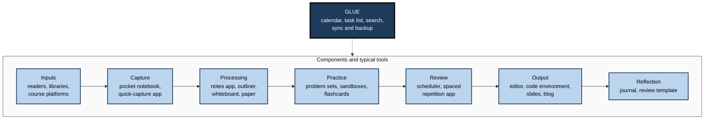
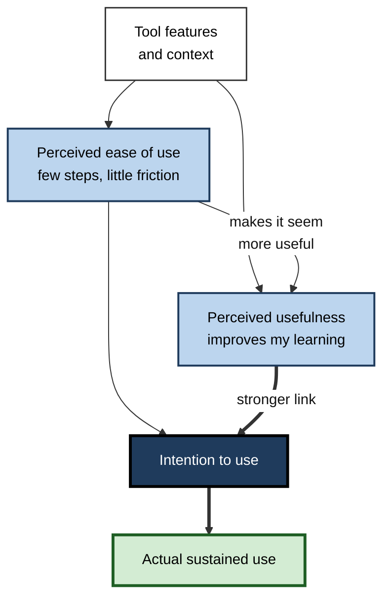
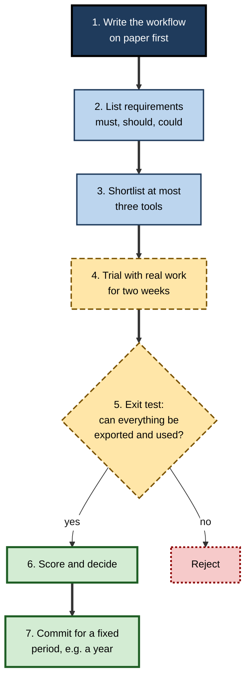
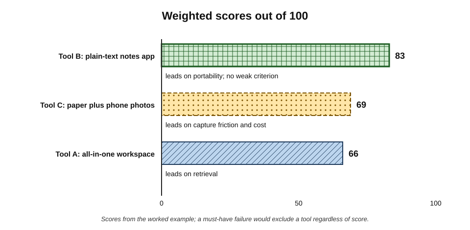
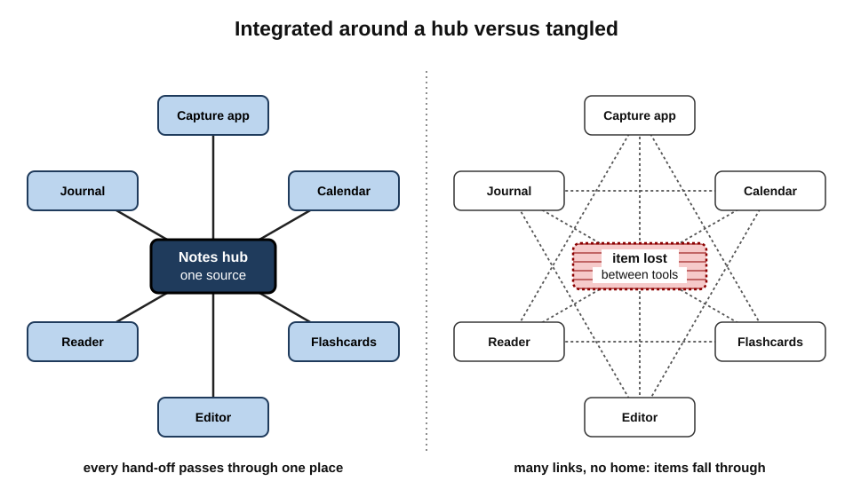

# H.4. Choosing Tools That Fit Your Style

A management consultant moved her notes between four applications in three years. Each migration consumed several weekends, each new tool promised to "change how she thinks", and at the end of the three years she was learning exactly as before — but with notes scattered across four export formats. Tools matter, but mostly in the way a shoe matters to a runner: a bad fit causes injury; a good fit simply disappears from attention.

> **Definition — Tool fit:** the degree to which a tool supports a person's workflows, working context and constraints with low friction, at acceptable cost and risk, for the period over which it will be used.

**Why it matters**

- **Friction decides behaviour.** If capturing an idea takes thirty seconds instead of three, much less gets captured; if a review queue is hard to open, reviews stop.
- **Tools carry hidden costs** — learning curves, subscription fees, migration effort, privacy exposure, lock-in.
- **Tools can displace learning.** Configuring, comparing and migrating tools feels productive and can quietly consume the hours meant for study.
- **Good tools outlast fashions** when chosen for portability and fit rather than novelty.

---

## What "Style" Should and Should Not Mean

### The learning-styles myth

> **Definition — Learning styles (meshing hypothesis):** the claim that people learn better when instruction is matched to a preferred sensory or cognitive style, such as "visual", "auditory" or "kinaesthetic".

**Study card — Pashler, McDaniel, Rohrer and Bjork (2008)**

- **Design:** a review of the learning-styles literature, asking what evidence would be needed to support matching instruction to style.
- **Criterion:** learners classified by style must be randomly assigned to matched and mismatched methods, and the **interaction** must show each group doing best with its own matched method.
- **Results:** very few studies used this design; those that did mostly **failed** to find the predicted interaction, and some contradicted it.
- **Conclusion:** there was no adequate evidence base for using learning-style assessments to shape instruction.

> **Watch out:** choosing tools to match a supposed "visual" or "auditory" style rests on the same unsupported idea. People certainly have **preferences**, and the content often dictates the best format (maps are visual, pronunciation is auditory), but matching to a self-labelled style does not improve learning.

### What legitimately determines fit

- **Workflow** — what the person actually does with information, as established by an audit of practice.
- **Context** — where learning happens: desk, commute, clinic, factory floor, client site.
- **Constraints** — devices allowed, employer policies, connectivity, budget, time.
- **Content** — mathematics needs notation; programming needs runnable code; languages need audio; law needs citations.
- **Accessibility needs** — dyslexia, visual impairment, motor difficulties, attention differences; these are real and justify specific tools (text-to-speech, screen readers, distraction-limiting modes).
- **Preference** — genuine liking matters for **adherence**, even if not for learning efficiency.

| Factor | Legitimate basis for tool choice? | Reason |
|---|---|---|
| Self-labelled sensory "style" | No | No evidence that matching improves learning |
| Nature of the content | Yes | Formats suited to the material improve understanding |
| Working context and devices | Yes | Determines whether the tool can be used at all |
| Accessibility needs | Yes | Removes barriers to access and processing |
| Enjoyment and aesthetic preference | Yes, for adherence | Liked tools are used more consistently |
| Novelty and features | Rarely | Feature count seldom predicts sustained use |

> **Key point:** "fit your style" should mean fitting **workflow, context, constraints, content and access** — not a sensory label.

---

## The Tool Landscape by Component

Every component of a learning system can be served by several kinds of tool, and a single tool often serves more than one.

**Figure 1.** Kinds of tool that typically serve each component of a learning system.

- **Glue tools** — calendar, task list, search and sync — are often more important than any specialised tool, because they make the hand-offs happen.
- **Specialised tools** are worth their cost where the component carries heavy load.
  - *e.g.* a spaced-repetition scheduler for someone memorising thousands of drug names or vocabulary items.

### All-in-one or best-of-breed?

| | All-in-one workspace | Several specialised tools |
|---|---|---|
| Learning curve | One tool to learn, often deep | Several shallower tools |
| Hand-offs | Inside one tool; easy linking | Between tools; needs conventions or automation |
| Quality per function | Adequate across many | Excellent in each |
| Risk if the vendor fails | Everything at once | Spread across vendors |
| Temptation to tinker | High — endless configuration | Moderate |
| Best for | People wanting one place for everything | People with one or two heavy-load components |

---

## Criteria for Choosing

### The core criteria

- **Workflow fit** — does it support the hand-offs the person has already designed?
- **Friction** — how many seconds and steps does the most frequent action take?
- **Reliability** — does it sync, save and open without fail?
- **Portability** — can everything be exported in an open, readable format?
- **Interoperability** — does it link to, import from and export to the other tools in use?
- **Retrieval** — can things be found again quickly by search or structure?
- **Cost** — money, setup time and learning curve.
- **Privacy and compliance** — where the data is stored, who can read it, and whether employer or client rules allow it.
- **Availability** — offline use, devices supported, accessibility features.
- **Longevity** — how long the tool and its format are likely to last.

> **Remember:** when time is short, four criteria decide most choices — **workflow fit, friction of the most frequent action, portability of the data, and privacy**.

> **Definition — Friction:** the time, effort and attention required to complete an action with a tool; low-friction actions happen more often.

> **Definition — Data portability:** the ability to move one's data out of a tool, complete and usable, in a standard format.

### Why usefulness beats ease — but ease decides adoption

**Study card — Fred Davis (1989): the technology acceptance model**

- **Design:** surveys of office workers about electronic mail, file editors and graphics software, measuring perceived usefulness, perceived ease of use and actual use.
- **Results:**
  - both perceptions were associated with use;
  - **perceived usefulness** was more strongly linked to use than ease of use;
  - ease of use worked partly **through** usefulness — easier tools seemed more useful.
- **Conclusion:** people adopt tools that they believe will improve their work; ease removes barriers but does not substitute for usefulness.

**Figure 2.** The technology acceptance model applied to a learning tool.

> **In practice:** when choosing a learning tool, ask first "will this make a component of my learning measurably better?" and only then "is it pleasant to use?" — but reject any tool whose most frequent action has high friction, because it will not be used.

---

## Paper or Digital?

### The evidence on handwriting and typing

**Study card — Mueller and Oppenheimer (2014)**

- **Design:** students watched lectures and took notes either by hand or on laptops (with internet disabled), then answered factual and conceptual questions.
- **Results:** laptop users wrote more and transcribed more verbatim; longhand note-takers did as well on factual questions and **better** on conceptual ones in several of the experiments.
- **Interpretation offered:** writing by hand forces summarising in one's own words — deeper processing.

> **Watch out:** later **replications** have not confirmed a reliable advantage. A direct replication by Kayla Morehead, John Dunlosky and Katherine Rawson (2019) and a larger replication led by Heather Urry (2021) found small or no differences between longhand and laptop notes on later tests. The robust lesson is about **processing, not the instrument**: verbatim transcription is weak in any medium; summarising in one's own words helps in any medium.

### Reading on paper and on screens

- A meta-analysis by Pablo Delgado and colleagues (2018) found a modest **advantage for paper** in comprehension of informational texts, larger when reading was **time-limited**.
- A suggested mechanism is that screen reading invites faster, shallower reading habits.
- The difference is **modest** and can be reduced by deliberately slowing down and annotating on screen.

### Comparing the media

| | Paper | Digital |
|---|---|---|
| Capture speed | Fast; no device to unlock | Fast with good apps; varies |
| Processing | Encourages paraphrase and sketching | Easy to copy and paste verbatim |
| Search and retrieval | Weak without an index | Strong |
| Linking and reuse | Manual | Easy |
| Distraction | Low | High unless controlled |
| Portability of the record | Physical; can be lost or damaged | Copies and backups; formats may age |
| Practice and review | Manual scheduling | Automated schedulers available |
| Best uses | Thinking, sketching, first-pass processing, reflection | Storage, search, scheduled review, output |

> **Key point:** many experienced learners use **paper for thinking and digital for keeping** — sketching and reasoning on paper, then moving the processed result into a searchable store.

---

## Hidden Costs of Tools

### Lock-in and migration

- **Switching costs** — the time, money and lost data involved in moving from one tool to another.
- **Proprietary formats** make export partial or impossible: links break, attachments detach, structure flattens.
- **Vendor risk** — services change terms, raise prices or close.
  - *e.g.* Google Reader, a widely used feed reader, was shut down in 2013, forcing millions of users to move their subscriptions and saved items.

> **Definition — Lock-in:** a situation in which switching away from a tool is so costly that the user stays even when better options exist.

> **Remember:** prefer tools whose data can be exported in **plain text or other open formats**. Plain text files written decades ago remain readable; many proprietary formats from the same era do not.

### Psychological costs

- **The IKEA effect** — Michael Norton, Daniel Mochon and Dan Ariely (2012) found that people value objects more highly when they have assembled them themselves.
  - Highly customised set-ups become hard to abandon even when they no longer serve.
- **Sunk-cost reasoning** — "I have spent so long setting this up" keeps poor tools alive.
- **Tinkering as procrastination** — adjusting templates, themes and plug-ins gives the satisfaction of progress without the effort of learning.

> **Watch out:** the most dangerous tools are not the bad ones but the **endlessly customisable** ones, because they offer unlimited opportunities to improve the system instead of using it.

---

## A Procedure for Choosing

**Figure 3.** A procedure for choosing a learning tool, from workflow to commitment.

1. **Write the workflow first.** Describe the hand-offs on paper; the tool must serve them.
2. **List requirements** using a priority scheme such as **MoSCoW** — must, should, could, won't — which originated in software project management.
3. **Shortlist no more than three tools.** More options mostly add comparison time.
4. **Trial with real work.** Two weeks of genuine use reveal friction that feature lists hide.
5. **Run an exit test.** Export everything and check that the result is complete and usable elsewhere.
6. **Score and decide** using weighted criteria (below).
7. **Commit for a fixed period.** A "tool freeze" — no new tools for, say, twelve months — protects learning time.

> **Watch out:** trials using demonstration data flatter tools. Only real material, with its real volume and mess, shows how a tool behaves.

---

## Worked Example: Choosing a Notes Tool for a Clinical Trainee

A junior doctor needs one place to process what she learns on ward rounds, in teaching and from guidelines, accessible on a hospital computer and on her phone, and compliant with patient-data rules.

**Step 1 — weighted criteria** (weights sum to 100):

| Criterion | Weight | Tool A: all-in-one workspace | Tool B: plain-text notes app | Tool C: paper notebook plus phone photos |
|---|---|---|---|---|
| Workflow fit | 25 | 4 | 4 | 3 |
| Capture friction on shift | 20 | 3 | 4 | 5 |
| Retrieval | 15 | 5 | 4 | 1 |
| Portability | 15 | 2 | 5 | 3 |
| Compliance with data rules | 15 | 3 | 4 | 4 |
| Cost | 10 | 2 | 4 | 5 |

> **Formula — Weighted score:** Σ (weight × score) ÷ 5, giving a score out of 100. Tool A = (25×4 + 20×3 + 15×5 + 15×2 + 15×3 + 10×2) ÷ 5 = (100 + 60 + 75 + 30 + 45 + 20) ÷ 5 = 330 ÷ 5 = **66**.

- **Tool B** = (100 + 80 + 60 + 75 + 60 + 40) ÷ 5 = 415 ÷ 5 = **83**.
- **Tool C** = (75 + 100 + 15 + 45 + 60 + 50) ÷ 5 = 345 ÷ 5 = **69**.

**Figure 4.** Weighted scores for the three candidate tools in the worked example.

**Step 2 — sensitivity check:** if capture friction on shift were weighted 30 and retrieval 5, Tool C would rise to 77 and Tool B would stay at 83 — Tool B still leads, so the choice is robust.

**Step 3 — decision:** Tool B for processing and storage, plus a pocket notebook for capture on shift (no patient identifiers), transferred at the end of each day.

> **Watch out:** weighted scoring disciplines judgement but does not replace it. If a tool fails a **must-have** — for example, it would store patient data on an unapproved server — it is excluded regardless of its score.

---

## Making Tools Work Together

### Integration principles

- **As few tools as the workflow allows.** Each additional tool adds a hand-off and a place to forget.
- **One inbox.** All capture lands in one place, whatever its source.
- **One source of truth per artefact type.** Notes in one store, review items in one queue, tasks in one list.
- **Stable identifiers and names.** Consistent file names, dates and tags make items findable across tools.
- **Automation only for stable, frequent hand-offs.** Automating a workflow that is still changing creates fragile machinery.
- **Backups independent of the vendor.** A regular export to a location the person controls.

**Figure 5.** A hub-and-spoke tool arrangement compared with a tangled one.

> **Key point:** the best-integrated systems have a clear **hub** — usually the notes store or the calendar — through which every hand-off passes. Tangled systems have many tools linked to many others, and items fall between them.

---

## Fit in Different Working Contexts

| Context | Main constraints | Fitting choices |
|---|---|---|
| Long commute by train | Short, interrupted blocks; one hand; patchy signal | Offline-capable phone apps; audio for familiar material; flashcards for review |
| Desk-based analyst | Long blocks; many windows; distraction | Notes store beside the work; distraction blocking; paper for thinking |
| Field or site engineer | Gloves, weather, no signal | Voice memos; rugged notebook; processing back at base |
| Clinician on shifts | Irregular hours; strict data rules | Pocket capture without identifiers; approved systems for anything clinical |
| Learner with dyslexia | Reading fatigue | Text-to-speech; readable fonts and spacing; audio review |
| Learner with attention difficulties | Distraction; time blindness | Minimal interfaces; visible timers; single-purpose devices |

> **In practice:** a tool that is excellent at a desk may be useless on a ward or a building site. Choose for the context in which the **most frequent action** happens.

---

## Small Tool Sets That Work

Most effective learners run on a handful of tools. Three common configurations show how few are needed when the workflow is clear.

### The paper-first set

- **Tools:** a pocket notebook, a bound study notebook, index cards, a wall or desk calendar.
- **How it runs:**
  - capture in the pocket notebook during the day;
  - process each evening into the study notebook in own words, writing a question for each key idea on an index card;
  - review cards in boxes sorted by how well they are known;
  - mark the calendar when a practice or output session is done.
- **Suits:** people who think best on paper, work where devices are restricted, or are easily distracted by screens.
- **Weakness:** weak search; physical loss; slow reuse in digital outputs.

### The plain-text set

- **Tools:** one plain-text or Markdown notes folder synchronised across devices, a spaced-repetition app, the calendar.
- **How it runs:**
  - one "inbox" file for capture;
  - one note per idea or topic, written in own words, named consistently;
  - practice questions copied into the review app;
  - outputs drafted from notes in the normal work editor.
- **Suits:** knowledge workers who value search, longevity and portability.
- **Weakness:** needs naming conventions and discipline; less visual.

### The work-embedded set

- **Tools:** whatever the job already uses — the code repository, the team wiki, the ticketing system, the shared drive — plus a private notebook.
- **How it runs:**
  - learning is captured where the work happens (comments, wiki pages, decision records);
  - a private notebook holds personal processing and questions;
  - practice consists of real tasks deliberately chosen to stretch.
- **Suits:** people whose learning is mainly from and for the current role.
- **Weakness:** knowledge left behind when changing employer; confidentiality limits what can be kept.

> **Key point:** each set covers every component with **three to five tools**. Adding more usually adds hand-offs faster than it adds learning.

### When to retire a tool

- **Signals that a tool should go:**
  - its most frequent action has become slower than it was;
  - items are regularly lost or duplicated around it;
  - its use has fallen to near zero for a quarter;
  - its terms, price or data practices have changed unacceptably;
  - the workflow it served has been dropped.
- **Signals that are not, on their own, reasons to change:**
  - a colleague recommends something new;
  - a competitor has more features;
  - the current tool feels boring.
- **Retirement steps:** export, verify the export, move live items to their new home, archive the rest read-only, and note the date and reason in a short system log.

> **Remember:** retire tools for **failures of fit**, not for **fatigue of familiarity**.

---

## Organisational, Ethical and AI Considerations

### Rules and confidentiality

- **Employer policies** often restrict which applications may hold work information.
- **Client confidentiality** — law, consulting, finance and healthcare professionals must not place client or patient information in personal consumer tools.
- **Data protection law** — for example, the European Union's General Data Protection Regulation (GDPR) — affects where personal data may be stored and processed.
- **Separation** — many professionals keep a work learning store (on approved systems) and a personal one, with only general, non-confidential knowledge in the latter.

### AI features in learning tools

- Many tools now embed AI assistants that summarise, link, generate questions and draft.
- **Questions to ask:**
  - Where does the text go, and is it retained or used for training?
  - Does the feature support processing (asking the learner questions) or replace it (writing the summary for them)?
  - Can it be switched off for confidential material?

> **Watch out:** an automatic summary feature makes capture look like processing. The summary exists, but the learner has not done the thinking that produces understanding.

---

## Case Study: The Migration Spiral

### Case study: a consultant's four tools in three years

- **Situation:** a management consultant learning digital-strategy topics for client work.
- **Problem:** four migrations in three years; notes split across formats; no measurable gain in capability; weekends lost to setting up.
- **Diagnosis:**
  1. Each move was triggered by **novelty** — a colleague's recommendation or a review article — not by a failure in her workflow.
  2. She had **never written down her workflow**, so each tool's features defined it afresh.
  3. Highly customised templates in each tool had made her reluctant to abandon them, until a new tool's appeal overcame the reluctance.
  4. Her audit showed that her real bottleneck was **output** — she rarely applied new frameworks before client meetings.
- **Actions:**
  1. Wrote her workflow on one page: capture on phone → weekly processing into plain-text notes → one framework applied in a client deliverable each fortnight.
  2. Chose the simplest tool that served it, after an exit test.
  3. Declared a **twelve-month tool freeze**.
  4. Converted all four archives into plain text once; archived the originals.
- **Result:** setup time fell to near zero; she produced a reusable framework library that colleagues began to borrow; partners noted sharper client materials.
- **Side effects:** a feeling of missing out when colleagues praised new tools.
- **Lesson:** tool changes cannot fix a workflow that has not been designed; once it is designed, almost any reasonable tool will do.

---

## Open Questions

- **Do specific tool features measurably improve adult learning?**
  - Most evidence concerns techniques (retrieval, spacing); controlled studies of tool features in professional learning are rare.
- **Is there a lasting difference between handwriting and typing for learning?**
  - Early findings favouring handwriting have not replicated reliably; effects may depend on the task and the note-taker's strategy.
- **How will embedded AI change processing?**
  - Tools that summarise and link automatically may reduce the effortful processing that builds understanding; designs that question the learner may do the opposite.
- **How can individuals assess vendor risk?**
  - Longevity is hard to predict; the safest protection — open formats and regular export — is known, but rarely practised.
- **When does customisation help rather than hinder?**
  - Customisation can improve fit, but also increases lock-in and tinkering; the balance point is unknown.

---

## Summary

- **Tool fit** is how well a tool supports workflow, context and constraints with low friction, at acceptable cost and risk.
- **Learning styles** (matching to a sensory label) lack evidence (Pashler et al., 2008); legitimate fit factors are **workflow, context, constraints, content, accessibility and preference for adherence**.
- Each **component** has typical tools; **glue tools** (calendar, task list, search, sync) make hand-offs happen. All-in-one and best-of-breed approaches trade simplicity against quality per function.
- Criteria: **workflow fit, friction, reliability, portability, interoperability, retrieval, cost, privacy, availability, longevity**.
- The **technology acceptance model** (Davis, 1989): perceived usefulness drives use more than ease; ease removes barriers.
- **Handwriting vs typing:** early advantages for longhand have not replicated reliably — **processing, not instrument**, matters. Paper shows a modest comprehension advantage for informational reading, especially under time pressure.
- Hidden costs: **lock-in**, migration, vendor failure, the **IKEA effect**, sunk costs and **tinkering**.
- Procedure: workflow first → requirements → shortlist ≤ 3 → real trial → **exit test** → weighted score → **commit**.
- Integrate around a **hub**, one inbox and one source of truth per artefact; automate only stable hand-offs; back up independently.
- Respect **confidentiality and data rules**; check what embedded **AI features** do with data and whether they replace processing.

---

## Self-Check

1. Define tool fit and explain why friction matters so much.
2. What did Pashler and colleagues (2008) conclude about learning styles, and what design would be needed to support the claim?
3. List the legitimate factors that should determine tool fit.
4. What role do glue tools play in a learning system?
5. Compare all-in-one workspaces with several specialised tools.
6. Summarise the technology acceptance model and its practical implication for choosing learning tools.
7. What did Mueller and Oppenheimer (2014) report, and what happened in later replications?
8. What does the evidence say about reading on paper versus screens?
9. Explain lock-in and the IKEA effect, and how each keeps poor tools in use.
10. Describe the seven-step tool-selection procedure and the purpose of the exit test.
11. Calculate the weighted score (out of 100) for a tool scoring 5, 3, 3, 4, 4, 2 on the worked example's criteria and weights.
12. State four integration principles.
13. A paramedic wants to use a popular desktop knowledge app to learn new protocols. What context factors should shape the choice?
14. A colleague wants to move all notes to a new AI-powered app that "writes summaries automatically". Advise them.

### Answer Key

1. The degree to which a tool supports workflows, context and constraints with low friction, at acceptable cost and risk. Frequent actions with high friction stop happening, so friction directly determines how much capture, review and practice occur.
2. There was no adequate evidence that matching instruction to learning style improves learning. Required design: classify learners, randomly assign them to matched and mismatched methods, and show a crossover interaction; the few studies of this kind mostly failed to find it.
3. Workflow, context, constraints, content, accessibility needs, and genuine preference (for adherence).
4. Calendar, task list, search and sync make the hand-offs between components happen and let items be found again; they connect specialised tools.
5. All-in-one: one learning curve, easy internal linking, adequate quality per function, concentrated vendor risk, high tinkering temptation. Specialised: excellent per function, hand-offs need conventions, risk spread across vendors.
6. Perceived usefulness and perceived ease of use predict intention and use; usefulness is the stronger driver and ease operates partly through it. Choose for real learning benefit first, but reject tools whose frequent actions are high-friction.
7. Longhand note-takers did as well on factual and better on conceptual questions in several experiments, apparently because they paraphrased rather than transcribed. Later replications (Morehead et al., 2019; Urry et al., 2021) found small or no differences — the processing strategy matters more than the instrument.
8. A modest paper advantage for comprehension of informational texts, larger under time limits; it can be reduced by slower, annotated screen reading.
9. Lock-in: switching costs so high the user stays despite better options. IKEA effect: people overvalue what they built, so customised set-ups resist abandonment. Both keep tools alive for reasons unrelated to fit.
10. Write workflow; list must/should/could requirements; shortlist ≤ 3; trial with real work for two weeks; exit test; weighted scoring; commit for a fixed period. The exit test checks that data can leave complete and usable, protecting against lock-in.
11. (25×5 + 20×3 + 15×3 + 15×4 + 15×4 + 10×2) ÷ 5 = (125 + 60 + 45 + 60 + 60 + 20) ÷ 5 = 370 ÷ 5 = 74.
12. Any four: as few tools as possible; one inbox; one source of truth per artefact; stable identifiers and names; automation only for stable hand-offs; vendor-independent backups.
13. Work happens on the move with gloves, time pressure and little desk time; protocols may be confidential or regulated; signal may be poor. Suitable: offline phone access to approved protocol references; brief flashcard review between calls; processing at base; no patient information in personal tools.
14. Automatic summaries replace the processing that builds understanding; check data retention and confidentiality; apply the selection procedure — workflow first, exit test, trial with real material — and use AI features that question the learner rather than summarise for them.

---

## Glossary

| Term | Meaning |
|---|---|
| Data portability | The ability to move data out of a tool, complete and usable, in a standard format. |
| Exit test | Exporting all data from a candidate tool to check it is complete and usable elsewhere. |
| Friction | The time, effort and attention needed to complete an action with a tool. |
| Glue tools | Calendar, task list, search and sync tools that connect components and hand-offs. |
| Hub-and-spoke arrangement | A tool set in which hand-offs pass through one central tool. |
| IKEA effect | Placing higher value on things one has assembled oneself. |
| Learning styles | The unsupported claim that matching instruction to a preferred style improves learning. |
| Lock-in | Being kept in a tool by high switching costs. |
| Meshing hypothesis | The specific prediction that learners do best when instruction matches their style. |
| MoSCoW | A prioritisation scheme: must, should, could, won't. |
| Perceived ease of use | The belief that a tool will be free of effort. |
| Perceived usefulness | The belief that a tool will improve one's performance. |
| Switching costs | The time, money and data loss involved in changing tools. |
| Technology acceptance model | Davis's model linking perceived usefulness and ease of use to adoption. |
| Tool fit | How well a tool supports workflow, context and constraints with low friction and acceptable risk. |
| Tool freeze | A commitment not to adopt new tools for a fixed period. |
| Weighted scoring | Rating options against weighted criteria to support a decision. |
