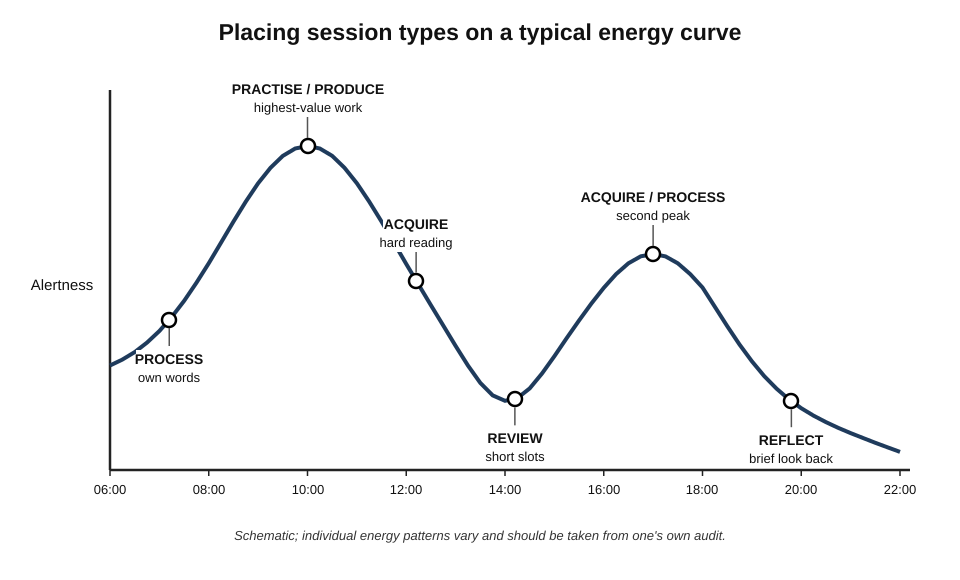
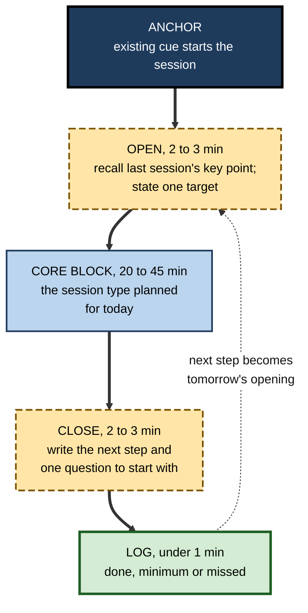
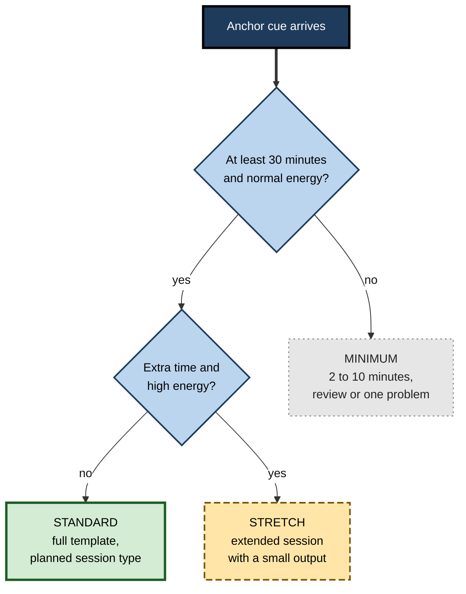
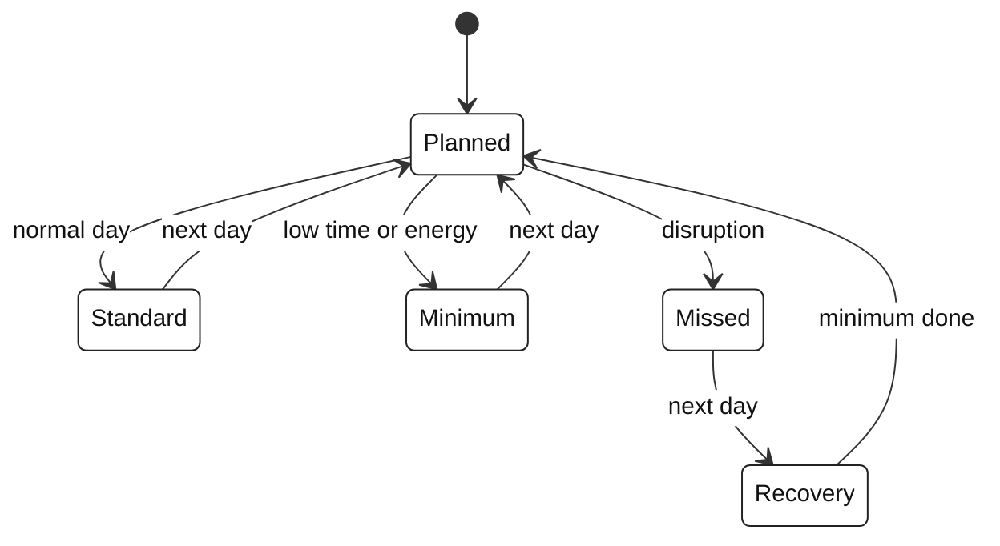
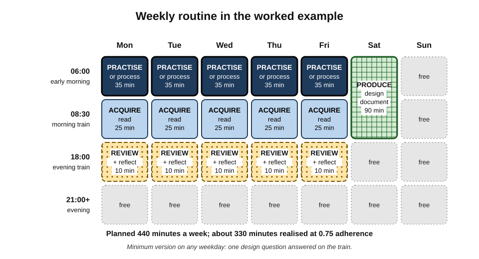

# H.5. Designing a Daily Learning Routine

Two colleagues make the same New Year commitment: "an hour of learning every day". One decides each evening what to do, if anything, and has stopped by February. The other has decided in advance exactly when the session happens, what kind of session it is on each weekday, what a five-minute version looks like on bad days, and where the materials are waiting. The second has not more willpower but a **design** — and a design keeps working when motivation does not.

> **Definition — Daily learning routine:** a pre-designed, repeatable pattern of learning sessions — when, where, for how long and doing what — that runs on most days with little need for fresh decisions.

**Why it matters**

- **Daily decisions are the enemy of daily practice.** Each time a person must decide whether, when and what to study, there is a chance the answer is "not today".
- **Small, regular sessions suit how memory works** — spacing practice across days produces more durable learning than the same hours massed together.
- **A routine is where the system actually runs.** Purposes, tools and workflows exist on paper; the routine is the moment they happen.
- **Routines survive busy periods** when they include reduced versions designed in advance.

---

## Routine, Habit, Schedule and Ritual

| | Habit | Routine | Schedule | Ritual |
|---|---|---|---|---|
| What it is | An action triggered automatically by a context cue | A designed sequence of actions repeated regularly | A plan of times and activities | A symbolic sequence marking a transition |
| Main driver | Context cue and past repetition | Design and, later, habit | Calendar commitment | Meaning and emotion |
| Decision needed each time | Almost none | Little | Some | None |
| Learning example | Opening flashcards on sitting down with the morning coffee | Morning: 5-minute recall → 25-minute practice → 2-minute log | Tuesday 7–8 p.m.: statistics course | Tidying the desk and lighting a lamp before study |
| Weakness | Hard to form; hard to change | Can become rigid | Easily overridden | Can become empty form |

> **Definition — Habit (Wendy Wood and David Neal, 2007):** a learned disposition to repeat a past response, triggered by features of the context in which it has been performed before.

- A good routine **uses** a habit to **start** — the cue launches the session without deliberation — and a design to determine **what happens inside**.

> **Key point:** habit gets the learner to the desk; the routine's design decides whether the time there produces learning.

---

## The Daily Time Budget

### How much is enough?

- **Growth** — building new capability — typically needs regular sessions of 25–60 minutes on most days.
- **Maintenance** — keeping existing capability alive — can need as little as a few minutes of review a day.
- The right budget is the **largest amount that can be sustained in an ordinary week**, not the amount that is possible in an ideal one.

> **Formula — Realised weekly learning time:** sessions planned × minutes per session × adherence rate. Example: 5 sessions × 40 minutes × 0.7 adherence = **140 minutes** a week. A smaller plan with higher adherence — 6 × 25 × 0.95 = **142.5 minutes** — yields the same time with less disruption.

### Limits within a session

- **Sustained attention declines** over long periods of demanding work.
  - In Norman Mackworth's wartime experiments (1948), radar-style observers watching a clock-like display missed more signals after the first half-hour — the **vigilance decrement**.
- **Deliberate practice is effortful.** In Anders Ericsson's studies of expert violinists (1993), the best performers practised deliberately for limited daily periods, often in sessions of about an hour separated by rest, rarely totalling more than about four hours a day.

> **Watch out:** the popular "10,000-hour rule" overstates Ericsson's findings. A 2014 meta-analysis by Brooke Macnamara and colleagues found that deliberate practice explained a meaningful but **modest** share of differences in performance, varying widely by domain. Hours matter; they are not the whole story.

> **Remember:** for most professionals, **25–50 minutes of focused work** is a sound core-session length, with a break before any second block.

---

## Session Types

A routine is built from sessions of different kinds. Each has a distinct purpose, energy demand and best timing.

- **Acquire** — encountering new material: reading, watching, attending.
  - Moderate energy; benefits from freshness when the material is difficult.
- **Process** — turning new material into own words, diagrams, questions and connections.
  - High energy; the most often skipped.
- **Practise** — retrieving and applying: problems, exercises, deliberate practice on weaknesses.
  - Highest energy; most valuable; best placed in the most alert hours.
- **Review** — revisiting earlier material on schedule.
  - Low to moderate energy; tolerant of short, interrupted slots.
- **Produce** — creating output: writing, building, presenting, explaining.
  - High energy; needs longer blocks.
- **Reflect** — a brief look back at what was learned and what to do next.
  - Low energy; fits at the end of a day.

| Session type | Typical length | Energy demand | Interruption tolerance | Good slots |
|---|---|---|---|---|
| Acquire | 20–45 min | Moderate | Moderate | Commute (for easy material), mornings (for hard) |
| Process | 15–30 min | High | Low | Straight after acquiring, at a desk |
| Practise | 25–50 min | Highest | Very low | Peak-alertness hours |
| Review | 5–15 min | Low–moderate | High | Queues, transit, breaks |
| Produce | 45–90 min | High | Very low | Protected blocks, often weekly |
| Reflect | 2–10 min | Low | High | End of the working day |

**Figure 1.** Matching session types to a typical daily energy pattern.

> **Key point:** the classic mistake is to give **acquisition** — the easiest, most pleasant session — the best hours, and to leave **practice** for when energy has run out. Reverse it where possible.

---

## Choosing the Slots

### Time of day and individual rhythm

- **Chronotype** — a person's natural tendency towards earlier or later sleep and peak alertness.
- **Synchrony effect** — Cynthia May, Lynn Hasher and Ellen Stoltzfus (1993) found that older adults, mostly morning types, remembered better in the morning, while younger adults, more often evening types, did better later in the day.
- **The post-lunch dip** — many people experience a fall in alertness in the early afternoon.

> **Watch out:** synchrony effects are real on average but **modest and individual**. The best guide is an energy map from one's own audit, not a general rule that "mornings are best".

### Availability and protection

- **Before the workday captures attention** — early morning slots are least likely to be overridden, for people whose mornings are their own.
- **Transitions** — commutes, waiting times and the minutes after meetings suit review.
- **Lunch** — a regular 20-minute slot works for some and is impossible for others.
- **Evenings** — available for many, but energy and family demands compete.

### Anchoring sessions to existing cues

- An **anchor** is an existing, stable daily event after which the session starts: the first coffee, arriving at the desk, the train departing, the children's bedtime.
- **Implementation intentions** — plans of the form "When situation X arises, I will do Y" — have well-established effects on following through.
  - A meta-analysis by Peter Gollwitzer and Paschal Sheeran (2006), covering 94 independent tests, found a **medium-to-large** effect on goal attainment.
- **How long until automatic?**
  - Phillippa Lally and colleagues (2010) followed people forming a new daily habit: the median time to reach near-maximum automaticity was **66 days**, ranging from 18 to 254.
  - A 2024 systematic review by Ben Singh and colleagues reported medians of roughly **two months** across health habits, with wide individual variation.

> **Example — an anchored routine:** "When I sit down with my first coffee at the kitchen table, I will open yesterday's practice notebook and answer the first question without looking."

> **Watch out:** the claim that a habit forms in "21 days" has **no research basis**. Expect around two months, with large variation, and do not abandon a routine because it still requires effort after three weeks.

---

## Inside a Session: The Session Template

A session template fixes the structure inside each session so that time is not spent deciding what to do.

**Figure 2.** A session template from opening retrieval to logging the next step.

### The opening

- **Recall before re-reading** — answering one question about the previous session primes the material and doubles as retrieval practice.
- **One target** — a single, concrete goal for the session ("solve three window-function problems unaided"), not "study SQL".

### The core block

- **Single-tasking** — notifications off, other windows closed.
- **One session type** — mixing acquisition, practice and output in one short block usually means the hardest part is dropped.

### The close

- **Write the next step** — the exact first action for the next session.
  - The novelist Ernest Hemingway described stopping his writing each day when he knew what would happen next, so that he could start easily the following morning.
- **Write one starting question** — material for the next opening.

> **Watch out:** the "Zeigarnik effect" — the claim that interrupted tasks are remembered better than completed ones — is often cited to justify stopping mid-task. A recent meta-analysis found the **memory advantage unreliable**, although the related tendency to **resume** interrupted tasks is better supported. The practical value of writing the next step lies in removing start-up friction, not in a memory boost.

### The log

- A one-character record — done, minimum, or missed — is enough for later evaluation.
- Detailed tracking is a separate practice; the routine's log exists only to show adherence patterns.

---

## Three Versions of Every Session

A routine designed only for good days fails on the first bad one. Each session should exist in three versions, decided in advance.

- **Minimum** — 2–10 minutes; keeps the chain unbroken.
  - *e.g.* answer five review questions; re-solve one problem.
- **Standard** — the normal session.
  - *e.g.* 35 minutes of practice using the full template.
- **Stretch** — an extended session for days with spare time and energy.
  - *e.g.* 75 minutes including a small output.

**Figure 3.** Choosing today's version of the session from available time and energy.

> **Key point:** the minimum version is not a failure mode but a **design feature** — it preserves the cue–action link that makes the routine automatic, at almost no cost.

---

## Composing the Week From Days

A daily routine need not be the same every day. Varying the session type by weekday spreads practice and output across the week.

| Day | Main session (standard) | Minimum version | Rationale |
|---|---|---|---|
| Monday | Acquire: new chapter or module | Read one section | Fresh start of the week |
| Tuesday | Process and practise Monday's material | Answer three questions | Processing close to acquisition |
| Wednesday | Practise: mixed problems | Re-solve one old problem | Mid-week peak; mixing types |
| Thursday | Acquire and process | Summarise one idea | Second input of the week |
| Friday | Produce: write, build or explain | One paragraph | Output closes the weekly loop |
| Saturday | Optional stretch or rest | — | Flexibility |
| Sunday | Review and brief planning | Five review items | Light; sets up the week |

- **Interleaving across days** — returning to topics over several days produces spacing automatically.
- **Rest days** protect sustainability and give consolidation time.
- A **short weekly review** of the week's learning sits naturally at the end of the cycle; it is a distinct practice from the daily routine.

---

## Designing for Adherence

### Reduce friction

- **Prepare the night before** — materials open, the first question written, the device charged.
- **One place, one set-up** — the same seat, the same notebook, the same app screen.
- **Remove competing cues** — phone in another room; email closed until the session ends.

### Raise commitment

- **Commitment devices** — arrangements that make backing out costly, such as a booked session with a study partner or a public deadline; reviewed in economics by Gharad Bryan, Dean Karlan and Scott Nelson (2010).
- **Social anchors** — a partner, a cohort or a mentor expecting a weekly update.

### Make progress visible — carefully

- A simple **done / minimum / missed** record shows patterns.
- **Streaks** motivate many people but can encourage gaming (counting trivial sessions) or collapse after one break.

> **Watch out:** a broken streak can trigger an "all or nothing" reaction — after one missed day the person abandons the whole routine. Designing a **minimum version** and a rule such as "a missed day is followed by a minimum day, never by another missed day" protects against this.

### State diagram of a day

**Figure 4.** How a routine responds to each day's circumstances, including recovery after a missed session.

---

## Routine Designs That Commonly Fail

- **The heroic plan** — two hours every day from a standing start.
  - Fails within weeks because no ordinary week contains it.
  - Remedy: begin at a level that feels almost too easy; grow by small steps once adherence is high.
- **The floating session** — "I'll fit it in sometime today".
  - Without a slot and an anchor, the session competes with everything else and usually loses.
  - Remedy: one fixed slot, one anchor.
- **The single-type routine** — every session is reading or watching.
  - Comfortable, but processing, practice and output never happen.
  - Remedy: assign session types by weekday.
- **The leftover slot** — learning given the last, most tired hour of the day.
  - Remedy: move practice to a high-energy slot, even if shorter; keep low-energy slots for review.
- **The over-instrumented routine** — trackers, dashboards and apps for every session.
  - Logging becomes the task. Remedy: a single done/minimum/missed mark.
- **The rigid routine** — no variant for travel, illness or busy weeks.
  - Breaks on the first disruption. Remedy: minimum versions and event anchors.
- **The solitary routine that needed company** — some people sustain learning only with others.
  - Remedy: a study partner, a cohort, or a weekly check-in with a colleague.

> **Key point:** most failed routines fail by **design**, not by character. When a routine collapses, the first question is "which part of the design made skipping the easy option?"

### Seasonal variants

Over a year, the same person may need different routines.

- **Intensive season** — exam preparation, onboarding to a new role, a career transition.
  - Higher budget; more practice; social commitments reduced for a defined period.
- **Normal season** — the default routine.
- **Maintenance season** — a crunch at work, a new baby, illness, caring duties.
  - Minimum versions only; review to protect existing capability; no new topics.
- **Recovery season** — returning after a break.
  - Restart with the minimum version for a week before rebuilding.

> **In practice:** naming the season explicitly ("I am in maintenance season until the product launch") turns an apparent failure into a planned choice and makes it easier to return to the normal routine afterwards.

---

## Worked Example (illustrative): A Routine for an Engineer With a Young Child

A backend engineer wants to learn distributed-systems design over six months. Her constraints: a toddler who wakes at 6:30, a 25-minute train commute, meetings from 10:00, tired evenings.

**Step 1 — energy and availability map:**

- 6:00–6:30 — alert, quiet, reliably free.
- Commute — two 25-minute rides; seated; poor signal.
- Lunch — unpredictable.
- After 21:00 — low energy.

**Step 2 — assign session types:**

1. **6:00–6:35 — practise or process** (highest-value, peak alertness).
2. **Morning train — acquire** (reading a downloaded chapter; offline).
3. **Evening train — review** (10 minutes of flashcards) **and reflect** (one line in a notebook).
4. **Saturday 7:00–8:30 — produce** (a small design document or prototype) while her partner covers childcare; she covers Sunday morning in return.

**Step 3 — anchor and template:**

- **Anchor:** the kettle switched on at 6:00.
- **Template:** recall yesterday's key point → 30-minute core → write tomorrow's first question.

**Step 4 — three versions:**

- **Minimum:** one design question answered in five minutes on the train.
- **Standard:** as above.
- **Stretch:** an extra commute session processing notes.

**Step 5 — budget check:**

> **Formula — Planned weekly time:** (5 × 35) + (5 × 25) + (5 × 10) + 90 = 175 + 125 + 50 + 90 = **440 minutes** ≈ 7.3 hours planned. At an expected adherence of 0.75 → **about 5.5 hours** realised.

**Figure 5.** The engineer's weekly routine, with session types placed by energy and availability.

**Step 6 — evaluation after four weeks:** adherence was 0.85 for mornings but 0.4 for evening reviews (she fell asleep on the train). She moved reviews to the morning train after reading and shortened reading to 15 minutes.

> **Watch out:** the instinct to "add an evening session to catch up" would have failed: her audit showed evenings were her lowest-energy period. Routines fail most often by assigning demanding work to unrealistic slots.

---

## Routines Across Roles

| Role and pattern | Main constraint | Routine design that fits |
|---|---|---|
| Nurse on rotating shifts | Shift pattern changes weekly | Routines anchored to shift events (after handover) rather than clock times; separate day-shift and night-shift versions |
| Litigation lawyer | Unpredictable deadlines | A non-negotiable 15-minute minimum on court days; standard sessions on other days |
| Field sales representative | Driving between clients | Audio for familiar material while driving; practice in parked minutes before meetings |
| Graduate trainee | Formal study alongside work | Employer-provided study time used for practice; personal time for review |
| Senior manager | Fragmented calendar | Calendar-blocked early session twice a week; daily five-minute review |

> **In practice:** **event anchors** ("after handover", "after the client meeting") are more robust than **clock anchors** ("at 7 a.m.") for people with irregular schedules.

---

## Evaluating and Adjusting the Routine

- **After four weeks**, look at three things:
  - **adherence** — what proportion of sessions were done (standard or minimum);
  - **quality** — whether sessions produced the target (problems solved, notes processed);
  - **outcomes** — whether retrieval of earlier material and real outputs improved.
- **Adjust one variable at a time** — time slot, session type, length or anchor.
- **Common adjustments:**
  - a slot with adherence below about 0.5 → move or shorten it;
  - high adherence but weak quality → change the session type or the template, not the time;
  - good sessions but no outcomes → add output and review sessions.

> **Remember:** a routine is a **hypothesis about one's own life**. Test it for a few weeks, read the log, and revise — without treating a failed slot as a personal failing.

---

## Case Study (illustrative): A Routine for a Professional Examination

### Case study (illustrative): an analyst preparing for a charter examination

- **Situation:** an investment analyst preparing for a demanding professional examination requiring several hundred hours of study over about six months, while working full time.
- **Problem:** her first two months relied on long weekend sessions; she fell behind after two weekends of travel and felt the material "slipping away" between weekends.
- **Diagnosis / Actions:**
  1. Massed weekend study left five-day gaps with no retrieval.
  2. Weekend availability was fragile — any trip erased the week's study.
  3. **New design:**
     - weekday mornings, 6:15–7:15 — one hour, alternating acquire-and-process days with practice days;
     - lunchtime — 10 minutes of review questions on her phone;
     - Saturday — a three-hour mixed practice exam section;
     - minimum version on travel days — 20 review questions on the plane or train.
  4. Anchor: the coffee machine at 6:15; materials laid out the night before.
- **Result:** realised weekly study rose from about 9 to about 13 hours; practice-exam scores rose steadily; she passed at the first attempt.
- **Side effects:** earlier bedtimes and fewer weekday evening social events; she negotiated two late starts a month with her manager for exam weeks.
- **Lesson:** the change was not more willpower but **distribution** (daily rather than weekly), **anchoring** and **pre-designed minimum versions** for disrupted days.

---

## Open Questions

- **What is the optimal session length for adult professionals?**
  - Evidence on attention and practice suggests limits, but optimal lengths likely vary by task, expertise and individual.
- **How strong are time-of-day effects for complex professional learning?**
  - Synchrony effects are documented on average; their size for real-world study is uncertain.
- **Do minimum sessions preserve learning or mainly preserve habit?**
  - They clearly protect routine continuity; their direct learning contribution is less studied.
- **How do routines interact with digital interruptions?**
  - The cost of interruptions is well documented in the laboratory; long-term effects on learning routines are less clear.
- **How long does a learning routine take to become automatic?**
  - Habit-formation studies concern simpler behaviours; complex study routines may take longer or never become fully automatic.

---

## Summary

- A **daily learning routine** is a pre-designed, repeatable pattern of sessions that runs with few fresh decisions; **habit** starts it, **design** decides what happens inside.
- Set the **budget** to what an ordinary week sustains; realised time = sessions × length × **adherence**.
- Sessions have limits: the **vigilance decrement** and the effort of **deliberate practice** suggest 25–50-minute core blocks; the "10,000-hour rule" overstates the evidence.
- Six **session types** — acquire, process, practise, review, produce, reflect — differ in energy demand and interruption tolerance; give **practice** the best hours.
- Choose slots by **energy map**, availability and protection; synchrony effects are modest and individual.
- **Anchor** sessions to stable cues; **implementation intentions** have a medium-to-large effect; automaticity takes around **two months** on average, with wide variation; "21 days" is a myth.
- A **session template**: open with recall and one target → core block → close with the next step → log.
- Every session has **minimum, standard and stretch** versions; the minimum protects the cue–action link.
- Common failures — heroic plans, floating sessions, single-type routines, leftover slots, over-instrumentation, rigidity — are failures of **design**; routines also vary by **season** (intensive, normal, maintenance, recovery).
- Vary session types across the **week**; include rest.
- Design for **adherence**: low friction, commitment devices, careful use of streaks, and a recovery rule after missed days.
- Evaluate after about four weeks on **adherence, quality and outcomes**; change one variable at a time.

---

## Self-Check

1. Define a daily learning routine and distinguish it from a habit and a schedule.
2. Calculate realised weekly time for 4 sessions of 45 minutes at 0.6 adherence, and compare with 6 sessions of 25 minutes at 0.9.
3. What do the vigilance decrement and Ericsson's violinist studies suggest about session length?
4. Why is the "10,000-hour rule" misleading?
5. Name the six session types and state which deserves the most alert hours, and why.
6. What is the synchrony effect, and how much weight should it carry in routine design?
7. Explain implementation intentions and summarise the evidence for them.
8. What did Lally and colleagues (2010) find about the time to automaticity?
9. Describe the four parts of the session template and the purpose of each.
10. Why should every session have a minimum version?
11. Why are event anchors more robust than clock anchors for some workers? Give an example.
12. After four weeks, a learner's evening slot shows 0.35 adherence while morning slots show 0.9. What should change, and what should not?
13. Design a routine outline for a hospital pharmacist on alternating early and late shifts who wants to learn paediatric pharmacology.
14. A colleague plans to study four hours every Sunday "to keep weekdays free". Evaluate the plan and suggest a redesign.

### Answer Key

1. A pre-designed, repeatable pattern of learning sessions — when, where, how long, doing what — that runs with few fresh decisions. A habit is an automatic cued response (it can start the routine); a schedule is a plan of times that is easily overridden and does not specify the inside of sessions.
2. 4 × 45 × 0.6 = 108 minutes; 6 × 25 × 0.9 = 135 minutes. The smaller, more frequent plan yields more realised time and better spacing.
3. Sustained attention declines after roughly half an hour of demanding monitoring, and deliberate practice is effortful enough that experts limit sessions (about an hour) and daily totals; core blocks of 25–50 minutes with breaks are sensible.
4. Ericsson's work showed accumulated deliberate practice matters, but meta-analysis (Macnamara et al., 2014) found it explains only a modest share of performance differences, varying by domain; there is no fixed hour threshold.
5. Acquire, process, practise, review, produce, reflect. Practice deserves peak hours because it is the most effortful and most valuable for durable, usable learning.
6. Better memory performance at one's preferred time of day (May, Hasher and Stoltzfus, 1993). Real but modest and individual — use one's own energy map rather than a general rule.
7. Plans of the form "When X, I will Y" that link a situational cue to an action. A meta-analysis of 94 tests (Gollwitzer and Sheeran, 2006) found a medium-to-large effect on goal attainment.
8. Median 66 days to near-maximum automaticity, ranging from 18 to 254 days, with wide individual variation.
9. Open (recall last key point, set one target) — primes and retrieves; core block (one session type, single-tasked) — the main work; close (write the next step and a starting question) — removes start-up friction; log (done/minimum/missed) — records adherence.
10. It preserves the cue–action link and continuity on bad days at minimal cost, preventing all-or-nothing collapse.
11. Their clock times vary but events recur. E.g. a nurse anchors review to "after handover" whatever the shift time.
12. Move or shorten the evening slot (e.g. fold its content into a morning slot or a commute); keep the morning slots unchanged; change one variable at a time.
13. E.g. two anchored versions: early shift — review after handover at the end of the shift and practise after dinner on two days; late shift — practise in the morning before work (peak energy). Minimum: five drug-dose questions. Weekly produce session on a day off: one quick-reference card. Evaluate after four weeks.
14. Massed weekly study gives poor spacing, leaves six days without retrieval and is fragile (one disrupted Sunday loses the week). Redesign: short weekday reviews and practice (15–30 minutes anchored to existing cues) plus a shorter Sunday session for production or mixed practice.

---

## Glossary

| Term | Meaning |
|---|---|
| Adherence rate | The proportion of planned sessions actually carried out. |
| Anchor | An existing, stable event after which a session begins. |
| Chronotype | A person's natural tendency towards earlier or later sleep and alertness. |
| Commitment device | An arrangement that makes abandoning a plan costly. |
| Daily learning routine | A pre-designed, repeatable pattern of learning sessions that runs with few fresh decisions. |
| Deliberate practice | Effortful practice designed to improve specific aspects of performance, with feedback. |
| Event anchor | A cue defined by an event rather than a clock time. |
| Habit | A learned disposition to repeat a response, triggered by context. |
| Implementation intention | A plan of the form "When X, I will Y". |
| Maintenance season | A planned period in which only minimum sessions run, to protect existing capability. |
| Minimum version | A pre-designed, very short form of a session for bad days. |
| Post-lunch dip | A common fall in alertness in the early afternoon. |
| Session template | A fixed internal structure for a learning session. |
| Session type | The kind of learning work a session does: acquire, process, practise, review, produce or reflect. |
| Synchrony effect | Better performance at one's preferred time of day. |
| Vigilance decrement | The decline in sustained attention over time on a demanding monitoring task. |
| Zeigarnik effect | The disputed claim that interrupted tasks are remembered better than completed ones. |
