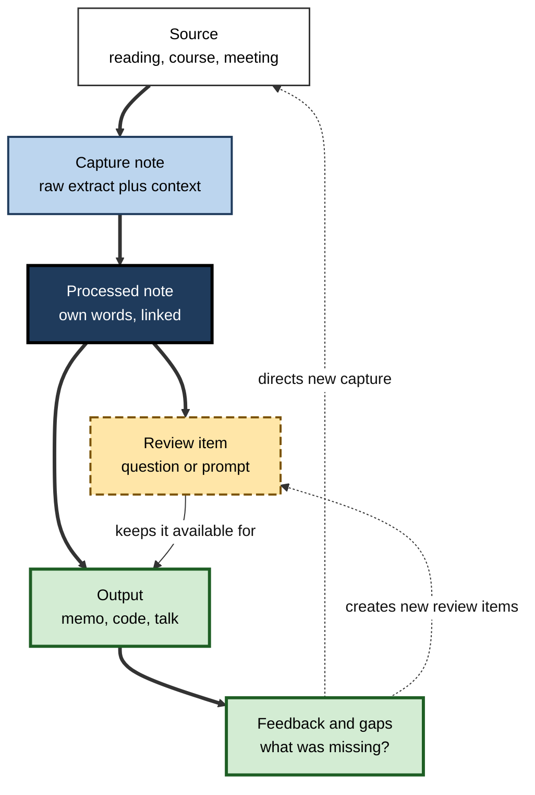
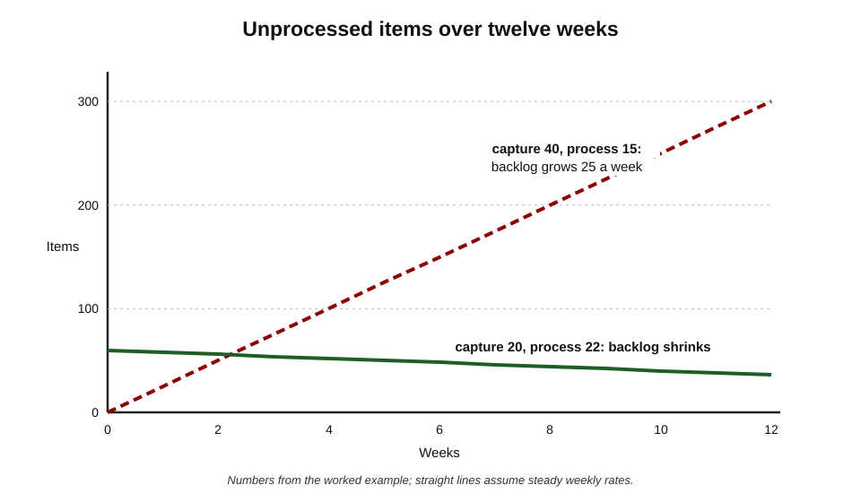
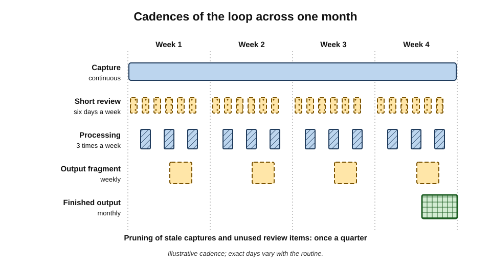
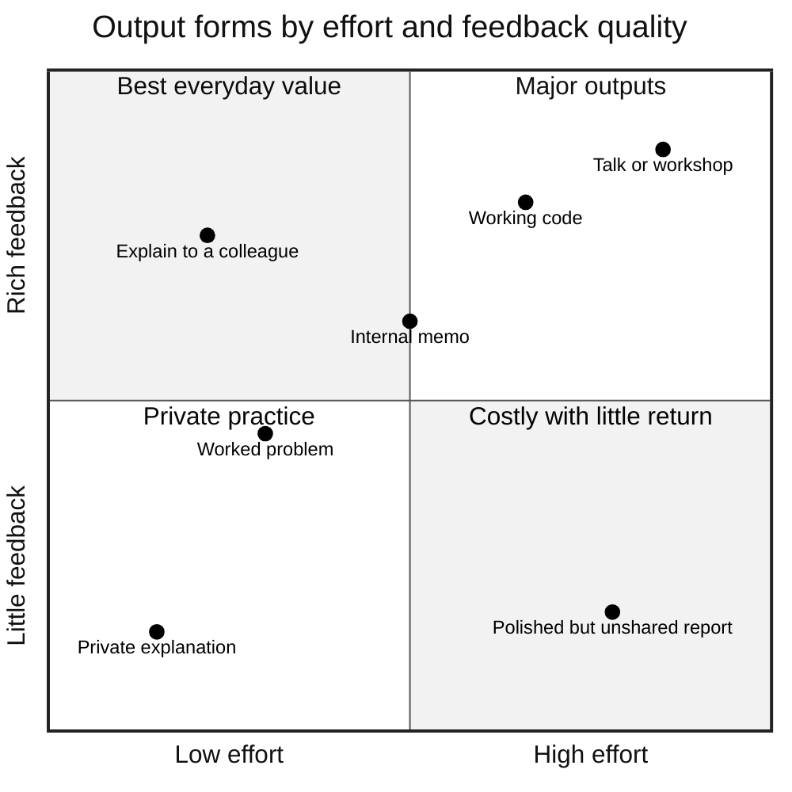

# C.6. Combining Capture, Review, and Output

A policy researcher has three thousand highlighted passages in her reading app and has published nothing in two years. A colleague with a fraction of her notes writes a short briefing every fortnight, and each briefing sends him back to his notes, then to new reading, then to the next briefing. Both capture; only one has joined capture to **review** and **output** so that each feeds the others. The difference is not diligence but **integration**.

> **Definition — Capture–review–output loop:** an integrated workflow in which captured material is processed into items that are reviewed and into components of real outputs, and in which producing outputs reveals gaps that direct new capture and review.

**Why it matters**

- **Each activity fails on its own.** Capture alone produces archives; review alone produces trivia; output alone, without a store of processed knowledge, produces thin work.
- **Output is the strongest test of understanding.** Gaps invisible during reading appear the moment one tries to explain, write or build.
- **Integration multiplies value.** One well-processed note can become a review question, a paragraph in a memo and an example in a talk.
- **Flow must balance.** If more is captured than can be processed, the system silts up regardless of how good each tool is.

---

## Three Activities, One Loop

### What goes wrong when they are separate

| Pattern | What the learner has | What is missing | Typical result |
|---|---|---|---|
| Capture only | Large archive of highlights and saved items | Processing, retrieval, use | Rediscovery of forgotten material; collector's satisfaction |
| Review only | Flashcards and reviews running daily | Connection to real tasks | Facts retained, rarely applied |
| Output only | Frequent writing or building | A store of processed knowledge; spaced retrieval | Repeating the same ideas; slow growth |
| Integrated loop | Processed notes, review items and outputs linked | — | Retention, transfer and a growing body of work |

> **Key point:** the loop works because each activity **supplies** the next: capture supplies raw material, processing turns it into reviewable and usable pieces, review keeps those pieces available, output uses and tests them, and output's gaps tell capture what to seek.

**Figure 1.** The capture–review–output loop and the artefacts that move around it.

---

## Artefacts and Their Next Destinations

A loop is easiest to run when every artefact type has a defined **next destination**.

> **Definition — Artefact:** any recorded product of learning — a capture note, a processed note, a question, a diagram, a draft, a finished output.

| Artefact | Created when | Next destination | Typical failure |
|---|---|---|---|
| Capture note | Something worth keeping is met | Processing within days, or deletion | Left unprocessed indefinitely |
| Processed note | The learner explains an idea in own words and links it | Review items and outputs | Written once, never revisited |
| Review item | A key idea, fact or procedure is worth retaining | Scheduled retrieval | Created in bulk, reviewed out of duty, never used |
| Draft or fragment | An idea is applied to a real question | A finished output | Abandoned drafts |
| Finished output | The work is shared or used | Feedback; new questions | Shared without asking for feedback |
| Feedback note | Someone responds, or the output is used | New capture targets and review items | Ignored |

> **Remember:** an artefact with **no next destination** is a dead end. Either give it one, or delete it.

### Processing as the hinge

- **Processing** — paraphrasing, connecting, questioning — is the step that makes material usable for **both** review and output.
- Well-processed notes tend to be:
  - **written in the learner's own words**, so they can be reused without re-reading the source;
  - **focused on one idea**, so they can be recombined in different outputs;
  - **linked** to related ideas, examples and sources;
  - **phrased with a question in mind**, so that a review prompt can be written directly from them.
- Several note-taking methods — the card-index approach associated with the sociologist Niklas Luhmann, and layered summarising methods popular among knowledge workers — are essentially techniques for this processing step.

> **Example:** a captured sentence — "Latency percentiles matter more than averages" — becomes a processed note explaining *why* (averages hide the slow tail that users notice), with an example from last month's incident, a review question ("Why report p99 latency rather than the mean?") and a paragraph reused in a performance-review memo.

---

## Why Output Belongs in the Loop

### Generating is more memorable than receiving

**Study card — Norman Slamecka and Peter Graf (1978): the generation effect**

- **Design:** participants either **read** word pairs (e.g. *rapid – fast*) or **generated** the second word from a cue (e.g. *rapid – f___*).
- **Results:** generated words were remembered better than read words across several tests.
- **Conclusion:** producing information, even in small ways, strengthens memory compared with passively receiving it.

- **Generative learning** — a tradition going back to Merlin Wittrock (1974) and synthesised by Logan Fiorella and Richard Mayer (2016) — holds that learners understand more deeply when they actively **select, organise and integrate** information by producing something: summaries, maps, drawings, self-explanations, teaching, enactment.

### Teaching others teaches the teacher

**Study card — Fiorella and Mayer (2013)**

- **Design:** students studied a lesson either for a test, expecting to teach it, or expecting to teach and then actually teaching it in a short recorded lecture.
- **Results:** expecting to teach gave a short-term benefit; **actually teaching** produced better performance on a **delayed** test a week later.
- **Conclusion:** explaining to others — an output — strengthens durable understanding beyond merely preparing to do so.

- **John Nestojko and colleagues (2014)** found that simply **expecting** to teach led learners to organise material better and recall more, compared with expecting a test.

### Output exposes the illusion of understanding

**Study card — Leonid Rozenblit and Frank Keil (2002): the illusion of explanatory depth**

- **Design:** participants rated how well they understood everyday devices (zips, flush toilets, cylinder locks), then wrote step-by-step explanations of how they worked, then rated their understanding again.
- **Results:** ratings **fell sharply** after attempting explanations.
- **Conclusion:** people believe they understand mechanisms in far more detail than they do — until asked to produce an explanation.

> **Definition — Illusion of explanatory depth:** the tendency to believe one understands how something works in more detail than one actually does.

> **Key point:** output does two jobs that reading cannot: it **builds** memory and understanding (generation, teaching) and it **diagnoses** what is missing (explanatory depth).

> **Watch out:** output is not automatically learning. Copying a template, pasting AI-generated text or reproducing slides creates artefacts without generation. The learning value comes from the learner doing the **selecting, organising and explaining**.

---

## Review That Serves Output

- **Retrieval practice** — recalling information rather than re-reading it — is among the best-established learning effects; reviews should therefore ask questions, not simply re-display notes.
- **Spaced review** — revisiting at increasing intervals — is best handled by a scheduler; dedicated spaced-repetition software automates this.
- **Review oriented to use:**
  - prioritise review items for knowledge that outputs will need — terms, figures, frameworks, procedures;
  - include **application prompts** ("How would this change the design of…?") as well as recall prompts;
  - during review, note any item that suggests an output — a review session is a good source of ideas.
- **Resurfacing** — periodically revisiting older processed notes in connection with current projects — produces unexpected combinations, a valued effect of linked note systems.

> **In practice:** many experienced practitioners keep **two queues**: a retrieval queue (questions and prompts reviewed on schedule) and an **idea queue** (notes flagged as possible material for future outputs), reviewed weekly when planning work.

---

## Flow Balance: Capture Rate and Processing Capacity

### The silting problem

- Capture is **cheap**: a click or a photograph.
- Processing is **expensive**: minutes of thought per item.
- When capture outpaces processing, the backlog grows without limit.

> **Formula — Little's law (John Little, 1961):** L = λ × W, where *L* is the average number of items in the system, *λ* the average arrival rate and *W* the average time an item spends in the system. If 30 items arrive a week and the backlog averages 120, then W = 120 ÷ 30 = **4 weeks** in the queue on average.

- Little's law holds for any stable system — factories, hospitals, notes inboxes. It shows that a large backlog **necessarily** means items wait a long time before being processed, and most become stale.

### Worked example (illustrative): a growing inbox

A product designer captures about **40 items a week** and processes about **15**.

1. **Net growth:** 40 − 15 = 25 items a week.
2. **After twelve weeks:** 25 × 12 = **300** unprocessed items.
3. **System never stabilises:** with arrivals above capacity, Little's law does not settle — the backlog and waiting time keep rising.
4. **Options:**
   - **cut capture** to about 15 items a week by capturing only what relates to current outputs;
   - **raise processing** to 40 a week — about 40 × 4 minutes ≈ 2.7 hours, unrealistic for her;
   - **triage** — discard or archive most of the backlog and set an expiry rule.
5. **Decision:** she caps capture at 20 a week, adds 15 minutes of processing on two further days (raising capacity to about 22), and archives items older than 30 days unread.
6. **Result:** arrivals (20) now fall below capacity (22); the backlog shrinks and stabilises; average waiting time falls to under a week.

**Figure 2.** Backlog growth when capture exceeds processing, compared with a balanced loop.

> **Watch out:** the instinctive fix — "process faster" — rarely works, because processing is the step where learning happens. Faster processing usually means shallower processing. The sustainable fix is **less capture**, chosen better.

### Work-in-progress limits

- In **Kanban**, developed in Toyota's production system under Taiichi Ohno and later adapted to software and knowledge work by David Anderson and others, a fixed limit is placed on the number of items in each stage.
- Applied to learning:
  - a cap on the capture inbox (e.g. 30 items);
  - a cap on topics in active study (e.g. two or three);
  - a cap on unfinished outputs (e.g. one draft at a time).
- When a stage is full, nothing new enters until something leaves.

> **Definition — Work-in-progress (WIP) limit:** a maximum number of items allowed in a stage of a workflow at once, used to keep flow balanced and finish work before starting more.

---

## Pull, Not Push

| | Push (collect, then hope) | Pull (output-driven) |
|---|---|---|
| Starting point | Interesting material encountered | A real output to produce: project, talk, decision, paper |
| What gets captured | Anything that seems valuable | What the output needs, plus a small allowance for curiosity |
| Processing priority | Order of arrival | Relevance to the current output |
| Review focus | Everything captured | Knowledge the outputs depend on |
| Risk | Archive grows; little is used | Narrowness; curiosity squeezed out |
| Typical outcome | Breadth of exposure | Depth, finished work and real feedback |

**Figure 3.** Push and pull learning workflows.

```mermaid
%%{init: {'theme':'base','themeVariables':{'fontFamily':'Arial, Helvetica, sans-serif','fontSize':'15px','primaryColor':'#FFFFFF','primaryTextColor':'#111111','primaryBorderColor':'#222222','lineColor':'#333333','secondaryColor':'#F2F2F2','tertiaryColor':'#FFFFFF','clusterBkg':'#FAFAFA','clusterBorder':'#555555','edgeLabelBackground':'#FFFFFF','titleColor':'#111111'}}}%%
flowchart TD
    classDef key     fill:#BCD5EE,stroke:#1F3B5C,stroke-width:2px,color:#000000
    classDef good    fill:#D3ECD3,stroke:#1E5E24,stroke-width:3px,color:#000000
    classDef caution fill:#F6CACA,stroke:#8B0000,stroke-width:2.5px,stroke-dasharray:3 3,color:#000000
    classDef detail  fill:#FFFFFF,stroke:#333333,stroke-width:1.5px,color:#000000

    subgraph PUSH["Push"]
        A1["Encounter interesting<br/>material"] --> A2["Capture it"] --> A3["Archive grows"]
        A3 -.-> A4["Occasional use,<br/>if remembered"]
    end
    subgraph PULL["Pull"]
        B1["Choose a real output"] --> B2["Identify what it needs"]
        B2 --> B3["Capture and process<br/>for that need"]
        B3 --> B4["Produce, get feedback"]
        B4 -.-> B1
    end

    class A1,A2 detail
    class A3,A4 caution
    class B1,B2,B3 key
    class B4 good
```

- **Pull does not exclude curiosity.** A deliberate, limited allowance — for example one exploratory item in five — keeps learning open to the unexpected.
- **Projects as organising units.** Organising captured material by the project or output it serves, rather than only by topic, keeps the loop pointed at use; several popular knowledge-management schemes take this approach.

> **Key point:** pull converts learning from **accumulation** into **production**, and production generates the feedback that tells the learner what to learn next.

---

## Cadences for the Loop

Each part of the loop runs at its natural rhythm.

- **Daily** — capture as things arise; a short retrieval review.
- **Two or three times a week** — processing sessions that empty the inbox.
- **Weekly** — one output fragment (a paragraph, a diagram, a small piece of code); planning which notes feed which output.
- **Monthly** — one finished, shared output; collecting feedback.
- **Quarterly** — pruning: archive stale captures, retire unhelpful review items, check that outputs reflect current goals.

**Figure 4.** Nested cadences of the capture–review–output loop over one month.

> **Remember:** **capture continuously, process frequently, produce regularly, prune occasionally.**

---

## Output Forms and Their Learning Value

| Output | Effort | Feedback it brings | Learning value | Main risk |
|---|---|---|---|---|
| Private explanation in own words | Low | None from others; self-diagnosis | Moderate | Self-deception |
| Worked problem or exercise | Low–moderate | Correctness of answer | High for procedures | Narrow transfer |
| Explaining to a colleague | Low | Immediate questions | High | Social pressure to oversimplify |
| Internal memo or decision note | Moderate | Colleagues' responses | High | Confidentiality |
| Working code, model or design | Moderate–high | Whether it works | Very high for skills | Scope creep |
| Talk or workshop | High | Questions from an audience | Very high | Preparation time |
| Public writing | Moderate–high | Wide, sometimes harsh | High | Exposure; perfectionism |

**Figure 5.** Output forms placed by effort required and quality of feedback received.

- **The everyday sweet spot** — explaining to a colleague, solving a problem, writing a short memo — gives rich feedback at low cost.
- **Major outputs** — talks, substantial code, published pieces — are worth scheduling monthly or quarterly.
- **Avoid** outputs that cost much and return no feedback — polished documents nobody reads.

> **In practice:** a useful rule is "**share before it feels ready**". An imperfect explanation shown to a colleague produces more learning than a perfect one kept private.

---

## One Source Through the Loop

Following a single source shows how the hand-offs work in practice. A management accountant reads a chapter on **activity-based costing** while preparing a pricing review for her firm.

1. **Day 1 — capture.** She marks four passages and writes one line of context: "relevant to the pricing review — our overhead allocation may be distorting product margins".
2. **Day 2 — processing (20 minutes).** She closes the book and writes two notes in her own words:
   - *Why traditional overhead allocation can mislead* — with an example from her firm's two product lines;
   - *The steps of activity-based costing* — identify activities, assign costs to activities, choose cost drivers, allocate to products.
   - She links both notes to an existing note on contribution margin.
3. **Day 2 — review items.** From the notes she writes three prompts:
   - "Why can volume-based overhead allocation overstate the cost of high-volume products?"
   - "List the four steps of activity-based costing."
   - "What cost driver would suit our machine-set-up costs, and why?"
4. **Days 3–30 — review.** The prompts appear on schedule; on day 9 she cannot answer the third and rereads her note, adding a clarifying sentence.
5. **Day 12 — output fragment.** She drafts a half-page section of the pricing review applying the method to one product line.
6. **Day 20 — feedback.** The finance director asks how set-up costs vary with batch size — something her notes do not cover.
7. **Day 21 — new capture target.** She finds a short case on batch-level costs, captures two passages and processes them into a third note.
8. **Day 30 — finished output.** The pricing review is presented, with an appendix she can reuse in future reviews.

> **Key point:** one chapter became three notes, four review items, a section of a real document and a new line of inquiry — and the learning was tested by a colleague's question within three weeks of the first reading.

---

## Indicators That the Loop Is Working

Detailed learning analytics are a separate subject; for the loop itself a few simple indicators are enough.

- **Time to first use** — days from capturing an idea to using it in an output.
  - Weeks, not months, signals a pull workflow.
- **Inbox age** — the age of the oldest unprocessed capture.
  - Should stay below the expiry limit.
- **Outputs per month** — fragments and finished pieces.
  - A count of zero for a month is the clearest warning sign.
- **Reuse ratio** — the share of recent outputs that drew on earlier processed notes.
  - Low reuse suggests notes are written but not built upon.
- **Feedback events** — questions, critiques or uses of outputs by others.
  - Outputs without feedback teach less.
- **Review relevance** — the share of review items connected to a current or likely output.
  - Falling relevance signals a need for pruning.

> **Formula — Reuse ratio:** outputs that drew on earlier notes ÷ total outputs. Example: 5 of 8 monthly outputs used earlier notes → **62.5%**.

> **Watch out:** indicators like these are **prompts for reflection**, not targets. Pursued as targets they invite gaming — trivial "outputs" produced to keep the count up — an instance of Goodhart's law, by which a measure that becomes a target ceases to be a good measure.

---

## Case Study (illustrative): From Highlights to Briefings

### Case study (illustrative): a policy researcher integrates her loop

- **Situation:** a researcher at a think tank covering energy policy.
- **Problem:** three thousand highlights; dozens of half-written notes; two years without a publication; colleagues unsure what she knew.
- **Diagnosis:**
  1. **Push** workflow — capture triggered by any interesting reading.
  2. **No processing hinge** — highlights went straight to the archive.
  3. **No review** — earlier reading forgotten and re-read.
  4. **Output perfectionism** — drafts abandoned when not comprehensive.
- **Actions:**
  1. Committed to a **fortnightly two-page briefing** on one question for colleagues — a pull target.
  2. Capture limited to material relevant to the next two briefings, plus one exploratory item a day.
  3. Three **30-minute processing sessions** a week: each relevant highlight turned into a one-idea note in her own words, with one review question.
  4. **Daily ten-minute review** of questions; notes flagged for upcoming briefings.
  5. **WIP limit:** one briefing in draft at a time; the highlight archive frozen and searched only on demand.
  6. After each briefing, colleagues' questions recorded as new capture targets.
- **Result:** within six months she had produced twelve briefings; two became a published report; she was asked to brief a parliamentary committee.
- **Side effects:** she read less widely and felt a loss of serendipity, which she addressed by keeping the exploratory allowance.
- **Lesson:** a **regular, modest output** pulled capture, processing and review into a single loop; the archive became useful only once something drew on it.

---

## Integration in Teams and in the AI Era

### Team loops

- Teams can share the loop: a shared reading channel (capture), short summaries in team members' own words (processing), "lunch and learn" sessions (output), and decisions recorded with reasons (artefacts for future review).
- **Decision records** — short documents explaining a technical or business decision and its rationale — are a particularly valuable team output, turning individual learning into organisational memory.

### AI assistance

- AI systems can help at each hand-off: turning processed notes into practice questions, suggesting links, critiquing drafts.
- **Keep the generative steps human:**
  - the learner writes the processed note and the first draft;
  - AI can then question, test and critique.

> **Watch out:** an assistant that converts every highlight into a polished summary and a set of flashcards produces a complete-looking loop with the **processing removed** — the step on which the generation effect and explanatory depth depend.

---

## Failure Modes of the Loop

- **Review without output** — thousands of review items maintained for years, rarely used.
  - Remedy: prune items not connected to any current or likely output.
- **Output without review** — producing frequently but forgetting the foundations.
  - Remedy: turn the key ideas of each output into review items.
- **Capture overload** — the inbox grows faster than processing.
  - Remedy: capture caps, expiry dates, pull targets.
- **Perfectionist output** — drafts never finished or shared.
  - Remedy: WIP limit of one draft; share before it feels ready.
- **Siloed artefacts** — notes, questions and drafts in separate places with no links.
  - Remedy: a reference from each review item and output back to its processed note.
- **Loop without feedback** — outputs produced but nobody responds.
  - Remedy: choose outputs that someone will use, question or test.

---

## Open Questions

- **How large is the benefit of integrating capture, review and output, compared with each technique alone?**
  - Each component is well studied; their combination in professional self-learning is largely untested.
- **What is the right capture-to-output ratio?**
  - Practitioners suggest strong filtering, but no research establishes useful ranges.
- **Does public output add learning beyond private output?**
  - Feedback and accountability may help; exposure may also cause avoidance or superficial polish.
- **How should AI be placed within the loop?**
  - AI-generated questions and critiques might strengthen the loop; AI-generated summaries might hollow it out. Evidence is early.
- **Do linked-note systems produce more creative outputs?**
  - Many practitioners report serendipitous connections; systematic evidence is limited.

---

## Summary

- The **capture–review–output loop** joins capture, processing, review and output so that each supplies the next and output's gaps direct new capture.
- Separately, each fails: capture → archive; review → unused facts; output → thin work.
- Every **artefact** needs a **next destination**; **processing** — own words, one idea, linked, question-ready — is the hinge.
- Output belongs in the loop: the **generation effect** (Slamecka and Graf, 1978), **learning by teaching** (Fiorella and Mayer, 2013; Nestojko et al., 2014) and the **illusion of explanatory depth** (Rozenblit and Keil, 2002) show that producing builds and diagnoses understanding.
- Review should use **retrieval** and **spacing**, be oriented to **use**, and feed an **idea queue**.
- **Little's law** (L = λW) shows backlogs mean long waits; if capture exceeds processing the backlog grows without limit. Fix by **capturing less, better**, with **WIP limits** and expiry rules.
- **Pull** (output-driven) beats **push** (collect and hope), with a small allowance for curiosity.
- Cadences: **capture continuously, process frequently, produce regularly, prune occasionally**.
- Choose outputs with **rich feedback at low cost**; share before it feels ready.
- Keep generative steps human when using AI; teams can share loops through summaries, sessions and **decision records**.

---

## Self-Check

1. Define the capture–review–output loop and explain how each activity supplies the next.
2. Describe what goes wrong in capture-only, review-only and output-only patterns.
3. Why is processing called the hinge of the loop? List the properties of a well-processed note.
4. Describe the generation effect study and its implication for learning systems.
5. What did Fiorella and Mayer (2013) find about teaching, and how does it differ from merely expecting to teach?
6. Explain the illusion of explanatory depth and why it makes output diagnostic.
7. State Little's law and calculate the average waiting time for a backlog of 90 items with 15 new items a week.
8. A learner captures 50 items a week and processes 20. What happens to the backlog, and what are the three options?
9. Why is "process faster" usually the wrong response to a growing backlog?
10. What is a WIP limit, and how can it be applied to learning?
11. Compare push and pull workflows, including the main risk of each.
12. Name the cadences of the loop and the activity at each.
13. Which output forms give the best learning value for their effort, and why?
14. A colleague maintains 8,000 flashcards, reviews them daily, but never writes or presents. Diagnose and redesign.

### Answer Key

1. An integrated workflow in which captured material is processed into review items and output components, and output reveals gaps directing new capture. Capture supplies raw material; processing makes it usable; review keeps it available; output uses and tests it; feedback directs capture.
2. Capture only: an archive, rediscovery, little use. Review only: facts retained but rarely applied. Output only: repetition of existing ideas and slow growth without a store of processed, retained knowledge.
3. It converts raw capture into material usable for both review and output. Properties: own words, one idea, linked to related ideas and sources, phrased with a question in mind.
4. Words generated from cues were remembered better than words read. Systems should require learners to produce — explanations, answers, drafts — not just receive.
5. Actually teaching (a recorded lecture) improved performance on a delayed test, beyond the short-term benefit of expecting to teach; producing the explanation adds durable learning.
6. People overrate their understanding of mechanisms until they try to explain them. Attempting an output therefore reveals gaps that reading conceals.
7. L = λW → W = L ÷ λ = 90 ÷ 15 = 6 weeks.
8. The backlog grows by 30 a week without limit. Options: capture less, process more, or triage/archive with an expiry rule — usually a combination led by capturing less.
9. Processing is where learning happens; speeding it up usually makes it shallower, defeating its purpose. Reducing and improving capture is sustainable.
10. A maximum number of items allowed in a stage at once. In learning: caps on inbox size, topics in active study and drafts in progress; nothing new enters a full stage until something leaves.
11. Push starts from interesting material and collects it, risking a growing unused archive. Pull starts from a real output and captures what it needs, risking narrowness — mitigated by a small allowance for curiosity.
12. Daily: capture and short review. Several times a week: processing. Weekly: an output fragment and planning. Monthly: a finished, shared output with feedback. Quarterly: pruning.
13. Explaining to a colleague, worked problems and short memos — low effort, rich or immediate feedback, and genuine generation.
14. Review without output: retention without application, probably many items unrelated to any use. Redesign: prune cards not linked to likely outputs; add a weekly output (explanation, memo, small project) drawing on the cards; turn gaps revealed by outputs into new, targeted cards.

---

## Glossary

| Term | Meaning |
|---|---|
| Artefact | Any recorded product of learning, from capture note to finished output. |
| Capture–review–output loop | An integrated workflow joining capture, processing, review and output, with feedback directing new capture. |
| Decision record | A short document explaining a decision and its rationale, kept for future reference. |
| Generation effect | Better memory for information one has produced than for information one has read. |
| Generative learning | Learning by actively selecting, organising and integrating information through producing something. |
| Idea queue | A list of processed notes flagged as possible material for future outputs. |
| Illusion of explanatory depth | Believing one understands a mechanism in more detail than one does. |
| Kanban | A flow-management method using visible stages and work-in-progress limits. |
| Little's law | L = λW: items in a system equal arrival rate times average time in the system. |
| Processed note | A note written in one's own words, focused on one idea and linked to related knowledge. |
| Pull workflow | A workflow in which learning is driven by the needs of a real output. |
| Push workflow | A workflow in which interesting material is collected in the hope of later use. |
| Resurfacing | Revisiting older notes in connection with current work. |
| Retrieval practice | Recalling information from memory as a way of strengthening it. |
| Reuse ratio | The share of outputs that drew on earlier processed notes. |
| Time to first use | Days from capturing an idea to using it in an output. |
| Work-in-progress (WIP) limit | A cap on how many items may be in a workflow stage at once. |
